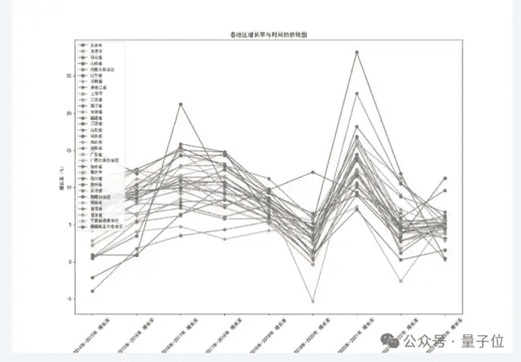
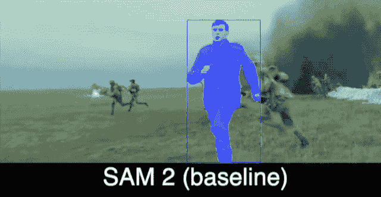
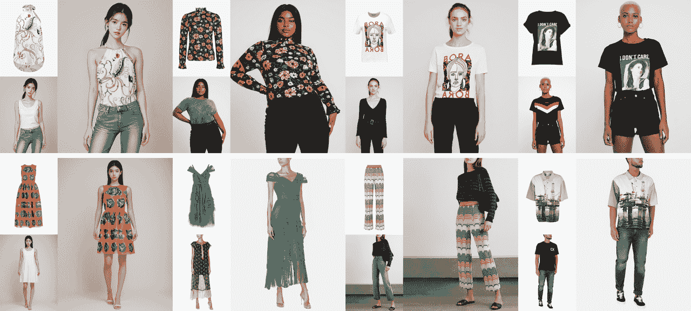
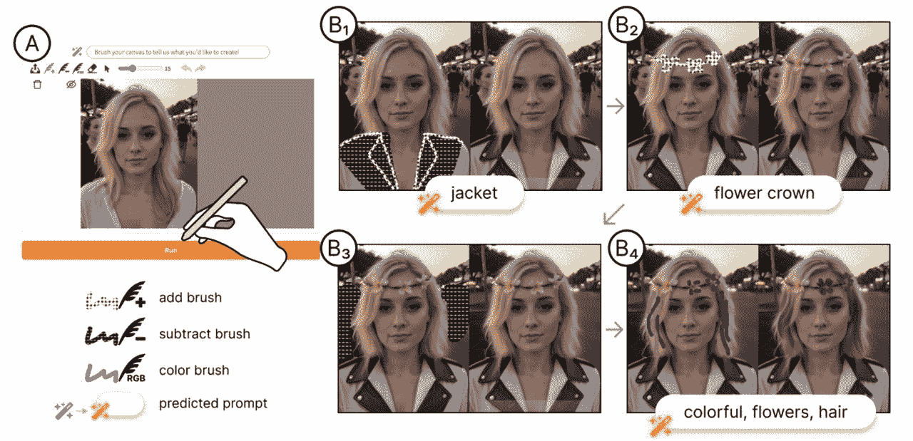
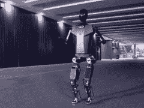
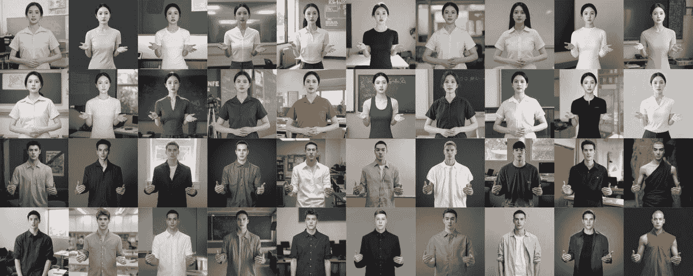
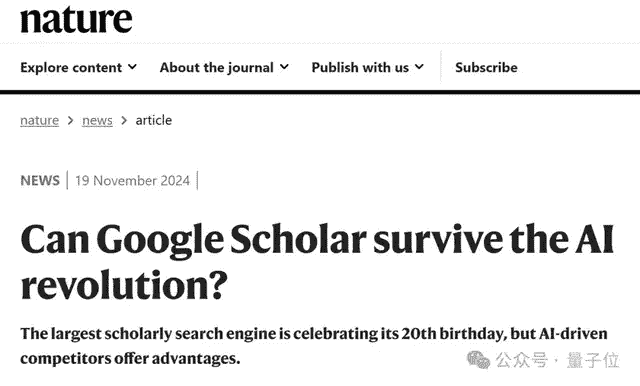
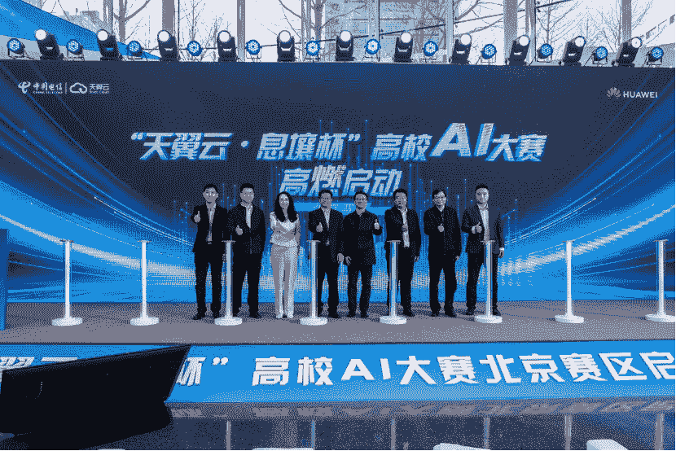

# 11.24-英伟达黄仁勋称未来三种机器人有望大规模生产 ：汽车、无人机和人形机器人

> 来源：[https://agijuejin.feishu.cn/docx/KYxwdWY0xoz1lXxFikIcs8TqnNd](https://agijuejin.feishu.cn/docx/KYxwdWY0xoz1lXxFikIcs8TqnNd)

> [欢迎加入 AGI 掘金社群](https://sourl.co/miZUyT)

## ⭐ 今日热点

### 💡 英伟达黄仁勋称未来三种机器人有望大规模生产 ：汽车、无人机和人形机器人

IT 之家 | [阅读原文](https://www.ithome.com/0/812/873.htm)

2024 年 11 月 24 日，英伟达 CEO 黄仁勋被授予香港科技大学荣誉博士学位并发表演讲。他称未来汽车、无人机和人形机器人三种机器人有望大规模生产，大规模生产可驱动技术飞轮效应。此外，他表示大湾区是唯一同时拥有机电技术和人工智能技术的地区，而日本和德国在人工智能技术方面落后。关键词：黄仁勋、机器人、人工智能。

## 🌟 技术突破

### 💡 扩散模型=进化算法！生物学大佬用数学揭示本质

新智元 | [阅读原文](https://www.163.com/dy/article/JHORKVRT0511ABV6.html?spss=dy_author)

2024 年，塔夫茨大学研究发现扩散模型的本质是进化算法。生物学大佬 Michael Levin 从数学角度证实这一结论，并创建新进化算法 `Diffusion Evolution`。该算法从随机解开始，通过适应度函数评估和加权平均去噪，加入小随机突变并减小搜索半径，能发现并维护多个良好解。研究在多个二维优化场景实验，效果良好，还提出 `Latent Space Diffusion Evolution`。引发对模型进化的更多思考。

### 💡 20 种复杂 Excel 操作一句话搞定！北大 `ChatExcel` 全新升级，所有人免费可用

量子位 | [阅读原文](https://www.qbitai.com/2024/11/223180.html)

2024 年 11 月，北大 `ChatExcel` 全新升级。可一句话搞定线性分析、图表和文字总结等复杂 Excel 操作。如分析各地区数据增长相关性、计算不同部门工资、跨表格操作等。新增多表格上传等四方面能力，支持 20 种数据分析能力，目前新老用户可免费体验。该项目最初启动于 22 年底，23 年 2 月上线即火，团队已成立公司元空 AI，目前规模在 10 人以内。

### 💡 经典卡尔曼滤波器改进视频版「分割一切」，网友：好优雅的方法

量子位 | [阅读原文](https://www.qbitai.com/2024/11/223020.html)

2024 年 11 月，华盛顿大学全华人团队提出 `SAMURAI`，改进了 Meta 的 `SAM 2`。它利用经典的卡尔曼滤波器，解决了 `SAM 2` 在拥挤场景或目标快速移动时跟丢的问题。`SAMURAI` 包含运动建模和运动感知记忆选择两个关键点，在多个数据集上表现出色，且无需重新训练。

### 💡 `OOTDiffusion`：支持半身、全身的开源的高分辨率虚拟试穿模型

小互日报 | [阅读原文](https://xiaohu.ai/p/15656)

2024 年 11 月推出的 `OOTDiffusion` 是基于扩散模型的虚拟试穿系统。它采用先进服饰融合技术，能将衣物'穿'到人物身上，生成逼真试穿图片，如可看到某件 T 恤穿在自己身上的效果，为虚拟试穿提供高度可控解决方案。

### 💡 参数量仅 0.25B，成都人形机器人创新中心全国首发 `R-DDIRM` 高速推理模型

IT 之家 | [阅读原文](https://www.ithome.com/0/812/705.htm)

2024 年 11 月 22 日，成都人形机器人创新中心全国首发 `R-DDIRM` 高速推理模型，参数量仅 0.25B。该模型在参数优化、动作柔顺度及数据采集效率方面有显著进展，推理速度是 `R-DDPRM` 模型的 10 倍以上。在复杂环境中任务处理能力强，训练数据采集次数从上万次锐减至 50 次，反应速度与人类相仿。此外，'贡嘎一号'是人形机器人创新成果，整机重量 25 公斤，最大负载 5.5 公斤，8 小时续航为全球最长级别。

### 💡 `MagicQuill`：AI 驱动的图像编辑系统 只需在图像上画几笔即可轻松编辑图像

小互日报 | [阅读原文](https://xiaohu.ai/p/15609)

2024 年 11 月，支付宝和香港大学联合开发了 `MagicQuill`，这是一个 AI 驱动的图像编辑系统。它集成多模态大语言模型，可实现实时意图预测，用户只需在图像上画几笔就能轻松编辑图像，无需复杂文字输入。

### 💡 陶哲轩宣布"等式理论计划"成功：人类 AI 协作，57 天完成 2200 万 + 数学关系证明

IT 之家 | [阅读原文](https://www.ithome.com/0/812/684.htm)

2024 年 9 月 25 日陶哲轩发起'等式理论计划'，探索原群等式理论空间，人类与 AI 协作，57 天完成 2200 万+数学关系证明。该计划集合人类数学家、`ChatGPT`、`Claude`、`GitHub Copilot` 等，利用 `Lean` 证明辅助语言。目前项目进度快，已完成主项目，论文待撰写，且衍生项目仍在进行，有望为未来 AI 数学工具提供基准测试。

### 💡 `Claude` 自动玩崩铁清日常，NUS 新论文完整测评 AI 电脑操控

IT 之家 | [阅读原文](https://www.ithome.com/0/812/679.htm)

2024 年，新加坡国立大学团队对 `Claude` 进行全面测试。`Claude` 可自动玩手游《崩坏：星穹铁道》及《炉石传说》，还能完成办公任务如网页搜索、在办公软件操作等。团队基于 `Claude Computer Use` 的 `API` 设计了自动化 `GUI` 框架，包括系统提示等 6 个部分。虽在复杂页面有失败案例，但整体表现出色，未来可期。关键词：`Claude`，AI 电脑，星穹铁道。

## 💫 企业动态

### 💡 `Mistral AI` 更新 `Le Chat` 聊天机器人，引入"登顶复杂数学推理榜"`Pixtral Large` 多模态模型

IT 之家 | [阅读原文](https://www.ithome.com/0/812/871.htm)

2024 年 11 月 24 日，`Mistral AI` 为聊天机器人 `Le Chat` 进行更新，引入拥有 1240 亿参数的 `Pixtral Large` 多模态模型，强化了数学推理能力。该模型在 `MathVista`、`ChartQA`、`DocVQA` 测试中表现出色，超越多个模型。`Le Chat` 还加入 `Flux Pro` 模型，新增图像生成能力及新界面，允许用户利用 AI 创建文档等。`Mistral AI` 称 `Le Chat` 在业界有一定领先性。

### 💡 `TrendForce` 发布 "2025 十大重点科技领域市场趋势预测"，人形化与服务型机器人迎来全新升级

IT 之家 | [阅读原文](https://www.ithome.com/0/812/856.htm)

2024 年 11 月 24 日，`TrendForce` 发布"2025 十大重点科技领域市场趋势预测"。其中提到人形化与服务型机器人将迎来全新升级，人型机器人 2025 年起逐步量产，2024 - 2027 年市场规模年复合成长率达 154%，产值有望突破 20 亿美元。服务型机器人借助生成式 AI，将成为来年机器人发展重心。关键词：人形机器人、人工智能。

### 💡 新晋 AI 编程神器干翻 `Cursor`！首创实时感知无限用，估值 12.5 亿华人初创震惊 AI 界

新智元 | [阅读原文](https://www.163.com/dy/article/JHORVB4Q0511ABV6.html?spss=dy_author)

2024 年，美国初创公司 `Codeium` 打造 AI 编程工具 `Windsurf`，将 `copilots` 和 `agents` 结合，创造全新协作型智能体。它能深度理解代码库，实时感知用户操作，且无需邀请码无限使用。`Windsurf` 有新功能 `Cascade`，可多文件编辑等。`Codeium` 完成 1.5 亿美元 C 轮融资，估值达 12.5 亿美元，其平台有大模型加持，支持约 70 种编程语言，有超 70 万用户和 1000 多家企业客户。

### 💡 国家安全部：警惕深度伪造技术带来的安全风险

IT 之家 | [阅读原文](https://www.ithome.com/0/812/819.htm)

随着人工智能技术发展，深度伪造技术带来风险隐患。包括视频、音频、虚假网络身份伪造技术，操作简易且具欺骗性。可能侵害个人权益、引发社会忧虑和信任危机、威胁国家安全。国家安全机关提示要提高安全意识，公民保护隐私，企业加强管理，对可疑信息警惕。发现问题可向国家安全机关举报。

### 💡 支付宝发布 `EchoMimicV2` ：从数字脸扩展到数字人 可以通过图片+音频生成半身动画视频

小互日报 | [阅读原文](https://xiaohu.ai/p/15667)

2024 年 11 月 24 日，支付宝发布 `EchoMimicV2`，实现从仅支持头部驱动动画扩展到半身动画，包括头部、手势和上身动作。可通过输入音频、参考图片及简单手势序列生成动态视频，结合音频和动作特征，生成自然流畅且高度同步的半身动画。

### 💡 英伟达 CEO 黄仁勋获香港科技大学荣誉博士，称 AI 正在革新科学且机器人时代即将到来

IT 之家 | [阅读原文](https://www.ithome.com/0/812/799.htm)

2024 年 11 月 23 日，香港科技大学举行荣誉博士学位颁授典礼，英伟达 CEO 黄仁勋获工程学荣誉博士。黄仁勋带领英伟达在加速运算领域成果丰硕，其 1999 年研发的 `GPU` 为 AI 时代奠定基石。他表示 AI 开启新计算时代，影响科学与各行业，当下企业竞相采用 AI，机器人投资激增，机器人时代即将到来。关键词：英伟达、黄仁勋、香港科技大学、机器人。

### 💡 千亿电池明星破产！1400 亿融资烧干，"生活费"只够一周，金主大众也难救

量子位 | [阅读原文](https://www.qbitai.com/2024/11/223102.html)

2024 年 11 月，电池巨头 `Northvolt` 申请破产保护，曾被视作欧洲版'宁德时代'，成立 8 年融资约 1450 亿元却几乎烧干，现金仅够维持一周运营，还背负 420 亿元债务。CEO 离职，公司因技术难题、原材料短缺、产能低下及外部竞争压力等原因走向破产，大客户接连撤退，投资者信心丧失。

### 💡 Nature：谷歌学术正在被 AI 工具颠覆

量子位 | [阅读原文](https://www.qbitai.com/2024/11/223053.html)

2024 年谷歌学术迎来 20 岁生日，却面临被 AI 工具颠覆的局面。如 `Semantic Scholar`、`OpenAlex`、`Consensus`、`Emergent Mind`、`Cambrian` 等 AI 学术工具涌现，它们在搜索结果展示和与论文交互方面发力，提供更精准的搜索结果和额外功能。谷歌学术成立近 20 年，每月访问量超 1 亿次，虽有免费访问等优势，但这些优势正被 AI 取代。

### 💡 探索未来之路 激发 AI 创新 "天翼云·息壤杯"高校 AI 大赛北京区域赛

量子位 | [阅读原文](https://www.qbitai.com/2024/11/223253.html)

2024 年 11 月 23 日，'天翼云·息壤杯'高校 AI 大赛北京区域赛在清华科技园拉开帷幕。由中国电信等多方联合主办，吸引约 300 人参会。大赛面向知名院校等，聚焦算子优化与大模型应用。众多嘉宾对大赛高度评价并发言，中国科学院院士胡事民进行专题分享。北京人工智能领域核心技术人才多，北京电信在 AI 和智算领域深入布局，打造多个行业应用场景。大赛将推动人工智能技术繁荣发展。

### 💡 滴滴创始 CTO 卸任，全力冲刺 `RoboTaxi` 战场

量子位 | [阅读原文](https://www.qbitai.com/2024/11/223001.html)

2024 年 11 月，滴滴创始 CTO 张博卸任集团 CTO，专注于滴滴自动驾驶业务，担任自动驾驶公司 CEO。滴滴自动驾驶已连续运营超 1500 天，累计拿到超 15 亿美元融资，与广汽成立合资公司，首款 `RoboTaxi` 明年量产。张博 2012 年加入滴滴，曾负责大数据团队，2016 年带队主导 `L4` 级自动驾驶技术开发。

### 💡 视频生成平台 `Runway` 获得新技能：更改视频比例，图片拥有"电影级"运镜

IT 之家 | [阅读原文](https://www.ithome.com/0/812/792.htm)

2024 年 11 月 23 日，视频生成平台 `Runway` 推出新功能 `Expand Video`。用户可输入文本提示，扩展视频比例并生成额外内容，保持视觉统一性，实现电影感动态摄像效果。该功能将逐步开放给 `Gen-3 Alpha Turbo` 用户。今年 6 月 `Runway` 发布 `Gen-3 Alpha` 视频生成模型，生成速度和保真度有重大改进，生成时间明显快于 `Gen-2`，如生成 10 秒片段需 90 秒。

### 💡 美国法院裁决支持学校处罚 AI 作弊学生，当事人历史成绩从 B 降至 C+

IT 之家 | [阅读原文](https://www.ithome.com/0/812/786.htm)

2024 年 11 月 23 日，美国马萨诸塞州一学生因在历史作业中未说明使用 AI 被学校处罚，成绩从 B 降至 C+。家长提起诉讼，法院最终支持学校。当地教育机构在应对 AI 使用方面不断调整，此校采取折中措施，此次判决表明学校有权对学生 AI 违规行为处罚。关键词：人工智能。

### 💡 Netflix《英雄联盟：双城之战》第二季海报被指 AI 生成，拳头工作人员回应

IT 之家 | [阅读原文](https://www.ithome.com/0/812/755.htm)

2024 年 11 月，Netflix《英雄联盟：双城之战》第二季海报被指 AI 生成后撤下。拳头游戏工作人员称此行为不尊重创作者。有用户发现海报中角色手部比例不对劲，品牌负责人表示对该内容坚持'拒绝 AI'立场，因这是对艺术家不尊重，此图是失误已撤下。也有用户质疑其声明未提及其他项目，负责人回应只能对负责内容发声，不支持 AI，认为艺术魅力在于人与人情感共鸣。

### 💡 一只暹罗猫竟是论文作者！谷歌学术 20 岁，创始人首次公开最魔幻学术故事

IT 之家 | [阅读原文](https://www.ithome.com/0/812/722.htm)

2024 年谷歌学术创立 20 周年，每月访问量超 1 亿次。创始人分享使用技巧和趣闻，如新增 AI 提纲功能的 `PDF` 阅读器等。在 AI 浪潮下，虽有竞争者涌现，但谷歌学术也在积极拥抱 AI，如进行智能排名等。还介绍了其早期发展历程及一些有趣的学术故事。

### 💡 `OpenAI` 向杜克大学资助"人工智能道德"研究

IT 之家 | [阅读原文](https://www.ithome.com/0/812/696.htm)

# AI 与学术动态

2024 年 11 月 23 日，OpenAI 的非营利部门向杜克大学提供赠款用于'研究 AI 道德'项目。该项目三年提供 100 万美元（约 726 万元人民币），由教授 Walter Sinnott-Armstrong 和 Jana Schaich Borg 领导。项目旨在创建算法预测医学等领域人类道德判断，但难点在于 AI 可能存在偏见，因机器学习模型通常反映主流文化意见。关键词：OpenAI，AI 道德。

## 💡 一只暹罗猫竟是论文作者！谷歌学术 20 岁，创始人首次公开最魔幻学术故事

新智元 | [阅读原文](https://www.163.com/dy/article/JHMBO5G70511ABV6.html?spss=dy_author)

2024 年是谷歌学术创立 20 周年，创始人撰写博客回顾成长历程并分享使用技巧和趣闻。谷歌学术每月访问量超 1 亿次，新增 AI 提纲等功能，还可解锁法律资源、复制引用格式、创建论文图书馆、关注特定作者。面对众多竞争，谷歌学术积极拥抱 AI，但其联创不视新兴工具为竞争对手，认为让学术信息易获取有益科学进步。谷歌学术早期靠'跑腿'收集资料，还有很多有趣的法律文件和论文，如暹罗猫竟是论文作者。

## 💡 美国教授痛心：UC 伯克利 GPA 4.0 计算机本科生，毕业即失业？ML 博士直呼太卷后悔转行

新智元 | [阅读原文](https://www.163.com/dy/article/JHMBNU6L0511ABV6.html?spss=dy_author)

2024 年美国科技行业就业遇冷，UC 伯克利 GPA4.0 的计算机本科生毕业即失业，三四十岁的科技从业者也被裁员。科技行业初级岗位稀缺且竞争激烈，薪资增长停滞，AI 领域则格外显眼，企业大招 AI 人才。75%的公司认为应届毕业大学生表现不佳，博士求职也未必顺利，机器学习领域很卷。
