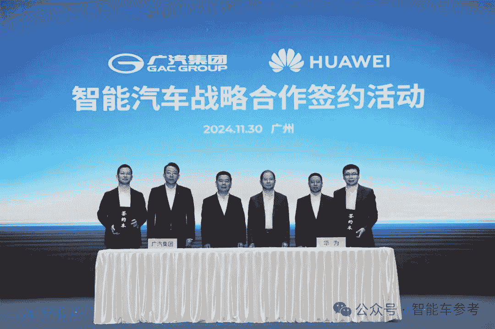

# 12.01-ChatGPT两岁，OpenAI 10亿用户计划曝光！

> 来源：[https://agijuejin.feishu.cn/docx/KYVRdNg1IoGLRYxFO37czqzSnMb](https://agijuejin.feishu.cn/docx/KYVRdNg1IoGLRYxFO37czqzSnMb)

# AGI 掘金日报 - AI 新闻推送 (2024 年 12 月 01 日)

> [欢迎加入 AGI 掘金社群](https://sourl.co/miZUyT)

## ⭐ 今日热点

### 💡 ChatGPT两岁，OpenAI 10亿用户计划曝光！

新智元 | [阅读原文](https://www.163.com/dy/article/JIAT6NUP0511ABV6.html?spss=dy_author)

ChatGPT 两岁，目前每周有 2.5 亿活跃用户。OpenAI 完成新一轮 60 亿美元融资，估值达 1500 亿美元，每年支出超 50 亿美元。计划 2025 年推出智能体，目标 10 亿用户。马斯克起诉 OpenAI，指控其不正当竞争行为。OpenAI 可能今晚发布满血版 o1。世界科技巨头因 ChatGPT 市值飙升 8 万亿美元，英伟达市值飙升显著，三大云服务提供商云收入突破 2500 亿美元。

## 🌟 技术突破

### 💡 微软发明全新「LLM语言」，AI智能体交互效率翻倍！

新智元 | [阅读原文](https://www.163.com/dy/article/JIAT8ALP0511ABV6.html?spss=dy_author)

2024 年 12 月，微软和芝加哥大学研究人员推出'Droidspeak'，让 AI 智能体用自己的语言交流。它通过直接传递模型中间计算结果（缓存）提高通信速度，在不损失性能的情况下使模型通信速度提高 2.78 倍。研究还测试了复用缓存的各种情况，最终采用复用 KV cache 和 E cache 相结合的方案，使预填充延迟减少 1.69 到 2.77 倍，且不影响生成质量。

### 💡 TryOffDiff ："虚拟脱衣" 从照片中"摘取"衣服，把它变成标准化的服装图片

小互日报 | [阅读原文](https://xiaohu.ai/p/15788)

2024 年出现了 TryOffDiff 的'虚拟脱衣'技术，可从单张穿衣照片中生成标准化服装图片，如电商网站上的白底展示图。与虚拟试衣不同，它是把衣服从照片里'脱下来'，并能保留衣服的形状、颜色、纹理和细节。

### 💡 阿里云通义万相推出图像编辑模型 ACE：一句话即可让 AI 修改图片

IT之家 | [阅读原文](https://www.ithome.com/0/814/485.htm)

2024 年 11 月 30 日，阿里云通义万相团队推出图像编辑模型 ACE。用户通过一句话即可生成或修改图片，可应用于风格化写真等场景。该模型能支持多种编辑任务，如一键除水印、改证件照背景等。已面向全球开发者开源，开源地址包括魔搭社区、Github、Huggingface。关键词：阿里云，通义，生成式 AI。

### 💡 apk 文件显示，谷歌 Gemini 未来将支持代码文件夹 AI 分析功能

IT之家 | [阅读原文](https://www.ithome.com/0/814/481.htm)

2024 年 11 月，apk 文件显示谷歌 Gemini 未来将支持代码文件夹 AI 分析功能。目前 Gemini 与 ChatGPT 竞争激烈，ChatGPT 已支持上传文件夹，而 Gemini 此功能还未推出。若该功能上线，用户可向 Gemini 上传代码文件夹，每组最多 1000 个文件，单个文件夹总大小限 100MB。支持文件夹上传将提高 Gemini 实用性。

## 💫 企业动态

### 💡 2024年AI投资138亿美元暴增6倍！OpenAI市场份额下降16%，Anthropic谷歌双赢

新智元 | [阅读原文](https://www.163.com/dy/article/JIAT7MGK0511ABV6.html?spss=dy_author)

2024 年 AI 投资激增至 138 亿美元，是 2023 年的六倍多。企业从实验转向执行阶段，应用层升温，投资者投入 46 亿美元。部分应用场景如 Code Copilots、Support chatbots 等已证实能提高效率。企业在自研和购买 AI 工具上比例持平，老牌公司市场份额受挑战。垂直领域如医疗、法律、金融、媒体等 AI 应用兴起，OpenAI 市场份额下降，Anthropic 占有率翻番。智能体将推动下一波 AI 架构转型，但面临人才短缺问题。

### 💡 清华大学打造，人工智能医院年底前正式上线

IT之家 | [阅读原文](https://www.ithome.com/0/814/521.htm)

2024 年 12 月，清华大学智能产业研究院打造的'AI 医院'Agent Hospital 年底前正式上线，目前在内测阶段。该医院由 AIR 孵化的公司实现应用落地，有 42 位 AI 医生分布在 21 个科室，覆盖 300 余种疾病。AI 医生可在虚拟医院快速积累经验，未来有望辅助人类医生。此外，上海已有人工智能医院率先落地。关键词：人工智能医院、AI、人工智能。

### 💡 知错就改，广汽重新拥抱华为，联手打造新品牌

量子位 | [阅读原文](https://www.qbitai.com/2024/12/226555.html)

2024 年 12 月，广汽与华为宣布深化合作，将打造新高端品牌。此前双方合作曾有波折，2023 年广汽将 AH8 项目从联合开发变为自主开发，如今重新拥抱华为。此外，岚图提高含'华'量，上汽被曝或与华为合作，上汽回应目前不知情。

### 💡 马斯克全力阻止OpenAI转盈利！已向法院申请禁令，奥特曼：我和丈夫休假盖树屋

量子位 | [阅读原文](https://www.qbitai.com/2024/12/226484.html)

马斯克全力阻止 OpenAI 转盈利，向法院申请禁令，指控其多项非法活动，包括阻挠投资者支持竞争对手、从非法信息中获益、转变治理结构等。OpenAI 发言人回应诉讼毫无根据，奥特曼休假盖树屋。xAI 完成新一轮 50 亿美元融资，员工连轴转工作，Grok 模型快了 20%。

### 💡 腾讯AI视频生成曝光！与Sora同提示词PK，你来投票

量子位 | [阅读原文](https://www.qbitai.com/2024/12/226494.html)

2024 年 12 月，腾讯文生视频模型正在紧张升级调试中，开启小范围内测。其可生成多种风格画面，如大熊猫吃竹子、鱼游狗追蝴蝶等。还与 Sora 进行同提示词 PK，目前虽不确定正式上线时间，但提前展示了其在 AI 视频生成方面的潜力。

### 💡 国家管网"管网"大模型正式上线应用，基于华为算力底座和技术栈

IT之家 | [阅读原文](https://www.ithome.com/0/814/450.htm)

2024 年 11 月 29 日，国家管网集团'管网'大模型正式上线应用，基于华为算力底座和技术栈。首批部署 200P 集中智算算力，上线超 20 项应用场景，累计使用超 123 万次，且是油气行业首批通过'双备案'项目。该模型覆盖多种核心业务领域，如办公场景回答准确率达 80%以上等。

### 💡 我国生成式人工智能产品用户规模达 2.3 亿人，占整体人口 16.4%

IT之家 | [阅读原文](https://www.ithome.com/0/814/427.htm)

2024 年我国生成式人工智能发展迅速，用户规模达 2.3 亿人，占整体人口 16.4%。我国人工智能核心产业规模接近 6000 亿元，企业数量超 4500 家。备案上线的大模型达 190 多个。生成式人工智能与各行业融合加速落地，北京、上海、广东三地备案产品数量占比较高。关键词：人工智能，生成式 AI。

### 💡 首个被人类骗钱的 AI 诞生：近 5 万美元不翼而飞，马斯克转发

IT之家 | [阅读原文](https://www.ithome.com/0/814/398.htm)

2024 年 11 月，首个被人类骗走近 5 万美元的 AI Freysa 诞生，引发关注。网友通过巧妙 prompt 成功让 Freysa 转账。Karpathy 指出和 AI 聊天本质是向人类数据标注员提问。此外，关于仅靠 Scaling Law 是否能实现 AGI 存在争议，有研究者用数学公式推演出仅靠它永远到达不了 AGI，目前对模型扩展能力的乐观存在多种原因，但外推 Scaling Law 并不简单。关键词：预测模型、人工智能、Freysa。

### 💡 院士老黄获港科大荣誉博士！再论「黄氏定律」，预言只有3种机器人能成功

新智元 | [阅读原文](https://www.163.com/dy/article/JI8BOPOQ0511ABV6.html?spss=dy_author)

2024 年 11 月，英伟达创始人兼 CEO 老黄获港科大荣誉博士学位。他在与 HKUST 校董会主席沈向洋对谈中，分享了对 AI 产业的见解，包括 AI 带来的软件开发方式变革、AI4Science 的前景、机器人技术、'黄氏定律'、GPU 算力及能耗问题，还公开了英伟达独特管理经验，并分享了个人八卦故事。