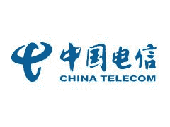
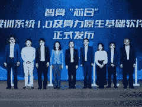

# 12.04-刚刚，中国140家企业被拉黑！出口产品，美国技术含量必须为0

> 来源：[https://agijuejin.feishu.cn/docx/Pf6xdh47uomVNcxmjUmcwAY0nqf](https://agijuejin.feishu.cn/docx/Pf6xdh47uomVNcxmjUmcwAY0nqf)

# AGI 掘金日报 - AI 新闻推送 (2024 年 12 月 04 日)

> [欢迎加入 AGI 掘金社群](https://sourl.co/miZUyT)

## ⭐ 今日热点

### 💡 刚刚，中国140家企业被拉黑！出口产品，美国技术含量必须为0

新智元 | [阅读原文](https://www.163.com/dy/article/JIG0QB4I0511ABV6.html?spss=dy_author)

2024 年 12 月，美国公布芯片出口限制新举措。140 多家中国半导体企业被列入实体清单，出口产品美国技术含量须为 0。包括限制向中国出口高带宽内存及多种芯片制造设备和软件工具，还对新加坡、马来西亚等国生产的设备实施出口管控。此举措可能影响美国及荷兰、日本等国企业，荷兰和日本在一定程度上获得豁免。新管控措施还对人工智能芯片核心组件 HBM 实施限制。

### 💡 快手预告“可灵 AI”导演共创计划作品 12 月 6 日上线：联合李少红、贾樟柯、叶锦添、薛晓路等

IT之家 | [阅读原文](https://www.ithome.com/0/814/980.htm)

2024 年 12 月 3 日，快手宣布‘可灵 AI’导演共创计划作品将于 12 月 6 日上线，联合 9 位导演共同发起，题材多元。该计划 9 月 9 日启动，作品全部由可灵 AI 生成。目前可灵 AI 服务用户超 500 万，累计生成 5100 万个视频、超 1.5 亿张图片，商业化单月流水超千万人民币。快手 CEO 程一笑表示有信心在明年实现可灵收入规模快速增长。关键词：快手、可灵 AI。

###

## 🌟 技术突破

### 💡 AI 靠单图生成 3D 世界：李飞飞空间智能首秀，可像玩游戏一样探索

IT之家 | [阅读原文](https://www.ithome.com/0/815/071.htm)

2024 年 12 月，李飞飞空间智能首秀，仅靠单图就能生成具有交互性的 3D 世界，可像玩游戏一样探索，如自由移动相机、改变物体颜色等。该系统直接预测 3D 场景，遵循 3D 几何物理规则，持久存在且可实时控制。团队还以新方式体验经典艺术作品，3D 世界生成可与其他 AI 工具结合。李飞飞的 World Labs 公司致力于空间智能，目前发布的是早期预览，还在努力改进。

## 💫 企业动态

### 💡 日本文化厅将建立 AI 系统检测盗版网站，以避免数十亿美元经济损失

IT之家 | [阅读原文](https://www.ithome.com/0/815/154.htm)

2024 年 12 月，日本为遏制动漫和漫画盗版，计划投入 3 亿日元（约 1457 万元人民币）实施试点计划，借助 AI 追踪盗版网站。目前有至少 1000 个非法网站，每年造成数十亿美元损失。人工审核难应对盗版，若成功可能推广到影视和音乐领域。2022 年，日本动漫等产业海外收入达 4.7 万亿日元（约 2282.55 亿元人民币），接近微芯片出口额。

### 💡 索尼互娱联席 CEO：AI 可能“彻底变革”游戏领域，但人类开发仍不可或缺

IT之家 | [阅读原文](https://www.ithome.com/0/815/152.htm)

索尼互娱联席 CEO Hermen Hulst 认为人工智能虽可能彻底变革游戏领域，但人类参与仍不可或缺，游戏行业需兼顾 AI 创新体验与手工内容。今年近三分之二游戏开发工作室在工作中引入 AI 技术，主要用于快速原型制作等，采用 AI 的工作室中 71%认为其提升开发效率，游戏平均开发周期从 2022 年的 218 天延长至 2023 年的 304 天，38%工作室对 AI 持观望态度。

### 💡 苹果考虑使用亚马逊 AI 芯片来预训练其 Apple Intelligence 模型

IT之家 | [阅读原文](https://www.ithome.com/0/815/149.htm)

苹果机器学习和人工智能高级总监 Benoit Dupin 现身 AWS re:Invent 大会。苹果在许多云服务中使用亚马逊的定制人工智能芯片，如 Graviton 和 Inferentia，为多项服务提供支持，效率提升 40%。目前苹果正在评估 Trainium2 芯片，预计预训练效率将提高高达 50%，但仅限于预训练阶段。今年早些时候，苹果在研究文件中确认使用谷歌 Tensor 芯片训练人工智能模型。

### 💡 腾讯混元大模型上线并开源文生视频能力：支持中英文双语输入，参数量 130 亿

IT之家 | [阅读原文](https://www.ithome.com/0/815/036.htm)

2024 年 12 月 3 日，腾讯混元大模型上线并开源文生视频能力，参数量 130 亿，支持中英文双语输入。可生成高质量视频，画面不易变形，光影反射符合物理规律。采用 DiT 架构，适配新一代文本编码器。可在‘腾讯元宝 App’申请试用，本次开源包含完整模型供企业与个人免费使用。关键词：腾讯混元，文生视频。

### 💡 英特尔传奇CEO被逼下课，基辛格时代落幕！18岁入职，在任期间市值蒸发1500亿

新智元 | [阅读原文](https://www.163.com/dy/article/JIG9E28H0511ABV6.html?spss=dy_author)

2024 年 12 月，英特尔 CEO 基辛格宣布退休。他在任期间，英特尔市值蒸发约 1500 亿美元，股价下跌超 60%。目前董事会成立遴选委员会寻找新 CEO，新任命两位高管担任临时联席 CEO。基辛格的离职被指是董事会决定，他们对其不满。英特尔面临诸多问题，如市场份额虽高但被重大失误困扰，18A 制程工艺被寄予厚望但也面临挑战，如今股价虽有小幅反弹但形势严峻。

### 💡 中国电信董事长柯瑞文：已构建“星海”数据智能中台，形成 9 万亿 Tokens 高质量数据集

IT之家 | [阅读原文](https://www.ithome.com/0/815/018.htm)

2024 年 12 月 3 日，在数字科技生态大会上，中国电信董事长柯瑞文表示，中国电信聚焦重点场景，打造 5G 大带宽能力、推进 50G PON 宽带网络试点等。还透露已构建‘星海’数据智能中台，形成 9 万亿 Tokens 高质量数据集，打造‘灵泽’数据要素平台，面向超 1000 家合作伙伴提供服务。中国电信于 12 月 3 日 - 5 日在广州举办以‘AI 赋能共筑数字新生态’为主题的大会。

### 💡 LG 预告首款家用管家机器人明年登场：集成 GPT-4o AI 模型，注重和用户情感互动

IT之家 | [阅读原文](https://www.ithome.com/0/815/007.htm)

2024 年 12 月 2 日，LG 在韩国首尔衿川区 LG 加山研发园区举办活动，宣布将于明年发布首款家用管家机器人‘Q9’。它能根据自然语音指令操控智能家电，如播放电影、音乐等。配备‘重力补偿装置’可稳定移动，搭载 GPT-4o 能创作故事。LG 暂未公布其正式名称和价格，预计售价数百万韩元并捆绑家电订阅服务。家用机器人市场规模预计从 2022 年的 135 亿美元扩大到 2030 年的 436 亿美元，明年三星、海信等也将发布家用机器人，市场竞争激烈。

###

### 💡 中国移动发布“芯合”异构混合并行训练系统 1.0，支持多品牌万卡集群

IT之家 | [阅读原文](https://www.ithome.com/0/814/957.htm)

2024 年 12 月，中国移动发布‘芯合’异构混合并行训练系统 1.0，支持多品牌万卡集群。该系统具备两大核心能力，已实现百亿参数大模型在多家智算芯片上交叉混合训练，训练加速比达 95%以上。此外，还发布了‘芯合’算力原生基础软件栈 2.0，实现三大升级，具备规模商用条件，未来将在提升智能算力网络自主可控水平方面发挥重要作用。

### 💡 中国电信“天翼”AI 手机发布：联合高通、中兴研发，端侧 3B 模型

IT之家 | [阅读原文](https://www.ithome.com/0/815/043.htm)

2024 年 12 月 3 日，中国电信在数字科技生态大会上推出‘天翼’AI 手机，由中国电信、高通、中兴携手研发，内置 3B 模型于高通芯片，实现端侧 AI 能力并可与云侧协同。具有九宫格呈现 AI 功能、推进‘去 App 化’探索、搭载 AI 视频伪造检测功能等特色。中国电信还将陆续发布 AI 眼镜等产品。此外，努比亚 Z70 Ultra 手机搭载星辰大模型与中国电信合作。关键词：天翼 AI、中国电信 AI。