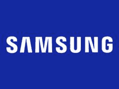
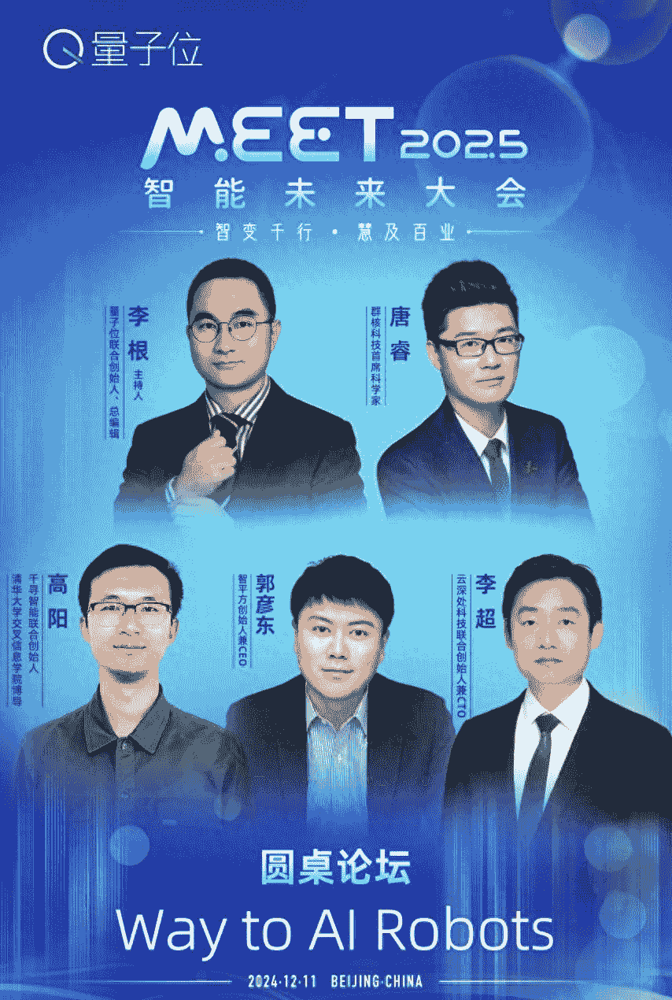
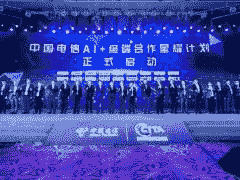
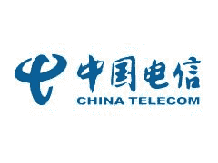
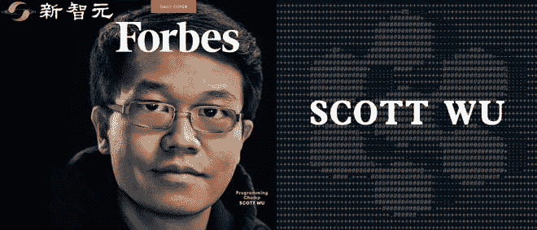
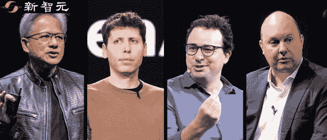

# 12.05-刚刚，DeepMind最强「基础世界模型」诞生！单图生1分钟游戏世界，解锁下一代智能体

> 来源：[https://agijuejin.feishu.cn/docx/HS5ZdRAnhoXx0exWLGLcHoctnFe](https://agijuejin.feishu.cn/docx/HS5ZdRAnhoXx0exWLGLcHoctnFe)

# AGI 掘金日报 - AI 新闻推送 (2024 年 12 月 05 日)

> [欢迎加入 AGI 掘金社群](https://sourl.co/miZUyT)

## ⭐ 今日热点

### 💡 刚刚，DeepMind最强「基础世界模型」诞生！单图生1分钟游戏世界，解锁下一代智能体

新智元 | [阅读原文](https://www.163.com/dy/article/JIK6J33S0511ABV6.html?spss=dy_author)

2024 年 12 月，谷歌 DeepMind 推出基础世界模型 Genie 2。它能基于一张图生成长达 1 分钟的游戏世界，包括 720p 的世界、多种视角、复杂 3D 场景等，为具身智能体提供无限训练数据。如在 Imagen 3 生成的世界中测试智能体遵循指令能力，结果令人惊喜。网友赞叹其开启了无限训练数据体系，正朝着‘黑客帝国’迈进。

## 🌟 技术突破

### 💡 一次推理，实现六大3D点云分割任务！华科发布大一统算法UniSeg3D，性能新SOTA

新智元 | [阅读原文](https://www.163.com/dy/article/JIIMCRLR0511ABV6.html?spss=dy_author)

2024 年 12 月，华中科技大学发布 UniSeg3D 算法，能通过一次推理完成六大 3D 点云分割任务，包括实例分割、语义分割等。该算法通过建立任务间显式关联促进信息共享，在多个数据集上取得 SOTA 结果。它解决了现有方法专注单一任务、缺乏对用户提示信息理解等问题，为三维场景理解提供高效解决方案。

## 💫 企业动态

### 💡 谷歌领跑 AI 视频生成赛道：抢先 OpenAI Sora 推出 Veo 模型，可生成 1080P 高清视频

IT之家 | [阅读原文](https://www.ithome.com/0/815/432.htm)

2024 年 12 月 4 日，谷歌在 Vertex AI 平台以私测预览版形式向企业开放生成式 AI 视频模型 Veo。谷歌虽在 5 月公开展示 Veo 比 OpenAI 的 Sora 模型晚 3 个月，但提前发布抢占先机。Veo 可根据文本或图像提示生成 1080P 高清视频，生成视频逼真程度极高。关键词：谷歌、Veo、AI、Sora、OpenAI、视频。

### 💡 OpenAI 将进行 12 场直播：一大堆东西要发布

IT之家 | [阅读原文](https://www.ithome.com/0/815/427.htm)

2024 年 12 月，OpenAI CEO 阿尔特曼宣布接下来每个工作日将进行一场直播，共 12 场，可能包括文本转视频工具 Sora 和新推理模型等发布。首场直播明天举行，内容尚未确认。Sora 今年早些时候亮相并被泄露，OpenAI 因数据来源受批评，且未回应是否用公共 YouTube 视频训练。OpenAI 并非唯一做文本转视频模型的公司，谷歌也有类似产品 Veo。关键词：OpenAI，ChatGPT，AI。

### 💡 阿尔特曼：ChatGPT AI 聊天机器人周活跃用户超 3 亿，日均消息发送量突破 10 亿条

IT之家 | [阅读原文](https://www.ithome.com/0/815/426.htm)

2024 年 12 月 5 日消息，OpenAI 首席执行官山姆·阿尔特曼在纽约时报 DealBook 峰会上宣布，ChatGPT 聊天机器人周活跃用户超 3 亿，日均消息发送量突破 10 亿条。自 2022 年推出以来，ChatGPT 发展迅速，OpenAI 不断为其添加新功能。关键词：ChatGPT、阿尔特曼、OpenAI、AI。

### 💡 三星布局未来：任命新首席财务官、成立新 AI 中心

IT之家 | [阅读原文](https://www.ithome.com/0/815/418.htm)

2024 年 12 月 4 日，三星电子进行年终高管调动和组织重组，任命朴顺哲为新首席财务官，其曾在网络业务和智能手机部门有丰富经验，将负责管理公司现金流。此外，三星还在半导体器件解决方案部门成立新 AI 中心，由执行副总裁 Song Yong-ho 领导，以提升在人工智能领域竞争力，应对行业趋势。

### 💡 MEET2025大会最全剧透：李开复周志华徐立领衔二十余位顶流大咖

量子位 | [阅读原文](https://www.qbitai.com/2024/12/228225.html)

2024 年 12 月 11 日将举办 MEET2025 智能未来大会，李开复、周志华、徐立等二十余位顶流大咖领衔。大会包括两场深度对话和一场圆桌论坛，议题涵盖大模型技术与应用、具身智能、AGI 的实现等热门话题。此外，大会还将发布年度 AI 趋势报告和 2024 人工智能年度评选榜单。

### 💡 中国电信目标明年销售 2700 万台 AI + 终端，与荣耀、OPPO、华为、中兴、vivo、小米等合作

IT之家 | [阅读原文](https://www.ithome.com/0/815/325.htm)

2024 年 12 月 2 日中国电信数智渠道终端生态合作大会在广州举办。目前近 2000 家伙伴加入联盟，2024 年预计新增终端接入超 2.3 亿部。2025 年目标新增 5G 手机及可穿戴终端 1.3 亿部、智能家庭终端超 8000 万台、产业数字化终端超 6500 万台。还将推进卫星、量子、AI、云、5G 方面技术升级，启动 AI+终端合作星耀计划，目标销售 2700 万台 AI+终端，合作方有荣耀、OPPO、华为等。

### 💡 中国电信发布首个央企全自研视频生成大模型，与华为、中兴等成立 AI 联盟

IT之家 | [阅读原文](https://www.ithome.com/0/815/317.htm)

2024 年 12 月 4 日，中国电信在‘2024 数字科技生态大会’期间举办首届‘TeleAI 开发者大会’。发布首个央企全自研视频生成大模型，打造‘VAST 二阶段视频生成技术’，且该模型在视频生成评测榜单 VBench 中排名第一。同时，中国电信与华为、中兴等 19 家合作伙伴成立 AI 联盟，并展示具身智能成果，还推出‘天翼’AI 手机。

### 💡 被字节起诉索赔 800 万的实习生拿下 NeurIPS 2024 最佳论文

IT之家 | [阅读原文](https://www.ithome.com/0/815/309.htm)

2024 年 12 月，被字节起诉索赔 800 万的实习生田某某与字节合作论文被 NeurIPS 评为最佳论文。该论文探讨可扩展图像生成方法，田某某是第一作者。此前，田某某因严重违纪被字节辞退，字节起诉其篡改代码攻击模型训练，已获法院受理。消息登上知乎热榜，热门回答评价不一。

### 💡 OpenAI 迎来首位首席营销官，千亿美元 AI 帝国加速商业化

IT之家 | [阅读原文](https://www.ithome.com/0/815/290.htm)

202**4 年 12 月** 4 日，OpenAI 任命首位首席营销官 Kate Rouch。Rouch 曾在 Coinbase 担任 CMO，拥有丰富营销经验。她将于 12 月 10 日开始工作，负责推广 OpenAI 全套产品及传达发展通用人工智能的使命。OpenAI 公司估值超1000 亿美元，目标是在 AI 市场占据更大份额，已推出包括 SearchGPT 原型搜索引擎等新产品，此次任命旨在加强市场推广力度以应对 AI 产品日益增长的需求。

### 💡 亚马逊 AWS AI 训练芯片 Trainium2 实例全面可用，公布下代 3nm Trainium3

IT之家 | [阅读原文](https://www.ithome.com/0/815/284.htm)

2024 年 12 月 4 日，亚马逊 AWS 宣布 AI 训练芯片 Trainium2 的 Trn2 实例全面可用，包含 16 颗 Trainium2 芯片，峰值算力 20.8 petaflops。还有 Trn2 UltraServer，聚合 4 台 Trn2 服务器，算力达 83.2 petaflops。亚马逊正与 Anthropic 合作构建巨型计算集群。同时公布下代 3nm 的 Trainium3 芯片，其 UltraServer 性能可达 Trn2 UltraServer 的 4 倍，首批实例预计 2025 年底推出。

### 💡 ChatGPT 拒绝谈论特定名字，OpenAI 称系内部工具故障导致

IT之家 | [阅读原文](https://www.ithome.com/0/815/257.htm)

2024 年 12 月，ChatGPT 出现故障，拒绝谈论‘David Mayer’这个名字，引发外界各种猜测。OpenAI 称是内部工具故障导致，错误标记了 Mayer 的名字。ChatGPT 的小故障并不罕见，类似‘翻车’事件在其他 AI 工具中也屡见不鲜。

### 💡 亚马逊祭出地表最强全家桶，多模态Nova却败给Claude 3.5！

新智元 | [阅读原文](https://www.163.com/dy/article/JIIMKQOA0511ABV6.html?spss=dy_author)

2024 年 12 月，亚马逊推出多模态模型 Nova 系列，其中 Nova Pro 在多项基准测试中仅次于 Gemini 1.5 Pro、Claude 3.5 Sonnet，超越了 GPT-4o。Nova 系列价格便宜，性能提升可处理复杂推理任务。同时，亚马逊在 AI 芯片赛道发力，推出 Trainium2 芯片及相关计算服务，与 Anthropic 合作构建超级计算机计划。众多科技巨头也在开发自己的人工智能专用芯片，而英伟达在 AI 芯片市场仍占据约 95%主导地位。

### 💡 28岁IOI金牌华人得主打造「AI程序员军团」，6个月创估值20亿独角兽！人类编程效率暴涨8倍

新智元 | [阅读原文](https://www.163.com/dy/article/JIIMGG8A0511ABV6.html?spss=dy_author)

28 岁 IOI 金牌华人得主 Scott Wu 打造‘AI 程序员军团’Devin。成立 6 个月的 Cognition AI 估值达 20 亿美金。Devin 让工程师编码效率飙升 8 倍，能完成编程任务。虽身陷质疑，但仍在不断改进。AI 代码已开始重塑行业，多家公司推出编码工具。创始人认为大规模裁员不太可能。

### 💡 韩国成为全球首个用工业机器人取代 10% 劳动力的国家：每万名员工中有 1102 台机器人

IT之家 | [阅读原文](https://www.ithome.com/0/815/228.htm)

2024 年韩国成为全球首个用工业机器人取代 10%劳动力的国家，每万名员工中有 1102 台机器人。自 2018 年以来，机器人密度年均增长 5%。韩国政府巨额投资机器人行业，计划到 2030 年投资 24 亿美元，目标是将本土核心机器人零部件比例从 44%提升至 80%。全球机器人密度在过去 7 年从每万名员工 74 台增至 162 台。

### 💡 Meta 计划在美国增加 1-4 吉瓦核能发电容量，以支持 AI 和环保目标

IT之家 | [阅读原文](https://www.ithome.com/0/815/215.htm)

2024 年 12 月，Meta 宣布寻求核能开发商提交提案以支持其人工智能和环境目标。计划自 2030 年代初期起，在美国增加 1 至 4 吉瓦核能发电容量。美国数据中心电力需求预计在 2023 至 2030 年间增长三倍，届时需约 47 吉瓦新发电能力。Meta 正在寻找有经验的开发商，考虑采用小型模块化反应堆或大型核反应堆，开发商需在 2025 年 2 月 7 日前提交提案。

### 💡 OpenAI 从谷歌 DeepMind 挖角三名高级工程师，专注于多模态 AI 研发

IT之家 | [阅读原文](https://www.ithome.com/0/815/211.htm)

2024 年 12 月，OpenAI 从谷歌 DeepMind 挖角三名高级工程师，专注多模态 AI 研发，在瑞士苏黎世设立新办公室。OpenAI 近年来在多模态领域表现突出，如 Dall-E 和 ChatGPT。AI 人才竞争激烈，OpenAI 内部也有人事变动。同时，OpenAI 计划在多地开设分支机构，目前已在多个城市设办公室。三名被挖工程师住在苏黎世，该地是科技中心，有知名高校。

## ✨ 行业观点

### 💡 万亿美元AI市场还能成吗？这里是12位业内人士的看法

新智元 | [阅读原文](https://www.163.com/dy/article/JIIMCSCH0511ABV6.html?spss=dy_author)

文章围绕 AI 市场展开讨论，提到大模型发展是否陷入瓶颈存在争议。业内人士对未来发展提出不同看法，如利用新类型数据、融入推理能力等。还指出预训练阶段面临计算能力和训练数据供应问题，多模态与私有数据、合成数据或成新方向，同时行业关注转向推理模型。有观点认为行业进步节奏可能变慢。

### 💡 “AI 教父”杰弗里・辛顿：超越人类智慧的 AI 最快可能 5 年内问世

IT之家 | [阅读原文](https://www.ithome.com/0/815/238.htm)

2024 年 12 月，‘AI 教父’杰弗里·辛顿认为超越人类智慧的 AI 最快可能 5 年内问世。他指出人类生命时间短难以吸收全部信息，但多个 AI 可掌握所有知识，ChatGPT 已有远超人类的知识量。过去认为超人能力 AI 要 50 至 100 年后出现，现在未来 20 年内甚至可能 5 年内实现。2024 诺贝尔物理学奖授予辛顿，他表示 AI 类似工业革命，有潜力提供更好医疗服务和提升效率，也有失控风险。