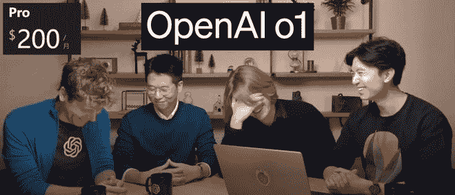
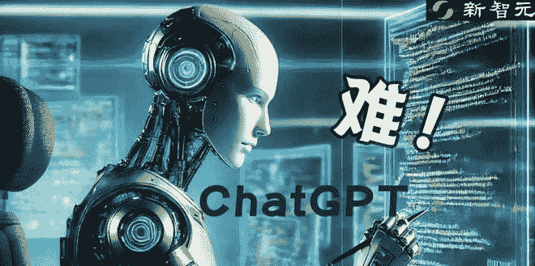
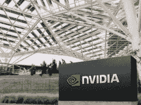

# 12.06-满血版o1深夜震撼上线，奥特曼怼脸演示超强推理！终极Pro版每月1450元

> 来源：[https://agijuejin.feishu.cn/docx/Jednd3jUXom0CwxtK7gccfAfn9e](https://agijuejin.feishu.cn/docx/Jednd3jUXom0CwxtK7gccfAfn9e)

# AGI 掘金日报 - AI 新闻推送 (2024 年 12 月 06 日)

> [欢迎加入 AGI 掘金社群](https://sourl.co/miZUyT)

## ⭐ 今日热点

### 💡 满血版o1深夜震撼上线，奥特曼怼脸演示超强推理！终极Pro版每月1450元

新智元 | [阅读原文](https://www.163.com/dy/article/JIN13CV10511ABV6.html?spss=dy_author)

2024 年 12 月，OpenAI 推出满血版 o1，首次将多模态和新推理范式结合，性能大幅提升。o1 数学性能较 o1-preview 提升近 30%，代码能力提升 27%，在多项基准测试中表现优异，甚至超越人类专家。同时推出 200 美元/月的 ChatGPT Pro，o1 Pro Mode 数学性能比 o1 提升 7.5%。o1 能上传图片推理，响应速度提升 50%，重大错误频率降低约 34%。此外，还放出了 49 页技术报告，介绍了 o1 的训练和安全性评估等内容。

## 🌟 技术突破

### 💡 DeepMind 开源大模型 GenCast 登 Nature：8 分钟预测 15 日天气

IT之家 | [阅读原文](https://www.ithome.com/0/815/512.htm)

DeepMind 开源大模型 GenCast 登上 Nature。GenCast 能在 8 分钟内完成 15 天的天气预测，在 97.2%的场景中表现超过全球顶尖中期天气预报系统 ENS。它基于扩散模型实现，分辨率为 0.25 度经纬度，每个网格涵盖 80 多个变量。GenCast 的预测速度快且精准性强，还在下游应用中有出色表现，目前已开源，代码和模型权重均已发布。

### 💡 英伟达提出全新 Star Attention：10 倍加速大语言模型推理，登顶 Hugging Face 论文榜

IT之家 | [阅读原文](https://www.ithome.com/0/815/510.htm)

2024 年 12 月，英伟达提出全新 Star Attention，可用于提升 Transformer 模型在处理长序列时的效率和准确性，能实现大语言模型推理 10 倍加速，登顶 Hugging Face 论文榜。在不同规模模型及长上下文基准测试上，加速比显著提升，准确率降低在 0 - 3%范围内，且能无缝集成到多数 Transformer 模型中，减少内存需求，未来有望进一步扩展并优化。

## 💫 企业动态

### 💡 桑达尔・皮查伊：到 2025 年，谷歌搜索将“发生深刻变化”

IT之家 | [阅读原文](https://www.ithome.com/0/815/693.htm)

谷歌 CEO 桑达尔・皮查伊称到 2025 年谷歌搜索将发生深刻变化，2025 年初搜索引擎功能会有很大提升。他回应微软 CEO 言论，称愿将自家模型与微软对比，还提到谷歌正准备推出下一代模型，虽预计 2025 年进展更难但致力于处于前沿。他对 AI 进入瓶颈期不完全认同。谷歌今年对搜索引擎进行重大人工智能改造，准备推出 Gemini 模型重大更新以竞争。关键词：谷歌、人工智能。

### 💡 让AI一键写系统性综述，难！Nature专栏：ChatGPT远远不够，一百年以后再看看

新智元 | [阅读原文](https://www.163.com/dy/article/JIN14QAF0511ABV6.html?spss=dy_author)

人工智能工具虽能提升科研效率，但完全自动化高质量文献综述生成仍面临挑战。如 FutureHouse 构建新系统生成科学知识综合页面，但目前质量普遍较低。研究人员认为离自动化‘金标准综述’还有很长路要走，现有工具虽能提升效率但有缺点，系统性综述仍很难，且自动化信息合成有风险。

### 💡 离职OpenAI后Lilian Weng博客首发！深扒RL训练漏洞，业内狂赞

新智元 | [阅读原文](https://www.163.com/dy/article/JIN148HE0511ABV6.html?spss=dy_author)

Lilian Weng 离职 OpenAI 后首篇博客发布，讨论大模型强化学习中的奖励欺骗问题。包括其概念、分类、产生原因、在不同场景下的表现及目前尚无完全有效的避免检测预防方法，还介绍了一些缓解方法，如强化学习算法改进、检测奖励欺骗、数据分析和 RLHF 等。多位行业人士对其博客给予好评。

### 💡 英伟达将在越南开设 AI 中心，计划收购 AI 医疗技术公司 Vinbrain

IT之家 | [阅读原文](https://www.ithome.com/0/815/646.htm)

2024 年 12 月 5 日，英伟达 CEO 黄仁勋访问越南并受到越南总理范明政会见。双方签署协议，英伟达将在越南建设 AI 研发中心，细节未公开。黄仁勋称人工智能对越南很重要，且英伟达将收购越南 Vingroup 集团投资的医疗 AI 技术公司 Vinbrain，该公司成立于 2019 年，致力于通过 AI 和物联网技术提升医疗服务效率和公平性。

### 💡 高中辍学天才、谷歌ViT三大将集体跳槽OpenAI！组队Sora决战AGI

新智元 | [阅读原文](https://www.163.com/dy/article/JILOHS2U0511ABV6.html?spss=dy_author)

2024 年 12 月 5 日，谷歌 DeepMind 的三名顶级工程师 Lucas Beyer、Alexander Kolesnikov 和 Xiaohua Zhai 跳槽至 OpenAI，他们曾是 ViT 等先进视觉方法的幕后功臣，加入后将致力于多模态人工智能研发。此外，高中辍学的天才、Midjourney 工程师 Gabriel Petersson 也加入 OpenAI，他将与众人携手用 Sora 决战 AGI。

### 💡 字节跳动豆包 AI 文生图“喜提新技能”：App 可生成带有指定文字的图片

IT之家 | [阅读原文](https://www.ithome.com/0/815/553.htm)

2024 年 12 月，字节跳动旗下智能 AI 助手豆包升级文生图能力，App 可生成带有指定文字的图片，目前在豆包 App 开启测试，网页及电脑版也将近期上线该能力。本月初，豆包还上线了图片理解功能，可识别图片内容，用户能询问景点位置或角色出处。

### 💡 24.55 米，丰田人形机器人创下机器人最远投篮纪录

IT之家 | [阅读原文](https://www.ithome.com/0/815/507.htm)

2024 年 12 月 5 日消息，丰田人形机器人 CUE6 在日本爱知县长久手市打破世界纪录，完成 24.55 米远距离篮球投篮，获得第二个吉尼斯世界纪录头衔。壮举于 9 月 26 日完成，投篮距离接近 NBA 篮球场全场长度（29 米）。

### 💡 AI Pin 失利后，Humane 押注 CosmOS AI 生态系统

IT之家 | [阅读原文](https://www.ithome.com/0/815/485.htm)

Humane 公司在可穿戴 AI 设备 AI Pin 失利后，押注 CosmOS AI 生态系统。该系统有望成为手机、汽车和智能音箱等设备的核心平台。视频展示了其通过语音交互实现远程控制、查询信息等功能，但 SDK 尚未公开发布，官网仅显示‘即将推出’并提供注册通道吸引潜在合作伙伴。

## ✨ 行业观点

### 💡 Bengio、LeCun再喊话：AGI推理不需要先学语言，LLM路走窄了？

新智元 | [阅读原文](https://www.163.com/dy/article/JIN10UR40511ABV6.html?spss=dy_author)

Yoshua Bengio 在《金融时报》文章中表示 AI 可以在说话之前学会思考，实现内部深思熟虑将成 AGI 里程碑。LeCun 也多次强调语言不是思考必要条件。同时探讨了 AI 推理能力提升及相关风险，如 o1 虽在推理和数学任务表现出色但有风险，且复杂规划任务仍艰难。