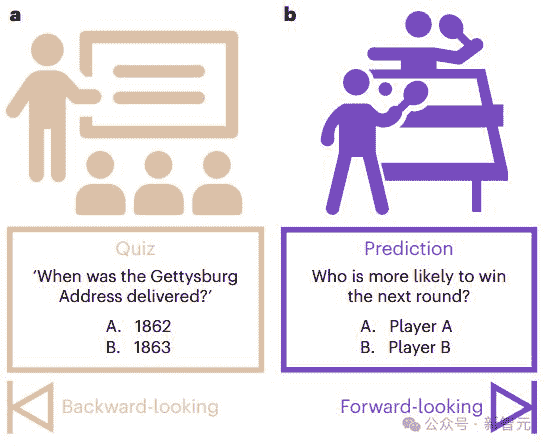

# 12.08-业界首例，中国联通 AI 大模型存算分离技术实现突破

> 来源：[https://agijuejin.feishu.cn/docx/KvDcd38T9oQBjTxBsj7ccZIFnuA](https://agijuejin.feishu.cn/docx/KvDcd38T9oQBjTxBsj7ccZIFnuA)

# AGI 掘金日报 - AI 新闻推送 (2024 年 12 月 08 日)

> [欢迎加入 AGI 掘金社群](https://sourl.co/miZUyT)

## ⭐ 今日热点

### 💡 业界首例，中国联通 AI 大模型存算分离技术实现突破

IT之家 | [阅读原文](https://www.ithome.com/0/816/077.htm)

2024 年 12 月，中国联通 AI 大模型存算分离技术实现突破。成功实施业界首次 30TB 样本数据跨 200 公里存算分离拉远训练，训练效率高达 97%以上。存算分离技术将存储与计算分开，可保证用户数据安全。解决了数据不便外迁及存储资源成本问题，为未来 AI 技术发展提供新方向。

## 🌟 技术突破

### 💡 “克隆阿尔法”仿生机器人明年开放预订，拥有合成器官、人造肌肉

IT之家 | [阅读原文](https://www.ithome.com/0/816/117.htm)

2024 年 12 月 8 日消息，波兰机器人公司 Clone Robotics 宣布其开发的‘克隆阿尔法’仿生机器人明年开放预订。这款机器人模拟人类解剖结构，拥有合成器官、人造肌肉和韧带等。计划仅生产 279 台，其肌肉系统靠人造肌肉技术驱动，运动系统通过水驱动。虽声称有 16 项预设技能，但实际能力遭质疑，其创始人相信它在家庭和工作场所都能发挥作用。

### 💡 Meta 今年压轴开源 AI 模型 Llama 3.3 登场：700 亿参数，性能比肩 4050 亿

IT之家 | [阅读原文](https://www.ithome.com/0/816/040.htm)

Meta 于 2024 年 12 月 6 日推出开源 AI 模型 Llama 3.3，有 700 亿参数，性能却比肩拥有 4050 亿参数的 Llama 3.1。它效率高、成本低，可在标准工作站运行。重点优化多语言支持，有 8 种语言。采用自回归语言模型和优化的 transformer 架构，上下文长度为 128K，支持多种工具使用格式，还采取了安全措施降低模型滥用风险。

### 💡 谷歌 DeepMind 专利革新蛋白质设计，开启 AI 原子级精度新时代

IT之家 | [阅读原文](https://www.ithome.com/0/816/021.htm)

2024 年 12 月，谷歌 DeepMind 获批新专利，推出基于全原子表征扩散模型的蛋白质设计系统。该系统整合神经网络和扩散方法，实现原子级设计，将结构预测和序列优化统一，采用‘抛弃式空间位置’管理原子级数据，还统一了结构-序列预测并结合条件去噪过程。系统由三部分组成，经过生成含噪声分子数据、去噪、生成优化结构等阶段，为生物技术和制药科学带来革命性突破。

### 💡 科研也完了，AI暴虐170位人类专家！Nature子刊：大模型精准预测研究结果，准确率高达81%

新智元 | [阅读原文](https://www.163.com/dy/article/JIQG7KUK0511ABV6.html?spss=dy_author)

2024 年伦敦大学学院研究人员在《Nature Human Behaviour》发布前瞻性基准 BrainBench。测试发现大型语言模型在预测神经科学结果方面超越人类专家，平均准确率达 81%，人类为 63%。模型可辅助人类做科研新发现，方法不特定于某一学科。研究人员针对神经科学预测难题开发了包含 200 个人类设计及 100 个 GPT-4 生成测试案例的基准，对摘要进行修改后测试人类专家和模型，结果表明大模型性能更好且没见过测试数据，模型和人类置信度与准确性正相关。

### 💡 OpenAI直播第二弹！奥特曼2024年最大惊喜竟来自字节？强化微调让o1-mini逆袭o1

新智元 | [阅读原文](https://www.163.com/dy/article/JIQG40UD0511ABV6.html?spss=dy_author)

OpenAI 直播展示强化微调技术，该技术首次开放给外部开发者，只需几十个高质量任务即可定制领域专家模型。强化微调后的 o1-mini 在准确率上跃升 180%超越 o1，被奥特曼称为 2024 年最大惊喜。该技术思路与字节跳动 ACL 2024 论文相同，能提升模型推理能力和特定任务准确性，在科学研究及众多领域有广泛应用，2025 年第一季度将公开发布。

## 💫 企业动态

### 💡 X 为 Grok 推出新 AI 图像生成模型 Aurora，可生成更加逼真的图像

IT之家 | [阅读原文](https://www.ithome.com/0/816/098.htm)

2024 年 12 月 8 日，马斯克旗下 X 公司为其 AI 聊天机器人 Grok 推出新 AI 图像生成模型 Aurora，可生成更加逼真图像，对生成内容限制更少。位于 Grok 模型选择器中‘Grok 2 + Aurora beta’选项，免费用户使用次数有限。该模型能生成受版权保护角色和公众人物图像，但不会生成裸体图像，有时在人体解剖结构和连贯性方面有怪异之处。

### 💡 2025 IEEE Fellow名单正式公布！戴琼海院士等120余位华人入选

新智元 | [阅读原文](https://www.163.com/dy/article/JIQSRSPC0511ABV6.html?spss=dy_author)

2024 年 12 月，IEEE 公布 2025 Fellow 名单，120 多位知名华人学者入选。其中清华 9 人，西电 4 人等。IEEE Fellow 是学会最高等级会员，每年只有不到 0.1%的成员被提升。入选者来自多所高校及企业，涉及多个领域，如氮化镓微波器件应用、计算机视觉等。

### 💡 备战 DALL・E 3：谷歌“最强文生图模型”Imagen 3 正式上线

IT之家 | [阅读原文](https://www.ithome.com/0/816/036.htm)

2024 年 12 月 7 日，谷歌为迎战 DALL・E 3，宣布其最强文生图模型 Imagen 3 正式上线。Imagen 3 号称谷歌最高级文生图模型，可理解长文本，生成细腻、生动的‘照片级’图片且视频无明显噪点，还开放了图片编辑和定制化功能。同时，为避免版权争议，引入了多项安全技术，如 DeepMind 开发的 SynthID 数字水印和安全过滤器。

### 💡 漫步者：搭载 AI 相关功能的各类新产品正在开发中

IT之家 | [阅读原文](https://www.ithome.com/0/816/005.htm)

2024 年 12 月，漫步者公布其‘漫步者摘要提取算法’‘漫步者机器翻译算法’已完成备案。目前，搭载 AI 相关功能的各类新产品正在开发中，且今年大力投入开放式耳机方向，已上市 11 款，未来不同形态、定价范围、品牌的开放式耳机将陆续上市。

## ✨ 行业观点

### 💡 Bengio预言o1无法抵达AGI！Nature权威解读AI智能惊人进化，终极边界就在眼前

新智元 | [阅读原文](https://www.163.com/dy/article/JIQG3UHU0511ABV6.html?spss=dy_author)

2024 年 12 月，Nature 文章探讨 LLM 在智能化道路上的突破与局限。OpenAI 推出的推理模型 o1 引发关于 AGI 的辩论。虽 LLM 能力令人震惊，但仍有局限，如 o1 在规划任务中性能会随步骤数增加而下降。同时，训练模型的数据即将耗尽，参数扩大收益不显著。目前对于 LLM 是否是通往 AGI 的唯一解存在争议，且大模型缺乏内部反馈，数据也几近用竭。关于 AGI 离人类有多近尚无共识，可能会悄然到来。