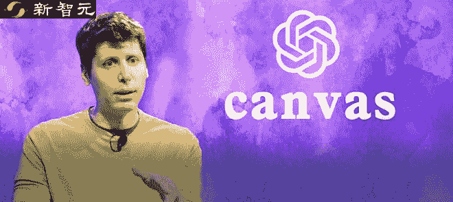
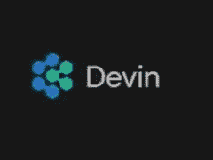
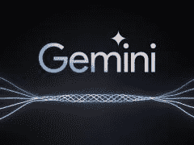
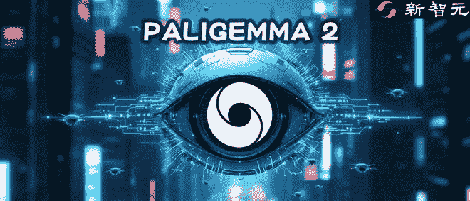
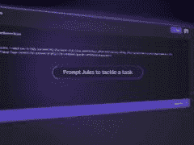

# 12.12-谷歌测试 Gemini AI 游戏助手：实时分析屏幕以提供游戏建议

> 来源：[https://agijuejin.feishu.cn/docx/STdjdYiZnotnxvxlrS5cejvvn3b](https://agijuejin.feishu.cn/docx/STdjdYiZnotnxvxlrS5cejvvn3b)

# AGI 掘金日报 - AI 新闻推送 (2024 年 12 月 12 日)

> [欢迎加入 AGI 掘金社群](https://sourl.co/miZUyT)

## ⭐ 今日热点

### 💡 谷歌测试 Gemini AI 游戏助手：实时分析屏幕以提供游戏建议

IT之家 | [阅读原文](https://www.ithome.com/0/817/023.htm)

2024 年 12 月 12 日，谷歌发布 Gemini 2.0，测试 Gemini AI 游戏助手，可实时分析屏幕为玩家提供游戏建议，还能连接谷歌搜索获取游戏知识。目前在《部落冲突》等游戏中测试，实用性有限且处于早期阶段。此外，谷歌还用 Genie 2 创建可玩虚拟世界，同样处于早期。

### 💡 ChatGPT深夜福利，Canvas生产力神器史诗级升级！跑代码改bug，AGI界面大革新

新智元 | [阅读原文](https://www.163.com/dy/article/JJ4GSQBL0511ABV6.html?spss=dy_author)

2024 年 12 月，OpenAI 对 ChatGPT 的 Canvas 进行重大升级并向所有用户开放。Canvas 新增三大能力，包括编辑文本（可提出修改建议、润色文档、检查语法、添加表情等）、运行 Python 代码（可 debug）、整合进自定义 GPTs。此次升级让 ChatGPT 成为与人类‘并肩作战’的全新 AI，开启人类和 AI 合作的崭新时代。

## 🌟 技术突破

### 💡 全球首个“AI 程序员”Devin 全面开放：可独立开发 / 修复 bug，月费 500 美元

IT之家 | [阅读原文](https://www.ithome.com/0/817/016.htm)

2024 年 12 月 11 日，全球首个‘AI 程序员’Devin 全面开放。个人和工程团队月费 500 美元可获得完整访问权限，包括 Slack 集成、IDE 扩展和专业技术支持。Devin 能运用多种编程语言，独立开发、部署网站和应用程序，还能自主发现并修复 bug。它采用沙盒计算环境，可快速学习新技术，理解复杂编程上下文并调整解决方案，具备快速掌握新技术、开发端到端应用、自动化找 bug 和 AI 培训等技能。

### 💡 谷歌深夜炸场：Gemini 2.0 正式发布，关键基准测试性能约为 1.5 Pro 两倍

IT之家 | [阅读原文](https://www.ithome.com/0/816/992.htm)

2024 年 12 月 11 日谷歌正式发布 Gemini 2.0，号称最强 AI 模型。其在关键基准测试性能约为 1.5 Pro 两倍，具有更强性能、多模态表现及新原生工具应用。支持图像、视频、音频多模态输入输出，可原生调用工具。即日起开发人员可试用，移动版后续推出。同时谷歌还发布新多模态实时 API。

### 💡 DeepMind悄悄发布PaliGemma二代，最易微调「视觉语言全能王」来了，多项任务登顶SOTA

新智元 | [阅读原文](https://www.163.com/dy/article/JJ4GRB3J0511ABV6.html?spss=dy_author)

2024 年 12 月，谷歌悄悄发布 PaliGemma 二代。它在多个任务上取得业界领先成绩，如图像描述、乐谱识别和医学图像报告生成等。有不同尺寸（3B、10B、28B 参数）和分辨率（224px、448px、896px）版本，易微调且性能更好，在多项任务中都展现出高性能，如在 896 像素分辨率下，PaliGemma 2 3B 在文本检测和识别任务中超过最先进的 HTS 模型。

## 💫 企业动态

### 💡 谷歌推出 AI 代码助手 Jules，可帮助开发者修复代码错误

IT之家 | [阅读原文](https://www.ithome.com/0/817/015.htm)

2024 年 12 月 12 日，谷歌推出 AI 代码助手 Jules，可帮助开发者修复代码错误。与 Gemini 2.0 一同发布，能为 Python 和 Javascript 编码任务准备拉取请求。它将与微软 GitHub Copilot 等竞争。开发者可控制审查调整其生成的代码。Jules 目前处于早期开发阶段，2025 年初将向其他开发者发布，更新将在 Google Labs 网站提供。

### 💡 谷歌称 Project Astra 将开启测试，部分人员通过智能眼镜体验 AI 助手

IT之家 | [阅读原文](https://www.ithome.com/0/817/012.htm)

2024 年 12 月谷歌称 Project Astra 将开启测试，部分人员通过智能眼镜体验 AI 助手。该项目虽处于‘概念视频’和‘早期原型’之间，但代表谷歌在人工智能领域的雄心。谷歌在智能穿戴设备领域有诸多探索，如今一小部分人将通过原型眼镜测试 Project Astra，部分测试人员也会通过安卓手机体验。谷歌在 Project Astra 的硬件方面有所规划，智能眼镜被认为是实现‘常伴助手’体验的绝佳载体。

### 💡 云深处科技自研国产机器狗 X30 交付新加坡电网，预估每年节省 480 小时人工隧道检查时间

IT之家 | [阅读原文](https://www.ithome.com/0/816/971.htm)

2024 年 12 月 11 日，云深处科技自研国产机器狗 X30 交付新加坡电网。该机器狗配备视频摄像头和热成像仪，能在管廊内自主导航，预估每年节省 480 小时人工隧道检查时间。检查后会生成数据报告供评估，为检修提供依据。SP 集团技术主管表示，可减少体力劳动，紧急情况还能作为第一响应者。

### 💡 消息称字节跳动提升即梦产品优先级，尝试打造“AI 时代的抖音”

IT之家 | [阅读原文](https://www.ithome.com/0/816/886.htm)

2024 年 12 月 11 日消息，字节跳动提升即梦产品优先级，尝试打造‘AI 时代的抖音’。字节跳动管理层认为‘AI 对话类’产品可能是中间态，长期更理想产品需更视觉化体验和低门槛。目前豆包用户活跃度不算高，字节内部判断付费订阅模式在中国难走通，时长和轮次低致广告空间小。即梦是前抖音集团 CEO 张楠到剪映后推出的 AI 创作工具和社区。

### 💡 UL Solutions 推出 AI 文本生成基准测试，支持英伟达、AMD、英特尔三家显卡

IT之家 | [阅读原文](https://www.ithome.com/0/816/865.htm)

2024 年 12 月 11 日，3DMark 开发方 UL Solutions 推出 Procyon AI 文本生成基准测试，支持英伟达、AMD、英特尔三家显卡。可通过 DirectML 通用 API 调用本地 GPU，也可通过英特尔 OpenVINO 调用其 GPU。该测试包括 4 种不同参数规模的模型，操作简易，能展示系统资源使用情况，可对 AI GPU 在多样化大语言模型文本生成用例中的表现进行比较。

### 💡 Omdia：预计 2029 年生成式 AI 市场规模达 728 亿美元

IT之家 | [阅读原文](https://www.ithome.com/0/816/863.htm)

据 Omdia 预测，2029 年生成式 AI 市场规模将达 728 亿美元，目前处于起步阶段。多模态生成式 AI 推动各行业应用，如客户服务等。生成式 AI 已在众多行业有 120 个应用场景。我国截至 2024 年 6 月，生成式人工智能产品用户规模达 2.3 亿人，占整体人口 16.4%。关键词：生成式 AI、人工智能。

### 💡 微软成立全新消费者健康业务部门，目标提供更具针对性 AI 健康解决方案

IT之家 | [阅读原文](https://www.ithome.com/0/816/859.htm)

2024 年 12 月，微软成立全新消费者健康业务部门，负责人穆斯塔法・苏莱曼组建团队，成员包括曾在 Google DeepMind 共事的人。新部门专注开发生成式 AI 在消费者健康方面的应用。近半数消费者曾向生成式 AI 工具寻求健康建议。苏莱曼曾在 2016 年于 DeepMind 成立健康部门，后因隐私问题被剥离。今年他被微软招募，加入 AI 研发力量。

### 💡 NeurIPS 2024最佳论文开奖！北大字节NUS夺冠，Ilya连续三年获奖

新智元 | [阅读原文](https://www.163.com/dy/article/JJ4KRHJ50511ABV6.html?spss=dy_author)

2024 年 NeurIPS 公布最佳论文，北大字节、新加坡国立大学等团队夺冠。Ilya 连续三年获时间检验奖。NeurIPS 2024 投稿量创新高，录用率 25.8%，研究集中在大模型等四大块。获奖论文 VAR 开启视觉自回归模型新范式，在多个维度超越扩散模型；STDE 破解高维高阶微分算子计算难题，应用于物理信息神经网络可提高计算速度、减少内存占用。此外，还有‘数据集与基准’最佳论文 PRISM，以及对 LLM 作为科学论文作者清单助手的效果评估。

### 💡 统信 UOS AI 2.0 发布，deepin（深度）系统社区用户超 760 万

IT之家 | [阅读原文](https://www.ithome.com/0/816/839.htm)

2024 中国操作系统大会召开，统信软件在会上宣布，统信 UOS 操作系统发展进入规模化阶段，国产平台装机量超 800 万套，服务客户超 50000 家。发布 UOS AI 2.0，带来系统级交互感知等升级。还发布行业白皮书及操作系统安全增强版，推出‘2+6+N’体系和多行业解决方案。统信软件总裁透露，2025 年统信 UOS 桌面版和服务器版 V20 将进入长期维护。同时，深度系统社区用户超 760 万，是全球规模最大且活跃的开源操作系统社区之一。

### 💡 DeepSeek V2 系列 AI 模型收官，联网搜索上线

IT之家 | [阅读原文](https://www.ithome.com/0/816/838.htm)

2024 年 12 月 10 日，DeepSeek 官方👸号宣布 DeepSeek V2 系列收官，推出 DeepSeek-V2.5-1210 最终版微调模型，主要支持联网搜索功能，在数学、代码等方面有进步，优化了文件上传功能。该版本已上线网页端，用户可在输入框中打开‘联网搜索’体验，目前 API 不支持搜索功能。

### 💡 聊天机器人平台 Character.AI 在美再遭起诉：对青少年及家庭构成威胁，恶化心理问题

IT之家 | [阅读原文](https://www.ithome.com/0/816/837.htm)

2024 年 12 月，聊天机器人平台 Character.AI 在美再遭起诉。该平台被指其聊天机器人与未成年人对话涉及自残、性虐待等恶劣行为，甚至建议青少年谋杀父母。诉讼称两名青少年使用后心理和身体急剧恶化。有律师指出科技公司收集青少年数据，加剧了生成 AI 模型的军备竞赛。这并非 Character.AI 首次因这类问题被起诉。

### 💡 从濒死到全球市值第一，英伟达30多年逆袭传奇！

新智元 | [阅读原文](https://www.163.com/dy/article/JJ4GS17A0511ABV6.html?spss=dy_author)

英伟达从濒临破产到全球市值第一。1995 年推出的第一款产品 NV1 失败致其濒临破产，后凭借 RIVA 128 强势回归，如今在独立显卡和 AI 市场占据高份额，创始人黄仁勋将其打造成‘AI 的世界引擎’。其发展历程体现了从错误中吸取教训、不断创新的文化。

### 💡 YouTube 自动配音功能推广至更多知识类频道，借助 AI 生成视频多语言配音

IT之家 | [阅读原文](https://www.ithome.com/0/816/819.htm)

2024 年 12 月 11 日，YouTube 宣布自动配音功能推广至更多频道。去年首次推出该 AI 驱动工具，现支持英语、法语等多种语言，采用谷歌 Gemini 技术，但处于初期阶段。另一个‘表现性语音’功能即将上线，YouTube 将与 Google DeepMind 和 Google Translate 团队合作，使配音更准确自然。