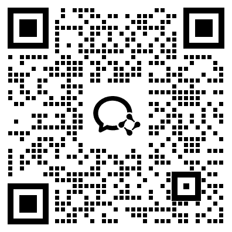

# 线下活动

> 来源：[https://agijuejin.feishu.cn/docx/UCwadYVQvo2IROxZhI1cnbLqnhb](https://agijuejin.feishu.cn/docx/UCwadYVQvo2IROxZhI1cnbLqnhb)

> **AI Talk沙龙****第3期****-****深圳**站|2024.8.24周六下午14：00-17：00| 深圳湾创新科技中心2栋B座F6

> **由掘金AI社区发****起的，面向广大****AI**爱好者、从业者的交流活动，本期主题为AI Agent技术突破和应用实践

> **线下报名链接：****h**ttps://www.bagevent.com/event/8791554?bag_track=AGIjuejin

> **🙎 分享嘉宾（排名不分先后）**

+   **网**易伏羲AOP框架技术负责人 Joysy，演讲议题《AOP框架在永劫无间手游Copilot的应用实践》，本议题将结合永劫无间手游公测实装全球首个游戏Copilot的应用，介绍游戏中多模态实时语音交互AI队友背景与演示，并分享该玩法内应用到的多Agent协同的设计，以及Agent能力迭代之自动化数据闭环链路的实现。最后会介绍支撑该玩法实现的AOP框架的设计思想和核心能力。

>

+   **云启星辰联合创始人&CTO 刘永峰，演讲议题《跨越鸿沟**，AI Agent 产业落地方法与实践》，本议题框架包括AI技术与产业落地的平行宇宙、如何从行业的视角看待AI Agent、AI Agent在产业应用场景面临的困境、什么是AI Agent在业务落地的最佳姿势、AI Agent实践案例分享、AI Agent未来发展的思考。

>

+   **5**3AI创始人 & LangGPT联合创始人 杨芳贤，演讲议题《AI Agent企业落地实践与应用拆解》，当前AI Agent在企业落地的两个主要场景是“Chat Agent”和“Data Agent ”，在“Chat Agent”场景中目前主流的RAG方案只能做到60%-70%的准确率，而企业对上线到生产环境的智能问答要求极高的准确率，这也是当下大多数大模型项目在企业内部落地效果不佳的重要原因。本议题将结合真实的落地案例来分享LangGPT提示词框架与AI Agent的落地实践。

---

# 分享框架

AOP框架在永劫无间手游Copilot的应用实践

1.  网易伏羲简介

1.  游戏Copilot的应用实践

1.  应用背景及演示

1.  游戏Copilot的设计与实现

1.  Agent设计

1.  多Agent协同

1.  Agent能力迭代-数据闭环

1.  AOP框架核心能力

1.  AOP设计思想

1.  AOP介绍

1.  AOP框架设计

1.  核心能力

1.  实时人机协作

1.  Agent数据闭环

1.  Agent闭环

跨越鸿沟，AI Agent 产业落地方法与实践

1.  AI技术与产业落地的平行宇宙

1.  如何从行业的视角看待AI Agent

1.  AI Agent在产业应用场景面临的困境

1.  什么是AI Agent在业务落地的最佳姿势

1.  AI Agent实践案例分享

1.  AI Agent未来发展的思考

AI Agent企业落地实践与应用拆解

1.  大模型的能力边界与LangGPT结构化提示词

1.  三种AI Agent的场景与价值

1.  AI Agent落地案例拆解

**AGI掘金小助手微信**

**AGI掘金线下活动群****二维码**

