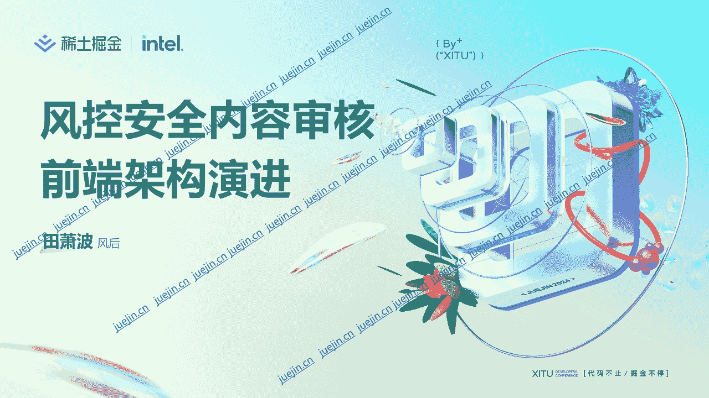

# 🎬 架构设计和业务稳定性建设

> 来源：[https://agijuejin.feishu.cn/docx/TcN6dGa3loCVaxxwrrtcBCkEnGh](https://agijuejin.feishu.cn/docx/TcN6dGa3loCVaxxwrrtcBCkEnGh)

[点击加入飞书社群领取更多干货](https://applink.larkoffice.com/client/chat/chatter/add_by_link?link_token=c6anf5ea-032e-4ee8-9804-d401cf077295)

## 分论坛精彩回放！

## 嘉宾PPT

[十亿级月活分钟数声网媒体中心架构演进之路_曹类_v7.pdf](https://internal-api-drive-stream.feishu.cn/space/api/box/stream/download/all/ZTAVbS4uioFU9dxThkrc5PHFneh)

[田萧波_架构设计和业务稳定性建设_试讲调整版2.pdf](https://internal-api-drive-stream.feishu.cn/space/api/box/stream/download/all/VWncbn4q6oQQSyxLcOHcz8AynBf)

[9.4.海能达数据库运维平台从0到N的架构设计和实战.pdf](https://internal-api-drive-stream.feishu.cn/space/api/box/stream/download/all/B2fMbXwzDoeZUXxXtoecCjRbnPb)