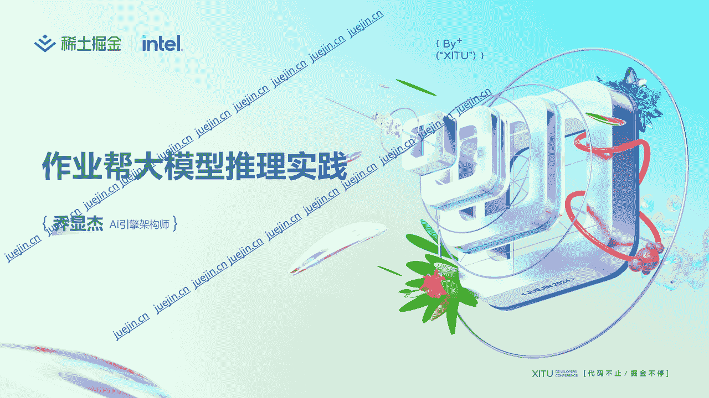
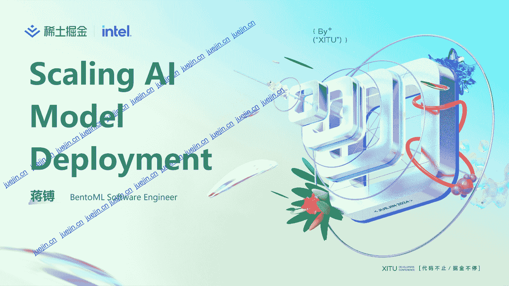

# 🎬 大模型部署与推理

> 来源：[https://agijuejin.feishu.cn/docx/MUnddApyHoaG6uxsMpWchMjNnOg](https://agijuejin.feishu.cn/docx/MUnddApyHoaG6uxsMpWchMjNnOg)

[点击加入飞书社群领取更多干货](https://applink.larkoffice.com/client/chat/chatter/add_by_link?link_token=c6anf5ea-032e-4ee8-9804-d401cf077295)

## 分论坛精彩回放！

## 嘉宾PPT

[作业帮大模型推理实践分享_v3.pdf](https://internal-api-drive-stream.feishu.cn/space/api/box/stream/download/all/JVB6bg1Fbork20x49NDckLbgnWb)

[蒋镈_大模型部署与推理_3.pdf](https://internal-api-drive-stream.feishu.cn/space/api/box/stream/download/all/JIg6bvjTbooRIvxXe27cl2ybnuc)

[缪金成-王锡贵_大模型部署与推理_3 (1).pdf](https://internal-api-drive-stream.feishu.cn/space/api/box/stream/download/all/I13ObE3ovo29q7xh2CYcLjjznQf)

[秦续业_大模型部署与推理_5.pdf](https://internal-api-drive-stream.feishu.cn/space/api/box/stream/download/all/V04DbovMmoGTeixCwq0c0moznRd)