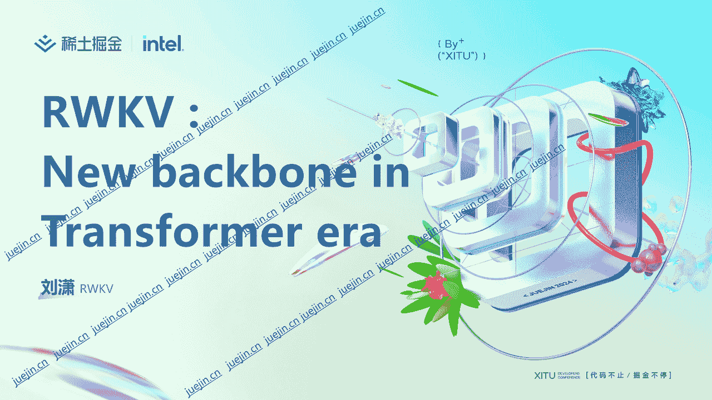
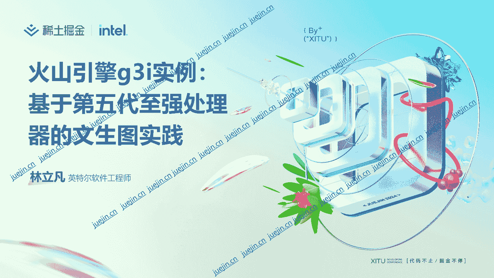
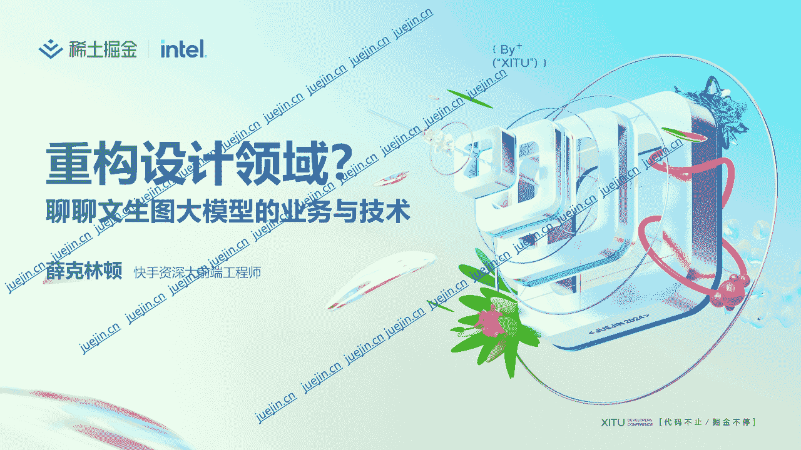
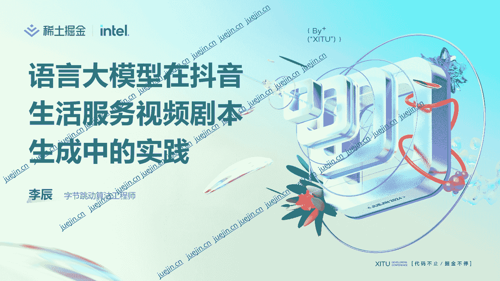

# 🎬 GenAI技术实践

> 来源：[https://agijuejin.feishu.cn/docx/GJGmdTDuyobpNbx48yucKyPcnoh](https://agijuejin.feishu.cn/docx/GJGmdTDuyobpNbx48yucKyPcnoh)

[点击加入飞书社群领取更多干货](https://applink.larkoffice.com/client/chat/chatter/add_by_link?link_token=c6anf5ea-032e-4ee8-9804-d401cf077295)

## 分论坛精彩回放！

## 嘉宾PPT

[刘潇_GenAI 技术实践_1.pdf](https://internal-api-drive-stream.feishu.cn/space/api/box/stream/download/all/WrLLbAAFUoDvHmx7E3Cco3a3nPb)

[林立凡&卢中延_GenAI 技术实践_3.pdf](https://internal-api-drive-stream.feishu.cn/space/api/box/stream/download/all/EH1pb3ClqoJCPuxUElBcQ30ZnhV)

[薛克林顿_GenAI技术实践_终稿5.pdf](https://internal-api-drive-stream.feishu.cn/space/api/box/stream/download/all/Gbu9bYekoocTEYxjoTMcgxAXnRc)

[李辰_GenAI 技术实践_9.pdf](https://internal-api-drive-stream.feishu.cn/space/api/box/stream/download/all/STB1bDdb6odDJFx7wCkcNkfynSf)