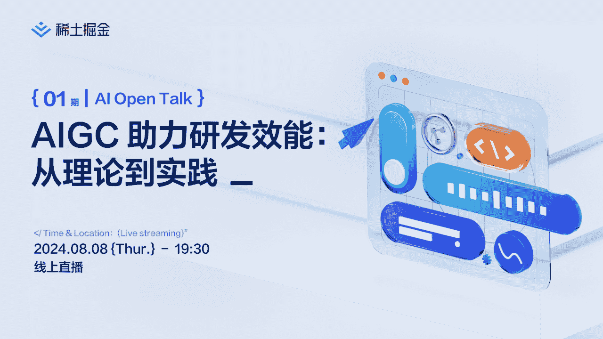
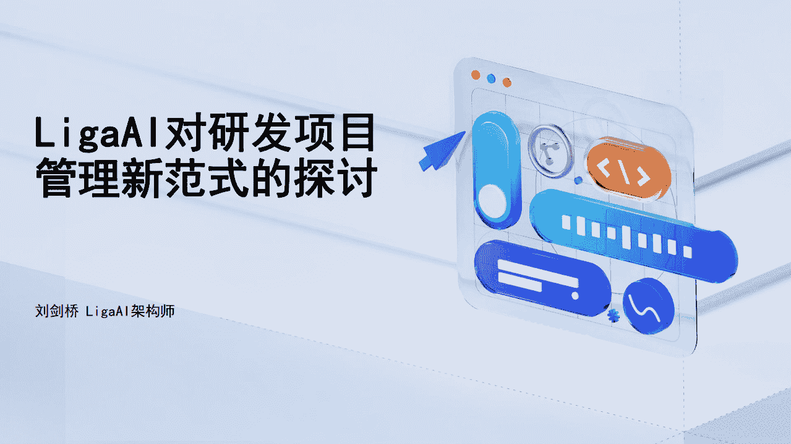

# 2024.08.08｜AIGC 助力研发效能：从理论到实践

> 来源：[https://agijuejin.feishu.cn/docx/Ely4d5K75oUlp8xXao4coFGXn2f](https://agijuejin.feishu.cn/docx/Ely4d5K75oUlp8xXao4coFGXn2f)

> 分享主题：AIGC 助力研发效能：从理论到实践

> **线上****回放：**https://juejin.cn/live/6834937

# 🎙️分享介绍

| **分享主题** | **分享人** | **内容大纲** | **你将收获** |
| --- | --- | --- | --- |
| **AI辅助编程经验分享** | 仝键 | 1.  大多数人基于LLM解决的都是片段级的开发 | 1.  学习与LLM结对进行代码片段级、单函数级、多函数多文件级三个层次进行编程时的方法 |
| 豆包 MarsCode在AI Coding 的实践与探索 | 王城波 | 1.  AI Coding 的演进史和发展趋势 | 1.  了解目前 AI Coding 领域最前沿的行业动态和知识 |
| LigaAI对研发项目管理新范式的应用 | 刘剑桥 | 1.  项目管理面临的问题 | 1.  理解项目管理的痛点，以及相关的解决方案。 |

1.  开发者对 AI 辅助编程的诉求

1.  代码补全关键指标 (CPO)与全链路优化实践

1.  基于 CKG 优化 AI 代码知识问答效果实践

1.  AI IDE 体验三要素：AI 交互友好 + 集成化 + 响应快

1.  更适合 AI 原生化交互：AI IDE 组件化技术实践

1.  响应更快：AI IDE 性能优化实践

1.  基于技术前沿谈谈下一个即将普惠的 AI Coding 技术

1.  AI 代码编辑推荐 (补全 Pro) 和 AutoDebug 的产品化探索

1.  软件开发更遥远未来的展望

1.  项目管理：史诗、项目、需求和研发协作的有机结合

1.  项目管理者的心流

1.  开发者的心流

1.  Cool features: RPA 和 AI功能的使用

# 🙎嘉宾介绍

**王城波**

+   字节跳动 Developer AI 部门技术专家

+   豆包 MarsCode IDE 平台技术负责人

+   自 2019 年加入字节以来深耕研发效能领域，负责过静态分析，火山引擎应用开发套件，DevOps流水线等项目，对研发效能和编码提效相关产品有多年实践落地经验。

**刘剑桥**

+   LigaAI架构师

+   近7年致力于企业DevOps和效能建设和相关软件开发，作为架构师在云从、极狐GitLab等多家企业参与研发效能落地

**仝键**

+   资深软件技术顾问，拥有15年以上软件行业从业经验，服务过华为、平安、京东、招行等知名企业。

+   专注于软件开发方法与效能的实践和研究。

---

# 📹分享视频回放

https://juejin.cn/live/6834937

# 📄分享材料

> 老师们的联系方式有放在每个分享文档的最后哟

《**AI辅助编程经验分享**》：

[AI辅助编程经验分享.pdf](https://internal-api-drive-stream.feishu.cn/space/api/box/stream/download/all/HT6kbNkSloTNsTxPu4QcTUrhnhb)

《豆包 MarsCode在AI Coding 的实践与探索》：

[豆包MarsCode在AI Coding的探索与实践.pptx](https://internal-api-drive-stream.feishu.cn/space/api/box/stream/download/all/Gwqcbg7nFoDm2axZRkJccCdknsJ)

《LigaAI对研发项目管理新范式的应用》：

[AI线上沙龙-LigaAI对研发项目管理的新范式的探讨(20240808).pdf](https://internal-api-drive-stream.feishu.cn/space/api/box/stream/download/all/YvaAbJjuUowKiQxKxcIcDj4cnag)