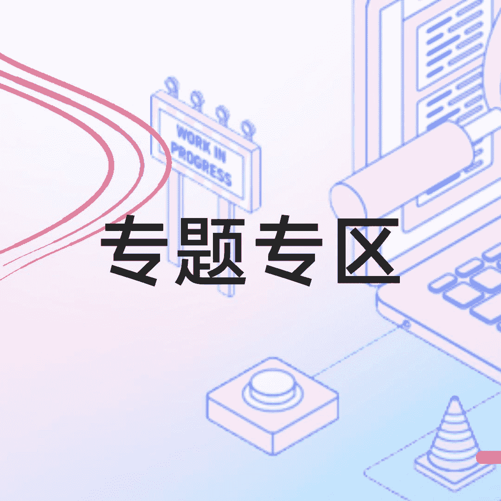
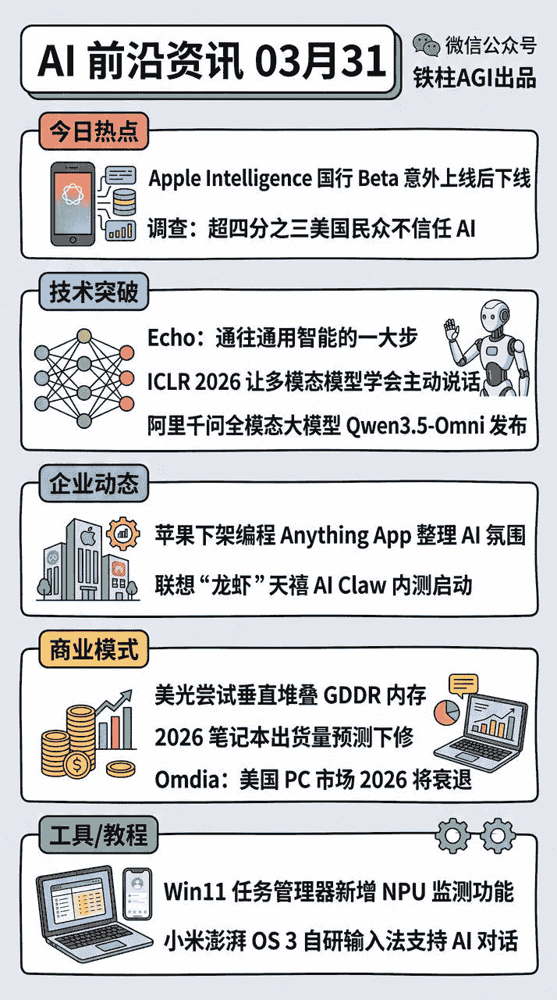
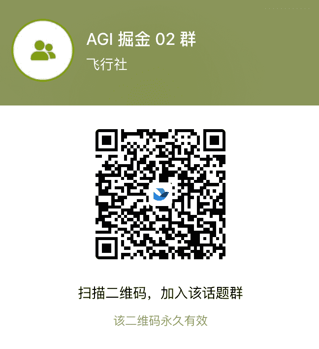

# AGI 掘金知识库

> 来源：[https://agijuejin.feishu.cn/docx/Y088dI4GToZ2vGxGOqZcy2MonCh](https://agijuejin.feishu.cn/docx/Y088dI4GToZ2vGxGOqZcy2MonCh)

# 💎 欢迎来到 AGI 掘金

> AGI 掘金知识库开始于 2024 年 7 月，是一家专注于 AGI 相关研究和应用的创新型知识平台。我们的使命是推动 AGI 技术和 AI 应用的落地与发展，并将其应用于各个行业，为人类社会创造更大的价值。我们提供 AGI 技术最新讯息、应用解决方案、组织各种有趣的服务，致力于成为行业的领军者。AGI 掘金期待你的加入！

> 知识库地址：[AGI 掘金知识库](https://km3dl0ffdl.feishu.cn/wiki/UvJPwhfkiitMzhkhEfycUnS9nAm?fromScene=spaceOverview)

> Captain 邀请你加入[飞书群](https://applink.feishu.cn/client/chat/chatter/add_by_link?link_token=1een0752-e36a-4d11-8aa6-677b0c33de0d)，快点击加入吧！

# ⚗️ 愿景

> 致力于让 AI 技术触手可及，为每位 AI 爱好者提供个性化的知识和工具。

> 通过持续创新和跨界合作，构建一个开放共享的 AGI 学习系统，让每个人都能参与并受益于 AGI 革命。

# 🪩 知识库主要内容

[**每天 AI 快报**](https://km3dl0ffdl.feishu.cn/wiki/UvJPwhfkiitMzhkhEfycUnS9nAm#CHp1d6NJWoNrzXx16CecclYxnze)

[**热门应用排行榜**](https://km3dl0ffdl.feishu.cn/wiki/A4Hhwzl7tijUppkvqNcc69SHnpH)

[**学术研究更新**](https://agijuejin.feishu.cn/wiki/YfAHwRoGwitjbAkMKfgc3XEinfg)

[**AI 基础学习**](https://km3dl0ffdl.feishu.cn/wiki/JEWpwDijZihVwGkcW9AcO8OendA)

[**技术干货学习**](https://km3dl0ffdl.feishu.cn/wiki/PFKCw7lUAifSi1kQaCxc30Fxn0e)

[**智能体学习**](https://agijuejin.feishu.cn/wiki/JUSPw6EDZiVpKckRLUicc1iAnOg)

[**技术前沿应用**](https://agijuejin.feishu.cn/wiki/EtoiwSfomiHnmukOCDncsdnenYd)

[**行业热点和应用**](https://km3dl0ffdl.feishu.cn/wiki/SW3dwTLmmits1TkWujfc5juenlu)

[**报告资源下载**](https://agijuejin.feishu.cn/wiki/JRM4wpD8rieLM8kUWRacNDY9nAb)

[**AI Coding编程**](https://agijuejin.feishu.cn/wiki/E5tmwojbjiOPipkgsS3cEAUknvc)

[**Deepseek专区**](https://agijuejin.feishu.cn/wiki/BAghw0NywidpvIkQpdPcZ2eZnzT)

（以上正在更新中）

# [2.2 AI Coding 编程](https://agijuejin.feishu.cn/wiki/E5tmwojbjiOPipkgsS3cEAUknvc)‍💻 AI Coding 编程专区（正在更新中）

[Trae.ai](https://agijuejin.feishu.cn/wiki/MN7bwMqcHiAX48kXRsHc3R1qnOd)[基础入门](https://agijuejin.feishu.cn/wiki/OSZbw3sZ6iVOBkkxIkAcFKPNnNa)[进阶](https://agijuejin.feishu.cn/wiki/UzSvw4xHgiXjwhkf73SckKOBnub)

[应用开发](https://agijuejin.feishu.cn/wiki/T3RrwufoBimahIk6XCJc484vnLf)

[Cursor](https://agijuejin.feishu.cn/wiki/WXZawGl33ioUsGkBdfKcGvmynEe)

[基础介绍](https://agijuejin.feishu.cn/wiki/Mi0Swfv33iyVjmkImZQcDlornAe)

[进阶](https://agijuejin.feishu.cn/wiki/WY3PwA1kZiztbVkyjc6c6fBvn6g)

[应用开发](https://agijuejin.feishu.cn/wiki/F3GxwL7iMiVJQskPLJdc0T97nCc)

[豆包 MarsCode](https://agijuejin.feishu.cn/wiki/MeKAwnsB9i3FPEkHgnwc2ZOsnKb)

[基础介绍](https://agijuejin.feishu.cn/wiki/HCE6wnoQHiIAKvkRBOMcAgh7nKd)

[进阶](https://agijuejin.feishu.cn/wiki/Uh21wTvE4iMgTfk4UVrcKQvJnIf)

[应用开发](https://agijuejin.feishu.cn/wiki/HWBQwsFLkilSIikdaiDcVbJ4n0d)

[Windsurf](https://agijuejin.feishu.cn/wiki/Cil0wTee7iy9jGkVhArcwTTcntD)

[Bolt.new](https://agijuejin.feishu.cn/wiki/TF7gw7UWiiIvhakELjVc33h5nid)

[V0.dev](https://agijuejin.feishu.cn/wiki/TLsKwX2JziwHlskdxwacIcbgnUg)

[Devin](https://agijuejin.feishu.cn/wiki/XoWlwLdKIiRuLckWeCbctRgInjh)

# 💡 本周AGI 视界周刊 | 每周更新

> 每周，我们都会精选一周汇总 [AGI 掘金视界周刊第 11 期](https://agijuejin.feishu.cn/wiki/BJc5wQmT1iIUvakeGQtcIPaznJx)

> 过往汇总：[AGI 掘金视界周刊](https://agijuejin.feishu.cn/wiki/D8S6wWFvRiHHVNkeEmqc24aNncc)

# 🔑 AGI 洞察 | 不定期更新

> 这一模块提供对最新 AI 产品的深入分析，包括技术特点、市场表现和未来发展趋势。我们的专家团队将为您解读每一个产品的核心技术，并预测其在未来市场中的表现。

> 历史存档：[1.4 产品洞察](https://km3dl0ffdl.feishu.cn/wiki/If2bwJW9QiFGeBklFrzc2d56n4b?from=from_copylink)

# 🗒️ AI 快报推送

> **AI 快报历史****归档：**[2026 年 AI 快报历史归档](https://agijuejin.feishu.cn/wiki/DjLqwMCPuiq4utke9Ssc739Cnpc)

> [欢迎加入 AGI 掘金社群](https://applink.feishu.cn/client/chat/chatter/add_by_link?link_token=bd4t8bb8-3fc9-461f-b8b2-10c57e2ea62a)，申请进群的请详细介绍自己，否则可能不予通过。

> [欢迎加入 AGI 掘金社群](https://applink.larkoffice.com/client/chat/chatter/add_by_link?link_token=890h8ad3-71e6-4140-af64-39dff6b2ba1f)

---

### 🔥 今日热点

1.  Ap[pl](https://www.ithome.com/0/934/277.htm)e Intelligence 中国意外上线 (链接)：据彭博社消息，该功能因未获监管部门批准而意外上线，苹果已将其下线，暂无发布计划。

1.  **苹果国行AI意外上线后下线** ([链接](https://www.ithome.com/0/934/276.htm))：Apple Intelligence国行Beta版凌晨分批上线后，被彭博社称为意外上线，苹果已将其下线，该版本曾开放约9.5GB模型下载并提供多项AI功能。

1.  **超四成美国人不信任AI** ([链接](https://www.ithome.com/0/934/279.htm))：民调显示76%美国人极少信任AI，但使用率持续攀升，多数人担忧其发展会减少就业岗位且监管不足。

### 🚀 技术突破

1.  **Echo 预测智能系统发布** ([链接](https://mp.weixin.qq.com/s?__biz=MzA3MzI4MjgzMw==&mid=2651024564&idx=1&sn=6fb075d1ca107111ac46eeb2215716fd))：UniPat AI 推出包含动态评测引擎、Train-on-Future 训练范式和专用模型 EchoZ-1.0 的预测智能基础设施，其模型在通用预测排行榜上超越顶级大模型及人类市场聚合判断。

1.  **多模态模型主动交互方案** ([链接](https://mp.weixin.qq.com/s?__biz=MzA3MzI4MjgzMw==&mid=2651024564&idx=2&sn=35264986836dd290aa3618d110aaeb85))：北京大学研究团队提出ProactiveVideoQA评估基准与MMDuet2模型，通过强化学习训练，使视频多模态大模型能在播放中自主决定回复时机，无需精确时间标注。

1.  阿里[发布](https://www.ithome.com/0/934/257.htm)全模态大模型 Qwen3.5-Omni (链接)：无缝理解文本、图片、音频及音视频输入，在215项SOTA任务中超越Gemini3.1-Pro，支持音色克隆、语义打断及长上下文处理。

### 🏢 企业动态

1.  **苹果整顿 AI 氛围编程应用** ([链接](https://www.ithome.com/0/934/283.htm))：以违反“自包含规则”为由下架“Anything”应用，强调应用不得通过生成运行外部代码来改变自身核心功能。

1.  联想[天禧](https://www.ithome.com/0/934/267.htm) AI Claw 启动内测 (链接)：内测期间可免费使用云端超大模型，采用端云混合部署方案，云端任务在设备关机时仍可持续运行。

1.  Mi[st](https://www.ithome.com/0/934/255.htm)ral 获 8.3 亿美元债务融资 (链接)：资金将用于在法国巴黎附近建设 AI 数据中心，计划部署 13800 块英伟达 GB300 GPU，预计 2026 年第二季度上线。

### 💼 商业模式

1.  **美光研发垂直堆叠 GDDR** ([链接](https://www.ithome.com/0/934/260.htm))：美光着手研发垂直堆叠 GDDR 内存，原型或于2027年发布，旨在标准GDDR与HBM间开辟新道路，以较低成本和较大容量应对AI推理需求。

1.  Tr[en](https://www.ithome.com/0/934/252.htm)dForce 下修 2026 年笔电出货预测 (链接)：预计2026年全球笔记本电脑出货量同比下滑14.8%，降幅扩大，因关键零部件供应紧张及价格上涨抑制消费需求，但苹果有望逆势增长7.7%。

1.  美国[PC](https://www.ithome.com/0/934/258.htm)市场2025Q4逆转下滑 (链接)：2025Q4出货量同比增3%至1820万台，但预计2026年因存储器成本大涨将衰退13%至6190万台。

### 🛠️ 工具/教程

1.  Wi[n1](https://www.ithome.com/0/934/288.htm)1 任务管理器新增 NPU 监测 (链接)：Windows 11 开发版更新为搭载 NPU 的电脑新增了全面的 NPU 占用、内存及引擎监控功能，以支持 Copilot+ PC 的 AI 硬件。

1.  澎湃[ O](https://www.ithome.com/0/934/242.htm)S 3 Beta 上线自研输入法 (链接)：支持 AI 对话、翻译及高级材质等功能，并同期推出可自动抓取存储密码的密码 App。

# 🌈 大模型&热门应用排行榜”

> 在这里，我们展示 AGI 的热门榜单，展示市场最火最热应用和大模型相关性能排行。

> 点击查看更多数据详情：[2.1 AIGC应用榜](https://km3dl0ffdl.feishu.cn/wiki/A4Hhwzl7tijUppkvqNcc69SHnpH?table=blk6VoQ4vbxOLZKc)

### TOP200 热门应用榜单部分展示

### [**大模型排行榜：**](https://km3dl0ffdl.feishu.cn/wiki/A4Hhwzl7tijUppkvqNcc69SHnpH?table=blk6VoQ4vbxOLZKc)**（进入表格查看详情）**

# 🤝 加入社群

知识库地址：[AGI 掘金知识库](https://km3dl0ffdl.feishu.cn/wiki/UvJPwhfkiitMzhkhEfycUnS9nAm?fromScene=spaceOverview)

Captain 邀请你加入[飞书群](https://applink.feishu.cn/client/chat/chatter/add_by_link?link_token=1een0752-e36a-4d11-8aa6-677b0c33de0d)，快点击加入吧！

# ✍️ 友情链接

> 共建和合作联系：captain 🛰️号：229199157

# 🚀 社区共建者

**Captain**

AGI 平台组织者

wechat：229199157

**安仔**

架构师，创业 7 年

《Coze 从入门到实践》

掘金小册作者

**Ada**

KCI 创新咨询-管理顾问

[AI培训和智能体咨询服务](https://www.kciagent.com/)

[飞书AI 职场人学习知识库](https://sat2tjmapq6.feishu.cn/wiki/OoiWwxxd5iOE6tku9QzcrCDMnVe)

**云中江树**

AI 算法工程师

LangGPT 结构化提示词

板块共建者

**铁柱AGI**

👸号：铁柱AGI

wechat：AI_tiezhu

万象AI实验室技术支持

**煮酒四郎**

大模型排行榜共建者

**       ****蓝衣剑客**

AIGC思维火花创始人

WaytoAGI专栏作者

LangGPT核心成员

曾担任多个国家级标准、报告代表及顾问

> 更多资源点击：[1.1 行业报告](https://agijuejin.feishu.cn/wiki/JRM4wpD8rieLM8kUWRacNDY9nAb)