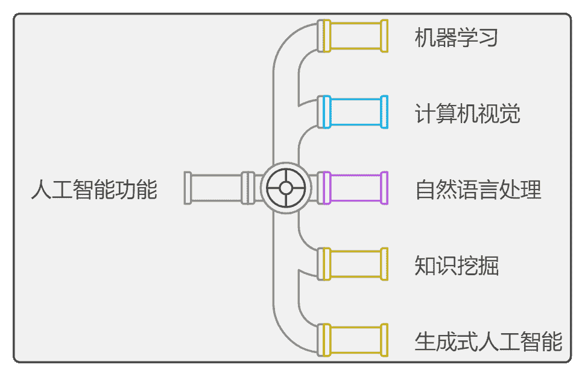

# AI 简介

> 来源：[https://agispace.feishu.cn/docx/NYT3dn4FQoU5v6xq9BycplCvnOc](https://agispace.feishu.cn/docx/NYT3dn4FQoU5v6xq9BycplCvnOc)

## 什么是 AI？

简而言之，AI 就是一种模仿人类行为和能力的软件。 关键概念包括：

+   机器学习 它通常是 AI 系统的基础，也是我们“教”计算机模型进行预测并根据数据得出结论的方式。

+   计算机视觉 - 通过相机、视频和图像直观地解释世界的 AI 功能。

+   自然语言处理 - 计算机理解书面或口头语言并作出相应反应的 AI 功能。

+   知识挖掘 - 从大量通常非结构化数据中提取信息以创建可搜索的知识存储的 AI 功能。

+   生成式 AI - 以各种格式（包括自然语言、图像、代码等）创建原始内容的 AI 功能。

<https://agispace.feishu.cn/sync/HRWSdJyQUsWyXkbTZR7co5JZndz>

# [👉点击继续（](https://agispace.feishu.cn/wiki/DQwcwBdjMimdRskMKZycgOWhnCf)下一单元: 了解机器学习）