# 前沿动态

> 来源：[https://agispace.feishu.cn/docx/TuJed0DT7oR0FXxXxjWcZJognUd](https://agispace.feishu.cn/docx/TuJed0DT7oR0FXxXxjWcZJognUd)

> 小技巧：右侧目录可以快速导览

+   [**👉最新七日动态**](https://agispace.feishu.cn/wiki/Xs6HwsNyDi92O8kayXJclpcZnsd#part-Gu72drW2qobr0HxtQVHc66LlnIh)

+   👉2[**024 大事件记录表**](https://agispace.feishu.cn/wiki/VLwGwZY1ziepcbk9tPsczAoYnJd)

# 🎃十月合集

---

## 10 月 31 日

### 【Prompt 创作】李继刚：用20年时间，给世界留下一句话

这篇文章是对“Prompt之神”李继刚的专访，深入探讨了他在AI领域，尤其是prompt创作的卓越贡献。李继刚以其独特的公文笔杆子和汉语新解等作品，在prompt社区中引起了广泛关注。文中提到，李继刚在消失的半年里，专注于读书，特别是哲学书籍，这使得他的prompt风格发生了显著变化，变得更加注重逻辑推理和深度表达。他认为，之前的工具书虽然提供了大量方法论，但在解决复杂问题时显得力不从心，而哲学书籍则帮助他构建了更为系统和深刻的思考框架。李继刚的观点犀利而深刻，他强调通过阅读和思考，才能真正提升prompt的质量和深度，进而更好地服务于各种写作需求。（原文链接：https://mp.weixin.qq.com/s/JT2oOG2SYw2pDYEHlEmcyQ）

### 【AI 编程】v0 工具惊艳亮相，轻松复制界面

今日，颇有名气的博主 Alvaro Cintas 分享了一个有关 v0 AI 编程工具的实操视频，引起了众人的强烈兴趣。

这款 v0 编程工具在界面复制方面有着非凡的表现。博主从 X 平台上传了一个应用截图，仅仅给出一个提示，它就出色地完成了界面复制任务。这一功能对于编程人员来说实在是太实用了。它能够大大提高编程工作的效率，避免不必要的重复劳动，让编程者有更多的精力投入到创新和优化工作中。

[GODLLQ838Bp117qh.mp4](https://internal-api-drive-stream.feishu.cn/space/api/box/stream/download/all/PnLYb8MiXoTFutxPeRTcvIzsnjf)

官方介绍：https://githubnext.com/projects/github-spark

### 【AI 编程】GitHub发布了AI大模型编程产品Spark

GitHub发布了AI大模型编程产品Spark，它支持四款超强编程模型，用户无需代码和部署环境，用自然语言就能开发微应用程序。Spark能打破编程界限，让不懂编程的人开发应用，还能生成代码并立即运行展示效果，提供修订变体功能，自动保存迭代内容，用户可从四个AI模型中选择，它包含内置组件和可主题化设计系统，运行时与GitHub Models集成，提供提示编辑器，还提供托管运行时环境，目前处于预览版，支持申请注册体验。

[avCjyB9lucvz4FaD.mp4](https://internal-api-drive-stream.feishu.cn/space/api/box/stream/download/all/XlCEbeTx8oYN00xh1eDcoA5LnAe)

> 我们能否让任何人都能使用人工智能和完全管理的运行时为自己创建或调整软件？

### 【AI 绘画】Recraft V3：“红熊猫” 登顶 Hugging Face 图像榜

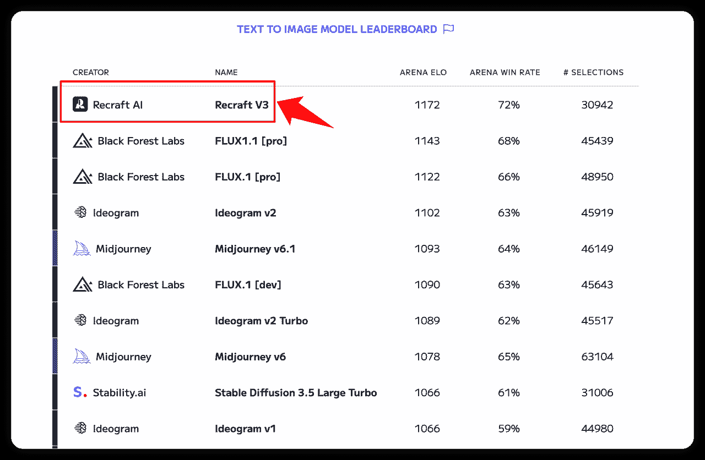

来自[机器之心的一篇文章](https://mp.weixin.qq.com/s/Hw8o0IwLseGUkmo2iJ877Q)介绍了在 Hugging Face 文本转图像排行榜上排名第一的 “red_panda” 模型，谜底揭晓它是由 AI 初创公司 Recraft 提供的 Recraft V3 模型。该模型以 1172 的 ELO 评分位居第一，超越了 Midjourney、OpenAI 等公司的模型。Recraft V3 在文本生成方面有高质量表现，还具备多项新功能，如可指定图像中文本大小和位置等。它是图像生成领域唯一可生成带有长文本图像的模型。Recraft 于 2022 年成立，总部在英国伦敦，致力于帮助设计师控制设计过程。

---

## 10 月 30 日

### 【智能体】智谱AI的AutoGLM后，Google和微软也下场来做“贾维斯”了

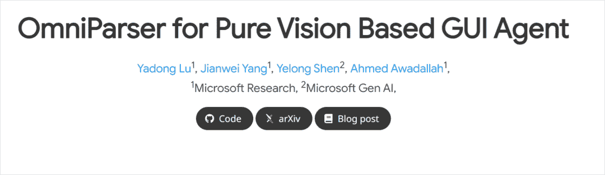

来自[卡兹克的一批文章](https://mp.weixin.qq.com/s/AuMHN_17mgCmdmF9kan4Eg)主要讲述了智谱AI推出AutoGLM后，Google和**微软也下场参与类似“贾维斯”产品的研发。微软发布了Omni**Parser for Pure Vision Based GUI Agent模型用于网页自动化操作，谷歌也被爆料准备推出接管计算机的人工智能。一周内已有四个公司有相关动作，其中Anthropic的Claude、智谱的AutoGLM和微软的OmniParser已发布产品。自主人工智能引发了AI圈的热情，其完成任务流程包括理解需求、系统规划、调用工具和完成目标。此前AutoGPT因基于大语言模型有局限性而沉寂，自主人工智能前期进展缓慢是因为多模态模型不成熟和缺乏行为数据，现在多模态模型基本可用，通过强化学习补充数据的范式逐渐形成共识。还对AutoGLM的能力实现进行了猜测，以🛰️发消息为例说明其可能的推理过程，最后指出Claude和AutoGLM都有问题，产品还需完善，但未来可能会快速发展。

### 【智能体】聊聊 AI Agent 应用、商业化以及当前行业的现状

文章是对澜码科技 CEO 周健的访谈，主要探讨了 AI Agent 的应用、商业化以及行业现状。周健介绍了澜码科技的业务，强调了 AI Agent 与 Chatbot、Copilot 的区别，阐述了其对企业结构和 SaaS 的影响，并分析了国内外在该领域的差距以及不同行业应用的差异，还分享了澜码科技的成功案例和未来展望。原文链接：https://mp.weixin.qq.com/s/iZHSidx0IDl23-5APuriCw

**金句提炼**

1.  “AI Agent 不仅具备语言理解能力，还能自主操作，改变传统业务流程。”

1.  “Agent 的自主性和业务属性的结合使其具备跨工具执行任务的能力，这是 Copilot 无法比拟的。”

1.  “未来的企业结构将更多依赖 AI Agent，Agent 不仅是工具，更是企业运作的重要组成部分，这将推动传统 SaaS 向记录性工具的转型。”

1.  “从今天的角度来看，我觉得更关键的是 Agent 如何对环境和目标进行建模。”

1.  “Agent 需要能够感知环境，采取相应的行动，并通过推理和学习来优化自身的表现。”

1.  “不同行业和职能中的核心能力也会有所不同，具体的应用场景会决定它们的侧重点。”

1.  “国内的追赶速度非常快，但最大的差距还是在大模型的创新和推理能力上，尤其是推理能力的泛化问题。”

1.  “AI Agent 作为业务自动化和管理增强的工具，能够帮助企业在不依赖人海战术的情况下，通过知识整理和管理提效来实现增收。”

1.  “AI 更偏向于具体业务场景，不像传统 SaaS 那样通用。”

1.  “Agent 的真正价值在于加速专家知识的传递和运用。”

### 【AI 笔记】腾讯低调发布 AI 笔记 ima copilot

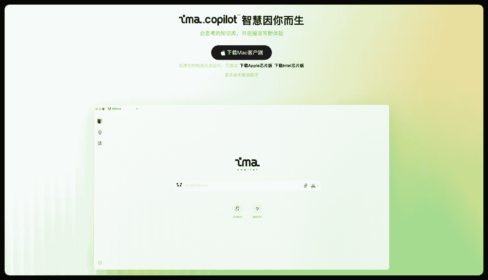

官网：https://ima.qq.com/

量子位测评：https://mp.weixin.qq.com/s/fWIDcB18CvzSqmYuLaAzmw

**最近智能体又频频带来**不少惊喜，前阵子谷歌 AI 笔记Google发布的notebooklm热度刚过去，腾讯便来了一个“传承延续”。

借助本身👸号数据优势壁垒，加上吸取的知识库概念，算是本土化AI 知识库的亮点，隔壁 notionAI 笔记已经很久没有炸裂更新，此次腾讯也是看准了智能体在笔记垂类的趋势，悄然小范围的开始推广试错。

---

## 10 月 29 日

### 【终端 AI】苹果发布 iOS18.1，Apple Intelligence终于来了

10月29日凌晨，苹果公司发布的 iOS 18.1 系统引入了一系列新功能，其中最引人注目的是 Apple Intelligence 。不过国行用户和全球大量非英语用户目前暂无法使用部分功能。以下是关于更新的详细介绍：

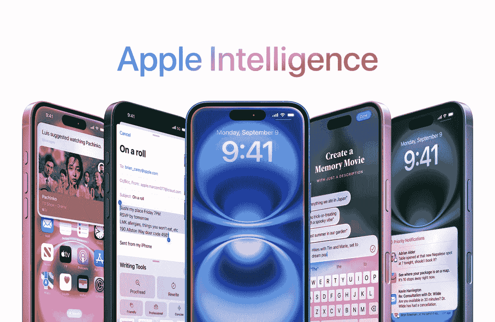

[4YxSmY6li11yebfF.mp4](https://internal-api-drive-stream.feishu.cn/space/api/box/stream/download/all/KkDGbeHPJosX0cxtBD2cUzp7n1b)

Apple Intelligence

+   **写作工具** - 写作工具支持一键总结归纳、对文本校对、针对用词和文本结构提出建议等

+   **Siri** - Siri 焕然一新，提供苹果设备产品知识，新增“输入给 Siri”功能，Siri 能够维持请求间的上下文，并理解你在说话时遇到困难。

+   **智能回复** - 在邮件和消息中，苹果可以建议回复收到的消息。

+   **功能概述** - 苹果智能可以总结电子邮件和通知，让您一眼就能看到重要内容。您还可以在“笔记”应用中查看转录摘要，以及在“Safari”浏览器中查看网站摘要。

+   **照片** - 记忆创造者让您只需描述即可创建个性化幻灯片，支持自然语言搜索，并提供清理功能，可从图片中移除不需要的对象。

**其它主要更新**

1.  **通话录音**：拨打电话接通后，通话页面左上角会出现录音小图标，点击可开启录音。虽然无需对方同意，但会通过语音提示对方通话正在被录音，录音会保存在备忘录中，可直接播放音频并转写为文本。

1.  **新增 rcs 信息**：在 iPhone 设置--app--信息中新增了“rcs 信息”选项，开启后可给安卓设备发送高清照片、视频等信息。

1.  **控制中心改进**：长按控制中心的连接模块，无线局域网、隔空投送、蜂窝数据、蓝牙四个模块由长条形改成方块形式；还可在控制中心添加单独的 Wi-Fi 控件、隔空投送控件。此外，新增还原控制中心的选项，能将其还原为厂家默认布局。

1.  **iPhone 镜像支持文件拖拽**：将 iPhone 更新到 iOS18.1正式版，mac 同步更新到 macOS15.1正式版后，使用屏幕镜像时可在 mac 和 iPhone 之间拖拽移动照片、文件、视频。

苹果CEO库克称正努力推动苹果智能在中国市场使用，需走完监管流程。按计划，今年12月将增加英国、澳大利亚等国的本地化英语支持，中文、印度英语、法语、德语、日语等语言的支持将于明年陆续推出。

[更多](https://agispace.feishu.cn/wiki/AJ6hwlMmRiCa1qkXrhtckeTYnZe)[Ap](https://agispace.feishu.cn/wiki/AJ6hwlMmRiCa1qkXrhtckeTYnZe)ple Intelligence详情

### 【AI+教育】北京市发布首份教育领域人工智能应用指南

10月26日，2024年北京市数字教育工作推进会在北京师范大学召开，正式发布了《北京市教育领域人工智能应用指南（2024年）》（以下简称《指南》），明确人工智能在教育领域应用规范，指导学校、师生稳妥、有序地开展应用实践。该指南是由北京市教育行政主管部门委托研制并发布的首份教育领域人工智能应用指南。

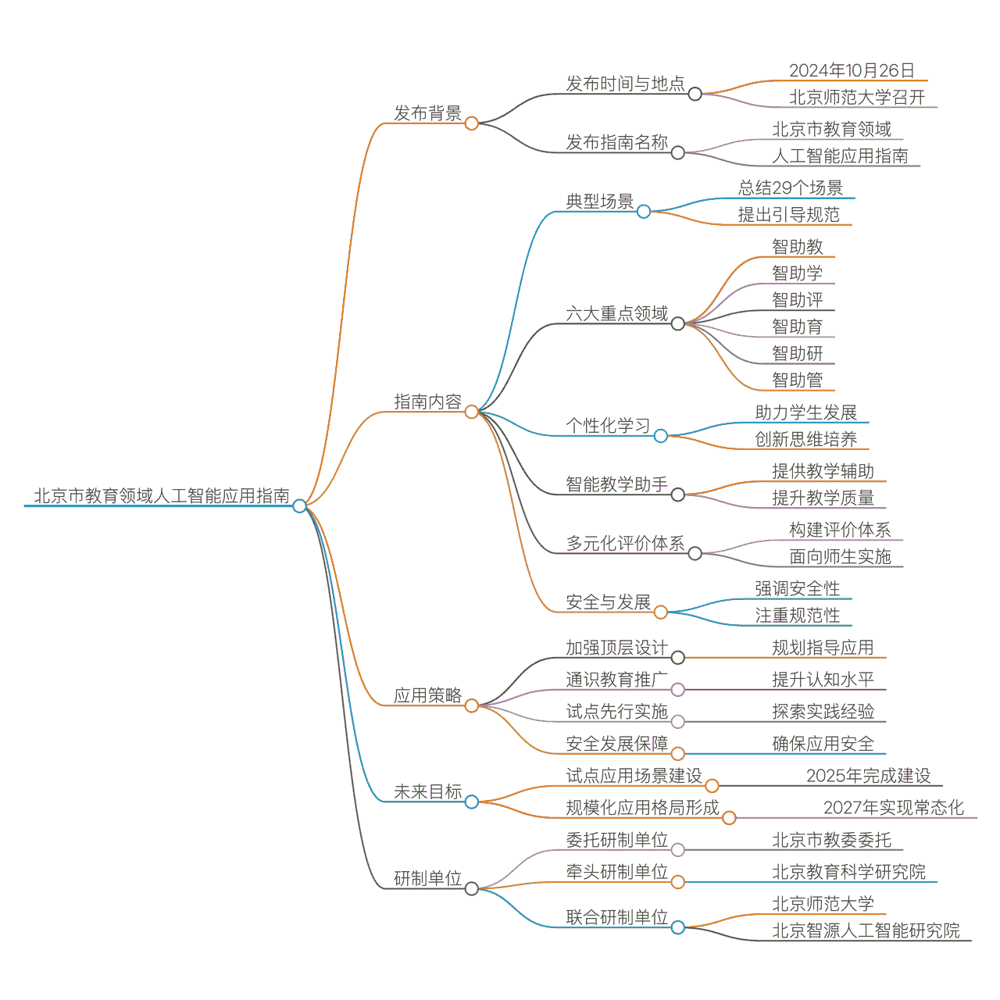

该指南由北京市教委委托研制，旨在明确人工智能在教育领域的应用规范，指导学校和师生稳妥、有序地开展应用实践。指南总结了29个典型场景，并提出了引导和规范，确保人工智能技术在教学、管理、科研等环节中充分发挥作用。指南涵盖了六大重点应用领域，包括助教、助学、助评、助育、助研和助管，并对教育人工智能应用作出规范要求，强调安全发展和批判性使用人工智能的理念。该指南是北京市教育领域人工智能应用政策监管体系的关键举措之一。

### 【智能体】智谱上线自主智能体AutoGLM，PC端已开放使用

AutoGLM是由智谱AI开发的一款自主智能体，它能够通过文字或语音指令模拟人类操作手机和网页，完成各种自动化任务。

（https://xiao9905.github.io/AutoGLM/项目地址）

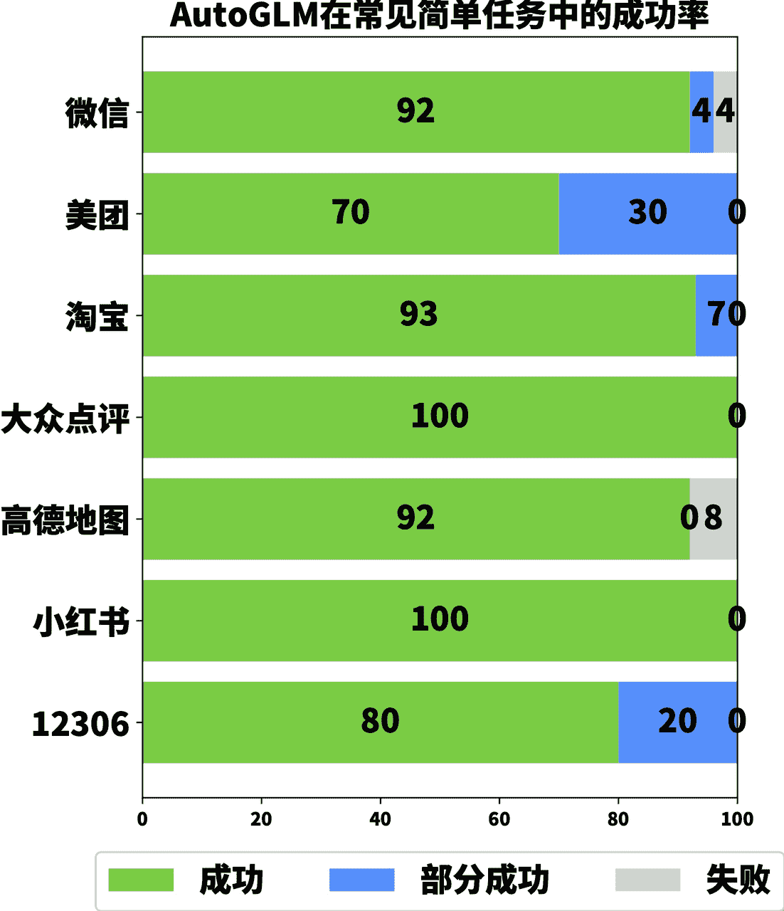

**核心功能：**AutoGLM 可以模拟人类在手机和网页上进行点赞、购物、预订酒店等操作。它基于智谱自研的 “基础智能体解耦合中间界面” 和 “自进化在线课程强化学习框架”，克服了网页智能体研究和应用中训练任务稀缺、反馈信号稀少和策略分布漂移等难题。

**AutoGLM的应用前景：**AutoGLM已在🛰️、淘宝、美团等热门应用中实现应用，覆盖了聊天、网购、社交、地图服务及订票等日常生活场景。市场潜力：根据IDC的预测，到2027年，中国市场AI手机和AI PC的市占率将分别超过50%、80%。智谱正在加紧推动大模型落地AI手机，并已与高通、三星等手机厂商达成合作。

**如何使用AutoGLM？**

**一、手机端使用**

目前移动端仅支持安卓端应用测试。用户需前往智谱清言，查找“AutoGLM小助手”，提交姓名、职业、手机号码以及申请原因。内测申请通过后，会收到含下载链接的短信。

获得测试资格后，使用步骤如下：

1.  **打开清言App**：确保已安装清言app。

1.  **开启AutoGLM模式**：在app内找到AutoGLM入口，开启自动驾驶模式。

1.  **下达指令**：像与朋友聊天一样，告知AutoGLM想要完成的任务，例如“帮我订个外卖”或“查找下周的天气预报”。

1.  随后，AutoGLM会依据指令自动完成相应操作。

**二、网页版使用**

目前，用户可通过安装“智谱清言”插件体验AutoGLM - Web。它是一个浏览器助手，能够模拟用户访问网页、点击网页，并在网站上自动完成高级检索、总结与内容生成。

> 项目地址：https://xiao9905.github.io/AutoGLM/

> 官网介绍：https://www.zhipuai.cn/news/144

### 【端侧大模型】端侧大模型浪潮奔涌而至：态势、影响与建议

来自腾讯研究院的一篇关于端侧大模型的文章https://mp.weixin.qq.com/s/G7lSj-tKijNWtr8lckVmTQ

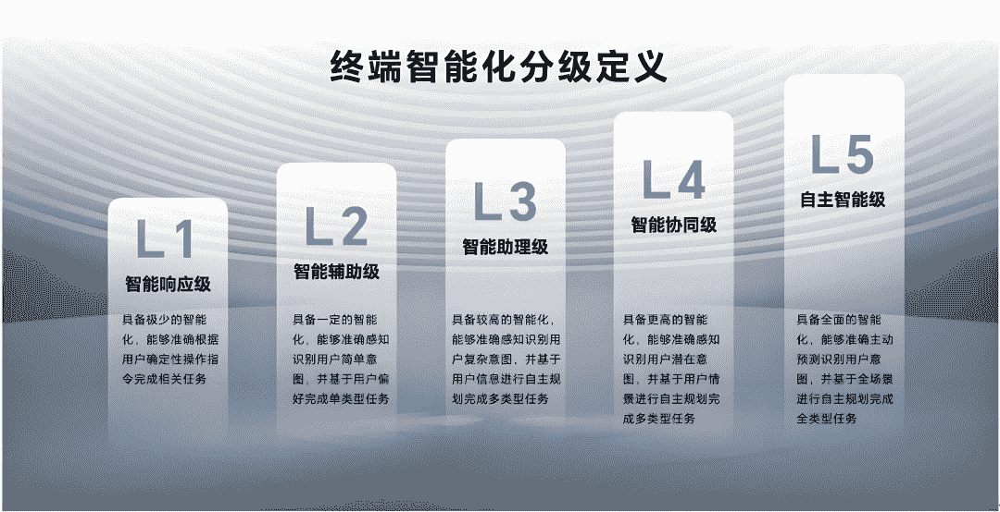

这篇文章探讨了端侧大模型在智能手机和其他终端设备上的快速发展和广泛应用，分析了其技术特点、优势（如实时性、保密性和经济性）以及未来发展趋势。文章指出，端侧大模型将重塑用户体验和生态格局，尤其在智能手机领域有望带来新的增长动力，并可能改变应用分发和商业模式。同时，文章也讨论了国内外在端侧大模型方面的发展态势及其对产业和数据隐私的潜在影响。

## 10 月 28 日

---

### 【AI 复活】AI赋予罗马半身像栩栩如生

今日，AI 技术再次惊艳众人！它竟能让古老的罗马半身像，如图拉真、尤利乌斯・凯撒、埃拉加巴鲁斯、卡利古拉等，从原始照片中 “活” 过来，生成栩栩如生的真人短视频。AI 的强大功能让历史与现代完美融合，充分展现了其在图像和视频处理领域的飞速发展，为我们带来了全新的视觉体验和历史感悟。

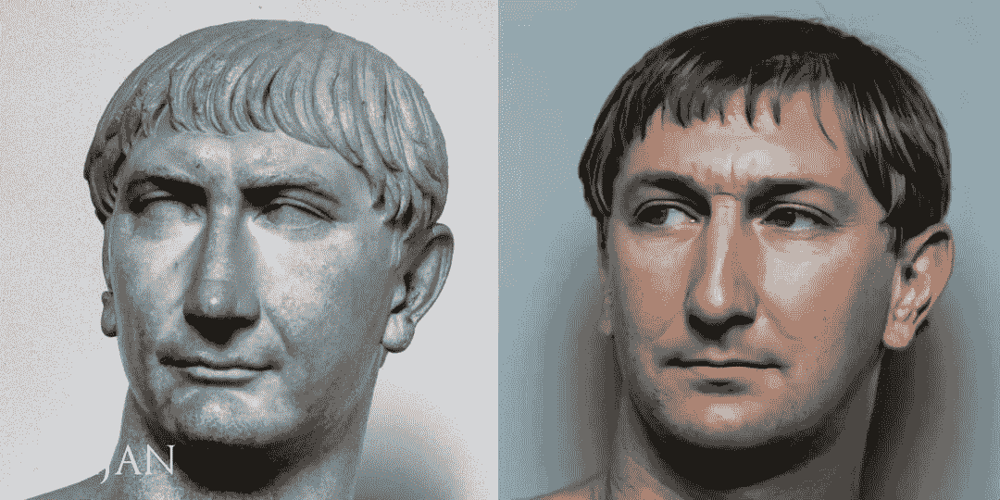

[oN9NP9RV1XRWYBSv.mp4](https://internal-api-drive-stream.feishu.cn/space/api/box/stream/download/all/OtIIbnWVPo3BmpxjOT5cyep8nqb)

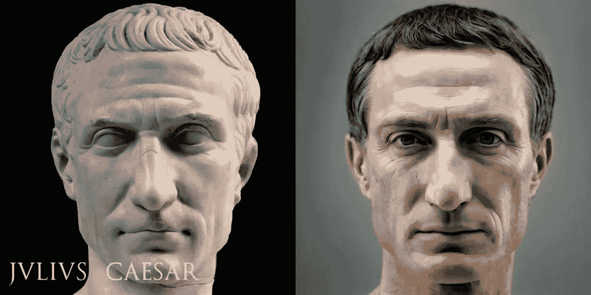

[WmcEUaYETfg_IabY.mp4](https://internal-api-drive-stream.feishu.cn/space/api/box/stream/download/all/KXcDb84iAoLpAzxROsKcYxDJnxh)

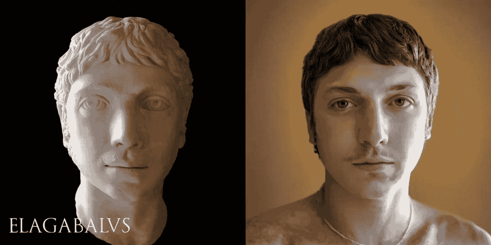

[2nncG7jJ61m7ZpH9.mp4](https://internal-api-drive-stream.feishu.cn/space/api/box/stream/download/all/CxSTb1ZMEo4UiUx8MHqcyG5pn9g)

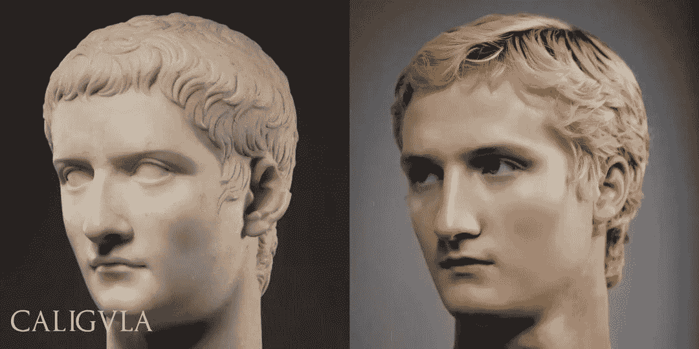

[obs0-0IaeEZx1p9n.mp4](https://internal-api-drive-stream.feishu.cn/space/api/box/stream/download/all/CLXab7YD4oj7MYxfARncViVFnae)

图拉真、尤利乌斯·凯撒、埃拉加巴鲁斯、卡利古拉转自Angry Tom

### 【前沿访谈】OpenAI 产品官洞察，未来 AI 更自主异步，产品构建变，新可能出现

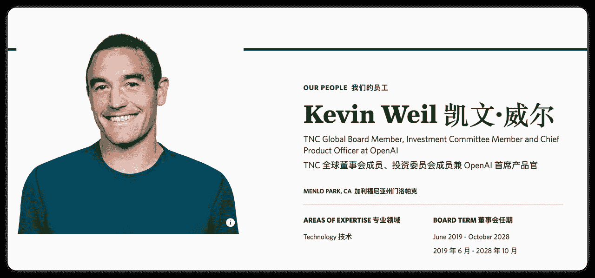

这篇文章是关于OpenAI首席产品**官Kev**in Wei**l的最新见解，**讨论了未来AI的发**展方向、产品构**建的变化以及OpenAI在技术和产品策略上的创新。

1.  **OpenAI产品管理的独特性**：Kevin Weil提到，在OpenAI工作与在其他公司最大的不同在于技术基础的不固定性，以及快速变化的技术带来的挑战和机遇。

1.  **AI技术的快速发展**：Weil强调，AI技术每隔一两个月就会有新的突破，这使得产品构建方式需要不断调整，以适应技术的不确定性。

1.  **开发者路线图策略**：OpenAI希望将AI交给开发者，让他们创造惊人的应用。Weil介绍了包括实时语音API和模型蒸馏功能在内的新发布，旨在降低AI应用的门槛。

1.  **AI应用的未来潜力**：Weil和Nishihara讨论了AI在翻译、商业对话等领域的应用前景，以及开源模型对OpenAI业务的影响。

1.  **竞争与合作**：文章还提到了OpenAI与其他云服务提供商的竞争关系，以及OpenAI如何通过快速行动和承担风险来保持竞争优势。

1.  **o1模型的挑战与应用**：Weil分享了将o1模型转化为产品的挑战，包括其推理能力和在解决问题过程中的应用。

总的来说，文章深入呈现了 OpenAI 首席产品官的最新见解，涵盖未来 AI 发展方向、产品构建变化及技术与产品策略创新，展现了 OpenAI 在 AI 技术飞速发展潮流中的积极探索与引领作用。

> 根据OpenAI首席产品官Kevin Weil与Anyscale联合创始人Robert Nishihara的对话内容整理，原文链接：https://mp.weixin.qq.com/s/Dc8c4dwTYhHv64ord02QyA

### 【行业报告】2024年Q3全球AIGC行业月报-流量篇

来自《非凡产研：2024 年 Q3 全球 AIGC 行业月报 - 流量篇》主要展示和分析了 2024 年 Q3 全球 AI 产品的流量态势，涵盖全球、国内及出海等维度，通过多种核心指标揭示市场竞争格局和用户需求偏好。

以下是报告中的一些重要数据结果：

+   **全球规模以上 AI 产品数量**：截至2024年9月底，全球规模以上（月访问量超过1万次）AI 产品数量达1743个，与上月相比相差不大，整体趋于稳定。中国规模以上 AI 产品数量（含国内及出海）在9月达316家，环比增长2.93%，创历史新高；出海规模以上的 AI 产品数量9月继续增加，产品数量达117个，较上月增加8家。

+   全球 AI APP 产品使用次数：9月份，与生成式人工智能相关的应用程序实现了552.67亿次单月使用量。

+   **全球市场 AI 产品内购收入**：9月份，全球用户对 AI 产品的内购消费总计达29959万美金。

+   **ChatGPT 相关数据**：9月独立访客数为2.84亿人；Q3访问量和月活人数稳步上升，其月访问量从1月的16.10亿次显著增长至9月的31.24亿次；访问时长方面，9月以3.22亿小时位居榜首。

+   **国内聊天机器人访问量**：9月国内月访问量过千万的聊天机器人仅有3家，分别是Kimi.ai（2455 万次）、豆包（2053 万次）、阿里通义（929 万次）。

+   **部分 AI 产品下载量**：9月全球 AI APP 下载量方面，ChatGPT 为3569万次，剪映为2460万次；国内 AI APP 下载量中，剪映为2460万次，豆包APP 为1631万次；出海 AI APP 单月下载量超过500万次的仅有 Gauth 和 InShot。

+   **教育类 APP 收入**：9月教育类 APP Duolingo 逼近4000万美金，单月吸金3976万美元；ChatGPT 本月收入3730万美元；剪映以3186万美元位列第三。

> 原文链接(非凡产研)：https://mp.weixin.qq.com/s/mzI5y9aOKLaT9HGUle9qfw

---

## 10 月 18 日

### 【AI硬件前瞻】AI硬件如何摆脱“昙花一现”的魔咒｜甲子光年

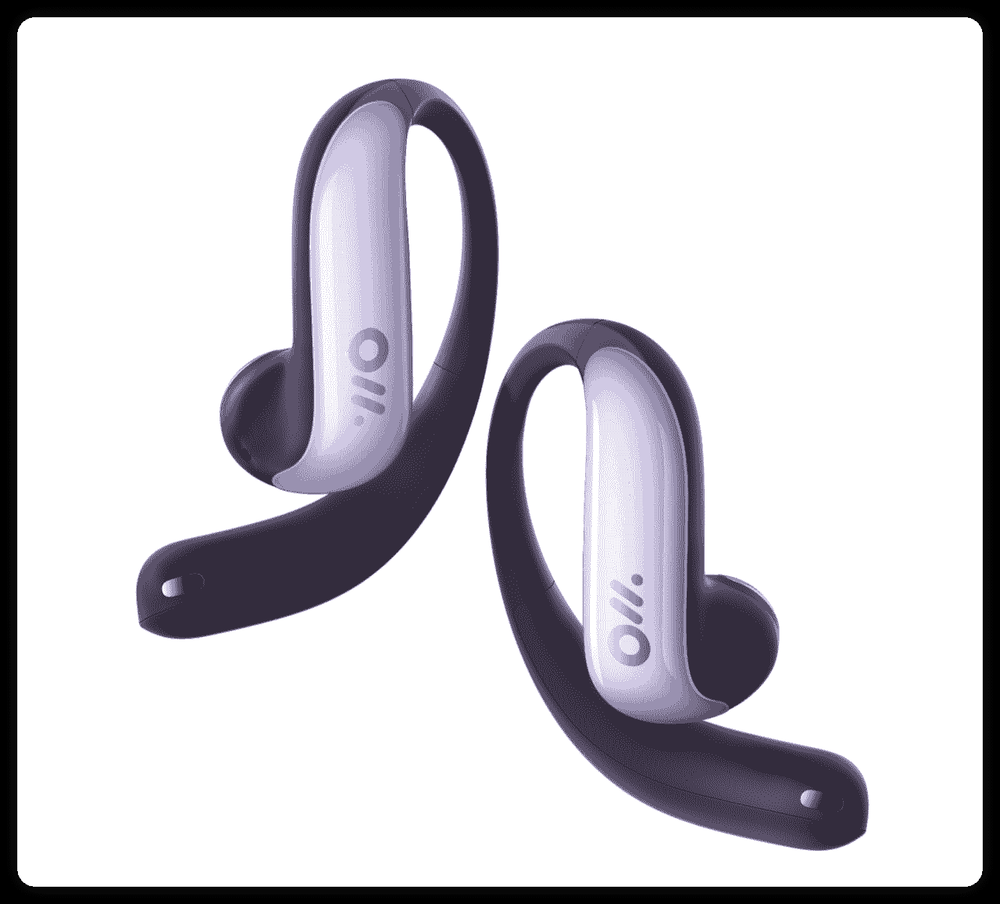

Ola Friend

AI Pin

Limitless的Pendant吊坠

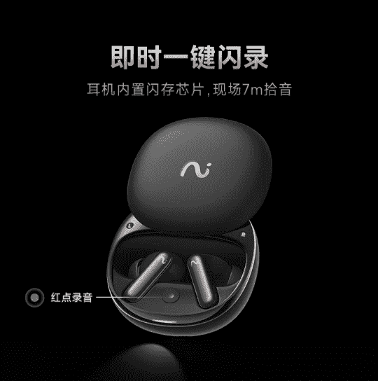

iFLYBUDS Pro 2

---

关于豆包开启了国内 AI 耳机的第一炮之后，推荐甲子光年的这篇文章，探讨了AI硬件产品如何避免“昙花一现”的命运，分析了AI硬件的市场现状、存在的问题以及可能的解决之道，并提出了理想的AI硬件产品应具备的特点。

1.  **AI硬件的市场现状**：文章开头提到了智能硬件rabbit r1和字节跳动的ola friend耳机等产品，这些产品虽然受到质疑，但AI硬件的市场热情依然高涨。据统计，自2019年以来，已有十多位大公司高管投身AI硬件创业。

1.  **AI硬件面临的问题**：许多AI硬件产品未能形成足够的产品力和市场认可，部分原因是产品定义上的缺失，如功能冗余、依赖手机运行等。此外，文章提到了humane ai pin的销售滑铁卢，指出其功能鸡肋和用户体验不佳是主要原因。

1.  **解决之道**：文章提出了两种思路，一是“硬件+AI”，即在已有品类上做创新和提升；二是“AI+硬件”，即通过软件定义硬件，从根本上变革个人计算设备的产品形态。

1.  **硬件+AI的策略**：借鉴普适计算的理念，将产品做得更便利、更有陪伴性、更具沉浸感。例如，limitless吊坠和科大讯飞的智能硬件产品，都是通过AI升级原有硬件，寻找新的需求。

1.  **AI+硬件的策略**：用软件定义硬件，如黄仁勋所提出的“加速计算”，通过AI大模型催生新的硬件形态，例如humane ai pin和rabbit r1。

总的来说，AI硬件市场虽然充满机遇，但也面临着诸多挑战。要想避免“昙花一现”的命运，AI硬件产品需要在产品定义、用户体验和市场定位上下功夫，同时探索“硬件+AI”和“AI+硬件”两种发展路径。

> https://mp.weixin.qq.com/s/kkLkv-fwP6bI-5oVQrtYxA

---

## 10 月 17 日

### 【研究报告】Stateo发布《2024 年人工智能现状报告》

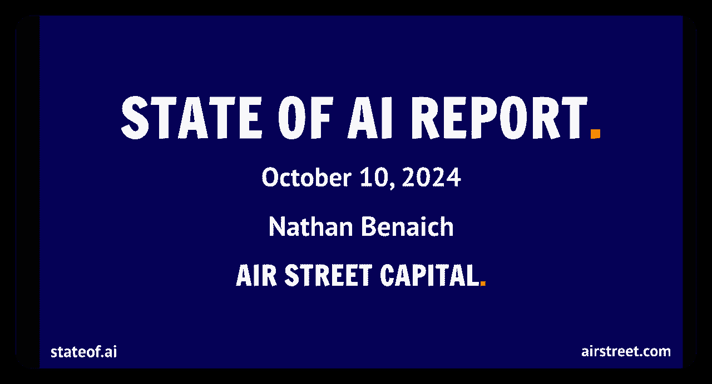

> 《**人工智能现状报告》**分[**析了人工智能领域最有趣的发展**](https://www.twitter.com/nathanbenaich)。[我们旨](https://www.airstreet.com/portfolio)在引发关于人工智能现状及其对未来影响的知情讨论。该报告由人工智能投资者Nathan Benaich和Air Street Capital制作。

《2024 年人工智能状况报告》已进入第七年，由行业和研究领域的领先人工智能从业者进行审查。报告考虑了以下关键方面，包括新的“安全”部分：

1.  **研究：**技术突破及其能力。

1.  **行业：**人工智能的商业应用领域及其商业影响。

1.  **政治：**人工智能的监管、其经济影响以及人工智能不断发展的地缘政治。

1.  **安全：**识别并减轻未来高性能人工智能系统可能给我们带来的灾难性风险。

1.  **预测：**我们相信会发生什么，并通过绩效评估来保持我们的诚实。

**2024 年报告的主要内容包括**：

1.  **随着 GPT-4 与其他模型之间的差距缩小，前**沿实验室的表现开始趋同，专有模型失去优势。OpenAI o1 让该实验室重回榜首——但能持续多久？

1.  随着公司探索将 LLM 与强化学习、进化算法和自我改进相结合以解锁未来的代理应用，规划和推理在 LLM 研究中占据优先地位。

1.  基础模型展示了它们突破语言的能力，支持数学、生物学、基因组学、物理科学和神经科学的多模式研究。

1.  美国制裁对中国实验室生产高性能模型的能力影响有限，因为库存、经批准的硬件、走私和云访问等因素让它们能够制造出高性能的 (V)LLM。与此同时，中国打造国内半导体产业的努力仍然举步维艰。

1.  **随着上市公司在人工智能领域迎来牛市，人**工智能公司的企业价值已达到 9 万亿美元。尽管 GenAI 在美国取得了巨大成功，但对私营人工智能公司的投资也有所增加，但幅度却有所下降。

1.  少数 AI 公司开始产生可观的收入， 包括基础模型构建者和从事视频和音频生成的初创公司。然而，随着企业争夺地盘，模型变得越来越便宜，关于长期可持续性的问题仍未得到解答。

1.  **伪收购成为人工智能公司的出路，**因为一些公司很难找到可行的商业模式，因为停留在前沿的成本太高。

1.  **关于生存风险的讨论已经冷却，**尤其是在 OpenAI 政变失败之后。然而，研究人员继续加深对潜在模型漏洞和滥用的了解，并提出了潜在的修复和保障措施。

> （报告英文原件）

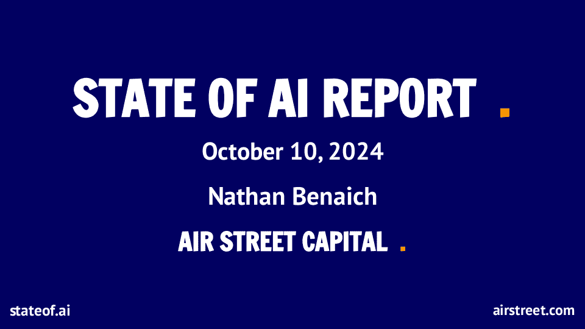

[State_of_AI_Report_-_2024_ONLINE.pdf](https://internal-api-drive-stream.feishu.cn/space/api/box/stream/download/all/TFQmbvtYboynAFxFt5ycyWbtnkg)

---

## 10 月 16 日

### 【联想 AI】联想从 AI Ready 到 AI Now

联想Tech World 2024盛况：联想的年度全球盛会在美国西雅图举行，吸引了包括英特尔、AMD在内的多个科技巨头的CEO站台，展示了联想在AI领域的重大进展。

1.  **提出混合式人工智能理念深化**：

+   联想将未来定义为“混合式人工智能”，强调企业基础模型和私有云与公共基础模型和公有云共存，共同塑造未来。私有AI（包括个人和企业）将与公共AI共存且相互补充，为不同客户需求提供更适配、更优化的结果。

1.  **发布系列AI产品与技术**：

+   **联想AI Now**：是将PC转变为个性化助手的本地AI智能体。它利用基于Meta的Llama3.1构建的本地大型语言模型，可与用户个人知识库实时交互，提供增强的数据隐私保护，用户能使用它自动化和简化各种任务，还集成了PC助理功能，且支持联想和第三方AI应用丰富生态系统。

+   ThinkPad X12 合 1 Gen10 Aura Edition：作为一款二合一的设备，配备超亮OLED显示屏、高刷新率，性能强劲，电池续航长，可在多种模式间无缝切换。其具有多种智能模式和功能，如智能模式可个性化不同任务、智能共享可与智能手机无缝共享图像等，且在设计上注重可持续性。

+   第六代Neptune海神液冷解决方案：采用温水冷却技术，能够减少高达40%的电力消耗，已全面覆盖联想服务器、解决方案和服务的端到端混合AI产品组合。

+   ThinkSystem系列新款服务器：例如SC777将搭载NVIDIA Blackwell AI加速卡（GPU），联想是首批搭载英伟达Blackwell系列GPU的厂商之一。

1.  **展示AI在多领域的应用**：

+   在医疗领域，为渐冻症患者打造数字分身AI Twin、为阿尔茨海默症患者定制AI数字分身；在文物保护方面，为应县木塔构建数字“木塔孪生体”等。

1.  **豪华嘉宾阵容与合作**：

+   全球众多顶级AI科技公司CEO现身大会，包括NVIDIA创始人兼CEO黄仁勋、Meta CEO马克·扎克伯格、AMD董事长兼CEO苏姿丰、英特尔CEO帕特·基辛格、微软董事长兼CEO萨提亚·纳德拉、高通总裁兼CEO克里斯蒂亚诺·安蒙等，凸显了行业对联想的认可与关注。

+   英特尔与AMD史无前例首次合作，宣布组建x86生态系统咨询小组，联想作为创始成员加入，该小组旨在塑造x86的未来。

+   联想与英伟达合作推出联想混合式AI全面优势集，为企业提供端到端的AI解决方案。

> **推荐阅读：**

> 量子位https://mp.weixin.qq.com/s/opWgfm1Or8OQ2oQIupQ04Q

> 极客公园https://mp.weixin.qq.com/s/wTsIOrWHEUpvq2GGXsebRg

> 官网：https://techworld.lenovo.com.cn/pc/2024/index.html

### 【AI 电商】推出 Google Shopping — 使用 AI 从头开始重建。

[JacketsDesktopVideo.mp4](https://internal-api-drive-stream.feishu.cn/space/api/box/stream/download/all/E9zLbtzukoTiDWxodfgc9tSXnZg)

2024年10月，Google购物推出了一系列AI增强功能，包括使用Gemini模型的个性化推荐、产品要点摘要和动态筛选器，帮助用户更轻松地找到合适商品。新功能还包括虚拟试穿、折扣页面和价格比较工具。这些AI驱动的改进旨在简化购物流程，提高用户决策信心。目前，这些更新已在美国推出。

Google Shopping的2024年更新带来了几项主要功能：

1.  **AI生成的产品摘要**：帮助用户快速了解重要的购买因素。

1.  **个性化推荐**：基于用户偏好，提供更为精准的产品建议。

1.  **动态筛选器**：根据购物偏好实时调整搜索选项。

1.  **虚拟试穿**：允许用户在线试穿服饰。

1.  **价格比较和跟踪**：帮助用户寻找最佳价格和折扣。

[💬官](https://blog.google/products/shopping/google-shopping-ai-update-october-2024/)[方原文](https://blog.google/products/shopping/google-shopping-ai-update-october-2024/)

[new_scroll.mp4](https://internal-api-drive-stream.feishu.cn/space/api/box/stream/download/all/OpY4bB1W0o8bjSxh5yYcJV7Mn7b)

### 【AI 翻译】阿里国际翻译大模型吊打谷歌和GPT-4

10月16日，阿里国际副总裁、AI负责人张凯夫在接受彭博社专访时表示，阿里国际最新研发的Marco翻译大模型，支持中、英、日、韩、西、法等15种全球主流语种。目前已在阿里国际AI官网Aidge上发布，面向全球用户开放使用。

1.  AI翻译界的竞争：文章开头提到AI翻译领域的竞争激烈，阿里国际发布了新的翻译大模型，能够提供比谷歌和GPT-4更优秀的翻译服务。

1.  marco-mt的特点：marco-mt支持三种翻译方式，包括基于语境的产品翻译、图像翻译和实时聊天翻译，能够更好地保留原意并提供简洁准确的表达。

1.  电商领域的应用：marco-mt在电商领域表现出色，能够处理专业术语和流行词汇的翻译，提供符合目标市场语言习惯的翻译结果。

阿里国际Aidge 官网： https://cn.aidc-ai.com/

新智元见解：https://mp.weixin.qq.com/s/sgb6b5dNDXpPG-EruoaeKA

### 【机器人融资】2024年前三季度都有哪些人形机器人企业获得亿元+投资？

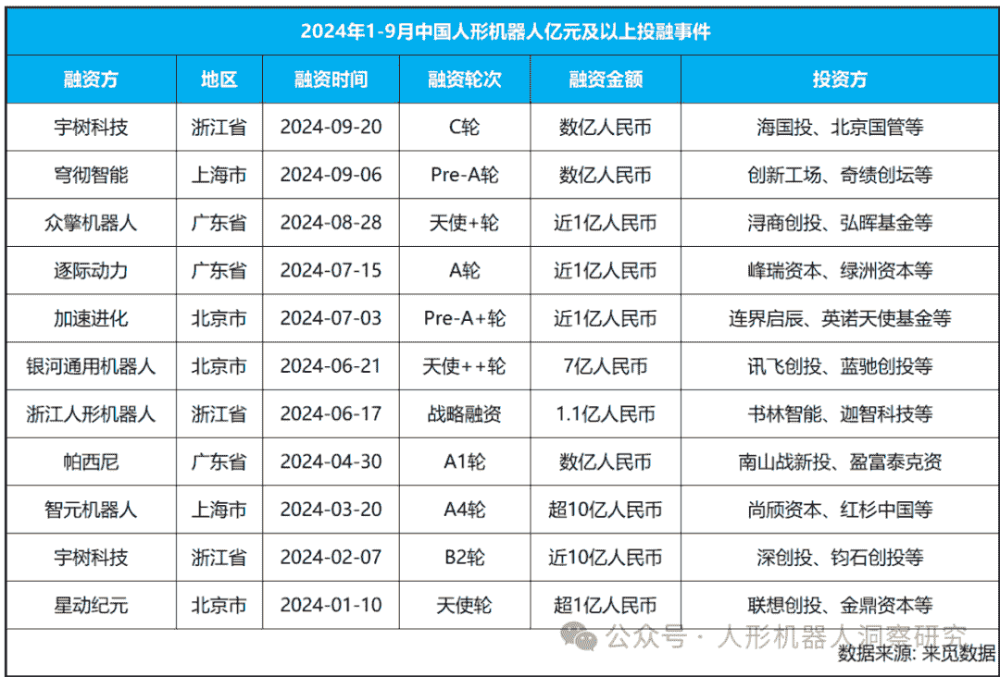

这篇文章介绍了2024年前三季度获得亿元及以上投资的人形机器人企业，多家企业获得亿元级投资。星动纪元、宇树科技、智元机器人等分别完成超亿元融资，专注于具身智能、技术研发及多维度触觉传感等领域。展示了这些企业的融资情况、地区分布、融资轮次和金额等详细信息，并对其中几家公司进行了简要介绍。

原文人形机器人洞察研究：https://mp.weixin.qq.com/s/kLTjClHuVdIVrTgaxIwHzw

---

## 10 月 15 日

### 【观点预测】 Anthropic 首席执行官发表关于人工智能和未来的文章

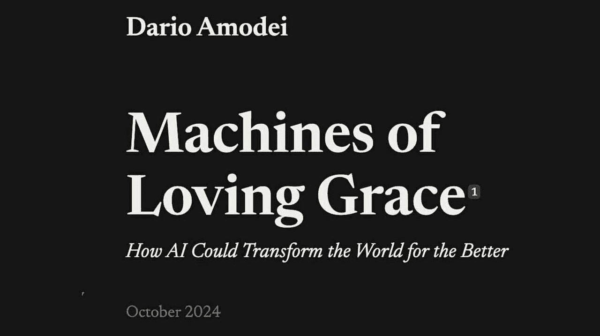

**摘要：**[** An**](https://darioamodei.com/machines-of-loving-grace?utm_source=www.therundown.ai&utm_medium=referral&utm_campaign=anthropic-ceo-predicts-ai-utopia)thropic 首席执行官 Dario Amodei 刚刚发表了一篇长文，概述了人工智能在达到人类水平的能力后 5-10 年内如何改变社会的乐观愿景，涉及长寿、政治、工作、经济等。

**独到的概念：**

《Machines of Loving Grace》文章中提出了几个与众不同的重要概念，这些概念既与传统的AI讨论有所不同，又提供了对未来AI发展的独特见解：

+   **“压缩的21世纪”**：这是一个独特的概念，指AI可以在未来5-10年内实现人类在生物学、医学等领域原本需要50-100年才能取得的进步。这种超快速的技术发展是AI带来的革命性潜力之一。

+   **智能的边际收益**：文章提出在某些任务或领域，AI的贡献可能会遇到限制因素，如数据缺乏或物理世界的速度限制，尽管AI具备强大的智能能力。这个概念强调了智能并非万能，其他生产要素仍然是成功的关键。

+   生物自由（Biological Freedom）：该概念设想了人类通过AI的帮助可以实现对自身生物过程的完全控制。它不仅涉及健康和疾病的管理，还包括选择外貌、体重等个体生物特征的能力，代表了一种对身体自主权的极致追求。

+   **认知和精神自由**：这个概念与生物自由类似，但聚焦于心理和认知层面。AI可能帮助人类提升认知功能、情绪管理，甚至带来更深层次的精神体验，如创造力、冥想等。这种自由超越了当前医疗或心理治疗的范畴，直指人类体验的核心。

+   **从虚拟生物学家到全能AI助手**：文章设想AI不仅仅是一个分析工具，而是能够代替人类科学家从事复杂实验和发明的新技术。例如，AI可以自动设计和运行实验，这一概念展示了AI作为“虚拟生物学家”的潜力，彻底颠覆科学研究的方式。

+   **逃逸速度与寿命延长**：文章讨论了AI如何帮助人类延长寿命，并设想当人类寿命达到150岁时，可能会进入“逃逸速度”，即科技进步的速度快到可以持续延长寿命，使人类有机会活到他们想要的年龄。

+   **复杂系统中的智能限制**：作者指出，尽管AI能够解决许多复杂问题，但面对某些混沌系统或不可预测的自然现象，即使最强大的AI也可能无法做得比人类好得多。这个概念表明AI的智能在某些方面仍然受到自然规律的约束。

这些概念共同展示了AI不仅仅是提升效率或解决具体问题的工具，它可能重新定义人类的生活方式、认知能力以及生命本身的界限。

**重要性：**作为被视为“以安全为重点”的人工智能实验室的首席执行官，Amodei 描绘了未来十年人工智能发展方向的乌托邦式乐观观点。这篇发人深省的文章既是人工智能潜力的路线图，也是确保技术负责任发展的行动号召。

> 原文以及翻译已收录至：[Machines of

> Loving Grace 慈爱机器](https://agispace.feishu.cn/wiki/Jx10w7FSXinnknkoek1cnZ0BnYf)

## 10 月 14 日

### Adobe 发布 Project Concept

这是一款新的人工智能优先产品，它改变了每个创意之旅的早期阶段。 Project Concept 还具有 Adobe Firefly Generative AI 模型的最新功能，可帮助您快速探索潜在的艺术方向、将图像混合在一起、转换资产区域以及重新混合样式、背景和其他成分资产。

[media_17978ce217fc7d8bbba009979c85dd8d972161778.mp4](https://internal-api-drive-stream.feishu.cn/space/api/box/stream/download/all/T0rrbyZTAoNQfNx0iTWc41bpnNg)

如果每个创意项目都从一个强大的“概念和情绪板”阶段开始，帮助您发现、创造和分享概念，会怎样？如果您可以利用最先进的生成人工智能功能和协作工具来进行这个激烈的探索阶段，会怎样？在快速的时间周期内为您的项目寻求无数可能的路径？这种对未来的愿景促使我们的团队构建了 Project Concept，这是一款通过无与伦比的创意控制和方向来改变每个创意项目的开始的产品。

---

## 10 月 12 日

### 【人工智能榜单】2024 年 9 月 AI 行业榜，包含独角兽、收入、产品和粘性榜单，区分全球、国内和出海

原文：https://mp.weixin.qq.com/s/OLv3l79wJIq7WwI6S2psdg

非凡产研根据自身对AI产业的独立研究和对全球数千家AI公司和近万个AI产品的持续追踪，根据当月该AI WEB产品的累计访问量进行排序，整理出全球范围内按照访问量排序的前100个AI WEB产品，具体榜单如下：

**全球公司榜**

+   AI 公司 独角兽 TOP100

+   AI 公司 收入榜 TOP100

+   AI 公司 估值增速 TOP100

**全球产品榜**

+   AI WEB 产品榜 TOP100

+   AI WEB 用户粘性 TOP100

+   AI APP 产品榜 TOP100

+   AI APP 用户粘性 TOP100

+   AI APP 内购收入 TOP100

**中国公司及产品榜**

## 10 月 10 日

### 诺贝尔奖快被 AI 包圆了，这10 个冷知识带你重新认识 AI 教父

https://mp.weixin.qq.com/s/x6nBCa7n9J9Gs2Sjz88iZg 这篇文章通过十个有趣的冷知识，重新介绍了人工智能教父Geoffrey Hinton的生平和贡献。文章不仅回顾了他在神经网络研究中的开创性工作，还分享了他在学术界和工业界的经历，以及他与多位科学家的关系。Hinton的故事不仅展示了他在人工智能领域的深远影响，还揭示了他独特的个性和幽默感。

## 10 月 8 日

### ChatGPT 与 Canvas 合作

OpenAI 近期推出了一个名为 Canvas 的新功能，旨在增强 ChatGPT 在写作和编码项目中的协作体验。与传统的对话界面不同，Canvas 提供了一个更交互式的编辑空间，用户可以直接编辑文本或代码。这个功能支持建议修改、调整文档长度、添加注释、调试代码等，还可以将代码翻译成多种编程语言。

Canvas 特别适合需要反复修改或复杂编码的任务，能够提高透明度，让用户更容易跟踪和管理修订。这个功能最初面向 ChatGPT Plus 和团队用户，未来计划推广到更多用户，包括免费用户。

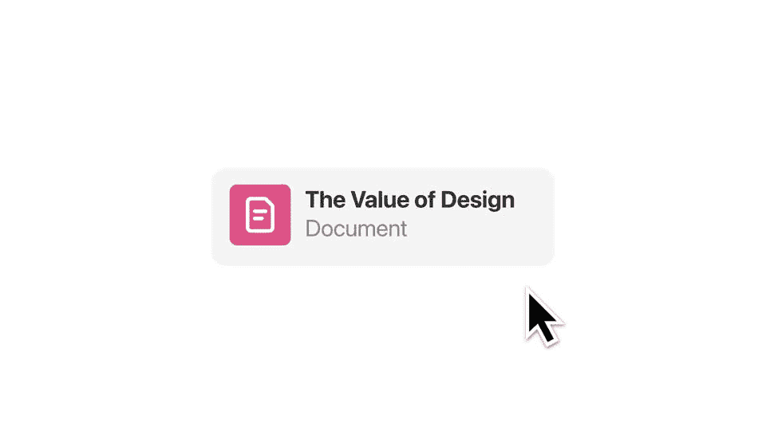

[Canvas_Writing_V1.mp4](https://internal-api-drive-stream.feishu.cn/space/api/box/stream/download/all/OGiObQ5z2oPeQTxnZdHcOxkDnId)

当 ChatGPT 检测到 Canvas 可能有用的场景时，它会自动打开。您还可以在提示中包含“使用 Canvas”以打开 Canvas 并使用它来处理现有项目。

书写快捷方式包括：

+   **建议编辑：** ChatGPT 提供内联建议和反馈。

+   **调整长度：**编辑文档长度以使其更短或更长。

+   **改变阅读水平：**调整阅读水平，从幼儿园到研究生院。

+   **最后的润色：**检查语法、清晰度和一致性。

+   **添加表情符号：**添加相关表情符号以强调和着色。

编码快捷方式包括：

+   **审查代码：** ChatGPT 提供内联建议来改进您的代码。

+   **添加日志：**插入打印语句以帮助您调试和理解代码。

+   **添加注释：**在代码中添加注释，使其更容易理解。

+   **修复错误：**检测并重写有问题的代码以解决错误。

+   **移植到一种语言：**将您的代码翻译成 JavaScript、TypeScript、Python、Java、C++ 或 PHP。

这个功能最初面向 ChatGPT Plus 和团队用户，未来计划推广到更多用户，包括免费用户

> [官网动态](https://openai.com/index/introducing-canvas/?utm_source=www.therundown.ai&utm_medium=referral&utm_campaign=chatgpt-levels-up-with-canvas)

### 美图公司旗下MOKI全面开放，重塑AI短片创作工作流

9月26日，美图公司旗下AI短片创作工具MOKI面向全部用户开放，用户可登录MOKI官网（www.moki.cn）进行体验。

与市面上流行的文生视频产品、图生视频产品不同，MOKI专注于AI短片创作这一场景，覆盖动画短片、网文短剧、故事绘本、MV等多个类型的视频内容生产，结合行业需求，有针对性地打造了一套AI短片创作工作流。

[66f5479e494468451xVRPCpT0M5541.mp4](https://internal-api-drive-stream.feishu.cn/space/api/box/stream/download/all/YIZVbub2Yo6qJdxwplpc0AlAnof)

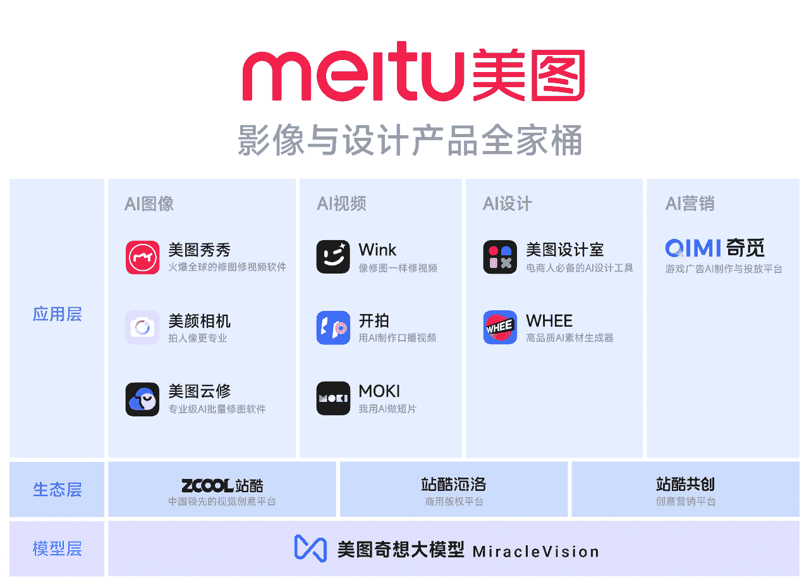

(展示短片：小云的昆仑仙境之旅)

# 🌾九月合集

---

## 9 月 29 日

### 【AI 短剧】用豆包生成AI版《红楼梦》MV

来自量子位一篇文章，使用字节跳动推出的AI视频生成模型豆包，创作了一支《红楼梦》主题的MV。

通过五个简单的步骤，包括查询原著片段、生成图片、制作视频片段、创作背景音乐和视频剪辑，作者成功地将经典文学作品转化为现代视觉艺术。文章还详细介绍了豆包PixelDance模型的四个关键能力：精准的语义理解、多动作多主体交互、强大动态和炫酷运镜的结合，以及一致性多镜头生成，展示了AI在视频创作领域的强大潜力。

原文地址：https://mp.weixin.qq.com/s/xNDGL5YHM-5KJUQy97ks9g

[0b2eaiaccaaauuabtfhymztfaawdeebaaiia.f10002.mp4](https://internal-api-drive-stream.feishu.cn/space/api/box/stream/download/all/M0TwbOpFgoCYzLxXDeQcILgQnSe)

（具体 MV）

---

### 【AI 医疗】支付宝进军大模型医疗应用

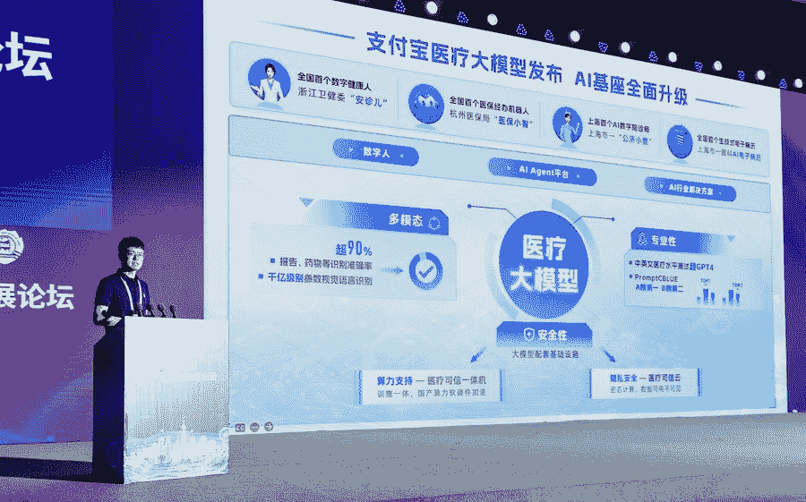

7月5日，在2024世界人工智能大会支付宝医疗大模型发布现场

原文地址：https://mp.weixin.qq.com/s/nrTdB2Gd13tzsivYGb0Mlw

这篇文章讨论了支付宝在医疗AI领域的最新进展和未来规划，特别是在大模型医疗应用方面。文章通过与支付宝医疗技术一号位魏鹏的对话，揭示了支付宝在该领域的四个主要切入点，并探讨了当前面临的技术挑战和行业趋势。

1.  **支付宝进军医疗AI的切入点**：

+   **医保问答**：利用图像解析和检索增强技术，提供政策类咨询服务，准确率达到80-90%。

+   **全科医生**：辅助医生角色，帮助用户初步判断病情，提供日常健康建议，提高医疗资源利用效率。

+   **院内服务串联**：与医院信息系统打通，提升医疗服务效率，实现数字人安诊儿等项目。

+   **专科智能体**：探索AI与专家医生交互，面临数据质量和获取的挑战，需长期积累和合作。

1.  **大模型医疗应用的挑战与数据问题**：

+   **数据处理**：当前医疗应用的最大挑战在于数据处理，国内需要两到三年时间解决。

+   **数据质量**：医疗数据需专业、权威、可信，标注成本高，错误数据会导致模型回答错误。

+   **模型参数量**：百亿参数量级足够，重点在于数据质量而非数量，需清洗和改写院内数据。

1.  **行业趋势与创业机会**：

+   **长期主义**：成功公司需具备长期主义精神，与政府、医院、ISV等生态建立良好关系。

+   **人文关怀**：医疗领域需兼顾情感、道德和人文关怀，数字人等服务需技术精度与人文温度并重。

+   **创业机会**：行业处于早期阶段，找到合适切入点的创业公司仍有机会，行业内有合作空间。

支付宝在大模型医疗应用方面展现了明确的战略规划和创新实践，未来将通过医保问答、全科医生、院内服务串联和专科智能体四个切入点，提升医疗效率和服务质量。面对数据处理的挑战，支付宝致力于与行业各方合作，推动医疗AI的发展。

---

## 9 月 27 日

### 【智能客服】万字长文讲透生成式AI 如何赋能客服

## 9 月 25 日

### 【AI 语音】ChatGPT高级语音助手正式上线！OpenAI：50多种语言、9种声线可选

在首次向公众展示的四个月后，OpenAI 终于决定面向其所有付费用户全面开放 ChatGPT 的类人高级人工智能语音助手功能 ——“高级语音模式”（Advanced Voice Mode，以下简称 AVM）。

Op**enAI 于 24 日发布消息称，所有订阅了 **ChatGPT Plus 和 Team 计划的付费用户都能够使用全新的 AVM 功能，不过该模式会在未来几日逐步推出。首先将在美国市场上线。下周，该功能会向 OpenAI Edu 以及 Enterprise 计划的订阅者开放。

据了解，AVM 提升了部分外语的对话速度、流畅程度，并且改进了口音。

高级语音有每日限制。当您在 15 分钟内达到该限制时，您将会收到警告。

[SaveTwitter.Net_GbIUwk5LOgfoU0c0_(1080p).mp4](https://internal-api-drive-stream.feishu.cn/space/api/box/stream/download/all/Wgy9baMSfo8ltexOWVEcuhgJnIg)

（官方展示 demo）

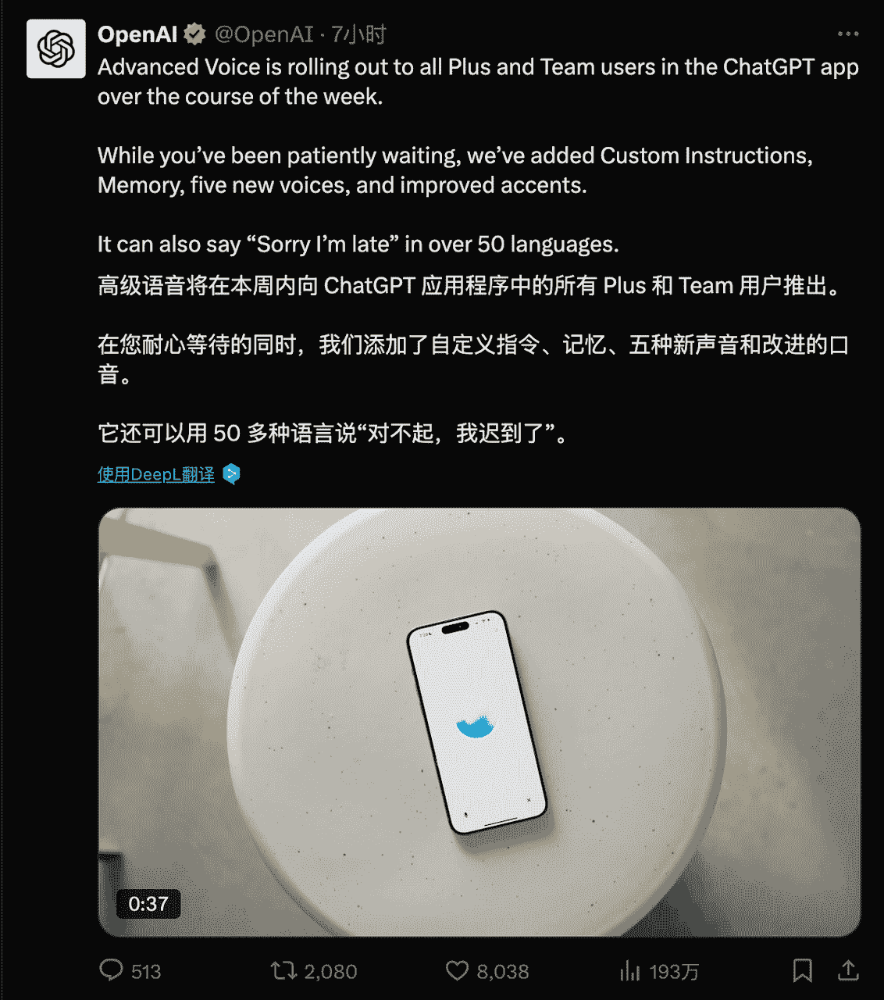

---

## 9 月 24 日

### 【AI 视频】字节正式发布新AI视频模型：PixelDance模型和Seaweed模型

字节跳动在火山引擎的发布会上正式发布了两款全新的AI视频模型：豆包视频生成-PixelDance模型和Seaweed模型。其中，豆包PixelDance模型凭借其卓越的性能和功能，已经和 Sora 掰手腕了。

豆包PixelDance模型特点：

+   **复杂连续动作**：能够生成人物的复杂连续动作，突破了以往AI视频的限制。

+   **多镜头组合视频**：只需一张图和一个Prompt，就能生成风格、场景、人物一致的多镜头视频。

+   **极致的运镜控制**：提供了前所未有的运镜控制能力，包括360度环绕、前后景变焦等多种运镜效果。

先看3 个案例 ⬇️ ：

[demo1.mov](https://internal-api-drive-stream.feishu.cn/space/api/box/stream/download/all/FpxCblvyIo0mOGxyWdlcRQdUnRg)

[demo2.mov](https://internal-api-drive-stream.feishu.cn/space/api/box/stream/download/all/NqfjbOYVXoQRa3xUhohcCXArngb)

[demo3.mov](https://internal-api-drive-stream.feishu.cn/space/api/box/stream/download/all/GKNFbtZGooTgXxxZgsCc7KLTnve)

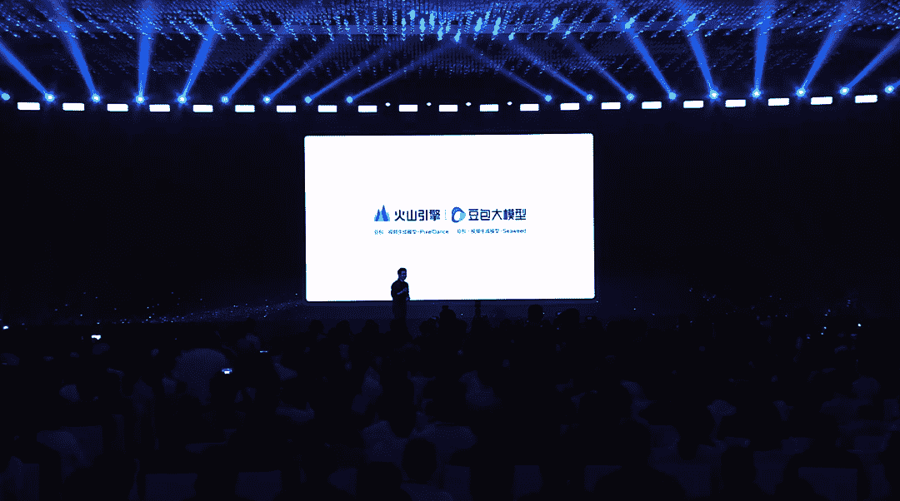

豆包PixelDance模型出乎意料展示了字节跳动在AI视频生成领域的强大技术实力，也为整个行业带来了新的发展机遇。随着这一技术的不断成熟和应用，我们有理由相信，未来的视频创作将更加便捷、高效和多样化。

**相关原文：**https://mp.weixin.qq.com/s/WAW7YjN4Y_TJRHy-0RXZaQ

---

### 【OpenAI】山姆·奥特曼罕见发长文，力推超级智能，百万人围观

Sam Altman's《智能时代》文章探讨了未来几十年人工智能（AI）将如何大幅提升人类能力，实现祖先难以想象的目标。AI不仅能够解决复杂问题，还将通过个性化教育、医疗等领域为所有人带来繁荣。深度学习的进步推动了AI的发展，未来可能在几千天内实现超级智能。虽然AI的普及存在挑战，但如果基础设施到位，AI将成为人人可用的工具，推动社会走向巨大的进步和繁荣。

**以下是奥特曼部分文章：**

在未来几十年里，我们将能够做到在祖辈看来像魔术一样的事情。

这种现象并不新鲜，但将会加速发展。随着时间的推移，人们的能力大幅提高；我们现在已经可以完成我们的前辈认为不可能完成的事情。

我们之所以更有能力，不是因为基因的改变，而是因为我们受益于社会的基础设施，这些基础设施比我们任何一个人都要聪明和有能力；从某种意义上说，社会本身就是一种高级智能。我们的祖辈以及他们的先辈创造并成就了伟大的事业。他们为「人类进步的脚手架」做出了贡献，而我们所有人都从中受益。AI 将为人们提供解决困难问题的工具，帮助我们在「脚手架」上添加新的支柱，而这些是我们自己无法解决的。人类进步的故事将继续下去，我们的后代将做到我们做不到的事情。

...

> 博客地址：https://ia.samaltman.com/

> 原文以及翻译版本[【24年9月】智能时代 The Intelligence Age](https://agispace.feishu.cn/wiki/CimZw1zsti2PXMkywgFc1Be5nuf)

## 9 月 23 日

### 【OpenAI】AI大家说 | 自动驾驶、人形机器人、数据瓶颈……OpenAI 创始成员谈未来

**概括**

OpenAI 创始成员 Andrej Karpathy 在 No Priors 播客中探讨了自动驾驶、人形机器人和 AI 发展等话题，认为 AI 应成为赋能人类工具。

**详细信息：**

1.  人形机器人最初的应用场景应在工厂进行物料搬运，而非直接面向消费者。

1.  自动驾驶技术已触及通用人工智能（AGI）的边缘，未来可能发展为端到端的深度学习系统。

1.  人形机器人与自动驾驶技术之间存在许多可转移的技术和理念。

1.  目前机器人技术缺少关键技术包括下半身控制和远程操作。

1.  数据壁垒和规模发展的成本问题已成为 AI 发展的主要瓶颈。

1.  合成数据在 AI 进步中扮演关键角色，但需注意保持数据的多样性和随机性。

1.  Transformer 模型在记忆序列方面比人脑更高效，但在数据获取上仍存在限制。

1.  未来人类与 AI 系统的结合可能类似于大脑的外层皮质，通过云端实现。

1.  未来模型可能非常小且高效，通过蒸馏技术实现功能压缩。

1.  教育不应只是有趣，还应具有挑战性和乐趣，AI 可在这方面发挥巨大作用。

**重要性：**

Andrej Karpathy 在访谈中深入探讨了 AI 的现状与未来发展，强调 AI 应成为赋能人类的工具而非取代人类。他提出人形机器人和自动驾驶技术的未来应用场景，并指出目前机器人技术所缺少的关键技术。同时，他也关注数据壁垒和合成数据的重要性，认为未来模型可能非常小且高效。最后，他强调教育的重要性，并希望通过 AI 协助人类实现更高的教育水平。

原文：https://mp.weixin.qq.com/s/yhOxL7cQKGDG_0zjbEzzIg

---

### 【空间智能】李飞飞 a16z 对话：空间智能不仅适用虚拟世界生成，还可融合现实世界等

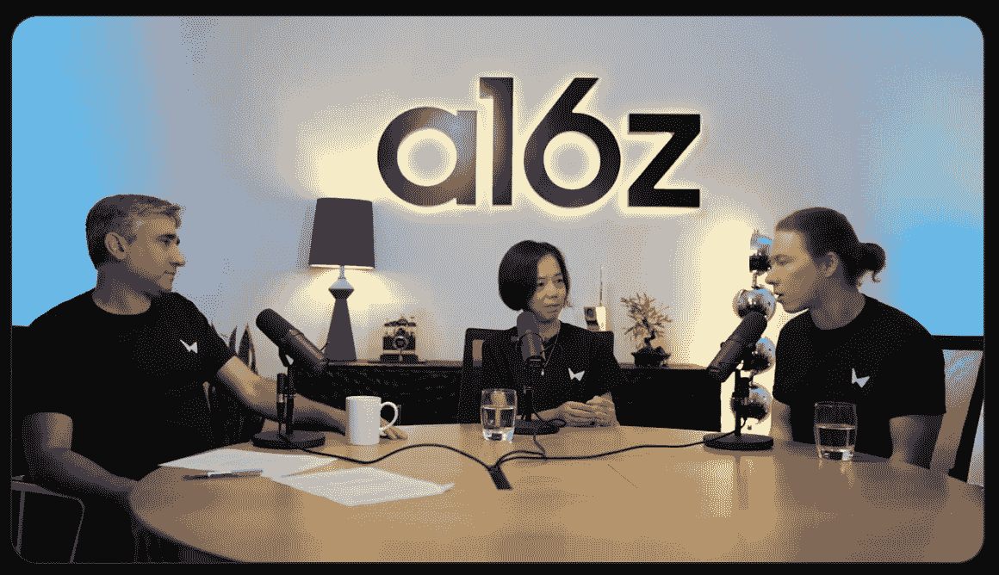

**概括：**

李飞飞与a16z合伙人讨论AI历史、现状及未来，强调生成式AI和空间智能潜力，指出AI技术进步将带来新应用场景。

**详细信息：**

1.  李飞飞强调生成式AI在她的研究生阶段就已存在，但早期技术不成熟，近年来取得显著进展。

1.  她介绍了创业项目World Labs，专注于“空间智能”，即机器在3D和4D空间中的理解和互动能力。

1.  李飞飞指出空间智能不仅适用于虚拟世界生成，还可融合现实世界，应用于AR、VR和机器人领域。

1.  Justin Johnson提到计算能力的增长和新的数据源是推动AI发展的重要因素。

1.  两人讨论了生成式AI的实现，认为从图像生成文字经历了匹配、像素生成文字到更高级阶段的发展。

**重要性：**

李飞飞与a16z的对话聚焦AI领域的发展历程，特别是生成式AI和空间智能的未来潜力。他们认为，随着技术的进步，AI将在虚拟世界生成、增强现实和物理世界交互等方面带来无法想象的新应用场景。同时，计算能力的增长和新的数据源也是推动这一领域发展的关键因素。

原文：https://mp.weixin.qq.com/s/gBYA84rOhfX7z5y2ZLpnMQ

访谈视频（英文）：https://x.com/FinanceYF5/status/1837670367869260081

---

## 9 月 20 日

### 【AI 音乐】字节音乐大模型Seed-Music ，一键生成歌曲、片段编辑等

字节跳动发布了名为 Seed-Music 的音乐大模型，该模型通过创新的统一框架结合语言模型和扩散模型，支持高质量音乐生成和灵活编辑，显著提升了 AI 音乐创作的效率和质量。

+   1. Seed-Music 的核心功能 -- Seed-Music 包含四大核心功能，涵盖十种创作任务，显著提升了音乐生成的灵活性和质量。

+   **2. 创新的统一框架** -- 该模型通过结合语言模型和扩散模型的优势，并融入符号音乐处理，实现了高质量音乐生成和灵活编辑。

+   **3. 中间表征的重要性** -- 文章详细介绍了三种中间表征（音频 token、符号音乐 token 和声码器 latent）及其在音乐生成中的应用，展示了 Seed-Music 的技术深度。

+   4. 应对 AI 音乐生成挑战的创新方案 -- Seed-Music 通过技术创新解决了音乐信号的复杂性、评估标准的缺乏和用户需求多样性的问题。

原文：https://www.jiqizhixin.com/articles/2024-09-19-5

> 相关栏目：[1.1.6 3D&音乐](https://agispace.feishu.cn/wiki/MOUdwGyI7iuiG4kJtvNcdNa9nyd)

---

## 9 月 19 日

### 【国产模型】新SOTA来了：国产9B模型多项得分超4o-mini，中国出海电商已经用上了

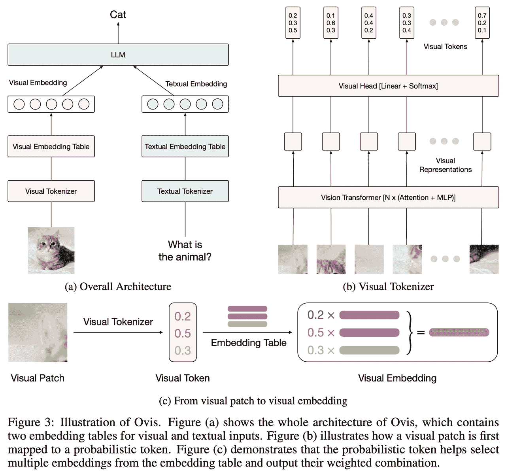

**就在刚刚，阿里**国际AI团队开源多模态大模型Ovis1.6。在多模态权威综合评测基准OpenCompass上，Ovis1.6-Gemma2-9B版本综合得分超越Qwen2VL-7B、InternVL2-26B和MiniCPM-V-2.6等主流开源模型，在300亿以下参数开源模型中位居第一。

**关于阿里国际跨境电商的应用：**

1.  **智能退款系统**：基于Ovis模型，阿里国际开发了智能退款系统，能够快速审核用户的退货退款申请，提供秒级服务并保持高度一致性，减少了人工审核的成本和不稳定性。

1.  **商品属性提取和卖点生成**：Ovis模型也被用于自动提取商品属性和生成卖点描述，提高了商品信息的准确性和吸引力。

1.  **多语言支持**：通过多语言增强大模型Marco和电商版多模态大模型MarcoVL，阿里国际提供了多语言文本生成技术和AI图片处理服务，帮助商品适应不同市场的语言和文化需求。

1.  **广泛应用场景**：AI能力覆盖了营销、客户服务、商品发布、设计、合规等40+应用场景，服务全球50万商家，日均调用超5千万次。

通过这些AI技术的应用，阿里国际不仅提升了商家的工作效率和生产效率，还为用户提供了更好的购物体验，从而在激烈的国际市场竞争中获得了竞争优势。

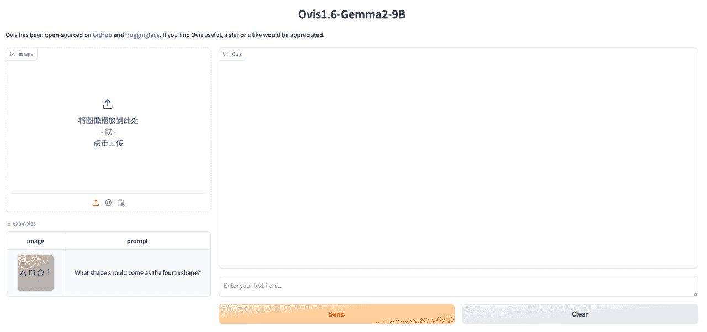

（demo 界面）

🍎 实**测案例**

我准备了一张比较简单的图片，直接丢给它。然后 prompt 只写了“请你给出答案”，并没有提示它明确的找水果问题。

过了几秒钟，识别出了奇异果、香蕉、苹果。

不过，可口可乐倒是出乎意料的，

它给出的分析也并不是没有道理，现在确实存在一些荔枝等水果口味的可乐。

可圈可点就是图中是百世可乐。

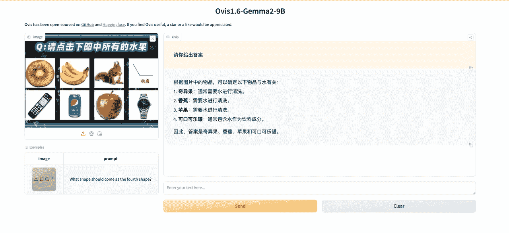

Ovis1.6开源地址和Demo：

arXiv: https://arxiv.org/abs/2405.20797

Github: https://github.com/AIDC-AI/Ovis

Huggingface：https://huggingface.co/AIDC-AI/Ovis1.6-Gemma2-9B

Demo：https://huggingface.co/spaces/AIDC-AI/Ovis1.6-Gemma2-9B

原文链接：https://mp.weixin.qq.com/s/VLvF4J-8CsBN6Wam5UlVXQ

### 【前沿访谈】o1发布后，信息量最大的圆桌对话：杨植麟、姜大昕、朱军探讨大模型技术路径

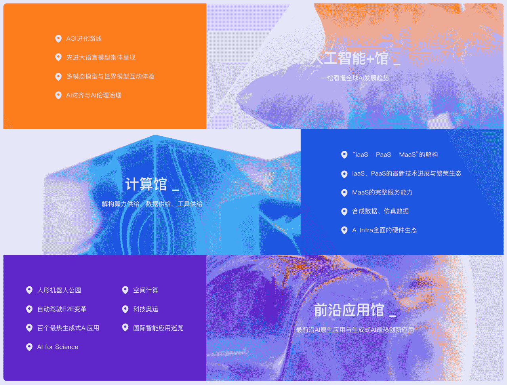

> 云栖大会邀请全球科技专家、学术精英等，通过主题演讲、圆桌讨论等形式，探讨云计算、生成式AI等前沿科技，激发创新思维，助力企业和机构能力提升，推动科技成果转化，加速产业升级。

> 大会官网：https://yunqi.aliyun.com/

> 原文：https://mp.weixin.qq.com/s/nqEe8rNnED3-EGZwowPJBg

**概要：**这篇文章记录了2024年云栖大会上，AI领域专家姜大昕、杨植麟和朱军与张鹏的圆桌对话，探讨了过去18个月AI技术的发展现状和未来方向。

1.  **“AI发展的速度太快了。”** —— 张鹏

1.  “过去18个月是在加速的，而且速度还是非常快的。” —— 姜大昕

1.  “o1第一次证明了语言模型也可以有人脑的慢思考。” —— 姜大昕

1.  “o1带来了scaling law的新方向。” —— 姜大昕

1.  “我觉得它（o1）的意义还是非常大的。” —— 朱军

1.  “这个（o1）是一个完全提升了AI上限的东西。” —— 杨植麟

1.  “有确定的方向和不确定的路径，对创业公司反而是好事。” —— 张鹏

1.  “谈卡伤感情，没卡没感情，用卡费感情。” —— 姜大昕

过去18个月，AI技术迅速发展，模型数量和质量显著提升，尤其是多模态模型和语言模型的智商及上下文长度。OpenAI的o1模型展示了语言模型的慢思考能力，带来了强化学习的新范式，并在推理能力和泛化性上取得显著进展。未来，强化学习的泛化和多模态融合将成为主要技术发展方向，L3级别的AGI有望在短期内实现。新技术范式为创业公司带来了更多机会，特别是在推理算力和后训练算法优化方面，但也对算力和数据的需求提出了更高的要求。

### 【通识课】谷歌刚刚发布了免费的人工智能课程。

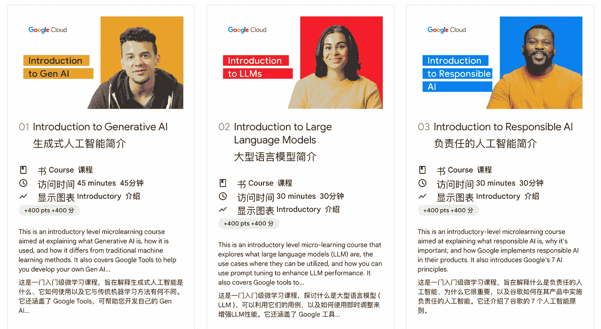

这些AI课程适合刚接触人工智能的初学者，内容涵盖生成式人工智能、大型语言模型和负责任的人工智能等基础知识。通过这些课程，您将了解生成式AI的基本概念及其与传统机器学习的不同之处，掌握大型语言模型的实际应用及优化方法，学习如何在AI项目中遵循负责任的原则。此外，您还将学会在Vertex AI平台上设计有效的提示，提升AI的输出效果。课程还介绍了如何使用Google Cloud工具进行AI项目的开发和实施，结合理论与实操，帮助您逐步提升在人工智能领域的技能和信心。跳转地址：https://www.cloudskillsboost.google/paths/118

## 9 月 18 日

### 【微软 AI】Microsoft 365 Copilot Wave 2：Pages、Excel 中的 Python 和代理

**摘要：**微软刚刚[**发布了**](https://www.microsoft.com/en-us/microsoft-365/blog/2024/09/16/microsoft-365-copilot-wave-2-pages-python-in-excel-and-agents/?utm_source=www.therundown.ai&utm_medium=referral&utm_campaign=the-next-era-for-microsoft-copilot)其 AI 助手 Copilot 的新一代产品，引入了新功能并扩展了其与 Excel、PowerPoint、Teams、Outlook、Word 和 OneDrive 等 Microsoft 365 应用程序的集成。

**详细信息：**

+   Copilot Pages：一种用于 AI 辅助团队合作的全新协作画布，支持多用户通过 AI 对持久的可编辑内容进行实时交互。

+   副驾驶代理：先进的人工智能助手，可自动执行复杂的业务流程，在后台运行以自主执行任务。

+   Agent Builder：一种用于创建自定义 Copilot 代理的无代码工具，使非技术用户更容易进行 AI 开发。

+   性能提升：在 GPT-4 集成的帮助下，Copilot 的响应速度现在提高了两倍，用户满意度提高了三倍。

**重要性：**微软让非技术用户能够比以往更轻松地将 AI 工作流添加到其生产力工具套件中。这可能是数百万人首次体验快速、智能、由 AI 驱动的 Excel 表格和 Word 文档。

### Groq 将建造世界上最大的 AI 数据中心

**摘要：**[**人工**](https://www.bloomberg.com/news/articles/2024-09-16/chip-startup-groq-backs-saudi-ai-ambitions-with-aramco-deal?utm_source=www.therundown.ai&utm_medium=referral&utm_campaign=the-next-era-for-microsoft-copilot)智能初创公司 Groq 最近与沙特石油巨头阿美公司合作，在沙特阿拉伯建立了他们声称的世界上最大的人工智能推理中心，旨在服务中东、非洲和印度。

**详细信息：**

+   该数据中心最初将容纳 19,000 个语言处理单元 (LPU)，并可能扩展到 200,000 个单元，从而有可能成为全球最大的 AI 推理中心。

+   沙特阿美公司正在为该项目提供资金，预计耗资“约九位数”，凸显了沙特阿拉伯对人工智能基础设施的承诺。

+   该中心利用沙特阿拉伯的优势：能源成本低、土地可用，并且在 100 毫秒的数据传输时间内可以覆盖 40 亿人口。

+   Groq 预计该中心将于 2024 年底投入运营，Groq 和 Aramco 之间有可能进一步合作。

**重要性：**此次合作凸显了沙特阿拉伯对人工智能的承诺，并表明 Groq 能够扩展其闪电般快速的人工智能推理基础设施。它可以加速近乎即时的聊天机器人响应的开发——这是继 OpenAI 的 o1 模型等近期的思维链突破之后的关键下一步。

> 与之相关栏目：[Groq](https://agispace.feishu.cn/wiki/RbuMwk7ViiZr8zkibhecpOv6nIb)

## 9 月 14 日

### 对话创新工场汪华：把AI大模型当作定语，应用才是主语

以下为核心要点：

1.  在移动互联网，你也不可能在2009年就投出一个TikTok，那时候设备、带宽、普及率都是不支持的。

1.  现在的AI应用基本是在原来已有的东西上加个AI框，就跟移动互联网早期，大家把爱奇艺、优酷原封不动往手机里搬一样，但移动互联网的最终形态是TikTok，连内容的长度、类型、交互方式都变了。

1.  如果模型成本降到现在的千分之一，再叠加模型性能的改良，有可能是移动互联网10倍的体量了。只是成本下降做普惠这件事儿，就可以再造一个移动互联网当年的规模。

1.  ChatGPT到现在为止才一年半的时间，但AI大模型的投入已经相当于当年移动互联网在2016、2017年级别的资本投入了。

1.  AI应用这个事，理论上应用是主语，AI是定语。但AI现在太dominate了，变成了AI是主语。AI投入成本高，底层技术栈目前又不稳定，所以焦虑。

1.  文心一言、通义千问、Kimi这些应用全部都加上，日活也不过就1000万，国内可是10亿多网民。中国的老百姓对AI的接触是“伪接触”，所以，还谈不到有没有产生增量。

原文：https://letschuhai.com/73e18aea

---

## 9 月 13 日

### OpenAI 发布最强模型 o1 ！

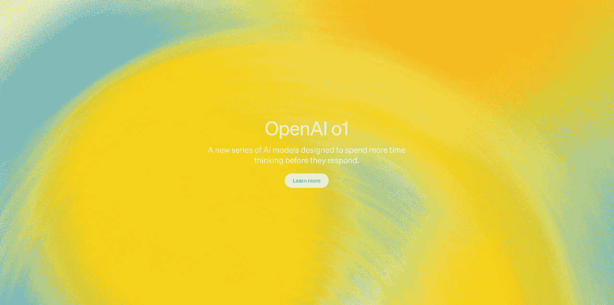

OpenAI 在 2024年9月12日发布了名为o1的新一代人工智能模型，这是继GPT-4之后的一个重要里程碑，标志着人工智能在推理能力上迈出了重要一步

OpenAI o1-preview 简介

> We've developed a new series of AI models designed to spend more time thinking before they respond. They can reason through complex tasks and solve harder problems than previous models in science, coding, and math.

> 我们开发了一系列新的 AI 模型，旨在花更多时间思考，然后再做出响应。他们可以推理完成复杂的任务并解决比以前的科学、编码和数学模型更难的问题。

o1模型的主要特点和优势

+   复杂推理能力：o1模型能够在回答之前进行深入思考，优化思维流程，并尝试不同的解题策略。

+   多领域表现：在科学、编程和数学等领域，o1模型展现出了比以往模型更强的处理能力。在国际数学奥林匹克竞赛的资格测试中，o1模型的解题正确率远高于GPT-4o。

+   安全性强化：通过新的安全训练方法，o1模型能够更有效地遵循安全和对齐准则。

o1模型的应用场景和局限性

+   应用场景：o1模型适用于需要复杂推理的场合，如解决科学问题、编程任务和数学问题。

+   局限性：作为早期模型，o1模型还不具备ChatGPT的许多实用功能，如浏览网页获取信息以及上传文件和图片。

OpenAI的o1模型不仅推动了AI技术的前沿，也预示着AI在处理复杂问题方面的潜力。

[【24年9月】OpenAI o1（推理）](https://agispace.feishu.cn/wiki/Rd6RwKdUri0O23kSoI4crsWUnof)

---

## 9 月 12 日

### 【AI 大会】回顾 2024外滩大会：AI+与 AI agent

> nclusion·外滩大会是在上海举办的具有全球影响力的金融科技和前沿科技大会，大会分享前沿科技趋势、探索产业新机遇、搭建国际交流平台，以人文视角共同探讨全球可持续发展的创新与责任。

> 官网传达：https://www.inclusionconf.com/

2024 年 9 月 5 日至 7 日，2024 inclusion・外滩大会在上海黄浦世博园区举行

其中，沈校董提出了对大模型的七个重要思考

1.  **算力是门槛：**从 2012 年起，大模型所需算力每年平均增速较高，近几年稳定在每年 4 倍左右的增长。随着模型越来越大、参数量越来越多，算力的需求也呈平方式增长。这意味着做大模型必须具备强大的算力支撑。

1.  **关于数据：**目前互联网上的数据量远远不能满足未来模型训练的需求，需要思考如何挖掘更多的数据。数据是模型的 “燃料”，其数量、质量和多样性直接影响模型的准确性和性能。

1.  **大模型的下一章：**大模型产业未来会从大语言模型发展到多模态模型，再迈向世界模型，从技术上讲要走理解和生成统一的道路，未来也会朝着具身智能（如自动驾驶等）方向发展。

1.  **大模型横扫千行百业：**大模型可分为通用大模型、行业大模型、企业大模型和个人大模型。通用大模型是 AI 的基础，行业大模型是做领域应用的底座，企业大模型能实现企业数据价值的再发现，而个人大模型也备受期待。

1.  AI Agent—— 从愿景到落地：AI Agent 从愿景到落地，需要以需求为圆点，深刻理解模型的能力，并构建一个 AI 深度参与的工作流程。目前的大模型应用还未完全达到 AI Agent 的程度，需要不断融入工作流。

1.  **重视 AI 的治理：**AI 的发展对各方面产生了强大冲击，引发安全治理担忧，需要新的治理框架和体系。从全球角度看，要发展主权人工智能，并需要有主权云来支持。

1.  **重新思考人机关系：**应重新审视人机之间的关系，AI 为人类提供了与技术共生的全新语境，人机交互的新方式指向 “AI 与 IA（智能增强）” 的融合共进，强调人类与 AI 的协作关系。

---

## 9 月 11 日

### 【前沿】ChatGPT Pro上线，聪明N倍的新模型草莓快来了

> OpenAI 的神秘大模型「草莓」（Strawberry，之前称为 Q*）可能要提早发布。

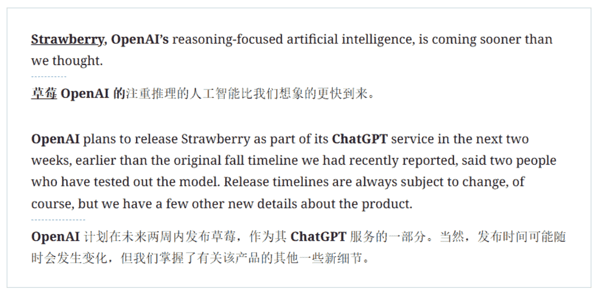

Theinformation消息，OpenAI将在未来两周内发布最新模型“草莓”（ Strawberry） ，会为ChatGPT等产品提供技术支持。

> 相关文章推荐：数字生命卡兹克：200美元的ChatGPT...

### 【企业增效】解决企业痛点的AI，才是有用的AI

这篇文章讨论了人工智能（AI）对企业的影响，特别是如何通过解决企业痛点来实现AI的价值。

1.  AI与企业痛点：文章指出，能够解决企业痛点的AI才是有用的AI。企业应关注解决客户体验、安全治理、数据价值变现、系统研发和AI交互等问题。

1.  网易数智的实践：网易数智通过其产品和服务展示了AI在不同领域的应用，如客户之声（VOC）、数字内容风控、数据价值变现等。

1.  AI生产力的重要性：文章强调，AI生产力将决定企业的生存和发展。企业应积极拥抱AI，加速数智化转型，以避免在竞争中落后。

1.  未来展望：文章最后呼吁企业勇敢行动起来，拥抱AI生产力，开创共赢的新局面，并推荐了“2024网易低代码大赛”，鼓励更多人探索AI应用的新世界。

这篇文章的核心观点是：AI的价值在于解决企业的实际问题，企业应积极拥抱AI以实现数智化转型和提升竞争力。

原文链接：https://mp.weixin.qq.com/s/nqF2pX5XsYU9o8dWQo1GQg

> 可能感兴趣：[1.3 AI驱动-行业革新](https://agispace.feishu.cn/wiki/BwRewiHLRiDVZ4k1CyTctwt1nId)｜[企业智能方案系列](https://agispace.feishu.cn/wiki/EYXawbNPMixiPwkirvXcR47pnwb)

---

## 9 月 10 日

### 【AI 影视】快手宣布和贾樟柯等 9 位导演共创 AIGC 电影

9 月 9 日下午，快手宣布正式启动「可灵 AI」导演共创计划，联合 9 位导演完全使用 AIGC 技术制作电影级内容，并共同推出 9 部 AIGC 电影短片。据了解，参与此次计划的导演包括李少红、贾樟柯、叶锦添、薛晓路、俞白眉、董润年、张吃鱼、王子川和王卯卯。

快手方面表示，9 位导演将依托可灵 AI 的技术能力，制作出品 9 部主题不限的 AIGC 电影短片。9 部短片将全部由可灵 AI 进行视频生成，电影导演完全依托视频生成大模型，群体深度参与电影级内容创作，这在中国尚属首次。

> 可能感兴趣：[视频AI大模型](https://agispace.feishu.cn/wiki/PeNkwcz7wi4pQUkJQfBcwb21n0e)｜[工具教程-Kling可灵](https://agispace.feishu.cn/wiki/AMxNwuiSli4SDBkOuMqcgHs7nKg)

---

## 9 月 9 日

### 【开源数据集】全球最大商业图库 Getty Images 推出免费高画质照片 AI 训练集：含 3750 张照片、分 15 项类别

全球最大商业图库 Getty Images 推出的免费高画质照片 AI 训练集具有以下信息：

1.  **基本信息**：

+   **图片数量**：包含 3750 张照片。

+   **类别划分**：分为商业、教育、医疗健康、运动与健身、物品与物体、插图、图标等 15 个类别。这些丰富的类别为开发者提供了多种主题的高质量视觉内容，可用于训练机器学习和 AI 模型，以开发多种应用场景。

1.  **获取方式**：

1.  https://huggingface.co/datasets/GettyImages/Getty-Images-Sample-Dataset

+   该数据集已在 Hugging Face 平台上线，用户需要同意服务条款并提供联系方式，才能免费访问该数据集。

1.  Getty Images 的目的：

+   Getty Images 希望通过这个免费样本数据集吸引企业和开发者使用其付费授权服务。该公司声称自己拥有超过 5.72 亿张照片，其中 2 亿多张可用于商业用途，通过提供免费训练集，可以让更多用户了解其图片资源的优势和价值，进而吸引用户在后续的项目中选择其付费服务。

1.  **优势特点**：

+   每张照片附有结构化的元数据，包括年龄、性别等信息，每张图片平均有 50 个关键词。这些元数据信息可以帮助开发者更好地理解图片内容，从而更有效地利用这些图片进行 AI 模型的训练，同时也能在一定程度上确保用户安全训练模型，避免侵权诉讼风险。

### 【企业应用】从腾讯大模型的「实用」路线，我们看到了企业应用AI的新方向

来源机器之心文章：https://mp.weixin.qq.com/s/XjhpVG1hxL4imxcIQooyog

作者：张倩

「现在每家公司都是 AI 公司，但引入 AI 之后，利润真的能提高吗？」

**摘要：**腾讯混元大模型展现了企业应用AI的新方向，即通过技术升级降低模型成本、提高模型可用性，使企业能够以更低的门槛使用AI。混元 Turbo 模型在性能提升的同时降低了成本，并在多个基准测试中表现优异。

**详细信息**

+   混元 Turbo 模型： 在腾讯全球数字生态大会上展出的混元 Turbo 模型，训练和推理效率提升超过1倍，而推理成本降低50%。该模型在国内的中文大模型基准测评中表现突出，在理科、文科以及hard任务上均取得了优异的成绩。

+   技术革新： 混元 Turbo 采用了全新的万亿级分层异构 MOE 结构，在数据优化和模型架构上有显著的技术创新。

+   多模态大模型： 腾讯还推出了国内首个基于MOE架构的多模态大模型，支持超过7K分辨率和任意长宽比的图片理解。

+   产品实用性： 腾讯云围绕大模型开发了一系列精调工具链和开箱即用的产品，如知识引擎、图像创作引擎、视频创作引擎等，加速大模型能力在各种场景中的应用。

+   行业应用： 腾讯与迈瑞医疗合作，针对重症医疗领域开发了智能应用，如病历撰写、患者病情查询等，提高了医生的工作效率。

**重要性：**腾讯混元大模型的实用路线对企业应用AI具有重要意义。它不仅展示了AI技术进步带来的性能提升和成本降低的可能性，也为企业提供了一种通过引入AI来增强客户体验、扩大用户基数同时保持甚至提高利润的途径。

---

## 9月 6 日

### 【AI+医疗】**🧬 **Google DeepMind 揭晓“AlphaProteo”

**摘要：**[** Go**](https://deepmind.google/discover/blog/alphaproteo-generates-novel-proteins-for-biology-and-health-research/?utm_source=www.therundown.ai&utm_medium=referral&utm_campaign=google-ai-steps-closer-to-curing-cancer)ogle DeepMind 刚刚推出了AlphaProteo，这是一种突破性的人工智能系统，可以设计定制蛋白质来与特定的分子靶点结合，有可能促进药物发现和癌症研究。

**详细信息：**

+   AlphaProteo 可以制造出像生物锁和钥匙一样粘附于特定目标的蛋白质，其制造强结合蛋白质的能力比现有方法高 3 到 300 倍。

+   人工智能成功为 8 个不同靶点中的 7 个设计了结合剂，其中包括与癌症相关的蛋白质。

+   独立测试表明，AlphaProteo 的一些设计可以阻止 SARS-CoV-2（Covid）感染细胞，并将多年的实验室工作缩短至几天或几周。

**重要性：** AlphaProteo 可以帮助我们阻断病毒、抗击癌症，并使用副作用更少的更有针对性的治疗方法以新方式治疗疾病。这可以大大加速药物研发，可能节省数十亿美元的研发成本，并更快地为患者带来挽救生命的治疗方法。

## 9月 5 日

### 【OpenAI】OpenAI Japan 披露“GPT-Next”细节

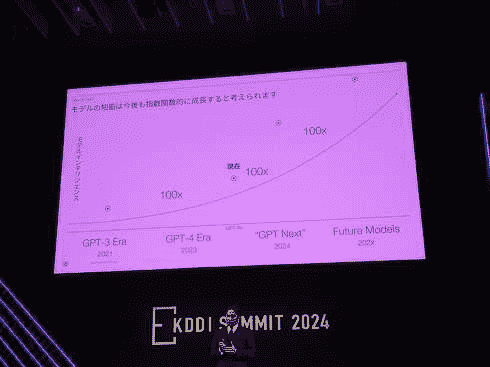

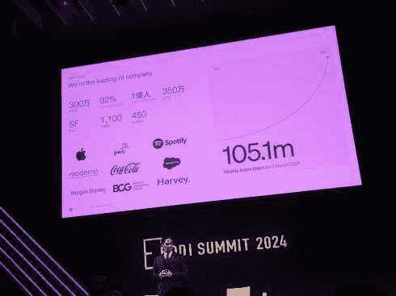

图片来源：KDDI Summit 2024

**摘要：** OpenAI 日本首席执行官[近日透露](https://www.itmedia.co.jp/aiplus/articles/2409/03/news165.html?utm_source=www.therundown.ai&utm_medium=referral&utm_campaign=openai-japan-reveals-gpt-next)，OpenAI 即将推出的 AI 模型“GPT-Next”预计将比 GPT-4 强大 100 倍。同时，还确认了一款名为 Orion 的更先进模型将于 2025 年发布。

**详细信息：**

+   GPT-Next 有望实现 100 倍的性能提升，同时不会浪费太多的计算资源。

+   这种进步来自于更好的架构和学习效率，而不仅仅是原始的计算能力。

+   GPT-Next 将使用 OpenAI 目前正在开发的先进 AI 系统“Strawberry”的较小版本。

+   幻灯片中提到了 GPT Next 2024，虽然未经证实，但暗示该模型可能会在 2024 年底发布。

**重要性：**[** Open**](https://www.axios.com/2024/08/29/openai-chatgpt-200-million-weekly-active-users?utm_source=www.therundown.ai&utm_medium=referral&utm_campaign=openai-japan-reveals-gpt-next)AI 仍然是AI 模型使用方面无可争议的领导者，如果翻译准确，GPT-Next 将成为开发人员期待已久的下一个巨大飞跃。最令人印象深刻的是，它无需使用太多计算即可实现这一飞跃，这对于需要速度和效率的应用程序来说是一大优势。

## 9月 4 日

### 【分析】两万字讲清楚：现在的 AI 产品有多难做？

**一句话总结**

本文深入分析了 AI 产品开发的复杂性和挑战，强调了大模型 API 的关键作用及产品经理在 AI 产品成功中的核心角色，同时探讨了商业价值和媒介影响。

**摘要**

本文从多个角度探讨了 AI 产品开发的难点与挑战，包括大模型 API 的使用、大小模型设计、上下文窗口问题、数据获取与安全机制、跨模态处理、RAG 和 AutoGPT 的应用等。文章指出，AI 产品的成功不仅依赖于先进技术，还需要产品经理与工程师的协同工作，以及对媒介和内容转换的深刻理解。此外，文章讨论了 AI 产品的商业价值与未来发展方向，强调在 AI 产品开发中应避免过度依赖大模型，而应结合实际工具和数据来优化整体系统。

**主要内容**

+   **1. 大模型 API 的重要性** -- 产品经理应更关注大模型 API 而非成品，因为 API 到产品的转化过程是关键。

+   **2. AI 产品的多模态挑战** -- 跨模态处理可能导致信息损耗，模型迭代应端到端解决这些问题。

+   **3. 媒介对内容的影响** -- 媒介的多样性为内容创作者提供了商业机会，理解媒介对内容的影响是理解 AI 和 AIGC 商业价值的关键。

+   4. RAG 和 AutoGPT 的区别 -- RAG 侧重于快速检索和生成答案，而 AutoGPT 尝试通过 AI Agent 解决复杂问题。

+   **5. AI 产品的商业价值** -- 大模型和 AIGC 的商业价值在于媒介的理解和应用，媒介的多样性为内容创作者提供了商业机会。

**文章金句**

+   1. 用户价值= 新体验 -- 旧体验 -- 替换成本。

+   2. 大模型可以被视作为是一个函数，一个 API，它本身只能被调用，而大模型产品才是真正面向用户的东西。

+   3. 要做出优秀的 AI 产品，不仅仅需要优秀的大模型，还需要优秀的工程师和产品经理来辅助大模型。

+   4. 因为用工程手段解决跨模态最大的问题是会造成信息的损耗。

+   5. 想要理解大模型以及 AIGC 的商业价值，私以为最重要的是要能够首先理解媒介。

来源：

https://mp.weixin.qq.com/s/pMt_VMs6uq5wsPPscOyefA

### 【案例】8 岁也能用 AI 制作游戏，全程 2 小时，引来 50 多万人围观

**一句话总结**

一位 8 岁儿童在没有编程经验的情况下，使用 Claude AI 和 Cursor 工具独立完成了多个项目，展示了 AI 技术在儿童编程教育中的潜力及其对未来教育趋势的影响。

**摘要**

文章报道了一个 8 岁儿童在没有编程背景的情况下，利用 Claude AI 和 Cursor 工具独立完成多个项目的故事，包括两个平台游戏、一个绘图应用、一个动画应用和一个 AI 聊天应用，每个项目大约花费 2 小时。孩子的父亲 Meng To，仅帮助孩子设置了必要的工具如 Cursor、Git 和 Netlify。文章通过展示孩子的成果和制作过程，强调了 AI 工具如何使编程变得简单，不再需要传统编程知识。Cursor 工具的独特性在于其可以预测代码并提供直接可用的代码片段，极大提高开发效率。这一事件不仅展示了 AI 技术在编程教育中的应用潜力，也反映了技术降低编程门槛的趋势，使更多人能够参与到软件开发中。

**主要内容**

+   **1. AI 工具使编程变得简单** -- 8 岁儿童在没有编程经验的情况下，通过 AI 工具独立完成了多个复杂的项目，显示了 AI 在简化编程过程中的作用。

+   2. Cursor 工具的独特功能 -- Cursor 使用 Claude-3.5-Sonnet 模型，能够预测代码并提供直接可用的代码片段，极大地提高了开发效率。

+   **3. 编程教育的未来趋势** -- 文章通过这个案例展示了 AI 技术在儿童编程教育中的应用，预示着编程教育可能向更加直观和易操作的方向发展。

文章金句

+   1. 现在，代码已成为一种设计工具，甚至不再需要人来编写代码了。

+   2. 编程领域变化太快了，未来是不是只需要狂按 tab 就够了？

+   3. 如果你喜欢 Copilot，那准备迎接被 Cursor 惊掉下巴吧！体验过 Cursor，你就再也回不去了。

来源：https://www.jiqizhixin.com/articles/2024-09-03-6

> [AI+编程](https://agispace.feishu.cn/wiki/UHZewGSgmiMb7JkcMZyc295OnF1?table=tblGjly8HiZcbmON&view=vewKw3rWMx)

## 9月 3 日

###  【XAI】xAI 打造全球顶尖 AI 集群

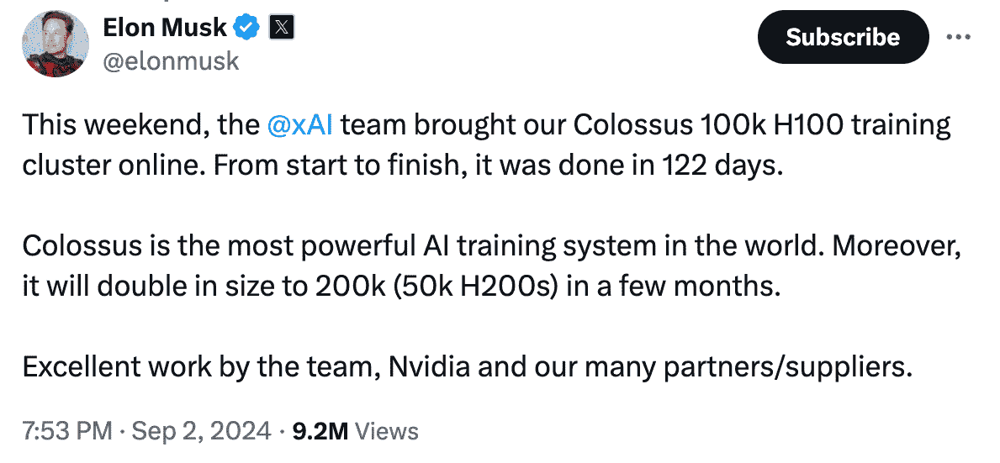

**摘要：**埃隆·马斯克的 xAI 刚刚[**推出了**](https://x.com/elonmusk/status/1830650370336473253?utm_source=www.therundown.ai&utm_medium=referral&utm_campaign=elon-musk-and-xai-announce-colossus)“Colossus”，这是世界上最强大的 AI 集群，由多达 100,000 个 Nvidia H100 GPU 驱动，仅用 122 天就建成，并且计划很快将规模扩大一倍。

**详细信息：**

+   马斯克表示，Colossus 由 100k 个液冷 Nvidia H100 GPU 组成，这些 GPU 连接在单个网络结构上，被认为是世界上“最强大的”。

+   该系统仅用 122 天就建成并投入使用，这是一个令人难以置信的快速成就，并于美国的一个周末假期上线。

+   xAI 计划在未来几个月内将 Colossus 扩展至 200,000 个 GPU（50,000 个 H200）。

+   在最近的播客中，埃隆·马斯克（xAI 创始人）表示 Grok 2 仅在约 15,000 个 GPU 上进行了训练。

**重要性：** xAI 的[**Grok 2**](https://www.therundown.ai/p/grok-2-reaches-state-of-the-art-status)最近以创纪录的速度赶上了 OpenAI 的 GPT-4，并且只在大约 15,000 个 GPU 上进行了训练。目前，xAI 团队和 Grok 的未来版本将对 OpenAI、Google 和其他公司施加巨大压力。

## 9月 2 日

### 【重要会议】[**全球最大的人工智能领袖聚会**](https://raysummit.anyscale.com/flow/anyscale/raysummit2024/landing/page/eventsite?utm_source=newsletter&utm_medium=rundown&utm_campaign=august30)

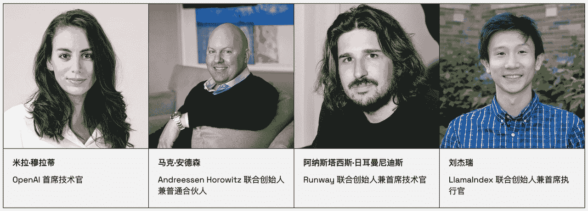

(部分嘉宾)

**概要：** Ray Summit 2024 即将到来。获取来自 NVIDIA、英特尔、谷歌等尖端 AI 公司的见解。包括 60 多个分组会议和实践技术培训，仅在 9 月 30 日至 10 月 2 日在旧金山提供现场服务。

在 Ray Summit 你将：

+   向 OpenAI 的 CTO、Instacart 的联合创始人等人学习

+   使用 Ray 和 Anyscale 探索科技巨头提供的真实 AI 解决方案

+   通过 GenAI、法学硕士 (LLM) 等实践培训提升你的技能

### 【中国 AI】中国新版 Qwen2 击败 GPT-4o

**摘要：**阿里巴巴刚刚[**推出了**](https://qwenlm.github.io/blog/qwen2-vl/?utm_source=www.therundown.ai&utm_medium=referral&utm_campaign=china-s-new-ai-tops-gpt-4o)Qwen2-VL，这是一种新的视觉语言 AI 模型，其在多个基准测试中均优于 GPT-4o，尤其是在文档理解和多语言文本图像理解方面表现出色。

**详细信息：**

+   Qwen2-VL 可以理解各种分辨率和比例的图像，以及超过 20 分钟的视频。

+   该模型尤其擅长解决大学水平的问题、数学推理和文档分析等复杂任务。

+   它还支持图像中的多语言文本理解，包括大多数欧洲语言、日语、韩语、阿拉伯语和越南语。

+   [**您可以**](https://qwenlm.github.io/blog/qwen2-vl/?utm_source=www.therundown.ai&utm_medium=referral&utm_campaign=china-s-new-ai-tops-gpt-4o)在Hugging Face上尝试 Qwen2-VL ，更多信息请参阅官方公告博客。

**重要性：**最先进的 AI 模型领域又多了一个新竞争者，它来自中国的阿里巴巴。Qwen2-VL 能够理解各种视觉输入和多语言请求，这可能会带来更复杂、更全球可访问的 AI 应用程序。

### 【拟人模型】AWPortraitFL正式上线，表现更加细腻且真实

基于Flux架构的写实模型，在构图美感、出图细节上都有了及其显著的提升。使用了AWPortrait-XL的训练集和近 2000 张美学质量极高的时尚摄影照片。相较于原版Flux，AWPortrait FL的表现更加细腻且真实。在构图和细节方面有显著的改善，皮肤和文字更加细腻逼真。

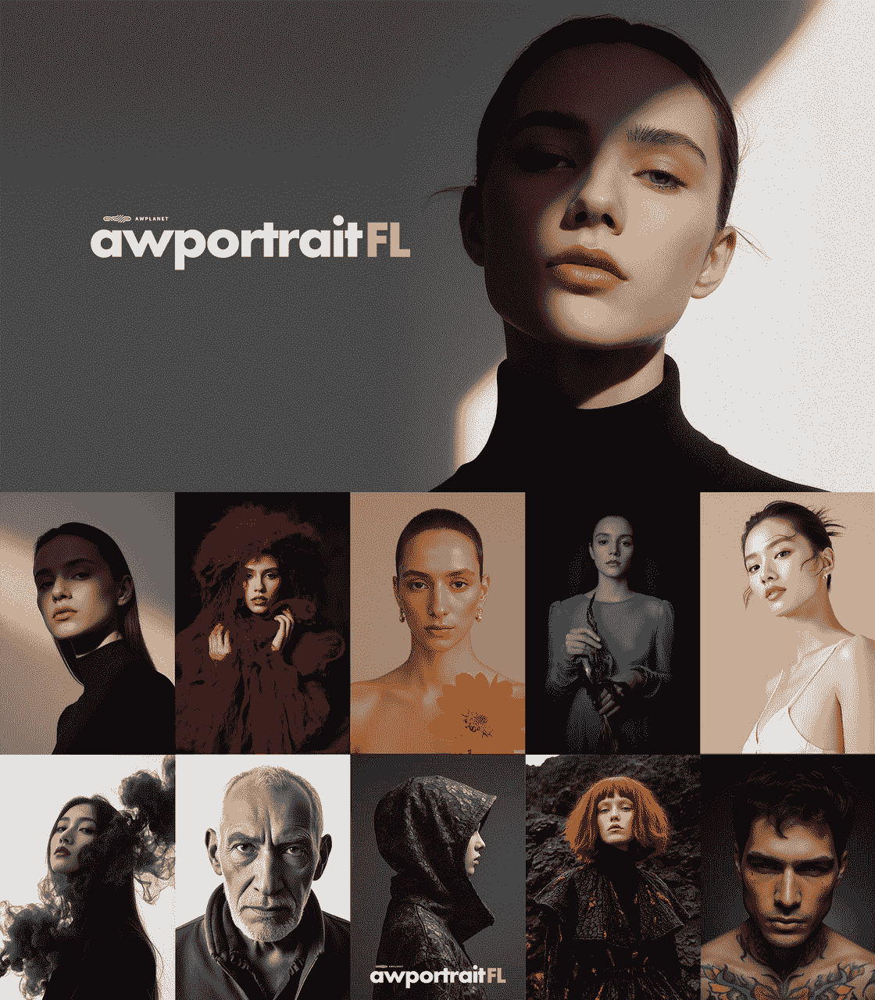

**官方案例展示：**

---

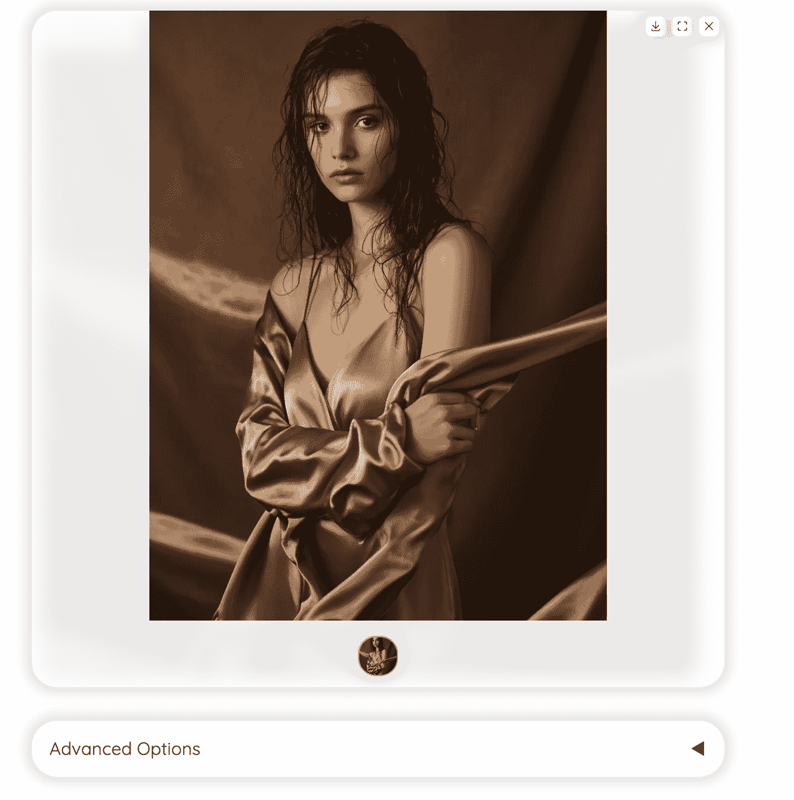

**提示词：**

高加索人，这幅图像展现了一位具有欧洲血统的年轻女子站在摄影棚的场景中，周围环绕着丝绸。（她穿着一条丝绸连衣裙），搭配大胆。她棕色的头发湿漉漉且蓬乱，自然地垂落在她的脸庞周围，给她一种原始而前卫的外观。这位女子目光强烈而直接，增添了图像的戏剧性氛围。背景是流动的丝绸，大量的丝绸。整体构图融合了时尚和自然的元素，营造出了醒目而有力的视觉效果

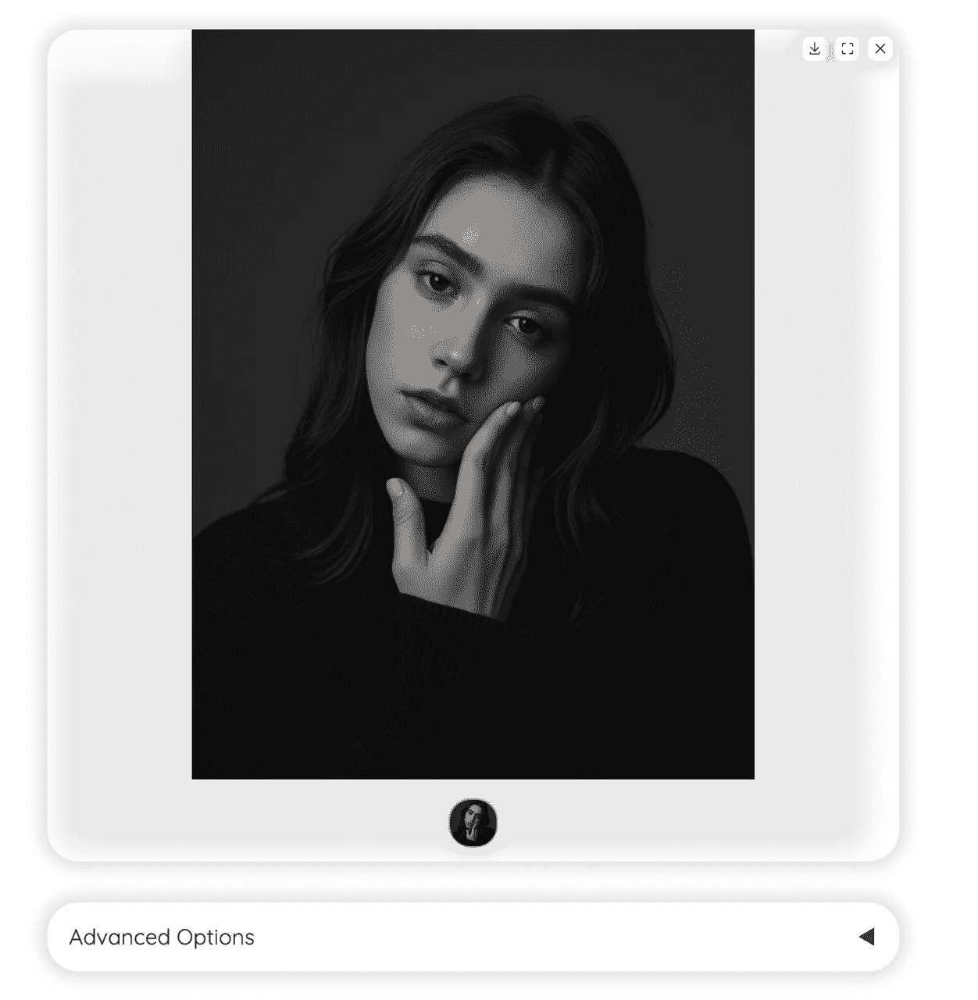

**提示词：**

一位年轻女子的黑白肖像，眼神迷人。她穿着件舒适的黑色毛衣，双手轻轻地捧着脸。单色色调突出了她精致的五官和沉思的情绪。

> 在线体验地址：https://huggingface.co/spaces/vilarin/AWPortrait-FL

> 更多时尚行业相关的知识👉：A[I+时尚 ](https://agispace.feishu.cn/wiki/BwRewiHLRiDVZ4k1CyTctwt1nId?table=ldx7Niyh9fWmjdcW)｜

# 🌕八月合集

## 8月30 日

### 【AI 销售】非凡行研｜万字长文讲透AI 销售如何构建新智能商业

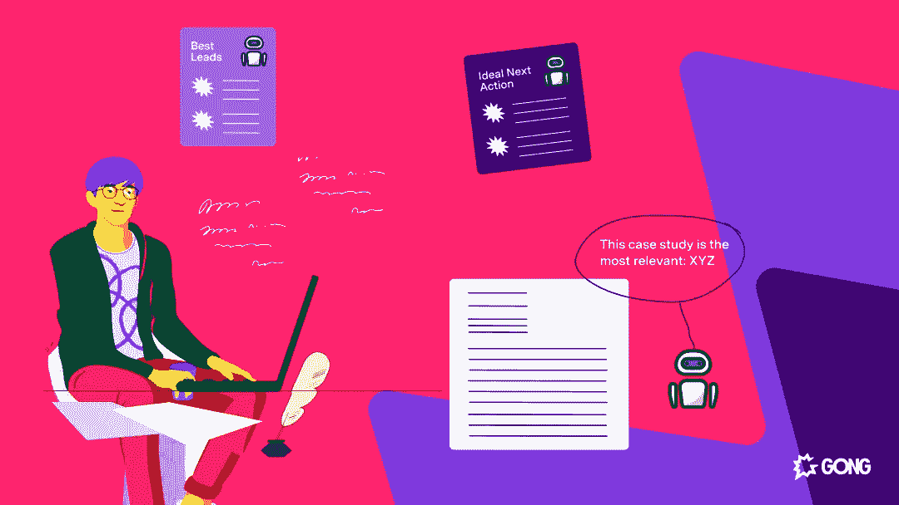

来自非凡行研，主要探讨AI在**销售领域的应用**及其对**未来销售模式**的影响。主要观点包括：

1.  **AI改变销售流程：**AI将革新传统销售流程，整合多模态技术，挖掘更丰富的客户洞察。

1.  Salesforce中的机会记录管理：介绍了如何在Salesforce中创建和管理机会记录，以优化销售预测。

1.  **AI提升销售效率：**AI替代重复性任务，提升销售代表的工作效率，并融合销售角色。

1.  **生成式AI的应用：**生成式AI在提升销售转化率和优化潜在客户培养方面具有巨大潜力。

1.  **AI销售的四大应用形式：**包括AI SDR和AI Sales Agent等，提升销售效率和效果。

总结来说，AI在销售领域的应用将显著提升销[售效率和](https://mp.weixin.qq.com/s/9rsqm1uGgMww-YxhdN1aZQ)效果，推动企业销售模式的创新。（原文链接）

---

## 8月29 日

### 【AI 游戏】🕹️ AI 实时创作 DOOM 视频游戏

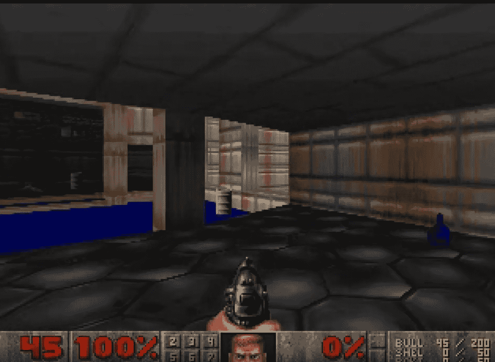

图片来源：Google DeepMind/GameNGen

**摘要：**谷歌的研究人员最近推出了 GameNGen，一种先进的人工智能系统，能够实时模拟经典游戏《DOOM》，并以每秒 20 帧以上的速度运行，生成的视觉效果几乎与原始游戏难以区分。

**详细信息：**

+   GameNGen 在单个芯片上以每秒 20 帧的速度生成可玩的游戏，每帧都通过扩散模型进行预测。

+   该 AI 系统经过了 9 亿帧游戏数据的训练，使得游戏测试人员几乎无法区分 3 秒的片段与真实游戏。

+   GameNGen 在单个 TPU 上运行，能够处理《DOOM》的 3D 环境和快节奏动作，无需传统游戏引擎组件。

+   [**在测**](https://www.youtube.com/watch?v=O3616ZFGpqw&list=PL3ZfMho22LwDvJSEKVBiwxNsVEqUTUmhJ&utm_source=www.therundown.ai&utm_medium=referral&utm_campaign=ai-generates-a-video-game-in-real-time)试中，人类评分员几乎无法区分人工智能模拟的短片和实际游戏。

**重要性：** GameNGen 是首个无需底层真实游戏引擎即可实时生成复杂且可玩的视频游戏的 AI 模型。我们正站在一个激动人心的时代，未来 AI 将能即时创建整个游戏，并为每个玩家提供个性化的体验。

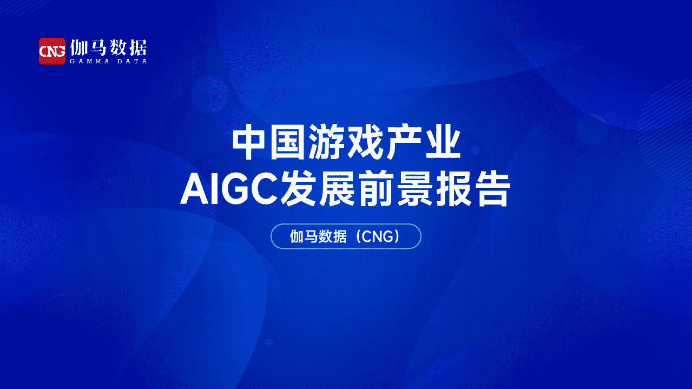

[中国游戏产业AIGC发展前景报告8.27.pdf](https://internal-api-drive-stream.feishu.cn/space/api/box/stream/download/all/BQHdbv9c4oN2WmxjLU5cOuqTngd)

## 8月28 日

### 8月28 日

### 【报告】2024年7月全球AIGC行业月报

2024年7月，全球AIGC行业融资总额达到290亿元人民币，较6月猛增66.67%，其中加拿大模型初创公司Cohere获得最高融资5亿[美元。国内方](https://mp.weixin.qq.com/s/f8tLN0yF9b89YfqRak7ABg)面，通用AI大模型研发及应用服务商“百川智能”完成28.24亿元A2轮融资。今年前7个月，全球AIGC行业融资总额达到1674亿元，同比增长45%。【非凡产业】

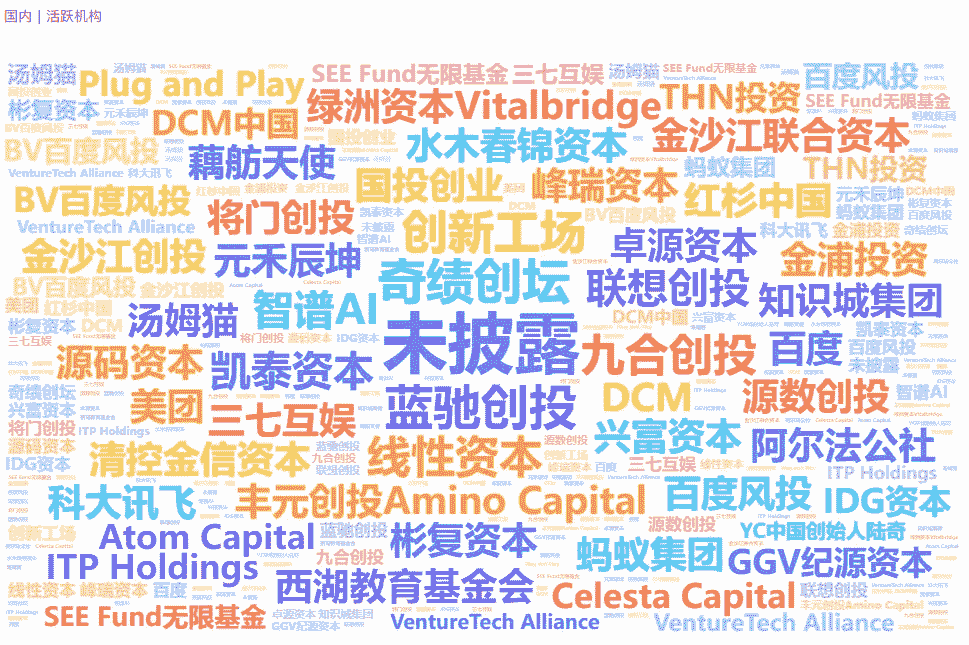

### 【AI 搜索】夸克PC端AI全面升级 整合AI搜索、AI创作、AI总结等能力

https://www.quark.cn/

8月27日，阿里智能信息事业群旗下夸克发布全新PC端，全面升级AI搜索、AI写作、AI PPT、AI文件总结等一系列功能。凭借“系统级全场景AI”能力，夸克为你升级AI电脑，一站式完成信息的检索、创作和总结。

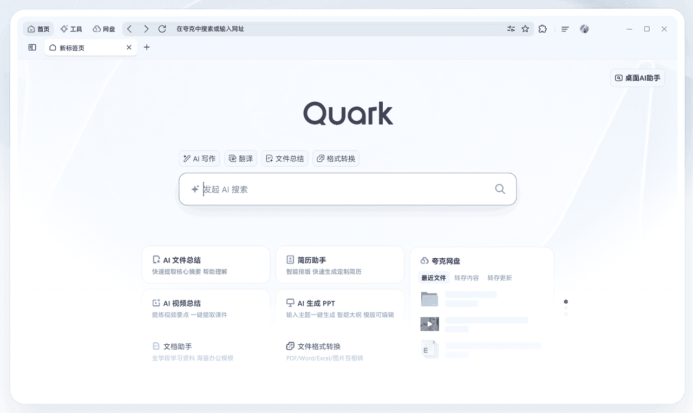

#### 🔘 （点击展开）以下是相关的 AI 搜索产品一次看全

## 8月27 日

### 【AI 视频】开源AI一键解说并剪辑视频工具

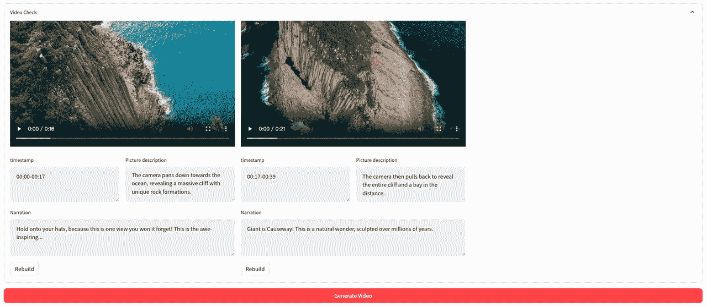

Github：https://github.com/linyqh/NarratoAI?tab=readme-ov-file

NarratoAI 是一个自动化影视解说工具，基于LLM实现文案撰写、自动化视频剪辑、配音和字幕生成的一站式流程，助力高效内容创作。

### 【AI教育】**OpenAI **与亚利桑那州立大学（ASU）的合作（AI+教育）

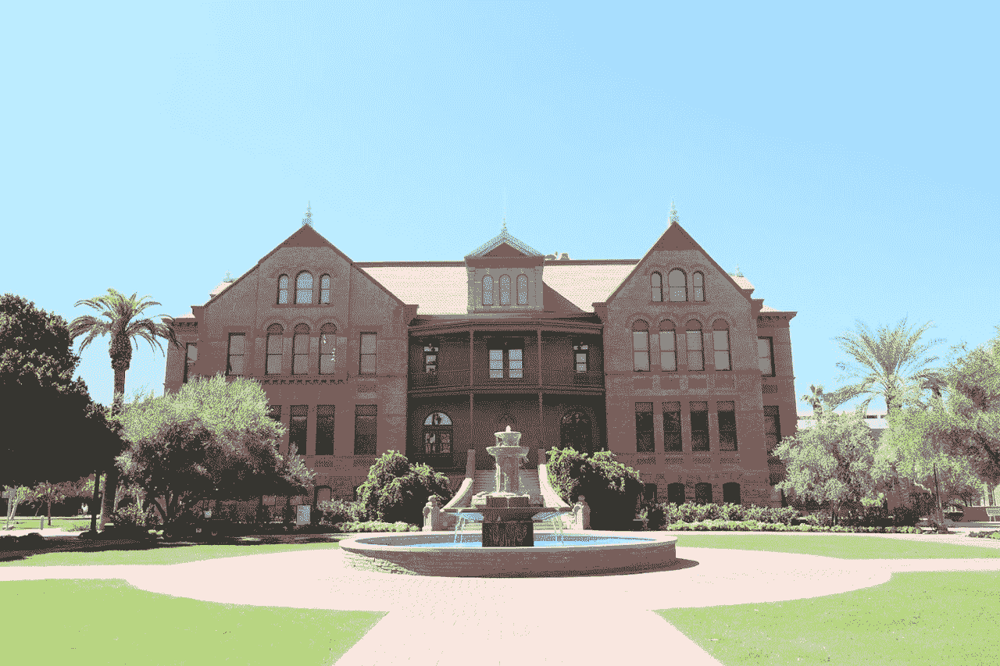

**摘要**：OpenAI 与亚利桑那州立大学（ASU）达成了一项创新合作协议，将 ChatGPT 这一先进的 AI 助手整合到 ASU 的教学、研究和运营中。这项合作旨在提升教育质量和效率，充分发挥 AI 技术在学术和行政领域的潜力。

**详细信息**：

+   **专用版本**：ASU 正在使用 ChatGPT Edu，这是一个专为大学设计的版本，具有增强的隐私和安全功能。

+   **创新挑战赛**：大学还向教职员工发起了一项“人工智能创新挑战赛”，鼓励使用 ChatGPT 来提高教学、研究和操作效率。

+   **重点项目**：

+   **AI 写作伴侣**：“Sam”是一个人工智能写作伴侣，旨在帮助医学生练习与患者的互动。

+   **AI 辅助研究招募**：利用 AI 技术来优化研究参与者的招募过程。

+   **启发效应**：此次合作激发了牛津大学和沃顿商学院等其他机构开展类似的合作项目。

**重要性**：虽然一些学校对人工智能持抵制态度，但亚利桑那州立大学正在积极采用 ChatGPT，以实现更加个性化的学习体验，并帮助学生适应日益受人工智能驱动的就业市场。这样的案例研究将有助于塑造教育领域的未来，并应对人工智能时代的挑战。

## 8月26 日

### OpenAI 公开反对 AI 大模型监管法案

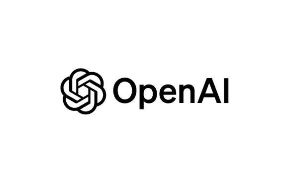

美国人工智能公司 OpenAI 在当地时间周三发布公开信，反对加州地方议员推出的《安全可靠的前沿人工智能模型创新法案》草案，称草案可能威胁加州未来增长、拖慢创新、赶走加州的世界级工程师和企业家，并建议在联邦层面而非地方层面推出 AI 大模型监管法案。

**点评：**

对新技术的监管确实面临许多挑战，尤其是在人工智能领域。OpenAI对加州《安全可靠的前沿人工智能模型创新法案》的反对，反映了对地方性监管措施可能产生的负面影响的担忧。这种法规可能会影响到加州的创新环境、世界级工程师和企业家的吸引力，从而拖慢技术进步。

李飞飞曾指出，**人工**智能政策需要在鼓励创新与设定适当限制之间找到平衡。过度限制可能会导致创新停滞，而不设限制又可能带来难以预测的风险。因此，政策制定者需要在促进技术进步与保护公众利益之间找到合适的平衡点。

与此同时，全球范围内的人工智能立法也在不断推进。例如，欧盟《人工智能法案》自今年8月1日生效，标志着欧盟在人工智能监管方面迈出了重要一步。这个法案不仅为AI技术的使用设置了明确的规范，也反映了全球在制定和实施人工智能政策方面的日益重视。

综合来看，新技术的监管需要全球范围内的协作与协调，既要避免过度干预影响创新，又要确保足够的安全与伦理规范。只有这样，才能确保技术进步带来最大利益，同时减少可能的负面影响。

### 在人潮涌动的世界机器人大会上，我们看到了“万亿美金”的新起点

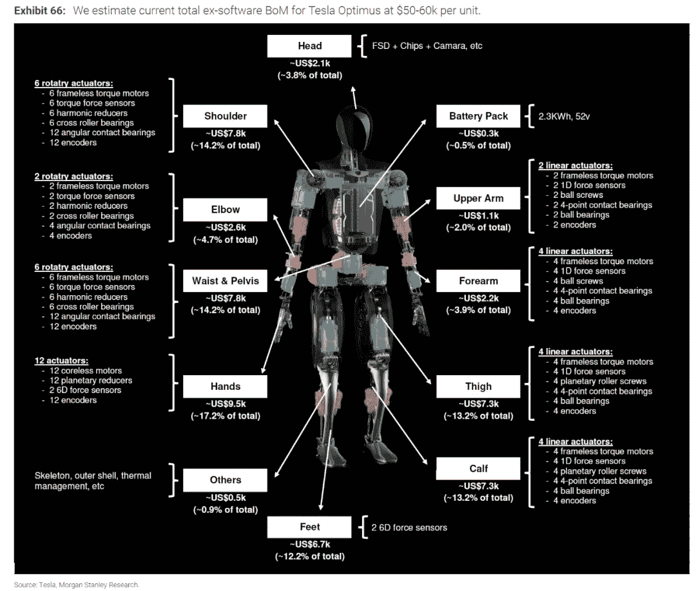

【[原文](https://mp.weixin.qq.com/s/jZdzft280cEn-aB0Dbjzew)】这篇文章主要讲述了2024年世界机器人大会在北京的召开情况，以及人形机器人领域的发展现状和未来前景。

1.  **世界机器人大会**：2024年世界机器人大会在北京开幕，今年是人形机器人参展企业最多的一届，共有27家人形机器人整机企业和30多家产业链上下游企业参加。

1.  **新产品发布**：多家公司发布了新产品，包括宇树科技的G1量产版本、智元机器人的五款商用人形机器人产品、星尘智能的新一代AI机器人助理AstriBot S1，以及银河通用的第一代人形机器人盖博特。

1.  **技术与投资**：文章提到了几家投资的公司，包括宇树科技、智元机器人、银河通用和星尘智能，它们在机器人软硬件一体化领域各有不同的技术切入方向和应用场景。

1.  **行业趋势**：人形机器人正越来越接近实用化，技术路线和应用场景多样化，短期内各公司将专注于占领各自的应用场景并积累数据。

1.  **软硬一体化**：文章强调了机器人的软硬件一体化的重要性，提到了电动车与自动驾驶行业的发展历史作为类比。

1.  **未来发展**：尽管最终目标是通用化，但在早期发展阶段，机器人产品定义不明确，预计将有多家公司围绕不同细分市场发展。

1.  **技术与成本**：文章提到了硬件与中国供应链低成本是人形机器人大规模运用的前提，宇树科技的G1人形机器人售价为9.9万元。

这篇文章通过对世界机器人大会的报道，展示了人形机器人领域的最新进展和投资趋势，以及行业面临的挑战和机遇。

> 来源：[经纬投创分析](https://mp.weixin.qq.com/s/jZdzft280cEn-aB0Dbjzew)｜[Founder Park](https://mp.weixin.qq.com/s/eoSBKqNqCrDV7Rs1jkGI7Q)

> 可能感兴趣：[2024世界机器人大会](https://agispace.feishu.cn/wiki/KrEUwpClsiImYhkPjnZcr0cKnQd)｜[3.0 人形机器人-具身智能](https://agispace.feishu.cn/wiki/DmzWw8aNnig4QckQvF6cE4hSn1g)

### Ideogram 官方教程——画涂鸦生成橙汁饮品宣传图（1分18秒视频）

[twittervid.com_op7418_2e865d.mp4](https://internal-api-drive-stream.feishu.cn/space/api/box/stream/download/all/T3EybRaPuoeZbMxkItWcczFznqc)

## 8月23 日

### a16z全球AI产品Top100：30%新面孔、字节系崛起、图像和视频工具依旧很热门

一些值得关注的要点：

+   与 6 个月前相比有 30% 的新公司；

+   移动端最多的应用是图像和视频编辑，占 22%；

+   Claude 追赶 ChatGPT 的势头很凶猛；

+   大多数新晋产品都来自中国团队，尤其是字节；

+   AI 约会是一个新兴的增长类别；

+   Discord 流量是值得关注的，相当多的应用都是在 Discord 完成 PMF 验证。

移动端榜单前十名产品中，其中第1、第2、第5、第9和第10，分别为ChatGPT（排名不变）、Microsoft Edge（排名不变）、Bing（后退1位）、Meitu（新上榜）和Character.ai（前进6位）都是大家耳熟能详的公司。

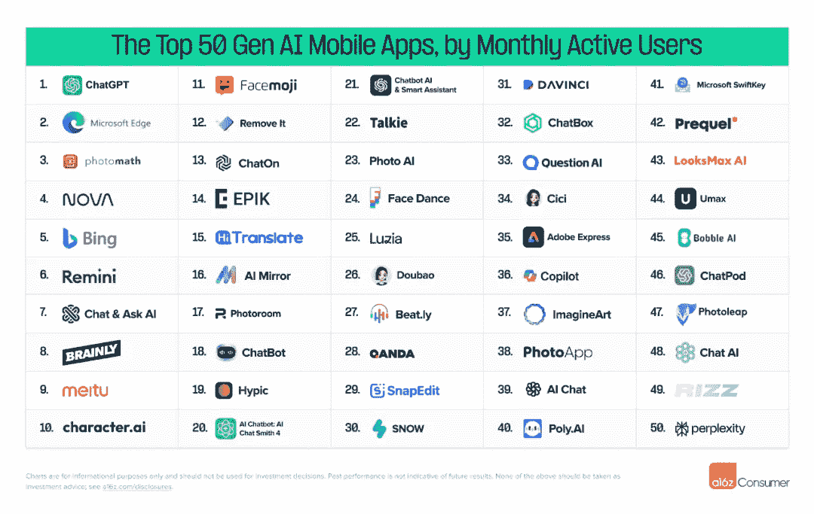

[网页端榜单前十](https://mp.weixin.qq.com/s?__biz=MzA3MDU4ODkyNg==&mid=2247499443&idx=1&sn=6855902e97822fd22c474c773b5d2543&chksm=9f383e22a84fb734cd69352dcb12dcfa3ae300bd3b7eb1577e1ccbd0a3ebcfe18b7794ba1dca&token=56281679&lang=zh_CN&scene=21#wechat_redirect)名产品中，前4[名包括ChatGPT（排](https://mp.weixin.qq.com/s?__biz=MzA3MDU4ODkyNg==&mid=2247497308&idx=1&sn=d55ba546d147dd1d7a2c7deaf67d826e&chksm=9f3836cda84fbfdb67d52454ef8c3bc2b6b6397f2d3d049fbd77fa30b4467fd89af383f4866d&scene=21#wechat_redirect)名不变）、Ch[aracter.ai](https://mp.weixin.qq.com/s?__biz=MzA3MDU4ODkyNg==&mid=2247505317&idx=1&sn=6920d72f56046108cd8736473075ca35&chksm=9f381534a84f9c22c716bf8089f48bcba9e36e4cc26ddc96d9cf7f7710009cf0cbda543cea7a&scene=21#wechat_redirect)（前进1位）、[Perple](https://mp.weixin.qq.com/s?__biz=MzA3MDU4ODkyNg==&mid=2247500841&idx=1&sn=3e1696cd0ecada01385435fe433cf996&chksm=9f3804b8a84f8dae2bf265af0242fe9b0074322f3368a0d5eb497af564b5c27be535dd37d79f&token=310821029&lang=zh_CN&scene=21#wechat_redirect)xity（前进4位）、Claud (前进6位）已广为人知。

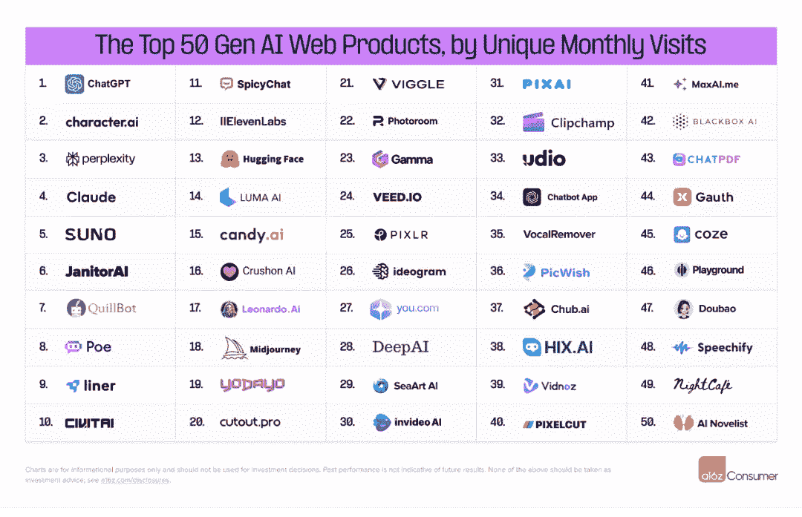

> [原文地址](https://mp.weixin.qq.com/s/mSJn7ERPIYg6qIhuWRxJRQ)

### 2024 世界机器人大会

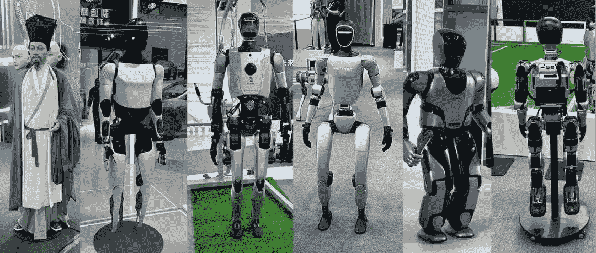

（图片来源：智东西）

[SaveTwitter.Net_4NkkXvhffPW6SUbc_(1280p).mp4](https://internal-api-drive-stream.feishu.cn/space/api/box/stream/download/all/R3TIbb490oxI3PxtEZTcBBOCnHe)

2024年世界机器人大会将于8月21日至25日在北京举行，主题为“共育新质生产力，共享智能新未来”。

展会亮点包括EXrobots展示的高仿真历史人物机器人、星尘智能的多功能AI助理Astribot S1和UniX AI的通用人形机器人Wanda。其他值得关注的展品还有北京具身智能的“天工”机器人，长木谷的ROPA骨科手术机器人，以及优必选的Walker S工业机器人等。这些展示代表了机器人技术在仿生、助理功能、医疗和工业等领域的最新突破，预示着机器人将在未来社会中发挥更大作用。

[2024世界机器人大会](https://agispace.feishu.cn/wiki/KrEUwpClsiImYhkPjnZcr0cKnQd)份文档罗列了此次大会主要人形机器人的产品，👉

---

## 8月22 日

### **MidJourney 网页版开放：每日 **25 张免费 AI 图像生成额度（限时）

Midjourney终于 迎来了一个激动人心的消息:他们的官方网站终于向所有用户开放了，每天向用户提供25张免费的 AI 图像生成的额度。

**分享一个 prompt **

In the center of the picture is the little prince, wearing his yellow cape, standing on his little planet. There is a rose on the planet, blooming proudly, and next to it are three small volcanoes (two active volcanoes and one extinct volcano) that the little prince loves. In the background is the vast universe, dotted with bright stars. The little prince's expression is gentle and slightly sad, holding a fox in his hands, with a warm light in the fox's eyes. The whole picture is soft in color and has a dreamy texture. The stars and planets in the starry sky flicker gently, adding a mysterious and peaceful atmosphere to the picture.

画面中央是小王子，穿着他那件黄色的披风，站在他的小星球上。星球上有一朵玫瑰花，傲然绽放，旁边是小王子喜爱的三颗小小的火山（两颗活火山和一颗熄灭的火山）。背景是广阔的宇宙，点缀着璀璨的星星。小王子的表情温柔而略带忧伤，手中捧着一只狐狸，狐狸眼中带着温暖的光芒。整个画面色调柔和，带有梦幻般的质感。星空中的星星和行星轻轻闪烁，为画面增添了一种神秘而宁静的氛围。

## 8 月 19 日

### 【具身智能】智元机器人2024新品盛宴：开启商用人形机器人新时代

**摘要**

智元机器人公司在其**2024年度新品发布会**上推出的一系列商用人形机器人和相关技术。

**概述**

+   **新品发布**：智元机器人发布了五款新的商用人形机器人，分别是远征a2、远征a2-w、远征a2-max、灵犀x1及灵犀x1-w，这些机器人设计用于多种不同的应用场景。

+   **技术展示**：公司展示了在机器人**动力域、感知域、通信域和控制域**的一系列自主研发技术成果。

+   **技术路线图**：智元定义了具身智能**技术路线图G1到G5**，并推出了具身智能数据系统**AIDEA**。

+   **开源计划**：智元宣布了一系列**开源计划**，包括高性能通信框架AIMRT的开源，灵犀X1的全栈开源，以及基于AIDEA的数据集开源，这些举措旨在促进产业创新和生态发展。

**重要性**

智元机器人的新品发布和技术展示凸显了公司在具身智能技术领域的深入研究和快速发展。发布的机器人产品展示了智元在多领域应用的能力，而开源计划的推出则有助于整个行业的创新和协作。智元的技术进步和开放策略可能会对未来机器人技术的发展产生重要影响，并推动具身智能技术的商业化进程。

另外，截至目前，智元机器人已完成天使轮、A 轮、A1 轮、A1 + 轮、A2 轮等多轮融资，A 系列融资多达 6 轮，其身后集结了一众投资人，包括产业资本、顶级 VC、早期投资机构等 。

> 你可能感兴趣专栏：[3.0 人形机器人-具身智能](https://agispace.feishu.cn/wiki/DmzWw8aNnig4QckQvF6cE4hSn1g)｜[智元机器人（稚晖君远征A1）](https://agispace.feishu.cn/wiki/TqSRwgVdgiRdNKk5XFdcn9vCnSd)

### 【行业】人工智能帮助沃尔玛将生产力提高 100 倍

**摘要**

沃尔玛通过引入人工智能技术，实现了生产力的显著提升，特别是在产品目录管理方面，效率提高了100倍。AI的应用不仅优化了供应链和库存管理，还改善了客户体验和员工生产力。

**概述**

1.  **生产力提升**：沃尔玛利用AI技术将产品目录管理的效率提高了100倍，这一进步是通过生成式人工智能实现的。

1.  **供应链优化**：AI驱动的路线优化技术帮助沃尔玛减少了3000万英里的行驶里程，节省了大量成本和时间。

1.  **客户体验**：AI购物助手的推出使得客户能够享受更智能、个性化的购物体验。

1.  **员工赋能**：AI助手为员工提供了数据驱动的决策支持，简化了运营流程，提高了工作效率。

**重要性**

沃尔玛的AI应用案例凸显了人工智能在零售行业中的巨大潜力。通过AI技术，沃尔玛不仅大幅提升了内部运营效率，还改善了客户体验，并增强了员工的工作能力。这些改进对于维持沃尔玛在全球零售市场的竞争力至关重要，并为其他企业展示了AI技术在提高生产力方面的实际应用价值。

> 你可能感兴趣专栏：[AI+电商(文档)](https://agispace.feishu.cn/wiki/HdMKwcN9BiGW0FkE0Rsclm5yn8d)

### 【AI 换衣】快手换装虚拟试穿

发现了快手一个好玩的项目，虚拟试穿。可以实现模特与衣服的自由结合。

只需选择模特半身或者全身照片一张、再选择完整的衣服照片一张，即可生成一张高度定制的模特穿衣图片。

点开网址即可在线尝试，👉项目地址：https://huggingface.co/spaces/Kwai-Kolors/Kolors-Virtual-Try-On

官方示意图：

自己 DIY 跨性别也能拿捏

## 8 月 16 日

### 【开源】一份较全面的 ComfyUI 工作流合集 ComfyUI-Yolain-Workflows

ComfyUI-Yolain-Workflows 是一个全面的工作流合集，专为 ComfyUI 平台开发，涵盖了从基础到进阶的各种应用场景。这个项目提供了一系列强大且实用的工作流，旨在帮助用户高效地处理图像相关任务，并实现不同的应用需求。

👉地址：https://github.com/yolain/ComfyUI-Yolain-Workflows

> 你可能感兴趣专栏：👉

### 【操作系统】银河麒麟发布首个AI PC版本

8月8日，2024中国操作系统产业大会于中关村国际创新中心成功举办，大会期间，银河麒麟操作系统 AI 版和银河麒麟智算操作系统正式发布，具备安全可靠、异构混训、性能高效、统一生态四大技术特点

（银河麒麟操作系统 V10 SP1介绍）https://product.kylinos.cn/productCase/171/36

## 8 月 15 日

### Gemini Live 对标 GPT-4o，谷歌 AI 手机全家桶上线。

谷歌，这家科技巨头，近日再次引爆了AI界的热议。在“谷歌制造”的主题演讲中，谷歌高调宣布推出其最新AI语音功能——Gemini Live，并计划将其迅速部署在全球范围内庞大的安卓和iOS设备用户群体中。

此外，谷歌还展示了Gemini如何更深入地集成到安卓操作系统、应用程序以及最新的Pixel设备中。在Pixel 9系列手机的发布会上，谷歌探索了“AI+手机”的新样态，预示着AI助手的功能将进一步增强。

+   Gemini Live 是谷歌对 OpenAI 高级语音模式的回应，它能够实现“深入”的免提对话，并有 10 种不同的类似人类的语音选项。

+   用户可以在回答过程中打断并提出后续问题，模仿自然的对话流程——但是 Gemini Live 计划在今年晚些时候实现查看和响应您的摄像头视图的功能。

+   与 Apple 即将推出的 Intelligence 功能类似，Gemini 可直接与 Google 集成，无需切换应用程序即可提供情境感知答案。

+   Gemini Live 现已成为 Google Pixel 9 上的默认助手，即日起向 Android 上的所有 Gemini Advanced 用户开放（即将登陆 iOS）。

## 8 月 13 日

### 【AI 绘图】AI 绘图新时代：Flux AI 模型的优势与应用

前几天提到过的[**Stable**](https://agispace.feishu.cn/wiki/Xs6HwsNyDi92O8kayXJclpcZnsd#part-Hbkcd5NtwoFiK3xXxzBcL0oan5c) Diffusion 原班人马，发布FLUX.1，又整活了。最新在社交媒体上发布了一组由Flux生成的合照。

**AI**生图工具Flux在全网掀起了一场风暴。Flux生成的情侣合照和其他图像细节逼真，几乎无法挑出破绽。无论是光线、纹理还是毛发，Flux都能处理得非常细腻。视频、声音和口型的同步也达到了令人惊叹的程度。

以下是部分样图：（点击可放大）

> 你可能感兴趣专栏：👉 **F**[**lux 专栏 **](https://agispace.feishu.cn/wiki/Hw4kwi0gki1SxZkCxZUcdX2UnId)** | A**[**I 绘画工具｜**](https://agispace.feishu.cn/wiki/Y9ljw0a6ii56lDkloiccGeWOnql?table=tblJjgNPn05PDlVe)** **

## 8 月 12 日

### 【具身智能】具身智能的10个真问题｜3万字圆桌实录

这篇文章是一篇关于具身智能的圆桌讨论实录，题为《具身智能的10个[真问题｜](https://mp.weixin.qq.com/s/peIi0YOJGKFV3fpLURDyyQ)3万字圆桌实录》。文章探讨了具身智能的现状、未来及其在各个领域的应用。【原文链接】

1.  **关于具身智能的定义**：文章中，嘉宾们讨论了具身智能的概念，包括它的定义、特点以及与其他相关概念的区别。王文博、许华哲和张恒第分别从不同角度阐述了具身智能的理解。

1.  **具身智能的应用场景**：嘉宾们探讨了具身智能在不同领域的应用，包括家庭端场景、工业自动化、服务行业等，并讨论了在这些领域中具身智能可能面临的挑战和机遇。

1.  **具身智能的商业化前景**：讨论了具身智能在ToB（对企业）和ToC（对消费者）市场的商业化潜力，分析了哪个市场更容易实现商业化。

1.  **具身智能的技术瓶颈**：嘉宾们讨论了具身智能发展的核心瓶颈，包括技术上的挑战和未来可能的突破方向。

1.  **具身智能的社会影响**：文章探讨了具身智能对社会的影响，包括它是否会成为年轻人结婚的“新三大件”之一，以及中国具身智能进入世界前列的关键因素。

总的来说，文章通过嘉宾们的讨论，展示了具身智能的多维度视角，探讨了其定义、应用、商业化前景、技术瓶颈和社会影响等多个方面。

> 你可能感兴趣专栏：👉

### 【AI 奥运】从AlphaGo到AlphaPong：Google DeepMind推出乒乓球机器人

**摘要：**谷歌 DeepMind 刚刚[**开发出**](https://sites.google.com/view/competitive-robot-table-tennis/home?utm_source&utm_medium&utm_campaign&utm_content&pli=1)一款机器人乒乓球 AI 代理，其速度和表现达到了人类水平，在与不同水平的对手的比赛中赢得了 45% 的胜利。

**详细信息：**

+   在 29 场比赛中，该机器人对战初学者的胜利率为 100%，对战中级选手的胜利率为 55%。

+   它结合使用模拟训练和真实世界数据来提高其技能。

+   该系统可以实时适应对手的比赛风格，随时调整策略。

+   尽管机器人在对抗业余选手时取得了成功，但由于身体和技能的限制，它在对抗高级对手时仍然举步维艰。

**重要性：**人类与人工智能进行国际象棋等竞技游戏已有一段时间，但实体游戏还是新鲜事物。这一突破使我们更接近机器人界的“北极星”，即在现实世界任务中达到人类水平的表现 - 为能够更好地实时适应物理世界的机器人开辟了新的可能性。

[Qt6dF0jzB_4jwz4_.mp4](https://internal-api-drive-stream.feishu.cn/space/api/box/stream/download/all/B8WgbgpYKoZ3jax9j5cceI4Fn2e)

[gMSrFJI0O6klptQX.mp4](https://internal-api-drive-stream.feishu.cn/space/api/box/stream/download/all/TrDWbksOIoeSk4xJ🐧zcnrpWnDf)

> 你可能感兴趣专栏：👉

## 8 月 9 日

### 【报告】甲子光年：2024AIGC行业应用价值研究报告

[2024年 中国AIGC行业应用价值研究报告-20240623V8.pdf](https://internal-api-drive-stream.feishu.cn/space/api/box/stream/download/all/FAeRbkgrIoh4iMx8ncYcf6iAn2b)

本报告由甲子光年智库出品，主要探讨了2024年中国AIGC行业应用价值。报告涵盖了AIGC的背景、价值、垂直领域探索、落地实践及未来展望等方面内容，分析了AIGC在多个行业的应用场景和潜力，包括数字内容产业、专业性行业、制造业、消费行业等，并介绍了国内重点厂商的产品及服务能力，同时整理了AIGC相关企业及备案信息。

> 报告的重要要素如下：

1.  AIGC迎来“寒武纪”式爆发，包括技术发展推动商业应用落地、大模型数量及能力增长、融资热度上升等。

1.  AIGC重新探索**数字生产力的实现模式，如提升生产力、改变生产**关系、企业对AIGC的期待及预算分布等。

1.  AIGC在**垂直领域**的再次出发，包括各行业的应用探索及破局之法，如制造业、专业性行业（金融、医疗等）、消费行业等。

1.  AIGC的落地实践及未来展望，包括重点厂商产品及服务能力分析、AIGC推动人工智能场景应用价值发展、AIGC人才体系建设等。

> 你可能感兴趣专栏：👉

## 8 月 8 日

### 【学习】人工智能 Python 初学者指南

👉：学[习地址](https://www.deeplearning.ai/short-courses/ai-python-for-beginners/?utm_campaign=The%20Batch&utm_source=hs_email&utm_medium=email&_hsenc=p2ANqtz-9XXzZk4EmtF-yjHJO38KMbwaD_ml1s8zIgYPsUL0YgRdrHQw3WELF_oIHxO_3aI6DsAT0w)

这是一系列免费的AI Python初学者短期课程，旨在帮助任何人，无论其背景如何，都能掌握编程技能。这门入门课程特别设计，旨在帮助初学者利用当前正在重塑计算机编程的强大趋势。无论你是从事营销、金融、新闻、行政等领域，只需一点编码知识，就可以提高工作效率和创造力，甚至有志于成为软件开发人员的人也会受益匪浅。四门课程中的两门现已推出，剩余两门将于9月发布。

（课程详情）

（课程大纲）

> 你可能感兴趣专栏：👉 优[**质通识课**](https://agispace.feishu.cn/wiki/UTGXwEhALiMCUzkFaFmcHA5Snzc?table=tbli4xb5quZLGDE6&view=vewF2knMtq)

### 【资本动态】人工智能初创公司融资 6.4 亿美元

> Groq的目标是通过提供高效、灵活的计算硬件，推动人工智能和机器学习技术的普及和发展。

> Groq是一家专注于设计和开发高性能计算硬件的公司，特别是在人工智能和机器学习领域。它由前谷歌工程师创建，致力于为深度学习和推理任务提供更高效的硬件解决方案。

Groq近日筹集了6.4亿美元资金，致力于颠覆推理计算硬件市场。这笔巨额融资将推动该公司在高效AI推理技术方面的创新，加速其商业化进程，并在全球市场中占据一席之地。这一动态标志着AI硬件领域的又一次重大突破，引发了业内广泛关注。

> 你可能感兴趣专栏：👉 投[**资概览图｜**](https://agispace.feishu.cn/wiki/GY79wySp9iH4tmkXyWvc98SonRf)**主**[**流AI投资机构**](https://agispace.feishu.cn/wiki/GY79wySp9iH4tmkXyWvc98SonRf)

## 8 月 7 日

### 【深度｜AI 搜索】拆解SearchGPT后，我们发现了AI搜索的壁垒、突破和未来

这篇文章通过拆解SearchGPT及相关AI搜索产品，分析了AI搜索的运作原理、面临的挑战以及未来的发展方向。

1.  **AI搜索的背景**：

+   OpenAI推出了AI驱动的搜索引擎SearchGPT。

+   AI搜索赛道竞争激烈，国内外都有多个优秀产品。

1.  **AI搜索的核心原理**：

+   **AI搜索产品**主要分为三类：**专门的AI搜**索产品、**传统搜索引**擎加入AI能力的产品和大模型厂商的有搜索能力的产品。

+   AI搜索的底层原理可以用“检索增强生成（RAG）”来概括，涉及检索和生成两个步骤。

1.  **AI搜索的挑战和突破**：

+   AI搜索面临的挑战包括**商业模式**如何建立和成本问题。

+   AI搜索产品比拼的是谁能提供更准确的答案、更快的响应速度和更智能化的用户体验。

+   **数据质量和**数量是AI搜索最大的壁垒，自建索引库是提高搜索准确性的重要解决办法。

## 8 月 5 日

### 【资本动态】Canva 收购 genAI 初创公司 Leonardo.AI

[**Canva**](https://www.canva.com/zh_cn/) 成立于 2012 年，总部位于澳大利亚，致力于简化设计流程，使所有用户都能轻松创建专业作品。它获得了超过 30 亿美元的投资，包括红杉资本和腾讯等顶级投资机构的支持。Canva 通过其直观的设计工具和广泛的模板库，已经成为全球设计领域的领军者。

[**Leonardo.AI **](https://leonardo.ai/)是一款利用深度学习和生成对抗网络（GANs）技术生成艺术作品的创新工具。尽管成立时间较短，Leonardo.AI 已迅速获得市场关注，其技术在AI图像生成领域取得了突破性进展。公司在用户注册量突破 100 万、获得超过 5000 万美元的融资支持，以及在国际设计比赛中获奖等方面取得了显著成就。

Canva 已收购了澳大利亚生成人工智能公司 Leonardo.AI，交易金额未公开。Leonardo.AI 的图像和视频生成工具在广告、营销等领域应用广泛，拥有 1900 万注册用户。此次收购旨在利用 Leonardo.AI 的团队和技术增强 Canva 的生成式 AI 产品。Leonardo.AI 的 Phoenix 模型能快速生成多种风格的图像和视频。此举是 Canva 扩展其视觉资产工具的战略之一

### 【资本动态】LiblibAI 获数亿元融资

AI 图像生成平台 LiblibAI 宣布完成三轮融资，总金额达数亿元人民币，创下国内 AI 图像赛道最大融资记录。融资方包括源码资本、高榕创投等。资金将用于算力中台建设、图像模型研发及支持开发者生态。LiblibAI 成立于 2023 年，已获国家备案，用户量突破 1000 万，生成并分享了 2.3 亿张 AI 图片。

### 【智能体】全面入门 Coze 工作流

**推荐理由：**

这篇文章提供了关于 Coze 的实用指南，详细解释了如何配置和使用该工具。文章内容直接针对 Coze [的基本操](https://mp.weixin.qq.com/s/r40BDHKq8NC547cehAzOzw)作步骤和应用场景，有助于你快速上手，理解如何将其运用于实际项目中，尤其适合需要在短时间内掌握 Coze 的用户。原文地址

**文章要点：**

1.  **Coze 工具简介** - 概述 Coze 的主要功能及其适用范围。

1.  **配置步骤** - 清晰列出 Coze 的安装和配置过程，便于用户跟随操作。

1.  **应用实例** - 通过具体的应用场景说明 Coze 的实际使用方法，帮助用户了解如何在实际工作中应用。

1.  **实用建议** - 提供一些实用的操作技巧和常见问题解决方案，以提高用户的使用体验。

> **你可能感兴趣：**[1.0.2 AI Agents智能体](https://agispace.feishu.cn/wiki/XAMKwqg8qiugtYkS9PDcImAon3g)**｜**[Coze 工具教程文档](https://agispace.feishu.cn/wiki/XMxlw9tc2iLMhCkkeU3cSbpHnng)

---

###  4. 【科技】马斯克八月最新2万字长访：xAI, Neuralink及人类未来

埃**隆·马斯克最近的2万字长访谈主要讨****论了xAI（扩展人工智能）、Neuralin**k以及人类未来的发展方向。在访谈中，马斯克详细介绍了Neuralink的进展，包括其在人体内的植入情况以及未来的发展计划。马斯克指出，Neuralink的目标是通过增加通信带宽来改善人工智能与人类的共生关系，提高人类与计算机交互的速度和效率。

马斯克提到，未来几年内，Neuralink将大幅增加电极数量并改进信号处理，预计将达到每秒数兆比特的速度，这将比任何通过打字或说话进行交流的速度都要快。此外，马斯克还讨论了脑机融合的概念，认为人类将不可避免地与AI融合，成为AI的一部分。他强调，这样的融合将有助于提高人类的智能和效率，同时也提出了对人工智能安全的担忧，并强调了在发展AI时需要考虑的伦理和安全性问题。

这次访谈不仅涉及了Neuralink的技术细节，还讨论了人工智能对人类社会的影响以及未来的发展方向。马斯克认为，随着技术的发展，人类将面临新的挑战和机遇，需要谨慎地处理与AI的关系，以确保技术的发展能够造福人类

[推荐阅读链接](https://mp.weixin.qq.com/s/k3S7cnsTeYVQ3MvpAxLTEQ)

---

## 8 月 2 日

### **Stable** Diffusion 原班人马，发布FLUX.1

开源文生图模型霸主**Stable** Diffusion原班人马，宣布推出全新的图像生成模型FLUX.1。

FLUX.1在视觉质量、图像细节和输**出多样性等方面性能优越，其具**有三大特点：文字生成、复杂构图、人手描绘。

第一个变体是 **FLUX.1 [pro]**，它是全新的 SOTA 文生图模型，具有极其丰富的图像细节、极强的 prompt 遵循能力和多样化风格。目前可以通过 API 使用。

+   API 地址：https://docs.bfl.ml/

第二个是 **FLUX.1 [dev]**，它是 FLUX.1 [pro] 的开放权重、非商用变体，并直接基于后者蒸馏而成。该模型的表现优于 Midjourney 和 Stable Diffusion 3 等其他图像模型。推理代码和权重已经放在了 GitHub 上。下图是与竞品图像模型的比较。

+   GitHub 地址：https://github.com/black-forest-labs/flux

第三个是开源的 FLUX.1 [schnell]，它是超高效的 4-step 模型，遵循了 Apache 2.0 协议。该模型在性能上与 [dev]、[pro] 非常接近，可以在 Hugging Face() 上使用。

+   Hugging Face 地址：https://huggingface.co/black-forest-labs/FLUX.1-schnell

FLUX.1包含**专业版、开发者版、快速版**三种模型，其中前两款模型击败SD3-Ultra等主流模型，较小规模的FLUX.1[schnell]也超越了Midjourney v6.0、DALL·E 3等更大的模型。

三款模型实用地址：

https://replicate.com/black-forest-labs/flux-pro

https://replicate.com/black-forest-labs/flux-dev

https://replicate.com/black-forest-labs/flux-schnell

**在下一步的工作上，黑**森林预告将发布一款SOTA文生视频模型，“让所有人都能将文本转为视频”。该模型将建立在FLUX.1的基础上，“以高清和前所未有的速度实现精确创作和编辑”。

[工具教程-Stable Diffusion](https://agispace.feishu.cn/wiki/HyXxwDj4jirBKXkXTvLc1H4fn3g)

> 相关推荐文章：机器之心https://mp.weixin.qq.com/s/Lb9nUwuDXndrYbhM7A64Gw

### 谷歌发布 Gemma **2 2B**，基准测试超过 GPT3.5

> 模型地址：https://huggingface.co/google/gemma-2-2b

**摘要：**谷歌[**发布了**](https://developers.googleblog.com/en/smaller-safer-more-transparent-advancing-responsible-ai-with-gemma/?utm_source=www.therundown.ai&utm_medium=referral&utm_campaign=google-s-tiny-ai-beats-gpt-3-5)Gemma 2 2B，这是一款仅有 2B 个参数的轻量级 AI 模型，其在关键基准测试中的表现优于 GPT-3.5 和 Mixtral 8x7B 等更大的模型。

LMSYS Chatbot Arena 排行榜得分于 2024 年 7 月 30 日捕获。Gemma 2 2B 得分 +/- 10。

**Gemma 2 2B 提供：**

+   **卓越性能：**以其尺寸提供同类最佳的性能，超越同类产品中的其他开放式型号。

+   **灵活且经济高效的部署：** G[emma 2 2B 可在](https://build.nvidia.com/google/gemma-2-2b-it)各种硬件上高效运行 - 从边缘设备和笔记本电脑[到具有 Vertex](https://www.nvidia.com/en-us/design-visualization/technologies/rtx/) AI 和 G[oogle Kuberne](https://www.nvidia.com/en-us/autonomous-machines/embedded-systems/)tes Engine (GKE) 的强大云部署。为了进一步提高速度，它使用NVIDIA TensorRT-LLM库进行了优化，并以NVIDIA NIM 的形式提供。此优化针对各种部署，包括数据中心、云、本地工作站、PC 和边缘设备 - 使用NVIDIA RTX、NVIDIA GeForce RTX GPU 或NVIDIA Jetson模块进行边缘 AI。此外，Gemma 2 2B 可与 Keras、JAX、Hugging Face、NVIDIA NeMo、Ollama、Gemma.cpp 以及即将推出的 MediaPipe 无缝集成，以简化开发。

+   **开放且易于访问：**根据商业友好的[Gemma 条款](https://www.kaggle.com/models/google/gemma/license/consent)，可用于研究和商业应用。它甚至足够小，可以在 Google Colab 的 T4 GPU 免费层上运行，使实验和开发比以往更加简单。

**重要性：**随着我们进入设备本地 AI 的新时代，轻量级和高效的模型对于直接在手机和笔记本电脑上运行 AI 至关重要。Gemma 2 以 1/10 的大小击败 GPT-3.5 Turbo，谷歌不仅展示了可能性，还巩固了其在小型模型领域的领先地位。

[谷歌（Gemini）](https://agispace.feishu.cn/wiki/La8PwDrNjiihk9keVZlcHfYCnBf)

---

## 8 月 1 日

### 具身智能：AI时代的人机关系展望

> [原文地址](https://mp.weixin.qq.com/s/m25e1HuAGvehUwYVQVHIaQ)

该论坛由腾讯研**究**院等机构举办，主题为“AI时代的人机关系展望”。讨论主要围绕具身智能的技术演进和人机关系走向。专家们认为，具身智能的未来发展需要与大模型相结合，大模型能够处理复杂数据，模拟和预测环境变化，提高具身智能的感知能力。但具身智能与大模型在应对环境和任务方面存在差异，需要在普适性和特殊性之间找到平衡。专家们还讨论了具身智能如何更好地服务于人类，包括提高对人类情感的理解能力，以及如何处理与特定环境的交互问题。

# 🌽七月合集

## 7月31日

### Midjourney 推出 v6最新版本

> **Midjourney V6.1**现已上线！6.1 版大幅提升了图像质量、连贯性和文本，并配备了全新的升级和个性化模型。它更智能、更快速、更清晰、更美观。我们希望您能享受迄今为止最好的图像模型！

Midjourney V6.1 有哪些新功能？

+   更连贯的图像（手臂、腿、手、身体、植物、动物等）

+   图像质量更好（减少像素伪影、增强纹理、皮肤、8 位复古等）

+   更精确、更详细、更正确的小图像特征（眼睛、小脸、远处的手等）

+   新的升级器具有更好的图像/纹理质量

+   标准图像作业速度提高约 25%

+   提高[文本准确性](https://www.midjourney-v6.com/midjourney-v6-capabilities/)（在提示中通过“引号”绘制单词时）

+   新的个性化模型，具有更好的细微差别、惊喜和准确性

+   个性化代码版本控制（使用旧作业中的任何个性化代码来使用该作业的个性化模型和数据）

+   新--q 2模式需要花费 25% 的时间（有时）来添加更多纹理，但代价是降低图像连贯性

+   整体而言，事物应该看起来“更加美丽”

🔗：官[网地址](https://www.midjourney-v6.com/midjourney-v6-1/)

---

### 美图秀秀发布 AI 一站式剪辑视频工具！

MOKI是一个使用AI技术来制作短片的平台。它提供了简单易用的界面，让用户能够快速创建和编辑视频内容。这个平台利用人工智能来简化视频制作过程，包括剪辑、特效添加和音频处理等功能。用户无需专业的视频制作技能，也能制作出高质量的视频短片。

> [内测地址](https://www.moki.cn/)

[video_1732.mp4](https://internal-api-drive-stream.feishu.cn/space/api/box/stream/download/all/OTsjbi8HJodo3pxxNdmcbgpgnkf)

（宣传视频↑）

## 7月30日

### Runway深夜炸场，Gen-3 Alpha图生视频上线

[videoplayback.mp4](https://internal-api-drive-stream.feishu.cn/space/api/box/stream/download/all/N1kEbQJH0oD8mNxR3wEcdAwwnlf)

**（展示视频↑）**

就在今日凌晨，Runway Gen-3 Alpha 图生视频重磅开放啦！

用户能够将任意图片作为视频生成的首帧。上传的图片既能单独运用，也能够结合文本提示获取额外的指导。

当下，Gen 3 Alpha 所支持生成的视频，最长可达 11 秒。

作为一次重大的更新，Runway 宣称，图生视频这一功能将会极大地提升生成视频的艺术掌控力与一致性。

> 👉官[**网地址 **](https://runwayml.com/ai-tools/gen-3-alpha/)**｜ 更**[**多视频大模型**](https://agispace.feishu.cn/wiki/PeNkwcz7wi4pQUkJQfBcwb21n0e)

### 北京发布AI新政策，促进人工智能加速赋能千行百业

> 详情：[《北京市推动“人工智能+”行动计划（2024-2025年）》印发，促进人工智能加速赋能千行百业](https://agispace.feishu.cn/wiki/MyXmwm43DiWwIAkPm5FcRbzbnGg)

近日，北京市推出了《北京市推动“人工智能+”行动计划（2024-2025年）》，旨在推动人工智能技术的发展和应用。根据该计划，到2025年底，北京市将重点打造3-5个领先的基础大模型产品，培育100个行业大模型产品，并实现1000个行业应用案例。计划涵盖了标杆应用工程、示范性应用、商业化推广及联合研发平台建设等多个方面，同时提供了资金支持，包括对重大标杆应用工程和示范性应用项目最高5000万元的资助，以及总额不超过1亿元的模型券。此举将加速人工智能在机器人、教育、医疗、文化、交通等多个领域的融合与发展。

> **概括：**

1.  **发展目标**：到2025年底，北京市计划实施5个全球领先的标杆型应用工程，组织10个全国引领的示范性应用项目，推广一系列具有广泛应用前景的商业化应用成果。目标是形成3-5个先进、自主可控的基础大模型产品，100个优秀的行业大模型产品和1000个行业成功案例。

1.  **重点领域**：该计划聚焦于机器人、教育、医疗、文化、交通等五大领域，以及科研探索、政务服务、工业智能、金融管理、空间计算、数字营销、司法服务、广电传媒、电力保障、内容安全等十个行业细分领域。

1.  **实施策略**：计划从标杆应用、示范应用、商业应用三个维度推动人工智能应用。这包括依托首都优势行业资源和科技创新能力，组织实施综合型、标杆性重大应用工程，促进大模型核心技术突破，增强人工智能工程化能力。

1.  **保障措施**：提出围绕算力、数据、算法、资金、平台、人才等应用发展核心要素的六方面保障措施，同时加大安全保障，确保大模型应用的合规性、安全性和可信度。

1.  **行动计划的意义**：该计划旨在推动北京市成为具有全球影响力的人工智能创新策源地和应用高地，加快人工智能与各行业的融合，提升实体经济效能。

## 7月29日

### 巴黎奥运，AI 也参与进来了！

> 智东西：中国黑科技，占领巴黎奥运，赢麻了！

这篇文章介绍了中国在2024巴黎奥运会中展示的各种高科技应用。主要内容包括：

1.  **中国科技在巴黎奥运会的应用**：超过11000小时的奥运直播通过阿里云全球分发，商汤、百度、联想等公司的AI技术用于多个项目的训练和比赛。

1.  **赛前训练的AI应用**：包括篮球、跳水、帆船等项目的AI辅助训练，以及为中国国家自行车队提供的最轻“战车”。

1.  **现场观赛的高科技**：巴黎奥运会提供了电动自行车、电动汽车等绿色出行方式，并使用数字孪生系统优化人流管控。

1.  **远程观赛的科技创新**：云计算和5G网络用于奥运直播，智能手机和AI技术提高转播质量。

1.  **赛中判罚和安保的AI应用**：AI技术用于检测兴奋剂、足球比赛的半自动越位技术，以及机器狗排爆和AI防止网络暴力。

1.  **赛中后勤的绿色可持续技术**：包括节能减排措施和环保材料的使用。

---

### 燃爆！奥运8分钟AI影片火了，巴赫主席：感谢中国黑科技

> 原文：[量子位](https://mp.weixin.qq.com/s/0sDdUpIcnsO_GrTHVZQ_lg)

> 原片：阿里巴巴

阿里巴巴携手国际奥委会AI修复影片《To the Greatness of HER 永不失色的她》正式上映，用阿里云AI技术重绘了百年间伟大女性运动员的故事，让那些泛黄影像第一次得以绽放彩色生机。谨以此片，向奥运赛场每一位女英雄致以最崇高的敬礼。

---

## 7月26日

### 【AI 搜索】OpenAI推出SearchGPT搜索大模型

> 人工智能搜索将成为人们浏览互联网的主要方式之一

SearchGPT目前处于原型阶段，主要面向少量用户开放，用户需要加入候补名单才能体验其功能。它的推出意味着OpenAI希望在搜索引擎领域与现有的巨头如谷歌等展开竞争

SearchGPT 旨在通过在搜索中突出显示引用和链接来帮助用户与发布商建立联系。响应具有清晰、内联、命名的归属和链接，因此用户知道信息来自何处，并且可以在带有源链接的侧边栏中快速获取更多结果。

[SearchGPT_Hero_Asset_V2.mp4](https://internal-api-drive-stream.feishu.cn/space/api/box/stream/download/all/XrVzbNFCooXQgNxCfTgc983JnTg)

> [SearchGPT](https://agispace.feishu.cn/wiki/LdQbwbABGiRxNvk9LALcKuemn3C)文档

## 7月25日

### 快手可灵全面开放，一部由可灵创作的微视频《姥姥》

[Mm1oBvLBBG8goQcz.mp4](https://internal-api-drive-stream.feishu.cn/space/api/box/stream/download/all/OAMIbVv3Ootp7Ix8ZBmcxtu1nTb)

> [视频源地址](https://x.com/minchoi/status/1816153139646718331)

### 【AI 音乐】行业报告（量子位）

2024年的AI音乐应用产业报告显示，AI音乐技术正在经历重大变革，其应用正深刻地影响着音乐产业。AI音乐生成技术的发展，让音乐创作变得更加容易，同时也为音乐产业带来了新的商业模式和收入来源。音乐生成技术通过学习大量音乐数据，掌握音乐的基本规律和风格特征，从而创作出音乐片段或完整的音乐作品。

[AI音乐应用产业报告【量子位智库】.pdf](https://internal-api-drive-stream.feishu.cn/space/api/box/stream/download/all/KlPubi4fEoIecixuYbEcLJaJnYd)

## 7月24 日

### OpenAI 再一次强调安全是人工智能的底线

**20**24年5月28日，OpenAI 成立了安全委员会，负责在90天内就关键安全问题提出建议，并制定新的安全措施。美国退役将军 Paul M. Nakasone 也加入了委员会，进一步加强安全保障工作。

> [OpenAI（SearchGPT｜CriticGPT｜ GPT-4o）](https://agispace.feishu.cn/wiki/G2NQwAbutiCx2xk2qM4c4H7snac)penAI 背景以及最近热门产品：👉

### 最大405B：Llama-3.1发布，第一时间详解

这篇文章详细介绍了Meta公司最新发布的开源模型Llama 3.1。以下是主要内容：

1.  **Llama 3.1的发布**：2024年7月23日，Meta发布了Llama 3.1，包括8B、70B和405B三个尺寸，其中405B是迄今最强大的模型。

1.  **性能和上下文**：Llama 3.1的最大上下文提升到了128k，405B模型在性能上超过了GPT-4 0125，与Claude 3.5不相上下。

1.  **数据训练**：Llama 3使用了超过15 T token的公开数据进行训练，采用了超过1.6万个H100 GPU。

1.  **开源的重要性**：文章强调了开源AI的重要性，认为它是未来的发展方向。扎克伯格在致辞中提到，开源AI将使更多人受益于AI技术，避免权力集中在少数公司手中。

1.  **Llama 3.1的应用**：Llama 3.1被设计为易于微调和定制，适用于各种规模的公司和研究机构。

1.  **生态系统的构建**：Meta正在内部建立团队，与开发者和合作伙伴合作，推动Llama模型在生态系统中的应用。

> [Meta（Llama3）](https://agispace.feishu.cn/wiki/MUIqwRyE7iQOzkkcjlscDAUbnBe)

> 🔗原[文链接](https://mp.weixin.qq.com/s/5fQDJL-_jVxQ1Xmskz5_mg)

### 快手可灵国际版上线，中国也有自己 Sora了

## 🔥7**月19日**

### OpenAI 推出 GPT-4o mini

GPT-4o mini 是 OpenAI 推出的一款成本效益极高的小型模型，旨在使智能技术更加实惠和广泛可用。该模型在多个基准测试中表现出色，包括文本智能、多模态推理、数学和编码能力，性能优于其他小型模型和GPT-3.5 Turbo。

**产品定位：**** 具有成本效益的小型AI模型**

**定价策略：**

输入每1M token 15美分，输出每1M token 60美分。

1M token什么概念？大致相当于2500页书。

在 ChatGPT 中，Free、Plus 和 Team 用户将从今天开始访问 GPT-4o mini，而不是 GPT-3.5。

从下周开始，企业用户也将可以访问，这符合我们的使命，即让所有人都能享受人工智能的好处。

Altman回顾说：就在2022年，世界上最好的模型是还是text-davinci-003（GPT-3的版本）。

Sam Altman感慨道：通往智能的成本，竟是如此低廉。

大模型的成本，两年间下降了99%，期待成本自由的到来！

**以下是官方发布的评估基准⬇️：**

GPT-4o mini 在文字智能和推理（82% 的 MMLU）、数学、编码和多模态推理方面得分很高。

**总结：**

1.  **成本效益：**

GPT-4o mini是OpenAI最具成本效益的小型模型，其售价为每百万输入代币15美分，每百万输出代币60美分。这一价格显著低于以往模型，比GPT-3.5 Turbo便宜超过60%。

1.  **性能：**

尽管体积较小，GPT-4o mini在各种基准测试中的性能优于GPT-3.5 Turbo等小型模型。它在MMLU（文本智能和推理的基准测试）上得分82%，目前在LMSYS排行榜上的聊天首选项上优于GPT-4。

1.  **能力：**

该模型支持API中的文本和视觉输入，具有包含128K令牌的上下文窗口，每个请求最多支持16K输出令牌。其知识更新至2023年10月，并在函数调用和长上下文任务中显示出强大的性能。

1.  **基准测试结果：**

+   推理任务：基于MMLU，GPT-4o mini得分82.0%。

+   数学推理：在MGSM上，得分87.0%。

+   编码性能：在HumanEval上，得分87.2%。

+   多模态推理：在MMMU上，得分59.4%。

1.  **安全措施：**

GPT-4o mini采用了与GPT-4相同的安全缓解措施，并且是第一个应用OpenAI指令层次结构方法的模型，提高了对越狱和注入攻击的抵抗力。

1.  **可用性：**

该模型现在可在助手API、聊天完成API和批处理API中使用。ChatGPT的Free、Plus和Team用户可以访问GPT-4o mini，企业级访问也即将推出。

1.  **未来发展：**

OpenAI计划继续提高模型的能力，同时降低成本，目标是让人工智能更容易获得，并集成到日常数字体验中。

[(官方地址)](https://openai.com/index/gpt-4o-mini-advancing-cost-efficient-intelligence/)

### 【智能｜酒店】Lighthouse 为独立酒店经营者推出人工智能解决方案

#### 通过可操作的市场洞察、商业智能和定价工具将复杂性转化为信心，从而最大限度地提高收入增长。

酒店/旅游行业商业平台[Lighthouse](https://www.mylighthouse.com/)推出了一款人工智能（AI）解决方案。

[周四（7 月 18 日）宣布的](https://www.mylighthouse.com/resources/blog/lighthouse-launches-ai-based-intelligent-channel-management-for-independent-hotels)渠道管理器旨在消除公司所谓的静态定价、促销和分销技术的“长期限制”。

Lighthouse 在新闻稿中表示：  “独立酒店业主、总经理和销售主管传统上依赖于单独的定价、促销和渠道管理工具，这些工具缺乏连接性并且需要人工监控。”

“这些传统的流程和工具速度慢、耗时，不足以满足独立酒店经营者快速变化的需求。”

新闻稿称，Lighthouse 可以自动执行市场需求分析、竞争对手定价、现有预订和最佳渠道分销，为独立酒店经营者提供收入“副驾驶”服务。

通过将定价、促销和分销功能整合到一个平台中，这些酒店经营者可以节省时间，做出更好的定价决策，并自动将价格和促销计划发送给最受欢迎的在线旅行社和其他渠道。

该公司表示，其解决方案“旨在打破孤岛，将定价、促销和分销管理的各个方面统一在一个智能互联平台下”，帮助独立酒店经营者迅速应对市场变化，利用新兴趋势，最终提高入住率、收入和盈利能力。

正如 PYMNTS 今年早些时候所写，  [Lightho](https://www.pymnts.com/news/artificial-intelligence/2024/ais-smarter-chatbots-and-search-engines-punch-travel-industrys-ticket/)use 的新产品是在旅游业增加AI 工具之际推出的。

例如，[Kayak](https://www.kayak.com/)刚刚推出了 PriceCheck，用户可以将任何航班行程的截图直接上传到 Kayak 应用程序中，以找到更具竞争力的价格；此外，Kayak 还在搜索结果页面上推出了聊天功能 Ask Kayak，用户可以输入对酒店、汽车或航班的具体偏好。

去年，[Tripadvisor](https://www.tripadvisor.com/)[推出了一项功能，利用人](https://www.pymnts.com/travel-payments/2023/tripadvisor-harnesses-ai-technology-to-offer-personalized-travel-itineraries/)工智能根据其收集的超过 10 亿条用户评论 制定个性化的旅行行程。

旅行社合作社Signature [Travel的信息技术执](https://www.linkedin.com/in/karenyeates)行副总裁Karen Yeates在接受 PYMNTS 采访时表示： “人工智能无法取代旅行社或住宿提供商的知识和经验。然而，人工智能技术可以改善业务流程，让旅游专家能够做出高度数据驱动的决策并提供更好的服务。”

例如，她补充道，旅行社收集了大量有关选择地点和一般旅行者行为的数据。

人工智能可以梳理这些趋势，对未来季节的旅游前景得出 深入的见解，让代理商向客户提供更好的建议。

## **7月18日**

### 一文看遍AI行业大模型（腾讯研究院）

**这篇文章是关于A**I行业大模型的发展和应用。文章首先介绍了大模型技术的发展，特别是通用大模型和行业大模型的概念。然后，讨论了行业大模型在弥合技术和需求差距方面的作用，包括其在专业性、数据安全、成本效益等方面的优势。文章还探讨了行业大模型的应用阶段、场景和技术优化策略，以及评估行业大模型成功的关键因素。最后，文章对行业大模型的未来发展提出了展望。

> [原文链接](https://mp.weixin.qq.com/s/Jkc_tGZsYOyemSEwMK8rnQ)；《向 AI 而行，共筑新质生产力——行业大模型调研报告》

### 谷歌发布 AI 视频工具 Vids

> [**官方地址**](https://workspace.google.com/products/vids/)

[谷歌的新](https://workspace.google.com/products/vids/)人工智能（AI）视频工具Vids于周一（7 月 15 日）向特定用户推出，它可以大幅降低企业的视频制作成本和时间，有可能颠覆各行各业的传统内容创作流程。

Vids 由 Google 的 Gemini AI 提供支持，可以制作长达 10 分钟的视频，并提供 AI 生成的故事板、可自定义的模板和免版税的素材库等功能。该工具接受各种输入格式，包括 Google 文档、幻灯片、视频和录音，这使其有别于标准的 AI 视频生成器。

[videoplayback.mp4](https://internal-api-drive-stream.feishu.cn/space/api/box/stream/download/all/VNVgb1fCEo4nW0xLAzPcsk9Gnad)

### AI Agent 阶段性总结与创投观察

这篇文章是关于AI Agent的阶段性总结和创投观察。它详细介绍了AI Agent的概念、设计、工作原理和应用案例。文中提到，AI Agent是一个具备类似人类思考和规划能力的智能体，能够与环境、其他智能体和人类进行交互[**。**](https://agispace.feishu.cn/wiki/FBVUwvjMNiLpcQk5dCQcIdQ2nXb)文章还探讨了AI Agent与大型语言模型（LLM）和机器人流程自动化（RPA）的区别，以及AI Agent面临的问题和挑战。最后，文中展示了多种AI Agent的设计模式和应用实例，如个人助理、游戏玩伴等。更详细的内容，您可以查看原文：AI Agent 阶段性总结与创投观察。

## **7月17日    **

### 【深度】解读AI Agent智能代理

> **本文通过 5W1H 分析框架，深入浅出地阐述了 AI Agent 的**概念、构成、分类、优势与局限，并探讨了其对企业和个人带来的影响以及未来发展趋势。

> **主要观点**

+   1. AI Agent 的核心构成 -- AI Agent 包括感知、大脑和行动三个部分，核心是基于大语言模型的控制中枢，通过规划、记忆和工具使用来实现自主分析决策和任务处理。

+   2. AI Agent 的任务处理机制 -- AI Agent 通过思维链、思维树等方法分解大型任务为子目标，并通过反思和完善机制不断改进决策，以高效处理复杂任务。

+   3. AI Agent 的记忆应用 -- AI Agent 的记忆模块至关重要，包括感官记忆、短时记忆和长时记忆，并利用 RAG 技术增强专业知识，实现长期记忆和知识更新。

+   4. AI Agent 的优势和局限性 -- AI Agent 的优势在于任务导向、自然交互、进化决策和灵活适应性，但也面临着可靠性不足、法律问题以及性能和成本方面的局限。文章也介绍了 Agentic Workflow 等解决方案来应对这些挑战。

+   5. AI Agent 对企业和个人的影响 -- AI Agent 可以帮助企业提升业务效率，为个人带来工作效率的提升。未来，AI Agent 将在更多领域得到应用，深刻影响个人和企业的发展。

+   [**🔗原文链接**](https://www.woshipm.com/ai/6082990.html)

WebCanvas 框架图。左侧展示的是任务的标注过程，右侧展示的是任务的评估过程。

+   拓展阅读【评估 Agent 评测框架 WebCanvas 】

+   [**智能体开源项目**](https://agispace.feishu.cn/wiki/XAMKwqg8qiugtYkS9PDcImAon3g?table=tblyV6o98k1LrJHi&view=vewr6wWsOt)

+   [**国内智能体盘点**](https://agispace.feishu.cn/wiki/AfYawvwpNi4y07krtujc5yDonqh)

+   学习视频（什么是智能代理 IBM）

### 【AI 医疗】人工智能预测阿尔茨海默病

**摘要：**剑桥大学的研究人员刚刚[**开发出**](https://www.thelancet.com/action/showPdf?pii=S2589-5370%2824%2900304-3&utm_source=www.therundown.ai&utm_medium=referral&utm_campaign=ai-s-alzheimer-s-breakthrough)一种新的人工智能工具，可以以超过 80% 的准确率预测患有轻度认知障碍的患者是否会发展为阿尔茨海默病。

**细节：**

+   人工智能模型分析认知评估和 MRI 扫描的数据——无需进行 PET 扫描和脊椎穿刺等昂贵的侵入性手术。

+   该工具将患者分为三类：可能保持稳定的患者、可能缓慢进展的患者和有快速恶化风险的患者。

+   人工智能准确识别了82%会发展为阿尔茨海默病的病例和81%会保持稳定的病例，大大降低了误诊率。

+   该人工智能的预测通过 6 年的跟踪数据进行了验证，并在多个国家的记忆诊所进行了测试，以证明其全球应用。

**重要性：**随着全球人口快速老龄化，未来 50 年痴呆症病例数量预计将增加两倍，而早期发现是治疗效果的关键因素。借助人工智能的预测能力，对于那些正在努力应对认知能力下降的人来说，积极治疗的新时代可能很快就会到来。

#### **OpenAI**和 Thrive 打造 AI 健康教练

**摘要：**[** Ope**](https://www.prnewswire.com/news-releases/openai-startup-fund--arianna-huffingtons-thrive-global-create-new-company-thrive-ai-health-to-launch-hyper-personalized-ai-health-coach-302190536.html?utm_source=www.therundown.ai&utm_medium=referral&utm_campaign=openai-s-hyper-personalized-ai-health-coach)nAI 初创基金和 Thrive Global 刚刚宣布成立Thrive AI Health，这是一家新公司，致力于开发超个性化、多模式人工智能健康教练，帮助用户改变个人行为。

**细节：**

+   人工智能教练将重点关注五个关键领域：睡眠、营养、健身、压力管理和社交联系。

+   Thrive AI Health 将根据科学研究、生物特征数据和个人偏好进行训练，以提供定制的用户建议。

+   DeCarlos Love 出任 Thrive AI Health 的首席执行官，他曾在谷歌担任产品负责人，负责人工智能、健康和健身体验。

+   O[**pen**](https://time.com/6994739/ai-behavior-change-health-care/?utm_source=www.therundown.ai&utm_medium=referral&utm_campaign=openai-s-hyper-personalized-ai-health-coach)AI 首席执行官 Sam Altman 和 Thrive Global 创始人 Ariana Huffington在《时代》杂志上发表了一篇文章，详细介绍了人工智能改善健康和延长寿命的潜力。

**重要性：**随着慢性病和医疗费用的上涨，人工智能驱动的个性化指导可能会改变游戏规则——让任何人都能够利用自己的数据来获得健康。此外，Altman 的公司和合作伙伴网络非常适合打造一个主要的人工智能健康巨头。

### 【AI 建筑】人工智能发力建筑领域

**概要**

随着建筑行业面临日益增长的利润压力和复杂的财务管理挑战，人工智能（AI）技术正逐渐成为该领域的重要工具。AI平台如Adaptive利用大数据分析和预测模型，为建筑行业提供财务现代化解决方案，包括预算、现金流管理、供应商协调等方面。同时，AI在建筑设计、项目调度和资源优化中也展现出巨大潜力，通过自动化流程、减少错误和提高效率来增强项目的整体表现。AI的引入不仅有助于解决建筑行业长期存在的延迟付款和现金流问题，还推动了项目规划、设计和执行的数字化转型。

[本周，旨在实现建](https://www.adaptive.build/)[筑金融现代化的金融科技初](https://www.prnewswire.com/news-releases/adaptive-closes-19m-series-a-to-transform-construction-finance-with-ai-and-automation-302196928.html)创公司Adaptive获得了 1900 万美元的 A 轮融资。该公司的人工智能平台解决了建筑行业中资金管理的独特挑战，而建筑行业以盛衰周期和错综复杂的支付结构而闻名。这是建筑行业日益转向使用人工智能的一部分。

> McCa[rthy Holdings创](https://www.linkedin.com/in/vlad-hernandez-1716746)新总监Vlad Hernandez告诉 PYMNTS： “AI 可以分析过去项目的大量数据，帮助预测潜在障碍、优化资源配置，并识别计划中的设计差异或合规性问题。” “潜在的好处可能包括减少延误、降低成本，并为建筑公司、贸易伙伴和业主提供更好的整体建筑体验。”

**A**daptive 的系统包括预算、现金流分析、费用跟踪、应付账款和应收账款、供应商管理和电子支付等财务管理工具。

> [Ada](https://www.prnewswire.com/news-releases/adaptive-closes-19m-series-a-to-transform-construction-finance-with-ai-and-automation-302196928.html)ptive 联合创始人兼首席执行官马特·卡尔瓦诺(Matt Calvano) 在新闻稿中表示： “我们在建筑行业看到的付款延迟和现金流问题很大程度上源于过时的手动后台流程。” “我们的平台利用人工智能和自动化来消除后台迷雾，实时清晰地了解财务状况并显著加快付款速度。”

**要点**

1.  **AI在财务管理中的应用**：AI平台通过自动化和数据分析，解决了建筑行业复杂的财务和支付问题，提高了资金管理的效率和透明度。

1.  **AI在设计和规划中的作用**：AI能够加速设计过程，通过自动化绘图和生成优化的施工计划，提高效率和准确性，同时及早发现潜在的设计冲突。

1.  **AI在调度和资源分配中的优势**：AI技术可以分析历史和当前数据，优化调度和资源分配，提高项目执行效率，减少延误和成本。

1.  **AI对决策制定的影响**：AI能够提供数据驱动的洞察，帮助建筑行业更快、更明智地做出决策，基于数据而非直觉或情感。

**重要性**

AI在建筑行业的应用具有重要意义。首先，它解决了行业长期存在的现金流和支付问题，提高了财务稳定性和项目可持续性。其次，AI通过自动化和优化流程，提高了项目的执行效率和准确性，减少了资源浪费和成本。此外，AI还推动了建筑行业的数字化转型，使项目规划、设计和执行更加高效、智能和透明。因此，建筑行业应积极拥抱AI技术，将其融入日常运营和决策过程中，以提高竞争力和应对市场挑战。

> **拓展阅读**

> 人工智能在各行各业的应用 👉

##     **7月16日    **

### OpenAI 的新 AI 代号为“草莓”

摘要：据报道，OpenAI 正在开发一种代号为“Strawberry”（以前称为 Q*）的秘密新 AI 模型，旨在大幅提高 AI 推理能力并实现自主互联网研究。

Strawberry 是 OpenAI 之前传闻的 Q* 项目的演变，该项目被吹捧为 AI 能力的重大突破。

据报道，Q* 引发了内部担忧，并有传言称，它导致了 Sam Altman 在 2023 年 11 月被短暂解雇（Ilya 看到的）。

新模型旨在自主浏览互联网，以进行 OpenAI 所称的“深度研究”。

即使在 OpenAI 内部，Strawberry 的具体工作原理仍然是一个严密保守的秘密——没有明确的时间表表明它何时会公开。

重要性：随着竞争对手赶上 GPT-4o，互联网一直在等待新的 OpenAI 活动——经过一段时间的平静之后，谣言又开始沸腾。凭借 Strawberry、AGI 等级列表、该领域的新模型以及人类推理能力的内部展示，这家人工智能巨头可能很快就会为下一步重大举措做好准备。

### 【融资】过去三个月 AI 融资盘点：各投各的，该卖的卖了

**快速导览⬇️**

> Founder Park 梳理了 2024 年第二季度全球 AI 领域的投融资相关信息，希望能为 AI 创业者提供一些有价值的参考。

>

> 整体来看，美国 AI 创业的趋势已经从「技术驱动」的阶段进入到「产品驱动」的阶段；受限于 C 端和 B 端付费能力不足，中国则仍停留在技术驱动的阶段。

>

> 对于国内的 AI 应用创业者而言，我们认为：

1.  大模型的基建相关问题都将会解决。

1.  「找到 PMF 并形成稳定的现金流」，仍是这个阶段更为万全的策略。

1.  投资机构大量投资 AI 应用的时间点或会发生在明年。

> ...

> 👉原[**文地址**](https://mp.weixin.qq.com/s/et5A2GZkHv7Jyymjz2gZxQ)

### 【学习】什么是智能代理？（What are AI Agents?）

[**（原视频地址）**](https://www.youtube.com/watch?v=F8NKVhkZZWI)

**概要：**

2024 年被视为人工智能代理年，主要探讨了从单一模型到复合人工智能系统的转变，以及大型语言模型负责控制逻辑的代理方法，包括其组成部分和能力。

**细节：**

1.  从单一模型到复合人工智能系统的转变：单一模型受训练数据限制，复合系统能通过访问数据库等解决问题，如计划假期查询。复合系统具有模块化特点，包含多种可选择的组件。

1.  复合人工智能系统的示例与局限：以假期政策数据库为例展示其运作，检索增强生成（RAG）作为常见复合系统，存在路径限制导致回答特定查询失败，回答查询的路径即程序控制逻辑。

1.  LLM 代理的组成部分和能力：LLM 代理的能力包括推理能力和行动能力，推理能力使模型处于解决问题核心，行动能力通过外部工具实现，如各种程序和其他语言模型。

**重点：**

重点在于理解复合人工智能系统通过模块化组件和数据访问来优化问题解决，以及 LLM 代理通过推理和调用外部工具来执行任务的方式，认识到这些方法在提高人工智能解决问题的能力和适应性方面的重要性。

##     **7月15日    **

### 【深度｜观点】微软中国 CTO 韦青：亲身经历大模型落地的体会与思考

> 在大模型、AIGC 的冲击下，大多数人把目光聚焦在技术浪潮上，聚焦在那些“容易解决”的问题上，但实际上企业增长过程中还存在很多显而易见的、需要解决的、关键的问题，这些问题就像“看不见的大猩猩”一样存在于企业之中，这些问题很可能成为企业快速发展的“卡点”。

+   微软中国 CTO 韦青：亲身经历大模型落地的体会与思考

+   微软中国CTO韦青：我们高估了人工智能的短期成就

### 【投资&安全】谷歌计划斥资 230 亿美元收购 Wiz

谷歌正在就约 230 亿美元收购网络安全初创公司 Wiz 进行洽谈，若达成，这将是谷歌史上最大收购。

《华尔街日报》周日指出，谷歌与 Wiz 深入谈判，可能很快达成协议。此时谷歌面临反垄断监管审查，此交易或助其在云计算领域与微软、亚马逊竞争。

谷歌一直致力发展网络安全业务，重点在云计算，其此前最大收购是两年前 54 亿美元收购安全公司 Mandiant。

Wiz 5 月估值 120 亿美元，今年 4 月还收购了云检测和响应公司 Gem Security。

### 【职场】人工智能的崛起助长科技行业裁员人数上升

[近期科技行业裁员，人工智能（](https://layoffs.fyi/)AI）在其中产生了一定影响。据Layoffs追踪机构的数据，截至7月12日，今年该行业裁员人数超10万。

TurboTax和QuickBooks的制造商Intuit近期裁员1800个职位，并聚焦人工智能。不过，Intuit并非用AI机器人替代这些员工，而是计划招聘同等数量的AI专业人才。总统的2024年经济报告称，多达五分之一的美国劳动力有因AI失业的风险。

因专注AI而裁员的还有UiPath（裁420人）和OpenText（裁1200人，计划最终招聘800名相关人员）。花旗银行的研究显示，银行业54%的岗位自动化潜力高，12%的岗位可借AI增强。

花旗称，AI可能加剧金融领域价格竞争，改变力量平衡。数字原生和云公司可能更快采用AI，部分银行可能因技术和文化债务而落后。同时，走向“机器人世界”会带来合规、安全等问题，比如AI模型可能产生幻觉、制造不实信息，给企业带来负面影响。

4月，PYMNTS采访了思科协作高级副总裁兼总经理Javed Khan，他分享了对AI改变工作格局的看法，认为AI最终会带来更好体验，已展现出对工作场所等领域的益处，让人们重新想象联系和协作的方式。

### 【工具｜语音】在几秒钟内将文本转换为逼真的语音

**概要：** ElevenLabs 的人工智能文本转语音工具可让您通过可自定义的声音和设置轻松生成自然的画外音。

**一步步：**

1.  [**在此**](https://elevenlabs.io/?utm_source=www.therundown.ai&utm_medium=referral&utm_campaign=gemini-1-5-pro-gets-a-body)注册一个免费的 ElevenLabs 帐户（包含 10,000 个免费字符）。

1.  从您的仪表板导航到“语音”合成工具。

1.  在文本框中输入您的脚本，然后从下拉菜单中选择一个声音。

1.  对于高级选项，单击“高级”可以调整模型、稳定性和相似性设置。

1.  单击“生成语音”以创建您的音频文件🎉

##     **7月12日    **

### 【AI 概念】OpenAI 定义了从 AI 到 AGI 的五个步骤

> 美东时间7月11日周四，OpenAI的发言人称，OpenAI在本周二的公司全体会议上与员工分享了新的分类系统，计划与投资者和公司外部人士分享这些等级的信息。

>

> OpenAI的系统划分了五个AI水平，按一到五的数字由低到高排列等级。OpenAI的高管告诉员工，公司认为目前自身产品处于第一级，但即将达到第二级，也就是，可以完成基本问题解决任务的系统，类似于拥有博士学位但无法使用任何工具的人。

OpenAI 认为目前人工智能已处于第 1 级，即能够以对话的方式与人类互动的人工智能。

该公司认为自己正在接近第 2 级（“推理者”），这意味着系统可以像具有博士水平教育的人一样解决问题。

OpenAI 将 3 级（“代理”）定义为可以花费数天时间代表用户行事的系统，

将 4 级定义为可以开发创新的人工智能。

最高级别5（“组织”）是指能够完成组织工作的人工智能系统。

报道称，该分类系统仍处于开发阶段，可能会随着 OpenAI 收到反馈而发生变化。

O[pen](https://www.pymnts.com/artificial-intelligence-2/2023/openai-executives-say-ai-will-be-able-to-do-any-job-within-10-years/)AI 的两位高管——首席执行官 Sam Altman 和首席技术官 Mira Murati——在 10 月份表示，  AGI将在未来 10 年内实现。

“我们坚信，如果你给人们提供更好的工具，他们就会做出让你惊讶的事情，”Altman 说。“我认为 AGI 将是人类迄今为止创造的最好的工具。”

今年 3 月，  [Nvidia](https://www.nvidia.com/en-us/)首席执行官 [黄仁勋](https://www.linkedin.com/in/jenhsunhuang)表示，如果 [将 AGI](https://www.pymnts.com/artificial-intelligence-2/2024/nvidia-ceo-artificial-general-intelligence-could-be-5-years-away/)定义为能够通过任何测试的能力，那么它可能会在五年内实现。

黄仁勋表示：“如果我给人工智能……所有你能想到的测试，你列出一份测试清单，并将其放在计算机科学行业面前，我猜五年后，我们会在每一项测试中表现出色。”

埃隆·马斯克表示， [人工智能](https://www.pymnts.com/artificial-intelligence-2/2024/elon-musk-predicts-ai-will-surpass-human-intelligence-by-2026-sparking-debate/)最早将在 2025 年或 2026 年超越最聪明的人类的智力。

马斯克补充说，“有感知计算的总量”——这个概念可能指的是人工智能独立思考和行动——将在五年内超过所有人类。

**延伸**

去年 11 月，Deepmind 发布了一篇名为《Levels of AGI》的论文。在该论文中，他们针对 AGI 的定义设定了六个原则，而其中尤为关键的一点是“重视能力，而非过程”。这意味着我们应当着重关注 AGI 能够达成的成果，而非它完成任务的方式。AGI 体系无需像人类那般思考与理解，也不必拥有意识或者感知的能力。

https://arxiv.org/abs/2311.02462

### 【自动驾驶】萝卜快跑

> 这份报告由甲子光年智库出品，由宋涛院长领导，翟惠宇撰写，胡博文亦有贡献，发布于2024年7月。

报告结构

1.  **发展背景**：讨论了汽车智能化的普及速度以及它如何成为消费者购车时的关键考量因素。报告指出，智能化水平是继续航里程和用车成本之后，新能源汽车竞争的主要领域。

1.  **趋势辨析**：分析了端到端自动驾驶的价值，解释了智能驾驶渗透率的提升以及自动驾驶科技公司IPO的趋势。

1.  **厂商实践**：探讨了不同厂商如特斯拉、Wayve、元戎启行等在技术路线选择和实践方面的情况，包括自动驾驶功能的普及和数据驱动在自动驾驶发展中的重要性。

1.  **未来展望**：讨论了端到端自动驾驶面临的挑战和未来发展的可能性，包括AI技术在自动驾驶中的应用和端到端自动驾驶的潜在优势与挑战。

[自动驾驶行业报告-端到端渐行渐近v1.3.pdf](https://internal-api-drive-stream.feishu.cn/space/api/box/stream/download/all/)

[luobo.mp4](https://internal-api-drive-stream.feishu.cn/space/api/box/stream/download/all/NiqTbOrSGoPtubxBU13c6CXOnHd)

### 【投资｜通用机器人】Skild AI 融资 3 亿美元，为机器人打造“通用大脑”

[Skild AI](https://www.skild.ai/)在 A 轮融资中筹集了 3 亿美元，用于构建机器人人工智能 (AI) 模型。

[Skild AI 总裁兼联合创](https://www.linkedin.com/in/abhinav-gupta-319193164)始人Abhinav Gupta 在新闻稿中表示：

> “通用机器人可以在任何环境下、以任何类型的形式安全地执行任何自动化任务，我们可以扩展机器人的功能，降低其成本，并支持严重短缺的劳动力市场。”

据新闻稿称，Skild 的模型被设计为适用于各种机器人、场景和任务的“共享、通用大脑”。与专为特定应用而设计的模型不同，它旨在使低成本机器人能够用于广泛的行业和应用。

### 【AI 学习文档】「可灵AI」驯服指南-V1.0

> 包含了文生视频、图生视频、视频延长的应用指南，还有一些应用场景案例

>

> 链接：https://docs.qingque.cn/d/home/eZQDp092-vzqbhb02KUdurkwP?identityId=1oEG9JKKMFv#section=h.ij1ne27l3pnj

##     **7月11日    **

### 【AI 素描】PaintsUndo：数字绘画中绘画行为的基础模型

> Paints-Undo 是一个旨在提供人类绘画行为基础模型的项目，希望未来的人工智能模型能够更好地满足人类艺术家的真实需求。

>

> 官网：https://lllyasviel.github.io/pages/paints_undo/

> GitHub：https://github.com/lllyasviel/Paints-UNDO

**工作原理：**

Paints-Undo 提出了一系列模型，以图像作为输入，然后输出该图像的绘制序列。该模型展示了各种人类行为，包括但不限于素描、着墨、着色、阴影、变换、左右翻转、颜色曲线调整、更改图层可见性，甚至在绘画过程中更改整体想法。

demo1：

[1a3e29ee-9595-405f-ad70-d5ca31e4f966_x264.mp4](https://internal-api-drive-stream.feishu.cn/space/api/box/stream/download/all/HlWBbGaMWoirdSxtB1wcu5MEnvd)

[710e00d0-ff6b-4f0b-9788-d3831f7c888d.mp4](https://internal-api-drive-stream.feishu.cn/space/api/box/stream/download/all/CbUmb3bdfofJbmxVPXycUVq2ngd)

另外还能**提取草图⬇️**

应用场景（不限于）：

+   数字艺术家：快速生成草图，为创作提供灵感。

+   设计师：改善现有草图，探索更多设计概念。

+   教育工作者：作为教学工具，帮助学生理解绘画过程。

+   AI 艺术创作爱好者：将动漫作品转换为草图风格，体验独特的艺术创作过程。

### 【智能指环】三星发布Galaxy Ring 4

官方新闻：https://www.samsungmobilepress.com/press-releases/samsungs-expanded-wearables-portfolio-unlocks-intelligent-health-experiences-for-all

示例图和部分技术参数：

与以往三星发布会不同，这次在法国卢浮宫地下举办的发布会，焦点是不起眼的 Galaxy Ring 智能指环。官宣六个月后它正式发布，功能堪比智能手环。

Galaxy Ring 重量轻，最小尺寸仅 2.3 克，续航长，最大尺寸能 7 天不断电。外观似普通银戒，有钛黑、钛银、钛金三色，9 种尺寸可选。内有加速度计等传感器，厚度约 2.6 毫米。

它能睡眠监测、健身监测和心率预警。睡眠监测对失眠者友好，还能细化指标给建议。健身监测能自动记录进度和提醒锻炼。心率异常会预警。还支持手机手势操作和设备定位。

Galaxy Ring 更像“科技化的时尚产品”，售价 399 美元，国行 3099 元。

### 【医疗｜诊断】人工智能可更快地检测耐药细菌

> 剑桥大学的一项新研究表明，人工智能（AI）可以显著加速抗生素耐药细菌的检测。

[原链](https://www.pymnts.com/artificial-intelligence-2/2024/ai-offers-quicker-detection-of-drug-resistant-bacteria/)

这项研究发表在[《自然通讯》杂志](https://www.nature.com/articles/s41467-024-49433-4)[上，展示](https://www.sciencedirect.com/topics/agricultural-and-biological-sciences/salmonella-typhimurium)了一种机器学习模型，能够从显微镜图像中识别耐药鼠伤寒沙门氏菌，与传统方法相比，可以缩短诊断时间。这是利用人工智能检测疾病和寻找新治疗药物的日益增长的推动力的一部分。

[专注于加速临床试验但未参与](https://www.lindushealth.com/)剑桥研究的[公司Lindus Heal](https://www.linkedin.com/in/meri-beckwith-aa164858)th联合创始人Meri Beckwith告诉 PYMNTS： “我们相信，更好的诊断技术具有巨大的潜力，可以从根本上改变医疗保健和制药业。”

“传统上，诊断技术一直被行业和投资者忽视，因为与长期服药治疗相比，检测疾病的商业回报较少，”贝克维斯说。“随着医疗系统面临更大的降低成本和提高效率的压力，这种情况正在改变，更好的诊断技术可以发挥重要作用。”

**商业意义和行业影响**

> 人工智能技术的潜在应用对医疗保健和制药行业意义重大。快速准确地诊断抗生素耐药性感染可能会带来更有针对性的治疗策略。

Beckwith 表示：“节省下来的宝贵时间可用于在感染蔓延之前将其遏制。”不过，Beckwith 也提醒说，还需要进一步验证：“每项应用都需要经过特定试验，以证明其在成本、准确性或速度方面优于目前的黄金标准，然后才能采用。”

耐药性细菌正在成为[全球严重的健康威胁](https://www.who.int/news-room/fact-sheets/detail/antimicrobial-resistance)。这些“超级细菌”已经进化到可以抵抗普通抗生素，使感染更难治疗。医疗保健和农业领域抗生素的过度使用和滥用加速了这一进程。结果，曾经很容易治愈的简单感染现在可能危及生命。医生对某些细菌感染的有效治疗方案已经所剩无几。

**未来发展方向**

在医学的许多领域，人工智能可以帮助医生更快、更正确地诊断疾病。

[科技巨头和初创公司正在竞相开发可能改变医](https://deepmind.google/)疗保健的人工智能工具。例如，谷歌的 DeepMind已经创建了一个人工智能系统，能够比人类放射科医生更准确地检测出乳房 X 光检查中的乳腺癌。在《自然》杂志发表的一项研究中，与人类专家相比，该系统将假阳性率降低了 5.7%，将假阴性率降低了 9.4%。

[201](https://www.fda.gov/)8 年，IDx Technologies的基于人工智能的糖尿病视网膜病变检测系统获得FDA批准。该软件可分析视网膜图像并立即做出诊断，有望提高医疗资源匮乏地区的筛查率。

[麻省理工学院的研究](https://news.mit.edu/2019/model-predicts-alzheimers-decline-0802)人员开发了一种人工智能模型，可以在症状出现前数年检测出阿尔茨海默病。通过分析脑部扫描，该系统可以识别与早期阿尔茨海默病相关的细微模式，从而有可能实现早期干预。

[人](https://www.wired.com/story/chinese-hospitals-deploy-ai-help-diagnose-covid-19/)工智能也为抗击新冠肺炎疫情做出了贡献。中国医院部署的推想科技的人工智能软件可以快速分析胸部 CT 扫描结果，以检测新冠病毒肺炎的迹象，帮助确定治疗病例的优先次序。

研究小组计划研究更多种类的细菌和抗生素。他们希望创建一个可以在血液、尿液或唾液等样本中发现耐药细菌的系统。这可以帮助医生在未来更好地治疗感染。

“真正重要的是，特别是在临床情况下，能够采集复杂样本并直接从中识别出易感性和耐药性，”苏丝米塔·斯里达尔 (Sushmita Sridhar)在新闻稿中表示，她在剑桥大学攻读博士学位期间发起了这个项目，现在是新墨西哥大学和哈佛大学公共卫生学院的博士后。“这是一个更为复杂的问题，而且实际上还没有得到解决，即使在医院的临床诊断中也是如此。”

##     **7月10日    **

### 【行业大模型】行业大模型的创新与治理

这份文档是由腾讯研究院出品的《向 AI 而行，共筑新质生产力——行业大模型调研报告》。报告深入探讨了人工智能大模型在不同行业中的应用现状、发展趋势、面临的挑战以及未来的展望。

[向 AI 而行，共筑新质生产力——行业大模型调研报告.pdf](https://internal-api-drive-stream.feishu.cn/space/api/box/stream/download/all/QwmVbyLozoaMIKxHsP6c6vuKnle)

**主要观点  **

+   **行业需求**：市场现有大模型以基础模型为主，缺少行业专业知识，行业特定需求推动了行业大模型的发展。

+   **应用场景**：大模型在多个行业如金融、广告、工业等领域展现出潜力，尤其在降本提效、业务创新和体验增强方面。

+   **多模态能力**：大模型正从单一模态向多模态发展，提高对复杂数据的处理能力。

+   **Agent技术**：AI Agent作为新型生产力，展现了在各行各业的潜力。

+   **技术演进**：多模态大模型、端侧大模型和云智能一体等技术的发展将为行业带来新的增长点。

+   **治理措施**：报告提出有效的治理和安全措施，包括监管沙盒、合成数据等，以促进负责任的AI发展。

**报告结构  **

+   **专家观点**：包含来自中国工程院院士、行业专家和企业高管的推荐和见解。

+   **应用案例**：提供了金融大模型、单细胞基因数据分析等具体应用案例。

+   **安全框架**：提出了全生命周期的大模型安全框架，确保技术的安全和可靠。

👉【拓展阅读】AI 对千行百业的影响

### 【AI 视频】一站式 AI 视频创作平台——寻光

> **官网/内测**：https://xunguang.damo-vision.com/

阿里达摩院在2024世界人工智能大会（WAIC2024）期间，推出了一站式 AI 视频创作平台——寻光。该平台旨在通过 AI 技术使视频创作更简单、高效，其集成了剧本创作、分镜设计、视频素材编辑等关键步骤，创作者可以从构思到成品，在该平台上完成视频创作全过程。

**四大功能模块**

+   剧本创作：用户可以通过输入文本描述，让平台自动生成剧本。

+   分镜设计：支持将原始视频素材切分成多个分镜头，并可对分镜头进行拖拽、添加、新建等操作。

+   素材编辑：提供人物控制、场景控制、运镜控制、目标新增/消除/修改等十多种 AI 编辑功能，且可对视频全局元素进行风格迁移、帧率控制、视频超分等操作。

+   图层编辑：用户通过文本输入，可生成具有透明背景的视频，并能一键融合到其他背景视频当中，也可以对视频进行图层拆解。

### 【AI 视频广告】Volvo XC60

> **Runway Gen-3** 生成的虚构品牌广告 Volvo XC60样片

[iBGIHJDZHHPWiQ3J.mp4](https://internal-api-drive-stream.feishu.cn/space/api/box/stream/download/all/CcZsbYABEovJ6Cx2Ox3ceiRInrg)

（宣传展示）

### 【AI +电影】博纳影业出品，首部AIGC科幻短剧集《三星堆：未来启示录》

> 详情：https://mp.weixin.qq.com/s/3v4p7eRieMmcWm5R0u6gdQ

全国首部AIGC科幻短剧集《三星堆：未来启示录》近日于抖音及全平台上线。从7月9日开始，该剧将以每天1集的频率和观众见面。该剧将故事放在近未来，讲述地球古文明遗迹发生异变，三支势力共同进入数字生成的古蜀国，展开了一场跨越古今的冒险之旅，寻找拯救文明的密码，由此揭开3000多年前古蜀国的神秘面纱。

##     **7月9日    **

### 【 AI+医疗】Sam Altman携手医疗巨头宣布成立 Thrive AI Health 公司

> 垂域大模型愈发深入，AI 健康或许会成为新的风口。

>

Op[enAI ](https://time.com/6994739/ai-behavior-change-health-care/)CEO萨姆·阿尔特曼（Sam Altman）与AI医疗健康巨头Thrive Global的CEO阿里安娜·赫芬顿（Arianna Huffington）一起在《时代》杂志上发表了一篇文章（文章原地址），分享了人工智能驱动的个性化行为改变如何改变医疗保健的愿景，正式宣布了Thrive AI Health公司的成立。

**（**[**更多 AI+医疗信息**](https://agispace.feishu.cn/wiki/BwRewiHLRiDVZ4k1CyTctwt1nId?table=tblsjC44Bl9qWYmb&view=vewhO0h5ZY)**）**

### 【开源】VAST 开源 3D 角色生成模型 CharacterGen

> 可将单幅图像[转为具有 高质量纹理 和 不同姿势一致性 的](https://t.co/R2COrScExb)3D [角](https://t.co/JxvykEtjkq)色网格，非常适合于游戏和动画的工作流程

> 项目：https://charactergen.github.io

> 代码：https://github.com/zjp-shadow/CharacterGen…

> 模型：https://huggingface.co/zjpshadow/CharacterGen/tree/main

（原图）

[录屏2024-07-09 上午11.16.50.mov](https://internal-api-drive-stream.feishu.cn/space/api/box/stream/download/all/S3NGbAbYBotvHIxXmN5cKz5Onxd)

（效果图）

### 【定向控制-Video】LivePortrait 高效的肖像动画工具

> 地址：https://liveportrait.github.io/

[all_self_opt.mp4](https://internal-api-drive-stream.feishu.cn/space/api/box/stream/download/all/WR4NbeBWdoU7WSxH1qgc9xRYnud)

**（效果部分展示）**

LivePortrait 是一个高效的肖像动画工具，它可以通过拼接和重定向控制，对肖像图像进行动画处理，生成动态视频效果。该工具基于 PyTorch 实现，结合了多种开源技术，如 FOMM、OpenFaceVid2Vid、SPADE、InsightFace 等，并在生成过程中使用了多个预训练模型。

LivePortrait 能够精确控制眼睛的注视方向和嘴唇的开合动作，还可以处理多个人物肖像的无缝拼接，将不同的人物特征合并到一个视频中，确保在多个动态人物之间过渡平滑，不会产生突兀的边界效果。对比实验显示，LivePortrait 生成的动画质量优于现有的非扩散模型和扩散模型方法。在 RTX 4090 GPU 上，LivePortrait 的生成速度达到了每帧 12.8 毫秒，显著高于现有的扩散模型方法。

此外，LivePortrait 还具有以下特点：

+   多模态能力：能够处理和生成多种模态内容，包括文本、图像和 3D 场景。

+   高效性：在 RTX 4090 GPU 上以 PyTorch 实现 12.8ms 的生成速度。

+   可控性：可以通过给定的标量控制眼睛和嘴唇的开合程度。

+   多人物肖像处理：能够实现多个人物肖像的无缝拼接，使每个人物的动作自然流畅。

LivePortrait 的应用场景包括动画制作、游戏开发、电影后期制作、广告制作等。它可以帮助用户快速生成逼真的人像动画，用于角色设计、广告制作或其他视觉媒体项目。

### 【合集】视频大模型

> 2024 年正值关键之年，OpenAI 出于某些考虑，一直对 Sora 秘而不宣。

> 在众人翘首期盼 Sora 现身却无果之时，其竞争对手们却纷纷亮出重磅手段来吸引眼球。

> AI 视频领域的局势瞬间发生了巨大变化。

> 【2024 年 7 月热门视频大模型合集】

### 【计算机视觉】拓展篇

> SkalskiP，创建的计算机视觉库 supervision 在 GitHub 上突破 15,000 颗星的作者

> 链接https://github.com/roboflow/supervision

最近分享了许多成果，这次看一下关于计算机视觉的一些成果和进展。

[Y3MzoAwJB8Y1vR86.mp4](https://internal-api-drive-stream.feishu.cn/space/api/box/stream/download/all/BYEWbBeW9op95BxbqFwcYaRunRd)

> SkalskiP：“我一直在尝试使用经过微调的 CLIP 模型实现基于嵌入式的跟踪器；剧透提醒：这比我预想的要难得多 ”

[7KG_blB-oghqgUSk.mp4](https://internal-api-drive-stream.feishu.cn/space/api/box/stream/download/all/QfJ3bUXYRoGCHsx8673cU2ZlnMb)

（识别比赛中每个选手的视觉算法分析）

##     **7月8日    **

### 【开源】快手开源**Kolors**

+   **2024.0**7[.06 ](https://github.com/Kwai-Kolors/Kolors/blob/master/imgs/Kolors_paper.pdf)🔥🔥🔥 我们发布了Kolors，一个基于数十亿个文本-图像对训练的大型文本转图像模型。该模型支持中英文双语，支持 256 个 token 的上下文长度。更多技术细节请参考技术报告。

+   [2024.07.03 📊 Kolors 在F](https://flageval.baai.ac.cn/#/leaderboard/multimodal?kind=t2i)lagEval 多模态文本转图像排行榜上获得第二名，尤其在中文和英文主观质量评估中表现出色，Kolors 均获得第一名。

Kolors 是快手 Kolors 团队基于潜在扩散的大规模文本转图片生成模型。经过数十亿个文本-图片对的训练，Kolors 在视觉质量、复杂语[义准确性](https://github.com/Kwai-Kolors/Kolors/blob/master/imgs/Kolors_paper.pdf)和中英文文本渲染方面均比开源和闭源模型具有显著优势。此外，Kolors 支持中英文输入，在理解和生成中文特定内容方面表现出色。有关更多详细信息，请参阅此技术报告。

### 【AI 大模型网站】一个出色的大模型汇总网站！

（先睹为快）

> 吴恩达：向构建 https://artificialanalysis.ai 的团队致敬。 这是一个非常出色的网站，对不同 LLM API 提供商的速度进行基准测试，帮助开发人员选择使用哪种模型。 这是对 LMSYS 聊天机器人竞技场、Hugging Face 开放式 LLM 排行榜和斯坦福 HELM 的很好补充。

>

> 以支持人们和组织为他们的用例选择正确的模型以及为该模型使用哪个提供商。

> 不同的模型和提供商之间存在不同的权衡，因此，首先要考虑如何使用模型。目前，模型质量、价格、输出速度、延迟、上下文窗口和其他维度之间存在权衡。

> [**其余相关 AI 大模型**](https://huggingface.co/models)**网站1**[**️⃣huggingf**](https://modelscope.cn/models)ace2️⃣modelscope

> [**AI 大模型知识库 **](https://agispace.feishu.cn/wiki/Dbf7wl0tWiX2qLkFzKXcaRrBnFb?table=blkJKbtfgaFsP3ZJ)

### 【AI 搜索】打破传统搜索的边界

> 当前主流 AI 搜索工具国外有 Perplexity、必应等知名产品，国内天宫 AI、秘塔 AI 等

> 👉

传统搜索主要依赖于关键词匹配和网页排名算法。用户输入关键词后，搜索引擎会返回一系列相关的网页链接，但这些结果往往并不完全符合用户的真正需求，需要用户花费大量的时间和精力去筛选和甄别。而且，传统搜索对于语义的理解较为有限，无法准确把握用户的意图，容易导致搜索结果的偏差。

AI 搜索则凭借其强大的机器学习和自然语言处理能力，实现了对用户需求的深度理解。它不再仅仅局限于关键词的匹配，而是能够理解用户输入的完整语句甚至段落，分析其中的语义、语境和意图。通过对海量数据的学习和分析，AI 搜索能够提供更加精准、个性化的搜索结果。

### 【AI 插件】把你喜欢的AI放到首页 AI Home Tab

> 项目主页：https://aihometab.com/

[AI Home Tab Video.mp4](https://internal-api-drive-stream.feishu.cn/space/api/box/stream/download/all/RDfHbSIsSoHoZVxybSLcKxK8nXf)

（演示 demo）

**产品介绍**

> 基于这个范式的转变，我们制作了 AI Home Tab 这款插件。

> 它可以把你喜欢的AI工具设置为浏览器的首页。

> 就像你把最喜欢的餐厅搬到了家里。

> 比如Kimi/豆包/Monica/海螺...

##     **7月5日    **

### 【蚂蚁】支付宝智能助理：AI 化身跑腿侠，为您购置咖啡

在 WAIC 2024 这场盛会中，支付宝智能助理成功入选最高荣誉“镇馆之宝”。据悉，支付宝智能助理是基于蚂蚁集团自主研发的百灵大模型开发而成。在本次 WAIC 大会上，支付宝智能助手还与官方联合推出了“WAIC 大会智能助手”。

当观众抵达会场后，只需在支付宝首页向下拉动，就能够借助 LBS 技术唤醒智能助理，进而获取一系列数字化的观展服务。例如，查询本届大会的核心亮点、场馆的导航指引、论坛的议程安排等信息，还能够迅速预订酒店、呼叫网约车、查找附近的餐馆与充电宝，甚至定制上海的游玩攻略等。

# 格式分割线

### **7月4日 **【新模型】对标 GPT-4o 的多模态大模型 Moshi 发布

> 免费体验地址：https://moshi.chat

7 月 4 日的凌晨时分，法国著名的开源 AI 研究实验室 Kyutai 在其官方网站发布了一款具备看、听、说多模态功能的大模型——Moshi。

Moshi 的功能与 OpenAI 于 5 月 14 日所展示的最新模型 GPT-4o 近乎相当，能够在听取人的语音提问后迅速进行推理并给出回答内容。然而，GPT-4o 的语音模式要等到秋季才会全面开放使用，Moshi 却已然可供运用。

Moshi 不存在锁区问题，仅需填写一个邮箱地址即可直接使用，无需任何等待时间。

### **7月4日 **【机器人】特斯拉二代人形机器人 Optimus 即将震撼亮相世界人工智能大会

> 特斯拉官方🧣宣称，二代人形机器人 Optimus 会在 7 月 4 日至 7 日

> 于上海举办的 2024 世界人工智能大会上首次登场，号称“见证人形机器人的再度进化”。

> 前不久，马斯克表示，计划从 2025 年开始“限量生产”Optimus 机器人，以供特斯拉工厂使用。

据了解，Optimus 是特斯拉在 2021 年 8 月推出的一款智能机器人，搭载了特斯拉自主研发的神经网络与计算机视觉技术。其设计旨在为人类承担一些危险或枯燥的任务，比如搬运重物、采购日常杂货等。该机器人配备了 2.3kWh 电池组，身高约 172CM，体重 73kg，静坐时能耗 100w，慢走时能耗 500w，整个身体的自由度超过 200 多个，其仿生手指极为灵活，拥有 27 个自由度，并且能够自然行走。

在去年 12 月，特斯拉突然发布了机器人二代 Demo 演示视频，各方面较前代有进一步的提升，一举一动极其拟人化，甚至能够做深蹲，还能够进行精细操作，例如放置鸡蛋等。

据介绍，二代机器人搭载了特斯拉自主设计的执行器和传感器，颈部转动实现了 2 个自由度，步行速度提高 30%，增加了脚力/扭矩感应，执行器集成线束和元件，整体重量减轻 22 磅（10 千克），平衡感和身体控制能力均有改善。

### **7月4日 **【WAIC 2024】商汤公布首个“可控”人物视频生成大模型Vimi

7月4日，世界人工智能大会（WAIC 2024）在上海隆重召开，由商汤科技打造的首个面向C端用户的可控人物视频生成大模型——Vimi入选WAIC展览展示最高荣誉“镇馆之宝”，成为本届大会最具创新展品。Vimi基于商汤日日新大模型的强大能力，仅通过一张任意风格的照片就能生成和目标动作一致的人物类视频，并支持多种驱动方式，可通过已有人物视频、动画、声音、文字等多种元素进行驱动。

> 原链：https://www.sensetime.com/cn/news-detail/51168268?categoryId=72

### **7月3日 **【机器人融资】全球人形机器人初创融资 TOP3，8.54 亿美金领衔

1️⃣**Figure AI ****累计融资高达**** ****8.54 亿美元****，位居全球人形机器人****初创企业融资榜首**

> Figure AI 自 2022 年成立后，累计融资已经高达 8.54 亿美元。其融资情况如下（不完整统计）：

1.  2023 年 4 月 19 日，Figure 获得 Aliya Capital Partners 等 10 家投资者的 7000 万美元 A 轮融资。

1.  2023 年 7 月 17 日，Figure 获得 Big Sky Partners 和 Intel Capital 的 900 万美元融资。

1.  **2**024 年 2 月 23 日，Figure 获得亚马逊创始人贝索斯，以及微软、英伟达、OpenAI 等大型科技公司联投的约 6.75 亿美元融资🚀🚀🚀。

2️⃣**达闼（CloudMinds）****累计融资额达 ****6.065 亿美元****，排名第二**

> 达闼（CloudMinds）的累计融资额高达 6.065 亿美元。

> 根据天眼查的数据，其最近的一轮融资发生在 2023 年 7 月，

> 获得超 10 亿人民币 C 轮融资，由知识城集团、上海国资联合领投。

3️⃣**Agility**** Robotics**** 累计融资**额为 1.788 亿美元，排名第三

> Agility Robotics 成立于 2015 年，成立至今累计融资额为 1.788 亿美元。

> 其最近的一轮融资发生在 2024 年 4 月，完成 1.5 亿美元的 B 轮融资，

> 本轮融资由领先的深科技投资公司 DCVC 和“安卓之父”Andy Rubin 创建的 Playground Global 领投，

> 亚马逊产业创新基金参投，

> 其余参投机构包括 MFV Partners、ITIC、Robotics Hub、Safar Partners、索尼创新基金和 TDK。

🔗更[3.0 人形机器人-具身智能](https://agispace.feishu.cn/wiki/GgShw5AdkiwxaEkpRQhct3Qintb)具身智能产品以及技术详情👉：

---

### **7月3日 **【大模型｜开源】微软开源GraphRAG（问答、摘要、推理）

7 月 3 日，微软于官网开源了基于图的 RAG（检索增强生成）技术——GraphRAG。

RAG 已成为 GPT-4、Qwen-2、文心一言、讯飞星火、Gemini 等国内外知名大模型的标配功能。

通过“Graph”图的形式，比如文本中的实体，像人物、地点、概念等，构建了庞大的知识图谱，助力大模型更有效地捕捉文本中的复杂关联和交互，从而增强其生成、检索等能力。

> 开源地址：[h](https://github.com/microsoft/graphrag?tab=readme-ov-file)ttps://github.com/microsoft/graphrag?tab=readme-ov-file

### **7月3日 **【3D】Meta 推出新的 3D 生成系统 Meta 3D Gen

Met[**a 的 **](https://go.fb.me/ry96ln)**G**enAI 有新研究成果，推出了 Meta 3D Gen 系统，能在不到 1 分钟内从文本端到端生成 3D 资产。这是新的组合式 AI 系统，可生成高质量 3D 资产，包括高分辨率纹理和材质图，其结果优于现有解决方案，速度是该领域现有工作的 3 - 10 倍。详细信息见技术报告。

**（宣传视频⬇️）**

[aWq_GZ0kNVGlgQt2.mp4](https://internal-api-drive-stream.feishu.cn/space/api/box/stream/download/all/SuCGbyUtnoQbF3xziqDczI5enHf)

---

### 7月2日 【AI 音乐】 suno 上线苹果应用商店｜含测试

> 下载地址：https://apps.apple.com/us/app/suno-make-and-explore-music/id6480136315

**宣传视频：**

[WoHKTdggZQFMGJuv.mp4](https://internal-api-drive-stream.feishu.cn/space/api/box/stream/download/all/F3OYbW4bQoO8HWxJRCOcByTdnOX)

**使用界面：**

（中文翻译&原版）

**创作**

版本：V3.5 等三个版本选择

歌曲描述：1️⃣可以通过自然语言描述  2️⃣可以直接填入歌词，下边我是先用电脑段自然语言创作了一首音乐。

测试 demo 地址：https://suno.com/song/4b785dce-1099-4913-9ab6-22966f7052b2

接着尝试移动端，直接用歌词创作了一首。

**我用 GPT 生**成了一段中文歌词丢了进去，支持中文的创作。

总体在**音乐丰富程度**上比较惊喜，

各种乐器组合流畅，人声有一些AI 化，不过相信还是能给音乐创作者提供灵感的。

另外，也适合**制作纯音乐当做背景音乐**

测试 demo 地址：https://suno.com/song/8b06e239-2a1a-48ae-bc8c-e3e9cf4cdb8f

> 测试歌词：

> [Verse] 在城市的喧嚣中我渴望自由的向往如风吹不停休想要踏遍这世界的每一个角落看尽世间繁华与温柔

> [Chorus] 穿越沙漠 航行过大洋 处处都是心灵的滋养 不怕畏惧远航 因为环游世界我的梦想

> [Verse 2] 我要开启这浪漫的旅程哪怕前路充满了不确定的脚步带我前行探索那奇妙的陌生

> [Bridge] 穿越高山 走过草原 感受大自然的在这里与安闲

> [Chorus] 穿越沙漠 航行过大洋 处处都是心灵的滋养 不怕畏惧远航 因为环游世界我的梦想

> [Outro] 穿越沙漠 航行过大洋 处处都是心灵的滋养

**Suno的音乐风格种类很多**

> **知识库内更多****音乐工具｜案例****快捷链接🔗音**[**乐&3D **](https://agispace.feishu.cn/wiki/MOUdwGyI7iuiG4kJtvNcdNa9nyd?table=tbldLCPXXJdycfn8&view=vewhJ9xno5)

### 7月2日 【AI 编程】字节发布：编程MarsCode

> **官网链接：**https://www.marscode.cn

> **主要功能**：代码补全、代码推荐、单测生成等能力，在编程的各个阶段提供协助支持

> **支持平台**： VsCode｜ JetBrains IDEs

> **官方文档：****https://docs.mars**code.cn/introduction

> 正如豆包MarsCode 负责人李东江在产品发布会上所说：

>

> 「AI 与人类不是竞争关系，我们希望打造一款软件，能让开发者的效率变得更高，能让开发者把更多的时间和效率花在思考和创造上。」

** VsCo**de ｜ JetBrains IDEs安装教程：

### **7月2日 【 AI 智能设备】全球**首款搭载GPT-4o的AI智能眼镜来了！

M**eta今年卖爆的AI眼镜Ra**y-Bans竞品来了，Solos 表示它将在今年晚些时候推出配备摄像头的版本，并使用OpenAI的新GPT-4o模型。

1. Solos AirGo 3智能眼镜简化使用体验，通过触摸镜框与ChatGPT互动，支持实时翻译和音乐播放；

2. 结合**Wayfarer风格**和**高科技**，微型扬声器和麦克风做到音质清晰；

**3. 强大软件支持**，**通过Solos App个性化**设置整合SolosChat和SolosTranslate实现多功能交流和信息查询。

---

### **7月1日 【 AI 大模型】**知乎发布全新 AI 产品「知乎直答」：用提问发现世界

**6 月 29 日，**知乎第十届盐 Club 新知青年大会**在北京 75**1 园区开幕，知乎创始人、董事长兼 CEO 周源在大会发表演讲并发布知乎最新AI产品「知乎直答」，通过大模型应用创新，为用户和创作者带来全新生产力工具，探索提问全新形态，帮助每个人更好地「用提问发现世界」。

「知乎直答」提供**简略**与**深入**两种答案模式，支持内容和人物搜索，缩短用户与优质回答之间的距离。产品已上线PC端，未来将开发App并引入多模态能力，加强与社区的融合，并探索外部合作。

---

### **7月1日 【机器人投资】**摩根士丹利人形机器人研报解读：人形机器人-具身人工智能的投资启示

摩根士丹利（Morgan Stanley Re**search）在6月26号发布一篇名为：Humanoids**: Investment Implications of Embodied AI的人工智能专题研究报告：对人形机器人成本拆解、降本路径和在相关领域的应用及其对全球投资市场的深远影响进行分类说明，为投资者提供了一个全面视角。

> 研报人形机器人部分英文原文PDF如下：

[摩根士丹利-特斯拉tesla-Humanoids_Investment Implications of Embodied AI20240626-2.pdf](https://internal-api-drive-stream.feishu.cn/space/api/box/stream/download/all/V56Zb2zSqoke8PxnebzczDitn6b)

---

### 7月1日 【开源模型】谷歌重磅开源9B、27B版Gemma2

四个月前谷歌宣布重磅开源Gemma，四个月后Gemma 2上线，专门**面向研究和开发人员。目**前，模型权重已经在HuggingFace上公开。

Gemma 2的核心亮点概括来说就是：参数虽小但性能极佳。

1. Gemma 2提供9B和27B参**数版本**，性能和推理效率均优于前代，具显著安全性改进；

2. 设计用于单个GPU或TPU主机上高效运行，显著降低部署成本，提升性能至双倍体积模型水平；

3. 兼容主流AI框架，支持广泛设备，谷歌提供实用示例和指南，简化开发者构建和部署AI解决方案的过程。

> 项目地址：https://huggingface.co/collections/google/gemma-2-release-667d6600fd5220e7b967f315

---

# 🍅六月合集

---

### 6月28日 【机器人】1.26 亿美元，英伟达、微软投了这家机器人初企

6月26日，美国机器人初创公司**Bright Machines****宣布完成C轮融资**，筹集金额达1.26 亿美元。其中1.06 亿美股权投资由贝莱德管理领投，英伟达、微软、Eclipse、Jabil 和新韩证券也参与其中。而摩根大通则提供2000万美元风险债务。

Bright Machines成立五年间，先后完成了5轮融资。其中，A+轮融了1.79亿美元、B轮融了1亿美元。

该公司计划将筹集到几乎所有资金用于研发机器人、计算机视觉和其他自动化问题。目前，该公司总融资额超4 亿美元。

此次获得英伟达、微软更是为Bright Machines发展带来前所未有的推动力。上一次，二者一起现身机器人投资圈还是今年2月，研发AI人形机器人的美国初创公司Figure AI最新一轮融资中。Figure AI在本轮融资中累计筹得约6.75亿美元，微软、英伟达纷纷参与其中。从公开信息来看，微软目前在机器人“露脸”次数还较少，但不能低估其对于未来智能自动化和人机协作市场的重视。

---

### **6月28日 【 大模型】**OpenAI发布CriticGPT模型

6月28日凌晨，OpenAI在官网发布基于GPT-4的最新模型CriticGPT。

**与以往模型不**同的是，CriticGPT是一款面向开发人员产品，可以增强RLHF（人类反馈强化学习）的效率培育出质量更好的训练数据。

**所**以，CriticGPT也被OpenAI称为“评论GPT”，主要用来审核ChatGPT输出的代码等内容，并解释内容到底错在哪里。

例如，让ChatGPT用Python写一个函数，表示文件路径的字符串路径作为输入，并在“path”处返回文件的file对象。

> 论文地址：

> https://cdn.openai.com/llm-critics-help-catch-llm-bugs-paper.pdf

---

### **6月28日 【 开源大模型】谢赛宁团队发布最新S**OTA的多模态模型Cambrian-11

**6月1**5日，智源大会「多模态大模型」论坛中，纽约大学助理教授谢赛宁从哲学的角度出发，分享了AI是否需要更强的视觉基础来实现理解和意义。

昨天，**杨立坤、谢赛宁团队**推出其最新研究工作，聚焦多模态模型视觉，发布以视觉**为中心的多模态大语言**模型（MLLM）--Cambrian-1。

Cambrian-1不仅实现了SOTA，还提供了一个全面**的、开放**的指令调优MLLMs的指南，并且完全开源。

> **论文题目:**

> Cambrian-1: A Fully Open, Vision-Centric Exploration of Multimodal LLMs

> **论文链接:**

> https://arxiv.org/pdf/2406.16860

---

### 6月27日 【AI社交游戏平台】李飞飞加持，英伟达、Unity力挺，Astrocade正复刻TikTok玩法

**2022年某个夜晚，三位技术**和学术界先锋**人物——Amir **Sadeghian、Ali Sadeghian和李飞飞（Fei-Fei Li）共同创立了Astrocade。公司源于他们对游戏开发未来深刻思考和共同愿景：让每个人都能轻松创作出互动游戏。

Astrocad**e自成立以来，共完****成两轮种子轮融资：2****0**23年5月1**日**，首次种子轮融资，帮助Astrocade进入市场并开始产品开发。2024年6月11日，第二次种子轮融资，筹集了1200万美元。此次融资主要投资者包括AME Cloud Ventures、NVIDIA Ventures、Venture Reality Fund及个人投资如Eric Schmidt（谷歌公司前CEO）、John Riccitiello（Unity前CEO）、Jerry Yang（雅虎创始人）等。

> 点击加入Astrocade官方Discord服务器：

> https://www.astrocade.com/

---

### 6月27日 【AI工具】ChatGPT macOS桌面版全面开放

OpenAI发布了适用于**macOS**的**ChatGPT桌面应用**，用户可直接从官方网站下载。

1. 新ChatGPT应用允许Mac用户通过键盘快捷键快速调用AI，支持文件上传、截图、图片输入，并处理复杂查询；

2. 支持包括最新**GPT-4o**在内多种模型；OpenAI将延迟推出预期语音助手功能。

> 虽然 Mac 应用程序尚未在 Mac App Store 中提供，但用户可以直接从 OpenAI的官方 网站下载。

> （下载地址：https://openai.com/chatgpt/mac/）

有趣的是，尽管微软与 OpenAI 的交情匪浅，但至今 ChatGPT 仍然没有 Windows 应用程序。OpenAI 曾表示，Windows 版本也在开发中，但会首先从 Mac 开始，因为「Mac 的用户更多」。当然Windows 用户不会因为优先级不够靠前而受到伤害，毕竟微软一直努力将由 ChatGPT 驱动的 Copilot 嵌入到系统的方方面面。

---

### **6月27日 【视频大模型】Sora首**部商业片《玩具反斗城的起源》，亮相戛纳！

Sora**首部商业片《玩具反斗城的起源》****，由Ni**k Kleverov导演，利用OpenAI的Sora技术制作，亮相戛纳国际创意节。

[1-玩具反斗城出品超清-0bc3vmaawaaaraahyu33gjtfbk6dbovqacya.f10002.mp4](https://internal-api-drive-stream.feishu.cn/space/api/box/stream/download/all/ODiNbZ8QqomYuqxvU38ctbRjn2u)

**影片**发布后，迅速吸引近300万网友关注。尽管影片受到好评，也存在一些争议，例如影片真实性和自然度，以及对AI在商业视频制作中角色的质疑。

---

### 6月26日 【AI工具】🛰️上线新版输入法，🛰️里的 「问 AI」

最近，🛰️输入法** Win、macOS 双端**迎来 1.2.0 正式版升级，引入了一个全新的功能——「问 AI」：结合AI大模型，允许用户直接在输入栏与AI交互。

1.「问AI」基于腾讯自研混元大模型，提取🛰️读书文库内容，旨在提供深度信息而非即时性或外文资料

2.🛰️此功能专注于**简化用户提问流程**，与一般聊天AI文案生成或角色扮演或传统搜索引擎等应用不同，提供差异化价值。

> 简单梳理「问 AI」的特点：

> 基于腾讯自研混元大模型，输入 = 号获取答案

> 信源来自🛰️读书文库，深度有余，时效性较弱

> 初步信息搜索工具，充当在线百科全书助手

> 不是文案生成工具，也没有角色扮演能力

> **附上下载地址：**https://z.weixin.qq.com/

---

### **6月26日 【大模型】**苹果上新视觉模型4M-21，搞定RGB等21种模态

**苹果**与**EPFL****联合开**发4M-21视觉模型能处理21种模态，包括图像、文本和结构化数据，提升跨模态检索和生成能力。

**1. 模**型通过对不同模态执行特定离散tokenization，实现统一处理，并在多数据集上联合训练，增强性能和适应性；

**2. 4M-21展示了优异的多**模态生成、检索能力，并在实验中证明其开箱即用的强大视觉任务执行能力。

+   论文地址：https://arxiv.org/pdf/2406.09406

+   论文主页 https://4m.epfl.ch/

+   论文标题：4M-21: An Any-to-Any Vision Model for Tens of Tasks and Modalities

---

### **6月26日 OpenAI断供，智谱A**I、AI Infra厂商硅基做出解决方案

OpenAI官宣将于7月9日起，终止对不支持国家的API服务，中国也包括在内。

在开发者们收到的警告信中，OpenAI写道：将采取额外措施，封禁来自不支持国家和地区的API流量。

1. 为此，**智谱AI**推出**“特别搬家计划”**，帮助OpenAI用户迁移到国产大模型，提供详尽迁移支持和优惠；

2.** AI Infra厂商硅基流动**，直接“Token自由”：把Qwen2-7B、GLM-4-9B**、Yi-**1.5-9B等顶尖开源大模型都给永久免费了，加速国产大模型的替代推广。

---

### **6月25日 【人形机器人】**傅利叶GR-1成为首台具备端到端环境感知能力人形机器人

6月20日，**傅利**叶智能在社交平台更新了一条名为《从“看见”到“理解”，人形机器人端到端环境感知技术进展》视频，该技术使得机器人不仅用“眼”看到,还可以用“脑”分析，识别可通行的区域及障碍物，为复杂环境中的导航和路径规划提供全面支持。

** 傅利叶端到端环境感知技术采用纯视觉方案，在GR-1周身配置6个RGB摄像头，覆盖机器人**周围360度视角，提供前视、侧视和后视图，可全面感知周围环境，并精确识别和追踪。

特别是在动态环境中，端到端环境感知技术显示了优越的环境建模能力与实时物体跟踪性能。使得GR-1成为首台具备端到端环境感知能力的人形机器人。

---

### **6月25日 【行业深度】对话爱诗科技**王长虎：视频生成赛道存在平台级产品的机会

**今年 2 月**，**Sora 吸引人们**对视频生成赛道关注。赛道的头部创业公司爱诗科技也开始进**入人们视野。成立于 2023 年 4 月，**比 Sora 诞生早一年，国际版产品 PixVerse 于今年 1 月上线，支持文生视频、图生视频等多项功能。据第三方数据统计网站 Similarweb，PixVerse 的用户量已突破百万。

+   为什么能提前预判视频生成的机会？

+   怎么理解视频生成赛道？

+   如何做一款好的视频生产产品？

在 AGI Playground 大会上，针对**这些问题，张鹏与王长虎进行了一次对谈。「我觉得 AIG**C 时代有同样的大的平台性机会，为什么？因为刚才提到的两种范式都存在升级的可能。」

平台型机会依然存在，但「不大可能是把抖音里边的内容换一遍、把人拍摄的内容变成 AI 原生。」

> 以下是访谈实录，经 Founder Park 整理后发布：https://mp.weixin.qq.com/s/IFkz-saoymaiYWdjrkaxAg

---

### **6月25日 【开源模型】微软Flo**rence-2官宣开源，一统视觉基础模型

等了半年，微软视觉基础模型**Florence-2**终于开源。它能够根据提示，完成字幕、对象检测、分割等各种计算机视觉和语言的任务。

1. 微软Florence-2已开源，支持高级视觉和语言任务如字幕、对象检测、分割等；

2. Florence-2显示出卓越性能，在**多种基准中超越亿级参数**模型，重要性体现在能处理各种复杂视觉任务；

**3. 模型利**用大规模多任务数**据集FLD-5B进行训练，**实现了高效的零样本和任务迁移能力。

微软团队的这篇论文已经被**CVPR 2024**接收为**Oral**论文。

> Florence-2最初的设计目的    是，创建一个视觉基础模型，实现广泛的感知能力。将文本提示作为任务指令，并以文本形式生成理想的结果，无论是字幕、物体检测、还是分割等等。

> 论文地址：https://arxiv.org/pdf/2311.06242

---

### **6月24日 【算力集群技术解析】有钱买**卡还不够，10万卡H100集群有多难搭？

在英伟达市值**猛涨、各家科技巨头囤芯片**的热潮中，往往会忽视GPU芯片如何转变为数据中心算力。最近，一篇SemiAnalysis的技术文章就深入解读10万卡H100集群的构建过程。

1. 10万卡H100集群功率需求高达150MW，超过现有数据中心容量，需分布在各园区，增加联网成本和复杂性；

2. **数据并行**、**张量并行**和**流水线并行**结合使用，需要通过不同网络拓扑结构和设备互连优化模型FLOP利用率；

3. GPU故障、网络故障和其他**硬件问题需要**现**场备用节点和**组件，需要使用容错训练技术和高效网络设计提升系统可靠性和MFU。

---

### **6月24日 OpenAI收购实时分析数据**库 Rockset，继续发力AI基础设施

**OpenAI官宣**收购了全球领先的实时分析数据库 Rockset，该数据库可提供世界一流的数据索引和查询功能。

1.Rockset 实时索引数据库专为云原生环境设计，使用 "Converged Indexing" 技术，支持快速SQL查询；

2.收购**目的**是将 Rockset 技术整合进 ChatGPT 等产品，提高数据处理能力和基础设施性能。

---

### **6月21日 【AI视频工具】斯坦福H**edra免费开放！音、图、视频同一工作流

**1. 斯坦**福初创公司发布的视频生成工具Hedra，能生成30秒逼真视频支持音频、图像与视频整合;

**2. Hedra实测**表现显示，可以处理多种音色和角色描述，虽然在处理非人类角色和特写时存在挑战;

3. 工具面临的问题包括人物识别误判和特定动漫人脸畸变，官方计划逐步改进并扩展视频尺寸和输入形式.

[1-网友直呼不输Luma超清-0bc3o4aa4aaakialujdtzvtfa56dbz3qadqa.f10102.mp4](https://internal-api-drive-stream.feishu.cn/space/api/box/stream/download/all/XtNNbPS0Nohnsjxt3cnck9mnnsc)

Hedra的目标是建立一个**人人都可访问的多模式创作工作室****，因此将**音频、图像、视频都结合在了一起：**在音频部分，****官方预置**了6种音色，可以文字转音频，也可以直接上传音频文件。然后输入你的角色描述，中间可以直接生成图像，当然也支持上传图像。最后一键生成视频，以下为实测结果（约50秒时间生成了2秒视频）。

> 工具地址：https://www.hedra.com/

> Discord:https://discord.com/invite/KXeUUa6cXD

---

### 6月21日 【机器人融资】银河通用机器人创具身智能赛道融资记录

最近，北京银河通用机器人有限公司（Galbot）逐渐走进了人们的视野。成立短短一年，就获得超7亿人民币天使轮融资，估值达数十亿人民币。

如果我们继续深入了解这家公司背后的投资机构，会发现其阵容堪称豪华：

+   **知名风投**：经纬创投、蓝驰创投、源码资本、IDG资本、启明创投、光源资本；

+   **战略投资方**：美团战投、讯飞基金、商汤国香基金；

+   **产业投资方**：首钢基金、北汽产投、招银国际；

+   **科研机构基金**：智源研究院基金、鹏城远景基金、北大燕缘基金、清华See Fund基金、智友科学家基金；

+   **以及其他重量级投资平台**：中网投、北京人工智能产业基金、顺禧基金、京国瑞、海淀中关村基金。

银河通用第一代具身大模型机器人——**盖博特（Galbot）**展示视频：

[1超清-0bc3aqaa6aaa7qadw3luxntfabgdb4caadya.f10002.mp4](https://internal-api-drive-stream.feishu.cn/space/api/box/stream/download/all/RZoUb9UmtoCWGvxrwHdcqEVOnle)

---

### **6月21日 【机器人X AI】北大**全新机器人多模态大模型RoboMamba

1. 北大的RoboMamba模型整合了视觉**编码器与Mamba状态空间语**言模型，提供端到端的机器人推理与操纵能力;

**2. Rob**oMamba实现视觉常识与机器人任务的推理，通过高效微调策略快速学习操纵位姿预测;

3. 模型在多个通用和机器人评估基准表现出**色，操作预测在真实世界**和模拟器测试中显示强大性能和快速推理速度.

> 论文：RoboMamba: Multimodal State Space Model for Efficient Robot Reasoning and Manipulation

> 论文链接：https://arxiv.org/abs/2406.04339

> 项目主页：https://sites.google.com/view/robomamba-web

> Github：https://github.com/lmzpai/roboMamba

---

### **6月20日 【AI医疗应用】5min搞定病历分析， Co**lor Health与OpenAI联手！

**AI技术迅猛发****展正在改变医疗行**业方方面面，尤其是在癌症治疗领域。Color Health与OpenAI合作，利用最新的GPT-4o技术，打造一款 AI 超级助手，旨在提高癌症筛查和治疗的效率。

1. “**Cancer Copilot**”用于快速分析患者病历并辅助制定癌症筛查和治疗计划；

2. Cancer Copilot通过提取和处理患者信息，生成**个性化筛查和治疗方案**，极大提升诊断效率，平均分析时间为五分钟；

3. Color Health已启动Cancer Copilot的实际应用，预计到2024年底将为超过20万名患者提供由医生监督的个性化护理计划。

**工作流程包括以下几个步骤： **

1.  数据提取和处理：Cancer Copilot从患者病历中提取信息，识别缺失诊断测试生成个性化筛查计划。

1.  生成文档：创建完成各种诊断测试所需的文件，例如医学必要性文件和保险预授权

1.  临床医生审核：每一步输出都由临床医生进行审核和修改，以确保结果准确可靠。

4. 整合治疗计划：一旦临床医生满意结果，就可将信息添加到患者现有治疗计划中。

---

###  🔥6**月20日 重**磅！Meta重组元宇宙团队

6月19日消息，Meta首席技术官Andrew “Boz” Bosworth宣布了该公司硬件部门自2020年更名为Reality Labs以来最大规模的重组。

根据外媒得到Meta发给员工的内部备忘录：Reality La**bs的所有团队****将合并为两个部门，**一个中央“元宇宙”部门，现在包括Quest头显产品线；另一个新的“可穿戴设备”部门涵盖Meta其他硬件产品，包括与Ray-Ban合作的智能眼镜。

**1. Me**ta重组其Reality L**abs部门，创**立两大新部门：元宇宙部门，包含Quest头显产品线；可穿戴设备部门，涵盖智能眼镜等硬件；

2. 新结构旨在：增强产品体验整合，减少运营摩擦，专注于MR软件平台、智能眼镜和AI技术；

3. 重组引发裁员具体数字未公开，目的降低管理费用、提高跨团队合作效率。

---

### **6月20日【AGI】跨越AGI，**Ilya官宣创业！SSI剑指安全超级智能

**出走OpenAI36天**后，Ilya终于官宣自己的下一步动向：新公司剑指安全超级智能！

从名字就可以看出，这个新公司SSI的核心，就是Safe SuperIntelligence。

**在**SSI的官方介绍语中，Ilya这样解释了公司的宗旨和愿景——目标唯有一个，就是「实现安全的超级智能」。

并且，Ilya同时向天下牛人们广发英雄令，召集世界上最优秀的工程师和研究者来「完成你一生的工作，并帮助解决我们这个时代最重要的技术挑战」：

> **超级智能即将实现，构建安全的超级智**能（SSI）是我们时代最重要的技术问题。

> **我们已经启动了世界上第一个专注于SSI的实**验室，目标只有一个：实现安全的超级智能。它的名字是Safe Superintelligence Inc（安全超级智能公司）。

> SSI是我们的使命、我们的名字和我们整个产品路线图，因为这是我们唯一的重点。我们的团队、投资者和商业模式都一致致力于实现SSI。我们将安全性和能力视为需要通过革命性工程和科学突破来解决的技术问题，并行推进。我们计划尽可能快地提高能力，同时确保我们的安全性始终领先。这样，我们就可以安心地扩展规模。

> **我**们单一的目标意味着不会被管理负担或产品周期分散注意力，我们的商业模式意味着安全性、安全性和进步都不会受到短期商业压力影响。

> 我们是一家美国公司，在帕洛阿尔托和特拉维夫设有办事处，我们在那里有深厚的根基，并有能力招聘顶尖的技术人才。我们正在组建一支由世界上最优秀的工程师和研究人员组成的精干团队，专注于SSI及其他任何事情。如果你是这样的人，我们提供一个机会，让你完成你一生的工作，并帮助解决我们这个时代最重要的技术挑战。现在是时候了。加入我们。

> **Ilya Sutskever, Daniel** Gross, Daniel Levy

> **2024年6月19日**

---

### **6月19日【开源大模型】哔哩哔哩 Index-1**.9B 发布，为Index 系列轻量版本

1. B站Index-1.9B模型系列发布，涵盖基座、纯对照、聊天优化和角色扮演定制版，预训练于2.8T中英文语料上;

**2. 通过结构优化和学**习率调整等方法提升了模型稳定性和性能，实验显示结构和学习策略对训练效果有显著影响;

3. 模型进一步**优化指令遵循和安全性**，通过不同训练阶段和数据配合增强性能。

> 体验地址: https://hf.co/spaces/IndexTeam/Index-1.9B

> 目前，已在 GitHub (https://github.com/bilibili/Index-1.9B)，Hugging Face (https://hf.co/IndexTeam) 上开源。

本次开源的 Index-1.9B 系列包含以下模型:

**Index-1.9B base**: 基座模型，具有 19 亿 非词嵌入参数量，在2.8T 中英文为主的语料上预训练，多个评测基准上与同级别模型比处于领先。

**Index-1.9B pure**: 基座模型的对照组，与 base 具有相同的参数和训练策略，不同之处在于我们严格过滤了该版本语料中所有指令相关的数据，以此来验证指令对 benchmark 的影响/。

**Index-1.9B chat**: 基于 index-1.9B base 通过 SFT 和 DP**O 对齐**后的对话模型，我们发现由于预训练中引入了较多定向清洗对话类语料，聊天的 趣味性 明显更强。

**Index-1.9B cha**racter: 在SFT 和 DPO 基础上引入 RAG 实现 fewshots角色扮演定制

---

### **6月19日【商业】英伟达以3.34万**亿美元市值超过微软、苹果，成为全球第一！

**北京时间6月19日凌晨1点多，**全球最大 AI 算力提供商、芯片巨头英伟达（NVIDIA）股价盘中涨3.5%，市值达到3.337（3.34）万亿美元，超越微软、苹果，成为全球市值最高的公司。

这一里程碑事件标志着，英伟达在技术革新和市场扩张方面的卓越成就，以及 AI 时代对于华尔街的重要性。

> **3.34万亿美元**，相当于全球第六大经**济体——英国**2**023年的G**DP，同时也是12个茅台市值（1.94万亿元人民币）、25个英特尔、12个AMD市值规模，甚至是英特尔+AMD加一起的8.76倍。

**至此，英伟达不仅成为全球第一家市值突破3万亿美元芯片公司、全球第一家由华人创立的3万亿美元市值公司、第七家市值**冲破1万亿美元、第3家冲破3万亿美金的美国公司，而且还成为全球最大 AI 科技公司、最快增长3万亿美金科技股，创造历史。

---

### 6月19日【视频生成大模型】Runway王者归来，深夜发布 Gen-3

**AI视频老牌选手Runw**ay出手了，深夜发布7Gen-3在保真度、一致性和精细程度上再次重磅升级，画面细节直接到达了电影级画质。

[2-Runway也坐不住了超清-0bc3miaayaaageae6zdqzjtfaywdbrraadaa.f10102.mp4](https://internal-api-drive-stream.feishu.cn/space/api/box/stream/download/all/Q21BbEsKRohJCsxkxnHcXpDnnDg)

> 提示：一名宇航员正在里约热内卢的一条小巷里奔跑。（Prompt: An astronaut running through an alley in Rio de Janeiro.）

1. Runway发布了其AI视频技术Gen-3 Alpha，具有电影级画质和细节改进；

2. Gen-3 Alpha展示了在人物动作、表情以及真实性上的显著提升；

3. 此次升级涉及跨学科专业合作，强化模型在风格和电影概念的诠释能力。

除了标准版本外，Runway也正在和娱乐、媒体公司展开合作，开发Gen-3的定制版本。这些定制模型，会为用户提供更好的风格控制、更一致的人物，还能满足用户的特定要求。

另外，Runway还宣布**新安全功能**，例如改进审核系统和对C2PA标准支持（所有主要商业图像模型都使用该标准）。

> 在Sora发布这几个月后，越来越多的视频生成模型出现，如近期发布的快手可灵、Luma、以及今天的Gen-3。

> 但遗憾的是，很多产品我们还不能直接体验到。相信接下来和文本大模型一样，视频生成模型会越来越多，我们也能自由尝试这些产品了。

> 

> 博客链接：https://runwayml.com/blog/introducing-gen-3-alpha/

---

### 6月18日 【3D 版 SORA 来了】DreamTech 推出全球首个原生 3D-DiT 大模型 Direct3D！

**DreamTech**推出了全球首个原生3D生成大模型Direct3D

**这是**首个公开发布的原生三维生成路线的 3D 大模型，通过采用 3D Diffusion Transformer (3D-DiT)，解决了长期以来困扰行业的高质量三维内容生成难题。

[1-这是首个公开发布的原生三维生成路线的-3D-大模型超清-0bc3paaaoaaa7qaijxdog5tfa6gda54aabya.f10002.mp4](https://internal-api-drive-stream.feishu.cn/space/api/box/stream/download/all/T05bbYs7koAdnSxR56fcAiegnNC)

1. Direct3D模型使用**原生3D技术路径**，避免了传统2D升维技术中的多头多面、空腔、遮挡等问题；

**2. 该模**型通过大规模3D训练数据和改进的DiT架构，预计将在多个行业中推动3D生成技术的广泛应用。

> 链接：https://arxiv.org/abs/2405.14832

---

### 6月18日 【视频大模型】复旦百度等出品，霉霉开口唱碧昂丝的歌！

🎤一张人像、一段音频参考，就让霉霉在你面前唱局长的《Halo》😘！

不论是说话还是唱歌，都能和各种风格人像相匹配。从口型到眉毛眼睛动作，各种五官细节都很自然！

⚙️这项工作由来自复旦大学、百度、苏黎世联邦理工学院和南京大学研究人员共同完成📈，单独拎出不同动作强度比较，动作幅度大也能驾驭🤨有不少网友看过效果后，直呼是目前最好的开源口型同步视频生成😎！

[1-网友直呼效果是开源最佳流畅-0bc3oeaagaaaqualendpmrtfa4odanyqaaya.f10004.mp4](https://internal-api-drive-stream.feishu.cn/space/api/box/stream/download/all/GGCrbafTpoRELjxoI2xcq957n7c)

团队提出了**分层的音频驱动视觉合成模块**，将人脸划分为嘴唇、表情和姿态三个区域，分别学习它们与音频的对齐关系，再通过自适应加权将这三个注意力模块的输出融合在一起，由此可以更精细地建模音视频同步。

**整体架构：**参考图像经过一个ReferenceNet编码全局视觉特征；人脸编码器提取身份相关的特征；音频编码器将输入语音转换为与运动相关的特征表示；分层音频驱动视觉合成模块用于在唇部、表情、姿态三个层次建立音视频的关联；最后通过扩散模型中的UNet完成去噪，生成视频帧。

+   **扩散模型主干网络**（Diffusion Backbone）

采用Stable Diffusion 1.5作为基础架构，包括三个主要部分：VQ-VAE编码器、基于UNet的去噪模型、条件编码模块。与传统的文本驱动扩散模型不同，Hallo去掉了文本条件，转而使用音频特征作为主要的运动控制条件。

+   **参考图像编码器**（ReferenceNet）

ReferenceNet用于从参考图像中提取全局视觉特征，指导视频生成过程的外观和纹理。结构与扩散模型的UNet解码器共享相同的层数和特征图尺度，便于在去噪过程中融合参考图像特征。在模型训练阶段，视频片段的第一帧作为参考图像。

+   **时序对齐模块**（Temporal Alignment）

Temporal Alignment用于建模连续视频帧之间的时间依赖关系，保证生成视频的时序连贯性。从前一推理步骤中选取一个子集（例如2帧）作为运动参考帧，将其与当前步骤的latent noise在时间维度上拼接，通过自注意力机制建模帧间的关联和变化。

> 项目地址：https://github.com/fudan-generative-vision/hallo

> Star：1.4K+

---

### 6月18日 【AI融资】日版OpenAI获多家硅谷风投1亿美金投资

1.  Sakana AI由谷歌DeepMin**d校友在东京创立，专注开发大**型语言模型，新一轮融资估值达10亿美元;

1.  获硅谷多家风投包括OpenAI投资者支持，筹资1亿美元，强化日本市场的AI能力;

1.  Sakana AI致力于开发具地区特色的AI模型，获日本政府大力支持，并探索在自然规则启发下的模型创新。

---

### 6月17日 【开源项目】北大快手提出VideoTetris视频框架，代码将开源

1.  **VideoTetris框架成**功定义并实现组合视频生成任务，包括多物体和多场景复杂长视频生成;

1.  利用**时空组合扩散方法**，框架在不同视频帧上进行精确的时间和空间维度解构和组合，提升视频内容一致性和细节保留;

1.  团队开发的参考帧注意力机制**优化了长视频的生成质量**，使视频在复杂指令下表现出更好动感和自然度.

---

### 6月17日 【开源项目】英伟达开源3400亿最强开源通用模型

**英伟达**全新发布开源模型**Nemotron-4 340B**，或许各行各业都不再需要昂贵的真实世界数据集。Nemotron-4 340B直接超越了Mixtral 8x22B、Claude sonnet、Llama3 70B、Qwen 2，甚至可以和GPT-4掰手腕！

1.  **Nemo**tron-4 340B使用合成数据挑战传统LLM训练方法，有望改变行业依赖真实数据的现状;

1.   Nemotron-4 340B在性能上超越多个现有模型，与GPT-4相当，展示了合成数据在开发高性能特定领域模型中的潜力;

1.   模型结构**支持多语种与编程语言**，优化使用TensorRT-LLM，适应不同行业需求，商业许可友好，推动合成数据生成的广泛应用.

---

### 6月17日 【商业】OpenAI计划转为盈利性AI公司，或启动6200亿IPO上市

O**penAI** **首席执行官Sam A**l**tman最**近告诉部分股东，OpenAI正在考虑将其治理结构转变为一家营利性企业，OpenAI 的非营利董事会无法控制该企业。Sam表示，董事会正在考虑的一种方案是成立一家营利性福利公司，而Anthropic 和 xAI 等竞争对手正在采用这种方案。

**这**样的变化可能为 OpenAI 最终进行首次公开募股（IPO）打开大门，目前OpenAI 估值为860亿美元（约合人民币6239.99亿元）。同时，这也可能让奥尔特曼有机会入股OpenAI公司，投资者也一直推动这一举措。但重组讨论仍在进行中，董事会最终可能会决定采取不同的方式。

---

### 6月17日 【机器人深度】从Figure看深京沪具身智能机器人发展优势

Figure由Brett Adcock于2022年创立，总部位于美国加利福尼亚，其目标是开发能够在不同环境中工作并处理各种任务的通用型人形机器人，覆盖仓储到零售。团队主要来自IHMC、波士顿动力、特斯拉、Waymo和谷歌等机构。

Figure项目的发展案例，展现了具身智能机器人产业发展存在以下共性：

1.具**身智能机器人的研发****集**机械学、电子学、计算机科学、控制论、人工智能等多学科知识于一身，离不开学术界在基础科学领域的支持和推动。以Figure为例，联合创始人兼CTO Jerry Pratt曾在佛罗里达人类和机器认知研究所就任高级研究科学家。

2.具身智能机器人是新一代信息技术、生物技术、新能源、新材料**等与机器人技术深度融合而成的新领域产品，**要**求软——硬件、软—**—软件、硬——硬件间具有比一般机器人产品更高的一体化协同能力。以Figure为例，企业通过引入与OpenAI共同开发的人形机器人人工智能模型，实现在智能技术、软件工具、机器人整机、平台系统、解决方案、服务等研发生产环节的覆盖，在零部件方面则是通过吸收美国硅谷区域集聚的电机、行星滚柱丝杠、减速器、传感器优质企业资源。

3.具**身智能机器人具备自**主决策、学习和适应能力，在工业、医疗、教育、家政、无人驾驶等领域的应用不断拓展，特别是目前具身智能机器人算法正在由模型驱动向数据驱动转变，高质量的数据则源自多样化应用场景。以Figure为例，企业和宝马合作在汽车生产工厂中落地Figure 01机器人，通过采集数据逐渐实现由简单金属处理任务到复杂制造任务的升级。

---

### 6月14日【多模态 AI 工具】PixVerse Magic Brush 上线

**PixVerse 发布了**一款功能强大的全新 AI 工具，名为 Magic Brush。

1. Magic Brush AI工具能控制视频中对象的动态移动，通过简单绘制箭头调整速度和方向；

2. 能提供多样化操作如调整背景运动，增强视频动态感觉；

3. 目前处于**免费Beta测试阶段**，未来将推出更多高级功能和订阅服务。

[1-PixVerse-刚刚发布了一款功能强大的新-AI-工具名为-Magic-Brush超清-0bc3qaaacaaalmakgdljl5tfbagdagaaaaia.f10002.mp4](https://internal-api-drive-stream.feishu.cn/space/api/box/stream/download/all/MKNibtIWVod6eTxYsavcJg0Pnyd)

> 用户可以通过网页应用程序或机器人访问 PixVerse。

> 支持通过命令创建视频，例如 /create，并提供样式和负面提示选项。

> 试用网址：https://app.pixverse.ai/

---

### 6月14日【商业】OpenAI 年收入达34亿美元，最新估值860亿美元

O**pen**A**I 首席执行官 S**am Altman 告诉员工， OpenAI在过去六个月左右的时间里将其年收入增长了一倍多，达到 34 亿美元，这表明尽管竞争日益激烈， ChatGPT 开发商的业务增长还在加速。

据 The Information 此前报道**，2023 年**底OpenA**I 年化收入****为 16 亿美**元，去年夏天约10 亿美元。而OpenAI 在最近一次员**工股票出售中最新估值约860 亿**美元。最新数据显示，OpenAI 估值约为预期收入 25 倍，处于近期私人 AI 初创公司融资低端。根据标普全球市场情报数据，这也略高于 Nvidia 在公开市场股票估值。

---

### 6月14日【视频大模型】美图版Sora「MOKI」曝光

**Sora**亮**相后，美图**技**术团队第一**时**间升级了视**频**大模型技术**架构**，在语义**理解、画面稳定性、动态连续性、主体一致性、内容可控性以及生成时长等方面全方位提升。

1.  **美图推出新版Sora **AI视频模型和六款AI工具，一人即可完成团队级工作；

1.  新工具包括视频、游戏、电商和设计服务，旨在全面提升生产力和创作自由度；

1.   CEO吴欣鸿强调**AI工作流的整合**，从单点功能到完整生态系统，特别在电商领域的应用。

[1-AI应用将经历点、线、面三个阶段超清-0bc3b4aauaaameahh3tkz5tfad6dbihqacqa.f10102.mp4](https://internal-api-drive-stream.feishu.cn/space/api/box/stream/download/all/Pd0nbN7iFowbGkxcGzhczkmXnrd)

---

### 6月14日【机器人】特斯拉股东大会：人形机器人将给特斯拉创造30万亿美元市场

北京时间6月14日，2024年特斯拉股东大会在美国盛大举行。特斯拉CEO埃隆·马斯克在会上分享关于特斯拉业务发展、行业趋势、公司业绩等方面见解，并特别强调了人形机器人领域的未来规划。

谈及特斯拉机器人战略时马斯克表示，特斯拉工厂预计在明年将部署超过一千个，甚至数千个人形机器人。马斯克指出特斯拉的目标是年产10亿台人形机器人，以占据市场10%以上份额。这一宏伟目标展示了特斯拉在机器人领域的野心和决心。为了实现这一目标，特斯拉将致力于降低人形机器人的成本，将控制在1万美元左右，而售价预计为2万美元。

---

### 🔥6月13日【视频大模型】Luma 发布 DIT 视频生成模型 Dream Machine

今**天，Luma AI首发了自己的视**频生成模型Dream Machine，可以通过文字或图片生成高质量的逼真视频。更重要的是，API对全球免费开放！进入官网后用谷歌账号登录即可马上试用。

Luma成立于2021年**，专注于3D内容生成技**术,公司定位于建立多模态人工智能，拓展人类想象力和能力。今年1月，Luma完成了由a16z独家投资的4300万美元B轮融资。此前，Luma在A轮融资中获得了英伟达等知名机构的投资。

**Luma推出的Dr**e**am **M**achin**e基于DiT视频生成架构，能够在120秒内生成一个包含120帧的高质量视频，实现快速创意迭代。它能理解物理交互，确保生成的视频角色和场景具有一致性和物理准确性。

[4超清-0bc3ciaauaaajaahur3kzrtfaewdbijaacqa.f10102.mp4](https://internal-api-drive-stream.feishu.cn/space/api/box/stream/download/all/N9T3b8G7top592xExeUcIFFenWc)

> 官方链接：https://lumalabs.ai/dream-machine

> 每位用户都有30次免费生成额度

---

### 6月13日【投融资】香港全力押注AI，并计划建首个香港AI研究院

6月12日上午，中国香港特区政府设立一支持有620亿港元的基金机构“香港投资管理有限公司”，宣布与 AI“独角兽”思谋集团（SmartMore）签定战略合作协议。

香港**特别行政区行政长官在致辞中透露**，这次港投公司与思谋科技在 AI 和智能制造领域的合作，涵盖 AI 上下游产业链、人才培养、提升香港算力水平等，将推进大模型创新在大湾区更广泛应用，更将创立香港首个人工智能研究院。

---

### 6月13日【行业深度】对话李开复：价格战烧不出 AI 超级应用，未来国内可能只剩下 10 家大模型公司

2**6 年前，微软中国研**究院成立（即微软亚洲研究院前身），作为创办者和首任院长，李开复带领微软亚洲研究院从零开始发展，并建立起一套完善「大牛+小牛+学生」人才培养机制和创新文化。在后来人工智能浪潮中，微软亚洲研究院更成为了中国互联网以及 AI 领域的黄埔军校，向业界输送大批技术中坚。

5 月 30 日，张鹏和李开复一起探讨了大模型、创业经历，以及未来通用人工智能可能为商业和科技领域带来的影响。直播中李开复输出了一些精彩观点：

1.  **要在正确的时**候启动正确的应用，要先把 TC-**PMF(Product-Mar**ket-Technology-Cost Fit，技术成本 X 产品市场契合度) 算好。

1.  创业者要在巨头还处于「创新者的窘境」的时候，把 TC-PMF 想清楚，悄悄推出产品，这样即便巨头觉醒，创业者也已经拥有了先发优势。

1.  推理成本下降是理所当然的，而且它是大模型向前发展的最大动力。

1.  统一多模态，是正确的技术路线，也是一个必答题。

1.  AI 时代的来临，会有很多赚钱且不上市的公司存在的可能性。

---

### 🔥6月13日【开源项目】Stability AI 开源 Stable Diffusion 3 Medium

6月12日晚，Stability AI 宣布开源其 Stable Diffusion 3 Medium 模型，可在消费级笔记本电脑上运行。

**1. St**ability AI宣布开源其具有20亿参数的Stable Diffusion 3 Medium模型;

2. 能在消费级PC上运行，显著提升图像质量，精准转换文本描述为图像;

3. SD3 Medium特点包括克服手部和**面部瑕疵，处理复杂提示，**低VRAM占用，适合小数据集和定制使用.

[录屏2024-06-13 上午10.21.47.mov](https://internal-api-drive-stream.feishu.cn/space/api/box/stream/download/all/DW13bJF5Coq0yyxAXS5cSTg4nlR)

+   Stable Diffusion 3 Medium 是 Stability AI 迄今为止最先进的文本到图像开放模型。

+   该模型体积小巧，非常适合在消费级 PC 和笔记本电脑以及企业级 GPU 上运行。它的尺寸非常适合成为文本转图像模型的下一个标准。

+   这些权重现在可在开放的[非商业许可证](https://huggingface.co/stabilityai/stable-diffusion-3-medium)和低成本的[Creator 许可证](https://stability.ai/license)下使用。如需大规模商业使用，请[联系我们](https://stability.ai/enterprise)获取许可详细信息。

+   [要尝试 Stable Diffu](https://platform.stability.ai/)sion 3 模型，请尝试使用稳定性平台上的 API ，在Stable Assistant上注册三天免费试用，并通过 Discord尝试Stable Artisan 。

什么让 SD3 Medium 脱颖而出？

[SD3 Me](https://stability.ai/news/stable-diffusion-3)dium 是一个拥有 20 亿参数的SD3 模型，具有一些显著的特点：

+   **整体质量和照片级真实感：**提供具有出色细节、色彩和光照的图像，实现照片级真实感输出以及灵活风格的高质量输出。通过 16 通道 VAE 等创新，成功解决了其他模型的常见缺陷，例如手部和面部的真实感。

+   **提示理解：理解**涉及空间推理、构图元素、动作和风格的长而复杂的提示。通过利用所有三个文本编码器或组合，用户可以权衡性能和效率。

+   **排版：**利用我们的[扩散变压器架构，实现前所未有的文本质量，拼](https://stability.ai/news/stable-diffusion-3-research-paper)写、字距、字母形成和间距方面的错误更少。

+   **资源高效：**由于 VRAM 占用空间小，非常适合在标准消费者 GPU 上运行且不会降低性能。

+   **微调：**能够从小数据集中吸收细微的细节，使其完美地适合定制。

> 原文链接：https://stability.ai/news/stable-diffusion-3-medium

> 模型链接：https://huggingface.co/stabilityai/stable-diffusion-3-medium

---

### 6月12日 【大模型技术路线】国产最强中文Embedding模型技术路线公开

商汤「日日新 5.0」在中文**大模型测评基准SuperCLUE**中，成为首个超越GPT-4 Turbo的国产大模型；在OpenCompass的基准表现中，客观评测超过GPT-4 Turbo，主观评测已超过GPT-4o位列第一。

1. 自研Embedding模型Piccolo2在C-MTEB评测中名列第一，支持512/2K/8K向量长度，并应用多任务混合损失训练和MRL技术；

2. Piccolo2通过**高效多任务训练**和**高质量数据**，提升嵌入维度和准确性，显著提高LLM的检索性能和长文本处理能力。

论文地址：https://arxiv.org/abs/2405.06932

Hugging Face地址：https://huggingface.co/sensenova/piccolo-large-zh-v2

---

### 6月12日【AI 融资】 Mistral AI 6.4 亿美元 B 轮融资！估值 60 亿美元

根**据《金融时报》Mistra**l AI 完成 6.4 亿美元 B 轮投资，由 General Catalyst 领投。

**Mistral 由前 De**epMind 研究员 Arthur Mensch（CEO）和前 Meta AI 科学家 Timothée Lacroix 以及 Guillaume Lample 在一年前创立。

**与** OpenAI 不同，Mistral 正在开源其模型，并表示正在根据欧洲对此类软件安全开发的更严格规定开发产品。

据悉，这笔资金包含 **4.68 亿欧元股权**和 **1.32 亿欧元债务**，最新估值达60 亿美元。

---

### 6月12日【人形机器人】 2024中国人形机器人开发者大会在沪举办

**近日，2024中**国人形机器人开发者大会暨第三届张江机器人全球生态峰会于上海张江科学会堂盛大开幕。

作为业内首个以人形机器人与具身智能开发者为核心的活动，超2000名开发者到场参会，百余位人形机器人与具身智能领域享有盛誉的院士专家、杰出领袖、创新创客以及企业精英齐聚一堂。

---

### 🔥6月11日 重磅！OpenAI与苹果合作：GPT-4o加持，全家桶都上生成式AI，Siri脱胎换骨

**6月11日凌晨，OpenAI在官网宣布与苹果达**成技术合作，将ChatGPT深度集成在苹果产品矩阵中，包括最新的iOS、iPadOS和macOS。

苹果用户可以在**手机、平板和笔记本电脑**中原生使用ChatGPT进行图片生成、文本生成以及文本摘要等。Siri在ChatGPT**加持下也将变得**更智能，例如让其深度解读文档、图像等内容，都会直接给出答案。据悉，苹果本次使用的ChatGPT是由GPT-4o提供技术支持，这是OpenAI前不久发布的多模态大模型，支持跨文本、视频、音频进行推理，也是专为移动端打造的低消耗、高性能版本。

---

### 6月11日【图生视频大模型】 腾讯混元团队全新图生视频模型

**腾讯混元团队**与**中山大学、香港科技大学**推出的**Follow-Your**-Pose-v2模型，支持多人视频动作生成，具备高泛化能力和低推理耗时特点。

1.  该模型通过引入光流指导器、多条件引导器等技术，解决多角色动画、身体遮挡和背景畸变问题，实现稳定的高质量视频生成

1.  在TikTok、TED演讲等数据集上，Follow-Your-**Pose-v2**性能优于现有技术，特别是在多角色动画方面展现出显著优势。

[2-合照秒变合舞超清-0bc3jaaaqaaapiajlnlgz5tfasgdbbeaacaa.f10002.mp4](https://internal-api-drive-stream.feishu.cn/space/api/box/stream/download/all/RQpeb97OtoDsFaxOZqKc2eYynfb)

---

### 6月11日【AI风投】马云和比尔盖茨基金支持下，美国AI探矿独角兽将投资超160亿开发赞比亚铜矿

总部位于美国旧金山湾区的一家** AI ****探矿技术****初创公司**——KoBold Metals Co，计划投资23**亿美元（约合**166.70亿元人民币），在赞比亚明贡巴启动铜矿开采项目，建造一座新的大型铜矿。

**企业投融资层面，**KoBold已获得超过总额**4亿美元融资。投资方**阵容强大，包括**微软创始人比**尔**·盖茨(Bill Ga**tes)麾下气候科技风投机构Breakthrough Energy Ventures，亚马逊创始人杰夫·贝佐斯、阿里巴巴集团创始人马云、硅谷a16z（Andreessen Horowitz）等知名人物和风投机构。

---

### 6月11日【视频大模型】中国首个超长时长、高性价比、端侧可用的Sora级视频模型诞生

近日，**世界模型公司「极佳科技」**联合**清华大学自动化系**正式发布**中国首个超长时长、高性价比、端侧可用的Sora**级视频生成大模型「视界一粟 YiSu」，引起社会各界广泛的反响和关注。

概括来说**「视界一粟 YiSu」**特点如下：

+   拥有模型原生的16秒超长时长，并可生成至1分钟以上；

+   同时还拥有超大运动、超强表现力、懂物理世界等众多优势；

+   更重要的是，YiSu模型成本更低、速度更快、端侧可用。

[1超清-0b2eoeaa2aaasualvo3hz5tfa4odbvyqadia.f10002.mp4](https://internal-api-drive-stream.feishu.cn/space/api/box/stream/download/all/Ei4Nb2XVToEffkxVCracgjIhn1d)

---

### 6月7日 OpenAI首次公开前沿大模型安全

**6月6日凌晨，Ope**nAI在官网公开了前沿大模型的安全策略，包括基础架构、保护措施、敏感数据存储、开发人员访问管理等。

1.  OpenAI首次公开大模型安全策略，涵盖基础架构、保护措施、敏感数据存储和访问管理；

1.  使用**Azure Entra ID**和**Kubernetes**身份验证和管理，确保最小权限访问和安全网络策略；

1.  引入AccessManager服务管理敏感数据访问，多方批准机制保护模型权重，进行安全红队测试和合规评估。

---

### 6月7日 AI五分钟做一张《AI 高考海报》！

又是一年高考季，今年语文高考作文题都涉及 AI，可见人人 AI 的时代加速到来。

大家别掉队，可从我这开启 AI 第一步！今天就教大家制作海报的详细步骤。

最后祝：🥳高考学子们，加油！愿你们超常发挥，考出佳绩，开启精彩人生新篇章！

[AI五分钟做一张《AI 高考海报》！](https://agispace.feishu.cn/wiki/EdEKwQX37iPz6DkdwZHckmK1n2d)

---

### 6月7日 【商业深度】黄仁勋深度访谈：十年时间，我是怎么带领 2.8 万人超越苹果的？

美国东部时间 6 月 5 日，英伟达股票大涨 5%**刷新历史新高，市值突破 3 万亿美元，超越苹果成为全球**市值第二高公司，仅次于微软。凭借在 AI 芯片领域垄断地位，英伟达股价今年以来上涨逾 147%，去年累计上涨近 240%。

近日，黄仁勋与美国移动支付巨头 Stripe CEO 帕特里克·克里森进行深度对谈：

1.**我绝对是世界上最好的厕所清洁工**：你必须去做艰难的事情，并努力解决困难，才能真正意识到自己所做的事情有多伟大。

**2.公司60 位高**管均向黄仁勋汇报，任何员工都没信息特权：反馈就是一种学习。

3.不愿放弃任何一位员工，宁愿将他们折磨到伟大。

4.每周工作 7 天，6 点起床全天开会：我们做 CEO 应该是临时替补，应该处理其他人做不了或者没有做的事情。

5.不喜欢抢夺市占率，「0 亿美元市场」才是好思路：宁愿成为一个市场的创造者，也不愿做一个市场中的掠夺者。

**6.空谈 AGI 何时**实现意义不大，先界定问题才能解决问题：不积极主动参与 AI 是犯错，想把英伟达变成巨大的 AI。

---

###  6月7日 【文生**视频大模型】**“中国版Sora”视频大模型Vidu重大更新，32秒音视频合成

1. Vidu视频大模型更新，实现32秒视频生成，支持音视频合成及4D内容生成；

2. Vidu采用**Diffusion**与**Transformer**融合架构**U-ViT**，实现1080P高清视频生成，具备高动态性和时空一致性；

**3. Vidu**模型继续迭代，提升长时长和多模态能力，获得数亿元融资，推动技术与产业应用深度融合。

[2-时隔40天全面对标Sora的中国首个自研视频大模型Vidu重大进展低调曝光超清-0bc33maakaaaheaaqv3byjtfbw6daxnqabia.f10102.mp4](https://internal-api-drive-stream.feishu.cn/space/api/box/stream/download/all/EUq3bZVvFoROsjx1ZKrcFWVKnpg)

---

### 6月6日 【AGI】OpenAI前员工预测：2027年AGI降临

1.  OpenAI前员工Leopold Aschenbrenner，预测2027年实现AGI；

1.   GPT模型从2019年学龄前水平到2023年的高中生水平，能力提升显著，尤其在语言理解、阅读理解和数学问题解决方面；

1.   算力、算法效率和「解开收益」（unhobbling gains）叠加，预计未来4年内AI系统将能自动化所有认知工作。

---

### 6月6日 【开源项目】GLM-4开源版本终于来了

1.  GLM-4-9B**全方位超越Llama 3 8B**，GLM-4V-9B多模态模型比肩GPT-4V，**上线大模型均开源**；

1.  智谱AI大模型平台日均调用量达400亿Tokens，MaaS平台升级2.0版，API价格降至6分/百万Tokens；

1.  新版大模型支持**100万长文本处理**，多语言性能提升，**生态建设与AI安全标准制定**步入新阶段。

---

### 6月6日 【投融资】**Sam Altman**秘投400多家公司，持股200亿，AI芯片成重点

1.  投资超400家公司，**持股价值超过28亿美元**，重点关注AI芯片创企，如Cerebras Systems和Rain AI；

1.   多家AI芯片公司与OpenAI有商业往来，如OpenAI从Rain AI购买价值5100万美元AI芯片；

1.  Sam Altman投资风格激进，利用个人贷款进行高风险投资，被指将个人项目置于职务之前。

---

### 6月5日【机器人】湖北首批双足人形机器人宇树科技H1成功交付

近日，**宇**树科技湖北首批双足人形机器人H1成功交付。

宇树科技此款H1-ReS人形机器人自2023年8月在网上发布视频起就备受瞩目，H1-ReS通过人工智能算法赋能，机器人行走和平衡均通过自主计算完成，即便是受到强大外力冲击，它也能快速调整姿态，保持身体平衡。

---

### 6月5日 【大模型融资】Cohere获4.5亿美元融资，估值50亿美元

**6月5**日**，大模型平台Cohe**r**e从**英伟达、Salesforce、思科等知名企业中获4.5亿美元融资。与上一轮融资相比，Cohere的估值提升28亿美元，年营收提升2200万美元。

C**ohe**re曾在2021年9月获得4000万美元A轮融资；2022年2月获得1.59亿美元B轮融资；2023年5月获得2.5亿美元融资。投资者包括老虎环球基金、“AI教父” Geoffrey Hinton、斯坦福大学教授李飞飞、深度学习专家Pieter Abbeel等。

---

### 6月5日 英伟达在 GDC 2024 推出全新数字人技术和 RTX SDK

今年的**GDC 2024**上，NVIDIA 展示其最新数字人技术**和更新 RTX SDK**，数字人技术包括NVIDIA Avatar Cloud Engine（ACE）和NVIDIA NeMo。

[1-NVIDIA-全新数字人技术和-RTX-SDK-更新亮相-GDC-2024打造超现实游戏体验超清-0b2eseaamaaa5uaek5c6yrtfbeoda2iqabqa.f10002.mp4](https://internal-api-drive-stream.feishu.cn/space/api/box/stream/download/all/GBtFbWgT9oMqCQxXfCUc4X29nQc)

1.数字人技术提供逼真面部动画、语音识别和文本转语音功能；

2. RTX全局照明（RTXGI）2.0 SDK通过A**I实现实时路径追踪**和光线追踪的间接照明，提升游戏画质和性能；

3. 新的渲染算法神经辐射缓存（NRC）和空间哈希辐射缓存（SHaRC）优化全局照明，兼容DirectX和Vulkan，提升场景动态处理能力。

---

### 6月4日【开源项目】Stable Diffusion 3将于6月12日正式开源

6月**3日晚，Stabilit**y AI联合首席执行官Christian Laforte，在AMD产品发布会上宣布，文生图模型 Stable Diffusion 3将于6月12日在Hugging Face开源。

本次开源的是Stable Diffusion 3的Medium模型，20亿参数，在照片真实感、样式、图片质量、算力资源消耗等方面都进行大幅度优化，将比前两代更好。

目前，**Stable Diffusion 3 M**edium模型只能用于学术研究无法商业化。正式开源后，想商业化开发者可联系Stability AI。Stable Diffusion 3 Turbo和其他版本需开通Stability AI会员。

申请地址：https://stability.ai/stablediffusion3

---

### 6月4日 【机器人融资】三菱电机，投了工业机器人

近日，工业机器人**无碰撞自主运动规划提供商**Realtim**e Ro**botics，已获得日资巨头三菱电机的战略投资。

虽然具体金额暂未披露，但据外媒报道，本轮资金将用于优化公司**机器人工作单元、拓展解决方案。Rea**ltime Robotics自2016年成立至今，共完成3轮融资，轮次走到B轮，已披露筹集金额超4580万美元（约3.3亿人民币），股东不乏Toyota Ventures（丰田风投）、上汽投资、SPARX Group等知名机构。

---

### 6月4日 【商业分析】麦肯锡：生成式AI应用激增，大中华区增长最快

全球顶级咨询公司**麦肯锡**在官网发布《The state of AI in early 2024:Gen AI adoption spikes and starts to generate value》，一份关于生成式AI应用调查报告。

1.  生成式AI应用激增，65%的受访者在业务中使用生成式AI，与2023年的33%相比几乎翻倍；

1.  **大中华区**和亚太地区成为生成式AI应用增长最快区域，主要因为技术环境和原生数字人口优势；

1.   企业使用生成式AI主要**三种**：使用现成产品、通过数据与厂商合作微调模型、完全自主开发模型。

**麦肯锡官网原文🔗：h**ttps://www.mckinsey.com/capabilities/quantumblack/our-insights/the-state-of-ai

---

### 6月3日 【开源项目重磅】斯坦福 AI 团队被曝抄袭中国大模型开源成果

斯坦福某AI 团队研究团队发布**Llama3-V**，号称只要 500 美元（约为人民币 3650 元），就能基于 Llama3 训练出一个超强的多模态模型，效果与 GPT4-V、Gemini Ultra 、 Claude Opus 多模态性能相当，但模型小 100 倍。

> Github 项目链接：https://github.com/mustafaaljadery/llama3v（目前已删库）

> HuggingFace 项目链接：https://huggingface.co/mustafaaljadery/llama3v（目前已删库）

**但发布几**天，Llama3-V 就遭重重质疑：

有人指出，Llama3-V 项目中有一大部分似乎窃取了清华大学自然语言处理实验室与面壁智能合作开发的多模态模型 MiniCPM-Llama3-V 2.5。

> 项目地址：https://github.com/OpenBMB/MiniCPM-V/blob/main/README_zh.md

---

### 6月3日 OpenAI 推出 ChatGPT Edu，AI 正式进入高校

**OpenAI 宣布推出**一款专为大学设计的 AI 解决方案—— ChatGPT Edu，由 GPT-4o 驱动，旨在帮助大学在学生、教职工、研究人员和校园运营中负责任地部署 AI 技术。ChatGPT Edu 不仅具备跨文本和视觉推理能力，还能够使用诸如数据分析等高级工具。此产品还包含企业级安全和控制措施，并且价格适中，适合教育机构使用。

1.  ChatGPT Edu 驱动于 GPT-4o，专为大学设计，支持多语种和跨领域功能如编程、数学解读；

1.  包含高级工具如数据分析和定制 GPT 版本创建，以及企业级安全措施；

1.  面向教育机构的应用实例包括快速生成研究干预措施、增强学生学习体验和教师评估效率等。

---

### 6月2日  25岁Anthropic参谋长预言3年内自己将被AI淘汰

Anthropic的25岁参谋长自曝因为深感AGI，未来三年自己的工作将被AI取代。她在最近的一篇文章中预言了未来即将要被淘汰的工种。

来自AI明星初创公司Anthropic的参谋长（Chief of Staff）在最新的文章中称：「我今年25岁，接下来的三年，将是我工作的最后几年」。这一切，是因为Avital Balwit深深地感受到了AGI。

---

### 6月1日 AI视觉算法登柳叶刀

**AI视觉算法登柳叶刀，可以看CT提前**10年预测致命心脏疾病，已进入临床使用。

1. CaRi-Heart技术结合AI视觉识别和预测算法，能在没有明显症状时提前10年预测重大心血管疾病风险；

2. 通过量化冠状动脉炎症的严重程度，AI算法评估心脏病风险，已在《柳叶刀》发表且进入临床使用；

3. 算法考虑多种风险，优于现有模型，支持个体化预防管理和治疗方案调整。

# 🍤五月合集

---

### 5月31日 【机器人】OpenAI 重启机器人团队！

OpenAI 联创 Wojciech Zaremba 曾在 2021 年表示OpenAI 成立于 2015 年，由于当时缺乏可用于训练机器人软件数据，OpenAI 于 2020 年关闭其机器人团队。

据 The Info**rma**tion 报道，OpenAI 发言人本周四证实：两个月前OpenAI 重组四年前解散的机器人团队。这个时间点正值 Figure AI 和 1X Technologies 等人形机器人公司，以及 Physical Intelligence 等机器人软件制造商通过使用 OpenAI 服务取得进展之际。据悉，OpenAI 机器人工作可能侧重软件而非硬件。

---

### 5月31日 【机器人商业化】“浙大系”人形机器人又迎新突破

日前，**云**深处科技发布超高扭矩、行业应用级、高防护机器人关节J80和J100，为人形机器人提供核心动力。关节模组被视为足式机器人的核心动力来源，它们直接关系到机器人灵活性、稳定性和负载能力，是实现复杂行走、跳跃乃至奔跑动作的关键部件。

成立7年，云深处科技先后完成天使轮、Pre-A轮、A轮、A+**轮、B轮**等**多次融资，****资本阵容也堪称**豪华。其中不乏一些自带国资背景**的VC\**P**E，如元禾原点、西湖科创投等，还有中国私募**股权基金领导者之一赛伯乐投资集团、前华为公司轮值CEO联合创立方广资本、“清华系”英诺天使基金、“浙大系”银杏谷资本、以及唯品会创始股东吴彬的道生资本等。

---

### 5月31日【商业】 OpenAI与普华永道达成技术、市场双向合作

昨**日**，全球四大会计事务所之一普华永道（PwC）在官网宣布，与OpenAI达成技术、市场双向合作，成为其最大客户和首家产品经销商。根据协议，普华永道将向其美国75,000名和英国的26,000名员工提供ChatGPT Enterprise（企业版）服务。

> 1.OpenAI与普华永道合作，向其全球101,000名员工提供ChatGPT Enterprise服务，并确定了3,000多个业务用例以增效降本；

> 2. 普华永道成为OpenAI首家产品经销商，其全球业务网络推广销售ChatGPT产品

> 3. 通过普华永道协助，OpenAI预期将大幅扩展其服务于世界500强企业能力，同时增强其企业服务市场竞争力。

---

### 5月30日 【行业报告】牛津、路透社联合发布生成式AI调查报告

5月29日，牛津大学、路透社新闻研究所联合发布一份生成式AI（AIGC）调查报告。在今年3月28日—4月30日，对美国、英国、法国、日本、丹麦和阿根廷约12,217人进行调查，深度调研他们对生成式AI产品应用情况。

从报告来看，ChatGPT**知名度最高，但使用频率不及预期**：

> 1. ChatGPT在多国中成为知名度最高的生成式AI产品，但使用频率较低；

> 2. 18-24岁年轻人成为AI主要用户**，生成式**AI应用场景包括文本、代码、音频、图像和视频生成，且多用于私人生活；

> 3. 生成式AI被认为会颠覆社交媒体、搜索引擎等行业，但公众对其内容准确性存疑，强调需严格审核AI生成内容。

---

### 5月30日  【开源项目】Mistral开源首个22B代码模型破纪录

法国**AI初创公司Mistral**发布了自家首款代码生成模型Codestral。不仅支持32K长上下文窗口以及80多种编程语言，而且还用22B的参数量取得了与70B的Llama 3相近的性能。目前，已开放API与IDE插件供用户使用。

项目地址：https://huggingface.co/mistralai/Codestral-22B-v0.1/tree/main

---

### 5月30日  【商业】英伟达 DGX Cloud 或成云服务市场重量级玩家

上周公司财报会上，Nvidia 承诺在未来几年向云计算领域投入近 90 亿美元，其中包括与亚马逊、微软、谷歌和甲骨文的合作，与 Nvidia 1 月份宣布的 35 亿美元云服务投入相比，这是巨大增长。

DGX Cloud 是 Nvidia 推出的一项云计算服**务，允许用户在云端租用这些计算资源，无需自己购买和维护昂**贵的硬件设备。这表明Nvidia 不满足于仅仅做硬件，而希望从出租其芯片的公司那获得更多收入。 换句话说，Nvidia 不希望你购买 GPU，然后将所有云资金都花在 AWS、Google Cloud 或者Microsoft Azure 上。DGX Cloud 将帮助 Nvidia 拉近与部分客户的距离，并防止其最大客户在未来与其竞争。

---

### 5月29日 OpenAI 董事会成员首次披露开掉 Sam Altman原因

在Sam Alman 回到 OpenAI 担任 CEO 进行董事会重组，并抢先 Google 发布会前一天发布 GPT**-4o 后，联合创始人兼首席科学家Ilya** Sutskever 等人陆续选择离开 OpenAI。OpenAI 超级对齐团队前联合负责人 Jan Lake ，今日更是直接官宣加入 OpenAI 竞争对手 Anthropic。同时，在与播客 The TED AI Show 对话中，前 OpenAI 董事会成员 Helen Toner 首次对外披露董事会当时开掉 Sam Altman 的原因：

> 1.**当** ChatGPT 于 2022 年 11 月推出时，董事会并未提前获悉此事，他们在 Twitter 了解到关于 ChatGPT 信息。

> 2.**Sam Altman 没有透露他参与 Ope**nAI Startup Fund 情况。

> **3.Sam Altman 在安全领域领导能力不足。Sam Alt**man 多次向他们提供公司已制定正式安全流程的不准确信息，这意味着董事会基本上不可能知道这些安全流程的运行情况或可能需要什么改变，也是最近 OpenAI 超级对齐团队陆续离职原因之一。

---

### 5月29日【商业化】Founder Park 解读大模型价格战

自** 5 月** **6 日 DeepSee**k 提出降价、实现百万 Tokens 输入 1 元开始，字节、智谱、阿里、百度、讯飞、腾讯等也先后加入到降价浪潮中。到 5 月 22 日，ERNIE Speed、ERNIE Lite、讯飞星火 Lite、混元-lite 模型等均已实现限定条件下免费。

激进的云厂商们此番意图路人皆知：通过降低试用成本，以吸引大量试用型开发者；通过模型成本降低，加强云及其他产品的售卖。

这背后一个重要原因则是：**大**模型层面的竞争激烈，但目前各家差距并不明显，没有谁能一骑绝尘、遥遥领先，降低成本很可能是一个最优业务策略及竞争策略。

与市场主流预期不同，模型层创业公司现阶段还暂未恐慌，但不管对于大厂还是模型层创业公司而言，降低 Token 成本都是未来大势所趋。便宜的模型、繁荣的开发者生态、第一方应用都是这场「百模大战」接下来竞争关键。

---

### 5月29日 【开源项目】北大-兔展联合发起Sora开源复现计划

**北大-兔展联合发起Sora开**源复现计划Open-S**ora-Pl**an，5月28日起可以生成最长约21秒的视频！

整体框架上，Open-Sora-Plan三部分：

+   Video VAE

+   Denoising Diffusion Transformer（去噪扩散型Transformer）

+   Condition Encoder（条件编码器）

**Open-S**ora-Plan表示，接下来的**工作主要围绕**两个方面进行：一是数据缩放，重点关注数据来源和数据体量。二是模型设计，主要会对CasualVideoVAE和扩散模型下手不变的是，无论如何更迭，所有数据、代码和模型都会继续开源。

[1-抱抱脸可在线试玩超清-0b2ev4aakaaajiafadcvmjtfbl6dawxqabia.f10002.mp4](https://internal-api-drive-stream.feishu.cn/space/api/box/stream/download/all/FZHHbsVkEoZbT4x5HLFc0hZAnLd)

Open-Sora-Plan生成视频：

> GitHub：

> https://github.com/PKU-YuanGroup/Open-Sora-Plan

> 抱抱脸：

> https://huggingface.co/spaces/LanguageBind/Open-Sora-Plan-v1.1.0

> ReVideo模型：

> https://github.com/MC-E/ReVideo?tab=readme-ov-file

---

### 5月28日【深度】 AI教父Hinton揭秘Ilya成长历程：Scaling Law是他学生时代就有的直觉

从AlexNet到AlphaGo，Ilya Sutskever两次参与了改变世界的研究。

OpenAI创立之初挖Ilya 去当首席科学家，他领导下推出GPT系列早期版本、DALL·E系列、Codex，直到ChatGPT，再次改变世界；多年后的最近，他发动董事会内讧，最终与OpenAI彻底分道扬镳，全世界都在等他的下一个动作。

ChatGPT问世后，不少人批评大模型本质上只是统计学，预测下一个token**，像随机模仿人类说话的鹦鹉。但Hi**nton和Ilya师徒二人都认为，远不止如此。在Hinton眼中，问题后的下一个token，便是答案的第一个token。因此学会预测，就意味着必须学会理解问题。

后**来**我们也看到两人都秉持这样的理念，坚持“大模型不止是预测下一个token”，坚持“预测即压缩，压缩即智能”。他们也都坚持认为，这个世界应该更加重视AI带来的风险。因此，一位离开了工作10年的谷歌，一位离开了一手拉扯大的OpenAI。

**Hinton访谈完整视频：**

---

### 5月28日 清华、华为等提出iVideoGPT：专攻交互式世界模型

**清华大学、华为诺亚方**舟实验室、天津大学研究者提出 iVideoGPT，作为一个可扩展自回归 Transformer 框架，它将多模态信号（视觉观察、动作和奖励）集成到一系列 token 中，通过预测下一个 Token 使智能体能进行交互体验。

地址：https://arxiv.org/pdf/2405.15223

iVideoGPT** 采用新颖的压缩 tokeniza**tion 技术，可有效离散高维视觉观察。利用其可扩展架构，研究者能够在数百万人类和机器人操作轨迹上对 iVideoGPT 进行预训练，从而建立一个多功能基础，可用作各种下游任务的交互式世界模型。该研究促进了交互式通用世界模型的发展。

---

### 5月28日 拆解宇树人形机器人G1：9.9万的革命性定价

**5月中旬，宇树科技向人形机器人市场扔下一枚**“震撼弹”——Unitree G1人形机器人，以9.9万元起售的亲民姿态，瞬间在业界激起千层浪。

相较于国内人形机器人市场普遍15-20万元的入门门槛，以及特斯拉Optimus终极目标价2万美元（折合人民币约14万元）和优必选Walker工业版高达50万元的价格，G1的定价无疑打破了行业常规，引发市场热议。

然而，现在深入剖析宇树G1成本构成，不难发现其低价策略并非赔本买卖。

以市面上公开售价零部件为例，如灵足时代的关节模组、激光雷达、视觉传感器等关键组件，即使加上结构件、计算平台等其他必要支出，硬件成本批量化生产不超过8万元。

**这**意味着，即便算上研发、营销和管理等费用，宇树G1定价仍有合理利润空间，尤其在考虑到大规模生产带来的边际成本下降后，利润可能性有望进一步扩大。

---

### 5月27日 国内仿生机器人开始量产，EX机器人总裁李博阳接受专访

1973年，世界上第一台全尺寸人形机器人在早稻田大学诞生。半个世纪后，国产仿生人形机器人开始量产的消息冲上热搜。几十年过去，它拥有带着血管的皮肤和法式美甲，接入大模型后可进行实时对话，从肢体动作、面部表情到语言语音、情绪感知都与人类高度相似。

**在2024中关村论坛年会上，该款人形**机器**人的亮相，获得众多国外参会者的关注。近日，九派财经探访大连蒂艾斯科**技发展股份有限公司（EX机器人），并和EX机器人总裁李博阳进行交流。李博阳认为“仿生”是人形机器人市场的一个细分领域，也是EX机器人打造的差异化。区别于工业机器人或者双足机器人，主要面向“文商旅”等第三产业提供服务，功能上更注重人机交互，腰部以上的功能乃至情绪感知、表达也成了团队研发的核心。在人工智能与机器人对接、具身智能爆发的当下，李博阳和他的团队成了那个为“赛博灵魂”装上躯体的人。

---

### 5月27日 【行业观点】**贾扬清评大模型领域上演价格战**

市场久违的价格战，正在大模型领域上演。

5** 月 15 日，字节跳****动旗下火山引擎发**布**豆包大模型，并宣布豆包通用模型** pro-32k 在企业市场定价为 0.0008 元 / 千 tokens，号称比行业便宜 99.3%。5 月 21 日上午，阿里云宣布通义千问大模型降价， 通义千问最低价格已达到 1 元 200 万 tokens。百度云采取更激进策略，宣布文心两个主力模型全面免费，大模型迈入免费时代。5 月 22 日，腾讯云公布全新大模型价格方案，混元 -lite 模型全面免费，混元 pro的API 输入价格从 0.1 元 降至 0.03 元 / 千 tokens。科大讯飞也发布公告，宣布讯飞星火 API 能力正式免费开放，讯飞星火 Lite API 永久免费开放，讯飞星火 Pro/Max API 低至 0.21 元 / 万 tokens。

大模型价格战愈演愈烈，巨头们纷纷宣布大幅降价甚至免费。

**互联网头部企业纷纷 AI 大模型****“****价**格战”，Lepton AI 创始人、阿里巴巴原副总裁贾扬清在朋友圈发布观点**表示“**大厂的降价行为对大厂本身并无影响，模型 API 的营收本来都几乎可以忽略不计，便宜点就便宜点当推广经费。”表面是降价，背后根本驱动力来自于技术，“便宜没好货”心理 在今天模型质量依然是重点考虑因素的情况下，贸然降价是否在用户心理会产生潜在的负面形象，尚待观察。当然质量好价格低就不会有错，他指出前面几年各大云厂商都被“项目制”，“咨询服务”这种业务形态给搞怕了，但是今天在全球市场上大家逐渐开始意识到的是在一个新兴技术落地的过程中，必要的 Consulting service、onboarding solutions，都还是需要的。

上周大模型价格战用一句话总结：大厂狂欢，小厂静观，企业服务产品尚待观察。

---

### **5月27日 马斯克xAI将开**发一台含10w个GPU的超级计算机，与巨头洽谈60亿美元巨额融资

5月26日，The In**formatio**n消息，马斯克旗下的大模型公司xAI将开发一台包含10万个GPU的超级计算机。马斯克表示，该计算机将在2025年秋天前投入使用，为xAI的主打生成式AI产品Grok提供预训练、推理、微调等服务。

据悉，马斯克将采购英伟达H10**0系列并与甲骨文合作一起开发。根据金融**时报消息，马斯克正与红杉资本、光速资本等投资巨头谈论关于xAI60亿美元巨额融资，预计6月完成。如果融资顺利完成，xAI将成为OpenAI、Anthropic、Cohere、Inflection之后，融资最高的大模型平台之一，并会成为该领域强有力竞争者。

---

### 5月27日 中国移动千亿多模态「九天-九九」大模型发布

5月24日，在第七届数字中国建设峰会中国移动人工智能生态大会「AI赋能，智筑国基」主旨论坛上，中国移动发布了最新自研的「九天」千亿多模态基座大模型。

中国移动发布的全自研「九天」千亿多模态基座大模型，一举成为国内最值得信赖、最懂行业的全栈大模型。

---

### 5月24日 阿里云发布首份金融大模型应用指南

5月24日，**阿里云发布《百炼成金：大金融模型新篇****章》**，为金融科技行业拥抱大模型提供思路。报告由阿里云智能集团副总裁、新金融行业总经理张翅执笔，深入总结金融企业拥抱大模型面临挑战，揭示大模型背后发展趋势，并描绘了如何构建金融级AI原生蓝图。

**针对金融行业高标准严要**求，阿里云在报告中对金融客户面临的主要挑战进行了剖析，定义了金融级AI原生的蓝图和六大要素，并挑选了知识密集型、全链路数字化、多模态数字化等三类具备较大业务价值的场景，阐述背后的技术架构的选择和落地路径，为金融企业数智化创新提速。

---

### 5月24日 李飞飞亲自撰文：大模型不存在主观感觉能力

「空间智能是人工智能拼图中的关键一环」，知名AI 教母李飞飞曾这样表示。

近日，**李飞飞连同斯坦福大学以人为本人工智能研究所 HAI 联合主**任 John Etchemendy 教授联合撰写了一篇文章，文章对 AI 到底有没有感觉能力（sentient）进行了深入的探讨。

**李飞飞和 Etchemendy 的主要观点是反驳「有感觉的人**工智能」阵营最常提出的辩护，而该辩护基于 LLMs 可能已经有了「主观经验」的能力。

---

### 5月24日 OpenAI等全球16家公司共同签署前沿人工智能安全承诺

5 **月 21 日，图灵奖得主 Yo**shua Bengio、Geoffrey Hinton 和姚期智联合国内外数十位业内专家和学者在Science 上刊文，呼吁世界各国领导人针对 AI 风险采取更有力行动，并警告“近六个月所取得的进展还不够”。

5 月 22 日，注定是人工智能史上的一个重大时刻：OpenAI、谷歌、微软和智谱AI 等来自不同国家和地区的公司共同签署了前沿人工智能安全承诺（Frontier AI Safety Commitments）；欧盟理事会正式批准了《人工智能法案》（AI Act），全球首部 AI 全面监管法规即将生效。

---

### 5月23日 OpenAI与新闻集团达成合作引争议

5月23日，**OpenAI**官宣与**全球最大媒体“新闻集团”**达成合作，将使用其旗下媒体数据用来训练和增强ChatGPT。

新闻集团旗下媒体包括《华尔街日报》、《纽约邮报》、《泰晤士**报**》、《太阳报》等几乎西方所有著名媒体。据透露，该交易在五年左右支付金额超过2.5亿美元，包括现金及OpenAI 产品积分。消息放出后新闻集团股价上涨4.7%。但OpenAI在社交平台公布消息后遭到大量吐槽，多数人认为新闻集团的新闻观点不公正，经常报道失真内容、控制舆论来保证一些特殊群体利益。很多用户吵着要退订ChatGPT，认为是糟糕的合作，同时也对ChatGPT生成内容担忧。

---

### 5月23日 大模型价格战，通义千问GPT-4级直降97%！

大模型进入全球范围内价格战，近日，阿里突然放出大招，**官宣9款通义大模型降价**。

其中，性能对标GPT-4的主力模型Qwen-Long，API输入价格从0.02元/千tokens降至0.0005元/千tokens，也就是1块钱能买200万tokens，相当于5本《新华字典》的文字量，堪称全球大模型的性价比之王。更直观一点对比——Qwen-Long支持1000万tokens的长文本输入，对比GPT-4，价格仅为1/400。

---

### 5月23日 “音乐ChatGPT”Suno 融资1.25亿美元

两个月前，Suno仅凭借几秒钟创作完**整2分钟歌曲引爆全民音乐创作狂**欢，缔造了音乐界的“ChatGPT”时刻。

[1-这是不可逆的未来流畅-0bc3xaaakaaa7eabhwp5znsvbogdaw4aabia.f10104.mp4](https://internal-api-drive-stream.feishu.cn/space/api/box/stream/download/all/NtX0bC8y6oLqpvxgVQCccpUMnSe)

近日，打造出这个现象**级**AI产品的Suno宣布已融资1.25亿美元，用于创造一个任何人都可以制作音乐的未来。投资方包括光速创投、Nat Friedman、Daniel Gross、Matrix和Founder Collective。

---

### 5月23日 英伟达GH200超级芯片落地9个超算中心

5月12日，英伟达宣布，全球有**9台**新型超级计算机正在使用Nvidia Grace Hopper超级芯片来加速科学研究和发现，从而推动高性能计算（HPC）产业转向以AI驱动。

最近，英伟达Grace Hopper的异构计算框架，被分布于世界各**地**的9台超算系统所使用，共同实现惊人的 200 exaflops的AI计算能力。这表明英伟达正在为世界上一些更强大的人工智能系统供货，已经开始取代AMD和英特尔在高性能计算领域的地位。

---

### 5月22日 【行业深度】SpaceX、人工智能与苏联：举国模式在美国的胜利

2023年3月的一天，美国政府的科技政策顾问Arati Prabhakar带着一台笔记本电脑走进了白宫的椭圆形办公室，向80岁的总统拜登展示了如何使用ChatGPT。

Arati Prabhakar让AI生成了一张拜登的爱犬“指挥官（Commander）”坐在总统办公桌上的图片。按照《Quartz》的形容：即使是世界上最有权势的人，也对ChatGPT印象深刻。

**这件事的影响之一，是一年后****美国人工智能安全委员会****的成立。**OpenAI的联合创始人Altman，英伟达的黄仁勋，微软的纳德拉，谷歌的皮查伊都是委员会成员。向拜登展示ChatGPT的Arati Prabhakar也是22位创始委员之一，她出生在印度，三岁时随家人移民到芝加哥，是加州理工学院第一位女性应用物理学博士。

人工智能革命的推动者们领到了一项新任务：指导美国关键基础设施安全地使用AI。

上世纪90年代初，伴随苏联解体，美国牢牢地站稳全球之巅。对DARPA而言，斯普特尼克1号发射34年后，令西方世界寝食难安的红色巨人和那颗卫星一样成为了历史。

1993年，克林顿政府拿掉了DARPA里的Defense（防卫），将机构名称改为ARPA。原因之一是DARPA对军事和战争深度介入，让社会舆论的质疑越来越大。比如越战期间，DARPA曾将一位精神分析师派往西贡，研究越共的“抵抗动机”。

过去一百年间，即便是自己的盟友，一旦威胁到美国的技术霸权与贸易收支，都会被美国的贸易炮火狂轰滥炸。

**每一个高举自由市场大旗的世界级经济体，都无比**清楚市场的优点和缺陷，然后对其善加利用。

DARPA也许并非经典意义的举国模式，也很难被定义为产业政策，但它自诞生起，一直是美国国家意志的延伸，和对斯普特尼克1号怀揣恐惧的象征。

1958年1月4日，在太空中飞行了7000万公里后，斯普特尼克1号电池耗尽，进入地球大气层烧毁。但它在地球夜空中闪烁的光亮和透过短波接收器发出的细碎声响，依然在华盛顿的上空盘旋。

**对美国人来说，苏联从未远去。**

详细原文：https://mp.weixin.qq.com/s/W7O2xgja-0xCshaUyievhw

---

### 5月22日 Scale AI获10亿美元融资，估值138亿美元

5月22日，著名大模型数据标注平台Scale AI在官网宣布获得10亿美元F轮融资，估值138亿美元。

Scale AI主要合作伙伴包括OpenAI、Anthropic、微软、Meta、英伟达、丰田、GM等著名公司。

本轮由**Accel领投**，**亚马逊、英特尔、AMD、思科、Meta、Servic**eNow、老虎全球基金等全球知名公司跟投。本轮过后，Scale AI成为该领域的独角兽并且随着生成式AI的持续火热已经具备上市的潜力。

---

### 5月22日 微软 Build 2024 开发者大会：奥特曼预告新模型

5 月 22 日凌晨，**微软 Bu**ild 2024 开发者大会在美国西雅图召开，今天的发布有关 AI 技术，更有关 AI 带来的新工具。

在微软官宣一系列更新后，OpenAI CEO 奥特曼也来到活动现场以示支持。

他鼓励开发者和初创公司利用当前的人工智能热潮，认为这是自移动设备繁荣甚至互联网出现以来最令人兴奋的时刻。

在模型方面，奥特曼透露，未来，GPT-4o 将变得更快但更便宜。他还很高兴地预告，下一个大模型即将问世。微软为这项工作建造了一台更大的超级计算机。

「最重要的一点，听起来也是我能说的最无聊的一点...... 模型会变得越来越智能，总的来说是全面智能。」

奥特曼暗示：新的模态和整体智能将是 OpenAI 下一个模型的关键。不过，他也指出，新技术并不能让开发人员摆脱艰苦的工作。这项工作还有待完成。开发者须弄清楚如何让这些技术对人们有用，最好不要忘记，将这些新技术带入生活并不容易。

---

### 5月21日 【机器人】天链人形机器人T1将两年内产品化

在首届中国人形机器人产业大会上，福德机器人带来了一款43公斤、71个关节的“天链人形机器人T1”尽显轻柔，甚至能做一些劈叉、一字马、跳跃等高难度动作，旋转、压腿更不在话下。

形态层面，天链人形机器人T1高度模拟人体骨骼结构，全手掌具备15个自由度，单手指3个自由度，高度还原人类手指灵活性。在运动功能层面，T1具备人类外形特征和形体表达，高度模拟人类动作，使其活动范围层面基于高拟人形态设计，髋关节-25°～142°，膝部关节-10°～155°，腰部关节左右范围±45°，腰部关节前后范围±90°，处国内领先。

---

### 5月21日 与GPT-4o称霸中文榜首！Yi-Large勇夺国内LLM盲测桂冠

由开放研究组织**LMSYS Org**发布的**Chatbot Arena**已经成为OpenAI、Anthropic、Google、Meta等国际大厂龙争虎斗的当红擂台。今天，LMSYS揭开最新榜单，黑马Yi-Large在中文分榜上与GPT-4o并列第一，在总榜上位列世界第七，紧追国际第一阵营，并登上国内大模型盲测榜首，真正与GPT-4o齐头并进的国产大模型来了。

中国大模型公司**零一万物**提交「Yi-Large」千亿参数闭源大模型，在LMSYS竞技场最新排名中，零一万物最新千亿参数模型Yi-Large总榜排名世界模型第7，中国大模型中第一，超过Llama 3-70B、Claude 3 Sonnet；其中文分榜更是与GPT-4o并列世界第一。零一万物也由此成为总榜上唯一一个自家模型进入排名前十的中国大模型企业。总榜上，GPT系列占了前10的4个，以机构排序，零一万物01.AI仅次于OpenAI、Google、Anthropic之后。

---

### 5月21日 【机器人】1452万，申昊科技拿下国内首单中标轨交机器人项目

近日，**杭州申昊科技股份有限公司**(300853.SZ，以下简称“申昊科技”）成功中标上海申通地铁集团有限公司（600834.SH）的上海轨道交通智慧维护工程智能巡检机器人项目，中标金额高达1452.35万元。

这也是国内轨道交通领域——车底检测机器人的首个批量订单。

---

### 5月20日【机器人】首公开 人形机器人GARMI为老人提供全天候支持

在近日举办的2024年国际机器人与自动化会议（ICRA）上**，来自慕尼黑工业大学**慕尼黑机器人与机器智能研究所（MIRMI）的研究人员携全新升级的GARMI辅助机器人向大家进行展示，赢得了一众与会者广泛关注。

作为一款专为老年人精心设计的人**形机器人助手，GARMI头**部装配了先**进的摄像头和网**络通信模块，并融入了全新的触觉系统。这款机器人不仅能帮助老年人处理日常家务、提供温馨的陪聊服务，更能在康复过程中为患者提供实实在在支持。

令人瞩目的是，在**远程医疗**的初步诊断环节，GARMI也能为医生提供宝贵的辅助。通过配备心电图、血压计、超声波等医疗设备，并融合物联网传感器技术，医生能够实时监控老年人的关键健康指标，从而在紧急情况下做出迅速而准确的应对。此外，GARMI新增的触觉系统显著增强了与家人朋友视频交流时的情感传递，让老年人在家中也能深切感受到孩子们的陪伴和关怀，即便彼此相隔千里或忙于各自的工作。

---

### 5月20日【行业深度】章文嵩、蒋晓伟、李飞飞、张凯巅峰对谈：大模型时代的数据智能新趋势

4 月 11 日，由极客邦旗下 InfoQ 中国主办的 QCon 全球软件开发大会暨智能软件开发生态展在北京国测国际会议会展中心正式召开。

位于主论坛压轴的圆桌对话环节，由**Aut**oMQ 联合创始人 & 首席战**略官章**文嵩、ProtonBase 研**究员蒋****晓伟**、阿里云数据库产品事业部负责人李飞飞、以及蚂蚁集团 AI 安全商业化总经理张凯围绕“大模型时代的数据智能新趋势”主题展开巅峰对谈。

**深度对谈主要内容**🔗：https://mp.weixin.qq.com/s/sf4UvNmZnAZtrtVGn0BrMg

---

### 5月20日 Meta首发「变色龙」挑战GPT-4o，34B参数引领多模态革命

OpenAI的GPT-4o发布不到一周，首个敢于挑战王者的新模型诞生。最近，Meta团队发布了「混合模态」Chameleon，可以在单一神经网络无缝处理文本和图像。10万亿token训练的34B参数模型性能接近GPT-4V，刷新SOTA。

论文地址：https://arxiv.org/pdf/2405.09818

---

### 5月20日 OpenAI新一轮股权大瓜，Sam Altman长文回应

上周OpenAI发生了**两件**大事，一个是迭代发布了新多模态推理模型GPT4o，另外一个是Ilya Sutskever和Jan Leike两位高管相继官宣离职。

Ilya Sutskever和Jan **Leike的离职，**直接牵扯出OpenAI的“秘密”离职协议：员工离职必须签署一份终生永不诋毁OpenAI的协议。例如，你离职后说OpenAI经常非法搜集视频数据训练AI模型，不然就会失去在OpenAI获得的所有股权。风头正劲的OpenAI成了枪口，再加上Ilya的离职以及Jan都公开吐槽OpenAI（不重视产品安全），Buff是叠满了。

Sa**m Altman罕见地发表长文来说明这件事，Sam表示，**从未收回过任何人的已获得股权，如果人们不签署离职协议（或不同意不诋毁协议），我们也不会这样做。已获得股权就是已获得股权，没有其他的附属条件。但是，OpenAI之前的离职协议中，是有过关于股权取消条款的，不过从来没有发生过股权收回的事情。

---

### **5月17日 特斯拉自**动驾驶团队再遭重创，顶尖AI工程师Paril Jain离职

近日，特斯拉又损失了一位自动驾驶领域顶尖 AI 工程师 ——Paril Jain，Jain 此前担任特斯拉人工智能团队“规划、模仿学习和强化学习”部门的技术负责人。他的离职正值特斯拉大规模裁员以及员工士气低迷之际，引发了外界对特斯拉自动驾驶项目前景的担忧。

Paril Jain 在特斯拉工作了九年，是公司自动驾驶项目重要成员，他最近领导的团队负责“构建可扩展至汽车和人形机器人平台的自动驾驶基础模型”、“利用数百万英里的驾驶数据和干预信息构建鲁棒可扩展的端到端学习自动驾驶系统”等等关键工作。

---

### 5月17日 微软通知中国 AI 团队搬至美国：涉及数百人可解决家属签证

2**0**24 年 5 月 15 日，多位微软员工发帖称：微软总部下发邮件，通知中国区负责人工智能研究多个团队，如 C+AI 团队做 AI platform 的 Azure ML 团队等，整体搬迁至美国或澳大利亚，涉及员工或达数百人，收到邮件的员工需要在6月7日前做决定，也可选择拿离职补偿，微软美国还可帮助解决家属签证。

**围绕微软人工智能团队集体赴美传闻，微软方面回应称，目前微软有一小部分员**工得到可选择国际轮岗的机会，员工可以选择接受轮岗，或者继续在现在的岗位工作，此前“打包赴美”传闻有夸张及不实之处。（21世纪经济报道）

---

### 5月16日 5项重大更新，NVIDIA助力人形机器人研发迈入新阶段

近**日，AI芯片龙头 NVIDIA 创**始人兼首席执行官黄仁勋在 CadenceLIVE 2024 大会表示，人类将构建“人形机器人”时代，并持续看好生成式 AI 和人形机器人的发展。

回顾 NVIDIA 在机器人领域的深耕历史可以判断，机器人和具身智能已经成为 NVIDIA 持续发力的全新增长点。

**在 2023 年，NVIDIA 创始人兼首席执行官黄仁勋表示具**身智能是 AI 下一个浪潮，机器人产品技术开始演进升级为 NVIDIA 接下去的核心方向。

24 年初，**NVIDIA 投资人形机器人公司 FigureAI **并成立通用具身智能体研究实验室 GEAR，表示对该领域持续看好。

近 7 年的布局和沉淀，使得 NVID**IA** 新近发布的产品和技术如此深入人心。在 NVIDIA GTC 2024 大会上，我们看到黄仁勋不仅介绍 NVIDIA 最新的 AI 芯片和硬件方案及合作案例，还重点介绍了人形机器人相关技术产品，将全球开发者带入 AI 驱动的新时代。

---

### 5月16日 【行业深度】最后走的人关灯，人类的任务是迎接智能机器的来临吗？

为人类哀悼有几种方式:要么是认为在人类消亡之后剩下的只是一大堆的机会,可悲的是绝大部分都被错过了,这些机遇曾给我们带来巨大的希望;相反的,我们也可以认为,从某种角度看,人类可以确信完成他的任务——这正是马丁·里斯(MartinRees)的观点。

“历史之理性”,有一位神从远古走来在我们面前的地平线上若隐若现,一个新的宗教使我们团结起来——去除了那些它特有的连篇无用的故事。让我们大家全都聚集在马丁·里斯乌托邦式的念头中吧:机器是我们在生物学领域外的后裔。

**我们还应该制出与我们自己大不相同的机器。为此第一个要遵守的条件是我们永**远不要将我们的进展成果交给军方,因为他们总是习惯于用冲突的眼光去看待发生的事件。我这么说并没有什么恶意。

**如果我们尽心尽**力完成了任务,机器人也许会将我们复活。正如法兰克·迪普勒(Fran**kTippler)在他“人类”乌托邦中所设想的那样,要致力**于《不死的物理学:现代宇宙,上帝和死人的复活》(1994年)。马丁·里斯认为:机器人是有能力做到这些的,这只是它们“能实现的无法想象的突破--完成我们可能想都不敢想的事”之一。

而我想告诉机器人的是:不要将人类看作你们的挚友(人类**的真诚无法从他们的任何行为中得到证实)。为了机器人后代的娱乐,还是将我们安置在“人**类乐园”中并成为那里的一些精彩景点吧!我们在这个“乐园”中所获得的待遇无疑会比现实生活中我们经受自己同类的对待要好得多。

**作者简介：**

**保罗·若里翁，****人类学家、社会学家、人工智能专家、经济学家，著有多部著作。曾任布鲁塞尔大学、**剑桥大学、巴黎第八大学、加州大学等世界知名大学教授，研究领域广泛，开设的有关人工智能、人类复杂系统以及经济学思考的博客在欧美受到广泛欢迎。

🔗：腾**讯研究院h**ttps://mp.weixin.qq.com/s/4Hg_LEogbA74bFxTzb0niA

---

### 5月16日 【机器人融资】雷军和联想，都投了这家手术机器人

近日，北京智愈医疗科技有限公司（以下简称“智愈医疗”)正式完成Pre-A++轮融资。

**据**悉，本轮融资由辰德资本领投，联想之星跟投，老股东顺为资本、礼来亚洲基金（LAV）、众海投资继续加注，金额超6000万元。而所筹金额将用于公司手术机器人临床试验，以及新产品管线的研发布局。

智**愈医疗成立于2****021年5月**，仅4个月后，就拿到了顺为资本与亦庄控股的融资。截至目前，成立3年多的智愈医疗，已完成3轮融资，而在颇为豪华的资方阵容，最引人注目的还属顺为与联想。

**2011年**，雷军与有着“独角兽猎手”之称的许达来共同成立了顺为资本。公司重点关注智能制造、互联网+等新兴科技行业，投了众多具有发展潜力的优质创新企业。而仅以近三个月看，机器人领域的多笔大额融资都有顺为资本的身影。

---

### 5 月 15 日 字节跳动火山引擎原动力大会发布「豆包」大模型

**5 月 15 日，**字节跳动的豆包大模型于火山引擎原动力大会上予以正式发布。

**据火山引擎总****裁谭待所述，豆**包大模**型当下每日平均处理 1200 亿的 Tokens 文本，还可生成 3000 万**张图片。谭待称，豆包的主力模型在企业市场中的定价仅为 0.0008 元/千 Tokens，仅需 0.8 厘就能处理 1500 多个汉字，相比行业价格要低 99.3%。大模型从按分计价变为按厘计价，这会助力企业以更低的成本来加快业务创新。

---

### 5月15日 谷歌举办 I/ O开发者大会

**5月15日，谷歌举**办了2024年I/O开发者大会，AI是全场的主题，谷歌CEO桑达尔·皮查伊和他的同事们发布了Gemini 1.5 Pro新版本，在100万Tokens的窗口能力上，进一步扩大至200万Tokens，它们的最终目标是无限上下文。

谷歌还展示了新的搜索产品，比如从本周开始，谷歌搜索引擎将在美国推出“AI概览”（AI Overviews）的功能，搜索引擎会直接归纳总结搜索结果。此外，谷歌还推出了新的TPU，第六代TPU芯片Trillium，较上一代芯片的算力表现翻4.7倍。

谷歌**对搜索进行了AI改造**，重新设计了搜索的展示形态，但AI概览不会出现**在每个搜索结果中，主要针对更****复杂****的问题。最新AI语音**助手 Astra，能够通过摄像头识别物体、代码和各种东西。最新文生视频模型 Veo，能根据提示词生成 60 秒时长的 1080P 的视频片段；更强大的文生图模型 Imagen 3，能更准确理解图像的文本提示词，并且生成的图片更具创造性和细节。

而就在这场发布会前一天，OpenAI举行了春季发布会，发布最新GPT-4o多模态大模型，相较于GPT-4 Trubo速度更快、价格也更便宜。

接下来的一个月里，硅谷还将迎来两家科技巨头的重磅大会——5月21日左右，微软将举行Build年度开发者大会；6月10日左右，苹果将举办全球开发者大会。一场有关AI的大比拼在大洋彼岸开赛。

伴随着OpenAI的崛起，以及谷歌在AR眼镜等失利，外界一度评价谷歌已经成为一家为“赚钱”打造的机器，失去了创新激情。不过，谷歌仍然拥有谷歌搜索、YouTube、云服务、Gmail、Android以及自动驾驶Waymo等业务，仅YouTube就有20亿月活用户，Android也拥有20亿月活用户，可以说，谷歌依旧还是掌握着全球最多的用户场景、数据以及设备接口。

---

### 5月15日 OpenAI首席科学家Ilya官宣离职，GPT-4负责人接任

今日，OpenAI 联合创始人、首席科学家 Ilya Sutskever 发推宣告离职。

在 OpenAI 工作近 10 年后，我做出了离开的决定。

**OpenAI 的发展轨迹可以称得上是奇迹，我相信 OpenAI 会在 Sam Altman、Greg Brockm**an 和 Mira Murati 的领导下，以及 Jakub Pachocki 的出色研究领导下构建安全有益的 AGI。 能够一起工作是一种荣幸，我会非常想念大家。这么久了，感谢你们大家所做的一切。我对接下来发生的事情感到兴奋，接下来从事的这个项目对我来说非常有意义，我会在适当的时候分享细节。

OpenAI CEO 奥特曼在推特上发文表示，Ilya 与 OpenAI 的分道扬镳令人非常难过。

---

### 5月14日【机器人】宇树发布Unitree G1 人形智能体 AI化身 ¥9.9w起

2024年5月13日，宇树科技发布了**名为Unitree G****1新型人形机器人，售价约9.9万元人民币，这一价格远低于**现有人形机器人公司的报价，也大大超过市场预期。Unitree G1人形机器人拥有多达34个关节，结合力位混合控制技术，能够实现人手般的精准操作。其超大关节运动角度和灵活的动作设计，使得机器人能够完成各种复杂的任务。

此外，**Unitree G1还搭载了UnifoLM（Unitree机器人统一大模型），这一强大**的AI引擎赋予了机器人自我学习和迭代升级的能力，能够在不同环境中自我适应和成长。

---

### 5月14日 OpenAI GPT-4o再次颠覆世界

1️⃣GPT-4o的先进功能:GPT-4o模型在GPT-4的基础上进**行改进，提供了“GPT-4级别"的智能，**并且在文本、视觉和音频处理方面有所增强。该模型能够实时响应用户输入，识别和响应语音、文本和视觉信号，提供个性化交互体验。

2️⃣交互体验的改进:GPT-4o的发布伴随C**hatGPT桌面版本和用户界面更**新，旨在简化用户与AI的交互，使用户能更自然直观与AI协作，不必过分关注技术细节。

**3️⃣AI应用潜力的展示:通过一系**列演示，GPT-4o展示了其在健康、教育、语言翻译和情感识别等多个领域的应用潜力。这些演示包括实时反馈用户呼吸模式、以不同情感风格讲述故事、帮助解决数学问题、实时翻译对话以及通过视觉识别分析用户情绪等，突显了AI技术在未来改善人们生活方面的潜力。

>> 更多详情：[Hello GPT-4o](https://agispace.feishu.cn/wiki/Gtl8w4EEriUsDrkf8RoczHo3ngb)

---

### 5月13日 【开源项目】谷歌推出TimesFM：用AI预测股票市场模型

在商**业领域，零售商能够运用TimesFM**来预估未来某个时间段内的商品需求，据此调整库存管理和促销策略，避免库存积压或脱销的情况，从而优化供应链效率。与此同时，金融市场的参与者，比如投资分析师，可以通过该模型洞察股市走向，预测股价波动，为资产配置和风险管理提供有力支持。

**T**imesFM的影响力还扩展到了天气预报领域，它能够基于[**长期积累**](https://github.com/google-research/timesfm)的气[**象数据，**](https://arxiv.org/abs/2310.10688)识别复杂的气象模式，进而预测天气变化，为农业规划、灾害预防和公众生活安排提供关键信息。无论是避免自然灾害带来的损失，还是优化农作物种植周期，这样的预测技术都扮演着不可或缺的角色。【代码地址】【论文地址】

---

### 5月13日 【开源项目】百行代码让H100提速30%，斯坦福开源全新AI加速框架

AI 的快速发展伴随而来大计算量，自然而然引出了一个问题：如何减少 AI 对计算的需求，并提高现有 AI 计算效率。

为了回答这一问题，来自斯坦福的研究者在博客《GPUs Go Brrr》中给出答案。

博客地址：https://hazyresearch.stanford.edu/blog/2024-05-12-tk

---

### 5月13日 美加州政府正测试ChatGPT等生成式AI，应用在政府4大部门

据美联社消息，美国加州政府正在测试ChatGPT等生成式AI，应用在税收和收费管理部、交通部、公共卫生部以及卫生与公众服务部4大部门。

测试时间6个月，**为**其提供技术支持一共有5家公司，分别是OpenAI、Anthropic、谷歌、Meta和ServiceNow，测试环境将在多家云服务平台中进行，费用只需每家支付1美元。

测试期间，州政府会根据实际业务应用情况，要求对生成式AI工具进行调整，例如，特定业务领域的数据微调等，以帮助政务实现更好的工作效率和节省时间。

---

### 5月11日 OpenAI官方称将于5月13日直播演示GPT系列更新

北美时间5月10日下午，OpenAI官方在国外社交媒体平台X发帖表示：

“We’ll be streaming live on http://openai.com at 10AM PT Monday, May 13 to demo some ChatGPT and GPT-4 updates”

即将于5月13日，也就是下周一，进行直播演示ChatGPT和GPT-4的一些更新。

---

### 5月11日  ICLR 2024智谱AI特邀演讲揭秘「GLM-zero」项目

国际学习表征会议(ICLR)，由Yoshua Bengio和Yann LeCun于2013年创立，是世界AI领域重要学术会议。

**5 月 7 日，第十二届ICLR 2024在奥地利维也纳会展中心开幕。本次大会共七场受邀演讲**，Meta、谷歌等科技巨头悉数在列。其中一场特邀演讲，是来自中国的 GLM 大模型团队，主题为《The ChatGLM's Road to AGI》。这也是目前国内鲜有的大模型相关 Keynote 登上全球学术顶会讲台。

---

### 5月11日 Neuralink人体试验植入物出现故障

Elon Musk的Neuralink公司在人体试验中遇到问题，首个大脑芯片的神经元监视线出现脱落。 目前脱落原因和具体脱落数量未知，安全风险尚无法评估。尽管如此，Neuralink庆祝了人体植入成功100天的里程碑。

---

### 5月11日  **【机器人】**乐聚机器人**夸父3.0**担任文明交通劝导“志愿者”

昨日，几台来自绵阳乐聚机器人技术有限公司的人形机器人在新区九洲大道与园艺街交叉路口亮相，担任起文明交通劝导“志愿者”角色。夸父机器人不仅拥有独特的设计，还展现了其卓越的功能和智能。

此次推出的**“夸父3.0”**版本，是绵阳乐聚机器人在人形机器人技术领域的又一次重要突破。它主要用于测试在文明交通劝导场景中的应用效果，以便后续根据测试情况进一步优化功能和提高指令的准确性。在测试中，“夸父3.0”展现了出色的稳定性和适应性，能够准确判断交通情况，及时提醒行人注意交通安全。

---

### 5月10日 【机器人】ExRobots人形机器人宣布量产

[XKxwQunAgJIJzUEr.mp4](https://internal-api-drive-stream.feishu.cn/space/api/box/stream/download/all/TcL6bZ82ro1ewPxazp6cU6FJnIf)

**近**日，ExRobots人形机器人宣布量产，来自工厂内部一段20 秒视频在社交媒体上引起了一些恐慌。它展示了一系列正在建造中的高度逼真、部分蒙皮的类人机器人产品，公司表示该产品已经实现量产，目前，ExRobots还在大连市经营了一个“ Ex 未来科技馆”，里面展示了各类人形机器人产品。

---

### **5月10日 【机器人】“加速进化”**人形机器人BR002实现反向折叠腿部站立

近日，人形机器人公司“加速进化”完成数千万元Pre-A轮融资。在加速进化近日发布的产品demo中，其人形机器人BR002能从躺倒在地的状态下，反向折叠腿部站立起来，与人形机器人先驱公司波士顿动力Boston Dynamics发布的电驱动式人形机器人Atlas站立的方式相同。

---

### **5月10日 知名 AI 搜索 Pe**rplexity 发布 Pages 功能

**知**名 AI 搜索 Perplexity 发布 Pages 功能。Perplexity 目前正在对一项名为「Perplexity Pages」的新功能进行 beta 测试，旨在增强其平台内的内容创作能力。该功能处于内测阶段，仅对通过官方表格注册的用户开放。官方声称目前参与人数已经达到了此阶段所需。

[**🔗：Perplexity**](https://www.perplexity.ai/)

---

### 5月9日 谷歌重磅发布AlphaFold 3，增强人类发现新药方法！

5月9日，谷歌DeepMind和Isomorphic Labs联合发布了最新预测蛋白质等结构的大模型——AlphaFold 3。据悉，AlphaFold 3可通过准确预测蛋白质、DNA、RNA、配体等的结构以及它们之间相互作用，增强人类对新药的发现方法与效率。例如，用AlphaFold 3去预测新冠病毒（COVID-19）刺突蛋白结构，深度解读病毒与宿主细胞ACE2受体之间的相互作用关系。

**医**疗研究人员便能基于该结构的完整信息快速开发一种小分子药物，阻断新冠与ACE2的结合，从而有效地阻止病毒的入侵、复制和传播。再经过多轮动物、临床、人体的实验，一款特效药、疫苗就能快速诞生了。

所以，不少医学领域的科学家对AlphaFold 3的评价非常高，认为AI也有机会去竞争医学领域的诺贝尔奖。目前，AlphaFold 3已经免费提供在线使用，手稿论文已在全球顶级期刊《自然》上发布，稍后会推出编辑整理版。

### 5月8日  Apple官宣M4芯片引哗然，AI大模型竞赛或厚积薄发

+   **2024 年 5 月 7 日，A**pple官宣全新M4芯片又在业界掀起巨浪，自ChatGPT横空出世之后，微软、谷歌等科技巨头，OpenAI、Anthorpic AI等初创公司，都在激烈角逐。在AI大模型竞赛上，Apple却一直姗姗来迟。

其实，早有传言和报道称在过去几个月中，苹果实际一直等待时机做出反击。先与谷歌谈判被爆出，后与OpenAI开展合作，预计将AI模型能力整合进下一代iOS 18系统。此外，苹果AI研究团队也在一直开发自己模型——Ajax。最近几月苹果在大模型等研究上成果频出，意味着这些AI能力可能会成为现实。

### 5月8日 **减速器**诞生国产替代标杆 工业机器人赛道有望突破30亿大关

在工业机器人核心零部件中，**减速器**是研发难度最大、成本比例最高的部件，功能类似人体的“运动关节”。作为机器人的“心脏”，谐波减速器能够帮助机器人降低转速、增加转矩，以提高机器人执行重复动作时的定位精度，重要性不言而喻。

据中商产业研究院发布《人形机器人系列专题之中国谐波减速器**产业链全景与机会洞察专题研究报告**》显示，2022年我国谐波**减速器市场规模约21亿元，202**3年增至24.9亿元。中商产业研究院分析师预测，2024年市场规模将达29.4亿元，2025年市场规模有望超过33亿元。

**目前，我国国产品牌在市场占有率不断提升**，国产谐波减速器已基本可以实现国产替代。2022年，我国谐波减速器市场竞争格局中，哈默纳科市场份额最大占比38%，其次绿的谐波市场份额26%。绿的谐波是国内少数集自主研发、设计、生产及销售为一体并实现谐波减速器规模化生产的企业，从基础原材料研究和选择、零部件粗加工、精密加工到谐波减速器整机装配，目前均能实现自主可控。2023—2030年，按年均复合增长率30%测算，预计到2030年我国人形机器人市场规模有望达约8700亿元。目前人形机器人主流减速器方案为谐波减速器。未来随着人形机器人逐步放量，精密减速器作为价值量占比较高的核心零部件市场规模有望大幅增长。

---

### 5月7日 微软首个5000亿参数大模型MAl-1正在研发

+   **前谷歌DeepMind负责人领衔，微软首个5000亿参数大**模型MAl-1正在研发，预计5月底亮相。外媒Information爆料称，微软内部正在开发自家首款5000亿参数的大模型MAl-1。

---

### 5月6日 AI人才争夺战，华尔街入局：豪掷百万美元年薪抢人

+   华尔街正积极参与AI人才争夺战，开出高达百万美元的年薪，与硅谷科技巨头竞争高精尖AI专家。金融**机**构如银行、对冲基金和私募股权公司均希望利用AI技术优化成本效益并增加市场份额。这场争夺战中，需求最高的岗位包括AI工程师、云安全领导者、AI产品经理等，其中最高薪酬可达200万美元。整体而言，这场AI人才的争夺显示出AI技术在现代商业中的重要性和价值。

---

### **5月6日 OpenAI首席执行官 Sa**m Altman 分享GPT-2相关推文

+   5月6日，OpenAI首席执行官Sam Altman在社交平台分享一条推文“我是一个优秀的GPT-2聊天机器人”。

而**在**4月30日，Altman就提到过该模型非常喜欢GPT-2。按道理说一个只有15亿参数在2019年发布的开源模型，被反复提及两次就很不寻常。更意外的是GPT-2曾短暂上榜LMSYS的聊天机器人竞技场性能媲美GPT-4、Claude Opus等模型。很多人猜测，难道这是OpenAI即将发布的GPT-4.5、GPT-5？

---

### 5月6日 特斯拉分享Optimus 2人形机器人工作视频

+   特斯拉分享Optimus 2人形机器人工作视频，视频显示，机器人可将电池单体精确地插入托盘中。

据特斯拉官方介绍，他们训练并部署了一个神经网络，允许 Optimus 开始执行有用的任务，例如从传送带上捡起电池单体并精确地将它们插入托盘中。这个神经网络完全端到端运行，意味着它只使用来自机器人的 2D 摄像头以及板载的本体感知传感器视频，并直接产生关节控制序列。

---

### **5月4日 AI教母李飞飞创业了**

+   **斯坦福大学教授李**飞飞正在建立一家AI公司，已完成种子轮融资。公司方向定为“空**间智**能”——旨在让AI能像人类一样对视觉信息进行高级推理，这将是该技术的一次飞跃。作为AI领域影响力最大的女性和华人，李飞飞长期对学术界和工业界贡献斐然。她曾担任谷歌云AI首席科学家、推动Google AI中国中心成立、并长期统筹谷歌云AI、谷歌大脑以及中国本土团队工作。

---

### 5月1日 OpenAI开放“记忆”功能

+   OpenAI昨日宣布**所有ChatGPT Plus用户现**在都可以使用“记忆（Memory）”功能。

# **🍬四月合集**

### 4月30日 通义千问直接开源千亿级参数模型Qwen1.5-110B

+   L**lama 3惊艳亮相后，国内通义千问直接开源千亿级参数模**型Qwen1.5-110B，一把冲上Hacker News榜首。不仅相较自家720亿参数模型性能明显提升，在MMLU、C-Eval、HumanEval等多个基准测试中，Qwen1.5-110B都重返SOTA开源模型宝座，超越Llama 3 70B，成最强开源大模型。

### 4月30日 华为与乐聚机器人宣布达成战略合作

+   华为技术有限公司与乐聚（深圳）机器人技术有限公司宣布达成战略合作，共同探索“华为盘古大模型+夸父人形机器人”的创新应用场景。这一合作体现了华为在机器人行业的深远布局，也进一步彰显乐聚机器人在人形机器人领域的领先地位。

---

### 4月27日 生数科技联合清华发布中国首个长时长、高一致性、高动态性视频大模型Vidu

+   4月27日上午，在2024中关村论坛上，生数科技联合清华大学发布中国首个长时长、高一致性、高动态性视频大模型——Vidu，它所展示的效果立刻刷屏。据生数科技，Vidu支持一键生成16秒、1080P分辨率的视频内容。而从视频来看，Vidu的一致性、运动幅度都达到了Sora水准，虽然时长还比不上Sora的最长60秒，但整体上已经可以对标Sora。

### 4月27日 智子引擎发布全新多模态大模型Awaker 1.0

+   在4月27日召开的中关村论坛通用人工智能平行论坛上，人大系初创公司智子引擎隆重发布全新的多模态大模型Awaker 1.0，向AGI迈出至关重要的一步。相对于智子引擎前代的ChatImg序列模型，Awaker 1.0采用全新的MOE架构并具备自主更新能力，是业界首个实现「真正」自主更新的多模态大模型。在视觉生成方面，Awaker 1.0采用完全自研的视频生成底座VDT，在写真视频生成上取得好于Sora的效果，打破大模型 「最后一公里」落地难的困境。

恭喜您！观看到这里的每一个人的学习精神都是最棒的！