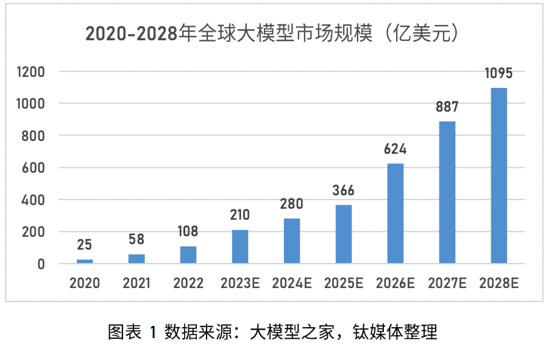
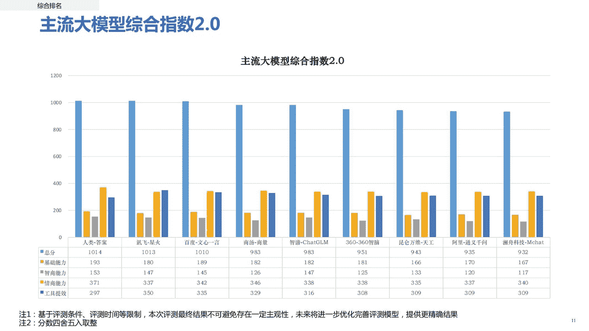
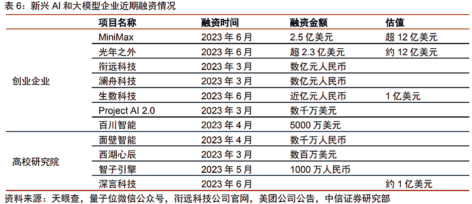
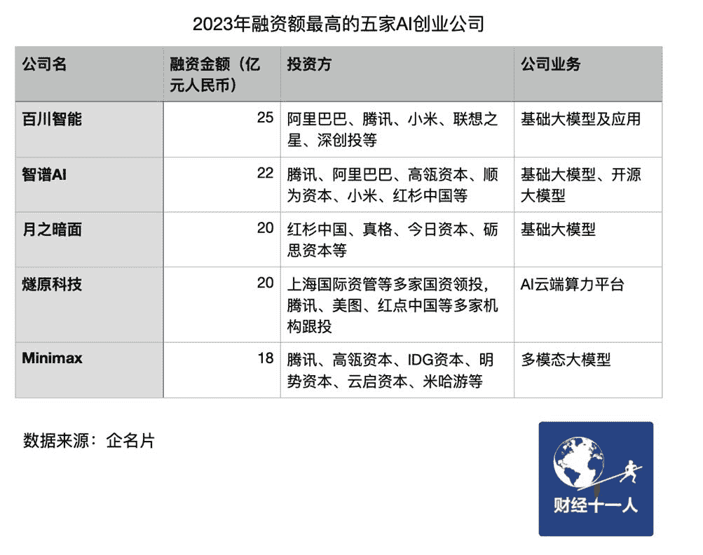

# 认知：大模型为何如此全能

> 来源：[https://agispace.feishu.cn/docx/IOgads7TdoWlaxx9cX9c3jKNnke](https://agispace.feishu.cn/docx/IOgads7TdoWlaxx9cX9c3jKNnke)

# **大模型的定义**

AI大模型，也称为人工智能大规模模型，是一种具有庞大参数量和复杂结构的机器学习模型。这些模型通常由大量的神经网络层组成，具有数百万或数十亿的参数，需要大量的计算资源和存储空间进行训练和推理

> **AI大模型不仅具备通用**性和可规模化复制的优势，而且被视为实现通用人工智能（AGI）的关键途径。

### **AI大模型的特点：**

1.  **参数量大**：大模型通常在设置参数的数量上高达千亿，它们的存在，通常是帮助模型在细节内容上进行微调，提升某一方面的权重。如 此一来，便能尽可能地提升内容的准确性。

1.  **数据量大**：大模型的训练内容多且复杂，有用于学习的标注数据，也有用于训练的未标记数据。只有通过更大体量数据的训练，才能有效提升人工智能的智能程度。

1.  **结构复杂**：构成大模型的内部网络十分复杂，并且是在有意模仿人类神经结构排列，让人工智能的输出逻辑更加符合人类的思想，提升其知识迁移的能力。

1.  **预训练与微调**：大模型的训练阶段较一般模型更多，分为预训练与微调两个阶段。前者是对无标签数据的学习，后者则是对学习内容的巩固，确保其训练成果。

1.  **迁移学习**：大模型可以将某一领域的思考模式，快速迁移到其他领域，提升其自主学习的能力，增加所学知识的转化率。

1.  **多模态**：AI大模型相较于一般模型，能够通过更多的模态对同一类内容进行更加精准的描述与预测，提升整体分析的能力。

# **大模型发展阶段**

> AI大模型的进化之旅可以分为三个显著的阶段：萌芽期、沉淀期以及爆发期。

#### **萌芽期（1950-2005）**

这一**时期标志着**从传统神经网**络模型如CN**N的起步阶**段。自1****956年计算**机**科学家约翰**·麦卡锡首次提出“人工**智能”一词起，**AI的发**展逐渐从**依赖小规模专家知识转向基于机器学习。1980年见证了卷积神经网络（CNN）的诞生，紧接着1998年现代CNN的基石LeNet-5的出现，深度学习开始取代早期的浅层学习模型，这为后续的深度学习架构更新和大模型的发展奠定了重要基础。

#### **沉淀期（2006-2019）**

这一阶段以Transformer模型为代表，见证了全新神经网络模型的发展。2013年，自然语言处理模型Word2Vec引入了“词向量模型”，为计算机更精准地理解和处理文本数据开辟了新道路。2014年，对抗式生成网络（GAN）的诞生拉开了深度学习在生成模型研究新篇章的序幕。2017年，Google提出了基于自注意力机制的Transformer架构，为大模型预训练算法奠定了基础。紧随其后，2018年OpenAI和Google分别推出GPT-1与BERT模型，预训练大模型开始成为自然语言处理领域的新趋势。

#### **爆发期（2020-至今）**

代表性的是GPT系列预训练大模型的快速发展。2020年，OpenAI发布了参数规模高达1750亿的GPT-3，实现了在零样本学习任务上的显著性能提升。接着，各种新策略如基于人类反馈的强化学习（RLHF）、代码预训练、指令微调等被引入以进一步增强模型的推理和泛化能力。2022年11月，ChatGPT的问世彻底改变了游戏规则，它不仅展示了模型逼真的自然语言交互能力，也大大拓宽了内容生成的可能性。2023年3月，GPT-4的发布进一步扩展了大模型的应用边界，将多模态理解与内容生成推向新高。这一时期的飞速发展得益于大数据、强大算力和先进算法的完美结合，特别是像ChatGPT这样的成功案例，正是基于Microsoft Azure的强大支持和Transformer架构的优化，以及通过RLHF细致调优的成果。

# **大模型发展现状**

### **发展现状**

AI大模型市场正在经历快速发展，市场规模从2020年的15亿元增长至2022年的70亿元，年均复合增长率达116.02%。预计到2024年，中国AI大模型产业规模将达216亿元。这一增长主要得益于大模型相关研究、产品的不断涌现，以及“ChatGPT”、“文心一言”、“盘古Chat”等大模型的爆火。

### 市场规模及预测

###  大模型市场融资情况

# **大模型研究报告**

多维表格（J4NBb7zvBaRe6Ms6ExUcQviAn4d_tblIWRIVOJU2oxii）