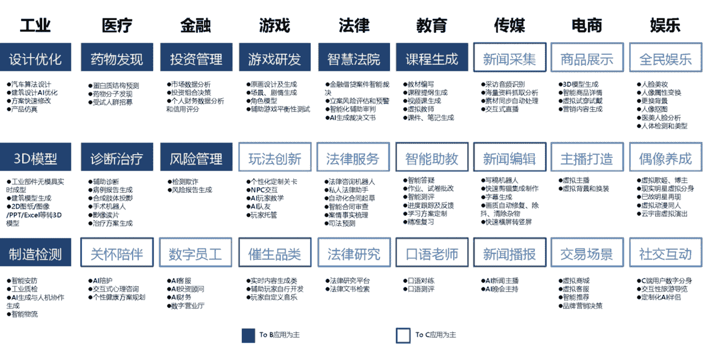

# 认知：大模型能帮我解决什么

> 来源：[https://agispace.feishu.cn/docx/NheddCARMo24MOx526DcwXJ5nie](https://agispace.feishu.cn/docx/NheddCARMo24MOx526DcwXJ5nie)

### [个体赋能方面](https://agispace.feishu.cn/wiki/LC8bwSc49i1mRgkZPdxcupuFnIc)

大模型可助力个体学习，像智能辅导，精准解答各学科难题、阐释知识概念。获取知识时，它能快速整合信息，提供知识综述。在创作上，为写作者、设计师等提供灵感。还能辅助个人决策，如根据健康和习惯给出生活建议。

### [企业增效方面](https://agispace.feishu.cn/wiki/EYXawbNPMixiPwkirvXcR47pnwb)

在企业中，市场营销可借助大模型分析数据定位客户，制定营销策略。客户服务方面，智能客服能高效处理咨询投诉。内部管理上，它能优化工作流程。产品研发时，可快速生成设计概念，缩短周期。

### [行业驱动方面](https://agispace.feishu.cn/wiki/BwRewiHLRiDVZ4k1CyTctwt1nId)

医疗行业，大模型辅助诊断、加速药物研发。金融领域，它分析市场数据辅助投资决策。制造业中，推动智能制造，优化生产。在人工智能行业，带动技术创新与人才培养。

（大模型市场全景图）