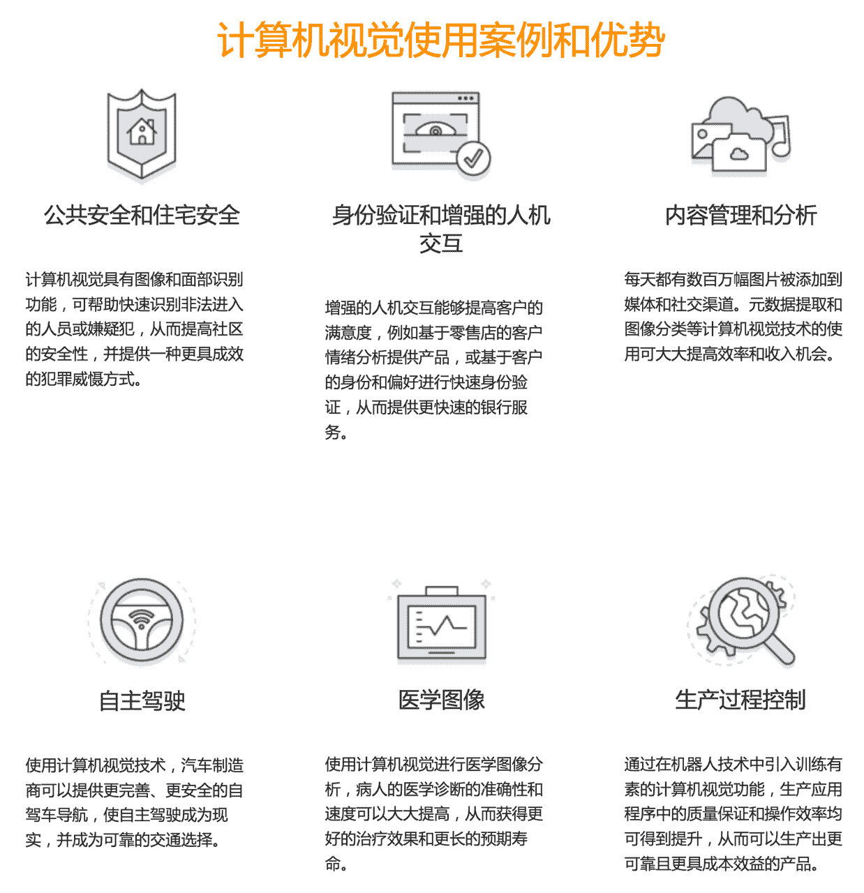

# 入门：计算机视觉

> 来源：[https://agispace.feishu.cn/docx/J0FldQpPDo243WxoLcEczygRnDg](https://agispace.feishu.cn/docx/J0FldQpPDo243WxoLcEczygRnDg)

### 自动识别和描述图像与视频

适用计算机视觉，计算机能够以更高的速度和效率，以相当于或高于人类的水平准确识别图像中的人物、地点和事物。计算机视觉通常使用深度学习模型构建而成，可以自动从单个图像或一系列图像中提取、分析、分类和理解有用的信息。图像数据可能会呈现出多种形式，例如单个图像、视频序列、来自多个相机的视图，或者三维数据。

其应用范围非常广泛，从识别高速装配线上的缺陷到自主式机器人，再到分析医学图像，以及识别社交媒体上的产品和人物。

