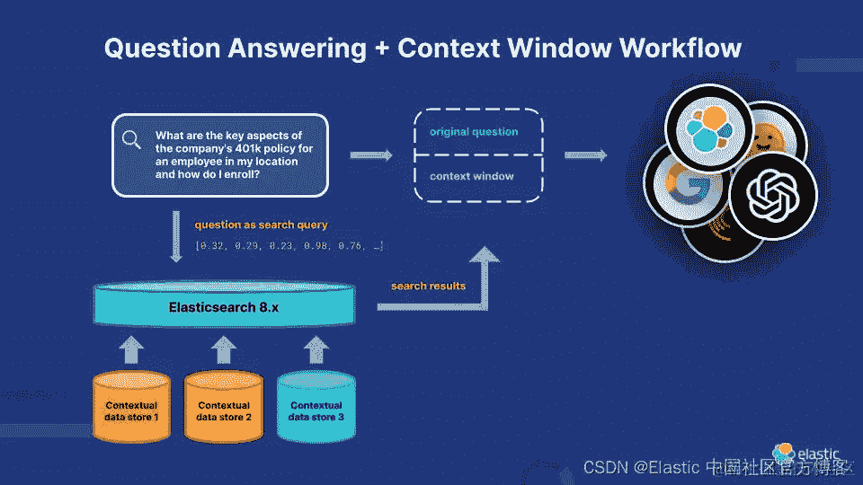

# 入门：LLM 大语言模型

> 来源：[https://agispace.feishu.cn/docx/HTpad4LS8ozZqPxm94ncHkJAnkc](https://agispace.feishu.cn/docx/HTpad4LS8ozZqPxm94ncHkJAnkc)

## **什么是大型语言模型？**

[大型语言](https://aws.amazon.com/what-is/deep-learning/)模型（LLM）是基于大[量数据进](https://aws.amazon.com/what-is/neural-network/)行预训练的超大型深度学习模型。底层转换器是一组神经网络，这些神经网络由具有自注意力功能的编码器和解码器组成。编码器和解码器从一系列文本中提取含义，并理解其中的单词和短语之间的关系。

转换器 LLM 能够进行无监督的训练，但更精确的解释是转换器可以执行自主学习。通过此过程，转换器可学会理解基本的语法、语言和知识。

与早期按顺序处理输入的循环神经网络（RNN）不同，转换器并行处理整个序列。这可让数据科学家使用 GPU 训练基于转换器的 LLM，从而大幅度缩短训练时间。

借助转换器神经网络架构，您可使用非常大规模的模型，其中通常具有数千亿个参数。这种大[规模模型可以摄取通常来自](https://registry.opendata.aws/commoncrawl/)互联网的大量数据，但也可以从包含 500 多亿个网页的 Common Crawl 和拥有约 5700 万个页面的 Wikipedia 等来源摄取数据。

## **为什么大型语言模型如此重要？**

大型语言模型非常灵活。一个模型可以执行完全不同的任务，例如回答问题、总结文档、翻译语言和完成语句。LLM 有可能破坏内容创作以及人们使用搜索引擎和虚拟助手的方式。

尽管并不完美，但 LLM 表现出根据相对较少量的提示[或输入做出预测](https://aws.amazon.com/generative-ai/)的非凡能力。LLM 可用于生成式人工智能，以根据采用人类语言的输入提示生成内容。

LLM 非常庞大。它们可以考虑数十亿个参数，并且有许多可能的用途。下面是一些示例：

+   Open AI 的 GPT-3 模型有 1750 亿个参数。类似的产品 ChatGPT 可以从数据中识别模式并生成自然且可读的输出。虽然我们不知道 Claude 2 的规模，但该模型可以在每个提示中输入多达 10 万个令牌，这意味着它可以处理数百页的技术文档，甚至可以处理整本书。

+   AI21 Labs 的 Jurassic-1 模型具有 1780 亿个参数和由 25 万单词部分组成的令牌词汇表以及类似的对话功能。

+   Cohere 的 Command 模型具有类似的功能，并且可以使用 100 多种不同的语言开展工作。

+   LightOn 的 Paradigm 提供根基模型，并且宣称该模型的功能超过 GPT-3。所有这些 LLM 都带有 API，可让开发人员打造独特的生成式人工智能应用程序。

## **大型语言模型如何运作？**

LLM 运作原理的一个关键因素是它们表示单词的方式。早期的机器学习使用数字表来表示每个单词。但是，这种表示形式无法识别单词之间的关系，例如具有相似含义的单词。人们采用如下方式克服此限制：使用多维向量（通常称为单词嵌入）来表示单词，从而使具有相似上下文含义或其他关系的单词在向量空间中彼此接近。

使用单词嵌入，转换器可以通过编码器将文本预处理为数字表示，并理解含义相似的单词和短语的上下文以及单词之间的其他关系，例如语音部分。然后，LLM 就可以通过解码器应用这些语言知识来生成独特的输出。

## **大型语言模型有哪些应用？**

LLM 有很多实际应用。

### **文案写作**

除了 GPT-3 和 ChatGPT 之外，Claude、Llama 2、Cohere Command 和 Jurassic 也可编写原件。AI21 Wordspice 建议修改原始语句以改善风格和语音。

### **知识库回答**

该技术通常称为知识密集型自然语言处理（KI-NLP），是指可以根据数字存档中的信息帮助回答特定问题的 LLM。AI21 Studio playground 能够回答常识性问题就是此类示例。

### **文本分类**

使用集群，LLM 可以对含义或情绪相似的文本进行分类。用途包括衡量客户情绪、确定文本之间的关系和文档搜索。

### **代码生成**

LLM 擅长根据自然语言提示生成代码。示例包括 Amazon CodeWhisperer 和 GitHub Copilot 中使用的 Open AI Codex，它们可以用 Python、JavaScript、Ruby 和其他几种编程语言编码。其他编码应用包括创建 SQL 查询、编写 Shell 命令和进行网站设计。

### **文本生成**

与代码生成类似，文本生成可以完成不完整的语句，编写产品文档，或者像 Alexa Create 一样创作简短的儿童故事。

## **如何训练大型语言模型？**

基于转换器的神经网络非常庞大。这些网络包含多个节点和层。层中的每个节点都有指向后续层中所有节点的连接，并且每个节点都有权重和偏差。权重和偏差以及嵌入称为模型参数。基于转换器的大型神经网络可以有数十亿个参数。模型的大小通常由模型大小、参数数量和训练数据规模之间的经验关系决定。

使用大量高质量数据执行训练。在训练过程中，模型会迭代调整参数值，直到模型可根据前一个输入令牌序列正确预测下一个令牌。为此，模型使用自学技术，这些技术教导模型调整参数，以最大限度地提高训练示例中正确预测下一个令牌的可能性。

经过训练，LLM 可以很容易地适应使用相对较小的有监督数据集执行多项任务，这一过程称为微调。

存在三种常见的学习模型：

+   零样本学习；Base LLM 无需明确训练即可响应各种请求，通常是通过提示，但是答案的准确性各不相同。

+   少量样本学习：通过提供一些相关的训练示例，基础模型在该特定领域的表现显著提升。

+   微调：这是少量样本学习的扩展，其中数据科学家训练基础模型，使模型使用与特定应用相关的其他数据来调整其参数。

## **LLM 的未来前景是什么？**

随着 ChatGPT、Claude 2 和 Llama 2 等可以回答问题和生成文本的大型语言模型的引入，我们可以预见令人兴奋的未来前景。可以肯定的是，LLM 会越来越接近人性化的表现，尽管这一过程会较为漫长。这些 LLM 即时取得的成功表明人们对机器人类型 LLM 的浓厚兴趣，这些 LLM 可模仿人类大脑的思维，在某些情况下表现甚至优于人类大脑。以下是一些关于 LLM 未来前景的想法：

### **增强的功能**

尽管 LLM 给人们留下了深刻的印象，但当前的技术水平并不完善，LLM 也并非绝对可靠。然而，随着开发人员学习如何在减少偏见和消除错误答案的同时提高性能，较新的 LLM 版本将提高准确性和增强功能。

### **视听训练**

开发人员使用文本训练大多数 LLM，但有些人已经开始使用视频和音频输入来训练模型。这种形式的训练应该可以加快模型开发速度，并为将 LLM 用于自动驾驶汽车开辟新的可能性。

### **工作场所转型**

LLM 是颠覆性的因素，它将转变工作场所。LLM 可能会采用机器人处理重复性制造任务的相同方式来减少单调和重复的任务。可能减少的任务包括重复的文书任务、客户服务聊天机器人和简单的自动文案写作。

### **对话式人工智能**

LLM 无疑将提高 Alexa、Google Assistant 和 Siri 等自动虚拟助手的性能。这些虚拟助手将能够更妥善地解释用户意图并响应复杂的命令。

> 文章引用：https://aws.amazon.com/cn/what-is/large-language-model/

## **大语言模型定义**

**大语言模型 (LLM) 是一种深****度学习算**法，可以执行各种自然语言处理 (natural language processing - NLP) 任务。 大型语言模型使用 Transformer 模型，并使用大量数据集进行训练 —— 因此规模很大。 这使他们能够识别、翻译、预测或生成文本或其他内容。

大型语言模型也称为神经网络（neural network - NN），是受人脑启发的计算系统。 这些神经网络使用分层的节点网络来工作，就像神经元一样。

除了向人[工智能 (A](https://link.juejin.cn?target=https%3A%2F%2Felasticstack.blog.csdn.net%2Farticle%2Fdetails%2F134747578)I) 应用训练人类语言之外，还可以训练大型语言模型来执行各种任务，例如理解蛋白质结构、编写软件代码等。 就像人脑一样，大型语言模型必须经过预训练，然后进行微调，以便能够解决文本分类、问答、文档摘要和文本生成问题。 它们解决问题的能力可以应用于医疗保健、金融和娱乐等领域，其中大型语言模型可以服务于各种 NLP 应用，例如翻译、聊天机器人、AI 助手等。

大型语言模型还具有大量参数，这些参数类似于模型在训练中学习时收集的记忆。 将这些参数视为模型的知识库。

## 那么，什么是转换器模型 (transformer model) 呢？

**转换器模型**是大型语言模型最常见的架构。 它由编码器和解码器组成。 转换器模型通过对输入进行标记来处理数据，然后同时进行数学方程以发现标记之间的关系。 这使得计算机能够看到人类在给出相同查询时会看到的模式。

Transformer 模型采用自注意力机制，这使得模型能够比长短期记忆模型等传统模型更快地学习。 自注意力使 Transformer 模型能够考虑序列的不同部分或句子的整个上下文，以生成预测。

## **大语言模型的关键组成部分**

大型语言模型由多个神经网络层 (neural networks layers) 组成。 循环层 (recurrent layers)、前馈层 (feedforard layers)、嵌入层 (embedding layers) 和注意力层 (attention layers) 协同工作来处理输入文本并生成输出内容。

**嵌入层**根据输入文本创建[嵌入](https://link.juejin.cn?target=https%3A%2F%2Felasticstack.blog.csdn.net%2Farticle%2Fdetails%2F134748014)。 大语言模型的这一部分捕获输入的语义和句法含义，因此模型可以理解上下文。

大型语言模型的**前馈层（FFN）**由多个全连接层组成，用于转换输入嵌入。 这样做时，这些层使模型能够收集更高级别的抽象，即理解用户输入文本的意图。

**循环层**按顺序解释输入文本中的单词。 它捕获句子中单词之间的关系。

**注意力机制**使语言模型能够专注于与当前任务相关的输入文本的单个部分。 该层允许模型生成最准确的输出。

将 Transformer 应用到你的搜索应用程序中

大语言模型主要分为三种：

+   **通用或原始语言模型**根据训练数据中的语言预测下一个单词。 这些语言模型执行信息检索任务。

+   **经过指令调整的语言模型**[经过训练](https://link.juejin.cn?target=https%3A%2F%2Fwww.elastic.co%2Fwhat-is%2Fsentiment-analysis)可以预测对输入中给出的指令的响应。 这使他们能够执行情感分析，或生成文本或代码。

+   **经过对话调整的语言模型**经过训练，可以通过预测下一个响应来进行对话。 想想聊天机器人或对话式人工智能。

## 大型语言模型和生成式人工智能有什么区别？

[生成式人工智能](https://link.juejin.cn?target=https%3A%2F%2Felasticstack.blog.csdn.net%2Farticle%2Fdetails%2F132834438)是一个总称，指的是具有生成内容能力的人工智能模型。 生成式人工智能可以生成文本、代码、图像、视频和音乐。 生成式人工智能的例子包括 Midjourney、DALL-E 和 ChatGPT。

大型语言模型是一种生成式人工智能，它接受文本训练并生成文本内容。 ChatGPT 是生成文本人工智能的一个流行示例。

所有大型语言模型都是生成式 AI。

## **大型语言模型如何工作？**

大型语言模型基于 Transformer 模型，其工作原理是接收输入、对其进行编码，然后对其进行解码以生成输出预测。 但是，在大型语言模型能够接收文本输入并生成输出预测之前，它需要进行训练，以便它能够实现通用功能，并进行微调，使其能够执行特定的任务。

**训练**：大型语言模型是使用来自维基百科、GitHub 或其他网站的大型文本数据集进行预训练的。 这些数据集由数万亿个单词组成，它们的质量将影响语言模型的性能。 在此阶段，大型语言模型进行无监督学习，这意味着它可以在没有特定指令的情况下处理输入的数据集。 在此过程中，LLM 的人工智能算法可以学习单词的含义以及单词之间的关系。 它还学习根据上下文区分单词。 例如，它会学习理解 “右” 是否意味着 “正确”，或者 “左” 的反义词。

**微调**：为了让大型语言模型执行特定任务（例如翻译），必须针对该特定活动进行微调。 微调可优化特定任务的性能。

**提示调整**实现了与微调类似的功能，即通过少样本提示或零样本提示来训练模型执行特定任务。 提示是给 LLM 的指示。 少样本提示教会模型通过使用示例来预测输出。 例如，在此情感分析练习中，几次提示将如下所示：

```
markdown
复制代码
1.  Customer review: This plant is so beautiful!2.  Customer sentiment: positive4.  Customer review: This plant is so hideous!5.  Customer sentiment: negative
```

语言模型将通过 “hideous (丑陋)” 的语义来理解，并且因为提供了相反的示例，所以第二个示例中的客户情绪是 “负面的”。

或者，零样本提示不使用示例来教导语言模型如何响应输入。 相反，它将问题表述为 ‘This plant is so hideous’ 中的情绪是……” 它清楚地表明了语言模型应该执行哪些任务，但没有提供解决问题的示例。

## **大型语言模型用例**

大型语言模型可用于多种目的：

+   **信息检索**：想想 Bing 或 Google。 每当你使用他们的搜索功能时，你都会依赖大型语言模型来生成响应查询的信息。 它能够检索信息，然后总结并以对话方式传达答案。

+   [**情感分析**](https://link.juejin.cn?target=https%3A%2F%2Fwww.elastic.co%2Fwhat-is%2Fsentiment-analysis)：作为[自然语言处理](https://link.juejin.cn?target=https%3A%2F%2Felasticstack.blog.csdn.net%2Farticle%2Fdetails%2F134747578)的应用，大型语言模型使企业能够分析文本数据的情感。

+   **文本生成**：大型语言模型是生成式人工智能的背后，例如 ChatGPT，并且可以根据输入生成文本。 他们可以在出现提示时生成文本示例。 例如：“给我写一首艾米莉·狄金森风格的关于棕榈树的诗。”

+   **代码生成**：与文本生成一样，代码生成是生成式人工智能的一种应用。 LLM 了解模式，这使他们能够生成代码。

+   **聊天机器人和对话式人工智能**：大型语言模型使客户服务聊天机器人或对话式人工智能能够与客户互动，解释他们的查询或响应的含义，并依次提供响应。

除了这些用例之外，大型语言模型还可以完成句子、回答问题和总结文本。

凭借如此广泛的应用程序，大型语言应用程序可以在众多领域中找到：

+   **技术**：大型语言模型可用于任何地方，从使搜索引擎能够响应查询到帮助开发人员编写代码。

+   **医疗保健和科学**：大型语言模型能够理解蛋白质、分子、DNA 和 RNA。 该职位允许 LLMs 协助开发疫苗、寻找疾病的治疗方法以及改进预防保健药物。 LLMs 还被用作医疗聊天机器人来执行患者入院或基本诊断。

+   **客户服务**：LLMs 在各个行业中用于客户服务目的，例如聊天机器人或对话式人工智能。

+   **营销**：营销团队可以使用法学硕士进行[情感分析](https://link.juejin.cn?target=https%3A%2F%2Fwww.elastic.co%2Fwhat-is%2Fsentiment-analysis)，以快速生成营销活动想法或文本作为推介示例等等。

+   **法律**：从搜索大量文本数据集到生成法律术语，大型语言模型可以为律师、律师助理和法律工作人员提供帮助。

+   **银行业**：LLMs 可以支持信用卡公司检测欺诈行为。

## **大型语言模型的好处**

由于应用范围广泛，大型语言模型对于解决问题特别有益，因为它们以清晰的对话风格提供信息，易于用户理解。

**大量应用程序**[：它们可](https://link.juejin.cn?target=https%3A%2F%2Fwww.elastic.co%2Fwhat-is%2Fsentiment-analysis)用于语言翻译、句子完成、情感分析、问答、数学方程等。

**不断改进**：大型语言模型的性能正在不断改进，因为它会随着添加更多数据和参数而增长。 换句话说，它学得越多，它就越好。 更重要的是，大型语言模型可以展示所谓的 “上下文学习”。 一旦 LLM 经过预训练，几次提示就可以使模型从提示中学习，而无需任何额外的参数。 就这样，它不断地学习。

**它们学习速度很快**：在演示上下文学习时，大型语言模型学习速度很快，因为它们不需要额外的权重、资源和参数来进行训练。 从某种意义上说它很快，因为它不需要太多的例子。

## **大型语言模型的局限性和挑战**

大型语言模型可能会给我们这样的印象：它们理解含义并且能够准确地做出反应。 然而，它们仍然是一种技术工具，因此大型语言模型面临着各种挑战。

+   **幻觉**：幻觉是指 LLM 产生错误的输出，或者与用户的意图不符。 例如，声称它是人类，它有情感，或者它爱上了用户。 由于大型语言模型预测下一个语法正确的单词或短语，因此它们无法完全解释人类的含义。 结果有时可能是所谓的 “幻觉”。

+   **安全性**：如果管理或监控不当，大型语言模型会带来严重的安全风险。 他们可以泄露人们的私人信息、参与网络钓鱼诈骗并制作垃圾邮件。 怀有恶意的用户可以根据自己的意识形态或偏见对人工智能进行重新编程，并助长错误信息的传播。 其影响在全球范围内可能是毁灭性的。

+   **偏差**：用于训练语言模型的数据将影响给定模型产生的输出。 因此，如果数据代表单一人口统计或缺乏多样性，则大型语言模型产生的输出也将缺乏多样性。

+   **同意**：大型语言模型是在数万亿个数据集上进行训练的 —— 其中一些数据可能不是在双方同意的情况下获得的。 当从互联网上抓取数据时，大型语言模型会忽略版权许可、抄袭书面内容以及在未经原始所有者或艺术家许可的情况下重新利用专有内容。 当它产生结果时，无法跟踪数据沿袭，并且通常不会向创建者提供信用，这可能会使用户面临版权侵权问题。

他们还可能从照片描述中窃取个人数据，例如拍摄对象姓名或摄影师姓名，这可能会损害隐私。 LLM 已经因侵犯知识产权而陷入诉讼，其中包括盖蒂图片社 (Getty Images) 发起的一项著名诉讼。

+   **扩展**：扩展和维护大型语言模型可能很困难，而且非常耗时和资源消耗。

+   **部署**：部署大型语言模型需要深度学习、转换器模型、分布式软件和硬件以及整体技术专业知识。

## **流行的大语言模型示例**

流[行的大型语言](https://link.juejin.cn?target=https%3A%2F%2Felasticstack.blog.csdn.net%2Farticle%2Fdetails%2F132834438)模型已经风靡全球。 其中许多已被各行各业的人们所采用。 你无疑听说过 ChatGPT，这是一种生成式 AI 聊天机器人。

其他受欢迎的法学硕士模型包括：

+   **PaLM**：Google 的 Pathways 语言模型 (PaLM) 是一种 Transformer 语言模型，能够进行常识和算术推理、笑话解释、代码生成和翻译。

+   **BERT**：来自 Transformers 的双向编码器表示 (BERT) 语言模型也是由 Google 开发的。 它是一个基于 transformer 的模型，可以理解自然语言并回答问题。

+   **XLNet**：一种排列语言模型，XLNet 以随机顺序生成输出预测，这与 BERT 不同。 它评估编码的标记的模式，然后以随机顺序（而不是连续顺序）预测标记。

+   **GPT**：生成式预训练 Transformer 可能是最著名的大型语言模型。 GPT 由 OpenAI 开发，是一种流行的基础模型，其编号迭代是对其前身（GPT-3、GPT-4 等）的改进。 可以对其进行微调以执行下游的特定任务。 例如，Salesforce 为 CRM 开发的 EinsteinGPT 和 Bloomberg 为金融开发的 BloombergGPT。

## **大型语言模型的未来进展**

ChatGPT 的到来使大型语言模型脱颖而出，引发了人们对未来的猜测和激烈争论。

随着大型语言模型的不断发展并提高其对自然语言的掌握，人们非常担心它们的进步会对就业市场产生什么影响。 很明显，大型语言模型将发展出取代某些领域工人的能力。

在正确的人手中，大型语言模型能够提高生产力和流程效率，但这为其在人类社会中的使用带来了伦理问题。

## Elasticsearch 相关性引擎简介

为了解决 LLMs 当前的局限性，Elastics[earch 相关](https://link.juejin.cn?target=https%3A%2F%2Fwww.elastic.co%2Fwhat-is%2Fsemantic-search)性引擎 (ESRE) 是为人工[智能驱](https://link.juejin.cn?target=https%3A%2F%2Felasticstack.blog.csdn.net%2Farticle%2Fdetails%2F134747578)动的搜[索应用程序](https://link.juejin.cn?target=https%3A%2F%2Fwww.elastic.co%2Fwhat-is%2Fgenerative-ai)构建的相关性引擎。 借助 ESRE，开发人员能够构建自己的语义搜索应用程序，利用自己的转换器模型，并将 NLP 和生成式 AI 结合起来，以增强客户的搜索体验。

使用 Elasticsearch 相关性引擎增强你的相关性



作者：Elasticsearch

链接：https://juejin.cn/post/7308219624138997798

来源：稀土掘金

著作权归作者所有。商业转载请联系作者获得授权，非商业转载请注明出处。