# 通义千问（阿里）

> 来源：`https://agispace.feishu.cn/docx/ME4qdGIhNou0z6xUiZkcccAFnGf`

## 一、序言｜资源

> 通义千问：`https://tongyi.aliyun.com/qianwen/?spm=5176.28326591.0.0.40f76ee1sASrpH`

> 通义万相：`https://tongyi.aliyun.com/wanxiang/?spm=5176.28326591.0.0.40f76ee1sASrpH`

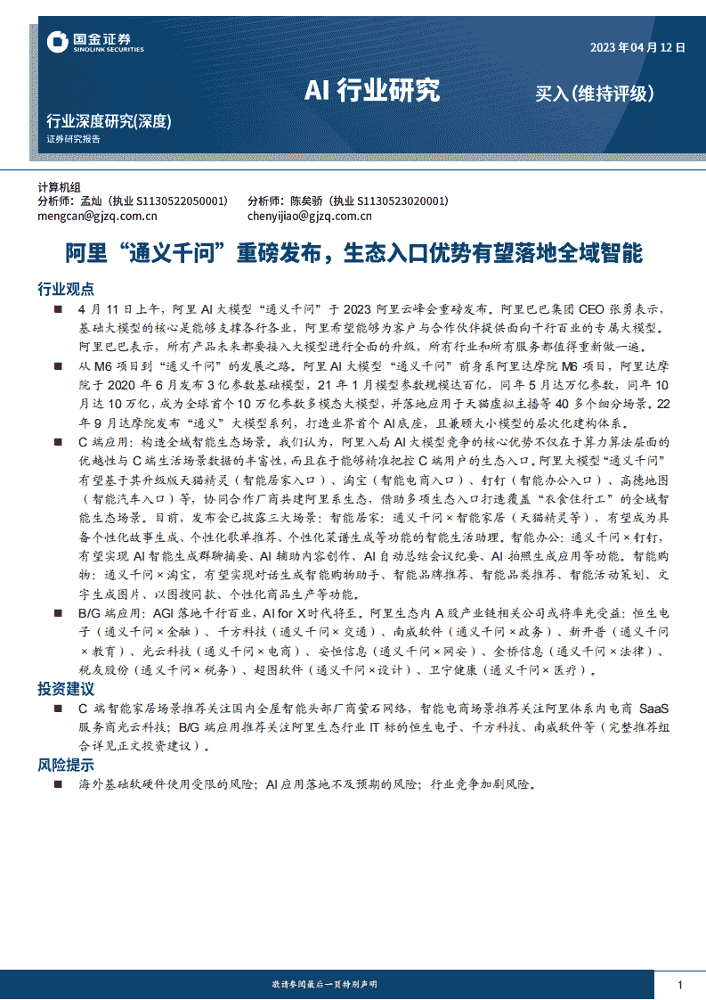

[`H3_AP202304131585415678_1.pdf`](https://internal-api-drive-stream.feishu.cn/space/api/box/stream/download/all/YoQvbLq3CoYwEQxOhO6c3Llznpf)

**阿里“通义千问”重磅发布**

生态入口优势有望落地全域智能 PDF

> 阿里AI依托阿里领先的云基础设施、大数据和AI工程能力、场景算法技术和多年行业实践，一站式地为企业和开发者提供云原生的AI能力体系。帮助提升AI应用开发效率，促进AI在产业中规模化落地，激发业务价值。

## 二、通义

### 通义版本迭代详情

1. 通义千问2.0发布：这一重要升级发生在2023年10月31日，阿里云在杭州的云栖大会上正式宣布。通义千问2.0的参数规模达到了千亿级别，并声称其综合性能超越了当时的`GPT-3.5`，展现了阿里云在大模型研究上的重大进展。这标志着阿里云在AI技术竞赛中加速追赶最前沿水平，如`OpenAI`的模型。

2. **通义千问2.5**

   + 发布时间：2024年5月9日

   + 发布地点：北京阿里云AI智领者峰会

   + 主要改进：相比通义千问2.1版，通义千问2.5版本的理解能力、逻辑推理、指令遵循、代码能力分别提升9%、16%、19%、10%。

   + 应用场景扩展：在过去一年中，通义千问发展出了文生图、智能编码、文档解析、音视频理解等能力，使得其应用场景更加广泛。

### 通义大模型

> 通义大模型系列是阿里巴巴集团推出的一系列超大规模的语言模型，涵盖了多个不同参数规模和功能特性的模型。以下是通义大模型系列的一些主要成员，按照参数规模和功能特点进行归纳：

1. **基础模型**：

   + `通义 - M6`：作为通义大模型系列的基础，`通义 - M6` 已经从最初的3亿参数基础模型发展到10万亿参数的全球最大预训练模型，并进一步演进为业界首个通用统一大模型`M6-OFA`。

1. **深度语言模型**：

   + `通义 - AliceMind`：这是阿里达摩院开源的深度语言模型体系，包含了多种模型，如通用语言模型`StructBERT`、生成式`PALM`、结构化`StructuralLM`、超大中文`PLUG`、多模态`StructVBERT`、多语言`VECO`、对话`SPACE`系列和表格`STAR`系列。这些模型在中文语言理解测评基础`CLUE`上取得了显著成绩，包括分类榜单、机器阅读理解榜单和总榜单的三榜第一。

1. **视觉大模型**：

   + `通义 - 视觉大模型`：专注于视觉领域，自下而上分为底层统一算法架构、中层通用算法和上层产业应用。它可以在电商行业实现图像搜索和万物识别等场景应用，并在文生图以及交通和自动驾驶领域发挥作用。

1. **行业模型**：

   + 通义大模型系列还涵盖了多个针对特定行业的模型，如`通义灵码-智能编码助手`、`通义智文-AI阅读助手`、`通义听悟-工作学习AI助手`、`通义星尘-个性化角色创作平台`、`通义点金-智能投研助手`、`通义晓蜜-智能客服`、`通义仁心-个人专属健康助手`、`通义法睿-AI法律顾问`等，这些模型为不同行业提供了定制化的解决方案。

1. **AI绘画创作大模型**：

   + `通义万相`：基于阿里研发的组合式生成模型`Composer`，通义万相提供高度可控性和极大自由度的图像生成效果，支持多类图像生成类任务能力。

### 通义千问

> 通义千问是阿里巴巴集团推出的一款大规模预训练语言模型

> （slogan!）

> 官网使用地址：`https://tongyi.aliyun.com/qianwen/`

> 通义介绍官网：`https://tongyi.aliyun.com/`

> 官方版本更新说明地址：`https://tongyi.aliyun.com/qianwen/document` （最新）

>

> “

> V2.5.0 版本说明（2024.05.09）

> 1. 模型中英文综合能力显著提升

> 2. 模型推理能力和复杂指令理解能力显著增强，困难任务上的表现更优

> 3. 文本理解能力提升：文本分类、信息抽取、情感分析、润色纠错等文本处理任务更稳健

> 4. 代码能力整体提升

> ”

#### 版本支持

（使用前需要手机号登录）

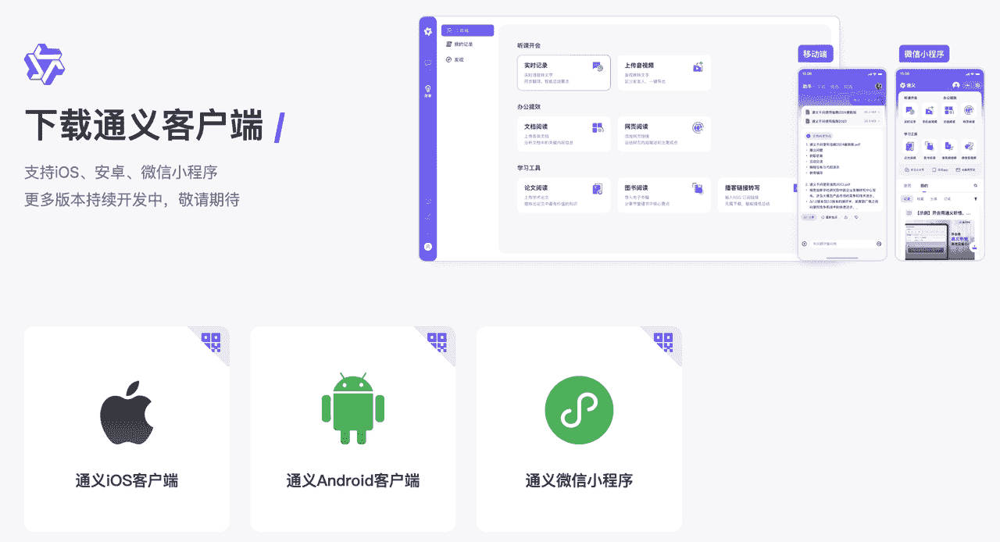

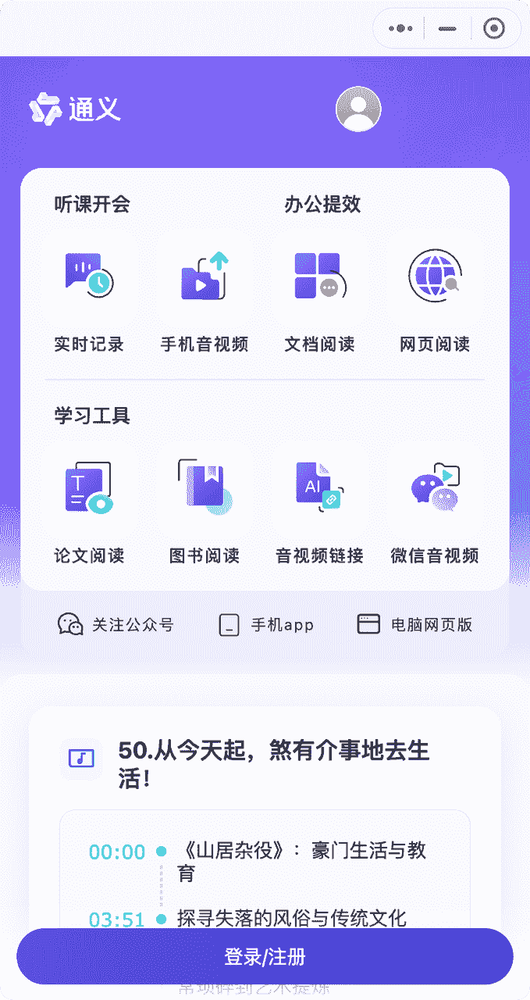

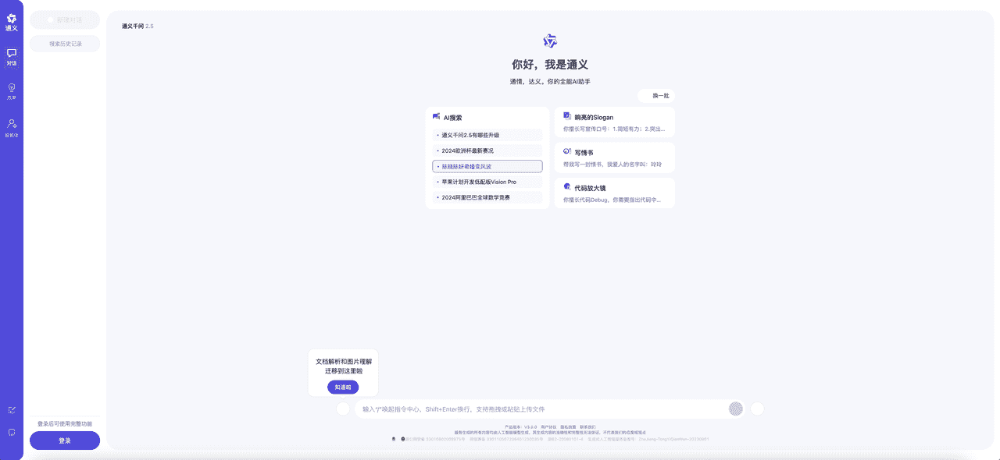

## 三、阿里AI 生态布局

> 阿里AI的生态布局涵盖了从人工智能基础设施、智能客服、智能物流、智能城市、智能家居到人工智能应用的全方位领域，同时拥有强大的研究机构和技术实力，持续推动AI技术的创新和应用。

>

1. **人工智能基础设施**：

   + 阿里云推出了`AI`平台`PAI`，提供了包括语音、图像、自然语言处理等多个领域的`AI`能力和算法，帮助企业和开发者快速构建`AI`应用。

   + 阿里云机器学习平台`PAI`（Platform of AI）为开发者提供了自然语言处理的机器学习算法和工具，支持快速构建智能应用。

1. **智能客服与虚拟助手**：

   + 阿里巴巴的钉钉和淘宝等平台上已经应用了`AI`客服技术，通过自然语言处理等技术，可以智能识别用户问题并提供相应的答案。

   + 阿里巴巴推出了图灵机器人，这是一个开放式的聊天机器人平台，支持自然对话和多轮交互。

1. **智能物流**：

   + 阿里的菜鸟网络在物流领域应用了`AI`技术，通过大数据和机器学习等技术，提高了物流运营的效率和精度。

1. **智能城市**：

   + 阿里在智能城市领域布局，与多个城市和政府合作，应用`AI`技术提高城市管理和服务的水平。

   + 阿里云推出了整合城市管理、工业优化、辅助医疗、环境治理、航空调度等全局能力为一体的`ET大脑`，正式布局产业`AI`。

1. **智能家居**：

   + 阿里的智能音箱天猫精灵，通过语音识别和自然语言处理等技术，可以实现控制家电、语音购物等功能。

1. **人工智能应用领域**：

   + 阿里在人工智能应用领域进行布局，推出了包括智能翻译、人脸识别等在内的多个应用。

   + 阿里云智能语音技术提供了语音合成、语音识别和语音转换等功能，用于支持智能语音交互和自然语言处理。

1. **研究机构与布局**：

   + 2014年，阿里宣布成立数据科学与技术研究院即`iDST`，重点研究大数据、机器学习、自然语言处理等领域。

   + 2017年，阿里在云栖大会上宣布成立全球性研究机构“达摩院”，把研究范围扩大至机器智能、区块链、量子计算、自动驾驶等领域。

1. **大模型领域的研究**：

   + 2023年4月，阿里云正式推出自研大模型“通义千问”，并发布`Qwen`系列开源模型。

## 四、阿里相关 AI 平台

### 阿里妈妈

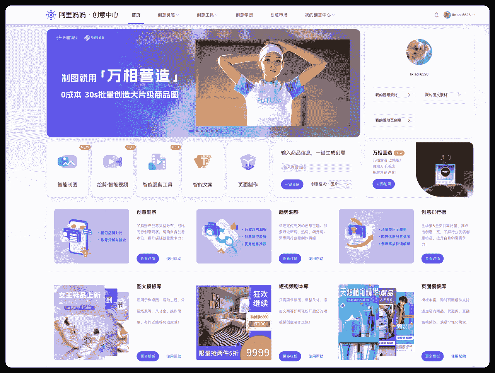

### 万相营造

`https://agi.taobao.com/?spm=a2esx.12365734.kbexternalIcon.d_goAgi.1ba32593sccC9v`

### 阿里达摩院

> `https://damo.alibaba.com/`

> 阿里达摩院是阿里巴巴集团旗下的全球研究机构，致力于探索科技未知，以人类愿景为驱动力，推动技术创新和应用落地。以下是关于阿里达摩院的详细介绍：

#### 一、创建历史与愿景

+ 阿里达摩院成立于2017年10月，在杭州云栖大会上正式宣布成立，名为“新技术研究院”。

+ 愿景是“服务世界二十亿人，创造一亿个工作岗位，为一千万家企业创造盈利的平台”。

+ 阿里巴巴集团对达摩院的投入承诺在五年内超过1000亿元，并期望其成为中国人创办的世界顶级科研机构。

#### 二、组织架构与人才储备

+ 阿里达摩院在全球多个地点设立科研机构，拥有顶尖科学家和工程师的团队。

+ 学术咨询委员会包括世界知名学者和科学家，如`Michael I. Jordan`、`李凯`、`George M. Church`等。

+ 阿里巴巴集团内部有超过2万名工程师和500多位博士的技术储备，为达摩院的研究提供强大的支持。

#### 三、研究领域与成果

1. 机器智能

   + 围绕机器学习等前沿技术开展理论与应用研究，帮助多个行业提升效率。

   + 下设语音、视觉智能、语言技术、决策智能、城市大脑等实验室。

   + 自主研发了全球首款基于`RISC-V`架构的神经网络处理器芯片“含光800”。

1. 数据计算

   + 旨在重构融合、开放、安全、敏捷、生态化的信息基础设施。

   + 下设计算技术、智能计算、数据库与存储等实验室。

1. 机器人

   + 主要围绕环境感知、高精定位、决策规划、智能控制等前沿技术方向。

   + 目前下设智能交通实验室，涉及无人驾驶、无人物流等研发与应用。

1. 金融科技

   + 致力于提升金融领域的连接、信任、安全和便捷。

   + 下设金融智能、区块链、生物识别等实验室，在杭州、北京、西雅图等地设有办公地点。

1. 其他领域

   + 在量子计算、生物计算、新材料等领域也有深入研究，取得了多项突破性成果。

#### 四、技术应用与产业合作

+ 阿里达摩院的研究成果广泛应用于电子商务、金融、人机交互、智能物流等多个领域。

+ 与全球多家企业和研究机构合作，共同推动`AI`技术的创新和应用。

#### 五、总结

阿里达摩院作为阿里巴巴集团旗下的全球研究机构，在机器智能、数据计算、机器人、金融科技等领域取得了显著成果。其研究成果不仅为阿里巴巴集团的发展提供了有力支持，也为全球科技进步做出了积极贡献。未来，阿里达摩院将继续致力于探索科技未知，推动技术创新和应用落地，为人类社会的发展做出更大贡献。

### 阿里天池平台

地址：`https://tianchi.aliyun.com/`

天池课程中心：`https://tianchi.aliyun.com/course/list?type=1&page=1&livePage=1&myPage=1`

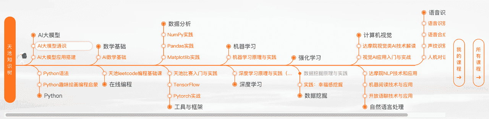

## Grow With AI

> 最前沿的`AI`赛题和课程，走在技术前线

> 阿里天池平台是阿里巴巴集团旗下的一个综合性平台，旨在推动大数据和人工智能技术的发展，发掘和培养全球范围内的优秀技术人才。以下是对阿里天池平台的详细介绍：

1. **平台概述**：

   + 阿里天池平台自2014年成立以来，基于阿里巴巴丰富的技术资源，结合在大数据、`AI`、芯片、制造业等多个行业的累积经验，为全球的开发者、研究者以及企业提供一站式的服务。

1. **主要功能和特点**：

   + **大数据竞赛**：天池平台定期举办各类大数据竞赛，涉及数据挖掘、机器学习、深度学习、自然语言处理、计算机视觉等多个前沿技术领域。竞赛设有高额奖金，如某些竞赛的奖金池高达数十万元，吸引全球技术人才参与。

   + **天池实验室**：用户可以在平台上创建自己的实验室，获得阿里云提供的免费或优惠计算资源，如云存储、云计算、数据分析工具等，用于数据处理、模型训练和实验验证。平台还提供丰富的公开数据集，支持用户进行探索和创新实践。

   + **教育资源**：天池平台提供丰富的在线课程、教程、案例分析等教育资源，帮助用户提升大数据和`AI`技术能力。

   + **开放创新模式**：鼓励开放数据、开放算法、开放思想，通过众包形式汇聚全球智慧，共同解决复杂的数据科学问题。

1. **技术与应用**：

   + 天池平台提供强大的数据处理能力，支持`PB`级别的数据分析和计算。

   + 提供完整的机器学习平台，包括数据预处理、模型训练、模型评估和推理等环节，同时也提供多种深度学习框架和算法库。

   + 提供交互式数据探索和可视化工具，如`Quick BI`、`DataV`等，帮助用户快速发现数据中的规律和趋势。

   + 平台支持科研项目的产业化，推动大数据和`AI`技术在各行业的应用。

1. **影响力与成果**：

   + 天池平台作为国内领先的办赛平台，拥有十年的办赛口碑，汇聚了全球大数据/`AI`开发者和技术学习者，形成了强大的技术社区。

   + 平台发布的比赛自带流量，为比赛提供1-3天的`banner`位曝光，为参赛者提供展示才华的机会。

   + 优秀的竞赛表现和实验室成果有可能为用户赢得阿里巴巴集团及其他企业的实习、就业或合作机会，助力职业发展。

1. **未来展望**：

   + 随着技术的不断进步和应用场景的拓展，天池平台将继续致力于推动大数据和人工智能技术的发展，为全球范围内的技术人才提供更多的机遇和挑战。

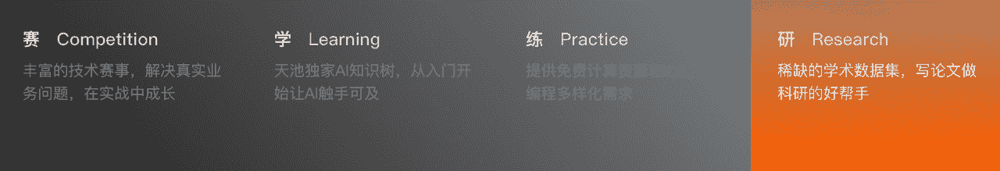

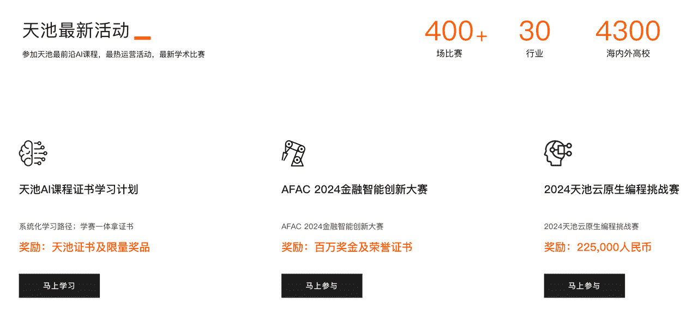

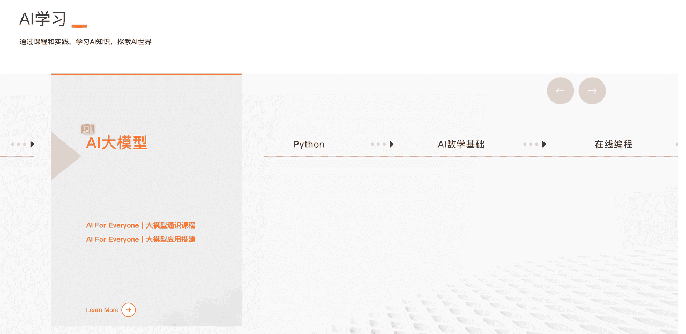

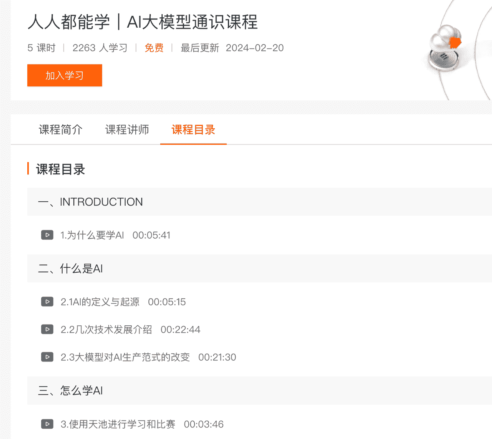

学习 demo

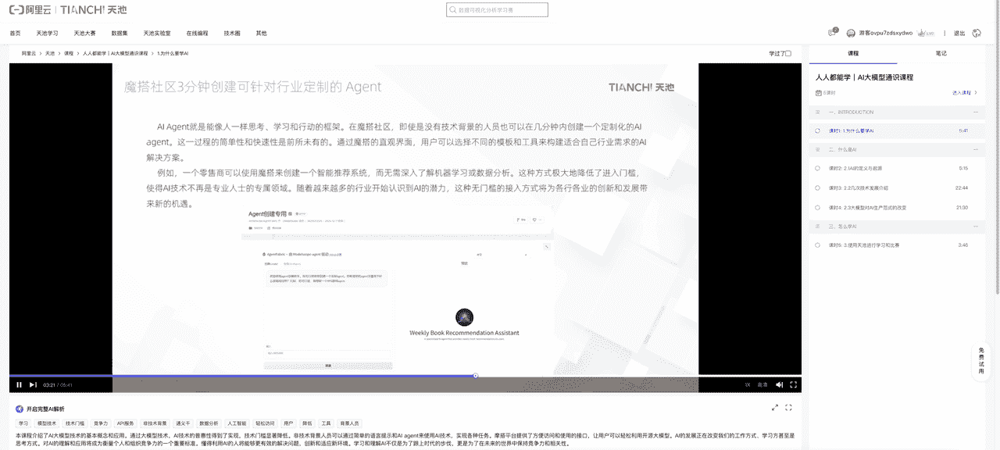

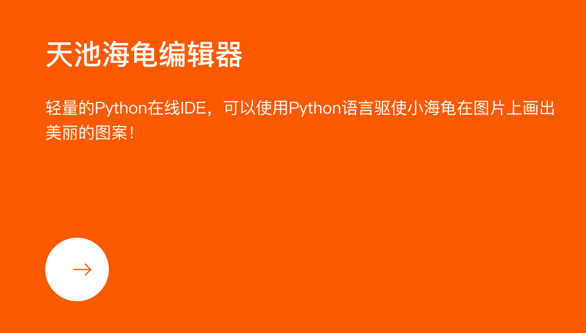

#### 天池Notebook

天池`notebook`集成机器学习`PAI-DSW`（DataScienceWorkshop）探索者版，成为天池实验室底座，为大家提供完备的`IDE`以及丰富的计算资源

#### 天池数据集

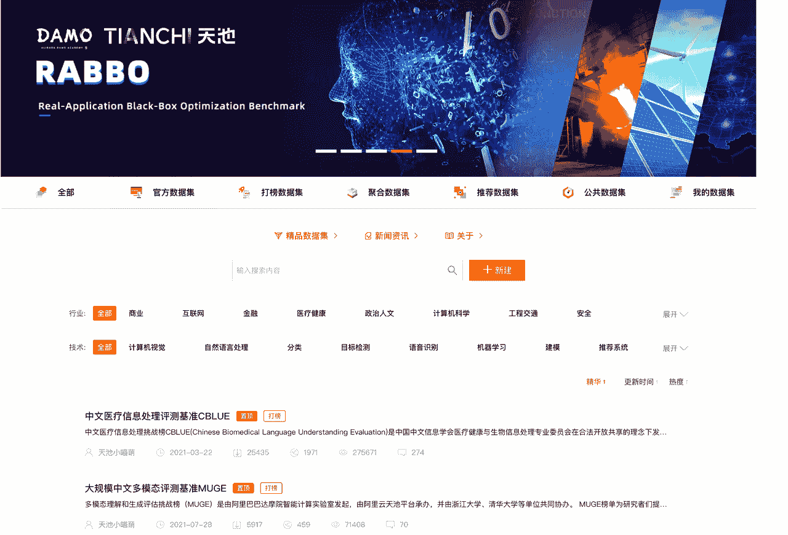

#### 大模型服务平台百炼

地址：`https://www.aliyun.com/product/bailian?spm=5176.24532587.J_5082370370.1.3ff442f48ApsPa`

> 阿里云百炼于近期正式发布2.0版本，应用、模型双引擎全新升级，兼容`LlamaIndex`等开源框架，更具开放性的应用框架，更极致生态化的模型服务，降低推理成本，加速大模型应用落地。

>

> 阿里云百炼是基于通义大模型、行业大模型以及三方大模型的一站式大模型开发平台。面向企业客户和个人开发者，提供完整的模型服务工具和全链路应用开发套件，预置丰富的能力插件，提供`API`及`SDK`等便捷的集成方式，高效完成大模型应用构建。

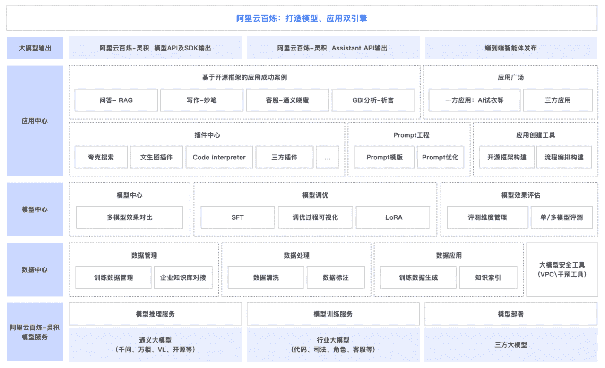

### 阿里云PAI

阿里云`PAI`（Platform of Artificial Intelligence），全称为阿里云机器学习平台，是阿里巴巴集团针对人工智能开发者和数据科学家打造的一站式云端机器学习开发与部署平台。`PAI`旨在简化机器学习和深度学习项目的整个生命周期管理，从数据准备、模型训练、评估、优化到部署，为用户提供全方位的支持。以下是阿里云`PAI`的几个核心特点和功能：

#### 核心特点：

1. 全面的算法库： `PAI`内置了丰富的机器学习和深度学习算法，覆盖了分类、回归、聚类、推荐、计算机视觉、自然语言处理等多种应用场景，用户可以直接使用这些算法快速构建模型。

1. 低代码/无代码开发： 通过可视化的拖拽式工作流设计，即便是没有深厚编程背景的用户也能轻松搭建模型，降低了`AI`应用的开发门槛。

1. 灵活的开发环境： 提供`Jupyter Notebook`、`PyCharm`等集成开发环境，支持`Python`、`Scala`等多种编程语言，满足不同用户的开发习惯和需求。

1. 大数据处理能力： 集成阿里云`MaxCompute`、`OSS`（对象存储服务）等大数据存储和处理服务，可以轻松处理`PB`级别的数据，支持高效的数据预处理和特征工程。

1. 模型训练与优化： 支持分布式训练，大幅缩短模型训练时间。同时，提供模型调优工具和自动模型选择功能，帮助用户快速优化模型性能。

1. 模型管理与部署： 用户可以便捷地管理训练好的模型，将其部署为`RESTful API`或者`Serving`服务，无缝对接到各种应用系统中，实现模型的快速上线和迭代。

1. 安全与合规： 符合多种行业安全标准，确保数据处理和模型训练过程中的数据隐私和安全。

#### 主要功能模块：

+ `PAI-Studio`（可视化建模）： 一个拖拽式的工作流设计工具，用户可以通过图形界面来构建数据处理流程和机器学习模型，无需编写代码。

+ `PAI-DSW`（Data Science Workshop）： 提供基于`Jupyter Notebook`的交互式开发环境，支持`Python`、`R`等语言，便于数据探索、模型开发和算法调试。

+ `PAI-EAS`（Elastic Algorithm Service）： 一个模型在线服务组件，支持模型的快速部署和弹性伸缩，实现低延迟的在线预测服务。

+ `PAI-AutoLearning`： 利用自动化机器学习技术，根据用户提供的数据自动选择最佳模型和超参数，极大提升模型开发效率。

+ `PAI-DLC`（Deep Learning Container）： 提供预置深度学习框架和环境的容器服务，方便用户在`GPU`实例上运行自定义的深度学习训练任务。

阿里云PAI以其强大的功能集、易用性和灵活性，成为企业和开发者在人工智能领域的重要工具，广泛应用于金融、电商、医疗、教育、制造业等多个行业，加速了AI技术在实际业务场景中的应用和落地。

# 五、阿里 AI 相关👸号

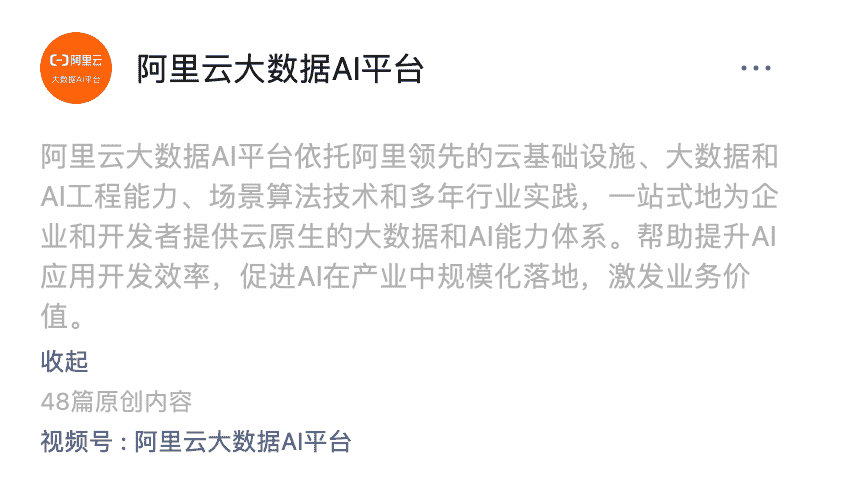
