# 文心一言（百度）

> 来源：[https://agispace.feishu.cn/docx/IoMkdiz7woLRTFxl1AUcn17fnid](https://agispace.feishu.cn/docx/IoMkdiz7woLRTFxl1AUcn17fnid)

# 一、**文心大模型**

> 文心大模型首页：https://wenxin.baidu.com/

> 大模型社区-飞桨星河：https://aistudio.baidu.com/community

> 文心一言是百度打造出来的人工智能大语言模型，具备跨模态、跨语言的深度语义理解与生成能力，文心一言有五大能力，文学创作、商业文案创作、数理逻辑推算、中文理解、多模态生成，其在搜索问答、内容创作生成、智能办公等众多领域都有更广阔的想象空间。

>

> 文心一言企业服务由千帆大模型平台提供，包括推理服务及大模型微调等一系列开发和应用工具链。

>

> 文心一言大模型现已升级至4.0，企业客户可通过百度智能云千帆大模型平台申请接入。

>

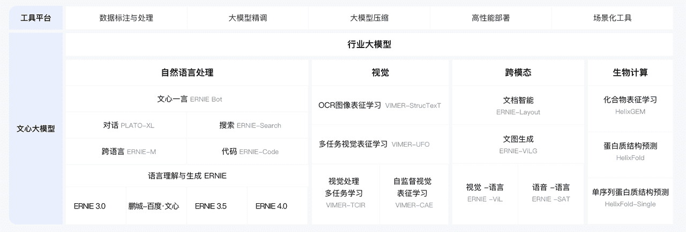

1.  **技术特点**：

+   文心大模型采用了创新性的知识增强技术，从单模态大模型到跨模态、从通用基础大模型到跨领域、跨行业都有持续的创新和突破。

+   它构建了模型层、工具与平台层，大幅降低了人工智能开发和应用门槛，加快了人工智能大规模产业化进程并拓展了人工智能技术边界。

1.  **模型体系**：

+   文心大模型已经形成了基础-任务-行业三级大模型体系，包括自然语言处理、视觉、跨模态等基础大模型，对话、跨语言、搜索、信息抽取等任务大模型，以及生物计算领域大模型和行业大模型。

+   其中，ERNIE 3.0是ERNIE系列大模型的进一步升级，通过持续学习对百余种不同形式的任务数据学习，实现了任务知识增强，显著提升了模型的零样本/小样本学习能力。

1.  **参数规模**：

+   鹏城-百度·文心（ERNIE 3.0 Titan）的参数规模达到2600亿，相对于GPT-3的参数量提升了50%。

1.  **应用领域**：

+   文心大模型可以支持智能创作、摘要生成、问答、语义检索、情感分析、信息抽取、文本匹配、文本纠错等各类自然语言理解和生成任务。

# 二、文心大模型主要产品

### **文心一言  （对话）**

> 文心一言地址：https://yiyan.baidu.com/

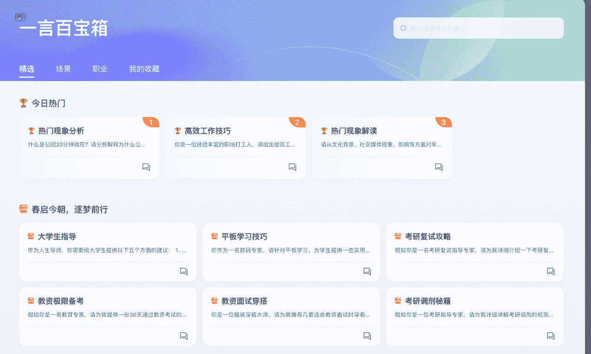

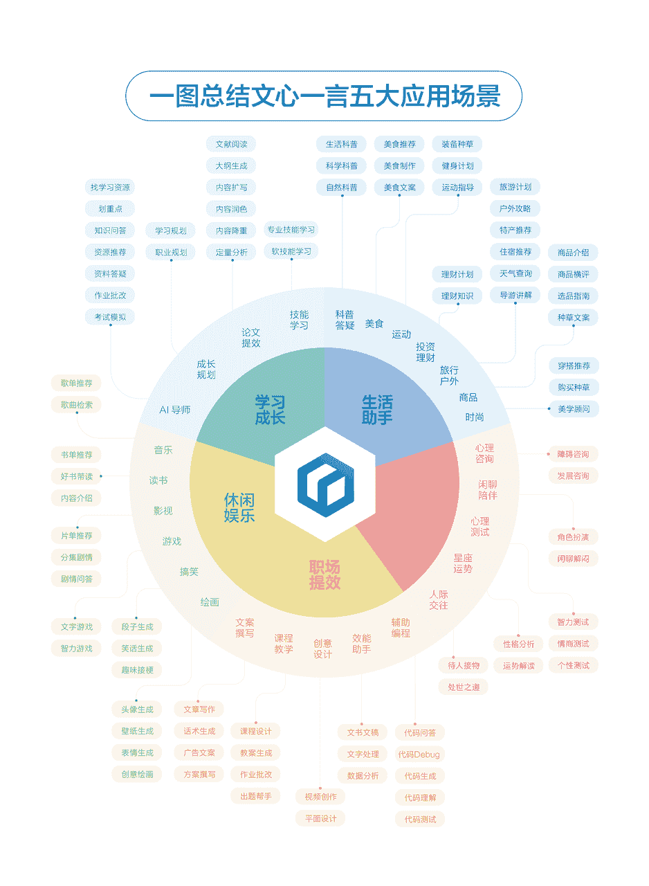

### **文心一格  （绘画）**

https://yige.baidu.com/

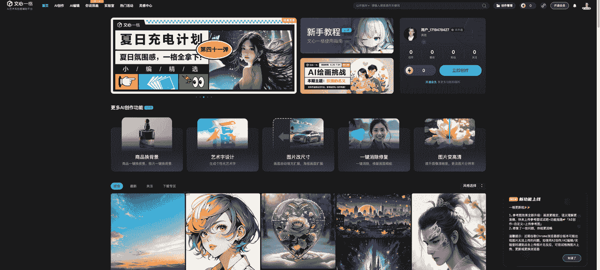

### **文心百中（搜索）**

https://wenxin.baidu.com/baizhong/index

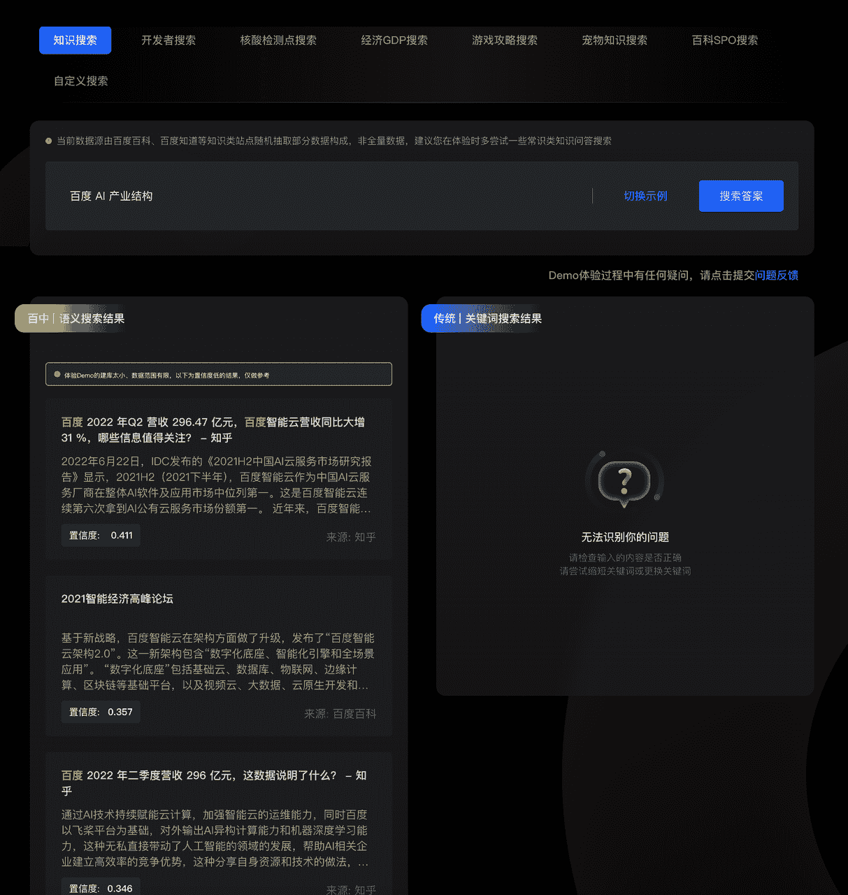

现阶段还看到有大范围推广，目前为止，24 年 6 月 24 日，测试了一下，效果不太理想，可能还在开发过程中。

不过看搜索引擎结构上来讲，跟目前主流的 AI 搜索有所差异。如果按照这个持续做好的话，相信还是好用的。

# 三、**百度AI布局**

1.  **AI平台**：

+   百度AI平台（含百度云）提供了从基础设施、算法、工具、场景到解决方案的全链条AI服务，帮助客户实现智能化转型和业务创新。

+   百度AI平台的技术能力不断提升，推出了百度大脑7.0，集成了百度自研的AI芯片昆仑，提供了超过300项AI服务，支持了超过1000种AI场景。

1.  **AI应用**：

+   百度AI应用涵盖了多个领域，如百度搜索、百度智能小程序、百度智能小屏、百度智能音箱、百度智能驾驶、百度智能健康等，为用户提供便捷、智能和个性化的服务。

1.  **AI硬件**：

+   百度自主研发了专用于AI计算的芯片，包括昆仑系列和飞桨系列，分别用于云端和边缘的AI计算，为百度AI平台和应用提供了高效、低成本和可定制的计算支持。

1.  **社会影响力**：

+   百度AI平台的社会影响力不断扩大，参与了国家重大工程，如新冠疫情防控、北京冬奥会、国家数字货币等，为国家和社会提供了智能化的解决方案。

1.  **研发投入**：

+   百度在AI领域的研发投入巨大，拥有全球最大的AI研发团队，超过5000名AI工程师和科学家，拥有全球最多的AI专利，超过11000项。

# 四、百度AI相关平台汇总

1.  **百度AI开放平台**：

> 百度大脑是百度技术多年积累和业务实践的集大成，包括视觉、语音、自然语言处理、知识图谱、深度学习等AI核心技术和AI开放平台。

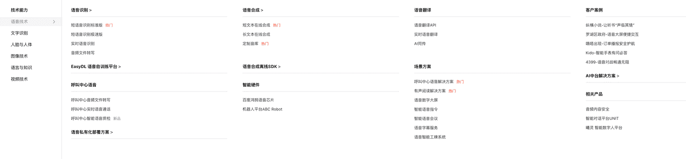

>

+   简介：提供强大可靠的技术支持，为企业提供优质易用的应用方案。

+   应用场景：企业服务和智能硬件。

+   官网网址：https://ai.baidu.com/

1.  **飞桨AI Studio**：

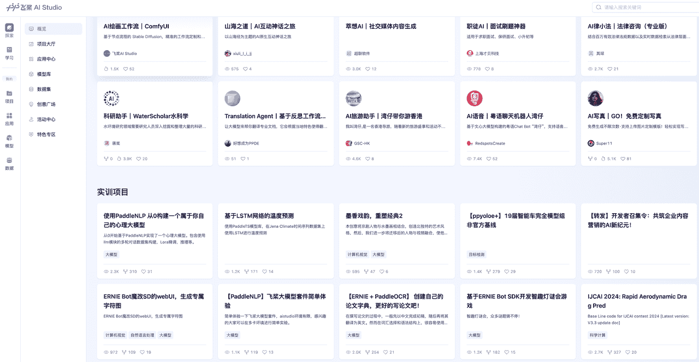

+   简介：针对教学全流程，提供一站式教学和实训平台。

+   主要功能：教学管理、实训环境、服务共建等。

+   应用场景：人工智能实训室和产业学院建设。

+   官网网址：https://aistudio.baidu.com/overview

1.  **百度智能云**：

> 百度智能云致力于为企业和开发者提供全球领先的人工智能、大数据和云计算服务，加速产业智能化转型升级

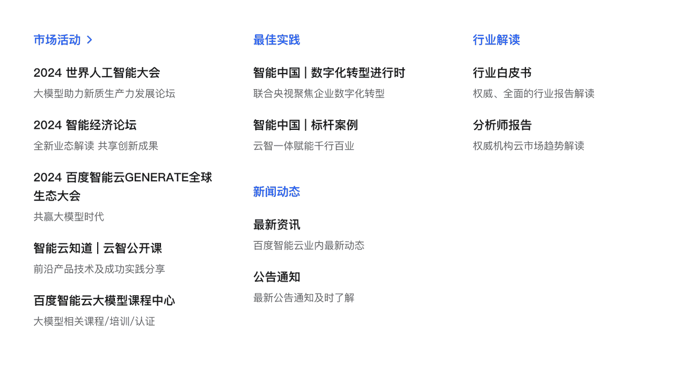

+   简介：面向企业的智能云服务平台，提供大模型应用产品。

+   主要功能：知识管理、智能客服、数字人等。

+   应用场景：企业知识管理、客户服务、营销等。

+   官网网址：https://cloud.baidu.com/

1.  **百度松果学堂**：

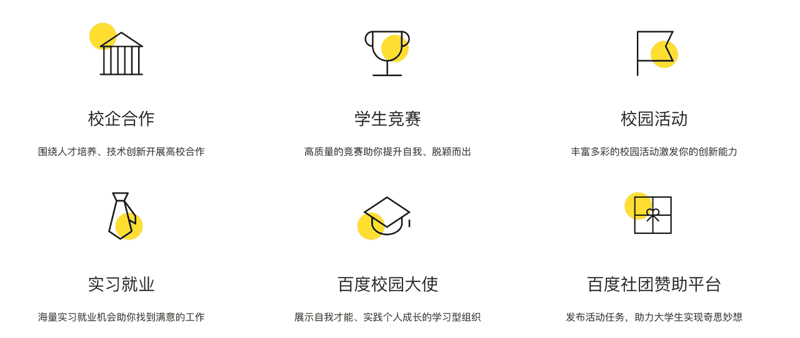

+   简介：百度旗下的AI人才培养平台，提供全方位的AI学习与实践资源。

+   主要资源：AI基础课程、实践教学、技术竞赛、产业实训、科研基金等。

+   应用场景：高校教育、行业应用等。

+   官网网址：http://campus.baidu.com/#/

1.  **百度千帆AI应用商店**：

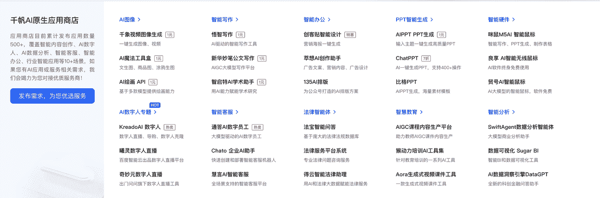

+   简介：提供各种AI应用的商店。

+   主要应用：创客贴智能设计神器、新华妙笔AI、智启特AI学术助手、千象Pixeling AIGC创作平台、ChatPPT等。

+   应用场景：满足用户在不同场景下的AI应用需求。

+   官网网址：https://qianfanmarket.baidu.com/

1.  一念

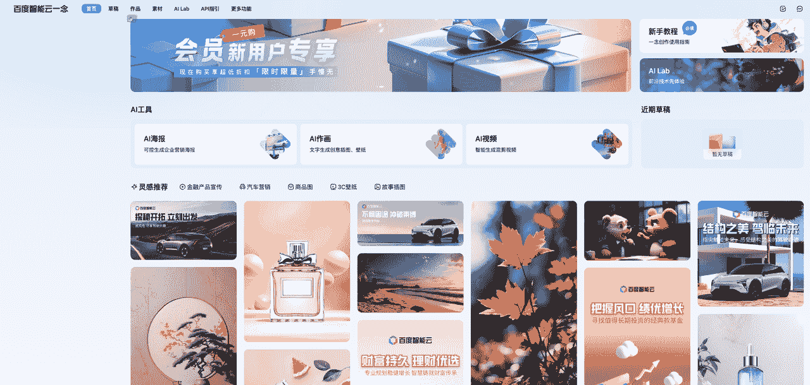

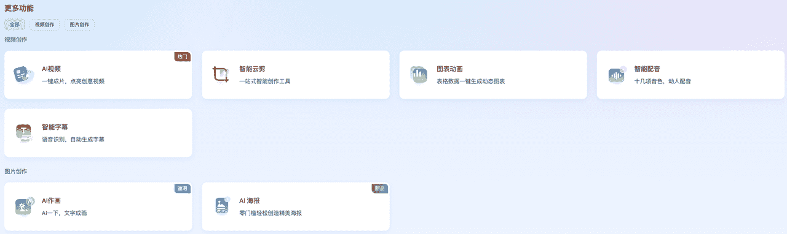

1.  数字人

https://xiling.cloud.baidu.com/

https://cloud.baidu.com/solution/digitalhuman.html?track=cloud_product

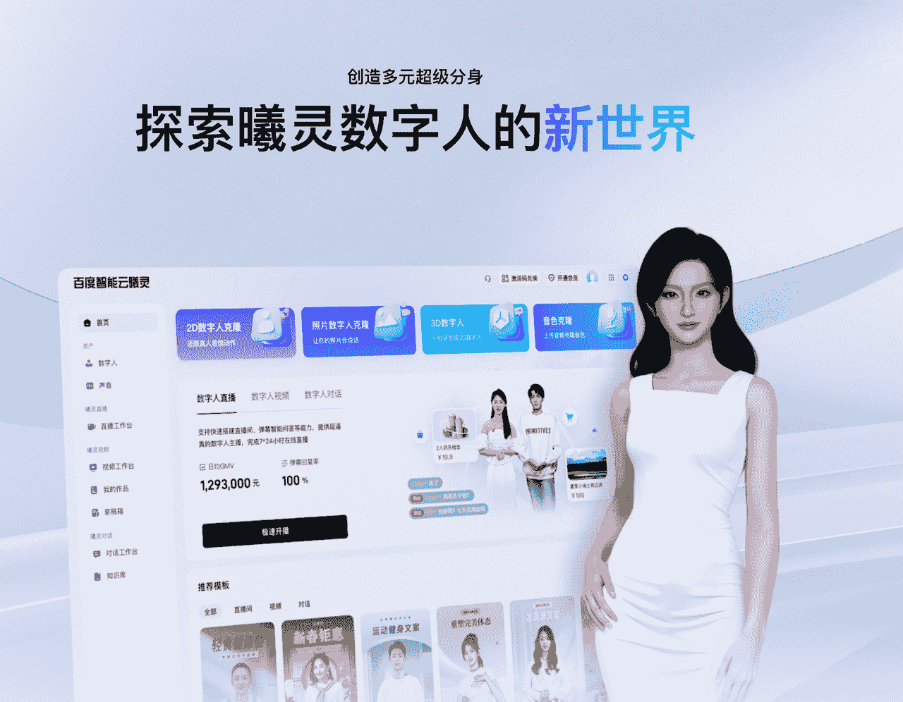

1.  智能客服

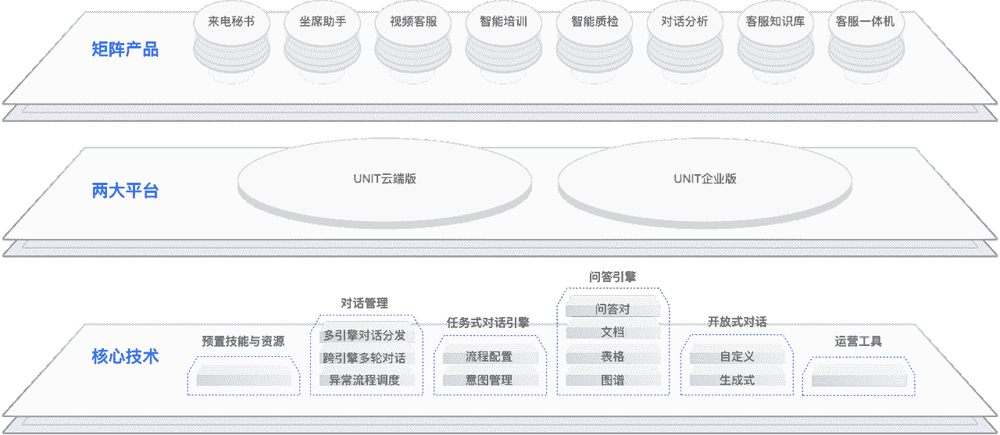

# 五、百度 AI 开发

#### AI 开发平台

AI 开发平台https://ai.baidu.com/bml/

BML 全功能 AI 开发平台是一个面向企业和个人开发者的机器学习集成开发环境，为经典机器学习和深度学习提供了从数据处理、模型训练、模型管理到模型推理的全生命周期管理服务，帮助用户更快的构建、训练和部署模型。

#### 开发工具

“开箱即用”的三大AI开发工具，包括智能体开发工具AgentBuilder、AI原生应用开发工具AppBuilder、各种尺寸的模型定制工具ModelBuilder

**AgentBuilder**

AgentBuilder是百度推出的一款对话流程构建工具，旨在帮助开发者快速创建各种智能对话应用。其主要特点包括：

1.  **界面设计**：AgentBuilder拥有简洁明了的界面设计，左侧提供丰富的对话组件库，方便开发者选择和拖拽；中间是代码编辑区，开发者可方便地编写和修改代码；右侧为运行展示区，让开发者实时查看对话运行情况，便于调试和优化。

1.  **功能特点**：

+   支持通过拖拽组件、设置参数和编写代码来构建复杂的对话流程。

+   利用条件判断和循环结构，开发者可以创建出更加智能的对话应用。

+   提供丰富的API接口和文档，帮助开发者深入了解其功能和用法。

**AppBuilder**

AppBuilder是专为Openbiz Cubi平台设计的元数据集成开发环境，其特点包括：

1.  **交互性图形界面**：AppBuilder具有交互性图形界面，提供直观的开发体验。

1.  **生成向导和编辑器**：包含两个功能强大的生成向导（App生成向导和模块关联向导）以及直观的元数据编辑器，极大地提高了开发效率。

1.  **AI能力**：AppBuilder集成了大量的人工智能能力，如百度多年的技术积累和AI能力组件，使应用开发更加智能化。

1.  **组件丰富**：提供包括百度独家开放的业务组件在内的55个组件，支持主流场景的第三方API集成，以及自定义组件的开发。

**ModelBuilder**

ModelBuilder是百度发布的模型定制工具，其主要特点包括：

1.  **模型丰富**：预置了包括ERNIE3.5、ERNIE4.0等在内的77个大模型，支持国内外主流第三方模型。

1.  **模型定制**：支持根据需求定制任意尺寸的模型，并可进行模型精调和post pretrain。

1.  **技术特点**：采用先进的压缩加速技术，如Qianfan-Llama-2-70B-compressed模型，降低模型推理资源占用。

1.  **功能优势**：提供数据集整理、模型精调、在线测试、模型评估等系统工具，支持Web应用调用，方便企业集成到自身业务系统中。

https://cloud.baidu.com/news/news_b9b782d9-7f56-499a-8ea5-2983c58e31f1官方详情

####

# 六、百度 AI 市场与服务

### AI 市场

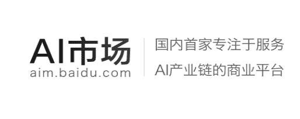

https://aim.baidu.com/

百度AI市场是一个专注于服务AI产业链的商业平台，为开发者、企业和用户提供丰富的AI产品、解决方案以及服务。以下是关于百度AI市场的详细介绍：

一、产品与服务

百度AI市场提供了从硬件产品、解决方案到软件服务和数据服务的全方位支持。

1.  **硬件产品**：包括边缘计算、计算机视觉、智能终端、智能机器人等，为AI应用提供强大的硬件支持。

1.  **解决方案**：涵盖智能园区、智能工业、智能农业、企业服务等多个领域，为用户提供定制化的AI解决方案。

1.  **软件服务**：提供API接口、SDK集成包、企业应用等，满足不同用户的软件需求。

1.  **数据服务**：包括图像采集、标注、数据审核服务、文本数据服务、音频数据服务等，为AI应用提供高质量的数据资源。

二、市场特点

1.  **丰富性**：百度AI市场拥有丰富的产品、解决方案和服务，可以满足不同用户的多样化需求。

1.  **专业性**：作为一个专注于AI产业链的商业平台，百度AI市场提供了专业的AI产品和服务，具有较高的技术含量和附加值。

1.  **开放性**：百度AI市场秉持开放合作的理念，与众多企业、高校和研究机构建立了合作关系，共同推动AI技术的创新和应用。

三、市场成绩

百度AI市场凭借其丰富的产品、专业的服务和开放的合作态度，取得了显著的市场成绩。例如，百度AI平台（含百度云）的收入在持续增长，成为百度的第二大收入来源。同时，百度AI平台的客户数也在不断增加，覆盖了金融、教育、医疗、制造、零售、物流等多个行业。

四、未来展望

未来，百度AI市场将继续加大投入，推动AI技术的创新和应用。一方面，百度将不断提升AI技术的研发能力，推出更加先进、更加智能的AI产品和服务；另一方面，百度将加强与各行业的合作，探索AI在更多领域的应用场景，推动AI产业的繁荣发展。

综上所述，百度AI市场是一个专业、开放、丰富的AI商业平台，为开发者、企业和用户提供了一站式的AI产品和服务支持。

### 百度智能云解决方案

https://cloud.baidu.com/solution/index.html

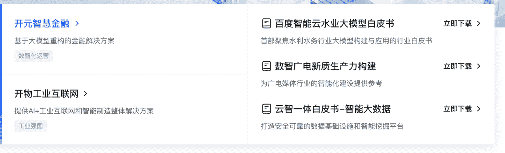

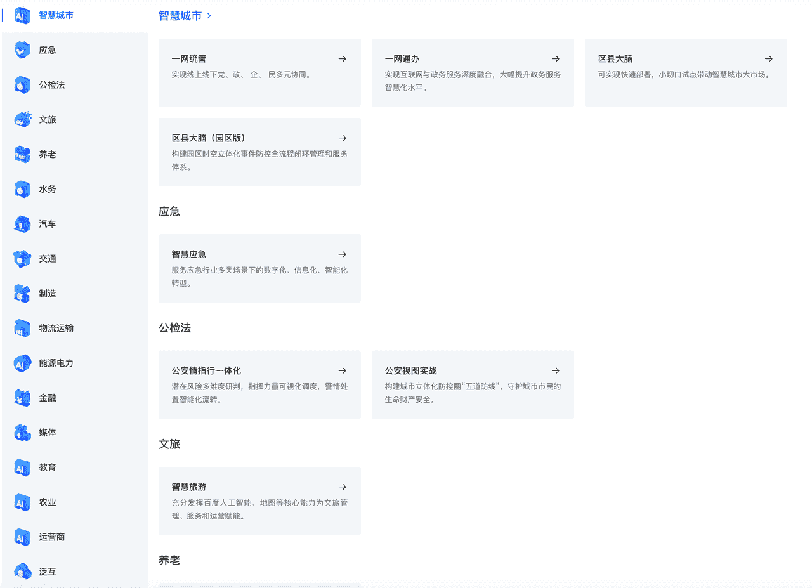

# 🆕百度最新AI 能力体验中心

> 地址：https://ai.baidu.com/experience

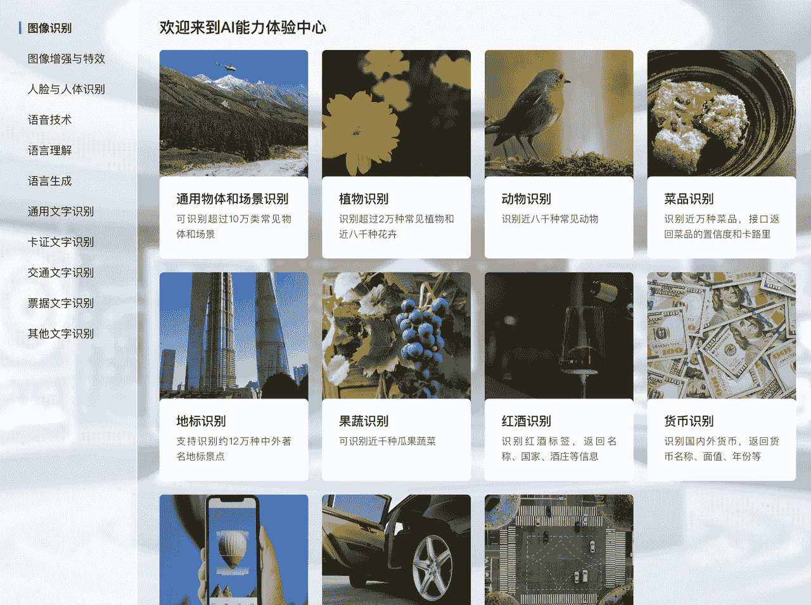

# 相关资源

+   《2024AI原生应用生态白皮书》

> 《2024AI原生应用生态白皮书》申请下载

> 由百度智能云、IDC联合撰写发布。介绍了AI原生应用在智能数字化新时代的机会与挑战，并给出生态评估框架及实践中的成功案例。

>

+   百度 GitHub：https://github.com/Baidu-AIP

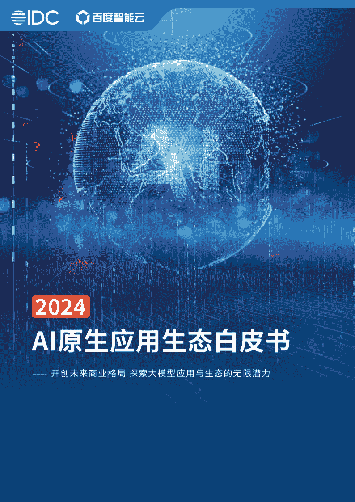

[百度智能云&IDC-AI原生应用生态白皮书.pdf](https://internal-api-drive-stream.feishu.cn/space/api/box/stream/download/all/VH20bnO5boNDhix2EdQcYBC6nhh)