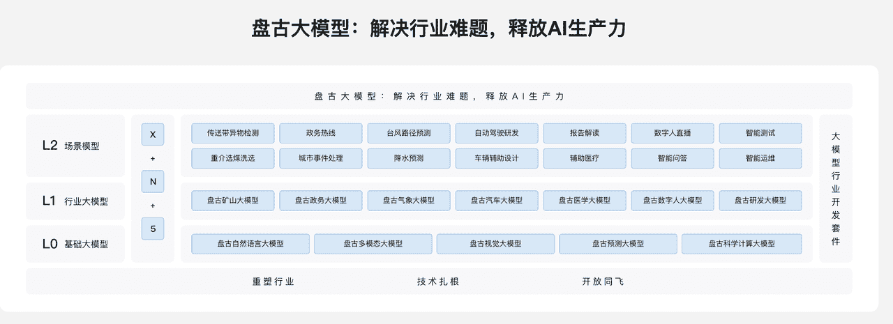
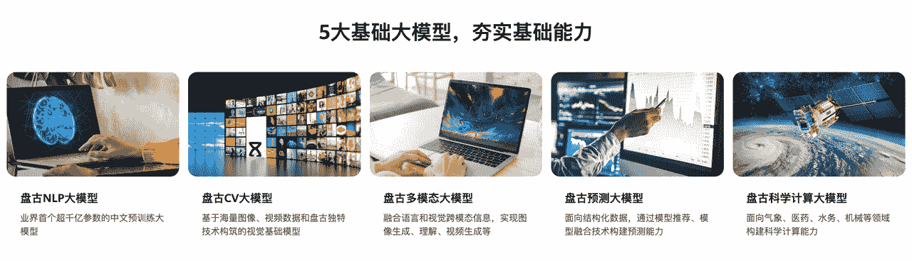
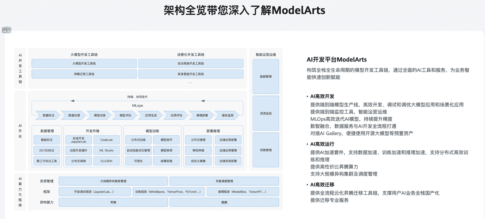
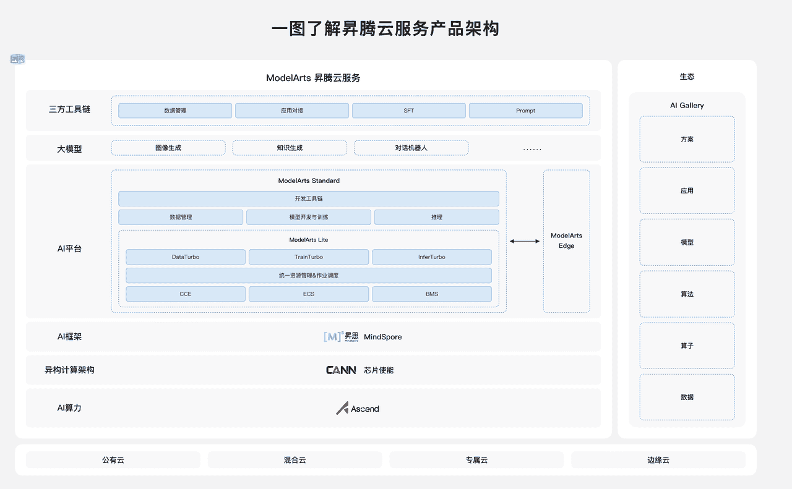

# 盘古（华为）

> 来源：[https://agispace.feishu.cn/docx/QcjDdZH8zordftxuMCbc8CUenGb](https://agispace.feishu.cn/docx/QcjDdZH8zordftxuMCbc8CUenGb)

# 盘古大模型

> [**华为盘古大模型官网地址**](https://www.huaweicloud.com/product/pangu.html)

> 盘古大模型3.0是面向行业的大模型，包含L0中5类基础大模型、L1行业大模型及L2场景模型三层架构

>

> 融合语言和视觉跨模态信息，实现图像生成、图像理解、3D生成和视频生成等应用，面向产业智能化转型提供跨模态能力底座。

>

>

> 华为AI生态布局涵盖了从鸿蒙原生智能系统、AI基础设施与云服务、智能家居与物联网应用、智能客服与数字化服务、网络优化与智能化转型，到产业合作与创新等多个方面。华为通过持续的技术创新和应用实践，不断推动AI技术的发展和应用，为用户提供更加智能、便捷的服务和体验。

# 华为 AI 生态布局

1.  **鸿蒙原生智能系统**：

+   华为在2024年HDC开发者大会上正式发布鸿蒙原生智能，HarmonyOS NEXT向开发者和先锋用户开放Beta，开启了全新AI时代。

+   鸿蒙原生智能基于软硬芯云协同的硬件与基础设施架构，具备多模态理解、用户个性化数据理解以及隐私保护的能力，提供全场景感知与协同能力。

+   鸿蒙原生智能的发布与华为“以消费者体验为核心，为消费者做伟大的产品”的战略目标相匹配，将为用户和开发者带来更高质量的智能体验。

1.  **AI基础设施与云服务**：

+   华为通过鸿蒙与昇腾云的深度协同，打造智能时代最佳AI基础设施。鸿蒙可一次开发多端部署，昇腾AI云服务即开即用，两者结合提供全链路云化工具链，加速应用快速落地。

+   鸿蒙与昇腾云的协同打破了算力及AI能力的瓶颈，为鸿蒙生态内的企业带来更快、更强、更可靠的智能化开发体验。

1.  **AI在智能家居与物联网的应用**：

+   华为全屋智能通过开放的鸿蒙生态和北向开放策略，为行业场景智能化提供解决方案。目前华为全屋智能已经拥有140+的API接口、40+的ISV伙伴、80+的应用客户和200+商用项目。

+   华为全屋智能通过云组网、本地组网和中控屏卡片等多种开放方式，支持中控屏卡片联动场景、中控屏开放客需语音等功能，满足不同行业的需求。

1.  AI在智能客服与数字化服务中的应用：

+   华为云提供了智能AI客服助手，通过自然语言处理等技术，为企业和消费者提供智能问答、语音导航等服务，提升客户服务的效率和体验。

1.  AI在网络优化与智能化转型中的应用：

+   华为发布了AI入网“开城计划”，旨在与全球运营商合作，通过构建无线智能化生态，全面提升网络生产力。该计划第一阶段将在半年内赋能1000名站点工程师，管理超过10000站。

+   华为推出全球首个站点工程师智能助手，基于海量专业知识和经验，自主生成问题解决策略，显著提升工程师的运维效率。

1.  **AI在产业合作与创新中的应用**：

+   华为在四川等地与多个行业合作伙伴探索合作试点，期待通过华为云盘古大模型为各行业的智能化转型贡献力量。

+   华为与清华大学智能产业研究院AIR团队共同发布了《AI与人协作、服务于人——AI终端白皮书》，旨在促进行业对AI终端能力演进的共识，推动整个生态向更高质量的AI方向发展。

# **AI开发平台ModelArts**

> AI开发平台ModelArts地址

> [**AI平台ModelArts资源**](https://www.huaweicloud.com/product/modelarts/resources.html)

> AI开发平台ModelArts文档

> 面向开发者的一站式AI开发平台，可快速创建和部署模型，管理全周期AI工作流，助力千行百业智能升级

>

> ModelArts是面向AI开发者的一站式开发平台，通过AI开发全流程管理助您智能、高效地创建AI模型和一键模型部署到云、边、端。

> ModelArts的AI Gallery中预置了大量的模型、算法、数据和Notebook等资产，供初学者快速上手使用；ModelArts的自动学习功能，可以帮助用户零代码构建AI模型；ModelArts同时也提供了开发环境，用户可以在云上的JupyterLab或者本地IDE中编写训练代码，进行AI模型开发。

> 面向不同AI基础的开发者，本文档提供了相应的入门教程，帮助用户更快速地了解ModelArts的功能，您可以根据经验选择相应的教程。

# AI Gallery 百模千态社区

> AI Gallery百模千态社区致力于构建一站式AI社区服务平台，包含丰富AI资产、服务、解决方案。提供基于昇腾AI云服务适配的业界主流开源大模型，易用开发工具和超强算力，助力企业和开发者快速创建模型应用，在大模型时代快人一步。

# **昇腾云服务**

https://www.huaweicloud.com/product/modelarts/ascend-cloud.html

昇腾云服务提供了高性价比的AI算力，提供全链路云化工具链，支持高效迁移，全栈垂直优化，支持模型/算法高效运行，使能“百模千态”应用快速落地

