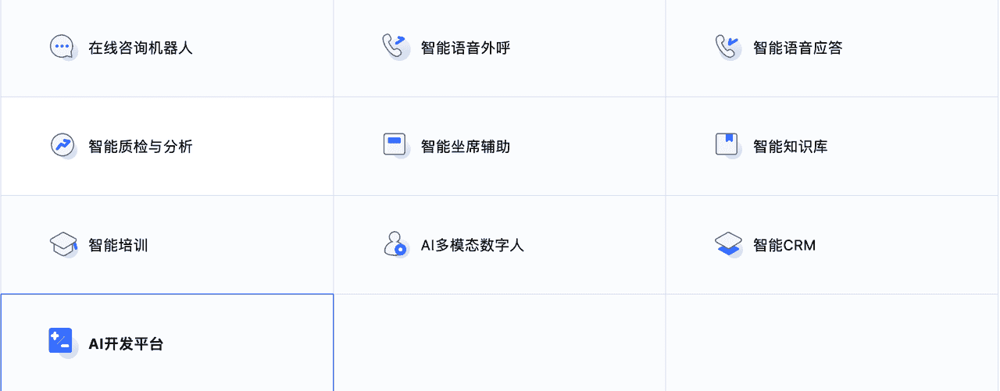
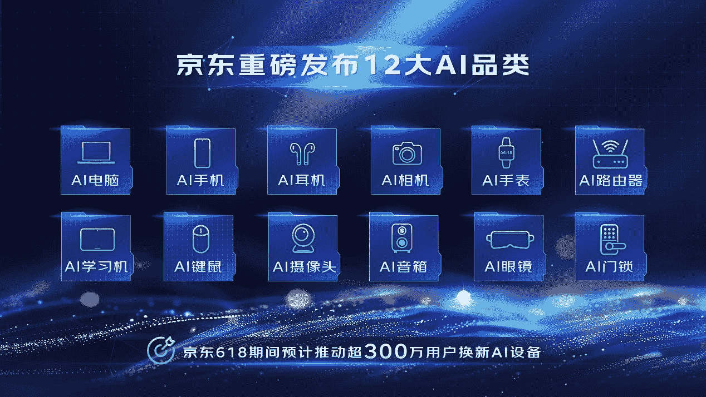
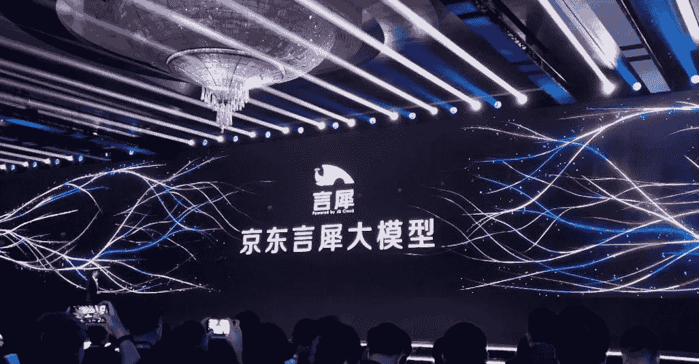

# 言犀（京东）

> 来源：[https://agispace.feishu.cn/docx/SED1duwyqorausxZzLfcACb3nBf](https://agispace.feishu.cn/docx/SED1duwyqorausxZzLfcACb3nBf)

> 言犀大魔性官网：https://yanxi.jd.com/

7月13日，2023京东全球科技探索者大会（JDD）在京举行。会上，京东健康正式发布面向医疗健康行业的大模型“京医千询”，并宣布推出医疗健康开放生态平台“京医星脉”，这是京东健康在新时期加速推进科技与产业融合，进一步推动远程医疗生态建设所迈出的坚实一步。

1.  **“京医千询”**：

+   **发布时间**：2023年7月13日

+   **特点**：

+   覆盖全流程医疗需求，实现智能决策，支持多模态的医疗大模型。

+   基于京东言犀通用大模型基础之上，融合了京东健康丰富的医疗知识和数据。

+   拥有行业内首个实物与服务相联通、知识与数据相融合的百万级大规模健康知识图谱。

+   沉淀了超过亿级的覆盖线上、线下医患场景的高质量健康档案。

+   可以根据用户侧个性化的诊疗建议、健康管理、自诊，以及医生侧的知识管理和文献挖掘、自动报告生成和病例生成来辅助医生的工作。

+   基于循证医学来训练，具有共情和交互的能力，可以理解复杂模态，包括图片影像等医疗数据来做自主的推理决策。

+   **应用场景**：

+   针对医生的智能医生助理

+   针对个人用户的数字医生+AI健康管家

+   面向企业/机构用户，建设高价值健康档案数据库，提供行业健康解决方案

+   智能云诊室，提供线上线下一体化的医疗解决方案

1.  **言犀大模型**：

+   **发布时间**：2023年7月13日（与“京医千询”同时发布）

+   **特点**：

+   源于产业、服务产业的大模型，融合了70%通用数据与30%数智供应链原生数据。

+   致力于深入零售、物流、金融、健康、政务等知识密集型、任务型产业场景，解决真实产业问题。

+   具有“更高产业属性、更强泛化能力、更多安全保障”的优势。

+   京东集团通过其丰富的产业布局和每年数百亿条优质交互数据来训练这一大模型。

+   **配套工具与平台**：

+   京东还推出了一套大模型的完整工具，包括言犀AI开发计算平台、向量数据库、混合多云操作系统云舰等。

+   同时，发布了全新升级的优加DaaS和言犀智能服务平台，以及面向零售、金融、城市、健康、物流五大领域的行业解决方案。

# 言犀大模型

> 以AI技术驱动，从文字、语音到多模态交互，从对话智能到情感智能，聚焦体验、效率与转化，旨在打造新一代智能人机交互平台，面向不同行业和客户场景助力企业服务和营销实现数智化转型升级

言犀大模型是京东集团推出的一款产业级大模型，它源于产业、服务产业，致力于深入零售、物流、金融、健康、政务等知识密集型、任务型产业场景，解决真实产业问题。这款大模型融合了70%的通用数据与30%的数智供应链原生数据，具有更高的产业属性、更强的泛化能力和更多的安全保障。

言犀大模型的开发基于京东集团丰富的产业布局和每年数百亿条优质交互数据，使得它能够更好地理解用户需求，提供更加精准和个性化的服务。通过融合通用数据和行业特定数据，言犀大模型在多个领域展现出强大的能力，例如零售、物流、金融、健康、政务等。

言犀大模型的推出，不仅为京东自身的业务发展提供了有力支持，也为整个产业带来了创新机遇。通过提供智能客服、智能营销、智能风控等解决方案，言犀大模型可以帮助企业提升效率、降低成本、优化用户体验。同时，它还可以为政府机构提供智能政务解决方案，推动数字化转型和智能化升级。

除了言犀大模型本身，京东还推出了一系列配套工具与平台，如言犀AI开发计算平台、向量数据库、混合多云操作系统云舰等。这些工具与平台为大模型的训练、部署和应用提供了全面支持，使得企业和开发者能够更加方便地利用言犀大模型的能力来构建自己的智能应用。

总之，言犀大模型是京东集团在人工智能领域的一项重要创新成果，它不仅为京东自身的业务发展提供了强大支持，也为整个产业带来了创新机遇。通过深入产业场景、解决真实问题，言犀大模型正逐步成为推动产业智能化升级的重要力量。

# 言犀大模型的产品

# AI 生态布局

一、AI品类与产品布局

1.  **12大AI品类发布**：在京东618前夕，京东正式发布了包括AI电脑、AI手机、AI耳机、AI相机、AI学习机、AI键鼠、AI手表、AI路由器、AI眼镜、AI门锁、AI摄像头和AI音箱在内的12大AI品类。

1.  **AI硬件市场的洞察**：京东基于对AI硬件市场发展趋势的深刻洞悉和对消费需求的精准洞察，为消费者提供了清晰的AI硬件区分认知。

1.  **AI硬件的普及目标**：京东公布了“618 AI普惠百万用户”的目标，预计在618期间推动超300万用户换新AI产品。

二、AI技术与应用

1.  **AI数字人带货**：京东成功打造了以刘强东为原型的AI数字人“采销东哥”，并在直播带货领域取得了显著成效。AI数字人直播等成本是真人的十分之一，闲时直播转化率超过30%。

1.  **AI技术的多领域应用**：京东在内容创意、广告投放、自动化营销、客户管理等多个领域应用AI技术，帮助商家实现生意增长。

三、AI基础设施与云服务

1.  **鸿蒙原生智能系统**：鸿蒙原生智能基于软硬芯云协同的硬件与基础设施架构，提供全场景感知与协同能力。

1.  **昇腾云**：通过鸿蒙与昇腾云的深度协同，打造智能时代最佳AI基础设施，提供全链路云化工具链，加速应用快速落地。

四、AI生态合作与开放

1.  **品牌合作**：京东与联想、小米、OPPO等品牌达成了深度战略合作，推动AI大模型在更多终端设备上的广泛应用。

1.  **开放策略**：京东的开放策略为行业场景智能化提供解决方案，目前已经拥有140+的API接口、40+的ISV伙伴、80+的应用客户和200+商用项目。

五、AI在特定领域的应用

1.  **智能家居**：通过鸿蒙与昇腾云的协同，为用户提供更智能的家居体验。

1.  **智能客服**：京东的智能AI客服助手通过自然语言处理等技术，为企业和消费者提供智能问答、语音导航等服务。

综上所述，京东的AI生态布局涵盖了从AI品类与产品、AI技术与应用、AI基础设施与云服务、AI生态合作与开放，到AI在特定领域的应用等多个方面。通过不断的技术创新和应用实践，京东正在构建一个全面、深入的AI生态体系，为用户提供更加智能、便捷的服务和体验。

言犀大模型是京东科技推出的一款大型语言模型，它具备以下三大特征：

+   产业原生：AI能力从京东优质的产业场景与数据中锤炼而来，具备更强的产业属性。

+   价值驱动：使用源于业务应用需求的前沿算法，提升推理速度，降低成本，让模型应用价值更高。

+   开放协同：基于京东自研向量数据库与领先的计算集群，模型迭代效率更高。

言犀大模型具备基础层、模型层、MaaS、SaaS四层体系，旨在提供高效的大模型开发环境，支持以少量企业数据精调出客户专属模型。

### 应用场景

言犀大模型已在多个业务场景中落地，包括智能客服、多模态数字人、交互式营销、智能政务热线、协同办公等。这些应用旨在让即使欠缺AI基础能力的传统企业也能达到开箱即用。

### 用户群体

京东云针对不同客户的诉求，提供一系列的大模型，从10亿级、百亿级到千亿级，也会提供大模型和小模型的搭配使用，因为在B端“1分钱都能影响成本”。

### 技术优势

言犀大模型融合了70%的通用数据与30%京东数智供应链原生数据，具有“更高产业属性、更强泛化能力、更多安全保障”的优势。

### 京东云在AI领域的布局

京东云依托智能城市操作系统，打造了城市运行支撑平台和城市运行能力中心的智能交互平台，服务普陀区推进“一网统管”，实现一屏发现、一口派单、一站处置、一网评效、一键智搜，打造特大城市“智”理新样板。

# 京东人工智能研究院

> 地址：https://yanxi.jd.com/ai-lab/public/

> 京东人工智能研究院成立于2017年，专注于人工智能技术的前沿创新和基础研究，研究领域涵盖语音语义、计算机视觉、多模态内容智能、知识获取与推理、情感智能、人机对话与交互、决策智能等。

> 研究内容是由业务场景需求驱动，致力于解决京东复杂、真实场景中的问题，对内满足京东集团对于人工智能技术的需求，对外助力数智化产业发展及变革。