# 讯飞星火（科大讯飞）

> 来源：[https://agispace.feishu.cn/docx/WlRZdG1bbowVjAxwZxlcitPyn9b](https://agispace.feishu.cn/docx/WlRZdG1bbowVjAxwZxlcitPyn9b)

> 科大讯飞的大模型，即讯飞星火认知大模型，是科大讯飞公司发布的一款重要的人工智能产品。

#### 讯飞最近发布了 V4.0 大模型

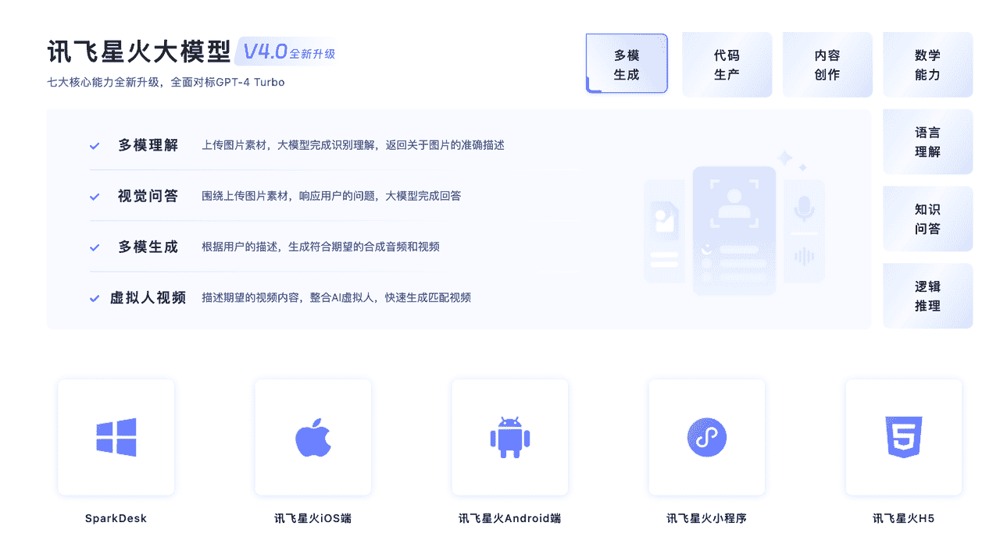

# 一、讯飞星火认知大模型

## **模型背景**

+   讯飞星火认知大模型是科大讯飞为对标OpenAI的ChatGPT而研发的一款大模型。自2022年OpenAI发布ChatGPT以来，人工智能领域迎来了新一轮的技术和产业革命。科大讯飞紧跟这一趋势，开始研发讯飞星火认知大模型。

+   讯飞星火认知大模型已位列中国头部水平，并通过了中国信通院组织的AIGC大模型基础能力（功能）评测及可信AI大模型标准符合性验证，获得4+级评分。

## **模型特点**

+   具有7大核心能力，包括文本生成、语言理解、知识问答、逻辑推理、数学能力、代码能力和多模交互。

+   模型的命名“星火”有三层寓意，包括看清通用人工智能（AGI）的远景目标和实现路径、创业团队的决心以及中国传统文化中的吉祥象征。

## **发展沿革**

+   2023年5月6日，科大讯飞正式发布讯飞星火认知大模型，并开始不断迭代。

+   2023年6月9日，星火大模型V1.5正式发布；8月15日，星火大模型V2.0正式发布；9月5日，星火大模型正式面向全民开放；10月24日，星火大模型V3.0正式发布。

+   2024年1月30日，星火大模型V3.5正式发布；4月26日，讯飞星火大模型V3.5更新；5月22日，讯飞星火Lite版永久免费。

+   6月27日，科大讯飞在北京发布讯飞星火大模型V4.0及相关落地应用。讯飞星火V4.0七大核心能力全面提升，全面对标GPT-4 Turbo，在8个国际主流测试集中排名第一。

## **模型能力**

+   在文本生成方面，可以进行多风格多任务长文本生成，如邮件、文案、公文等。

+   在语言理解方面，能够进行多层次跨语种语言理解，包括语法检查、要素抽取等。

+   在知识问答方面，可以回答生活知识、工作技能、医学知识等广泛领域的问题。

+   此外，还具备逻辑推理、数学能力、代码理解与生成能力等多方面的能力。

# 二、科大讯飞AI生态布局

## AI＋行业

科大讯飞在AI+行业方面的布局十分广泛，涵盖了教育、医疗、智慧城市、金融、运营商、汽车等多个领域。在教育领域，科大讯飞通过智能语音和人工智能技术，为教育行业提供智慧教育解决方案，助力教育公平与质量提升。在医疗领域，科大讯飞利用自然语言处理和语音识别技术，打造智慧医疗系统，提高医疗服务的效率和质量。在智慧城市领域，科大讯飞通过大数据和人工智能技术，为城市管理提供智能化支持，提升城市治理水平。在金融领域，科大讯飞利用人工智能技术，为金融机构提供智能客服、智能风控等解决方案，提高金融服务效率和安全性。

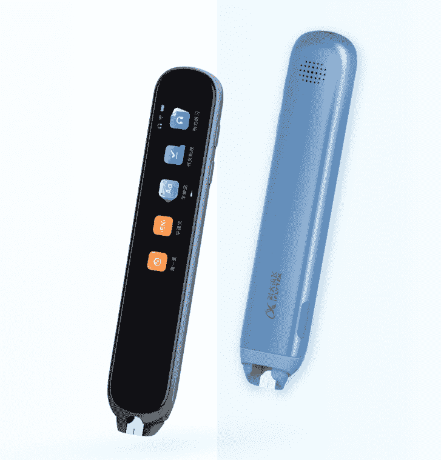

## AI＋办公

在AI+办公方面，科大讯飞推出了多款智能办公产品，如智能语音鼠标、智能录音笔等，旨在通过人工智能技术，提升办公效率和体验。这些产品利用科大讯飞的语音识别、自然语言处理等技术，实现语音转文字、智能翻译等功能，让办公更加便捷高效。

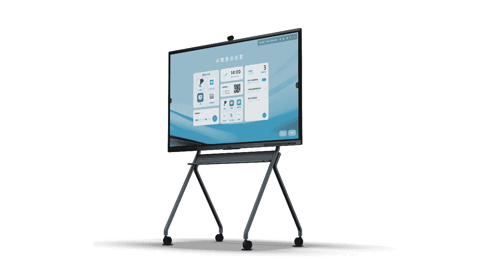

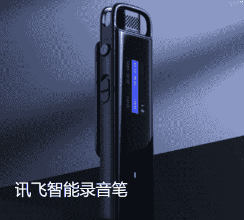

## AI＋生活

科大讯飞在AI+生活方面的布局主要聚焦于智能家居和智能穿戴设备等领域。通过人工智能技术，科大讯飞为用户提供了更加智能化、便捷化的生活方式。例如，通过智能家居系统，用户可以实现远程控制家电、智能安防等功能；通过智能穿戴设备，用户可以实时监测健康状况、运动数据等。

## AI＋数字化

在AI+数字化方面，科大讯飞利用大数据和人工智能技术，为企业提供了数字化转型的解决方案。通过数据分析、数据挖掘等技术手段，科大讯飞帮助企业实现业务优化、决策支持等功能，推动企业实现数字化转型和升级。

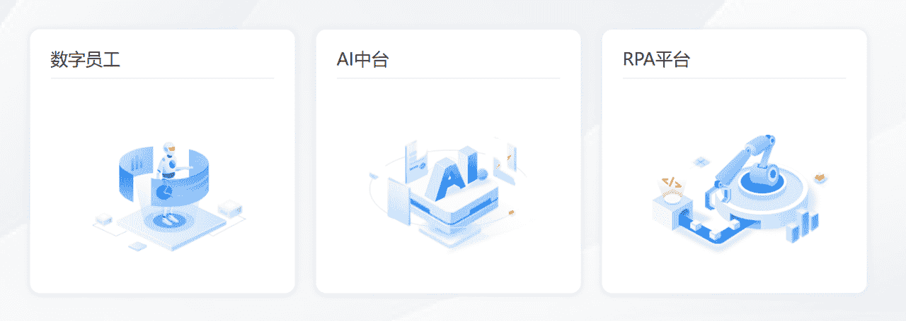

## AI＋生态

科大讯飞在AI+生态方面的布局主要是打造一个开放、共赢的AI生态圈。通过开放平台、开发者社区等方式，科大讯飞吸引了众多开发者、合作伙伴加入其中，共同推动人工智能技术的发展和应用。同时，科大讯飞还积极与高校、科研机构等合作，推动产学研深度融合，为人工智能技术的发展提供源源不断的动力。

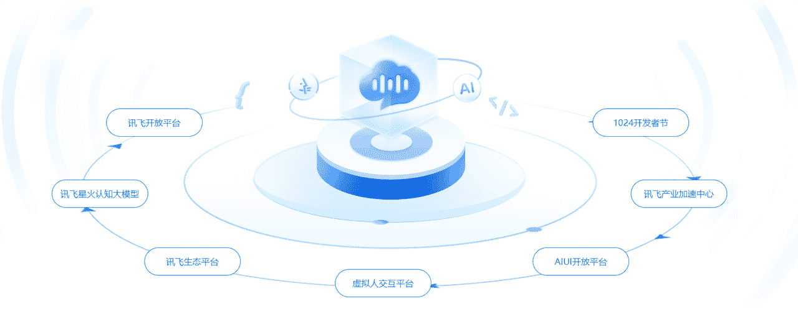

# 三、科大讯飞其他相关AI平台

## **讯飞开放平台**

**官网**：https://www.xfyun.cn/

**简介**：以语音交互为核心的人工智能开放平台，提供了语音识别、语音合成、自然语言处理等多项AI能力。

**平台特点：**

+   提供百万级免费服务，涵盖全领域行业方案。

+   提供1V1专属支持，助力用户快速接入AI技术。

+   语音识别技术精准，支持39个语种自动判别，适用于多种场景。

## **讯飞机器人超脑平台**

**官网：**https://aibot.xfyun.cn/

**简介：**专注于智能机器人开发，提供覆盖多场景的解决方案。

**平台特点：**

+   支持多语种、多方言播报，结合AI对口唇、表情、动作的精准控制。

+   提供webapi、sdk等接入方式，满足不同应用场景的需求。

+   提供公有云和私有云等不同的部署方案，满足用户的不同需求。

## 讯飞**A.I.开发栈**

**官网：**https://aidev.xfyun.cn/

**简介：**为开发者提供一系列A.I.开发工具，平台将打造集数据标注、模型训练、模型快速服务化、服务编排组合等能力于一体的一站式A.I.能力及方案开发栈，帮助A.I.开发者更好的实现A.I.能力的研究创造和接入使用，A.I.开发栈将成为讯飞连接A.I.引擎开发者、行业方案开发者以及行业应用开发者的重要平台。

**平台优势：**

+   A.I.算法引擎的无服务全托管式平台，通过简单的接口适配 ，即可快速实现高可用、低成本、安全可控的A.I.能力服务。

+   可视化A.I.能力组合编排平台，通过简单拖拽即可实现A.I.能力、应用服务组合 ，满足开发者快速定制A.I.应用服务诉求。

+   在引擎训练的过程中，可以提供专业的数据标注服务，帮助A.I.引擎得到更好的训练优化。

## **AIUI开放平台**

**官网：**https://aiui.xfyun.cn/

**简介：**以自然语言理解为核心的全链路人机交互平台，致力于用AI打造领先的人机交互体验。

**平台亮点：**

+   汇聚了降噪算法、语音识别、图像识别、数字虚拟人交互等全链路人机交互软硬件核心能力。

+   引入星火交互认知大模型，实现人机交互的自然化、人性化。

## 星火内容运营大师APP

旨在为企业和个人提供从内容策划到发布的全流程支持。在内容策划阶段，提供了丰富的模板和创意灵感库，帮助用户轻松构思和设计内容。这些模板覆盖了各种主题和行业，确保了内容的多样性和吸引力。同时，其内置的智能创作功能利用人工智能技术，如文本自动生成和智能摘要，大大降低了内容创作的难度和时间成本。

支持多平台内容发布，允许用户一键将内容分发至🧣、抖音、知乎等多个社交媒体和内容平台。这种高效的发布机制极大地提升了内容的曝光度和传播效率。而且，该工具还能实时追踪和分析内容的表现数据，如阅读量和互动情况，使用户能够深入了解内容效果，并据此优化后续内容策略。

对于团队来说，它提供了协作编辑和管理的功能，支持多人在线协作，提高了团队工作效率。此外，它还具备版权检测和保护机制，确保用户内容的原创性和合法权益，避免了侵权风险。对于有特定需求的用户提供个性化定制服务，根据用户的行业特点和品牌需求，提供定制化的内容运营解决方案。

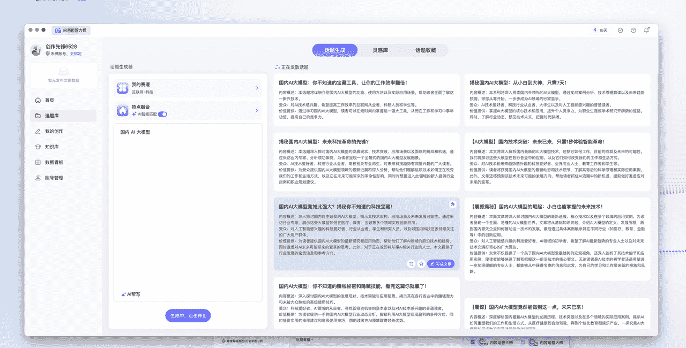

# 四、相关👸号

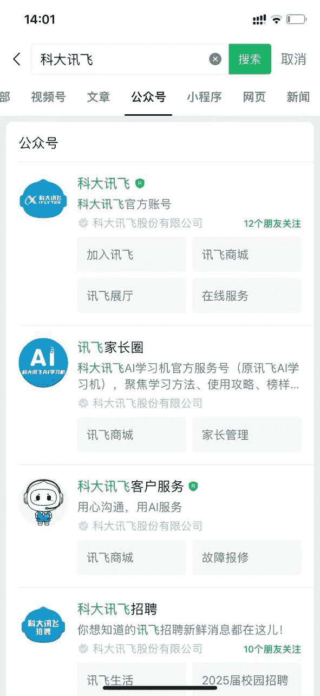

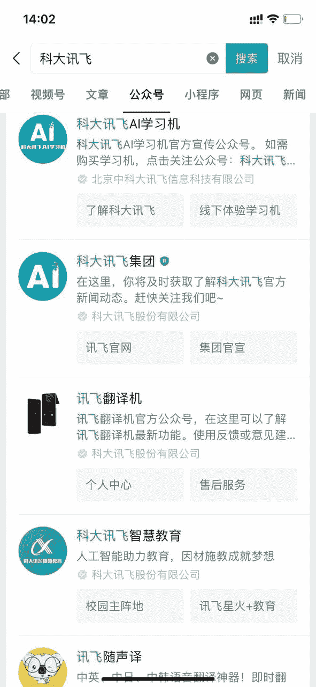

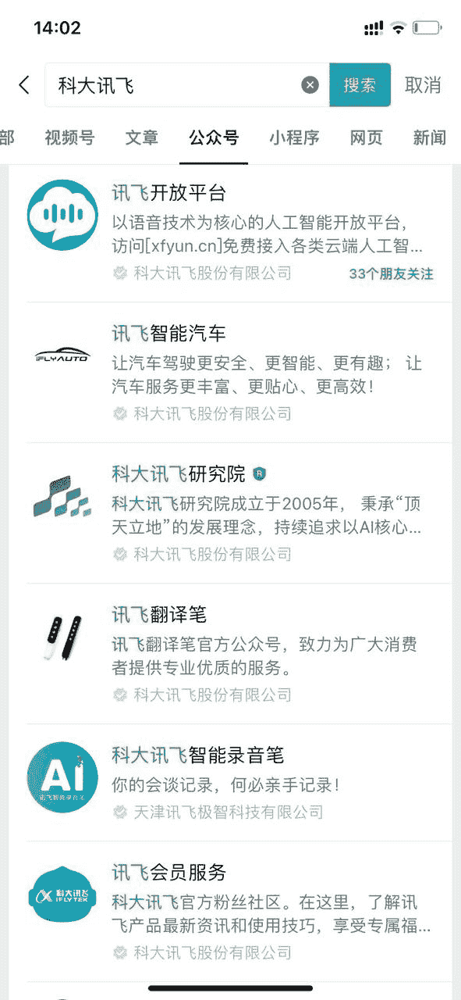

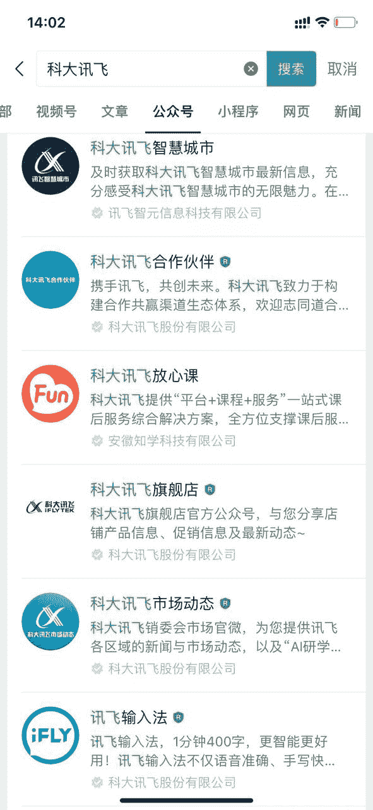

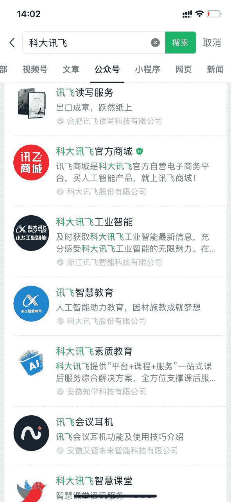

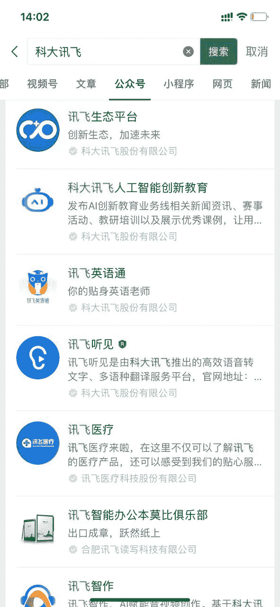