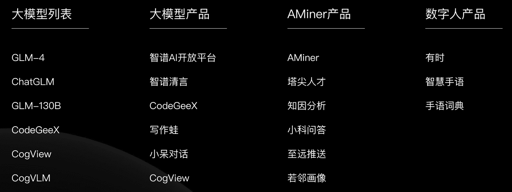

# GLM-4（智谱 AI）

> 来源：[https://agispace.feishu.cn/docx/QFvCdnJmdor69bxcFRbcU7fAnSb](https://agispace.feishu.cn/docx/QFvCdnJmdor69bxcFRbcU7fAnSb)

> https://www.zhipuai.cn/  智谱 AI 官网

> https://chatglm.cn/?redirect=/main/toolsCenter 智谱清言 （智能体）

# 智谱 AI产品梳理

# **一、产品与技术布局**

1.  **大模型技术**

+   **GLM系列模型**：包括GLM-4新一代基座大模型，整体性能相比GLM3提升60%，支持128K上下文，具备理解和规划复杂指令、完成复杂任务的能力。

+   **ChatGLM系列模型**：基于GLM预训练框架的双语对话模型，采用多阶段增强预训练方法，针对中文问答和对话进行优化。

+   **CodeGeeX代码大模型**：支持超过100种编程语言，具备代码生成、补全、翻译、智能问答等能力，可帮助提升编程效率。

+   **CogView模型**：多模态大模型，可根据语言描述生成全新、独特又真实的高质量图片。

1.  **超拟人大模型**

+   推出新一代超拟人大模型CharacterGLM和Emohaa，支持各种场景的个性化角色扮演，具备人设如一、情感共情、超长记忆等特点。

1.  **多模态理解**

+   在不牺牲任何NLP任务性能的情况下，实现了视觉语言特征的深度融合，支持视觉问答、图像字幕、视觉定位、复杂目标检测等各类多模态理解任务。

# **二、AI开发平台与工具**

https://www.aminer.cn/

AMin[er是一个以](https://www.aminer.cn/)人工智能为驱动的科技情报挖掘平台。它提供学术搜索、论文检索、专利查询、文献追踪和学者画像等功能。用户可以通过这个平台获取大量的科研人员和论文成果信息，以及知识概念和引用关系。AMiner还提供高级搜索、对话和编组功能，帮助用户更有效地理解和探索科学知识。此外，平台还提供趋势分析和定制科研兴趣等服务。网站链接为：AMiner。

1.  **MaaS开放平台**

+   智谱AI大模型MaaS开放平台，基于领先的千亿级多语言、多模态预训练模型，打造高效率、通用化的“模型即服务”AI开发新范式。

1.  **开发计算平台与数据库**

+   提供AI开发计算平台、向量数据库等配套工具与平台，支持大模型的训练、部署和应用。

# **三、合作伙伴与生态**

1.  **企业合作**

+   与华为、金山办公、360公司等建立合作伙伴关系，共同推动AI技术的发展和应用。

1.  **投资与布局**

+   美团入股智谱AI，通过投资布局AI大模型赛道，结合美团在本地生活服务领域的行业优势、海量的用户数据资源以及雄厚的技术实力和资金投入，共同探索AI技术的商业化落地。

### **四、总结**

智谱AI在AI领域拥有全面的技术布局和产品线，不仅推出了多款高性能的大模型和多模态大模型，还提供了完善的AI开发平台和工具，积极与各行业企业合作，共同推动AI技术的发展和应用。这些布局和产品使得智谱AI在AI领域具有显著的优势和竞争力。

# 背景

智谱AI是一家在人工智能领域具有显著影响力和技术实力的公司。以下是关于智谱AI的背景信息，按照清晰的分点表示和归纳：

1.  **成立与发展**：

+   智谱AI的起源可以追溯到清华计算机系知名教授唐杰带领下的清华知识工程实验室。该实验室在2006年发布了名为AMiner的科研情报产品，这是国内最早研发的以及迄今访问量最大的研究者社会网络分析与挖掘系统。

+   智谱AI正是脱胎于该实验室，背后集结了一群清华大牛，包括CEO张鹏、董事长刘德兵、总裁王绍兰以及首席科学家唐杰教授等。

1.  **技术实力**：

+   智谱AI具备强大的知识图谱能力，能够整合海量数据，构建丰富的知识体系。这主要通过实体链接、语义分析等技术实现。

+   在自然语言处理方面，智谱AI拥有先进的语音识别、文本分类、情感分析等技术，能够轻松应对各种语言场景。

+   智谱AI还通过深度学习和机器学习技术，能够分析用户的行为和喜好，为用户提供个性化的内容推荐。

1.  **产品与解决方案**：

+   智谱AI先后发布了GLM系列大模型、ChatGLM、CodeGeeX代码大模型等，这些模型在多个领域展现出强大的能力。

+   智谱AI的MaaS开放平台基于领先的千亿级多语言、多模态预训练模型，为开发者提供高效率、通用化的“模型即服务”AI开发新范式。

+   智谱AI还提供了AI开发计算平台、向量数据库等配套工具与平台，支持大模型的训练、部署和应用。

1.  **应用场景**：

+   智谱AI的应用场景非常广泛，可以应用于智能客服、智能推荐、智能翻译、智能驾驶、智能家居等多个领域。

+   通过自然语言处理技术和海量数据的分析，智谱AI能够为企业提供智能客服解决方案，提高客户服务效率。

+   智谱AI的智能推荐系统可以根据用户的历史数据和行为，为用户提供个性化的推荐服务，如音乐、电影、商品等。

1.  **行业地位与影响力**：

+   智谱AI作为国内领先的大模型研发企业之一，其技术和产品在国内乃至全球都享有盛誉。

+   智谱AI在多个领域与企业和机构建立合作关系，共同推动AI技术的发展和应用。

+   智谱AI还积极参与各种行业会议和展览，展示其最新的技术成果和产品，提升品牌影响力和行业地位。