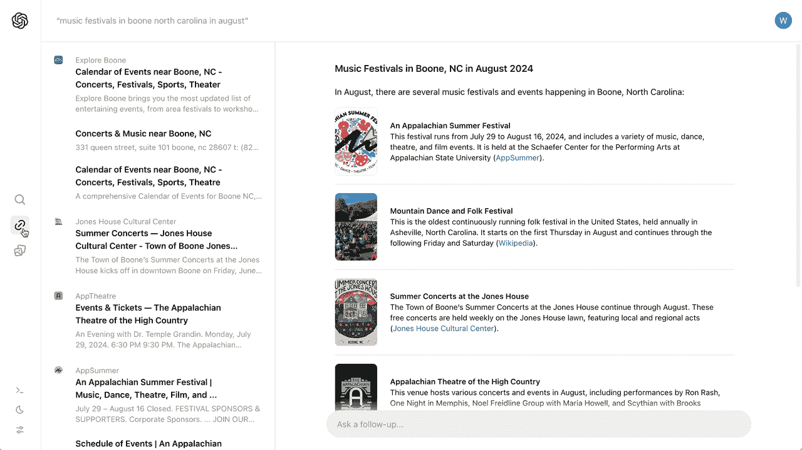

# 【24 年7月】SearchGPT(搜索)

> 来源：[https://agispace.feishu.cn/docx/Happd3pfvojRndxy7klcjn1ln2g](https://agispace.feishu.cn/docx/Happd3pfvojRndxy7klcjn1ln2g)

http://chatgpt.com/search （申请地址）

## 新的搜索方式

在网络上获取答案需要付出很多努力，通常需要多次尝试才能获得相关结果。我们相信，通过使用来自网络的实时信息增强我们模型的对话能力，您可以更快、更轻松地找到所需内容。

## 旨在为您提供答案

SearchGPT 将使用来自网络的最新信息快速直接地回答您的问题，同时为您提供相关来源的清晰链接。

[SearchGPT_Sources.mp4](https://internal-api-drive-stream.feishu.cn/space/api/box/stream/download/all/ZZkhbWor8oqZTgxd17PcSwAVn6e)

您将能够提出后续问题，就像与人交谈一样，每个查询都会构建共享的上下文。

[SearchGPT_Followup.mp4](https://internal-api-drive-stream.feishu.cn/space/api/box/stream/download/all/DOfOblbGwoTBOlxcY1jc3FhRn7g)

SearchGPT 旨在通过在搜索中突出显示引用和链接来帮助用户与发布商建立联系。响应具有清晰、内联、命名的归属和链接，因此用户知道信息来自何处，并且可以在带有源链接的侧边栏中快速获取更多结果。

SearchGPT 是新 AI 搜索功能的临时原型，旨在将 AI 模型与网络信息结合，为用户提供快速及时的答案和清晰相关的来源。目前正处于测试阶段，向小部分用户和发布商推出以获取反馈，计划未来将最佳功能集成到 ChatGPT 中。

它能利用网络最新信息直接回答问题并提供清晰链接，用户可像与人交谈般提出后续问题。

SearchGPT 致力于打造繁荣的发布商和创作者生态系统，通过突出显示引用和链接帮助用户与发布商建立联系，响应有清晰的归属和链接。

与出版商合作打造体验，推出让出版商管理自身出现方式的措施。

未来将继续改进本地信息和商业等领域体验，获取原型反馈并融入 ChatGPT。有兴趣者可注册等候名单。

例如，在回答用户问题时，SearchGPT 不再需要用户多次尝试搜索，能迅速给出准确答案和来源链接。又如，出版商即使退出生成式 AI 训练，也可能出现在搜索结果中，并且有管理自身呈现的方式。