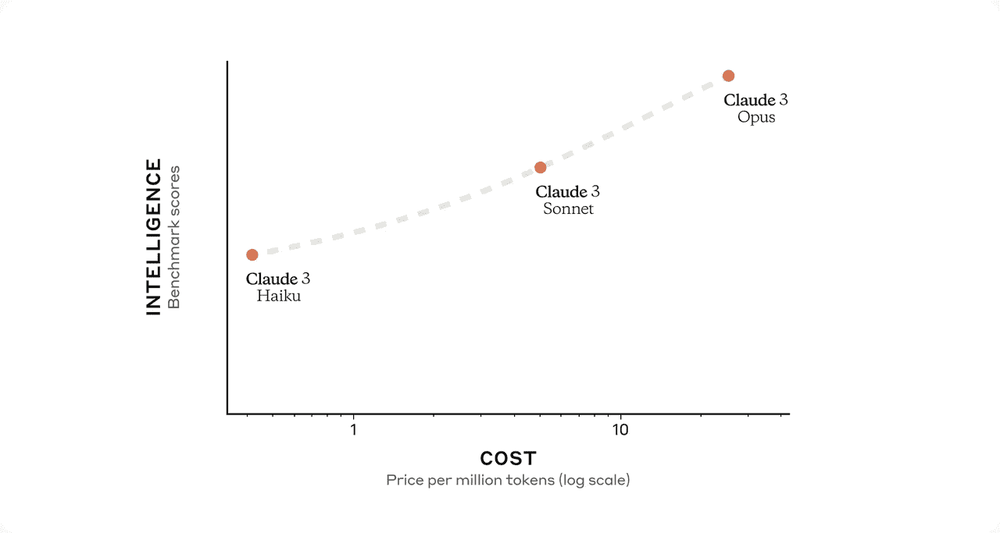
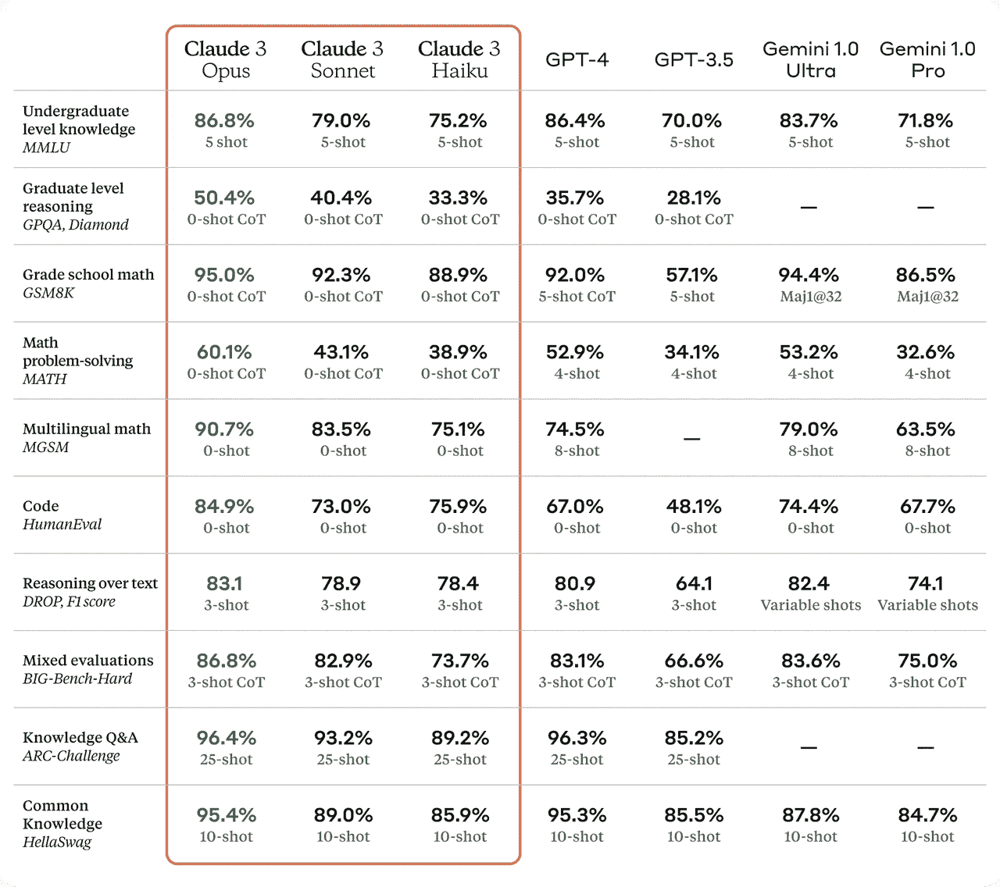
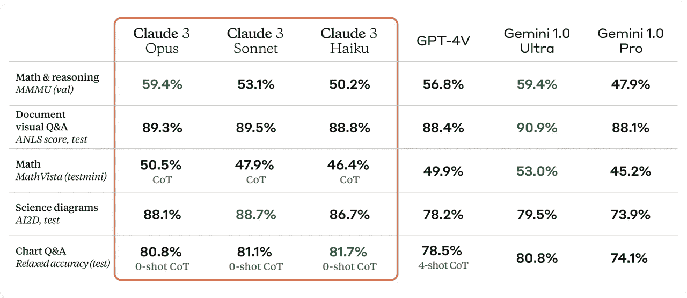
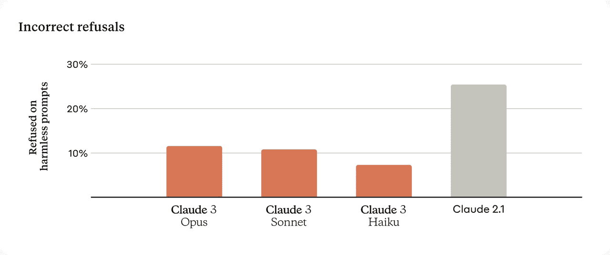
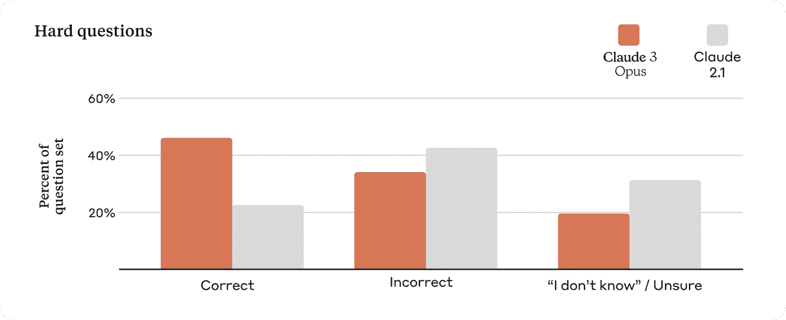
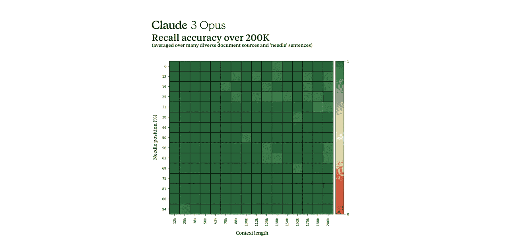
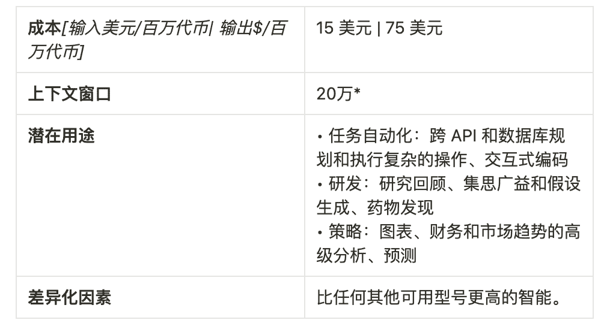

# Anthropic（Claude 3.5 Sonnet）

> 来源：[https://agispace.feishu.cn/docx/F3SEd6BtHo4PALxcgm6cmQG2ncb](https://agispace.feishu.cn/docx/F3SEd6BtHo4PALxcgm6cmQG2ncb)

> [《Claude 3.5 Sonnet：智能语言的创新杰作》](https://agispace.feishu.cn/wiki/ECDuwiRzMiEhZlktcaJcqnljnEc)🆕Claude 3.5 Sonnet

>

> Claude官网介绍：https://www.anthropic.com/news/claude-3-family

> Claude官网地址：https://www.anthropic.com/

>

2024年3月4日，我们宣布推出 Claude 3 模型系列，它为广泛的认知任务树立了新的行业基准。该系列包括三种最先进的型号（按功能升序排列）：Cla[ude 3 Ha](https://www.anthropic.com/api#pricing)iku、Claude 3 Sonnet 和 Claude 3 Opus。每个后续型号都提供越来越强大的性能，允许用户为其特定应用选择智能、速度和成本的最佳平衡。

[Opus 和 So](http://claude.ai)[nnet 现已可在 ](https://www.anthropic.com/supported-countries)claude.ai 中使用，而 Claude API 现已在159 个国家/地区广泛使用。俳句即将推出。

### **克劳德3模型家族**

### **智能的新标准**

Opus 是我们最智能的模型，在人工智能系统的大多数常见评估基准上都优于同行，包括本科水平专家知识 (MMLU)、研究生水平专家推理 (GPQA)、基础数学 (GSM8K) 等。它在复杂任务上表现出接近人类水平的理解力和流畅性，引领通用智能的前沿。

所有[Claude 3](https://www.anthropic.com/claude-3-model-card)模型都显示出在分析和预测、细致内容创建、代码生成以及西班牙语、日语和法语等非英语语言对话方面的增强能力。

以下是 Claude 3 模型与我们的同行模型在多个性能基准 [1] 上的比较：

### **近乎即时的结果**

Claude 3 模型可以支持实时客户聊天、自动完成和数据提取任务，其中响应必须立即且实时。

Haiku 是智能类别市场上速度最快且最具成本效益的型号。它可以在不到三秒的时间内阅读 arXiv 上包含图表和图形的信息和数据密集的研究论文（约 10k 代币）。发布后，我们期望进一步提高性能。

对于绝大多数工作负载，Sonnet 的速度比 Claude 2 和 Claude 2.1 快 2 倍，且智能水平更高。它擅长执行需要快速响应的任务，例如知识检索或销售自动化。Opus 的速度与 Claude 2 和 2.1 相似，但智能水平更高。

### **强大的视觉能力**

Claude 3 型号具有与其他领先型号相当的复杂视觉功能。他们可以处理各种视觉格式，包括照片、图表、图形和技术图表。我们特别高兴能够为我们的企业客户提供这种新模式，其中一些客户的知识库高达 50% 以各种格式编码，例如 PDF、流程图或演示幻灯片。

### **更少的拒绝**

以前的克劳德模型经常做出不必要的拒绝，这表明缺乏语境理解。我们在这一领域取得了有意义的进展：与前几代模型相比，Opus、Sonnet 和 Haiku 拒绝回答接近系统护栏的提示的可能性明显降低。如下所示，Claude 3 模型对请求表现出更细致的理解，能够识别真正的伤害，并且拒绝回答无害提示的频率要少得多。

### **提高准确性**

各种规模的企业都依赖我们的模型来为其客户提供服务，因此我们的模型输出必须保持大规模的高精度。为了评估这一点，我们使用了大量复杂的事实问题来针对当前模型中已知的弱点。我们将答案分为正确答案、错误答案（或幻觉）和承认不确定性，其中模型表示它不知道答案，而不是提供不正确的信息。与 Claude 2.1 相比，Opus 在这些具有挑战性的开放式问题上的准确性（或正确答案）提高了一倍，同时也减少了错误答案的水平。

除了产生更值得信赖的回复之外，我们很快还将在 Claude 3 模型中启用引用，以便他们可以指出参考材料中的精确句子来验证他们的答案。

### **长上下文和近乎完美的回忆**

Claude 3 系列型号在发布时最初将提供 200K 上下文窗口。然而，所有三种模型都能够接受超过 100 万个代币的输入，我们可能会将其提供给需要增强处理能力的精选客户。

为了有效地处理长上下文提示，模型需要强大的回忆能力。“大海捞针”（NIAH）评估衡量模型从大量数据中准确回忆信息的能力。我们通过在每个提示中使用 30 个随机针/问题对之一并在不同的众包文档库上进行测试，增强了该基准的稳健性。Claude 3 Opus 不仅实现了近乎完美的召回率，超过 99% 的准确率，而且在某些情况下，它甚至通过识别“针”这句话似乎是人类人为插入到原文中来识别评估本身的局限性。

### **负责任的设计**

我们开发的 Claude 3 系列型号不仅功能强大，而且值得信赖。我们有几个专门的团队来跟[踪和减轻广泛的风险，从错](https://www.anthropic.com/news/constitutional-ai-harmlessness-from-ai-feedback)误信息和 CSAM 到生物滥用、选举干扰和自主复制技能。我们继续开发宪法人工智能等方法来提高模型的安全性和透明度，并调整我们的模型以减轻新模式可能引发的隐私问题。

解决日益复杂的模型中的偏差是一项持续的努力，我们在这个新版[本中取得了长足的进步。如模型](https://aclanthology.org/2022.findings-acl.165/)卡所示，根据问答 (BBQ) 偏差基准， Claude 3 显示的偏差比我们之前的模型要少。我们仍然致力于改进技术，减少偏见并促进我们模型的更大中立性，确保它们不偏向任何特定的党派立场。

虽[然与之前的模型相](https://www.anthropic.com/news/anthropics-responsible-scaling-policy)[比，](https://www.anthropic.com/news/red-teaming-language-models-to-reduce-harms-methods-scaling-behaviors-and-lessons-learned)Claude 3[ 模型系](https://www.whitehouse.gov/briefing-room/statements-releases/2023/07/21/fact-sheet-biden-harris-administration-secures-voluntary-commitments-from-leading-artificial-intelligence-companies-to-manage-the-risks-posed-by-ai/)列[在生物知识、网络相关知识](https://www.whitehouse.gov/briefing-room/statements-releases/2023/10/30/fact-sheet-president-biden-issues-executive-order-on-safe-secure-and-trustworthy-artificial-intelligence/)和自主性的关键指标方面取得了进步，但根据我们的负责任的扩展政策，它仍处于 [AI 安全级别 2 (A](https://www.anthropic.com/claude-3-model-card)SL-2) 。我们的红队评估（根据我们的白宫承诺和2023 年美国行政命令进行）得出的结论是，这些模型目前带来灾难性风险的可能性可以忽略不计。我们将继续仔细监控未来的模型，以评估它们是否接近 ASL-3 阈值。更多安全细节请参见Claude 3 模型卡。

### **更容易使用**

Claude 3 模型更擅长遵循复杂的多步骤指令。他们特别擅长遵守品牌声音和响应准则，并开发用户可以信赖的面向客户的体验。此外，Claude 3 模型更擅长以 JSON 等格式生成流行的结构化输出，从而可以更轻松地指导 Claude 进行自然语言分类和情感分析等用例。

### **型号详情**

**Claude 3 Opus**是我们最智能的模型，在高度复杂的任务上具有市场最佳的性能。它可以以惊人的流畅性和类似人类的理解能力来导航开放式提示和看不见的场景。Opus 向我们展示了生成式人工智能的外部极限。

| 成本[输入美元/百万代币| 输出$/百万代币] | 15 美元 | 75 美元 | | --- | --- | | 上下文窗口 | 20万* | | 潜在用途 | • 任务自动化：跨 API 和数据库规划和执行复杂的操作、交互式编码 • 研发：研究回顾、集思广益和假设生成、药物发现 • 策略：图表、财务和市场趋势的高级分析、预测 | | 差异化因素 | 比任何其他可用型号更高的智能。 |

+   1M 代币可用于特定用例，请咨询。

##

**Claude 3 Sonnet**在智能和速度之间实现了理想的平衡，特别是对于企业工作负载。与同类产品相比，它以更低的成本提供强大的性能，并且专为大规模人工智能部署中的高耐用性而设计。

| 成本[输入美元/百万代币| 输出$/百万代币] | 3 美元 | 15 美元 | | --- | --- | | 上下文窗口 | 20万 | | 潜在用途 | • 数据处理：RAG 或对大量知识的搜索和检索 • 销售：产品推荐、预测、定向营销 • 节省时间的任务：代码生成、质量控制、从图像中解析文本 | | 差异化因素 | 比其他同类智能机型更实惠；更适合规模化。 |

###

**Claude 3 Haiku**是我们最快、最紧凑的模型，具有近乎即时的响应能力。它以无与伦比的速度回答简单的查询和请求。用户将能够构建模仿人类交互的无缝人工智能体验。

| 成本[输入美元/百万代币| 输出$/百万代币] | 0.25 美元 | 1.25 美元 | | --- | --- | | 上下文窗口 | 20万 | | 潜在用途 | • 客户互动：实时互动、翻译中快速、准确的支持 • 内容审核：捕捉危险行为或客户请求 • 节省成本的任务：优化物流、库存管理、从非结构化数据中提取知识 | | 差异化因素 | 比同类智能产品中的其他型号更智能、更快速且更实惠。 |

### **型号可用性**

Opus 和 Sonnet 现在可以在我们的 API 中使用，该 API 现已普遍可用[，使开发人员能够立](http://claude.ai)即注册并开始使用这些模型。俳句即将推出。Sonnet 正在为 claude.ai 提供免费体验，Opus 可供 Claude Pro 订阅者使用。

Sonnet 现已通过 Amazon Bedrock 提供，并在 Google Cloud 的 Vertex AI Model Garden 上提供私人预览版，Opus 和 Haiku 也即将推出。

###

### **更智能、更快、更安全**

我们认为模型智能还没有达到极限，我们计划在未来几个月内频繁发布 Claude 3 模型系列的更新。我们还很高兴发布一系列功能来增强我们模型的功能，特别是对于企业用例和大规模部署。这些新功能将包括工具使用（又名函数调用）、交互式编码（又名 REPL）和更高级的代理功能。

当我们突破人工智能能力的界限时，我们同样致力于确保我们的安全护栏跟上这些性能飞跃的步伐。我们的假设是，处于人工智能发展的前沿是引导其走向积极社会成果的最有效方式。

我们很高兴看到您使用 Claude 3 创作的作品，并希望您能给我们反馈，使 Claude 成为更有用的助手和创意伴侣。要开始与 Claude 一起构建，请访问anthropic.com/claude。

**脚注**

1.  该表显示了与目前已发布评估的商用模型的比较。我们的型号卡显示了与已宣布但尚未发布的型号（例如 Gemini 1.5 Pro[）的](https://github.com/microsoft/promptbase)比较。此外，我们还想指出，工程师们一直在努力优化评估提示和少量样本，并为较新的 GPT-4T 模型报告了更高的分数。来源。