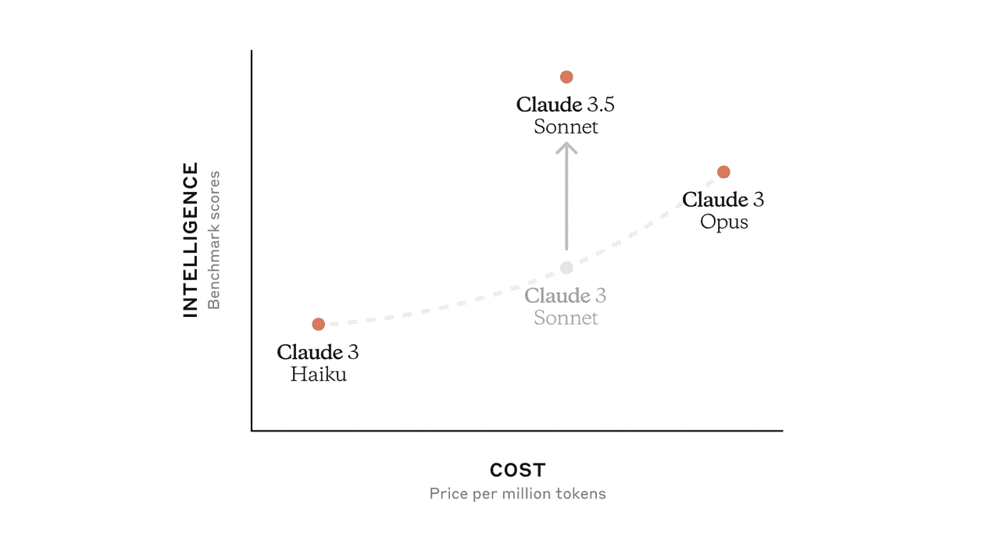
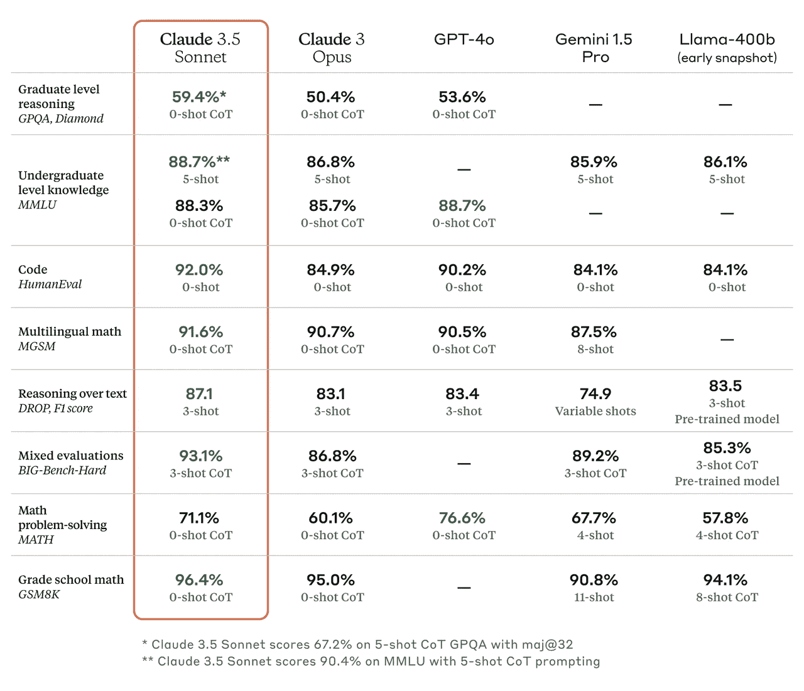
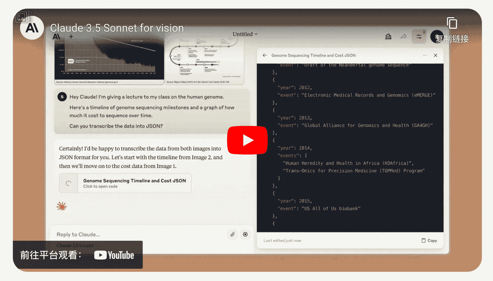
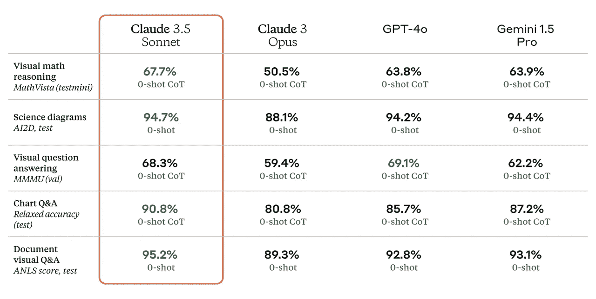
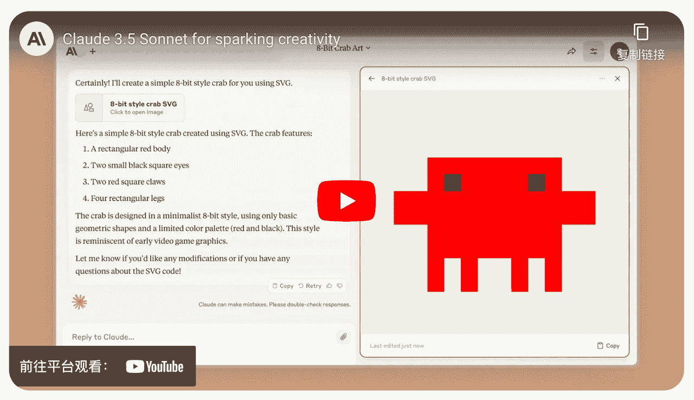

# Claude 3.5 Sonnet

> 来源：[https://agispace.feishu.cn/docx/DZqIdiI6zoddIoxkKvBc4rYZnrh](https://agispace.feishu.cn/docx/DZqIdiI6zoddIoxkKvBc4rYZnrh)

# Claude 3.5 Sonnet：多模态语言创新的惊鸿一瞥

在当今科技飞速发展的时代，人工智能语言模型不断推陈出新，为人们的生活和工作带来了前所未有的便利。

2024年6月21日Anthropic发布的 Claude 3.5 Sonnet 以其卓越的性能和独特的特点，成为了这一领域的璀璨明星。

https://www.anthropic.com/news/claude-3-5-sonnet

---

Claude 3.5 Sonnet 现已在 Claude.ai 和 Claude iOS 应用上免费提供，而 Claude Pro 和 Team 计划订阅者可以以更高的速率限制访问它。它也可以通过 Anthropic API、Amazon Bedrock 和 Google Cloud 的 Vertex AI 获得。该模型每百万输入令牌收费 3 美元，每百万输出令牌收费 15 美元，具有 200K 令牌上下文窗口。

---

+   **性能提升**：Claude 3.5 Sonnet 在多个主要 AI 基准测试中表现出色，不仅超越了 Claude 3 Sonnet，还击败了 Anthropic 此前最强版本的旗舰模型 Claude 3 Opus。它在阅读、编码、数学和视觉等方面都有显著的能力提升。

+   **创意写作能力**：该模型强调了在创意写作方面的突出表现，能够更好地理解指令之间的细微差别，并且具有更强的幽默能力。

+   **图像处理能力**：作为一款多模态大模型，Claude 3.5 Sonnet 在图像处理能力方面有所提升，可以更准确地解释图表和图形，甚至能在不完美的图像中完成文本转录任务。

+   **价格和速度**：Claude 3.5 Sonnet 的价格为每输入 3 万 token 定价为 3 美元，每生成百万 token 为 15 美元，并具有 20 万个 token 的上下文窗口。它的运行速度比 Claude 3 Opus 快两倍。

+   **应用产品推出**：Anthropic 还推出了一款应用产品 Artifacts 预览版，这是一个可供用户添加和编辑其模型生成内容的工作空间，例如用其生成的代码、文档、图像、网站设计等内容创建作品。

+   **接入亚马逊云科技**：Claude 3.5 Sonnet 已正式接入亚马逊云科技的 Amazon Bedrock。

---

# 效率

### 以 2 倍速度获取前沿情报

Claude 3.5 Sonnet 为研究生水平推理 (GPQA)、本科生水平知识 (MMLU) 和编码能力 (HumanEval) 设定了新的行业基准。它在掌握细微差别、幽默和复杂指令方面表现出显著的进步，并且擅长以自然、亲切的语气撰写高质量的内容。

Claude 3.5 Sonnet 的运行速度是 Claude 3 Opus 的两倍。这种性能提升加上经济实惠的价格，使 Claude 3.5 Sonnet 成为复杂任务的理想选择，例如上下文相关的客户支持和协调多步骤工作流程。

在[内部代理编码评估](https://www-cdn.anthropic.com/fed9cc193a14b84131812372d8d5857f8f304c52/Model_Card_Claude_3_Addendum.pdf)中，Claude 3.5 Sonnet 解决了 64% 的问题，优于 Claude 3 Opus（解决[了 38%](https://www.anthropic.com/news/tool-use-ga)）。我们的评估测试了模型修复错误或向开源代码库添加功能的能力，前提是给出了所需改进的自然语言描述。在得到指导和相关工具后，Claude 3.5 Sonnet 可以独立编写、编辑和执行代码，并具有复杂的推理和故障排除功能。它可以轻松处理代码转换，使其特别适合更新旧版应用程序和迁移代码库。

# 视觉

### 最先进的视觉

Claude 3.5 Sonnet 是我们迄今为止最强大的视觉模型，在标准视觉基准上超越了 Claude 3 Opus。这些重大改进对于需要视觉推理的任务最为明显，例如解释图表和图形。Claude 3.5 Sonnet 还可以准确地从不完美的图像中转录文本 - 这是零售、物流和金融服务的核心功能，在这些服务中，AI 可以从图像、图形或插图中获得比仅从文本中更多的见解。

https://youtu.be/dhxrHvgXpSM

# 实时

### Artifacts——使用 Claude 的新方法

今天，我们还将在 Claude.ai 上推出 Artifacts，这是一项新功能，可扩展用户与 Claude 的互动方式。当用户要求 Claude 生成代码片段、文本文档或网站设计等内容时，这些 Artifacts 会与对话一起显示在专用窗口中。这创建了一个动态工作区，用户可以在其中实时查看、编辑和构建 Claude 的创作，将 AI 生成的内容无缝集成到他们的项目和工作流程中。

此预览功能标志着 Claude 从对话式 AI 进化为协作式工作环境。这只是 Claude.ai 更广阔愿景的开始，该愿景很快将扩展以支持团队协作。在不久的将来，团队（最终是整个组织）将能够安全地将他们的知识、文档和正在进行的工作集中在一个共享空间中，而 Claude 将充当随时可用的队友。

https://youtu.be/rHqk0ZGb6qo

# 安全

### 致力于安全和隐私

我们[的模型经过](https://www.anthropic.com/news/anthropics-responsible-scaling-policy)了严格的测试，并经过了训[练以减少误](https://www-cdn.anthropic.com/fed9cc193a14b84131812372d8d5857f8f304c52/Model_Card_Claude_3_Addendum.pdf)用。尽管 Claude 3.5 Sonnet 的智能有了飞跃，但我们的红队评估得出的结论是 Claude 3.5 Sonnet 仍处于ASL-2水平。更多详细信息请参阅模型卡附录。

作为我们对安全和透明度的承诺的一部分，我们与外部专家合作，测试和改进最新模型中的安全机制。我们最近将 Claude 3.5 Sonnet 提供给英国人工智能安全研究所 (UK AIS[I) 进行部署前安全](https://www.commerce.gov/news/press-releases/2024/04/us-and-uk-announce-partnership-science-ai-safety)评估。英国 AISI 完成了 3.5 Sonnet 的测试，并将其结果与美国人工智能安全研究所 (US AISI) 分享，这是谅解备忘录的一部分，该备忘录得益于美国和英国 AISI于今年早些时候宣布的合作伙伴关系。

我们[整](https://www.thorn.org/)合了外部主题专家的政策反馈，以确保我们的评估是稳健的，并考虑到滥用的新趋势。这种参与帮助我们的团队提高了评估 3.5 Sonnet 针对各种滥用类型的能力。例如，我们利用 Thorn 儿童安全专家的反馈来更新我们的分类器并微调我们的模型。

指导我们 AI 模型开发的核心宪法原则之一是隐私。除非用户明确允许，否则我们不会使用用户提交的数据来训练我们的生成模型。到目前为止，我们还没有使用任何客户或用户提交的数据来训练我们的生成模型。

### 即将推出

我们的目标是每隔几个月就大幅改善智能、速度和成本之间的权衡曲线。为了完善 Claude 3.5 型号系列，我们将在今年晚些时候发布 Claude 3.5 Haiku 和 Claude 3.5 Opus。

除了开发下一代模型系列外，我们还在开发新模式和功能，以支持更多企业用例，包括与企业应用程序集成。我们的团队还在探索诸如 Memory 之类的功能，该功能将使 Claude 能够记住用户的偏好和指定的交互历史记录，从而使他们的体验更加个性化和高效。

我们一直在努力改进 Claude，并乐于听取用户的反馈。您可以直接在产品内提交有关 Claude 3.5 Sonnet 的反馈，以告知我们的开发路线图并帮助我们的团队改善您的体验。与往常一样，我们期待看到您使用 Claude 构建、创建和发现的内容。