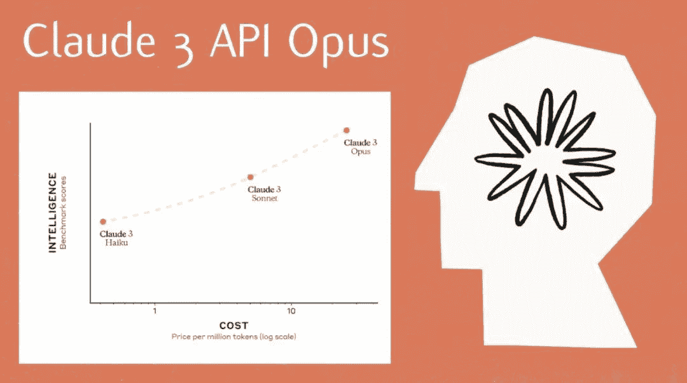
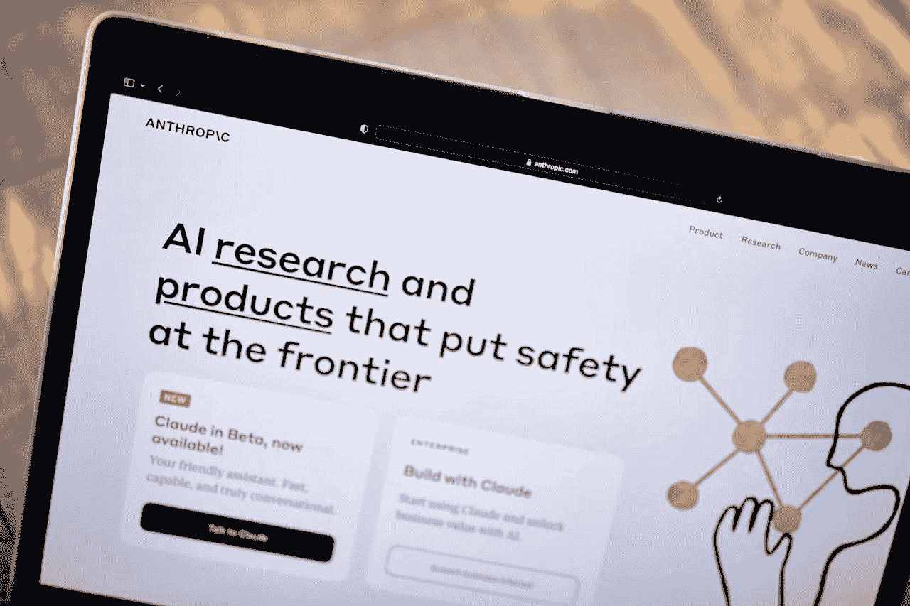
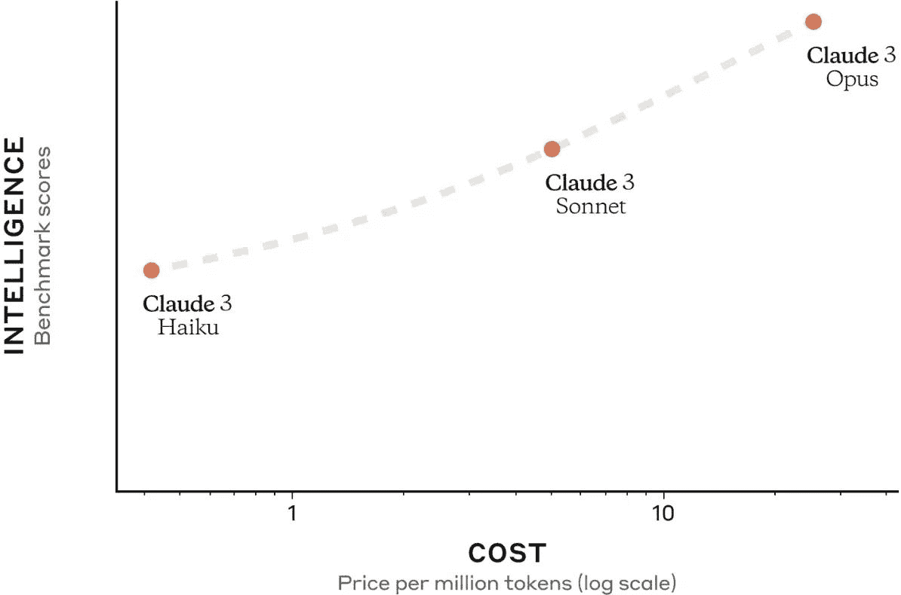
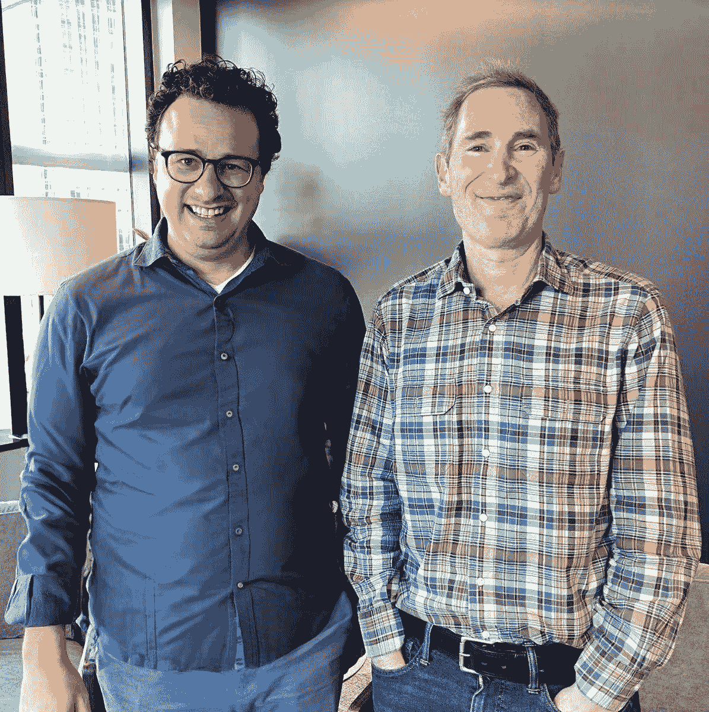
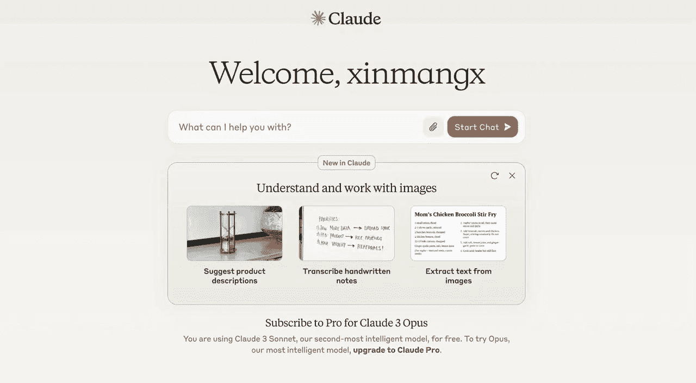
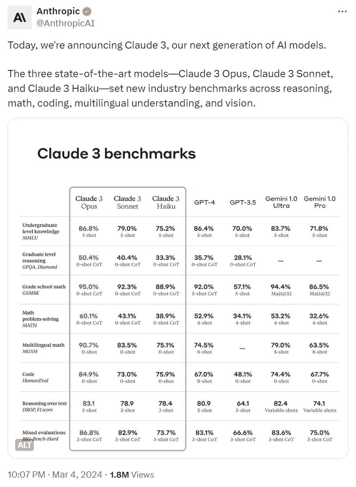
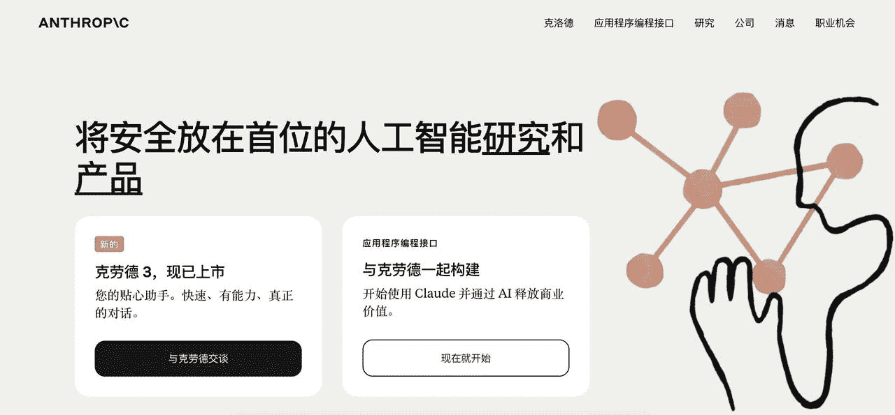

# AI 初创公司Anthropic（claude3）

> 来源：[https://agispace.feishu.cn/docx/ZwYHdXajYomrVlxBlapcmqFHnLe](https://agispace.feishu.cn/docx/ZwYHdXajYomrVlxBlapcmqFHnLe)

**Anthropic **是一家专注于人工智能安全研究的初创公司，团队包括来自多领域的研究人员、工程师、政策专家和业务领导者。

公司以创建可靠、可解释和可控的 AI 系统为目标，并通过各类伙伴关系和产品部署其研究成果。

# 成立背景与发展历程：

### 成立背景：

**Anthropic 成立于****2021年，由O****penAI****的前研究副总裁达里奥·**阿莫迪（Dario Amodei）和大语言模型GPT-3论文的第一作者汤姆·布朗（Tom Brown）等人共同创立。

公司的成立源于创始人对大型AI模型中存在的安全问题的担忧，以及对构建可靠、可解释和可操控的A**I系统的愿景。Ant**hropic特别重视AI安全性和可解释性，希望通过技术创新来解决这些问题。

### 发展历程

Anthropic 自成立以来，迅速在全球A**I领域崭露头角**。Anthropic公司在2023年7月发布了Claude 2，这是一个类似于ChatGPT的AI助手，Anthropic 开始以其大型语言模型（Claude系列）闻名。

** 就在最近，Anth**ropic 又于2024 年 3 月发布了 Claude 3，开发旨在使 AI 系统与人类价值观保持一致的“宪法式人工智能”（Constitutional AI）框架。

> **概念排疑：**

> "宪法式人工智能"（Constitutional AI）是一个概念性框架，它借鉴了宪法原理来指导和规范人工智能（AI）系统的设计和行为。核心思想是将宪法中的基本原则和价值观，如自由、平等、正义等，融入到AI系统的决策过程中，以确保AI行为的合理性和道德性。

> 在"宪法式人工智能"框架中，AI系统被设计成遵循一系列预设的规则和原则，这些规则相当于AI的"宪法"，不仅包括技术标准和操作规范，还包括道德和伦理准则。通过这种方式，AI系统行为可以被限制在一定的道德和法律边界内，减少对人类权利和福祉潜在威胁。强调透明度、可解释性和可审计性，这意味着AI系统的决策过程应该透明，用户和监管机构可以理解和审查AI行为和决策依据。

> "宪法式人工智能"是一种试图将人类社会的核心价值观和原则整合到AI技术中的框架，促进AI的负责任和伦理发展。

# 公司架构与产品线：

### 公司架构：

检索过程中，我们发现Anthropic 的具体公司架构信息未明确提及和公开，但作为一家初创公司它很可能采用扁平化管理结构，促进快速决策和创新。

> **另外，Anthr**opic 作为一**家对外性质为公**共利益导向的公司，与有效利他主义运动有关联，往往采用跨学科工作方式。

### 产品线：

Anthropic 主要致力于研究和开发 AI 安全技术，其产品和服务包括：

1.  **解释性 AI 系统**：开发能够提供可解释、透明决策过程的 AI 模型，以便人类用户可以理解和信任 AI 的行为。

1.  **AI 安全框架**：研究和开发用于评估和保证 AI 系统安全性的工具和方法，包括对抗性攻击防御、鲁棒性测试等。

1.  **伦理和价值对齐**：探索如何将人类的伦理标准和价值观整合到 AI 系统的设计和决策中，以确保 AI 的行为符合人类利益。

1.  **合作和咨询服务**：与其他公司合作，提供 AI 安全和伦理方面咨询服务。

主要产品是 Claude AI 助手，设计用于为企业和非盈利组织减少品牌风险和简化任务。

Anthropic 核心产品Claude，是一个类似于OpenAI的ChatGPT的人工智能聊天机器人。Claude采用了“宪法AI”技术，旨在解决AI系统的透明度、安全性和决策制定的担忧，而不依赖于人类的反馈来评估响应。

# 市场地位与融资表现：

### 市场地位：

**Anthropic** 目前通过与全球科技大公司的战略合作伙伴关系，以及获得显著资金注入，显示出市场的信任和财务背书。

**亚**马逊 CEO Andy Jassy（右）和 Anthropic 创始人&CEO Dario Amodei（左）

### 融资表现：

> **截至2024年3月，Anthropic已经完成了**几轮融资，融资总额达到了大约15亿美元。

1.  **初始融资****：Anthr**opic在成立初期获得了Google的支持，并从Alphabet（Google母公司）和其他一些投资者那里获得了初步资金支持。

1.  2023年5月：Anthropic宣布完成了4.5亿美元的融资，这是当时AI领域最大的一笔融资之一。

1.  2023年9月：据报道，Amazon投资了Anthropic，但具体金额未公开。

1.  **2023年10月：Google同意向Anthropic投资高达20亿美元，这是对Anth**ropic的一项重大投资，表明了Google对该公司和其AI安全研究的高度重视。

1.  2024年2月：据《纽约时报》报道，Anthropic在资金筹集热潮中脱颖而出，成为全球AI领域最热门的初创公司之一。

这些融资反映了投资者对Anthropic在AI安全和发展方面的信心，以及对该公司未来发展潜力的看好。

Ant**hropic的发展历程中，重要的里程碑包括完成多轮**融资，成为除OpenAI外融资最多的AI初创公司。Google在2023年2月对Anthropic进行了3亿美元的投资，换取了10%的股权。

> 关于Anthropic融资情况的一些内容链接：

1.  [Anthropic公司](https://www.anthropic.com/company)简介及其融资情况概述：Anthropic官网

1.  Anthropic与Amazon的投资合作：Reuters报道

1.  Google向Anthropic的投资：Reuters报道

1.  Anthropic在AI领域的融资情况：纽约时报报道

# 技术创新与合作伙伴关系：

### 技术创新

1.  **Claude**：Anthropic开发了一个名为Claude的大型语言模型，类似于OpenAI的ChatGPT。Claude旨在提高对话可靠性，通过使用称为“构造性偏好”技术来指导模型行为，确保它能够以负责任和有益方式进行交流。

1.  **对抗性训练**：Anthropic采用对抗性训练方法来增强其模型的鲁棒性，这有助于防止模型被恶意利用或产生有害的输出。

1.  **可解释性研究**：Anthropic致力于提高人工智能模型的可解释性，这意味着让模型的决策过程更加透明和可理解，以便人类用户可以更好地信任和控制这些系统。

### 合作伙伴关系

1.  **投资者支持**：Anthropic得到了一系列知名投资者的支持，包括Sam Altman（OpenAI的首席执行官）、Reid Hoffman（LinkedIn的联合创始人）和Inflection等风险投资公司。

1.  **学术合作**：Anthropic与多个学术机构合作，进行人工智能安全和可靠性研究。这些合作推动人工智能领域知识进步，并培养下一代研究人员。

1.  **行业联盟**：Anthropic参与了多个行业联盟和倡议，例如Partnership on AI，旨在制定人工智能的伦理和安全标准，并促进跨行业的合作。

# Anthropic在AI时代下的大模型战略：

A**nthropic在AI时代下的大**模型战略主要集中在开发其旗舰产品Claude系列模型。Claude 3是Anthropic迄今为止推出的最强大的AI模型系列，提供了一系列新的商业用例，并致力于推动负责任的AI发展。

Claude 3系列包括三个模型：Opus、Sonnet和Haiku，每个模型都旨在为特定的商业用例提供更强大的性能，同时允许用户根据智能、速度和成本选择最佳平衡。

Claude 3具有一系列新功能，包括更强的视觉处理能力、更少的拒绝响应、提高的准确性、长文本处理能力和近乎完美的回忆能力。这些功能使得Claude 3模型能够更好地处理大规模AI部署中的复杂任务。

Anthropic认为，进行**边缘AI系统的安全研究**是必要的。公司采取了一种对AI安全的多元化方法，旨在开发更好的使AI系统更安全的技术，**以及更好**的识别潜在危险行为的方法。Anthropic强调，对越来越复杂的模型进行偏见处理是一项持续的努力，公司致力于推动技术的进步，以减少偏见并促进模型的更大中立性。

Anthropic 在大 AI 模型时代的方法是构建可信赖和可理解的系统，这些系统与人类价值观相一致，确保社会获益。公司在大模型领域的关键动态体现在其严谨的研究、以安全为驱动的产品开发，以及承诺实行道德 AI 实践上。

> [更多详细](https://www.anthropic.com/company)信[息可以在 Anthr](https://craft.co/anthropic)opic 的官方网站和Craft 个人资料了解。

总的来说，Anthropic的大模型战略集中在开发强大、可靠且负责任的AI系统，同时以“确保变革性 AI 帮助人们和社会繁荣发展”为使命，不断推进安全和透明度的改进，以确保AI技术的积极社会影响。