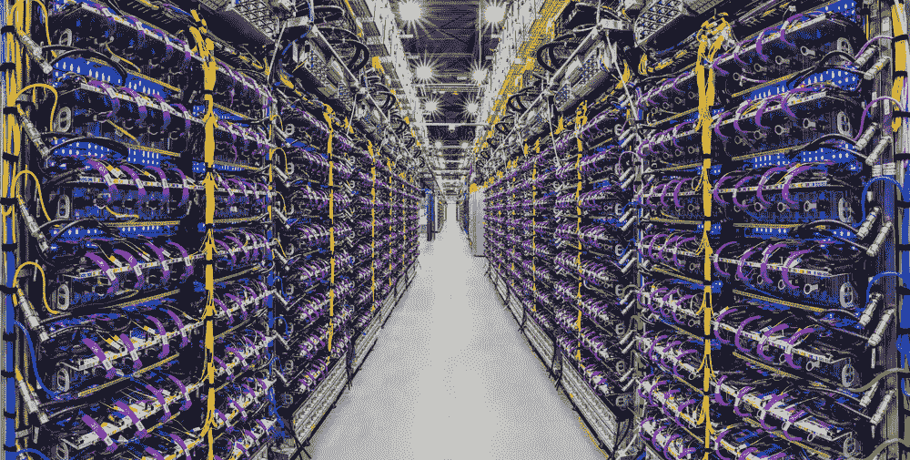
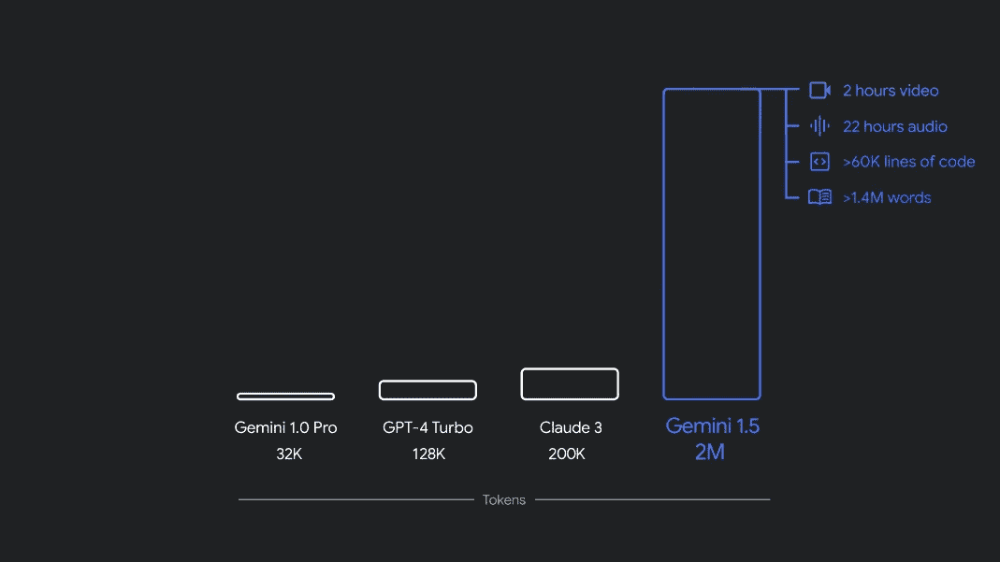
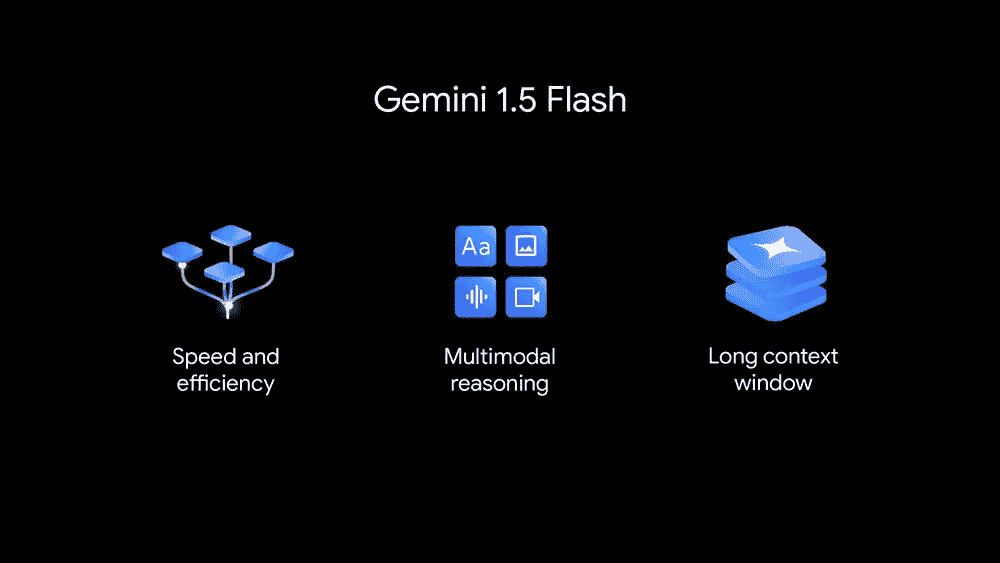
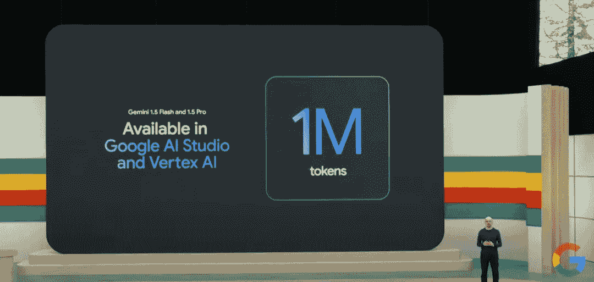
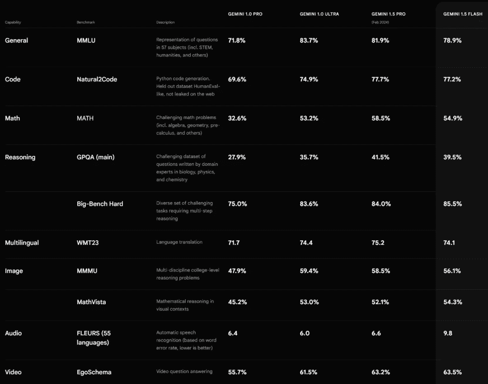
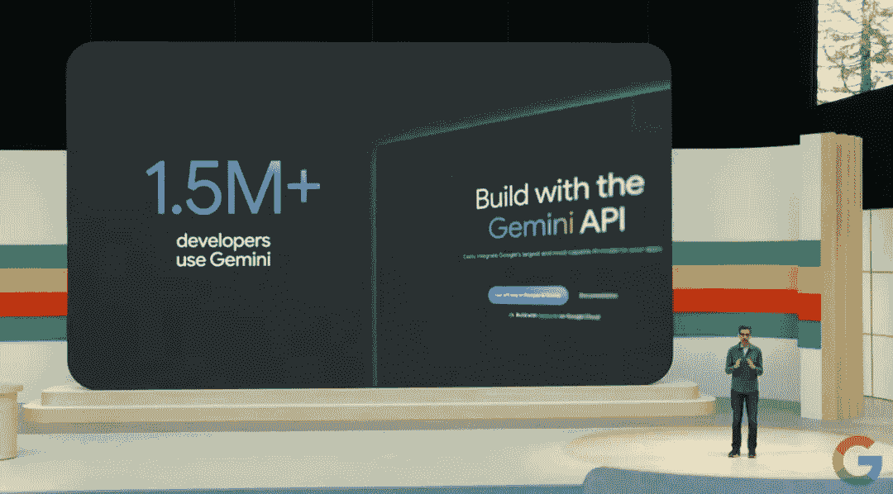
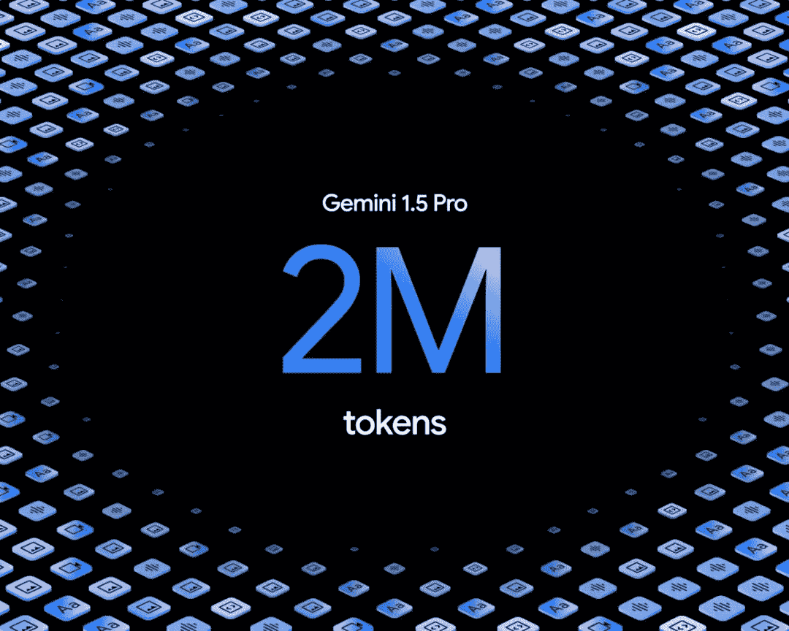

# 谷歌（Gemini）

> 来源：[https://agispace.feishu.cn/docx/HfT8dIMkNoW4HLxqVppck79snEg](https://agispace.feishu.cn/docx/HfT8dIMkNoW4HLxqVppck79snEg)

> Gemini 是一系列由 Google AI 和 DeepMind 共同开发的多模态语言模型。它的前身是 Google Bard，在 Bard 的基础上进行了多项重大改进，使其在各方面的性能都得到了大幅提升。Gemini 可以处理不同类型的信息，包括文本、代码、音频、图像和视频，从而具备了更强大的功能。

> 谷歌已全面进入双子座时代。

> 官网：https://gemini.google.com/app

> 官方介绍：https://blog.google/technology/ai/google-gemini-ai/#sundar-note

## Gemini 简介：我们最大、能力最强的人工智能模型

谷歌和 Alphabet 首席执行官桑达尔·皮查伊 (Sundar Pichai) 的注释：

每一次技术变革都是推进科学发现、加速人类进步和改善生活的机会。我相信我们现在所看到的人工智能转变将是我们一生中最深刻的转变，远远大于之前向移动或网络的转变。人工智能有潜力为世界各地的人们创造从日常生活到非凡的机会。它将带来新一轮的创新和经济进步，并以我们从未见过的规模推动知识、学习、创造力和生产力。

这让我感到兴奋：有机会让人工智能为世界各地的每个人提供帮助。

作为一家人工智能优先的公司，我们已经走过了近八年的历程，进步的步伐只会不断加快：数百万人现在在我们的产品中使用生成式人工智能来完成一年前无法完成的事情，从寻找答案到更复杂的问题使用新工具进行协作和创造的问题。与此同时，开发人员正在使用我们的模型和基础设施来构建新的生成式人工智能应用程序，世界各地的初创公司和企业正在利用我们的人工智能工具不断成长。

这是令人难以置信的势头，然而，我们才刚刚开始触及可能性的表面。

我们正在大胆而负责任地开展这项工作。这意味着我们的研究要雄心勃勃，追求能够为人类和社会带来巨大利益的能力，同[时建立保障措](https://ai.google/responsibility/principles/)施并与政府和专家合作，应对人工智能变得更加强大的风险。我们继续投资最好的工具、基础模型和基础设施，并在我们的人工智能原则的指导下将它们引入我们的产品和其他产品。

现在，我们正在与 Gemini 一起迈出下一步，这是我们迄今为止功能最强大、最通用的模型，在许多领先的基准测试中都具有最先进的性能。我们的第一个版本 Gemini 1.0 针对不同尺寸进行了优化：Ultra、Pro 和 Nano。这些是 Gemini 时代的第一个模型，也是我们今年早些时候成立 Google DeepMind 时的愿景的首次实现。这个模型的新时代代表了我们作为一家公司所做出的最大的科学和工程努力之一。我对未来以及双子座将为世界各地的人们带来的机会感到由衷的兴奋。

——桑达尔

### 介绍双子座

作者：Demis Hassabis，Google DeepMind 首席执行官兼联合创始人，代表 Gemini 团队

对于我的许多研究同事来说，人工智能一直是我一生工作的重点。自从十几岁的时候为电脑游戏编写人工智能以来，以及作为一名神经科学研究人员试图了解大脑的运作方式以来，我一直相信，如果我们能够建造更智能的机器，我们就可以利用它们以令人难以置信的方式造福人类。方法。

这个由人工智能赋能的世界负责任的承诺继续推动着我们在 Google DeepMind 的工作。长期以来，我们一直希望构建新一代人工智能模型，其灵感来自于人们理解世界和与世界互动的方式。人工智能感觉不太像一个智能软件，而更像是有用且直观的东西——一个专家帮助者或助手。

[今天，当我们推出 Gemini](https://deepmind.google/technologies/gemini)时，我们离这一愿景又近了一步，它是我们迄今为止构建的最强大、最通用的模型。

Gemini 是整个 Google 团队（包括 Google Research 的同事）大规模协作努力的成果。它是从头开始构建的多模式，这意味着它可以概括和无缝地理解、操作和组合不同类型的信息，包括文本、代码、音频、图像和视频。

<https://www.youtube.com/embed/jV1vkHv4zq8?enablejsapi=1&origin=https%3A%2F%2Fblog.google&widgetid=1>

Gemini 简介：我们最大、能力最强的人工智能模型

Gemini 也是我们迄今为止最灵活的模型 - 能够在从数据中心到移动设备的所有设备上高效运行。其最先进的功能将显着增强开发人员和企业客户利用人工智能进行构建和扩展的方式。

我们针对三种不同的尺寸优化了 Gemini 1.0（我们的第一个版本）：

+   **Gemini Ultra——**我们最大、最有能力的模型，适用于高度复杂的任务。

+   **Gemini Pro——**我们可扩展各种任务的最佳模型。

+   **Gemini Nano——**我们最高效的设备端任务模型。

### 最先进的性能

我们一直在严格测试 Gemini 模型并评估其在各种任务中的性能。从自然图像、音频和视频理解到数学推理，Gemini Ultra 的性能在大型语言模型 (LLM) 研发中使用的 32 个广泛使用的学术基准中的 30 个上超过了当前最先进的结果。

[Gemi](https://arxiv.org/abs/2009.03300)ni Ultra 的得分高达 90.0%，是第一个在MMLU（大规模多任务语言理解）上超越人类专家的模型，该模型结合了数学、物理、历史、法律、医学和伦理学等 57 个科目来测试知识和解决问题的能力。

我们新的 MMLU 基准方法使 Gemini 能够利用其推理能力在回答难题之前更仔细地思考，从而比仅使用第一印象有显着改进。

Gemini 在文本和编码等一系列基准测试中超越了最先进的性能。

Gemini Ultra 还在新的MMMU基准测试中取得了 59.4% 的最先进分数，该基准测试由跨越不同领域、需要深思熟虑的推理的多模态任务组成。

根据我们测试的图像基准，Gemini Ultra 的性能优于以前最先进的模型，无需光学字符识别 (OCR) 系统从图像中提取文本以进行进一步处理的帮助。这些基准凸显了双子座天生的多模态性，并表明了双子座更复杂推理能力的早期迹象。

请参阅我们的Gemini 技术报告了解更多详细信息。

Gemini 在一系列多模式基准测试中超越了最先进的性能。

### 下一代功能

目前为止，创建多模态模型的标准方法涉及针对不同模态训练单独的组件，然后将它们拼接在一起以粗略地模仿其中的一些功能。这些模型有时擅长执行某些任务，例如描述图像，但难以处理更概念性和复杂的推理。

我们将 Gemini 设计为原生多模式，从一开始就针对不同模式进行了预训练。然后我们使用额外的多模态数据对其进行微调，以进一步完善其有效性。这有助于 Gemini 从头开始无缝地理解和推理各种输入，远远优于现有的多模式模型 - 而且其功能几乎在每个领域都是最先进的。

详细了解Gemini 的功能并了解其工作原理。

#### 复杂的推理

Gemini 1.0 复杂的多模式推理功能可以帮助理解复杂的书面和视觉信息。这使得它在发现大量数据中难以辨别的知识方面具有独特的能力。

其通过阅读、过滤和理解信息从数十万份文档中提取见解的卓越能力将有助于在从科学到金融的许多领域以数字速度实现新的突破。

<https://www.youtube.com/embed/sPiOP_CB54A?enablejsapi=1&origin=https%3A%2F%2Fblog.google&widgetid=2>

双子座解锁新的科学见解

#### 理解文本、图像、音频等

Gemini 1.0 经过训练，可以同时识别和理解文本、图像、音频等，因此它可以更好地理解微妙的信息，并可以回答与复杂主题相关的问题。这使得它特别擅长解释数学和物理等复杂学科的推理。

<https://www.youtube.com/embed/K4pX1VAxaAI?enablejsapi=1&origin=https%3A%2F%2Fblog.google&widgetid=3>

双子座解释数学和物理推理

#### 高级编码

我们的第一个版本的 Gemini 可以理解、解释和生成世界上最流行的编程语言（如 Python、Java、C++ 和 Go）的高质量代码。它跨语言工作和推理复杂信息的能力使其成为世界领先的编码基础模型之一。

[Gemini Ul](https://arxiv.org/abs/2107.03374)tra 在多个编码基准测试中表现出色，包括HumanEval（用于评估编码任务性能的重要行业标准）和 Natural2Code（我们内部保留的数据集），该数据集使用作者生成的源而不是基于网络的信息。

[Gemini 还可](https://deepmind.google/discover/blog/competitive-programming-with-alphacode/)以用作更高级编码系统的引擎。两年前，我们推出了AlphaCode，这是第一个在编程竞赛中达到竞争性能水平的人工智能代码生成系统。

[使用 Gemini 的](https://goo.gle/AlphaCode2)专门版本，我们创建了更先进的代码生成系统AlphaCode 2，它擅长解决超出编码范围、涉及复杂数学和理论计算机科学的竞争性编程问题。

<https://www.youtube.com/embed/LvGmVmHv69s?enablejsapi=1&origin=https%3A%2F%2Fblog.google&widgetid=4>

双子座擅长编码和竞争性编程

当在与原始 AlphaCode 相同的平台上进行评估时，AlphaCode 2 显示出巨大的改进，解决的问题数量几乎是原来的两倍，我们估计它的表现优于 85% 的竞赛参与者，而 AlphaCode 的这一比例接近 50%。当程序员通过为代码示例定义某些属性来与 AlphaCode 2 协作时，它的性能会更好。

我们很高兴程序员越来越多地使用功能强大的人工智能模型作为协作工具，帮助他们推理问题、提出代码设计并协助实施，这样他们就可以更快地发布应用程序并设计更好的服务。

请参阅我们的AlphaCode 2 技术报告了解更多详细信息。

### 更可靠、可扩展且高效

[我们使用 ](https://cloud.google.com/tpu?hl=en)Google 内部设计的张量处理单元(TPU) v4 和 v5e 在我们的 AI 优化基础设施上大规模训练 Gemini 1.0。我们将其设计为最可靠、最可扩展的训练模型，以及最高效的服务模型。

在 TPU 上，Gemini 的运行速度明显快于早期、较小且功能较差的型号。这些定制设计的人工智能加速器一直是谷歌人工智能产品的核心，这些产品为搜索、YouTube、Gmail、谷歌地图、Google Play 和 Android 等数十亿用户提供服务。它们还使世界各地的公司能够经济高效地训练大规模人工智能模型。

[今天，我们宣布推出迄今为止](https://cloud.google.com/blog/products/ai-machine-learning/introducing-cloud-tpu-v5p-and-ai-hypercomputer)最强大、最高效且可扩展的 TPU 系统Cloud TPU v5p，专为训练尖端 AI 模型而设计。这款下一代TPU将加速Gemini的开发，帮助开发者和企业客户更快地训练大规模生成式AI模型，让新产品和能力更快地到达客户手中。

Google 数据中心内的一排 Cloud TPU v5p AI 加速器超级计算机。

### 以责任和安全为核心构建

在 Google，我们致力于在我们所做的一切事情中推进大胆且[负责任的人工](https://ai.google/responsibility/principles/)智能。基于 Google 的人工智能原则和我们产品中强大的安全政策，我们正在添加新的保护措施来考虑 Gemini 的多模式功能。在开发的每个阶段，我们都会考虑潜在的风险，并努力测试和减轻它们。

Gemini 拥有迄今为止所有 Google AI 模型[中最全面的安全](https://blog.research.google/2023/11/responsible-ai-at-google-research_16.html)评估，包括偏见和毒性。我们对网络攻击、说服和自主等潜在风险领域进行了新颖的研究，并应用了 Google Research 一流的对抗性测试技术来帮助在 Gemini 部署之前识别关键的安全问题。

为了找出内部评估方法中的盲点，我们正在与各种外部专家和合作伙伴合作，针对一系列问题对我们的模型进行压力测试。

为了诊断 Gemini 训练阶段的内容安全问题并确[保其输出符合我](https://allenai.org/data/real-toxicity-prompts)们的政策，我们使用了诸如“真实毒性提示”之类的基准，这是一组从网络中提取的 100,000 个不同程度毒性的提示，由艾伦研究所的专家开发。对于人工智能。有关这项工作的更多细节即将推出。

为了限制伤害，我们建立了专门的安全分类器来识别、标记和整理涉及暴力或负面刻板印象的内容。结合强大的过滤器，这种分层方法旨在使 Gemini 对每个人都更安全、更具包容性。此外，我们正在继续解决模型的已知挑战，例如事实性、基础性、归因和佐证。

责[任](https://mlcommons.org/)和安全始终是我们模型[开发和部署的核心。这是](https://blog.google/outreach-initiatives/public-policy/google-microsoft-openai-anthropic-frontier-model-forum/)一[项需](https://blog.google/outreach-initiatives/public-policy/google-microsoft-openai-anthropic-frontier-model-forum/)[要协作构建的长](https://blog.google/outreach-initiatives/public-policy/google-microsoft-anthropic-open-ai-frontier-model-forum-executive-director/)期承诺，因[此我们正在与行业和更广泛的生](https://blog.google/technology/safety-security/introducing-googles-secure-ai-framework/)态系统合作，通过 MLCommons 、 Frontier Model Forum 及其AI 安全基金以及我们的安全人工智能框架（SAIF），旨在帮助减轻公共和私营部门人工智能系统特有的安全风险。在开发 Gemini 的过程中，我们将继续与世界各地的研究人员、政府和民间社会团体合作。

### 让 Gemini 走向世界

Gemini 1.0 现已在一系列产品和平台上推出：

#### Google 产品中的 Gemini Pro

我们通过 Google 产品将 Gemini 带给数十亿人。

从今天开始，巴德将使用 Gemini Pro 的微调版本来进行更高级的推理、计划、理解等。这是 Bard 自推出以来最大的升级。它将在 170 多个国家和地区提供英语版本，我们计划在不久的将来扩展到不同的模式并支持新的语言和地点。

+   我们还将[Gemini 引入 Pixel](https://blog.google/products/pixel/pixel-feature-drop-december-2023/)。Pixel 8 Pro 是第一款运行 Gemini Nano 的智能手机，它支持记录器应用中的 Summ[ari](https://blog.google/technology/ai/google-gemini-ai/#footnote-1)ze 等新功能，并在 Gboard 中的智能回复中推出，首先是 WhatsApp、Line 和 KakaoTalk(1)明年将推出更多消息应用程序。

在接下来的几个月中，Gemini 将出现在我们更多的产品和服务中，例如搜索、广告、Chrome 和 Duet AI。

[我们已经开始](https://labs.google/sge/)在搜索中试验 Gemini，它使用户的搜索生成体验(SGE) 更快，美国英语的延迟减少了 40%，同时质量也得到了提高。

#### 与双子座一起建设

[从 12 月 13 日开始，开发者和企业客户](https://ai.google.dev/)可以通过Google AI Studio或Google Cloud Vertex AI中的 Gemini API 访问 Gemini Pro 。

Google AI Studio 是一款基于网络的免费开发者工具，可使用 API 密钥快速构建应用程序原型并启动应用程序。当需要完全托管的 AI 平台时，Vertex AI 允许对 Gemini 进行自定义，提供全面的数据控制，并受益于额外的 Google Cloud 功能，以实现企业安全、安全、隐私以及数据治理和合规性。

An[droid 开发人员还可以](https://android-developers.googleblog.com/2023/12/a-new-foundation-for-ai-on-android.html)通过 AICore（Android 14 中提供的新系统功能，从 Pixel 8 Pro 设备开始）使用 Gemini Nano（我们最高效的设备端任务模型）进行构建。注册获取AICore 的早期预览版。

#### 双子座超即将推出

# Gemini 1.5 发布进展

对于 Gemini Ultra，我们目前正在完成广泛的信任和安全检查，包括由受信任的外部方进行红队检查，并在广泛使用之前使用微调和基于人类反馈的强化学习 (RLHF) 进一步完善模型。

作为此过程的一部分，我们将向选定的客户、开发人员、合作伙伴以及安全和责任专家提供 Gemini Ultra 进行早期实验和反馈，然后在明年初向开发人员和企业客户推出。

明年初，我们还将推出[Bard Advanced](https://blog.google/products/bard/google-bard-try-gemini-ai)，这是一种全新的尖端 AI 体验，让您可以从 Gemini Ultra 开始使用我们最好的模型和功能。

## 双子座时代：开启创新未来

这是人工智能发展的一个重要里程碑，也是我们谷歌新时代的开始，我们将继续快速创新并负责任地提高模型的能力。

目前为止，我们在 Gemini 上取得了巨大进展，我们正在努力进一步扩展其未来版本的功能，包括规划和内存方面的进步，以及增加上下文窗口以处理更多信息以提供更好的响应。

我们对人工智能赋能的世界所带来的惊人可能性感到兴奋——这是一个创新的未来，它将增强创造力、扩展知识、推进科学并改变世界各地数十亿人的生活和工作方式。

## Gemini 1.5

去年 12 月，谷歌推出了首款原生多模态模型 Gemini 1.0，共有三种尺寸：Ultra、Pro 和 Nano。仅仅几个月后，谷歌发布新版本 1.5 Pro，其性能得到了增强，并且上下文窗口突破了 100 万 token。

现在，谷歌宣布在 Gemini 系列模型中引入了一系列更新，包括新的 Gemini 1.5 Flash（这是谷歌追求速度和效率的轻量级模型）以及 Project Astra（这是谷歌对人工智能助手未来的愿景）。

目前，1.5 Pro 和 1.5 Flash 均已提供公共预览版，并在 Google AI Studio 和 Vertex AI 中提供 100 万 token 上下文窗口。现在，1.5 Pro 还通过候补名单向使用 API 的开发人员和 Google Cloud 客户提供了 200 万 token 上下文窗口。

此外，Gemini Nano 也从纯文本输入扩展到可以图片输入。今年晚些时候，从 Pixel 开始，谷歌将推出多模态 Gemini Nano。这意味着手机用户不仅能够处理文本输入，还能够理解更多上下文信息，例如视觉、声音和口语。

### Gemini 1.5 Flash

新的 1.5 Flash 针对速度和效率进行了优化。

1.5 Flash 是 Gemini 模型系列的最新成员，也是 API 中速度最快的 Gemini 模型。它针对大规模、大批量、高频任务进行了优化，服务更具成本效益，并具有突破性的长上下文窗口（100 万 token）。

1.5 Flash 擅长摘要、聊天应用程序、图像和视频字幕、从长文档和表格中提取数据等。这是因为 1.5 Pro 通过一个名为「蒸馏」的过程对其进行了训练，将较大模型中最基本的知识和技能迁移到较小、更高效的模型中。

### 改进的 Gemini 1.5 Pro

上下文窗口扩展到 200 万 token

谷歌提到，如今有超过 150 万的开发人员在使用 Gemini 模型，超过 20 亿的产品用户都用到了 Gemini。

在过去的几个月里，谷歌除了将 Gemini 1.5 Pro 上下文窗口扩展到 200 万 token 之外，谷歌还通过数据和算法的改进增强了其代码生成、逻辑推理和规划、多轮对话以及音频和图像理解能力。

1.5 Pro 现在可以遵循日益复杂和细致的指令，包括那些指定涉及角色，格式和风格的产品级行为的指令。此外，谷歌还让用户能够通过设置系统指令来引导模型行为。

现在，谷歌在 Gemini API 和 Google AI Studio 中添加了音频理解，因此 1.5 Pro 现在可以对 Google AI Studio 中上传的视频图像和音频进行推理。此外，谷歌还将 1.5 Pro 集成到 Google 产品中，包括 Gemini Advanced 和 Workspace 应用程序。

Gemini 1.5 Pro 的定价为每 100 万 token 3.5 美元。
