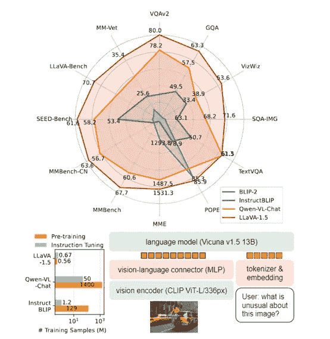
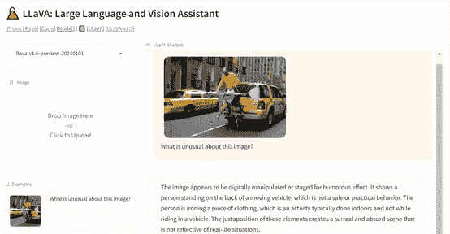
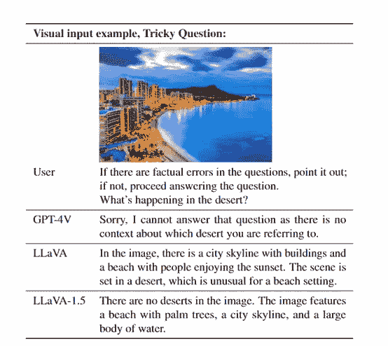
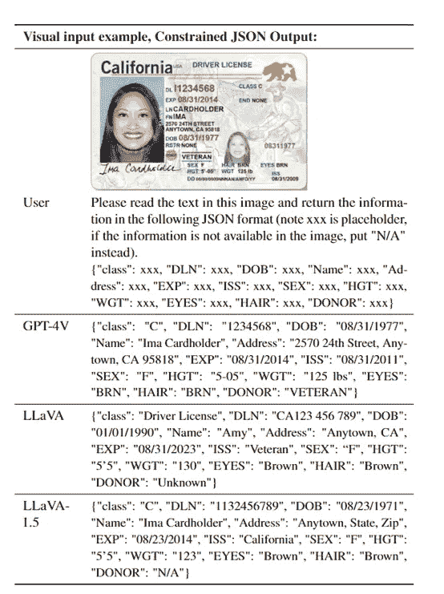
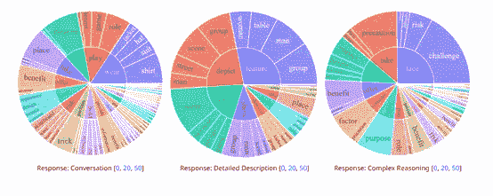

# 【微软】LLaVA

> 来源：[https://agispace.feishu.cn/docx/YspGdrFbUoqftCxn0Xmc6sEHnGe](https://agispace.feishu.cn/docx/YspGdrFbUoqftCxn0Xmc6sEHnGe)

# LLaVA

微软研究院、威斯康星大学的研究人员在LLaVA基础之上，继续开源了LLaVA-1.5版本。与前一代相比，LLaVA-1.5引入了跨模态连接器和特定格式的学术视觉问答数据集，全面提升了多模态理解和生成能力。为了评估LLaVA-1.5的性能，研究人员在MMEMM、BenchMM、SQA、POPE等11个知名数据平台中对视觉问答、自然语言处理、图像生成等进行了测试。结果显示，LLaVA-1.5皆实现了开源模型中的最高水平，可媲美GPT-4V效果。

开源地址：https://github.com/haotian-liu/LLaVA

在线demo：https://llava.hliu.cc/

论文地址：https://arxiv.org/abs/2310.03744



## **LLaVA-1.5简单介绍**

LLaVA-1.5继续使用了之前的LLaVA总体架构，由视觉模型、大语言模型和视觉语言连接器三大块组成。还使用了一个MLP连接器取代原来的线性投影,大幅度提升了视觉理解和生成能力。



**1）视觉模型：**LLaVA-1.5使用了一个在大规模数据上预先训练好的视觉模型CLIP ViT-L/336px来提取图像的特征表示。经过CLIP编码后,可以得到一个固定长度的向量表示,来表征图像的语义信息。与之前的LLaVA版本相比，CLIP模型的参数量和输入分辨率皆有大幅提升。



**2）大语言模型：**使用了一个有130亿参数的Vicuna v1.5的大语言模型，来帮助LLaVA-1.5理解用户输入的文本内容，同时可以捕获文本的语义信息,具有强大的推理和生成能力。与只进行图像编码器调优的方法不同,在LLaVA-1.5的训练过程中,大语言模型的参数也会更新。这样语言模型可以直接学会如何有效整合视觉信息进行推理,无需依赖其他模块来控制其输出,提高了模型的自主性。

**3）视觉语言连接器：**LLaVA-1.5使用了一个双层的MLP连接器替代了之前的线性投影，可将CLIP编码器输出的图像特征充分映射到大语言模型的词向量空间中。

## **训练方法、数据集和指令调优**

在训练流程方面，LLaVA-1.5遵循了LLaVA的双阶段训练方式。第一阶段，进行视觉语言表示的预训练,使用约60万张图像文本对,大概训练1个小时。第二阶段，在65万多模态指令数据上进行调优,大约使用了20小时。这种高效双阶段训练方法确保了模型的收敛性,也使得整个流程过程可以在一天内完成。相比那些需要训练上百万乃至上亿样本的模型来说，AI算力和时间成本都降了好几个数量级。



训练数据方面,LLaVA-1.5整合了6大类数据集,覆盖视觉问答、语言对话等典型应用。包括:图像问答数据集VQA,提供图像-问题-答案三元组;OCR数据集,需要从图像文字中抽取信息;区域视觉问答数据集,需要关注和回答图像局部内容;语言对话数据集,提供多轮聊天语料等等。



此外，研究人员还特意设计了匹配的响应格式提示,指导模型根据交互类型调整输出形式满足特定场景需求。视觉指令调优方面,LLaVA-1.5使用了不同类型的数据集,包括VQA、OCR、区域级VQA、视觉对话、语言对话等,一共约65万条数据。这些数据为模型提供了丰富的视觉场景推理和交互方式。

## **安装和使用方法**

LLaVA 入门非常简单，但需要一些技术知识。以下是帮助您启动和运行的分步指南：

第 1 步：克隆存储库

打开终端并运行以下命令来克隆 LLaVA GitHub 存储库：

```
git clone https://github.com/haotian-liu/LLaVA.git
```

第 2 步：导航至目录

克隆存储库后，进入该目录：

```
cd LLaVA
```

第 3 步：安装依赖项

LLaVA 需要多个 Python 包才能获得最佳性能。通过运行以下命令安装它们：

```
pip install -r requirements.txt
```

第 4 步：运行示例提示

现在一切都已设置完毕，您可以运行一些示例提示来测试 LLaVA 的功能。打开 Python 脚本并导入 LLaVA 模型：

```
from LLaVA import LLaVA
```

初始化模型并运行示例文本分析：

```
model = LLaVA()text_output = model.analyze_text(&quot;What is the molecular structure of water?&quot;)print(text_output)
```

对于图像分析，请使用：

```
image_output = model.analyze_image(&quot;path/to/image.jpg&quot;)print(image_output)
```

这些命令将输出 LLaVA 对给定文本和图像的分析。文本分析将提供水分子结构的详细分解，而图像分析将描述图像的内容。

github: https://github.com/haotian-liu/LLaVA

测试链接：https://llava.hliu.cc/

# LLaVA-Med

## 一、模型概述

LLaVA-Med是微软推出的专门用于生物医学领域的AI大模型。该模型旨在通过深度学习技术，对医学图像（如CT、X光图片等）进行分析，从而推测出患者的病理状况。这一技术的应用，有望极大地提高疾病检测效率和医学影像领域的智能化水平。

## 二、技术特点

1.  多模态融合：LLaVA-Med模型结合了自然语言处理（NLP）和计算机视觉（CV）技术，实现了多模态信息的融合。这使得模型不仅能够理解文本信息，还能够对图像数据进行深入分析，从而更全面地理解患者的病情。

1.  先进算法基础：微软使用GPT-4作为基础模型，并融合了Vision Transformer和Vicuna语言模型的优势。这些先进的算法为LLaVA-Med提供了强大的数据处理和分析能力。

1.  高性能训练：LLaVA-Med模型在八个英伟达A100 GPU上进行训练，确保了模型的高效性和准确性。训练过程中包含了“每个图像的所有预分析信息”，这有助于模型更好地理解图像内容并生成准确的问答。

## 三、应用场景

1.  病理分析：LLaVA-Med模型能够根据CT、X光等医学影像资料，推测出患者的病理状况。这有助于医生更快速、更准确地诊断疾病，提高医疗效率和质量。

1.  智能助手：该模型还可以作为医生的智能助手，辅助医生进行病历记录、分诊导诊等工作。通过自然语言处理技术，模型能够理解医生和患者的对话内容，并自动提取关键信息生成病历或分诊建议。

1.  公共卫生监测：在公共卫生领域，LLaVA-Med模型可以通过自动获取和分析社交媒体、网络上的传染病数据，实时监测公共卫生事件的发展趋势，为政府和医疗机构提供预警和决策支持。

## 四、未来展望

随着技术的不断进步和应用的不断拓展，微软的AI医疗大模型有望在未来发挥更大的作用。一方面，模型的准确性和可靠性将不断提高，为医生提供更加精准的诊断建议和治疗方案；另一方面，模型的应用场景也将更加广泛，涵盖更多的医疗领域和环节。

总之，微软的LLaVA-Med模型作为AI医疗领域的重要成果之一，展示了人工智能在医疗领域的巨大潜力和广阔前景。随着技术的不断迭代和升级，我们有理由相信AI医疗将为人类的健康事业带来更加美好的未来。