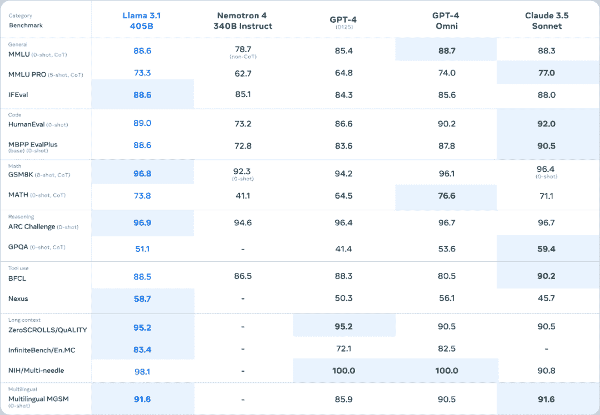
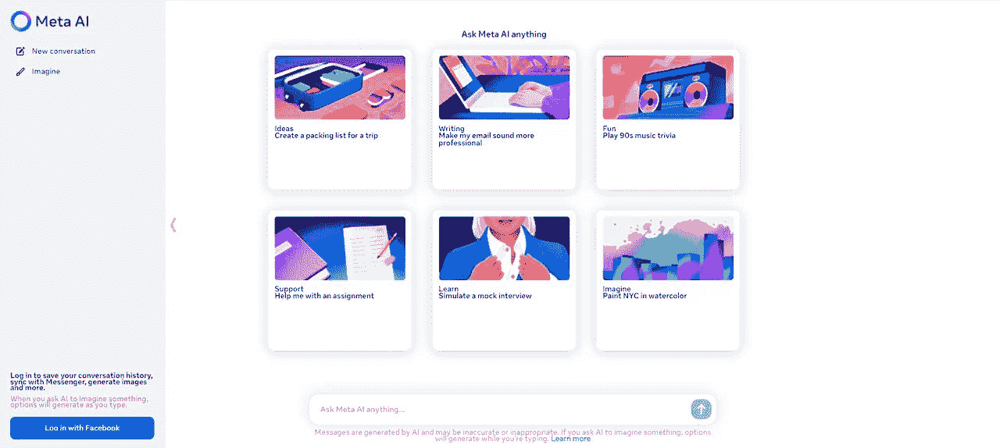

# Meta（Llama3）

> 来源：[https://agispace.feishu.cn/docx/XIandeBHkoxsorxlImPcE48hnQU](https://agispace.feishu.cn/docx/XIandeBHkoxsorxlImPcE48hnQU)

# 最新消息

北京时间：2024年7月23日23点，Meta正式发布了其最新的开源模型——Llama 3.1，包含8B、70B和405B三个尺寸，最大上下文提升到了128k。

1.  **Llama 3.1的发布**：2024年7月23日，Meta发布了Llama 3.1，包括8B、70B和405B三个尺寸，其中405B是迄今最强大的模型。

1.  **性能和上下文**：Llama 3.1的最大上下文提升到了128k，405B模型在性能上超过了GPT-4 0125，与Claude 3.5不相上下。

1.  **数据训练**：Llama 3使用了超过15 T token的公开数据进行训练，采用了超过1.6万个H100 GPU。

1.  **开源的重要性**：文章强调了开源AI的重要性，认为它是未来的发展方向。扎克伯格在致辞中提到，开源AI将使更多人受益于AI技术，避免权力集中在少数公司手中。

1.  **Llama 3.1的应用**：Llama 3.1被设计为易于微调和定制，适用于各种规模的公司和研究机构。

1.  **生态系统的构建**：Meta正在内部建立团队，与开发者和合作伙伴合作，推动Llama模型在生态系统中的应用。

其中，405B是其拓展最强大的模型，从评分上看，超过了GPT-4 0125，和Claude 3.5不相上下。

### 相关知名媒体消息：

+   赛博禅心：最大405B：Llama-3.1发布，第一时间详解

+   [**AI沃茨：3.1个羊驼顶1个GPT4，**](https://mp.weixin.qq.com/s/WPoEN4zbuG8ZfWmDB7jZrg)评测Llama 405B 10大实用场景

> 北京时间2024年4月18日，Meta开源了其最新版本的大语言模型LLaMA-3。LLaMA-3提供了三个版本的模型：参数量分别为80亿、700亿和4000亿的预训练模型和指令微调模型。值得注意的是，LLaMA-3的所有版本目前均采用Dense架构，并未如外界预期的那样使用类似GPT-4的MoE(Mixture of Experts)架构。

> **LLaMA 3 的亮点和特性：**

> ▪ 基于超过 15T token 训练，大小相当于 LLaMA 2 数据集的 7 倍还多；

> ▪ 训练效率比LLaMA 2 高 3 倍；

> ▪ 支持 8K 长文本，改进的 tokenizer 具有 128K token 的词汇量，可实现更好的性能；

> ▪ 在大量重要基准测试中均具有最先进性能；

> ▪ 增强推理和代码能力；

> ▪ 安全性有重大突破，带有 LLaMA Guard，Code Shield 和 CyberSec Eval 2 的新版信任和安全工具，还能比 LLaMA 2 有更好“错误拒绝表现”。

> 官方网址：https://llama.meta.com/

> 下载链接：https://llama.meta.com/llama-downloads/

> Github网址：https://github.com/meta-llama/

# 使用 Llama 3进行快速工程

除此之外，Meta 此次和大模型一起发布的还有自己的AI助手，Meta AI。

Meta AI 网址：https://www.meta.ai/

Meta AI由最新的Llama 3模型提供支持，它不仅将被整合到Meta 旗下的 Instagram、WhatsApp、Facebook和Messenger的搜索框中，还将首次以独立网站Meta.ai的形式对外提供服务。