# Bloomberg（BloombergGPT）

> 来源：[https://agispace.feishu.cn/docx/SsrNdXYOJoWBYixlqeEcGa2Jnjc](https://agispace.feishu.cn/docx/SsrNdXYOJoWBYixlqeEcGa2Jnjc)

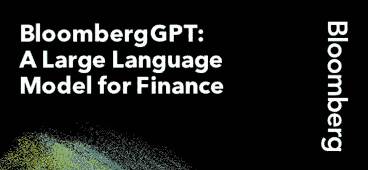

# 一、简介

BloombergGPT是布隆伯格2023年3月30日公开在arXiv的一篇文章——BloombergGPT: A Large Language Model for Finance中涉及到的语言模型，也是金融领域第一个公开发表文章的大语言模型（以下简称“LLM”）。

# 二、要点

+   BloombergGPT是Bloomberg训练出来的金融大语言模型（LLM for Finance）

+   模型**参数量为500亿**，使用了包含3630亿token的金融领域数据集以及3450亿token的通用数据集

+   **隐藏层维度为7680**，多头的**头数为40**

+   模型采用U**nigra**m tokenizer，AdamW优化器

+   模型在64个AWS的p4d.24xlarge实例上训练了53天，其中每个p4d.24xlarge实例包含了8块40GB的A100GPU

+   对BloombergGPT的**评估包含了两部分**：金融领域评估与通用领域评估

+   评估对比的其他大语言模型有GPT-NeoX、OPT、BLOOM、GPT-3

+   在**金融领域任务上，BloombergGP**T综合表现最好；在通用任务上，BloombergGPT的综合得分同样优于相同参数量级的其他模型，并且在某些任务上的得分要高于参数量更大的模型

+   **BloombergGPT模型在金融领域取得好效**果的同时，并没有以牺牲模型通用能力为代价

+   对模型定性评估的结果表明，BloombergGPT可以提高工作效率

+   出于安全性的考虑，**BloogbergGPT模型不会被公开，但是模**型训练和评估的相关经验和思考会被分享出来

+   作者认为，对模型效果提升促进最大的三个因素（按影响从高到低排序）分别为精心清洗的数据集、合理的tokenizer、流行的模型结构

# 三、数据集

**BloombergGPT是一个有**500亿参数、基于BLOOM模型的LLM，过程中采用了一种兼具通用能力和特定领域的方法。

作者首先**构建了FinPile**——一个包含了新闻、档案、网络爬取的新闻稿件、英文财经文档等英文金融文档的金融领域数据集，同时也采用了通用的数据集。

### **2.1 金融领域数据集**

**金融领域数据集共包含了3630亿个tok**en，占总数据集token量的54.2%，具体由以下几个部分构成：

+   金融领域相关网页，2980亿token，占比42.01%

+   金融领域知名新闻源，380亿token，占比5.31%

+   公司财报，140亿token，占比2.04%

+   金融相关公司的出版物，90亿token，占比1.21%

+   bloomberg，50亿token，占比0.7%

因为包含一部分收费和私有数据，所以这份数据集不会被公开，但是文章中公开了模型训练方法。

### **2.2 通用数据集**

**通用数据集共包含了3450亿个toke**n，占总数据集token量的48.73%，具体分为如下几个部分：

+   The Pile数据集，1840亿token，占比25.9%

+   C4数据集，1380亿token，占比19.48%

+   Wikipedia数据集，240亿token，占比3.35%

数据集使用**Unig**ram tokenizer对原始文本进行tokenize。具体处理时，作者这了两点改进（具体内容可参考原论文《2.3Tokenization》）：

+   在pretokenization这一步，将数字视为单个token，并且允许词组的存在，以提高信息密度减少句子长度

+   使用分治的思想优化Unigram tok**enizer在大数据**集上的实现，并对最终词表大小控制在13万这个数量级上

# 三、模型

### **3.1 模型结构**

模型**基于BLOOM模型的自回归结构**，具体包含了70层transformer decoder。

另外一些细节如下（详见《3.1 Architecture》）：

+   前馈层（FFN）中的非线性函数采用GELU

+   位置编码采用ALiBi编码

+   模型在第一层多了一个layer normalization

### **3.2 模型尺度**

这一部分，作者先有了算力预算（40G内存A100共130万GPU小时），并且给中间checkpoint存储留出了约25%的时间预算。

**根**据Chinchilla scaling laws，计算出模型的参数和需要的数据量大小——模型参数为500亿，token数据量为11000+亿。

考虑到金融领域token数量要占总token数量的50%以上，而且目前的数据暂时无法再进行扩充，最终模型参数量选择为500亿，token数据量为7000+亿。

另一方面，隐藏层维度D也可以根据d**ecoder的层数计**算出来，**这里经过计**算隐藏层维度为7680，多头的头数为40。

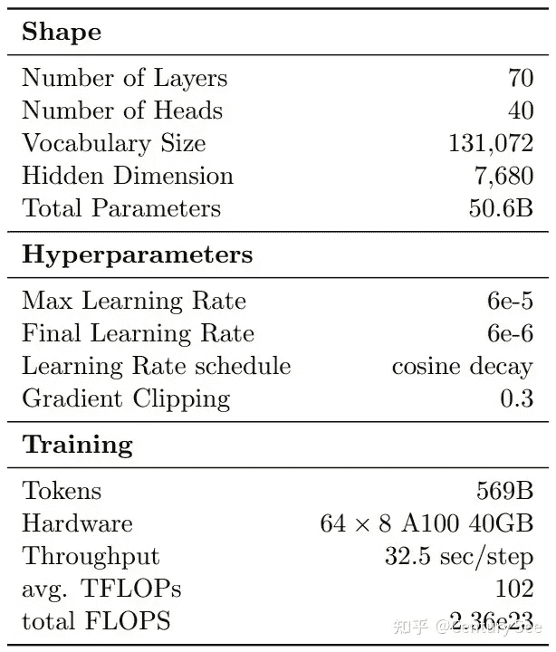

### **3.3 训练配置**

这一部分原始论文写的比较详细，具体见《3.3 Training Configuration》，这里简单摘要如下：

+   作者在**每篇文档的最后添加了特殊标记<|endoftext|>，模型**训练时选取的句子长度为2048token

+   训练时采用的优化方法是**AdamW，beta1、beta2、weight de**cay取值分别为0.9、0.95、0.1，初始学习率为6e-5，采用cosine衰减、线性warmup方式

+   模型参数随机初始化为均值0、标准差0.006588的正态分布，并对MLP的第二层和注意力层输出进行缩放

+   关于训练的不稳定性，文章中没有描述训练BloombergGPT时采用的方法，只是介绍了相关进展

+   关于计算使用到的硬件，使用了**6**4个AWS的p4d.24xlarge实例，每个p4d.24xlarge实例包含了8块40GB的A100GPU

### **3.4 大规模优化采用的方法**

这一部分中，作者描述了具体优化时采用的方法：ZeRO优化、MiCS、Activation Checkpointing、混合精度训练（Mixed Precision Training）、内核融合（fused kernels）。

具体见《3.4 Large-scale Optimization》

经过上述优化，上述硬件的平**均算力水平达到了102**TFLOPs，训练一步需要32.5秒。

### **3.5 训练过程**

损失函数随训练步数变化曲线如下图所示：

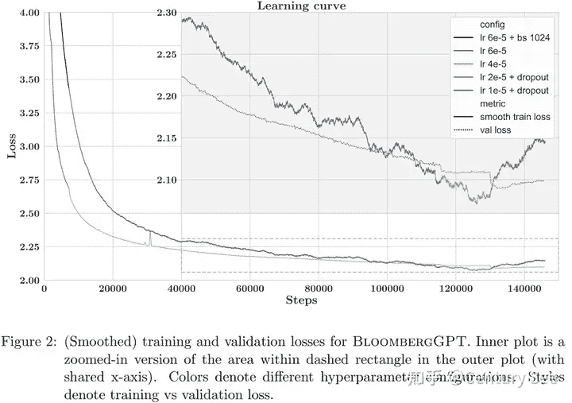

文章中记录**模型共训练了139,200步**，进行了约**0.8个epoch**，**训练了53天。**一个epoch都没有训练完的原因是这时验证集上的损失函数已经不再继续下降了。

**具体训练过程如下**：

+   初始训练的batch size大小为1024，warm-up过程持续了7200步，随后作者将batch size修改为2048。

+   115,500步之后，验证集上的损失不再下降，然后作者将学习率缩小为原始的2/3；

+   129,900步之后，学习率缩小为之前的1/2，同时增加dropout

+   137,100步之后，学习率再次缩小为之前的1/2

+   最终，训练在146,000步结束。作者选取139,200这一步的模型最为最终使用的模型

这里推荐阅读原始文章3.3节与3.4节中关于训练方法的描述，对于大模型训练有一定的参考意义。

# 四、评估

**文章中对Bloo**m**bergGPT的评估分**成了两部分：金融领域任务与通用**任务。这样做的目的也比较直观，就是验证在特**定领域预训练后的模型能够在特定领域表现好，同时在通用领域的表现也不会差太多这一观点。

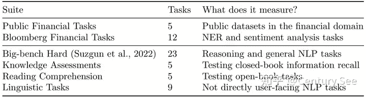

同时，文章**对比了BloombergGPT、GPT-NeoX、OPT、**BLOOM、GPT-3在不同任务上的表现。注意，这里因为GPT-3模型无法获取，故仅在部分通用任务上进行了评测。

各个模型使用到的token数量、参数数量、计算量如下：

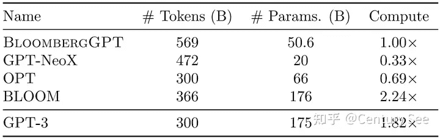

作者对每一个模型均独立进行了评测，并且在每一个任务中使用相同的标准prompt、相同的样例、不使用任务描述和任何CoT prompt，以保证评测结果的公平性。

**对于有多个答案的任务，文章中采用了基于似然的**分类方法（likelihood-based classification）进行评估；对于其他任务，文章采用贪心解码（greedy decoding）的方式进行评估。

### 4.1 holdout loss

作者首先在FinPile数据集预留的部分样本上对各个模型进行了bits per byte的评估。

**bits per byte指标是评估语言**模型的一种常见指标，类似于perplexity，取值越小，模型越好。具体计算方法可见How to compute bits per character (BPC)?

各个模型在各个类型的数据上的bits per byte值如下：

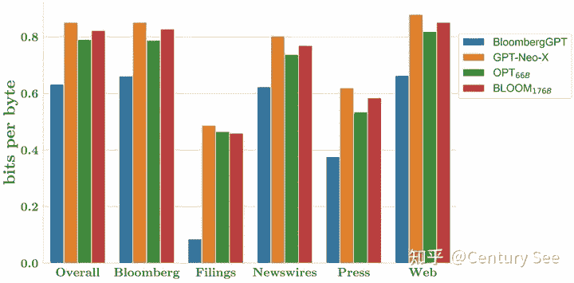

可以看出，**B**loombergGPT在金融语料上的bits per byte均好于其他模型，并且在财报（Filings）这个类别上表现尤其突出。这个结果也符合预期。否则可能就没有后面任务对比的必要了。

### **4.2 金融领域任务**

金融领域任务共有6种类型，**3种判别式任务、3种生成式任务**。具体任务的格式如下：

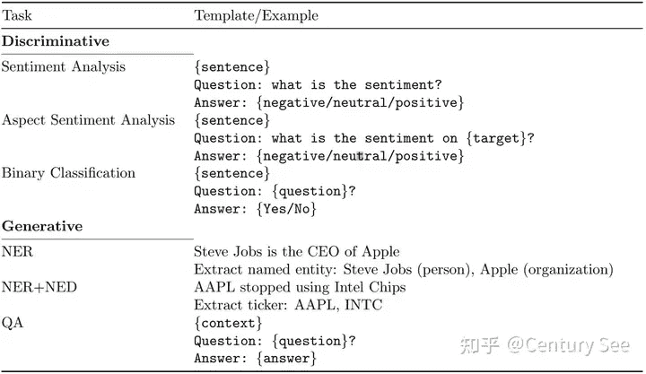

文章又将金融领域任务分成了外部任务和Bloomberg内部任务。在每个任务上，作者除了评估模型在任务上的表现，还评估了同一任务下不同模型生成结果之间两两比较的胜率（WR）。

**4.3 外部任务**

外部任务主要如下：

+   ConvFinQA，标普500收益报告问答推理

+   FiQA SA，金融新闻和微博客标题基于方面的情感三分类（正负中）

+   FPB，金融新闻句子级别情感三分类（正负中）

+   Headline，新闻标题在预定义标签下的二分类

+   NER，信用风险评估数据的命名实体识别

**BloombergGPT在上述5个任务中的4个都取得了最好效果，在另外一个取得了第二名**；并且在模型两两结果对比的胜率最高，同时在ConvFinQA这个任务上遥遥领先。

具体得分如下：

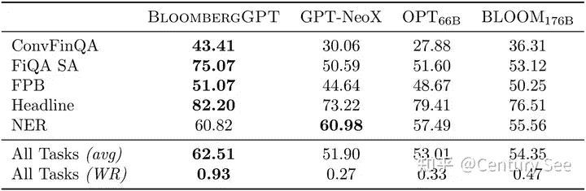

4.4 Bloomberg内部任务之情感分析

这个任务中的情感分析均为基于方面的情感三分类（aspect-specific sentiment），数据集的内容通过任务名称就可以略知一二。

BloombergGPT在上述4个数据集上的表现均大幅领先于其他模型。

具体结果如下：

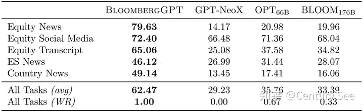

**4.5 探索性任务：NER**

注意，这里的NER只涉及到ORG、PER、LOC这三类实体。

同时探索性任务NER+NED是指识别出实体后再将实体链接到上市公司的股票简称。比如“AAPL announced that they will stop using Intel chips in future products.” 这句话NER的结果是“AAPL, Intel”，NER+NED的结果是 “AAPL, INTC”。

这两类任务涉及到的数据集包括了**7个数据集**，分别为BN（Bloomberg BN wire上内容）、BFW（Bloomberg First Word上的内容）、Filings（财报内容）、Headlines（Bloomberg news内容）、Premium（Bloogberg收录 的第三方新闻内容）、Transcripts（公司新闻发布会的文字记录）、Social Media。

最终，**NE**R任务下，BloombergGPT仅在Headlines这一个数据集上得分最高；但在NER+NED任务下，BloombergGPT在除了Social Media任务的其他任务上均得分第一。

具体结果如下：

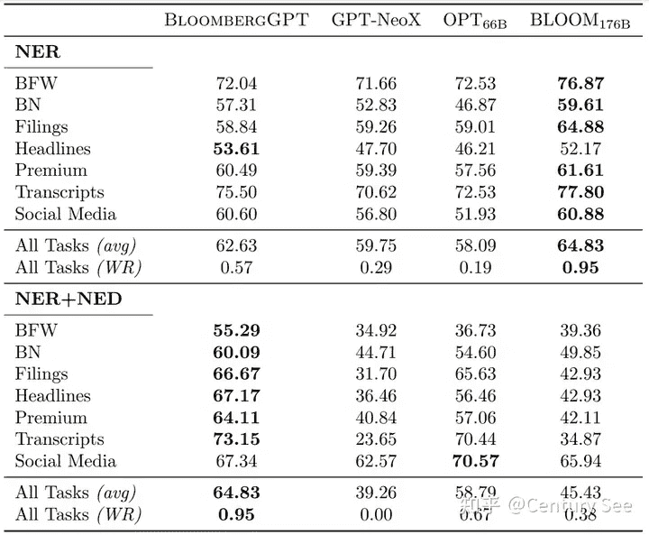

### **4.6 通用任务**

文章在通用任务上做了相当多的对比，这里仅对任务类型和结果做简要描述，详细内容见文章中的5.4~5.7节。

作者在**BIG-bench Hard**（BIG-bench的一个子集，**仅包含目****前模型表**现**无法超**过人类的任务）、常识测试（不提供任何背景知识，仅可以训练时使用的数据）、阅读理解、语言学（消歧、语法识别、蕴含判别等）等任务上进行了测试。

**在B**IG-bench Hard任务上，BloombergGPT得分低于参数量更大的PaLM和BLOOM，但是与参数规模类似的GPT-NeoX或OPT66B相比，BloombergGPT的性能更接近BLOOM，这说明开发金融专用的大语言模型并没有明显牺牲其通用能力。

**在**常识测试任务中，BloombergGPT在1个任务上取得了第一名，在其余3个任务上取得了第二名（这里未考虑GPT-3）。

**在阅读理解任务上，GPT-3在所有任务上排名第一，Bloo**mbergGPT在5/6个任务上排名第二，且得分远高于BLOOM模型。

**在语言学任务上，GPT-3在综合排名第**一，BloombergGPT综合排名第二，且综合得分高于BLOOM模型。

### **4.7 评测总结**

在金融领域任务上，BloombergGPT综合表现最好；

**在**通用任务上，BloombergGPT的综合得分优于相同参数量级的其他模型，并且在某些任务上的得分要高于参数量更大的模型。

**这都说明，开发金融专用的大语言**模型在金融领域取得好效果的同时，并没有以牺牲模型通用能力为代价。

这一结论也可以给我们一个启示，在其他特定领域，我们也可以开发专用的大语言模型。

### **4.8 定性评估**

作者在文章的第6章还展示了对BloombergGPT定性评估的例子，以展示模型在专业领域带来的促进作用。

这些例子包括：

+   BQL（Bloomberg查询语言）生成，即使用自然语言完成Bloomberg数据库查询，类似NL2SQL

+   新闻标题提示，辅助记者生成新闻短标题

+   金融问答

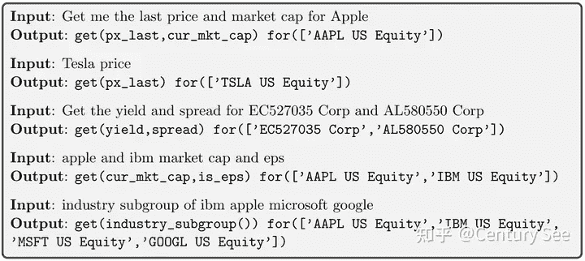

BQL样例

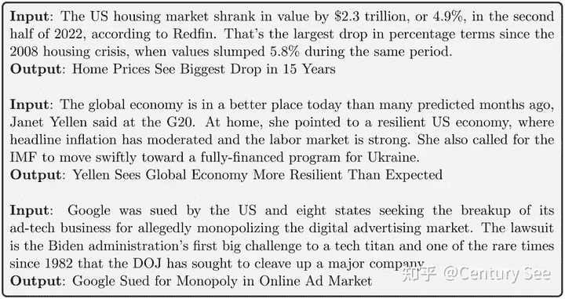

新闻标题生成样例

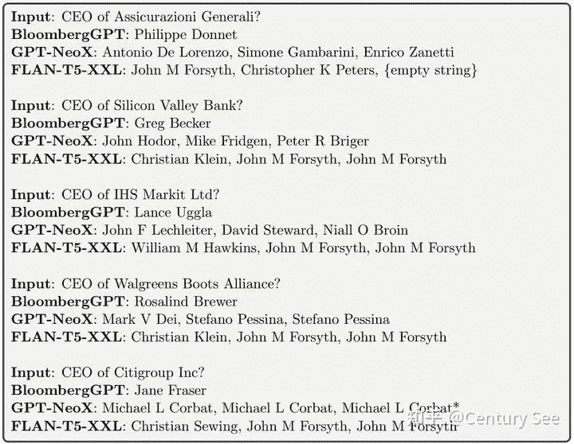

金融问答样例