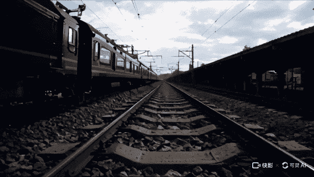
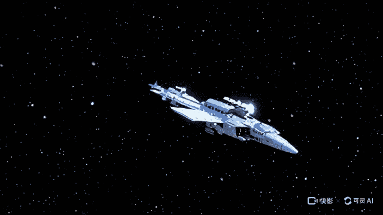
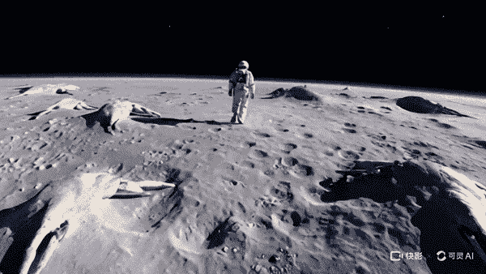
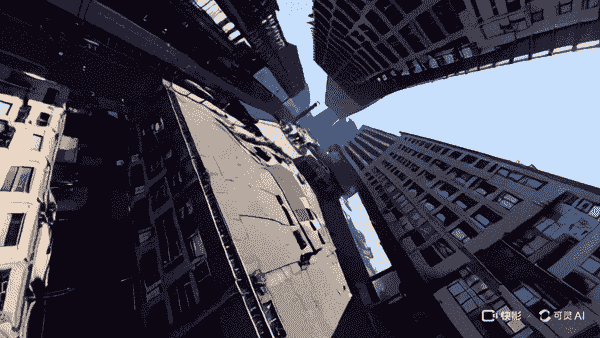
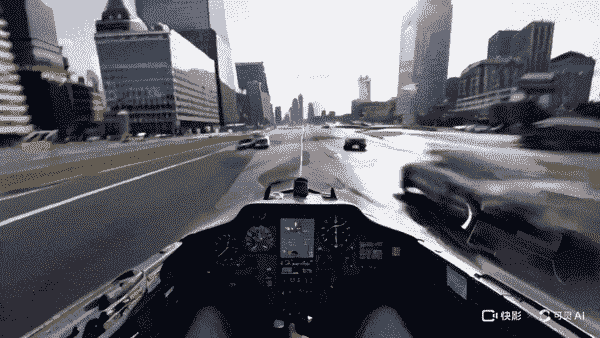

# 可灵视频大模型（快手）

> 来源：[https://agispace.feishu.cn/docx/WiCedD3YBo077jxXrFwcQqTXn0d](https://agispace.feishu.cn/docx/WiCedD3YBo077jxXrFwcQqTXn0d)

> 官网：https://kling.kuaishou.com/

> 官方👸号：[今天你“可灵”了吗？](https://mp.weixin.qq.com/s/9xT16HvcwMEaduKidruT0w)【快手】

# 相关资讯：

快手「可灵」爆火：海外AI圈巨震，中国版Sora一号难求【机器之心】

一**点不**夸**张，快手**“**可灵”可能比 Sora **还强｜AI横评（可灵与Pika、ruaway Gen-2(两个目前市面已上线且最火的视频生成大模型)对比一下。）

# 部分案例：

> 原文详细案例：中国版Sora？快手「可灵」到底行不行？ 作者：GenJi科学实验室 GenJi

**“中国版SORA”到底是不是名副其实？能不能达到**“物理世界模拟器”的级别？我们速看一下！

我们看这个火车在铁轨上行驶，**火车的铁皮质感、烟囱喷出的烟雾**、铁轨和石头、天空树林等**自然景观**，模拟得相当到位，仔细看第一张车身反射的光影变化，也很写实。

（视频来源：阢）

唯一不足的是，火车在铁轨上，**没有什么重量感，有点飘飘忽忽**，尤其第二张更为明显。

（视频来源：阢）

这个复古飞行器()和舰艇相当惊艳，尤其舰艇的**铁皮质感**很有**复古未来**的感觉，不说的话，我会以为是从哪部《星球大战》《星河战舰()里截的片段。

（视频来源：闲人一坤）

（视频来源：杉杉-吉时）

科幻电影**宣传片级别**了：

（视频来源：野菩萨）

这张有《疯狂的麦克斯()**那种废土朋克味**了，吹毛求疵一点，**我觉得还**是有“重量感不足”的问题，感觉车子在“漂移”。

（视频来源：闲人一坤）

随着**运动镜头**的不断切换，画面还是**稳定**，楼房没有出现夸张的变形：

（视频来源：杉杉-吉时）

（视频来源：野菩萨）

“可灵”对于毛线、水的**材质模拟**，我觉得达到了**照片级别**，水波的运动方式也是对的。