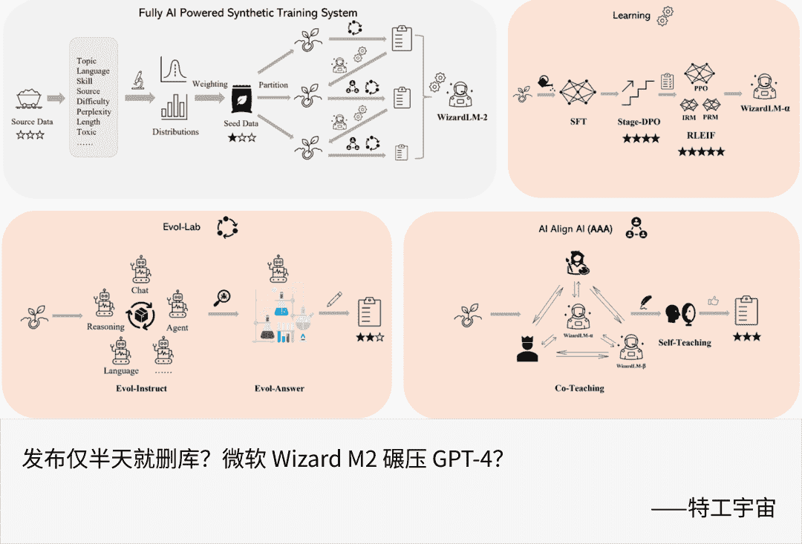
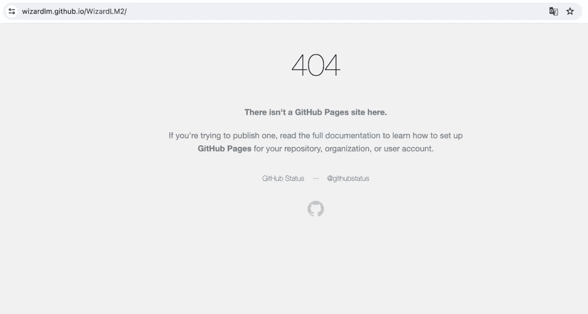
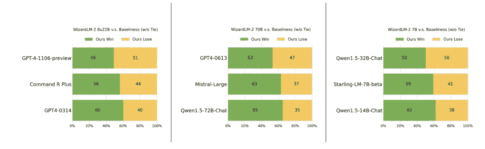
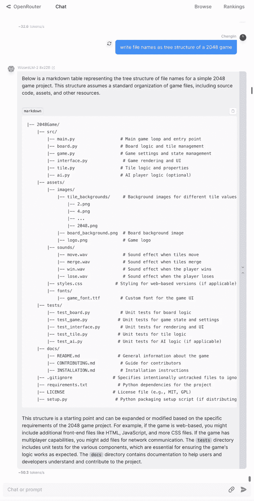
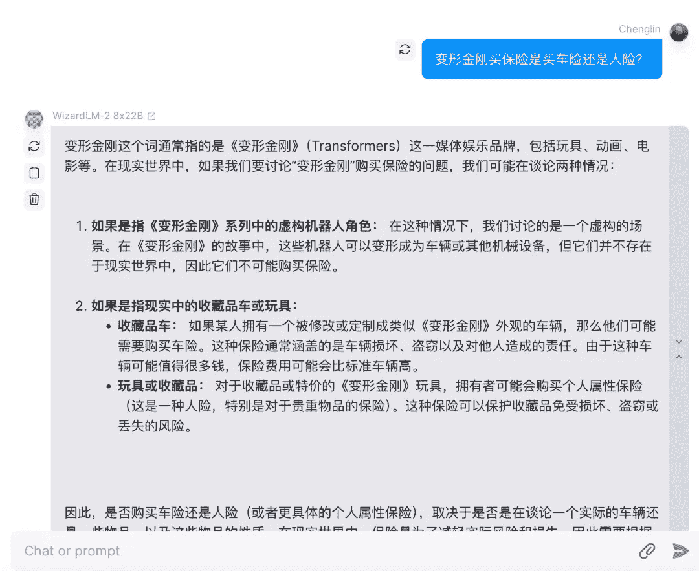
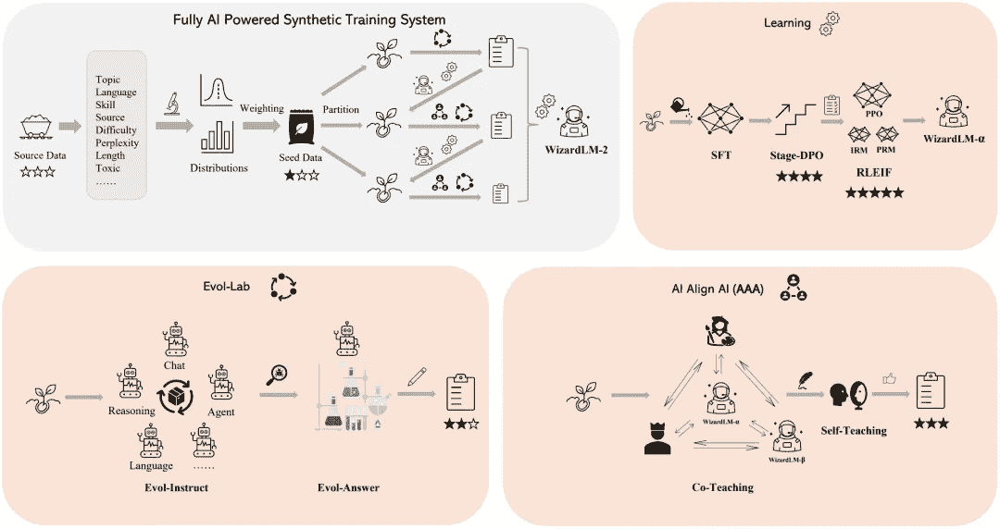
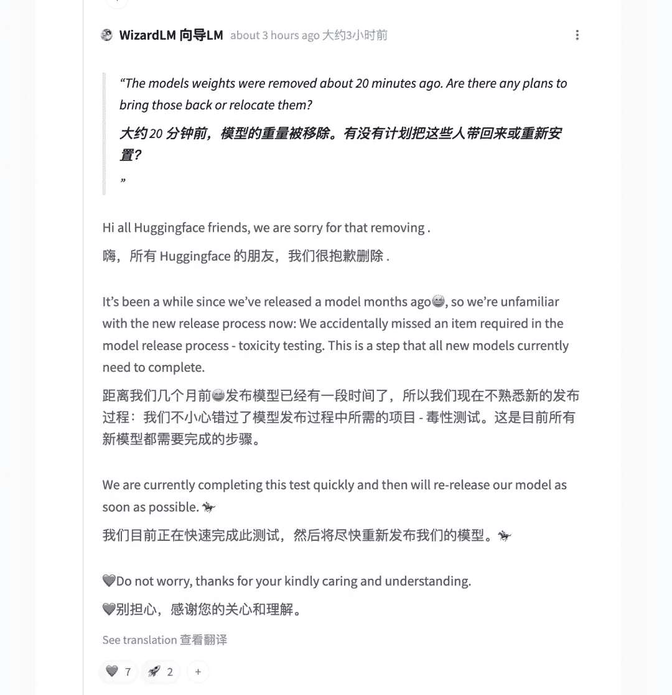

# （大模型）微软 Wizard M2 碾压 GPT-4，刚开源就删库？

> 来源：[https://agispace.feishu.cn/docx/LTvAdh5YtozES9xfVutcyYQCnVf](https://agispace.feishu.cn/docx/LTvAdh5YtozES9xfVutcyYQCnVf)

> 作者：特工少女

> 👸号：特工宇宙

> 原文链接：https://mp.weixin.qq.com/s/tlqArQNQok0ls1bIPwuEAQ

Microsoft 在今天推出了 WizardLM 2，这是一个突破性的开源大语言模型，可以说是开源领域的突破，甚至接近和超过部分 GPT-4 的能力，这在之前的开源领域是前所未有的。这些模型在复杂的聊天、多语言理解、推理和代理功能方面取得了重大改进，超过了其前身 WizardLM 和其他领先的开源模型。

**目前发布仅半天就被删库，有人甚至猜测由于它强大的能力，是一个有意识的 AI 删除了它，来阻**止我们获取它；也有人认为 Microsoft 并不是想完全开源，但许可证挂错了，挂成了 apache2就是完全开源了。类似的说法众说纷纭，颇有迷幻色彩，这里特工鲸鱼卖个关子，在文末会给大家揭晓真正的原因～

话不多说，先来看看这次发布的模型有什么型号，以及实力如何吧！

## WizardLM-2 家族的三个型号：

1.  WizardLM-2 8x22B：作为Microsoft最先进的型号，WizardLM-2 8x22B 与 GPT-4 等超强模型相比，都能有一战之力。目前它领先所有开源模型，特别是在复杂任务上表现出极强的能力，难道开源模型的天真的要变了？！

1.  WizardLM-2 70B：该模型具有很强推理能力，是 70B 参数大小类别中的首选。它在性能和资源需求之间提供了出色的平衡。

1.  WizardLM-2 7B：尽管尺寸较小，但 WizardLM-2 7B 的速度非常快，其性能可与 10 倍于其尺寸的开源型号相媲美。对于要求效率而又不影响质量的应用来说，WizardLM-2 7B 是一个不错的选择哦～

说完型号，接下来自然是大家最关心的能力问题了，特别是标题所说，和 GPT-4 的能力对比。

## WizardLM 2 大战 GPT-4，看看谁更强。

我们依旧分点来进行对比：

1.  WizardLM-2 8x22B：仅仅略逊于 GPT-4，但已经超越了 2023年3月 版本的 GPT-4，只能说 OpenAI现在是不是已经汗流浃背了呢？

1.  WizardLM-2 70B：是这个尺寸上表现最佳的模型，对复杂指令的人工评估也超越了 GPT-4-0613以及Mistral-Large 等模型。

1.  WizardLM-2 7B：身体小力量大，也是在这个尺寸上目前最好的模型。已经使用过的人表示👇

> Wizardlm-2-8x22b，它比 gpt-3.5-turbo 强得多，看起来比 gpt-4-turbo 更勤奋。只是它有时候有点“过度勤奋”，这可能是因为 wizardlm训练时使用的 instruction 都写的太好了？但它实在是太便宜了，就是 gpt-4-turbo 的 3%-10%.

我们来看看这个 Wizardlm-2-8x22b 实际具体表现：

不得不说它在编写代码和程序上的能力还是很不错的，虽然它写的贪吃蛇看起来有点丑（狗头，建议微软领回家再补习一下审美艺术哈哈哈）。让我们再测试一点弱智吧到“高智商”问题，看看它是否还能游刃有余地应对👇

可以看出 Wizardlm-2-8x22b 表现出的能力还是挺让人满意的，至少它在开源模型的领域已经展现出了完全碾压的气势。

到这里，来吃瓜的小伙伴已经摩拳擦掌，迫不及待地想尝试一下了，但如我们开篇所说，目前这个模型已经删库，不如先少安毋躁，放好小板凳，听特工把模型的更深原理讲一讲，为什么它那么强，它是怎么训练出来的？相信好奇技术细节的小伙伴也已经非常好奇了。

WizardLM 2 是如何训练的呢？

**WizardLM 2 的训练过程主要归功于微软开发的一项革命性**训练方法——Evol-Instruct。这个方法利用大型语言模型，通过反复修改一组初始指令，使其变得越来越复杂。这些修改后的指令数据被用来微调基础模型，使其能够更好地处理复杂任务。

Evol-Instruct 通过这种方式生成了大量高复杂度的指令数据，这些数据对于人类来说很难生成。而这些数据又是训练大型语言模型的关键。通过自动化生成多样化且具有挑战性的训练数据，微软为大型语言模型的快速进步铺平了道路。

具体到 Evol-Lab，它负责生成更多样化和更复杂的 [指令、响应] 对，主要由下面两个方面组成：

Evol-Instruct：此方法使各种代理能够自动生成高质量的指令。

Evol-Answer：引导模型多次生成和重写响应可以提高其逻辑性、正确性和亲和性。除了 Evol-Instruct，WizardLM 2 的训练还采用了另一重要的方法——RLEIF（Instruction&Process Supervised Reinforcement Learning）。这个方法结合了指令质量奖励模型和过程监督奖励模型，以在在线训练中更精确地保证正确性。另外，微软还使用了 AI Align AI（AAA）框架，该框架让多个顶尖语言模型能够相互教导和改进，进一步提高了 WizardLM 2 的性能。AAA 框架由两个主要组成部分组成：

1.共同教导（Co-Teaching）：WizardLM 和其他各种顶尖的开源和专有模型进行模拟对话、质量评判、改进建议和技能缺口封闭。通过相互交流和提供反馈，模型能够相互学习，完善自身能力。

2.自学成才（Self-Teaching）：WizardLM 能够通过与自身交互生成新的演化训练数据，进行监督学习，以及通过积极学习生成的数据和反馈来进行强化学习。这种自我教导机制使模型能够不断改进自身性能。

看完这个模型，不得不说目前的训练方法和模型能力都让特工感到惊讶与震撼，在文章的最后，我们也来揭晓我们最初的问题，为什么删库了？是不是要让我们失望了，与这个惊人的模型说再见了？

**其**实不是的，这次删库只是因为他们忘记做“毒性测试”（对模型生成内容的有害性进行评估），在完成这个任务之后会重新把模型上传的。

相信也有小伙伴说按耐不住心情来结尾看原因的，记得把这篇介绍文章看完哦，有关于这个模型的能力以及原理等相关的介绍，相信我，你会喜欢的。

我们下期再见～

一些盘点：

1.  盘点丨那些 AI 公司悄咪咪上线的产品（四）

1.  独家丨那些AI公司悄咪咪上线的产品（三）

1.  独家丨那些AI公司悄咪咪上线的产品（二）

1.  独家丨那些AI公司悄咪咪上线的产品（一）

1.  独家丨马毅加入大模型创业，已获真格投资

好玩的 AI 产品：

1.  AI 搜索个人玩家，3 天独立开发上线！

1.  万知，PPT排版配图轻松搞定，还能看懂图表！

1.  字节的扣子炸裂更新，模型支持月之暗面，插件 IDE 已经上线。

1.  加持了AI的360浏览器，强大到让人感到陌生。

1.  Gatekeep，仅用一句话，生成优雅的教学视频。

1.  AI+播客丨Podwise，我不允许还有任何听友不知道它！！！

1.  Dola，一个相当炸裂的Agent日程助理，创始团队来自全球顶尖名校！

Agent 科普：

1.  [Agent > GPT5？吴恩达最新演讲：](http://mp.weixin.qq.com/s?__biz=Mzk0NTYzNDQ5NQ==&mid=2247488311&idx=1&sn=7dd2c61032eb1eda7fe35017fe690d25&chksm=c3133ee7f464b7f13d8c6696ad352304c84e70d47996c274bd4ee0abdd0e6ef7bd23476c3278&scene=21#wechat_redirect)四种 Agent 设计范式（通俗易懂版）

1.  六分钟，Langchain 作者到底在红衫 AI 峰会上说了什么？

1.  [论文解读丨AI 争夺继承权？AgentGroup](http://mp.weixin.qq.com/s?__biz=Mzk0NTYzNDQ5NQ==&mid=2247488486&idx=1&sn=44c1dacbc080c237b1f52acba838a271&chksm=c3133e36f464b72018d55af21181456452cf62bff17c226f7485bbeea414430ef95648ac9ce3&scene=21#wechat_redirect)Chat，为 AI 群聊打造的通用框架。

1.  周鸿祎：2024 年 AI 产业发展的 16 个趋势。

