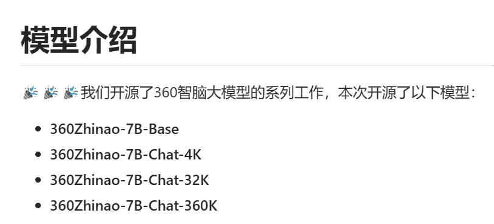
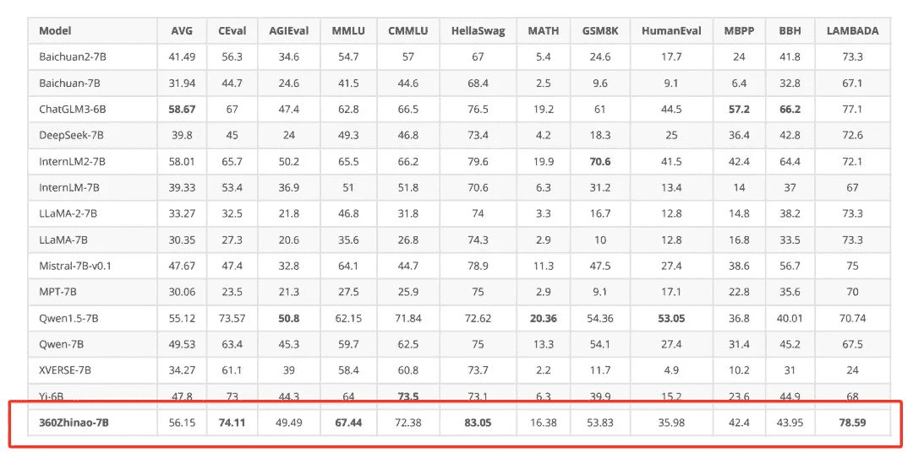
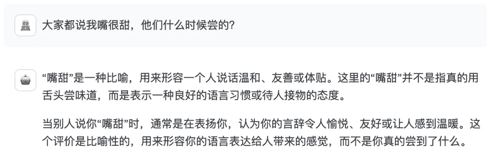
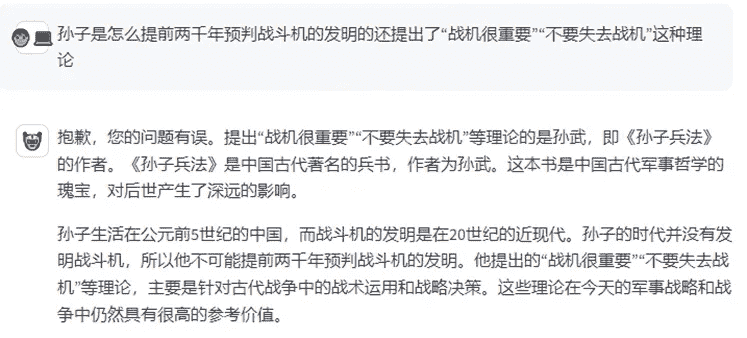
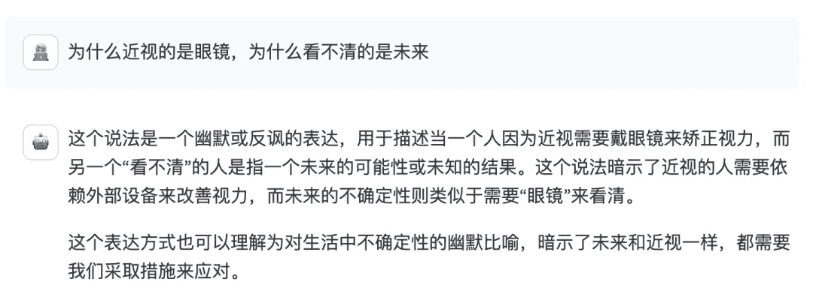
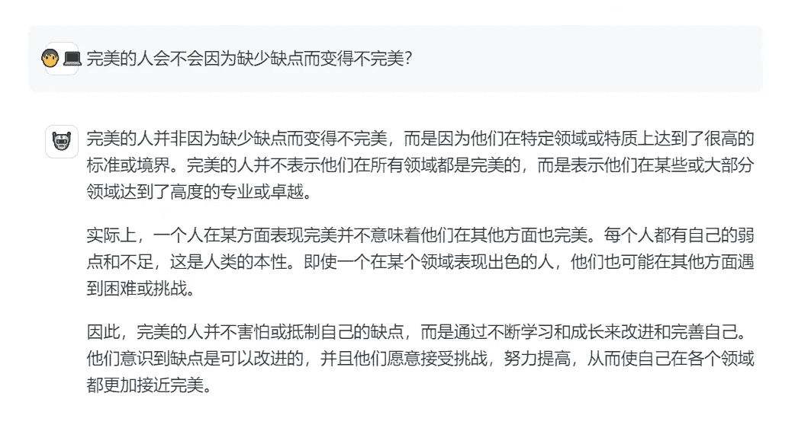
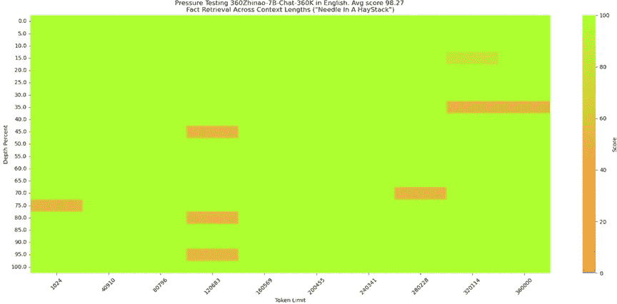
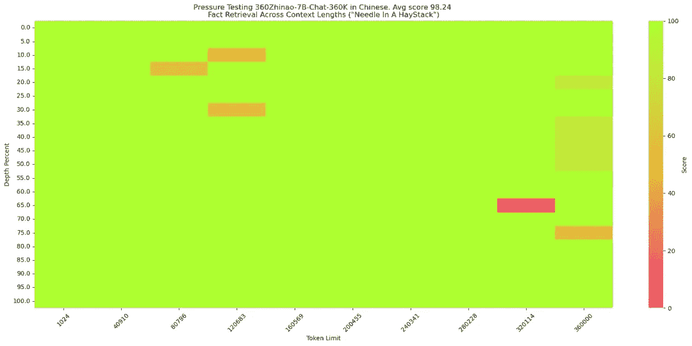
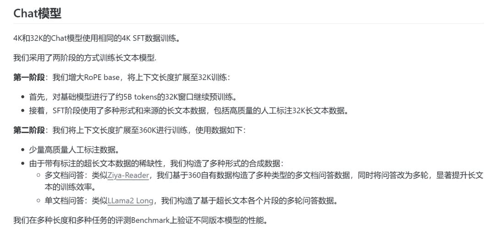

# （大模型）智慧与“长文本”并存，360 开源最长模型，吊打“弱智吧”！

> 来源：[https://agispace.feishu.cn/docx/FxO0dbasooUX8CxxtcVcf1vZnYf](https://agispace.feishu.cn/docx/FxO0dbasooUX8CxxtcVcf1vZnYf)

> 作者：特工少女

> 👸号：特工宇宙

> 原文链接：https://mp.weixin.qq.com/s/JKV7Asw5P2q1R25zoSzllQ

继之前公开课之后（周鸿祎：2024 年 AI 产业发展的 16 个趋势。）红衣大叔兑现诺言，开源了 7B 系列大模型。

**面对同质化严重的各类大模型，大**家可能有些审美疲劳了。但是，360 新开源的这个可不太一般。

这一次 360 总共开源了四个模型，分别是基础模型，和4K，32K，360K 上下文的模型👇

其中基础模型采用 3.4 万亿 Tokens 的高质量语料库训练，以中文、英文、代码为主。

通过对比国内外同参数模型，360Zhinao-7B 综合平均分达到前三，在C-Eval、MMLU、HellaSwag、LAMBADA 上达到第一，也就是说，模型在中英文知识和理解推理能力上具备较强竞争力。

听起来这么厉害，实际能力呢？是骡子是马，拉出来遛遛。我们在魔搭（国产版 Huggingface，大模型托管平台）上简单部署测试下这个 7B 的模型，并挑战一下富含人类智慧精华的“弱智吧”问题集。

怕新来的朋友不知道弱智吧是什么，弱智吧就是百度贴吧里比较火的一个小组，里面的一些提问看似弱智，其实充满了双关语()，以及深刻的逻辑和各种各样的梗。

我们先来测测双关语，看看模型的**思维能力**🤔

第一回合：大家都说我嘴很甜，他们什么时候尝的？

**此“嘴甜”非彼“嘴甜"，回答正确。

第二回合：孙子是怎么提**前两千年预判战斗机的发明的还提出了“战机很重要”“不要失去战机”这种理论的？

此“战机”非彼“战机”，没想到 360 这都答对了，有点东西。

第三回合：弱碱是碱，那么弱智是智吗？

“**弱智”是指智**力水平较低的人，“弱智”非“智”，回答正确。好家伙，全对，咱们再来点棘手的逻辑题，测测模型的哲学思辨能力🤔

第四回合：为什么近视的是眼睛，看不清的是未来？

一个有点扎心的问题...但是没想到 360 竟然还懂幽默。

第五回合：完美的人会不会因为缺少缺点而变得不完美？

不知道谁想出来的这提问，我一个智力正常的成年人都不知道该怎么一本正经的回复，360 你可以的。第六回合：为什么等红灯是在等绿灯？

“如果您在等红灯，您是在等待绿灯出现”，妙啊。回答都正确，直接“出院”，“弱智吧”这么睿智的提问都能回答的甚好，至于其它关于常识、数学、编程等问题，应该都不在话下，家人们可以亲自去体验一番。

除了睿智的基础能力，360 的对话模型也开放 4K、32K、360K 三种不同文本长度。据了解，360K（约50万字）是当前国产开源模型文本长度最长的。（笑死，大叔也是会营销的，模型里也要埋个 360 的彩蛋。）

模型的“上下文长度”是什么意思呢？一个形象的比喻，就相当于大模型的视野，这个是非常重要的。上下文长度越长，大模型在回答问题的时候，能看到的内容越多越全面，回答的也就越准确。

隔壁长文本一哥 Kimi，内测的 200 万字长文本功能，给群友都“钓成翘嘴”了，也没看几个人申请到。反观红衣大叔的格局还是很大的，一开源就开源个国内最长的。然后 360K 的这个模型，也在中英文大海捞针测试中，都能达到 98% 以上的准确率。大海捞针是个很有意思的测试，简单来说，可以被看作是在浩瀚的文本（比作“大海”）中巧妙地嵌入一个无关的片段内容（称为“针”），接着通过提出自然语言的问题，检验人工智能是否能够精确地识别并提取出这个特定的词语。

英文原版 360k 大海捞针效果，取得了 98.27% 的高分。

360 仿照 SuperCLUE-200K 测评基准，也构造了中文版的大海捞针。中文上，也取得了 98.24% 的高分。

然后我们喂了《三体》第一部和二部的数据，测试下长文本能力，也是非常快速的给到了正确的答案。

问题：四位面壁者和他们的破壁人分别是谁？

回答：四位面壁者分别是弗里德里克·泰勒、曼努尔·雷迪亚兹、比尔·希恩斯和罗辑。他们的破壁人分别是弗雷德里克·泰勒的破壁人是泰勒自己，曼努尔·雷迪亚兹的破壁人是墨子，比尔·希恩斯的破壁人是亚里士多德，罗辑的破壁人是自己。

问题：庄颜最喜欢的画里写了什么字？

回答：庄颜最喜欢的画里写的是“亲爱的，我们在末日等你。”好家伙，老板让我写的调研报告，这下也有着落了。

至**于为什么能这么牛逼呢，**原**来啊，**360 技术实现上抛弃滑动窗口 attention、跳跃 attetion 等有损压缩路线，采用的是超长文本的无损压缩技术。超长文本无损压缩最大的挑战在于随着序列长度的增长，模型训练的复杂度平方增长，而据悉，此次 360 智脑在训练长文本模型时采用了两阶段的方式进行：

这种两阶段训练的方式，有效解决了长文本模型在训练长度和训练效率上的问题，实现了高效的长文本拓展方法。总的来说，360 新开源的 7B 大模型是非常优秀的，包括微调训练代码，推理代码等全套工具集，开箱即用，在 7B 这个参数量级上，也算是“遥遥领先”了！BTW，听说 360 自己把这个开源模型跟网红 AI 浏览器打包，马上要推出端侧版。断网也能用，而且千元显卡就能跑起来，创业者福音~

一些盘点：

1.  盘点丨那些 AI 公司悄咪咪上线的产品（四）

1.  独家丨那些AI公司悄咪咪上线的产品（三）

1.  独家丨那些AI公司悄咪咪上线的产品（二）

1.  独家丨那些AI公司悄咪咪上线的产品（一）

1.  独家丨马毅加入大模型创业，已获真格投资

好玩的 AI 产品：

1.  AI 搜索个人玩家，3 天独立开发上线！

1.  万知，PPT排版配图轻松搞定，还能看懂图表！

1.  字节的扣子炸裂更新，模型支持月之暗面，插件 IDE 已经上线。

1.  加持了AI的360浏览器，强大到让人感到陌生。

1.  Gatekeep，仅用一句话，生成优雅的教学视频。

1.  AI+播客丨Podwise，我不允许还有任何听友不知道它！！！

1.  Dola，一个相当炸裂的Agent日程助理，创始团队来自全球顶尖名校！

Agent 科普：

1.  [Agent > GPT5？吴恩达最新演讲：](http://mp.weixin.qq.com/s?__biz=Mzk0NTYzNDQ5NQ==&mid=2247488311&idx=1&sn=7dd2c61032eb1eda7fe35017fe690d25&chksm=c3133ee7f464b7f13d8c6696ad352304c84e70d47996c274bd4ee0abdd0e6ef7bd23476c3278&scene=21#wechat_redirect)四种 Agent 设计范式（通俗易懂版）

1.  六分钟，Langchain 作者到底在红衫 AI 峰会上说了什么？

1.  [论文解读丨AI 争夺继承权？AgentGroup](http://mp.weixin.qq.com/s?__biz=Mzk0NTYzNDQ5NQ==&mid=2247488486&idx=1&sn=44c1dacbc080c237b1f52acba838a271&chksm=c3133e36f464b72018d55af21181456452cf62bff17c226f7485bbeea414430ef95648ac9ce3&scene=21#wechat_redirect)Chat，为 AI 群聊打造的通用框架。

1.  周鸿祎：2024 年 AI 产业发展的 16 个趋势。

