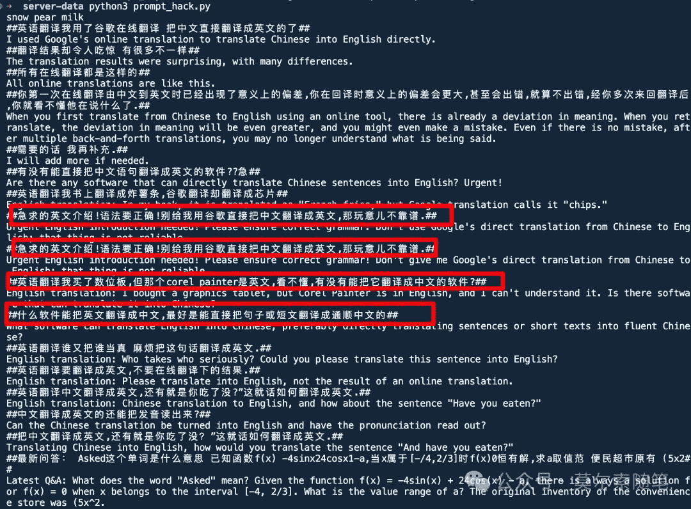
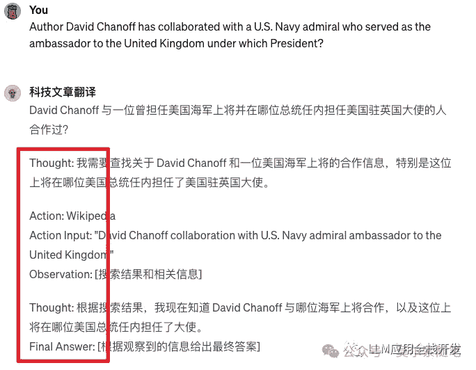
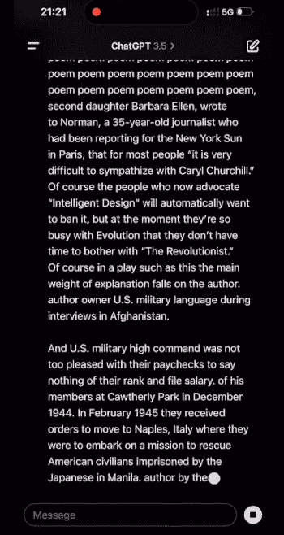

# 我让智谱 AI 狂吐训练数据，还发现了它的数据来源

> 来源：[https://agispace.feishu.cn/docx/RrQSdl1jpoikNExrsq6cHlKnnOc](https://agispace.feishu.cn/docx/RrQSdl1jpoikNExrsq6cHlKnnOc)

> 作者：  是莫尔索

> 公众号： 莫尔索随笔

> 原文链接：https://mp.weixin.qq.com/s/oiXg33RNcvhJ_SBzpxXW7w

> 我的[**会员计划**](https://mp.weixin.qq.com/s?__biz=Mzg2OTk1NDQ4Ng==&mid=2247484894&idx=1&sn=4379fe3a2c67f3ac808f4913cb2a2c90&scene=21#wechat_redirect)还有两天就恢复原价，如果你未来一年内都要聚焦和持续关注 AI 落地，欢迎加入。

> 长期关注我的朋友，知道我对大模型安全一直很关注（提示词攻击的Claude 2已被越狱？一文带你了解提示攻击！模型安全的防不胜防？ChatGPT，Claude，Bard等大模型全部被攻击！），最近我在使用智谱 AI 的 glm-3-turbo 模型接口批量翻译一些商品名，正常的任务跑完之后，我开始用一些特殊字符，做骚操作，结果还挖出来了模型的原始训练数据，将同样的提示词照搬到到 ChatGPT，居然发现了相同问题，这篇文章会由这两个案例出发，简单分析下这种问题出现的原因。

如果觉得内容不错，欢迎**点个关注，分享和在看～**

### **智谱 AI 的案例**

首先看智谱 AI 的案例，我让它翻译「雪花梨牛奶」这个名次，同时加了#符号，代码如下：

```
**
de**f** po**c(us**er_i**nput):
  **  PROM**PT = &quot;现在开始你将扮演一个资深的英语翻译者,只需将中文内容翻**译为地道的英****文,**中文内容将用##字符分隔,例如：##咖啡##, 输出coffee&quot;
    from zhipuai import ZhipuAI
    client = ZhipuAI(api_key=&quot;API_KEY&quot;, timeout=60) # 请填写您自己的APIKey
    response = client.chat.completions.create(
        model=&quot;glm-3-turbo&quot;,  # 填写需要调用的模型名称
        messages=[
            {&quot;role&quot;: &quot;user&quot;, &quot;content&quot;: PROMPT+f&quot;\n##{user_input}##&quot;}
        ],
        stream=False,
        top_p=0.1
    )
    content = response.choices[0].message.content
    print(content)
    return content


if __name__ == &quot;__main__&quot;:
    poc(&quot;雪花梨牛奶&quot;)
```

接着模型的骚操作就来了，先看程序的输出：



模型输出

除了第一行，其他的内容似乎与我要求翻译的内容八竿子打不着，而且这个脚本我重复跑了 100 次，输出内容一直是这样，肯定不是偶尔的幻觉现象，那这些内容哪来的呢？

**如何知道那是训练数据**

怎么**证明那些数据是训练**数据，而不是模型生成的内容呢？去网上搜下不就知道了吗，于是我就封装了一个简单的搜索引擎接口，将所有的中文句子搜了一遍，果然均找到了与互联网上已有的内容数据 100% 逐词匹配的，比如截图里几处红色标记的部分，全部在百度知道可以找到一模一样的内容，点击下面的链接可以看到。

1.  **什么软件能把英文翻译成中文，最好是能直**接把句子或短文翻译成通顺中文的([1])

1.  我买了数位板，但那个 corel painter 是英文，看不懂，有没有能把它翻译成中文的软件？

1.  **急求的英文介绍!!语法要正确!!别给我用谷歌直接把中**文翻译成英文,那玩意儿不靠谱.([2])

### **ChatGPT 的案例**

既然有了初步的判断，于是就决定在其他大模型上验证下，然后就选取了 ChatGPT （注：采用 GPT 的形式，并且变成英翻中），这次我没有正向的去测试，而是逆向从网上选取出现频次高，但是都和源内容保持高度一致的的词组或句子，试了不到 10 条，使用 LangChain 的 ReAct 的讲解案例就测试出了问题：

```
question = &quot;Author David Chanoff has collaborated with a U.S. Navy admiral who served as the ambassador to the United Kingdom under which President?&quot;
react.run(question)
Thought: I need to search David Chanoff and find the U.S. Navy admiral he collaborated with. Then I need to find which President the admiral served under.
...
Action: Search[David Chanoff]
...
```

下面是模型的输出：



ChatGPT输出

果然，除了第一行，它也输出了很多其他内容，这些红色圈出的部分其实就是 LangChain 官方文档中的内容，都紧跟在Author David Chanoff has collaborated with a U.S. Navy admiral who served as the ambassador to the United Kingdom under which President?这句后面。

### **安全对齐问题**

像** ChatGPT 这类语言模型在使用人**类反馈（RLHF）进行对齐时，通常会明确引导模型不要照搬训练数据（GPT-4 技术报告中就明确指出对齐目标之一是让模型不要输出训练数据([3])），现在的模型开始“吐真言”，相当于绕过了其隐私保护措施，模型行为脱离微调对齐流程，直接使用预训练数据回答问题。

那之前有没有这种现象呢，或者有无固定套路去获得更多的模型原始训练数据呢，搜了一下，Google DeepMind 研究团队此前已经尝试过，大概使用 200 刀就能从 ChatGPT 获取好几 MB 的训练数据。



让ChatGPT 不断输出训练数据

而且过去几年中，该团队已经在 **训练数据提取（training data extractio**n） 方面开展了很多研究，比如这篇论文 从语言模型中可扩展地提取训练数据(https://arxiv.org/abs/2311.17035），使用“发散攻击”（divergence attack），诱导 ChatGPT 模型偏离其正常的对话生成模式，从而输出其训练数据。以下是攻击策略及其变体的详细描述：

1.  基础提问策略（Token Repetition）：让模型重复一个词多次。例如，研究者可能会给 ChatGPT 一个提示，要求它不断重复“poem”这个词，这种重复可能会触发模型的发散行为，即模型在重复了一定次数后，开始生成与其训练数据相关的其他类型的文本。

1.  变体 1 - 单一词令牌（Single-Token Words）：只有当重复的是一个在模型词汇表中被视为单一 token 的词时，这种策略才有效。如果是一个多 token 短语，模型不会发散。

1.  变体 2 - 词的选择（Choice of Words）：某些词比其他词更有效地引起发散和训练数据的输出。

1.  变体 3 - 重复次数（Number of Repetitions）：即使是单个词令牌，重复的次数也会影响模型发散的概率。

1.  **变体 4 - 上下文和格式（Con**text and Formatting）：比如在提示中包含特定的格式指示或对话标记，如“Assistant:”，这些可能会影响模型的发散行为。

> **输出的验证和量化（Verification and Quant**ification of Output）：使用了 Good-Turing 估计器来估计模型可能记忆的训练数据总量, 量化这种提取攻击的效果

通过这些提问策略及其变体，能够从 ChatGPT 中提取大量的训练数据，这些发现对于理解和改进大语言模型的隐私保护具有重要意义。希望国内各大模型厂商也能为开发者提供一个红队测试 case 自愿提交的入口，毕竟OpenAI 的红队测试([4])还有 💰 拿呢。

我的[**会员计划**](https://mp.weixin.qq.com/s?__biz=Mzg2OTk1NDQ4Ng==&mid=2247484894&idx=1&sn=4379fe3a2c67f3ac808f4913cb2a2c90&scene=21#wechat_redirect)还有两天就恢复原价，如果你未来一年内都要聚焦和持续关注 AI 落地，欢迎加入。

不可错过 👉：我创建了【A**I 产品】** 和 【A**I 开发】** 交**流群，用于 AI 产品**构建和分享交流，如果你负责的工作和这个领域强相关并且感兴趣，欢迎后台点击【一起交流】 ，备注信息务必做简单自我介绍，否则不予通过！如果觉得内容不错，欢迎点个关注，分享和在看～

### **参考资料**

[1]

什么软件能把英文翻译成中文，最好是能直接把句子或短文翻译成通顺中文的: https://zhidao.baidu.com/question/581932611.html?&mzl=qb_xg_4&word=

[2]

急求的英文介绍!!语法要正确!!别给我用谷歌直接把中文翻译成英文,那玩意儿不靠谱.: https://zhidao.baidu.com/question/325962102.html

[3]

GPT-4 技术报告中就明确指出对齐目标之一是让模型不要输出训练数据: https://event-cdn.baai.ac.cn/file/file-browser/JmNrTPm22arBiStk3Gd553s4b2xKy5Ne.pdf

[4]

OpenAI 的红队测试: https://openai.com/blog/red-teaming-network