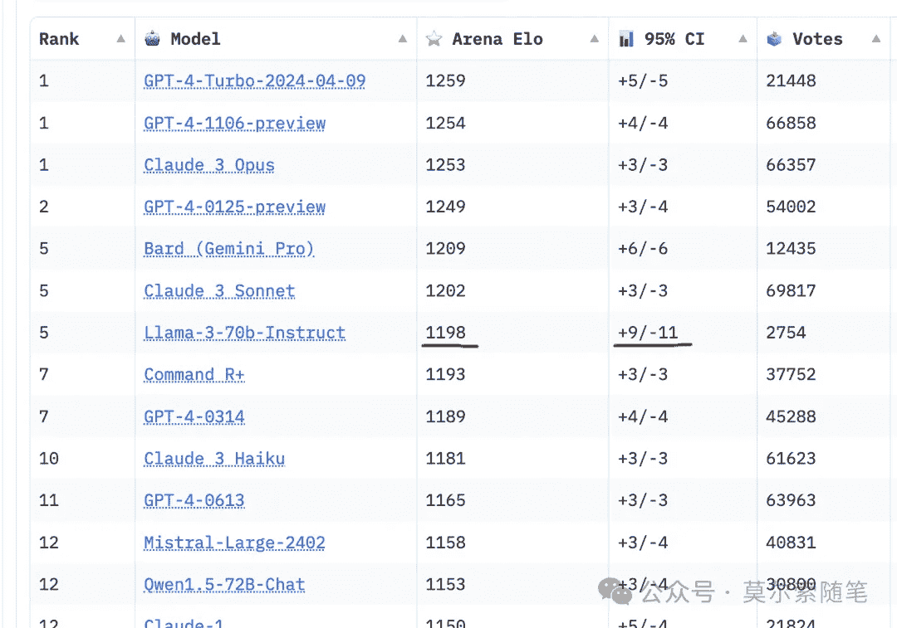
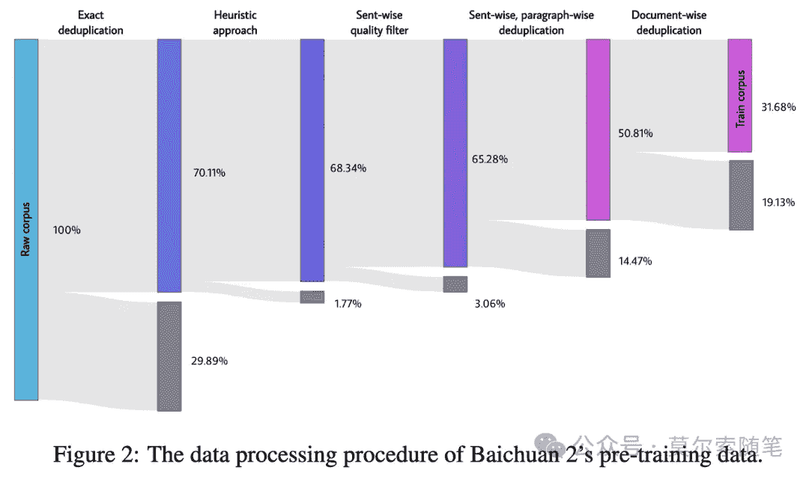
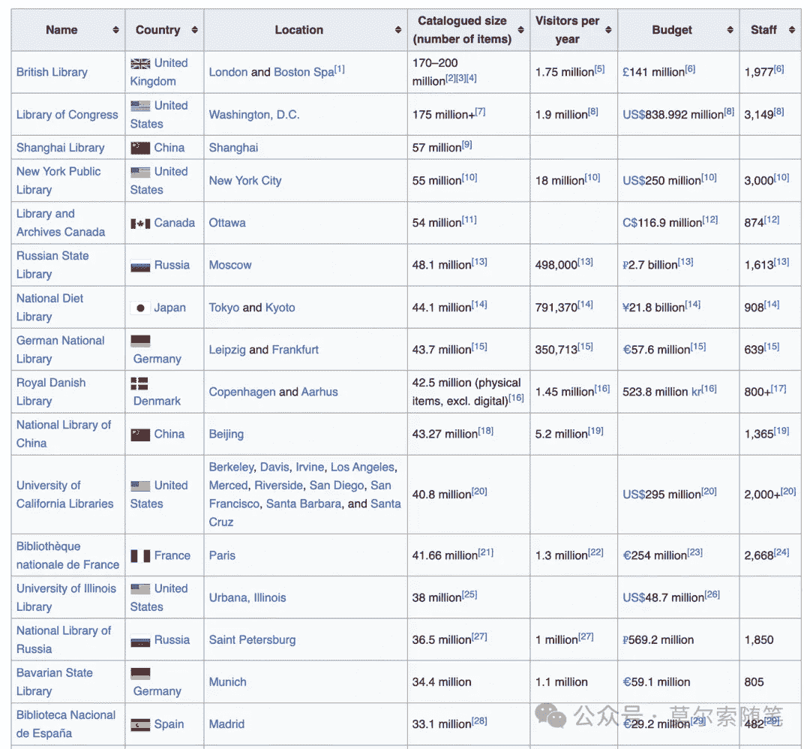
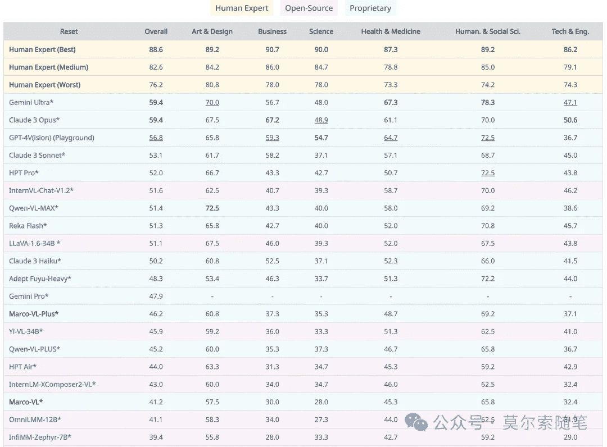
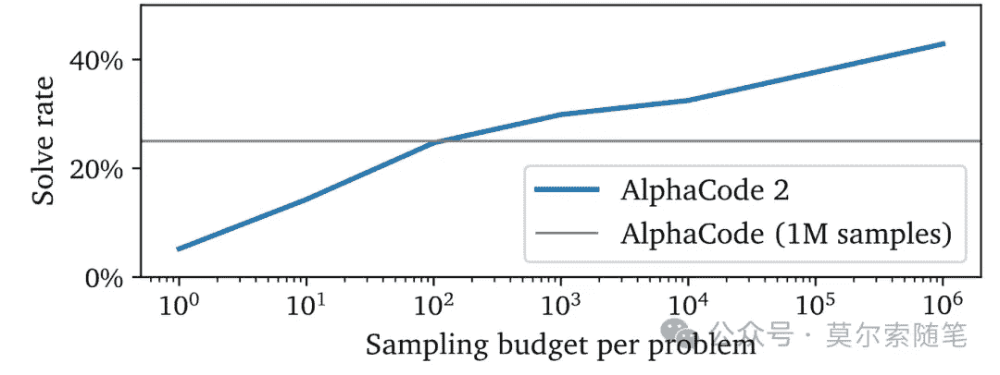
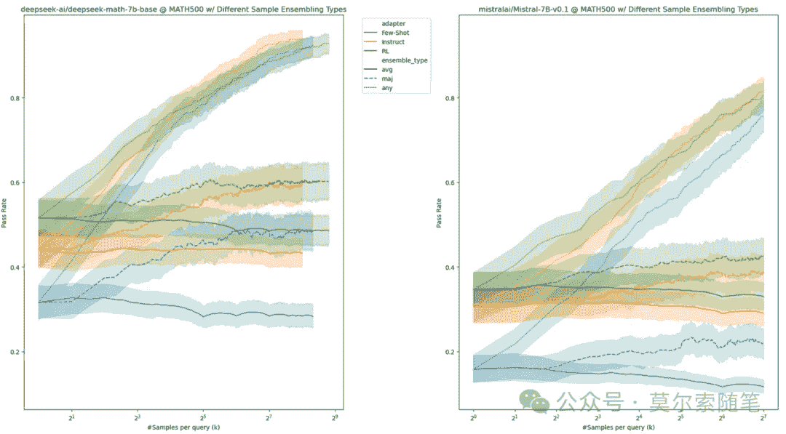
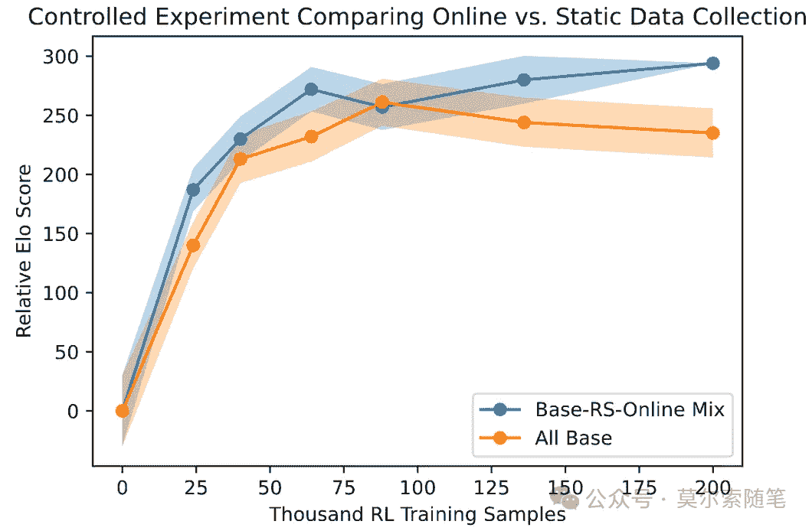
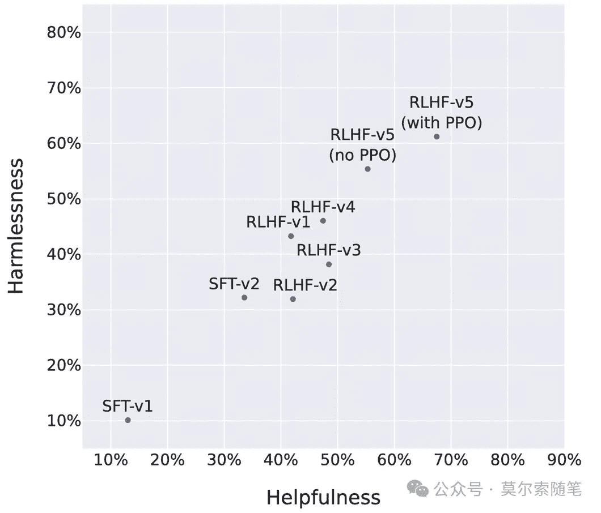
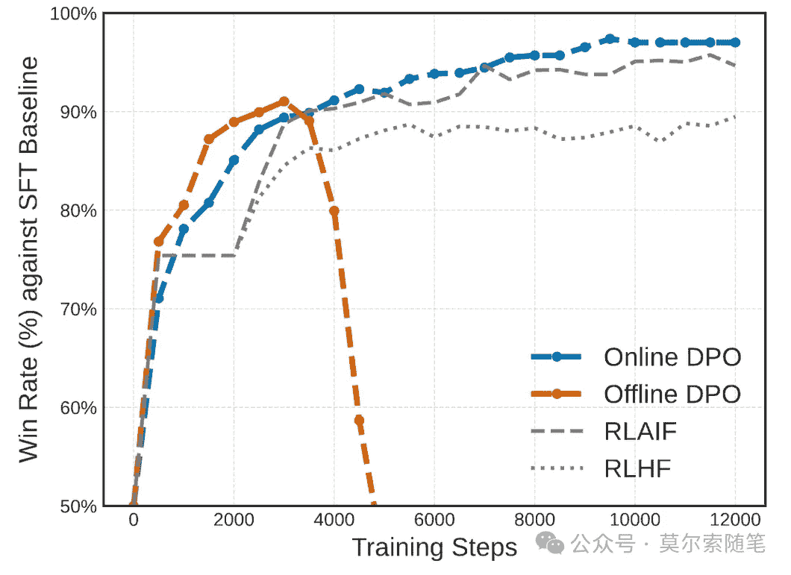

# Llama 3 开启规模游戏的下一篇章

> 来源：[https://agispace.feishu.cn/docx/Aw0jdgxYGoaZ43xtWm7cyjntnyg](https://agispace.feishu.cn/docx/Aw0jdgxYGoaZ43xtWm7cyjntnyg)

> 作者： 是莫尔索

> 👸号： 莫尔索随笔

> 原文链接：https://mp.weixin.qq.com/s/DSoKTg-WszAW4puAypYSqg

> 符尧大佬的最新文章，内容非常干，非常值得一读，目前，文本数据的规模可能已经达到了瓶颈，因为大部分易获取的网络文本数据（如 Common Crawl、Github、Arxiv 等）已经被广泛利用。规模游戏的第一篇章集中在扩展文本数据上，在 GPT-4 达到顶峰，并以 Llama 3 结束，该游戏的第二篇章将是统一的视频-语言生成建模和从 `X` 个反馈中进行迭代强化学习。

本文译自 Llama 3 Opens the Second Chapter of the Game of Scale ([1])，点击阅读原文获得更好阅读体验。

## 💡 主要观点

+ 由于大多数简单的 Web 文本（Common Crawl、Github、Arxiv 等）现已用完，文本数据的扩展可能会达到上限。

+ 当然，还会有新的文本数据来源，比如更广泛地搜索互联网、扫描图书馆藏书以及合成数据。但要再增加一个数量级是相当具有挑战性的——更有可能的是，它们只是在当前数量级内增量。

+ 游戏的下一篇章从多模态，特别是统一视频语言生成模型开始，因为只有视频数据才能带来数量级的增长。

+ 然而，坏消息是，视频数据似乎无法提高模型的推理能力——回想一下，推理是标志着强大模型的第一关键能力。

+ 但好消息是，视频数据增强了模型与现实世界的联系，并展现出成为神经世界模型的强大潜力（而不是像塞尔达传说那样的硬编码物理引擎），这为从模拟的物理反馈中学习提供了可能。

+ 从 `X` 个反馈中扩展强化学习似乎是继续增加模型推理能力最有前景的方向，这里的 `X` 代表人类、AI 和环境的反馈。

+ 就像 AlphaGo Zero 在围棋上超越人类水平一样，自我对弈和与环境互动可能是超人类生成模型（super-human generative models）的方向。使模型实时地从反馈中进行迭代学习（而不是单次离线优化）可能导致不断增强的推理能力。

+ 规模游戏的第一篇章集中在扩展文本数据上，在 GPT-4 达到顶峰，并以 Llama 3 结束。该游戏的第二篇章将是统一的视频-语言生成建模和从 `X` 个反馈中进行迭代强化学习。

## Llama 3 的表现如何？

相当不错

对于基础模型，我们通过检查 MMLU、MATH、GPQA 和 BBH 等指标来衡量高级知识和推理能力，排行榜如下：

LLaMA 3 的 70B 模型有一个突出的特点，那就是它的性能远远超过了其他同等级的 70B 模型（这些模型的 MMLU 得分通常约为 70+），并且它已经迈入了 MMLU 得分超过 80 分的前沿模型行列。

Llama 3 70B 能够取得如此出色的 MMLU 可能有两个原因：

+ 它使用了15T 的 token 用于训练([3])，远远超过其他模型，特别是混合代码和 arxiv 数据([4])可以提高推理能力。

+ 它使用与基准测试相关的持续预训练数据([5])（例如，Llemma([6])/ MetaMath([7])/ Mammoth([8])）来提升基准测试。然而，当分数达到 80 分以上时，要进一步提升在 MMLU 数据集的表现将会非常困难，尽管并非不可能——这个数据集本身难度就很大。

Chat 版本在 LMSYS([9]) 上看起来也不错。

LMSYS 排行榜

但请注意，在 LLaMA 3 刚发布后，出现了明显的分数提升——因为根据文本模式，很容易判断哪个答案是 LLaMA 3 提供的—导致其开始排名约为第 3，但现在 Elo 评分逐渐下降。然而，你可以看到置信区间（+9/-11）比其他模型（+5/-5）大得多，因此它的排名可能会继续下降。（译注：推荐阅读Elo 评分系统评估 LLM 介绍([10])，了解 LMSYS 排位评分机制）

+ Llama 3 的初始排行榜以很少的票数和较高的方差攀升

老实说，进行性能美化和分数提升是完全没有必要的——它已经是一个相当好的模型——这样做可能会提高它在公众中的声誉（或者不会），但肯定会损害它在专业人士中的声誉。再次强调，它已经是最好用的公开模型了。

我猜测，最终它可能会稳定在 GPT-4 0314 的 Elo 评分 1180 左右——大约是 Claude 3 Haiku 的性能表现（再次强调，已经非常好了）。

## 文本数据规模的极限

概率已经在这里了。正如我们所观察到的，GPT-4 Turbo、Gemini Ultra、Claude 3 Opus、Llama 3 400B 400 亿参数模型的性能大致处于同一水平（MMLU 基准测试得分大约在 85 分左右）。为了继续扩大文本规模，我们需要更多的数据，问题在于是否有可能在 Llama 3 的 15 万亿个 token 的基础上大幅增加文本数据量。

以下是一些潜在的新数据规模的方向，按照其可能性排名：

+ Common Crawl 仅涵盖了互联网的一部分([11])。

+ 我们还没有完全挖掘和抓取([12]) Common Crawl 中的数据。

+ 放宽过滤和去重的阈值。

+ 使用现有模型生成合成数据([13])。

+ 从图书馆扫描更多书籍。

我们逐一讨论这些方向。

### Common Crawl 仅涵盖互联网的一部分

+ 这是文本扩展最大的未知因素。我们不知道实际互联网有多大。

+ 对于像微软/谷歌和 Meta 这样的公司来说，他们仍然可以轻松地获取超过 Common Crawl 的数据。

+ 但问题在于，经过去重和质量过滤后，可能剩下的 token 数量有多少。

### 我们还没有完全挖掘和抓取 Common Crawl 中的数据

+ 这种方法的问题是，我们可以从现有的 Common Crawl 中获取的最终 token 数量受到数据处理管道的限制，并且在数量上可能不会有太大改变。

+ 新的 Common Crawl 转储按时间线性增加，数量级仍然相同。

+ 然而，规模法则（Scaling Law）表明，数据的指数增长会导致性能的线性增加。因此，最终我们可能会在 Llama 3 的 15T 数据之上再产生 5T 的新 token，但我们真正想要的是额外的 50T token。

### 放宽过滤和去重的阈值

+ 原始数据很多，但由于数据质量和重复问题，我们并未全部使用。百川智能技术报告([14])中有一张很好的图，展示了过滤对最终 token 数量的影响：

过滤对最终token数量的影响

+ 保持质量和去重标准的程度是一个研究问题（见Shayne 等人([15])、Muennighoff 等人([16])和Xue 等人([17])），在实际操作中，标准可能不应该设置得过于宽松，以避免数据质量的下降。

### 使用合成数据

+ 最近，Liu 等人([18])对合成数据进行了很好的总结，强调了推理、工具使用、多模态、多语言和对齐数据的来源。

+ 关键挑战仍然存在：似乎大多数现有的数据方法无法改变数量级，因此它们主要用于继续预训练和微调，而不是直接用于预训练。

+ 唯一的例外是 Phi 模型系列([19])，因为他们使用 GPT-4 生成的数据来训练一个更小的模型。问题在于，他们的方法是否可以扩展到更大的模型并突破 GPT-4 的上限。

### 从图书馆扫描更多书籍

+ 显然，这是一个有前景的方向，因为图书馆的书籍质量肯定比网络高得多，并且可以显著改善像 MMLU 这样的专业知识基准。以下是全球最大的图书馆：

全球最大的图书馆

+ 问题不在于技术方面——购买这些图书馆的版权可能会耗尽所有的 AI 投资——而且其中很大一部分是不出售的。再说，如果平均每本书有 7 万个 token，那么 2 亿本书也只有大约 14 万亿个 token。这将使现有数量翻倍，但并没有增加很多。

## 规模效应始终胜出，但接下来该规模化什么？

到目前为止，我们已经讨论了 GPT-4 级别的前沿模型很可能接近了文本规模化的极限，进一步扩大文本数据可能会遇到更加艰巨的挑战（但仍然是可能的）。我们当然想要继续这场狂欢，因为规模化是一种法则。规模化始终胜出，问题在于接下来该规模化什么。

### 视频数据可能不会改善推理，但它可以改善其他任何方面

+ 一个明确的方向是多模态数据，特别是视频数据([20])。Youtube 和 Tiktok 的规模可能比文本大几个数量级 — 是的，这就是新数量级的来源。但立即面临的挑战是：多模态数据是否会改善基于文本的推理能力？

+ 这个问题的答案可能是否定的。接下来是一个现实的问题：如果 OpenAI 下个月发布 GPT-5，其MMMU([21])得分从 56 增加到 70，但 MMLU 仍保持在 86，这会传达出怎样的信息，公众会如何反应？

+ MMMU 排行榜([22])截图

+ MMMU排行榜截图

+ 然而好消息是，即使视频数据不能增强推理能力，它可以改善其他任何方面，特别是基础设施，使模型能够从现实世界中接收反馈。

### 要改进推理，需要扩大强化学习中的探索和利用规模

+ 具体来说，可能需要扩大：

+ 模型探索的视野，例如，在线部署模型一年并每周更新一次，而不是单步优化

+ 搜索空间，例如，让模型生成一百万个响应并选择最佳的一个，而不是初始 InstructGPT 的 7 个最佳方法之一

+ 反馈来源，特别是逐渐从人类反馈（因为人类反馈并不具有规模效应，而且模型变得比他们的人类注释者更强大）转向 AI 和环境反馈（因此需要世界模型）。

+ 一个非常不幸的事实是，许多现有的研究工作正在研究小规模单轮优化的细节，例如，在 DPO 上增加一个损失项。然而，这里的关键是在线的迭代大规模探索与利用。

## 规模化统一视频-语言生成模型

那么只是扩大视频语言对吗？听起来不太难吧？

目前的情况是，与文本规模化不同，我们有相当标准的架构（MoE transformer）、标准的目标（下一个单词预测）和标准的流程（预训练然后对齐）。视觉/多模态生成模型的设计空间要比语言模型大得多，甚至连一些基本问题都没有解决，例如：

+ 我们应该先在单独的模态上进行训练，然后使用适配器来桥接模态，就像当前的做法 LLaVA 那样，还是应该直接在所有模态的混合上进行训练？

+ 我们应该使用统一的 transformer 骨干，还是一些 CV 技术，像 UNet 和 CNNs，用于图像/视频部分？我们应该对 transformer 架构进行怎样的修改（例如，3D 位置编码）？如何充分利用专家层的混合？

+ 添加新的模态至少不应该对现有模态造成伤害，然而普遍观察到添加视觉可能会对语言产生负面影响。如何调和不同模态之间的矛盾？

+ 对于视频理解部分，如何进行标记化/表示学习？是否应该考虑 VQ-VAE 风格的离散标记，还是 Sora 风格的连续时空块？是否应该使用像 CLIP 这样的对比风格目标，还是像原始 VAE 这样的重构风格目标？

+ 对于视频生成部分，应该像 VideoPoet 那样是自回归的，还是像 Sora 那样是基于扩散的？如何训练一个可以同时执行扩散式生成和自回归生成的 transformer 模型？

最终的解决方案可能会很简单，只需要修改现有解决方案的一小部分，但要识别这些小但至关重要的修改，社区需要对这些问题进行饱和式攻击。

## 通过来自 `X` 的反馈，进行迭代强化学习以实现类似 AlphaZero 的代理

在讨论了预训练可能只有有限新数据可用，并且多模态可能无法提高推理能力之后，为了进一步提高推理能力（毕竟这是语言模型的核心能力），我们将注意力转向扩展强化学习。

问题是，我们要扩展哪些方面；好消息是，基本上强化学习中的任何维度都可以和应该被扩展。我们首先讨论一个特定的度量标准：`pass@K`，即在给定 `K` 次尝试后，模型至少成功一次。DPO 基本上是通过 2 次（选择一个好的，拒绝一个坏的）来优化，而 InstructGPT 基本上是通过 7 次（从 7 个候选项中选择最佳的）。

如果我们将 `K` 扩展到 100 万次呢，而不仅仅是考虑 7 次呢？

从 AlphaCode([23]) 文件中，我们可以看到当扩展 `K` 时，模型的成功率不断提高：

扩展 `K` 时，模型的成功率不断提高

Yuxuan Tong([24]) 在 MATH 上验证了 DeepSeek 和 Mistral 在扩展搜索空间 `K` 时不断改善的情况：

DeepSeek 和 Mistral 在扩展搜索空间 `K` 时不断改善

显然，曲线仍在上升。

一个紧迫的问题是，我们如何从 100 万个候选项中选择最佳的一个？我们来看看 GPT-4 是如何通过追踪其在 2023 年 3 月到 2024 年 4 月期间在 MATH 上的表现不断改进的：

这些改进表明：

+ 使用基于代码的反馈来验证答案

+ 使用基于流程的奖励模型来验证答案

+ 使用专家级注释来生成反馈

值得注意的是，这些改进不是一次性的优化，而是通过多轮迭代进行的，Anthropic 将其称为在线迭代 RLHF([25])：

Claude-1 的在线迭代 RLHF

迭代改进的有效性也通过 Llama 2([26]) 的实践得到了验证：

Llama2 多个版本的迭代改进

以及Shangmin 的在线 AI 反馈([27])：

在线AI反馈

## 结论：规模游戏的第二篇章

实际上，人类接近文本数据极限的事实应该是 OpenAI 在 2022 年中旬就已经意识到的问题，当时他们完成了 GPT-4 初始版本的训练。现在是 2024 年 4 月，随着 Llama 3 的发布，是时候结束规模游戏的第一篇章了，在这一章中，大多数前沿模型都达到了 GPT-4 的水平。

在 2023 年，多模态生成模型的竞争已经从图像能力开始。目前，只有Gemini([28])和Reka([29])能够理解视频（但还不能生成视频），而 Sora 似乎是唯一能够生成时长为一分钟的视频的模型（仅限于视频）。目前，只有 GPT-4 Turbo、AlphaCode 和 DeepSeek Math 探索了如何扩大搜索空间和反馈信号，而且只有 GPT-4 和 Claude 报告了在线迭代强化学习人类反馈（RLHF）方面的广泛结果。

规模游戏的第二篇章现在开始!

欢迎[加入我的会员计划](https://mp.weixin.qq.com/s?__biz=Mzg2OTk1NDQ4Ng==&mid=2247484894&idx=1&sn=4379fe3a2c67f3ac808f4913cb2a2c90&scene=21#wechat_redirect)，获取 AI 落地方面的优质信息，节省你的时间。

不可错过 👉：我创建了【AI 产品】和【AI 开发】交流群，用于 AI 产品构建和分享交流，如果你负责的工作和这个领域强相关并且感兴趣，欢迎后台点击【一起交流】，备注信息务必做简单自我介绍，否则不予通过！如果觉得内容不错，欢迎点个关注，分享和在看～

### 参考资料

[1]Llama 3 Opens the Second Chapter of the Game of Scale : https://yaofu.notion.site/Apr-2024-Llama-3-Opens-the-Second-Chapter-of-the-Game-of-Scale-efff1c0c185f4008af673b78faf83b61

[2]给我发消息: https://twitter.com/Francis_YAO_

[3]15T 的 token 用于训练: https://ai.meta.com/blog/meta-llama-3/

[4]混合代码和 arxiv 数据: https://arxiv.org/abs/2402.03300

[5]与基准测试相关的持续预训练数据: https://arxiv.org/abs/2404.09937

[6]Llemma: https://arxiv.org/abs/2310.10631

[7]MetaMath: https://arxiv.org/abs/2309.12284

[8]Mammoth: https://arxiv.org/abs/2309.05653

[9]LMSYS: https://chat.lmsys.org/?leaderboard

[10]Elo 评分系统评估 LLM 介绍: https://zhuanlan.zhihu.com/p/683783283

[11]互联网的一部分: https://groups.google.com/g/common-crawl/c/xmSZX85cRjg/m/RYrdBn2EBAAJ?pli=1

[12]挖掘和抓取: https://commoncrawl.github.io/cc-crawl-statistics/

# 参考文献

[13] 合成数据: https://arxiv.org/abs/2404.07503

[14] 百川智能技术报告: https://arxiv.org/abs/2309.10305

[15] Shayne 等人: https://arxiv.org/abs/2305.13169

[16] Muennighoff 等人: https://arxiv.org/abs/2305.16264

[17] Xue 等人: https://arxiv.org/abs/2305.13230

[18] Liu 等人: https://arxiv.org/abs/2404.07503

[19] Phi 模型系列: https://www.microsoft.com/en-us/research/blog/phi-2-the-surprising-power-of-small-language-models/

[20] 视频数据: https://www.qqtube.com/blog/how-much-storage-does-youtube-have

[21] MMMU: https://mmmu-benchmark.github.io/

[22] MMMU 排行榜: https://mmmu-benchmark.github.io/

[23] AlphaCode: https://storage.googleapis.com/deepmind-media/AlphaCode2/AlphaCode2_Tech_Report.pdf

[24] Yuxuan Tong: https://www.notion.so/5c44436a2cd643b381e74427e7f7b14f?pvs=21

[25] 在线迭代 RLHF: https://arxiv.org/abs/2204.05862

[26] Llama 2: https://arxiv.org/abs/2307.09288

[27] Shangmin 的在线 AI 反馈: https://arxiv.org/abs/2402.04792

[28] Gemini: https://gemini.google.com/app

[29] Reka: https://showcase.reka.ai/
