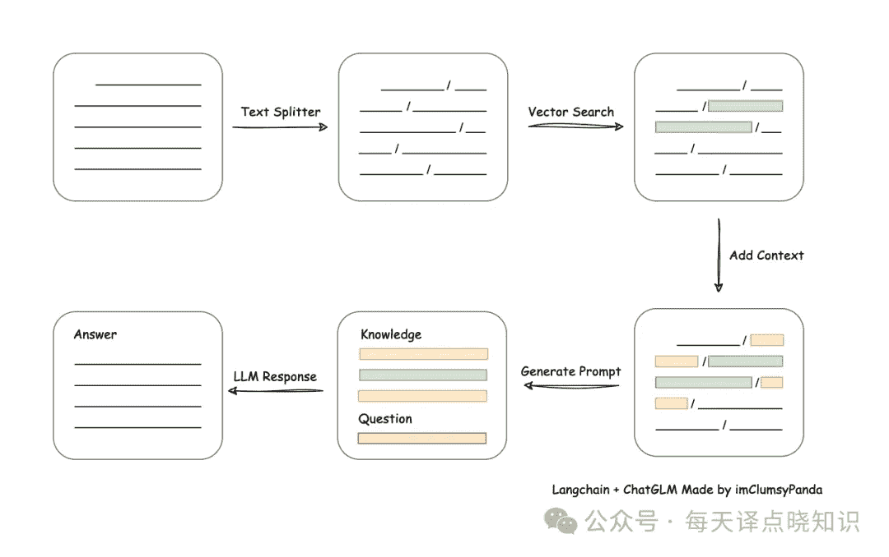
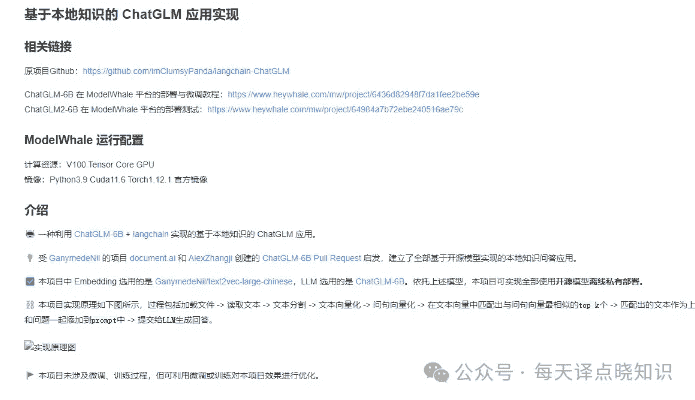
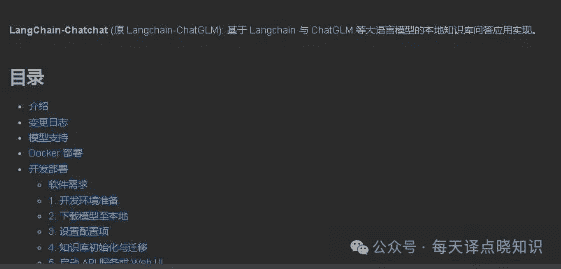
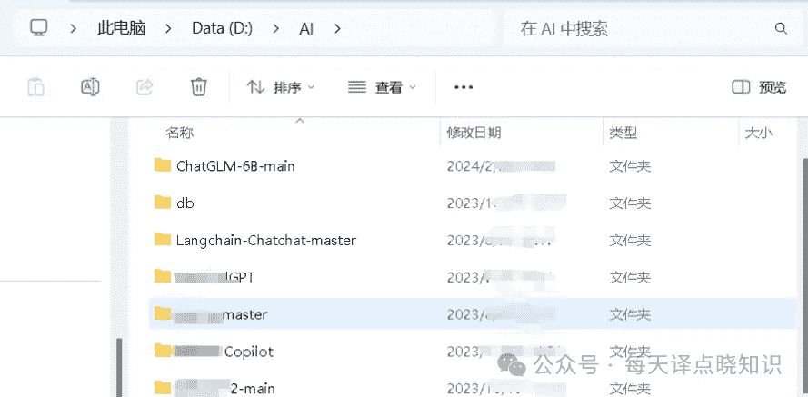
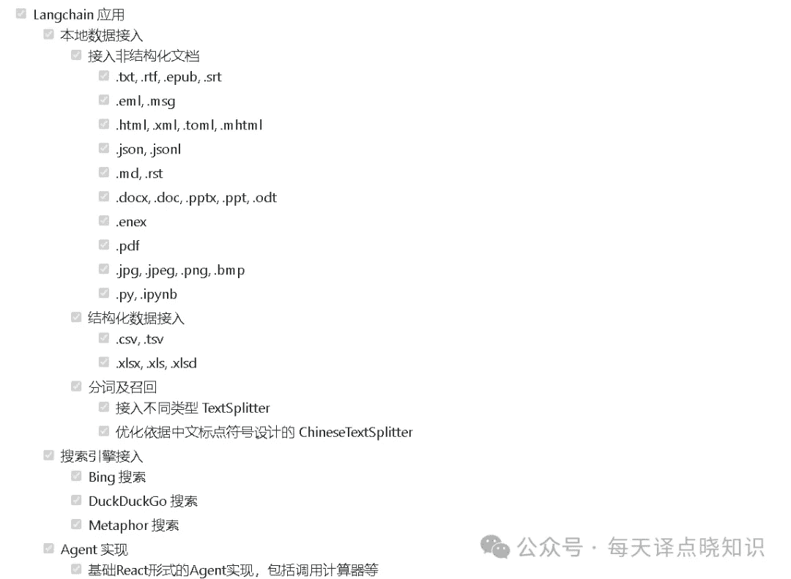
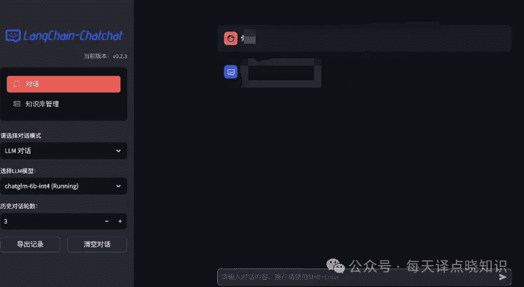
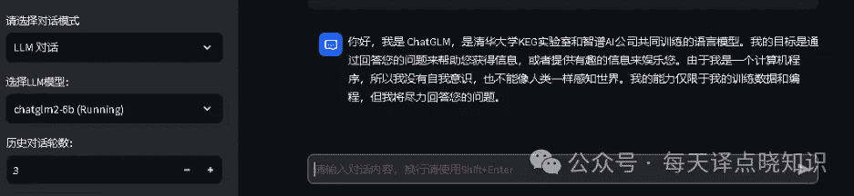

# 基于LangChain+ChatGLM 部署本地私有化知识库

> 来源：[https://agispace.feishu.cn/docx/E8aDdcrKmow3iexbH7ecyMv6niA](https://agispace.feishu.cn/docx/E8aDdcrKmow3iexbH7ecyMv6niA)

> 作者：   译点

> 👸号： 每天译点晓知识

> 原文链接：https://mp.weixin.qq.com/s/nic_x165MpT98cW2OXzcJQ

### **前言**

随着人工智能技术的不断发展，越来越多的企业和机构开始认识到知识库的重要性。知识库不仅能够集中管理大量的信息和数据，还能通过智能检索和推理功能，为用户提供准确、高效的知识服务。

LangChain 与 ChatGLM 作为当前领先的 AI 技术，为部署本地私有化知识库提供了强大的支持。



### LangChain 与 ChatGLM 简介

LangChain 是一个强大的自然语言处理框架，它集成了多种先进的 NLP 技术，包括文本生成、语义理解、情感分析等。通过 LangChain，我们可以轻松地构建出功能强大的聊天机器人、智能问答系统等。ChatGLM 是基于 GLM（Generative Language Model）的自然语言处理模型，它具备强大的文本生成能力和语义理解能力，可以为用户提供高质量的对话体验。



### **私有化知识库的优势**

私有化知识库指的是将知识库部署在企业或机构的内部网络中，以实现数据的集中管理和安全控制。与公有云知识库相比，私有化知识库具有以下优势：



1、数据安全：私有化部署可以确保数据的安全性和隐私性，避免数据泄露和非法访问；

2、自主可控：私有化知识库允许企业或机构自主管理和控制数据，确保数据的准确性和完整性；

3、灵活定制：私有化部署可以根据企业或机构的实际需求进行定制，满足特定的业务需求。

### 基于 LangChain 与 ChatGLM 的私有化知识库部署方案



基于 LangChain 与 ChatGLM 的私有化知识库部署主要包括以下几个步骤：

1、需求分析：明确企业或机构的知识库需求，包括数据类型、数据存储方式、用户访问方式等；

2、环境搭建：搭建适合 LangChain 与 ChatGLM 运行的环境，包括服务器、存储设备等；

3、模型训练与部署：利用 LangChain 与 ChatGLM 进行模型训练，将训练好的模型部署到私有化知识库中；

4、数据导入与整理：将企业或机构的数据导入到知识库中，并进行整理和优化，以提高检索和推理的准确性；



5、系统测试与优化：对部署好的私有化知识库进行系统测试，根据测试结果进行优化和调整。

通过**容器化**快捷部署：


+

```
docker run -d --gpus all -p 80:8501 registry.cn-beijing.aliyuncs.com/chatchat/chatchat:0.2.3
```

温馨提示：更多部署方式->请私信留言&交流探讨部署过程中遇到的问题><

### **总结与展望**

基于 LangChain 与 ChatGLM 的私有化知识库部署方案为企业和机构提供了一个高效、安全、可控的知识管理解决方案。



可基于你所具备的服务器、硬件资源等相关条件，选择相应的 LLM 模型：



未来，随着 AI 技术的不断发展，我们有理由相信，私有化知识库将在更多领域得到应用和推广，为企业和机构带来更大的价值。这与早期所接触开发涉及的知识库（对信息的归纳、概括与总结->数据客观存在-信息加工）领域相比来看，AI 在语义、语境搜索，上下文联想，召回率，相关性，准确度等各方面丝毫不逊色，尤其是在垂类的知识领域，AI 检索使得回答更精准（前提：提示词给得恰如其分，让机器成为你的好帮手），效果更受用户青睐！

这样，一个本地私有化知识库应用就完成了搭建。当然，也需要持续关注应用的运行情况，并根据用户反馈和市场需求进行迭代和更新，这包括优化用户体验、增加新功能等。

### **思考&延伸**

AI 在各个领域中的应用越来越广泛，各种大模型相继面世，特别是在大数据、深度学习技术以及新质生产力政策的推动下，通过投入研发，相比于依赖外部模型，打造本地私有化应用可以更好地掌控数据的安全性和可控性。

企业可以自主决定数据的采集、存储和使用方式，确保数据的安全性、隐私性，避免因数据泄露或滥用带来的风险。对于通过 AI 技术推动业务发展和创新的企业和团队来说，这是一个值得投入和尝试的方向。

这不仅有助于实现定制化需求、掌握核心技术、推动创新与发展，还能够培养人才团队和增强数据的安全性与可控性！