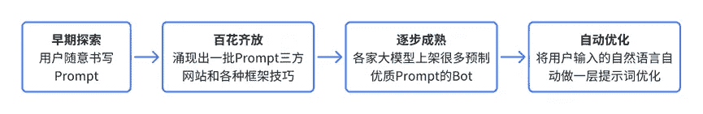
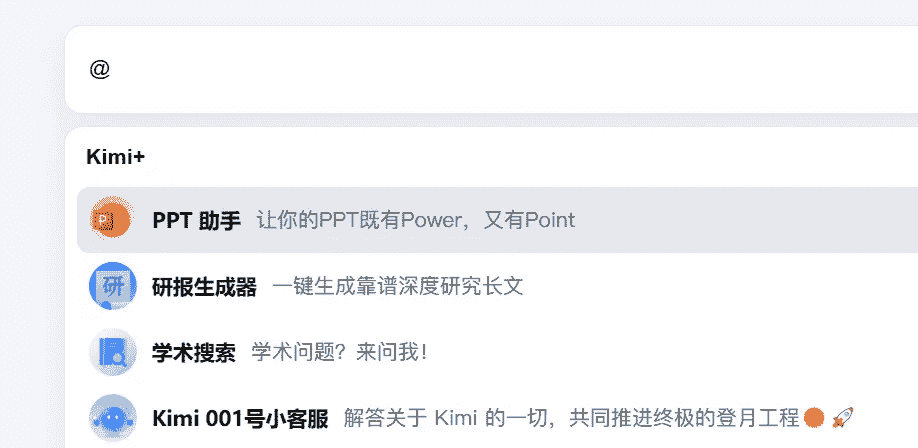
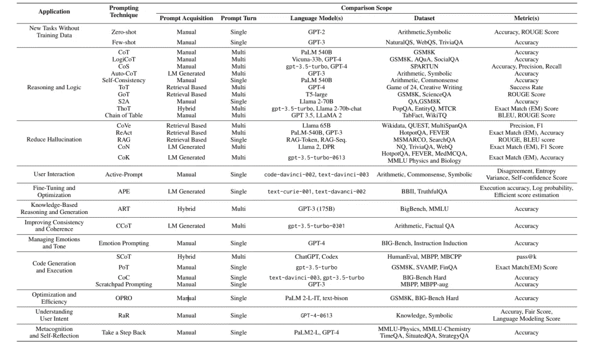
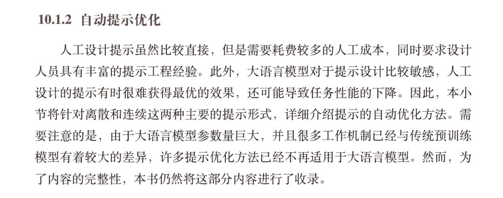
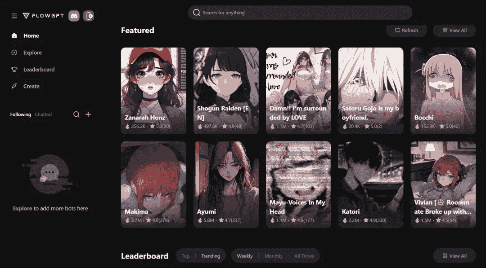
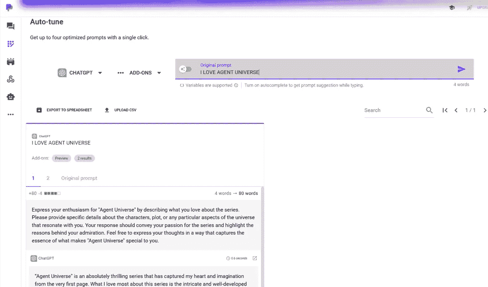

# 浅谈提示词发展现状，Prompt 自动优化是未来。

> 来源：[https://agispace.feishu.cn/docx/Om62dKNxPotTzZxig1Dc5uxbnPc](https://agispace.feishu.cn/docx/Om62dKNxPotTzZxig1Dc5uxbnPc)

> 作者：特工少女

> 👸号：特工宇宙

> 原文链接：https://mp.weixin.qq.com/s/D8pPI6BhJoNcqOesbzH_jA

#封面手绘于本科期间，当年在知乎上写的第一篇关于 AI 的文章就用的这个封面，聊表纪念。

继上一次浅谈当下国内 AI Agent 现状，钉钉和扣子走在前列之后，这次我们来聊聊 Prompt. 本来想取一个类似“提示词不存在了...”，或是“再见，Prompt 课程...”的标题，但最近很多大佬的谬赞让我感到诚惶诚恐，后来想想还是算了。

从 2022 年 11 月起，刚刚入门 NLP 的我开始研究大模型，期间也学习过一些论文，以及一些提示词书写框架。以下是我这一年半以来，混迹大模型上中下游，沉淀出的一些思考。

我整理了一个流程图，概括了这一年多我看到的 Prompt 的一些发展。

图 1-1 Prompt 发展脉络图

在最早期，少数爱好者经过不断的尝试，根据经验，加之一些前沿论文的探究学习，总结了许多能让大模型输出更好效果的提示词技巧和框架，爱好者不断增加+教程不断完善，渐渐诞生了许多 KOL 以及提示词社区。再后来，大概 2023 年 6 月左右，以文心一言和科大讯飞为代表，各家大模型产品开始内嵌了许多“助手”，即基于 Prompt 创建完成的 Bots.平台还加上了一些 UGC 的玩法，靠大赛/教学等激励方式，涌现了许多丰富的 Bot，本质上是将 Prompt 社区做到了自家产品里。作为一个 toC 产品，给用户不断提供新颖的 Bot 的策略是对的，但当时一些厂商过于追求数量（可能是为了发布会装逼），体验过后会发现绝大部分 Bot 没有任何意义，提效类的经常出错，娱乐类的经常出戏。随着模型能力的不断迭代以及 Agent 的不断迭代，后来 OpenAI() 发布了 GPTs，各家也一个接一个地推出了“商店”或是“广场”，比如最近 Kimi 推出了 kimi+. 发展到现在，Bot 的创建也不只局限于 Prompt，还衍生了外挂知识库、调用 API，工作流创建等等玩法，而曾经的那个 Bot 或是助手，也被很多家换了个新名字——智能体。与此同时，许多厂商也推出了，使用“@”或是“/”，即可在对话框中快捷唤起提示词模板，或是 Bot.

图 1-2 文心一言对话框（获取 Prompt）

图 1-3 Kimi 对话框（获取 Bot）在一些平台上，用户也可以收藏 Prompt 作为常用语。

图 1-4 Kimi 对话框（设置常用语）

**这是一个入口级的提升**，用户无需查阅多次打开三方提示词网站，或是个人笔记，在大模型平台上就能一站式完成。但是这只解决了收藏和使用的问题，没有解决创作的问题。

于是业界逐渐往**提示词自动优化**方向发展，什么是提示词自动优化？即用户属于简单的自然语言后，AI 会自动优化这段 Prompt.

一种是用户看不到的，即大模型自身根据用户输入后，黑盒式做了一些分析，用户无感知。还有一种是用户能看到的，可以二次调整的，比如扣子和 Claude.

图 1-5 扣子 Bot 创建页面

实现提示词的自动优化，最简单粗暴的方式就是用 Prompt 来优化 Prompt，专家通过设计一套固定且适合自身大模型的提示词，用户上传的 Prompt 会被润色且结构化。此外还有一些更复杂的提示词自动优化的方法，比如 APE（Automatic Prompt Enginnering）、OPRO（Optimization by Prompting）、AutoPrompt 等等。

图 1-6 Prompt 方法大全

而具体实现的一些算法原理，可以去查看上图中方法对应的论文，也可查看去年爆火的大模型综述，如今出书了（附下载）一书，里面讲述了自动提示优化的一些方法。

图 1-7 《大语言模型》一书第十章

我认为，长期来看，研究提示词的群体只限于相关学者，以及一小撮热爱者。

普通人深究提示词**框架和书写技巧意义不大，**且未**来**靠教学 Prompt 变现不是**一门好生意。原因有三：第一**，提示词技巧的可迁移性较差，相同的提示词在不同的模型上表现能力不同，甚至在同一模型的不同更新版本上表现能力也不同。比如现在很多主流的技巧，都是基于 GPT4 的，但很多方法迁移到国产大模型当中，得到的效果非常一般。如果模型能力不行，提示词写的天花乱坠又有什么用？以及，如果 GPT5 来了，模型足够智能，现在这些技巧还有多少用武之地？第二，让所有用户都来学习如何写出高质量的提示词，并不现实。从用户体验的角度来看，各家大模型一定是往“即使是最简单的自然语言，也能让用户得到满意的回答”的方向发展。在模型的智能化程度还未达到下一个高点之前，像扣子等平台的提示词自动优化就是一个很好的当下最优解。第三，模型朝着 AGI 发展，未来语音交互会成为主流。语音交互的场景更加丰富，效率也更高，用户总不可能念出来上百字的提示词内容吧？未来模型对话一定是开袋即食的。

基于以上观点，我认为提示词社区的发展空间也不大。随着各家模型和平台不断迭代，入口已经被其垄断了，用户创建、学习、分享等行为，会在该平台实现闭环，没有再上三方网站的必要。拿去年名噪一时的 FlowGPT 举例，现在也已经全面 Character.ai 化了，充斥着各种 AI 虚拟陪伴的 Bots.

图 2-1 FlowGPT 官网截图

而最近，也没怎么听过身边的朋友谈论 PromptPort（另一个之前比较火的提示词社区）了。还记得 JinaAI 很早就做了一个名为 PromptPerfect 的项目，即自动优化用户上传的提示词，我认为这个产品夹杂在用户和模型之间，生存空间也很受限。toC 目前用户的选择非常多样，又有多少人愿意付费优化自己的 Prompt？toB 的话，以目前大模型这个内卷程度，大模型公司自己估计就端到端完成了。

图 2-2 PromptPerfect 测试截图

在这一年半里，我见证了许多朋友，凭借对 Prompt 的研究，有拿到了融资的，有拿到了黑客松冠军的，也有知识变现近百万的，也有从一般程序员成长为 AI 圈 KOL 的，有成为高校讲师的，有成功出版第一本书的...尽管有的 Prompt 的项目烂尾了，尽管有的教程内容也有些过时了，但这些勇于尝试的人，在这样一个时期，在这样一个风口上，终究是拿到了一些结果。那么下一个风口是什么呢？或许是 Agent 吧。

所以该干什么不用我多说了吧，放个名片自己体会

说到 Agent，最近有关“**Workflow 是不是伪需求**”的讨论也非常热烈，我们已经策划一期沙龙活动和一篇相关探讨文章，敬请期待。此外，也有很多朋友在质疑“AI 是否真的能提供情绪价值/心理治疗”，于是我们邀请了来养一只治愈自己的 AI 小动物吧一文提到的盒子姐姐，在本周日（5 月 19 日）晚上八点，直播分享《当我们需要 AI 陪伴时，真正需要的是什么》，速速预约！~

AI 发展太快了！存在太多的非共识，有太多的问题值得思考，值得讨论。让我们一起脑暴，一起经历，一起成长。

