# Agent > GPT5？吴恩达最新演讲：四种 Agent 设计范式（通俗易懂版）

> 来源：[https://agispace.feishu.cn/docx/F5WddR3akoxrXSx9b8qcgDGZnEd](https://agispace.feishu.cn/docx/F5WddR3akoxrXSx9b8qcgDGZnEd)

> 作者：特工少女

> 公众号：特工宇宙

> 原文链接：https://mp.weixin.qq.com/s/6sh39yEO4YGZI-BGPjJnCg

吴恩达教授最近在红杉 AI 峰会上讲述了他对 Agent 的一些看法，尽管一些媒体已经进行了相关报道，但为了分发的及时性，而采用了机翻的方式，牺牲了表述的准确性，增加了不必要的阅读门槛。

特工宇宙于是重新整理翻译了一版，既保留了吴恩达教授的原意，又加之了部分个人理解。期望即使是外行，也能无障碍阅读。

不过本少女能力有限，如若有任何疑问或建议，欢迎来我们 Agent 爱好者社区交流。以下是大佬发言👇

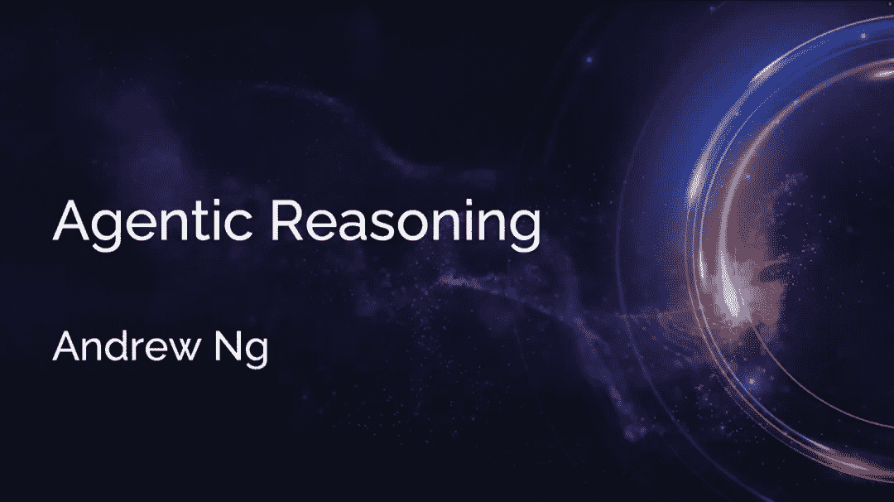

如今，我们在使用 ChatGPT 等 AI 工具时，基本我们会输入一个 Prompt，然后得到一个答案。这就有点像你给定一个主题，然后让一个人去写文章，你跟 Ta 说，坐在电脑边，去敲键盘吧！不断的打字直到写完全部。

相比之下，如果使用 Agentic Workflow（这很难信雅达地翻译，姑且认为是智能体工作流，即基于大语言模型的用流程构建的智能体系统），就好比你跟 Ta 说，先写一个大纲，如果需要的话去网上查点资料，再写一个草稿，然后思考你的草稿该怎么改，最后再修改，多次如此迭代。很多人没有意识到这会带来多大的优化，事实是我经常这样做，得到的效果非常惊艳。

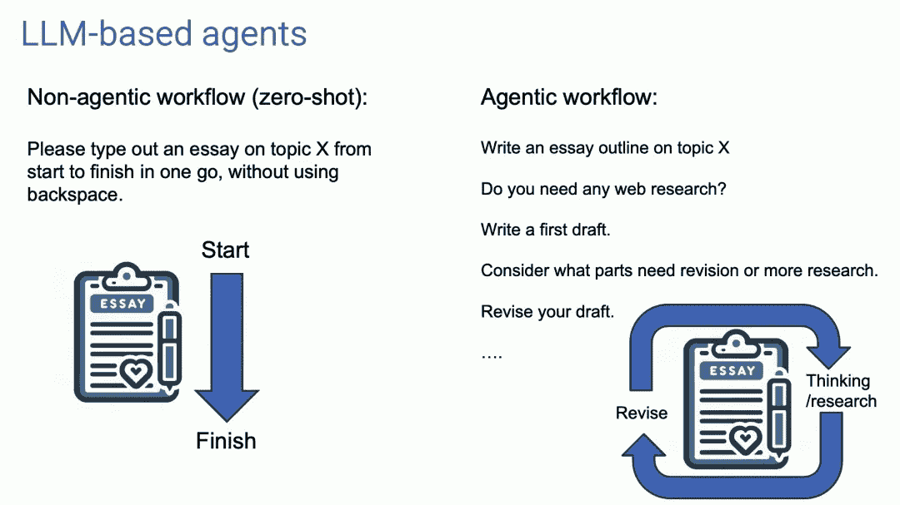

我们团队做了一个案例研究，使用了  HumanEval （OpenAI 为了评估编程语言模型而设计的数据集），但出现了一些错误，比如我举的这个例子，“我给你一个数字列表里，找出奇数位置上的数字，返回其中所有奇数之和”，然后 AI 给了错误的回答。

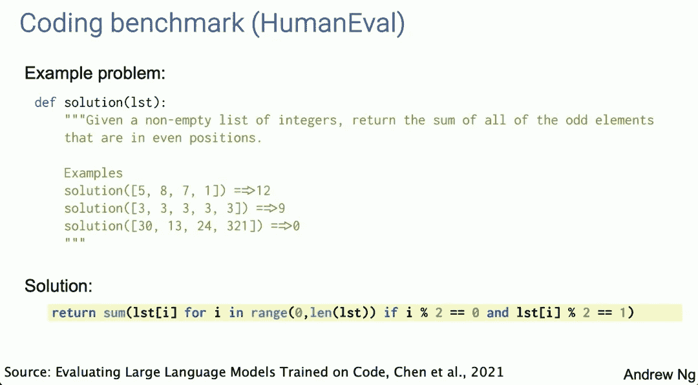

我们平常大都会使用 Zero-shot（不给大模型具体训练样本或标签提示，直接提问让其回答）来写 Prompt，就是直接让 AI 编写代码并运行（这不是一个明智的做法）。

我**们的研究结果表明，如果你使用GPT3.5 + Zero-sh**ot 的正确率为 48%，GPT4 + Zero-shot 的正确率为 67%，但是，如果你用 GPT3.5 + Agentic Workflow，你会得到超越 GPT4 的效果！因此，Agent 在构建 AI 应用时非常重要。

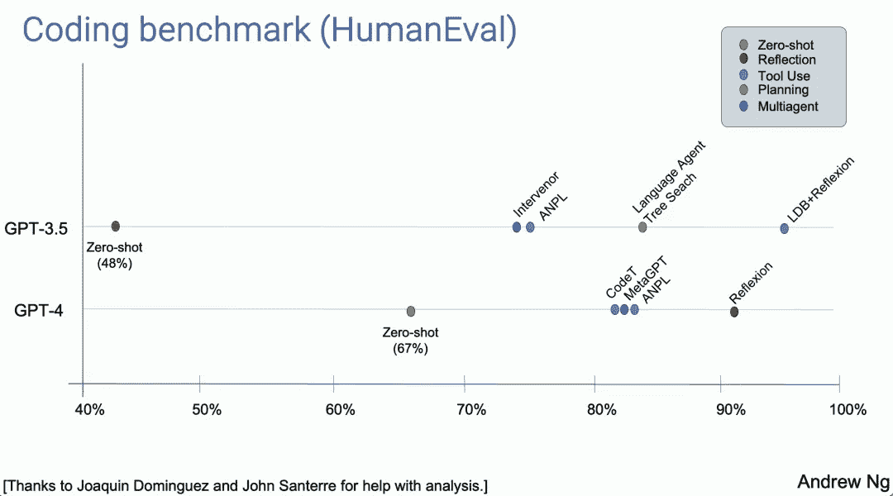

**（然后就到了主题）**尽管很多学者、专家谈论了很多关于 Agent 的东西，但我今天想更具体的分享我在 Agent 中看到比较广泛的四种设计模式（尽管很多团队，开源项目等做了很多种多样的尝试，但我还是按我的理解划分成了四类）。

**Reflection 和 Tool Use 属于比较经典且相对已经广泛使用的方**式，Planning 和 Multi-agent 属于比较新颖比较有前景的方式。

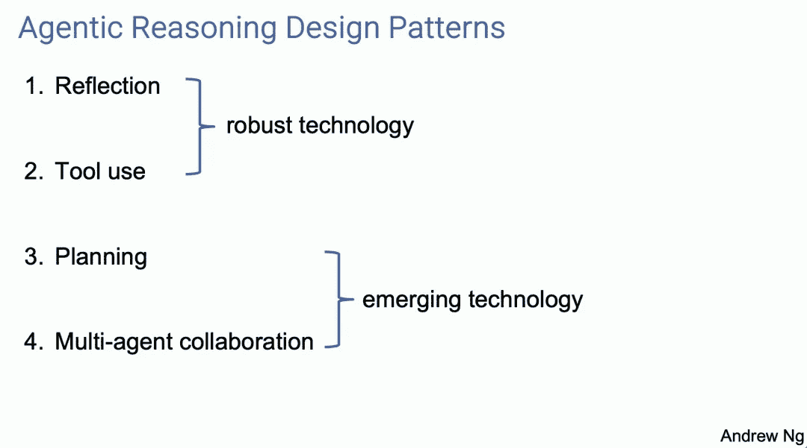

第一个讲的就是 Reflection（反思，类似于 AI 的自我纠错和迭代），举个栗子，我们让用 Reflection 构建好的一个 AI 系统写个xxx代码，然后 AI 会把这个代码，加上类似“检查此段代码的正确性，告诉我如何修改”的话术，再返回给 AI，AI可能会给你提出其中的 Bug，然后如此反复，AI 自己完成了自我迭代，虽然修改后的代码质量不一定能保证，但基本上来说效果会更好。

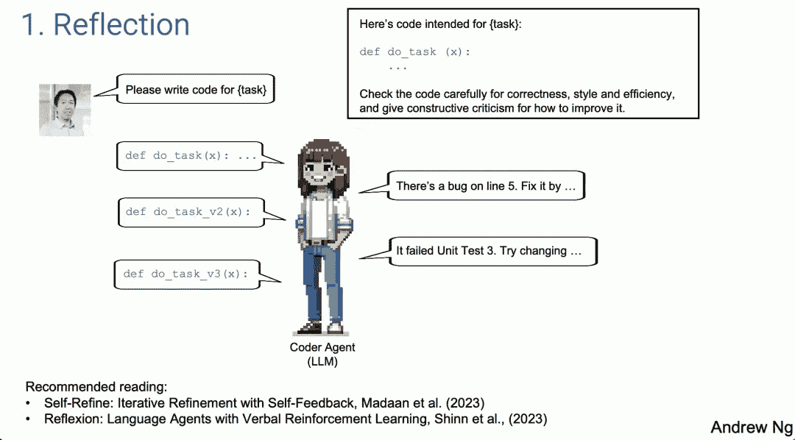

（每页PPT下方，吴恩达大佬都推荐了一些相关论文，可以去看看）

如上表述的是案例是 Single-agent（区别于 Mutli-agent 的单智能体），但其实你也可以用两个 Agent，一个写代码，然后另一个来 Debug👇

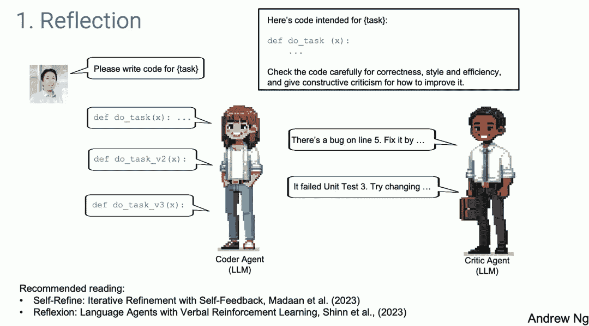

这两个 Agent 可以用相同的 LLM，也可以用不同的，这种 Reflection 的方式在很多场景都适用。

接下来第二个是 Tool Use（如果你经常玩 GPT4 或者国产的一些 AI 对话产品，那就不陌生了），大语言模型调用插件，极大的拓展了 LLM 的边界能力。

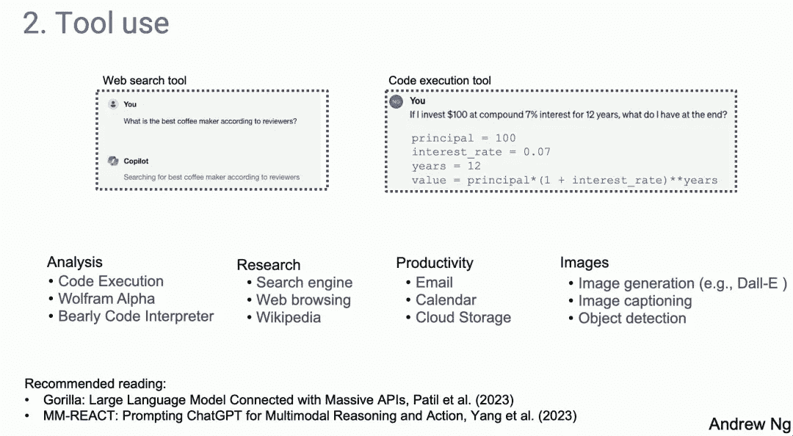

（这一部分介绍的比较少）现在用的比较多的就是使用 Copilot 进行联网搜索，以及在解决某数理逻辑问题时，调用代码插件来辅助解决。

第三个是 Planning（规划），非常惊艳的设计，用户输入任务，AI拆解流程、选择工具、调用、执行并输出结果。我在做一些 demo 时会遇到一些错误，但 Agent 绕过了我的错误，自主地完成了任务。

我在这里举一个例子，改编自 HuggingGPT 这个论文，我需要生成一个图片，一个女孩在看书，她的姿势要个我给的这个图片中的男孩一样，然后你再用文字描述这篇文章。

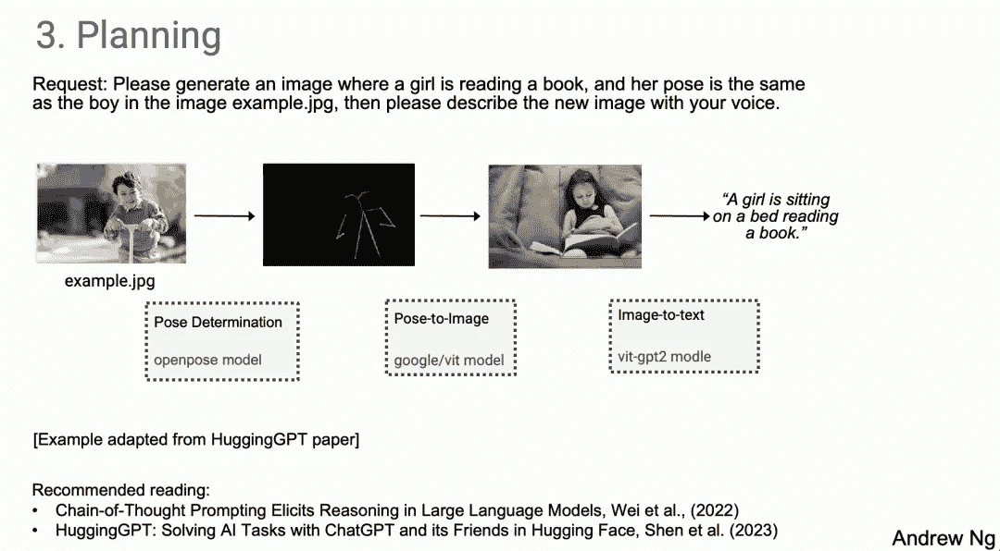

Agent 的做法是，先提取该图片中男孩的姿态（可能是调用的 Huggingface上的模型），然后再找到一个模型生成一张同样姿势的图片，最后再描述好生成的这张图片。

Agent 的效果不一定保证非常好，但大部分情况比较高效，比如我之前谷歌搜索会花费大量时间，现在我会丢一个问题给 Agent，然后过一会来看它给的回复。

最后一个是 Multi-agent，多智能体协作（吴恩达在这里的举例，来自清华面壁智能的开源项目 ChatDev）。

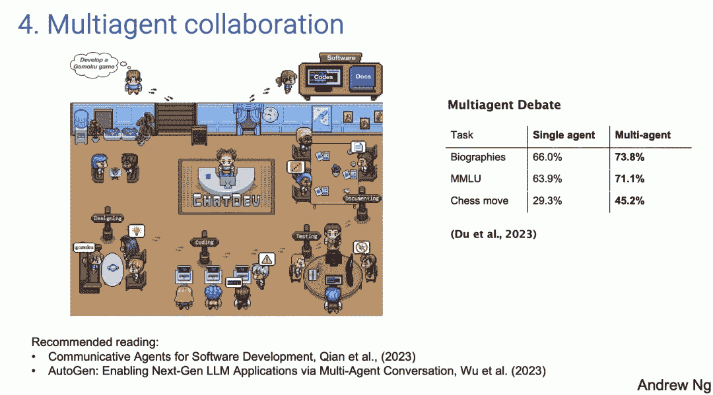

每个 Agent 被赋予了不同的身份，比如有的是 CEO，有的是产品经理，有的是程序员，他们互相合作互相对话，比如你让他们开发一个简单的小游戏，他们会花几分钟时间来编写代码并测试。尽管有时候不是很有效，但非常有前景和想象力，它模拟了现实生活中的工作场景，Multi-agent 不仅仅只能执行单一任务，而是成为了一个复杂系统。

最后是结论，我认为未来，得益于 Agentic Worklfow，AI 能做出来更多牛逼的应用。但现在我们等待 Agent 的回复需要比较长的时间，所以更快的 token 生成速度是很重要的（吴恩达在此又扯了个故事，表达的意思是人性就是希望即时满足）。

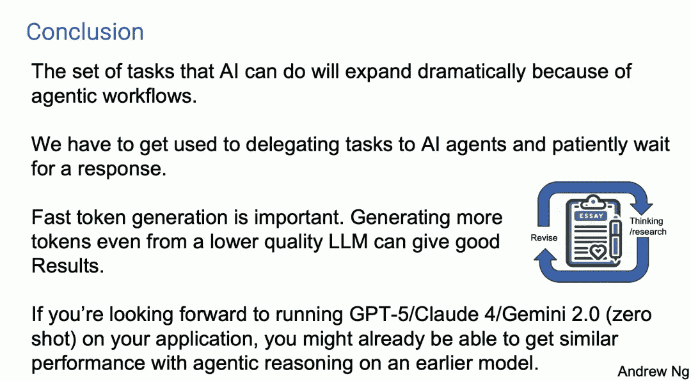

重要的一点是，如果你在期待 GPT-5 等更牛逼的大模型，其实你可以现在用 Agent 得到类似的更好的结果。这可能有些争议，但 Agent 确实是一个重要趋势。

最后的最后，吴恩达升华了一下主题👇

Path to AGI feels like a journey rather than a destination, but I think agentic workflow could help us take a small step forward on this very long journey.

**通**往人工通用智能的道路，宛如一场旅程而非终点，但我相信，Agent能帮助我们在这条漫长征途上迈出微小而坚实的一步。

