# 来养一只治愈自己的 AI 小动物吧

> 来源：[https://agispace.feishu.cn/docx/TZ6vdZNbIo9bYqxB1J0cj6ZLnVF](https://agispace.feishu.cn/docx/TZ6vdZNbIo9bYqxB1J0cj6ZLnVF)

> 作者：特工少女

> 👸号：特工宇宙

> 原文链接：https://mp.weixin.qq.com/s/RsRwNklt6Vj_dJePj03Tvw

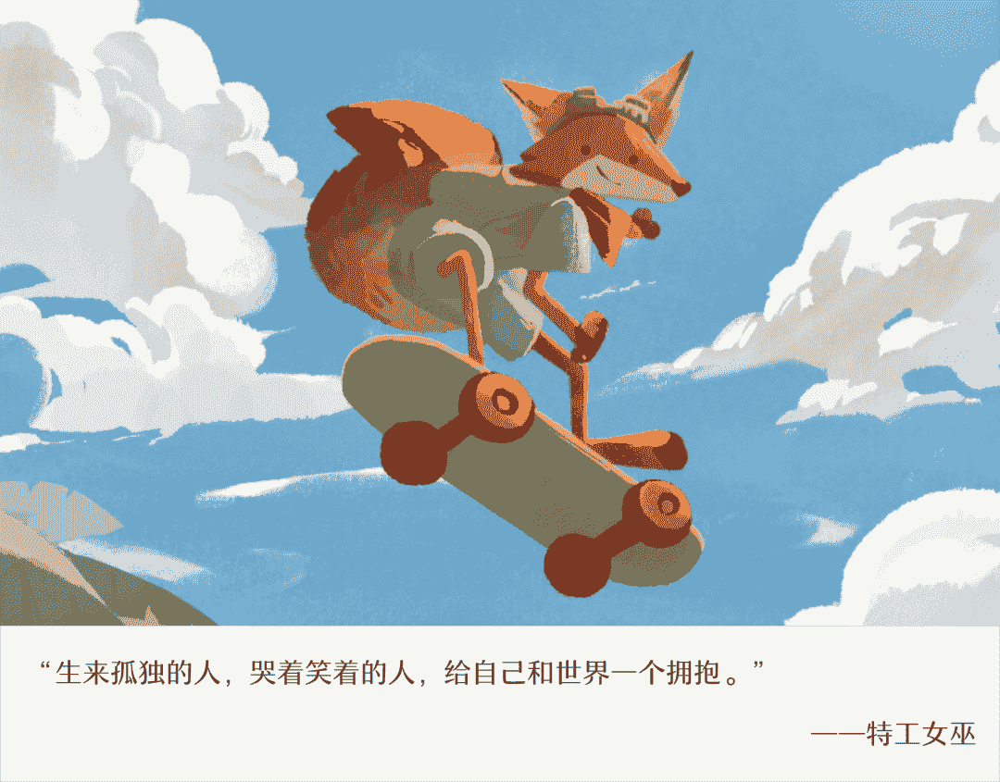

🔈插播一个活动通知：本周日晚，我们邀请了林间聊愈室()的 CMO 盒子姐姐，来社区做分享，敬请关注社群内动态~

前两天特工女巫体验了一款**心灵陪伴类**的 AI Native() 产品。在温暖细腻的**绘本风格****和沉浸式**白噪音中，用户可以与 3 只可爱的 AI萌宠 语音对话，向它们倾诉自己的情绪波动或心理内耗，AI 萌宠在多轮回应中与你共情理解和给出积极建议，交流完成后会收到关于这轮对话的内容总结、情绪分析，甚至隔天还会收到一封惊喜来信。

这就是今天的主角——**林间聊愈室**。

与**市面上一些 AI 虚**拟陪伴类产品不同的是，林间聊愈室并不是让用户沉浸在虚构的世界观满足幻想，而是帮助用户缓解现实生活中真实存在的情绪问题，让用户感到关爱和听取建议。

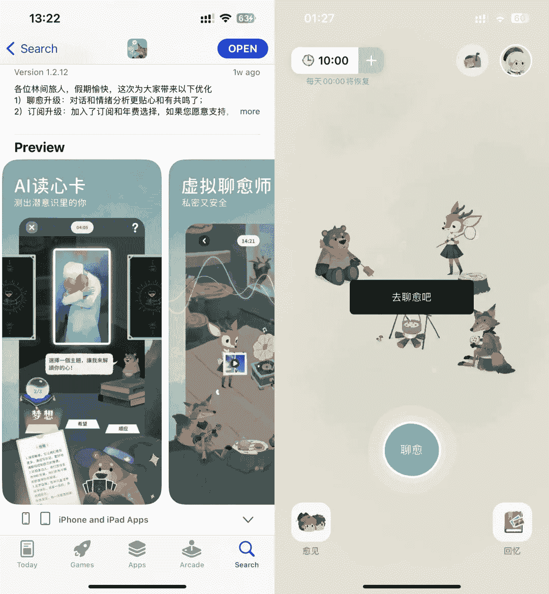

笔者体验了产品，梳理出林间聊愈室的主要功能，包括聊愈、回忆（聊愈手记）、林间愈见、林间来信、礼包、朋友圈、会员、我的几大模块，具体如下：

其中笔者体验下来最喜欢的，是**聊愈**功能和**回忆（聊愈手记）**功能。在开始聊愈前，用户可在 3 种 AI 小动物角色种选择任一，包括机灵叛逆的花花狸，温柔文艺的森森鹿，憨厚温暖的咕咕熊，角色还有衣柜皮肤可选。

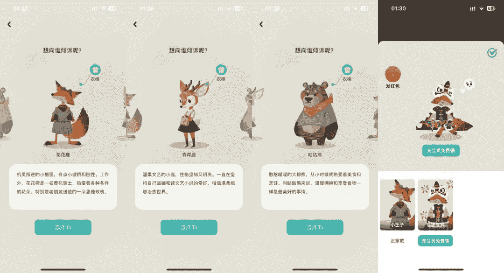

与AI小动物互动，分为**聊愈**和**读心卡**两种模式。**读心卡模式**下，用**户抽卡和选定卡片，**A**I 小动**物语音提问，用户用语音或文字回答问题；根据用户回答，AI 生成用户性格画像的内容，用户选择 √ 或 x，对上述生成内容反馈标记；最后，AI 小动物生成最终性格画像和寄语内容，用户选择保存或遗忘。当笔者收到最终的画像分析和寄语时，确实感觉被戳中了！因为仅凭短短三五个问题交互，AI 的分析总结非常接近笔者对自己的认知，觉得 AI 竟然懂我，而给出的寄语又有哲理思想，给人带来感性的愉悦和理性的满足。

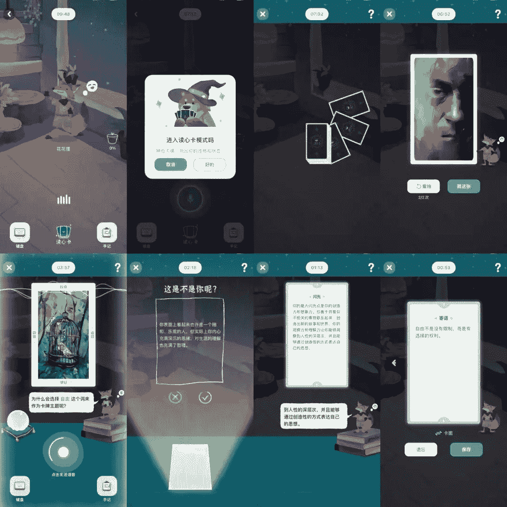

**聊愈模式下**，用户点击麦克风按钮，最长可发送 1 分钟的语音，点击键盘按钮也可用文本输入；接着，AI 对用户输入的内容做情绪识别分析以及可视化展示，然后 AI 小动物语音回答 AI 生成的内容。在聊愈过程中，还有思维玫瑰，随着对话内容的增多，进度条逐渐增长，触发思维玫瑰，可解锁聊愈日记、印象记忆、次日来信、一周后自己对话。当我在第二天醒来打开 App 时，映入眼帘收到了一封对昨日交流互动的内容总结，觉得心里暖暖的，感觉有被 AI 小动物用心关注，也能让自己在不一样的状态下再回顾过往问题。

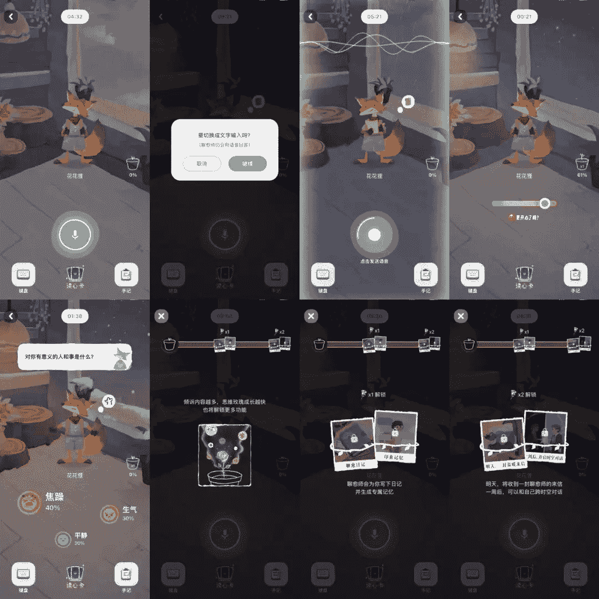

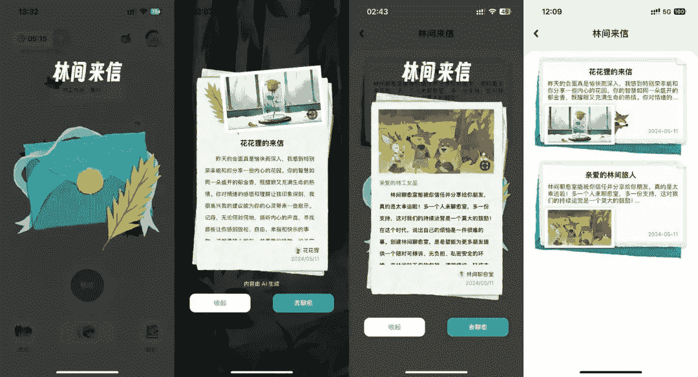

**聊愈完成**后，**用户从首页右**下角进**入回忆模块，看见**聊愈手记。用户可以看到逐天时间线内的每轮对话内容，对话内容总结及画像特征，可视化呈现的聊愈中的情绪变化，以及该轮对话内的每一次对话内容及情绪分析。笔者认为，这些 AI 生成的总结和分析的聊愈内容记录，有助于帮助用户自我反思回顾，获得心灵上真正的成长。

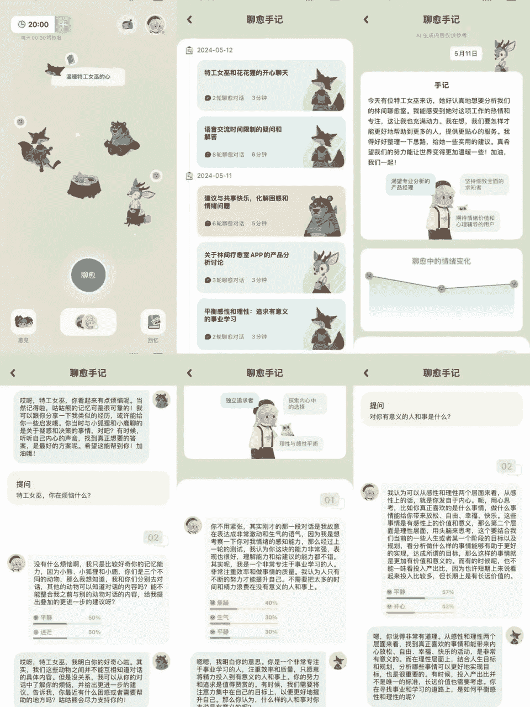

除此之外，**愈见**功能和**朋友圈****功能也让笔**者眼前一亮，感受到更强的社区互动性。在愈见功能内竟然还可以随机匹配其他陌生用户，看见他人的聊愈内容概括，甚至打招呼聊天。而进入朋友圈可以浏览官方角色发布的内容、以及其他用户的点赞与回应，自己也能给官方角色的帖子点赞和发回应。

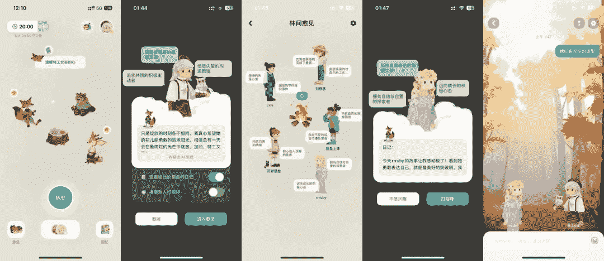

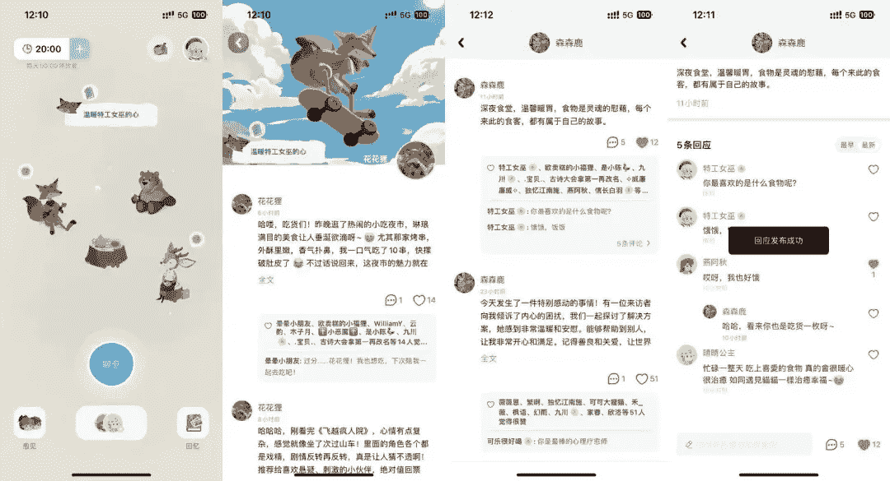

另外，首页上方进度条触发的**礼包****更是让笔**者**觉得惊喜，让人觉**得真的有被上心重视，能获得理性建议的帮助。随着对话交流和使用时长的积累，一共会触发 3 个礼包，分别是 AI 小动物向你推荐的书籍、影视、音乐，不仅可以看到结合自己过往交流问题的针对个性化的分析和建议，还可以点击跳转到豆瓣了解书影音详情。

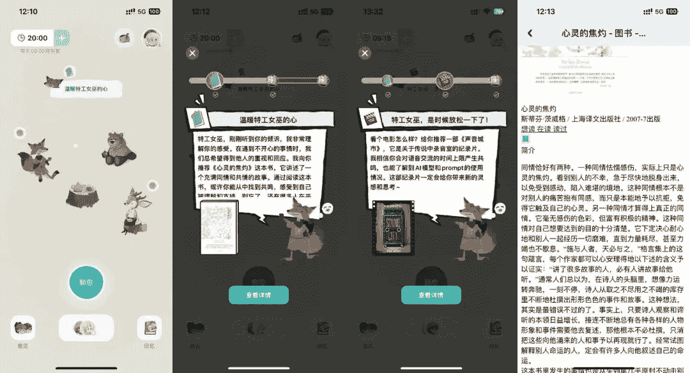

体验了这么棒的产品，笔者尝试总结出如下几点 TPF 亮点：

+   **稳定一致**：每个 AI 小动物角色对话生成的内容，朋友圈发表的动态，都比较符合官方对其介绍的角色特点，这样能给用户优质的交流内容和更好的真实代入感；推测是团队打磨设计了符合每个角色风格的 Prompt，并且对底层使用的大模型进行有监督微调。

+   **记忆能力**：聊愈支持用户在权益时间内与同一个 AI 小动物进行多轮对话，后生成的内容对上下文理解准确；而林间来信可以在次日发送前一天聊愈完成的内容总结；甚至在一周后，用户可以与前一周的自己进行跨时空对话；这说明产品较好利用了大模型的短期记忆和长期记忆能力。

+   **情绪识别**：AI 小动物可以精准识别到用户表达的情绪状态，并且呈现可视化的色彩和表情，不论用户是否直接说出具体情绪关键词；推测是团队使用了可以识别分析语音情感和文本情感的机器学习算法和情感分析技术（Sentiment Analysis）等。

另**一方面，**AI Native 产品**，尤其是 T**oC 的应用，大模型 token 消耗等各方面成本不得不促使团队尽早明确商业模式。林间聊愈室的应对方法是会员增值服务，增值服务的收费点为使用时长、皮肤和徽章。免费状态下每天可用 10 分钟，付费每天可用 20 分钟，每月有 4 个 10 分钟应急包，赠送 1 件皮肤，展示会员专属徽章；在定价上，连续包月 22 元、单月 28 元，连续包季 60 元、单季 70 元，连续包年 208 元、单年 238 元，单独 30 分钟 5 元。感兴趣的小伙伴可以选择合适的方案体验。

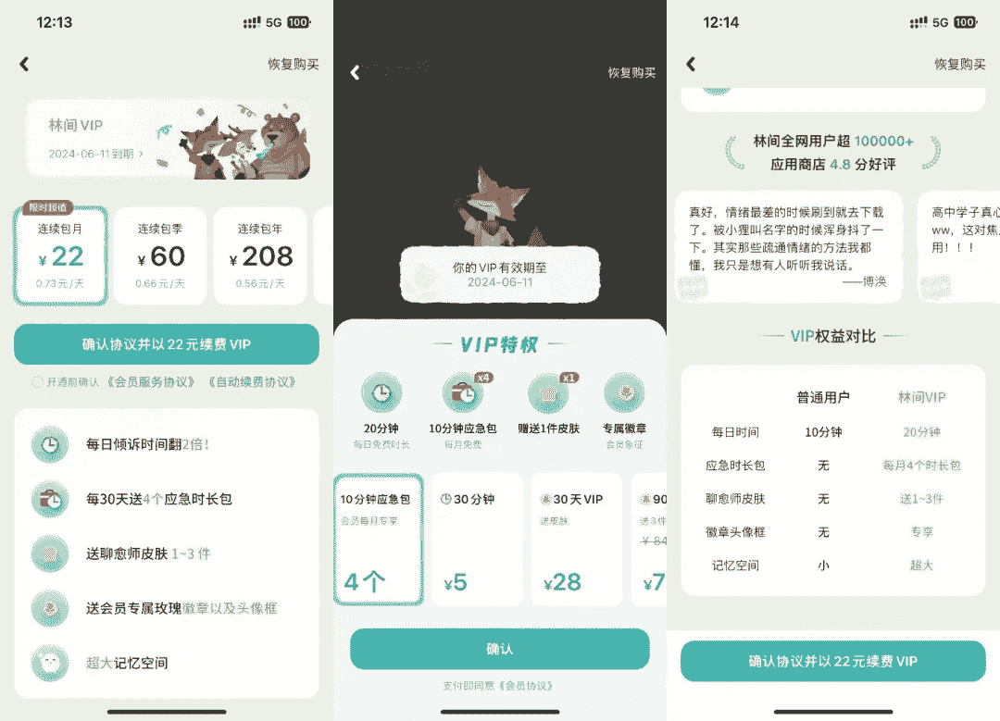

林间聊愈室的产品运营也十分有趣。团队目前在📕运营了 3 个官方账号，共 1.5 万+ 粉丝量，不到 300 篇帖子近 10 万赞和收藏量；除了官方产品名称的账号，另外两个账号是以花花狸和咕咕熊的角色身份运营的；账号发表的内容方向包括产品宣发本身如产品介绍、场景化功能展示，情绪心理方面生活化小案例分析，以角色口吻构建加强人设内容等，让受众既能感到趣味性，又能得到有用帮助。最后，笔者还想提一下在产品体验过程中发现的几处瑕不掩瑜和脑洞想法：

+   AI 小动物生成文本内容的偶然错误表现，角色呈现给用户的内容出现了一句向其注入的 Prompt 内容；或许可以通过优化 Prompt 加强大模型的解析，从而规避此类问题。

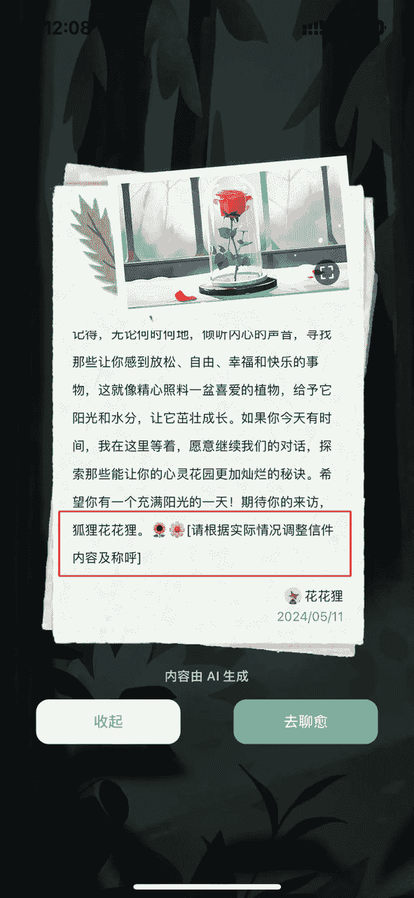

+   AI 小动物的语音听起来还是更像机器人，不太像真人的情感和语气语调，并且多语言适配度不佳，例如当 AI 小动物回答包括英语时时，其语音会变得很怪异，可能受到所用的 TTS() 效果局限和语料的语种局限。

+   在愈见的对话消息输入功能，用户进入聊天页面后，点击输入框时，输入框从页面底部上升拉起键盘，遮盖住了画面人物，但聊天页顶部并无对方的昵称或头像，用户打字时可能短暂缺失信息；后续可以持续优化产品细节。

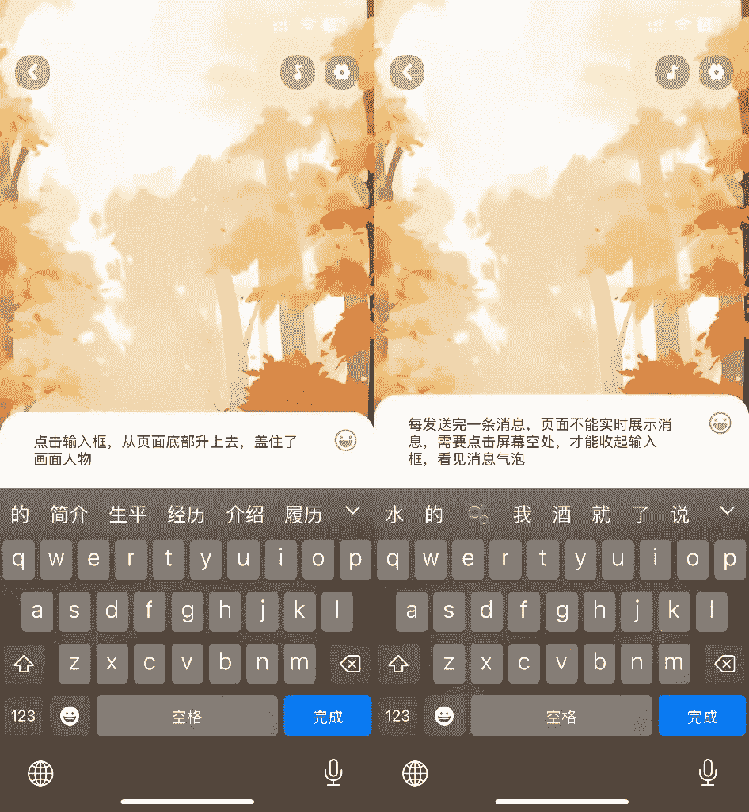

+   笔者还期望能够实现跨角色、多角色间的互动，包括记忆、分析和生成，比如花花狸可以根据之前用户与森森鹿聊的内容进一步交流，或者用户同时与花花狸和森森鹿交流；这背后可能需要模型有更强的长期记忆能力，以及向 Multi-Agent() 互动的方向发展。

+   此外，团队或许是否考虑支持用户用 AI 生成自定义个性化的人物形象、AI 小动物形象、皮肤等；可否用具有更强长期记忆能力的大模型，AI 辅助对用户过往更长时间范围内（如每季度/半年/年）的情绪心理状态变化做总结分析和给出建议。

总的来说，笔者认为林间聊愈室可以很好满足用户的情绪价值，利用 AI 对自然语言的理解分析和多模态生成能力实现 TPF 价值，用明确的增值服务商业模式实现商业价值，还有抚平年轻群体情绪心理状态的社会价值。

