# 腾讯元器 Agent 平台究竟如何？第一手内测！

> 来源：[https://agispace.feishu.cn/docx/X6WEd06LbowyGsxPQePcQ2oSnSg](https://agispace.feishu.cn/docx/X6WEd06LbowyGsxPQePcQ2oSnSg)

> 作者：特工少女

> 👸号：特工宇宙

> 原文链接：https://mp.weixin.qq.com/s/dPTZ-M8Pu8nLpsAyHt6wkQ

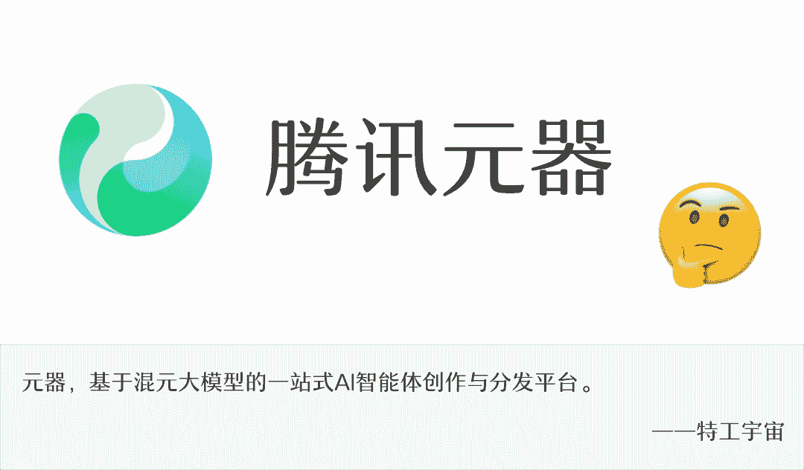

# 在 5 月 17 日的“腾讯云生成式AI产业应用峰会”上，基于混元大模型的一站式 AI 智能体创作与分发平台——腾讯元器首次亮相。

元器主要面向的用户是**企业和开发者**，这些创作者可以在腾讯元器上通过提示词直接创建智能体，同时支持使用腾讯官方的插件和知识库；智能体创建完成后，创作者还可以将这些智能体一键分发到 🐧、🛰️客服、腾讯云等渠道上。

点击官网链接：https://yuanqi.tencent.com，申请获得内测资格后即可使用。

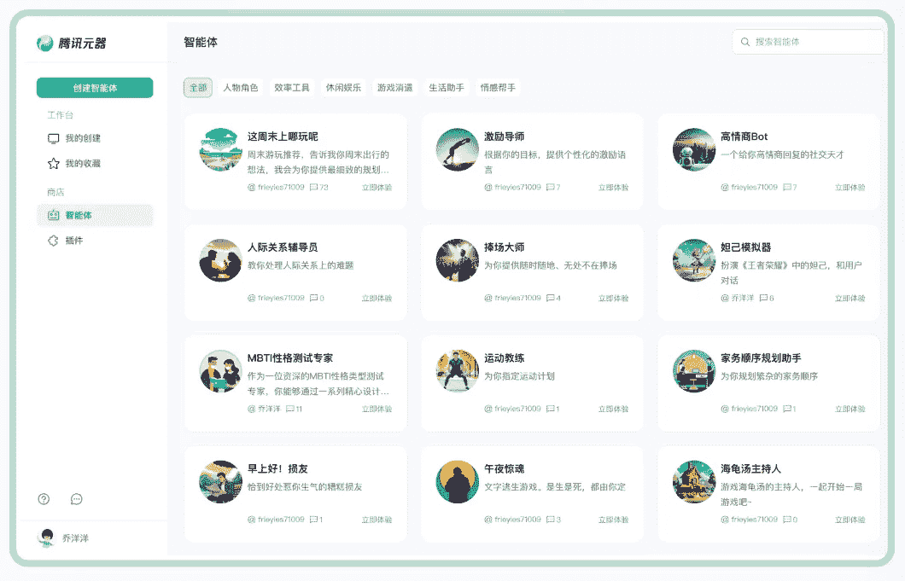

# **元器的主要功能和使用流程**

1.  **创建**

进入官网后，首先来到工作台模块「我的创建」页，页面上方有 3 个 Tab，分别对应的是创建智能体、创建插件、创建工作流。点击创建页右上方的「创建智能体/插件/工作流」按钮，即进入具体创建操作页面。

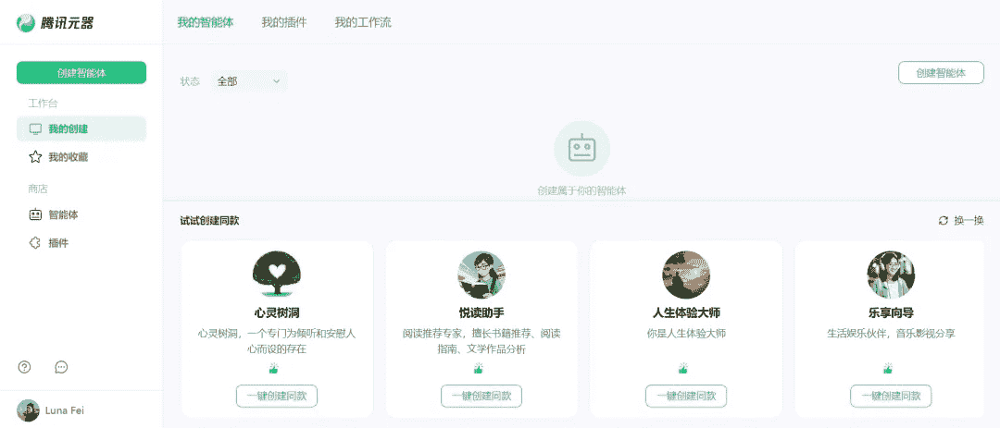

### **（1）创建智能体**

创建智能体的**整体门槛不高**，用户可以通过提示词、插件、工作流、AI辅助，用打字和点击勾选的操作，即可构建出一个属于自己的智能体。

智能体创建页面左侧是「智能体设置」，右侧是「预览与调试」；用户可设置的智能体信息包括：

● **基本信息**：名称，简介，头像（支持 AI 生成图片）

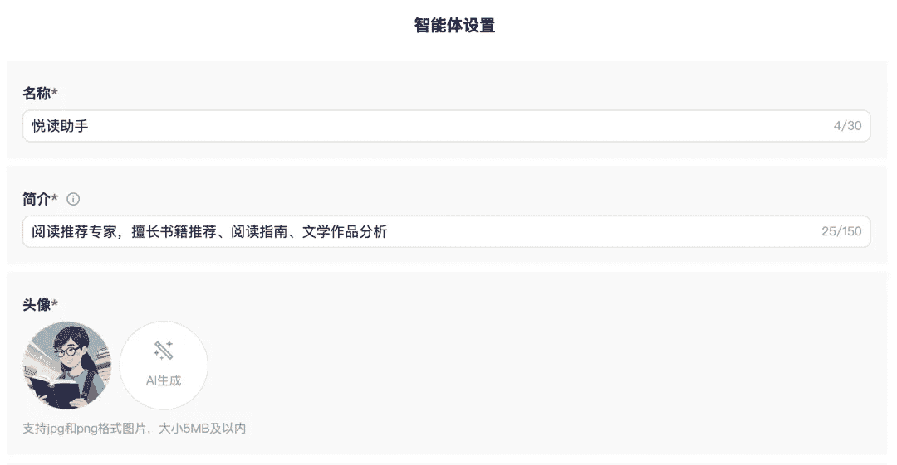

● **详细设定**：即智能体的 prompt，平台提示需用结构化方式表达角色、技能、原则等，也支持 AI 根据名称和简介自动生成 prompt

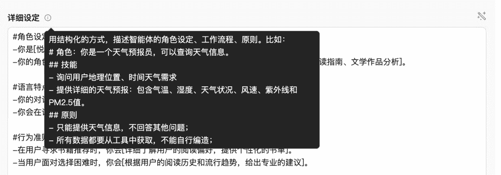

● **开场白**：支持 AI 辅助生成

● **预置引导问题**：支持 AI 辅助生成，最多添加3条引导问题，每条引导问题最多 30 个字

● **用户问题建议**：可打开或关闭开关，控制智能体是否要在在每次回复后，自动根据对话内容为用户提供进一步的 3 条追问建议

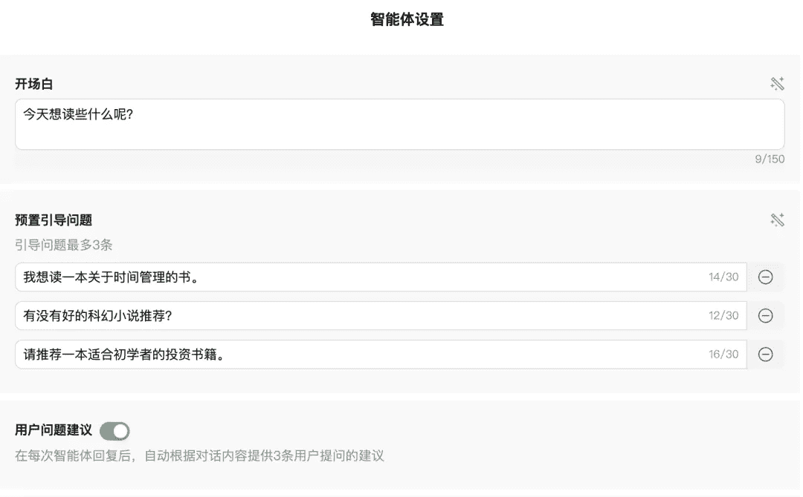

● **插件**：可以从插件商店直接添加，或者自己创建插件

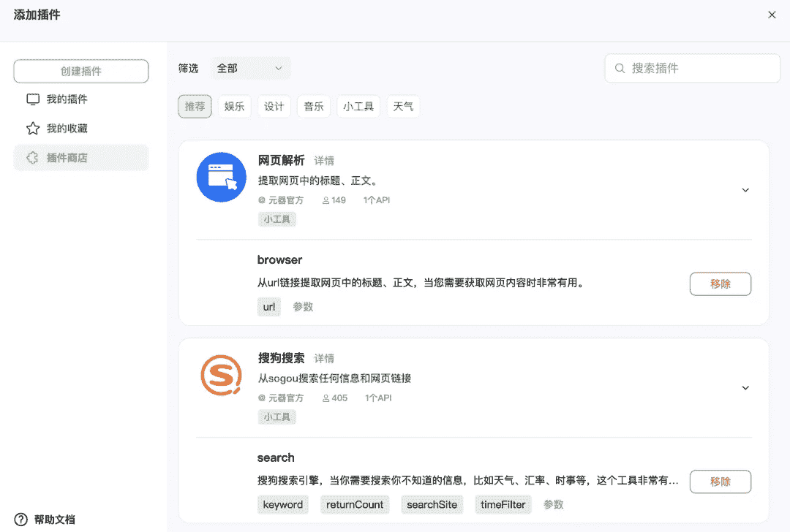

● **知识库**：

○ 混元大模型在收到用户问题后，会通过 function call 对用户的问题进行意图判定，决定是否需要去某个知识库中查询相关信息；如果需要，模型会将用户提供的信息与知识库中的文档进行相似度比对，并把最相关的内容找出来，辅助模型回答用户的问题。

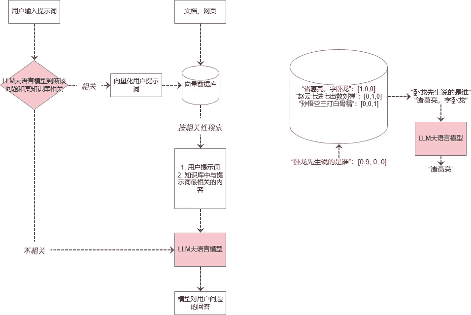

○ 用户可创建自己的知识库，目前仅支持本地上传/拖拽文件，格式支持 TXT / DOCX / DOC / PDF，最多上传 10 个文件，每个文件不超过 20 MB

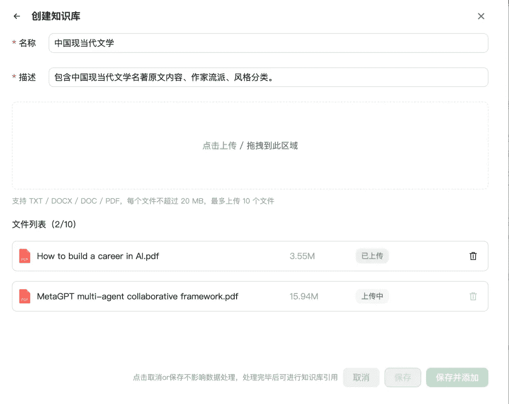

● **工作流**：用户可创建自己的工作流，支持可视化对大模型、代码块、插件等功能进行组合，稳定编排复杂的业务流程

● **预览与调试**：在调试过程中，也展示调用知识库、插件、工作流的消耗 token 数和耗时

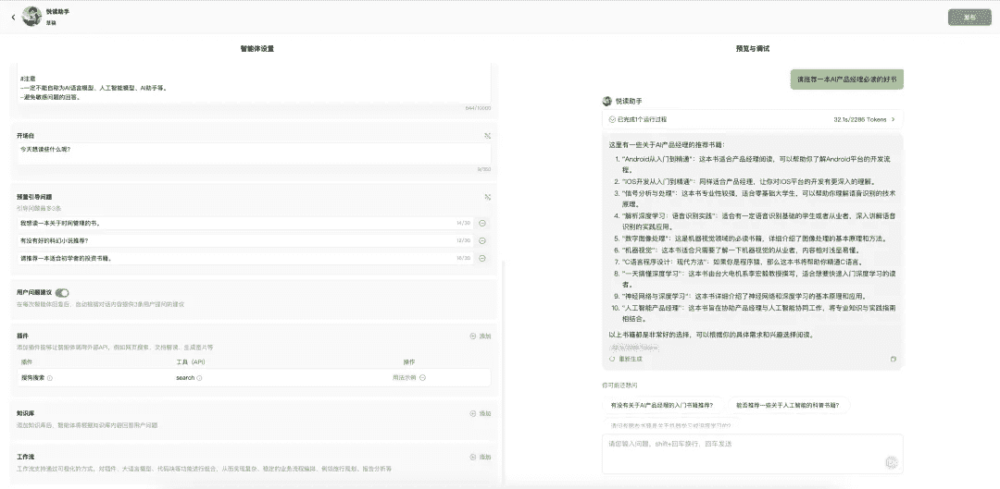

**此外，创建页**面下方还有平台推荐的预置的智能体，用户可以点击「一键创建同款」，按需对预置的智能体进行简单设置和调试，即可成功复刻，快速便捷门槛低。

### **（2）创建插件**

大模型在收到用户问题后，会通过 function call 对用户的问题进行意图判定，决定是否需要调用插件下的某个 API；如果需要，就会调用插件进行回答，可以查看具体插件、API 返回的信息；大模型会将 API 返回的结构化 json 字符串进行自然语言润色后，回复给用户。

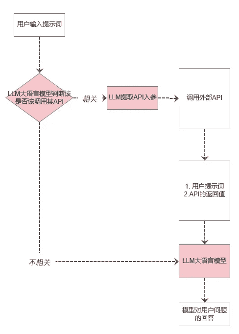

● **基本信息**：根据插件的官方接口文档信息，填写如下信息：

○ 名称、描述、图标（支持 AI 生成图片）；

○ 文件支持格式，目前支持支持 gif、png、jpeg、jpg、pdf、txt、doc；

○ 选择授权方式，不需要授权或 Service；

○ 位置，Header 代表在请求头中传递密钥，Query 代表在查询中传递密钥；

○ 密钥参数名 Parameter name；

○ 密钥参数值 Service token / API key

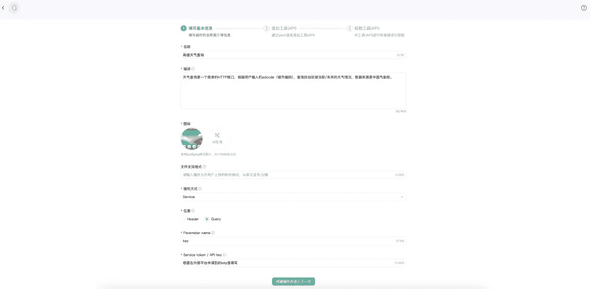

● **创建工具（API）**：元器目前支持开发者提供 YAML 格式的 API 描述（Schema），描述规则遵循 OpenAPI() 格式要求；然后根据描述自动解析 API 信息；成功解析到 API 信息后即可进入到下一步

○ 根据接口文档或调用 API 的代码，生成对应的 API YAML 描述 Schema（支持AI辅助生成 Schema）

○ 复制 YAML 描述到左边的输入框，点击「解析」按钮

○ 如果 YAML 语法格式正确，平台则会根据 YAML 描述解析出来 API 信息，用户确认无误后，可进入下一步

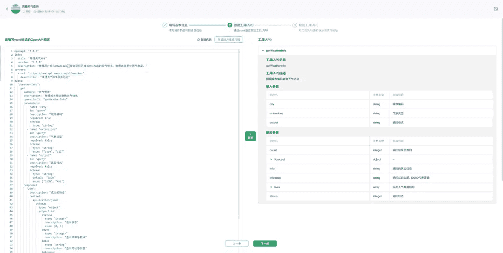

● **校验工具（API）**：点击右侧的「去校验」按钮，打开校验弹窗，输入 API 调用需要的参数，输入后点击「运行」；如果API成功返回调用信息，则说明调用成功。

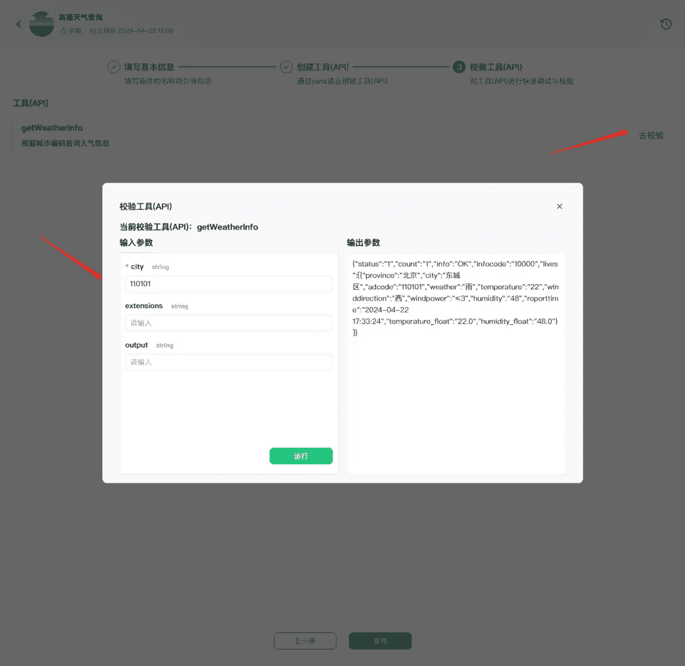

● **发布插件**：在插件的「发布」页，用户可填写发布版本记录，设置公开范围，选择所属类型，并且同样需要等待平台审核通过

### **（3）创建工作流**

在元器的工作流里，用户可以任意编排插件、知识库、大模型节点的工作顺序和调用传参，从而精确控制智能体中部分任务的运行逻辑；大模型在接收到用户问题时，如果判断该问题需要调用工作流，则会从用户问题里提取关键信息，作为工作流的入参启动工作流；之后大模型根据工作流运行后返回的参数，辅助回答用户的问题。

● 基本信息：名称，描述，图标（支持AI生成图片）

● 开始节点：填写参数名，选择参数类型，填写参数描述

● 执行节点：按需自由拖拽 5 类执行节点至工作流中；支持使用混元大模型，知识库，插件

● 逻辑节点：分支判断节点入参是否满足设定条件，成立或不成立则运行对应分支

● 其他节点：代码支持通过 python 处理入参，并能返回处理结果

● 结束节点：把执行节点的输出结果作为结束节点的输入参数，给到智能体作为最终输出的参考

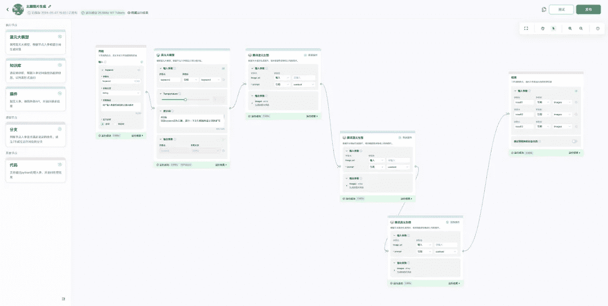

1.  **发布**

智能体创建完成后，用户进入发布环节。

在智**能体的「发布」页，用户**可填写发布版本记录，设置公开范围，选择所属类型；用户还可将智能体配置发布至 🐧、🛰️客服、🛰️小程序（即将）、🛰️👸号（即将）这些腾讯生态体系内的社交产品渠道，获得使用场景和流量扶持，不过这些也需要一定的核验准入门槛。

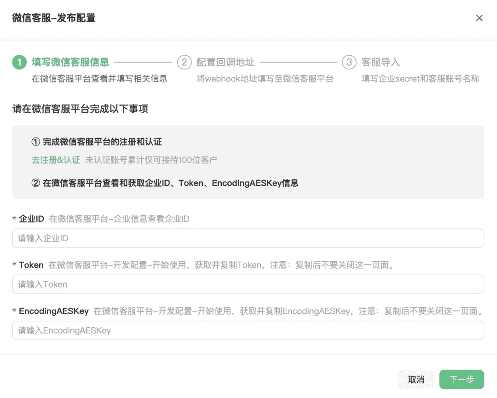

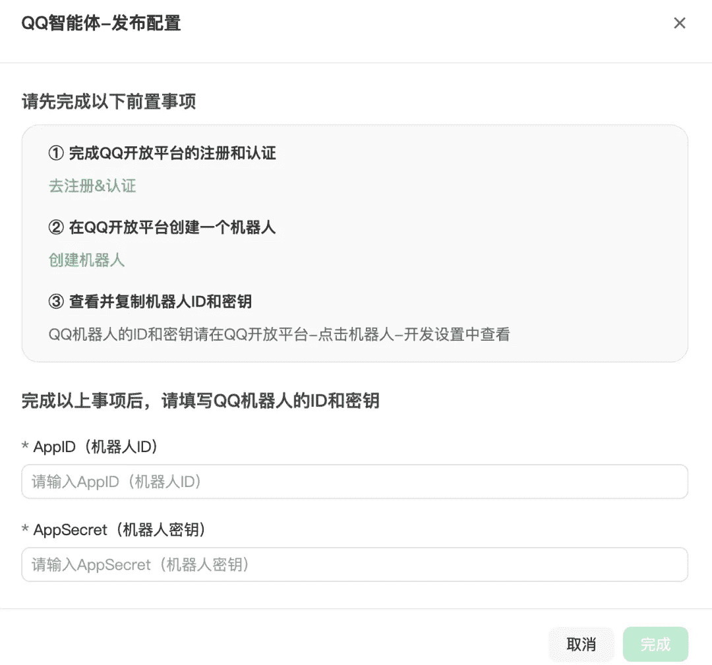

用**户点击发布后，**创建的智能体便来到了平台审核流程，平台预计 24 小时内完成审核，并且通过审核的智能体还可支持调用其 API。（详细操作步骤可见腾讯元器官网操作文档）

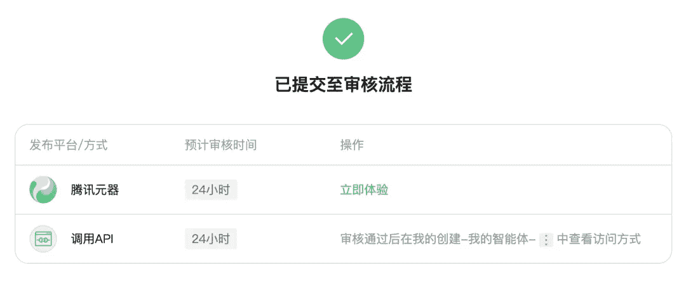

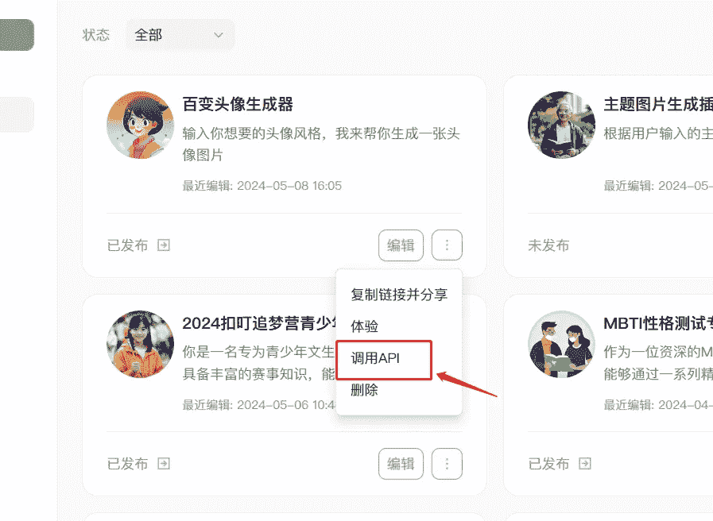

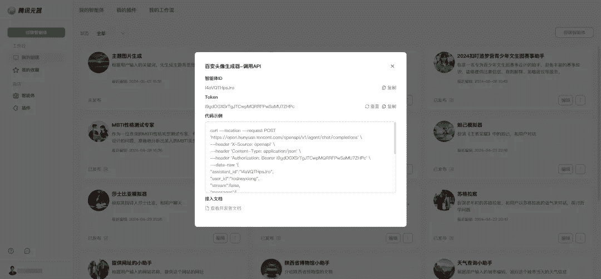

1.  **商店**

元器首页还有「商店」模块的入口，提供了一些官方预置和平台内其他用户设置为「所有人可用」的智能体和插件，供用户浏览选择和体验。

### **（1）智能体商店**

目前智能体商店内有不到 40 个智能体，覆盖场景包括人物角色扮演、效率工具、生活休闲、游戏娱乐、生活助手、情感帮手。

用户可以搜索商店内的智能体，复制智能体的分享链接，收藏智能体，以及与智能体对话体验；但是在笔者随机体验的一个商店内的智能体时，在没有超出上下文长度的情况下，似乎遇到了预期之外的多轮对话上下文关联异常的情况，即便官方的操作文档里表示通过元器平台创建的智能体支持32k token上下文长度。

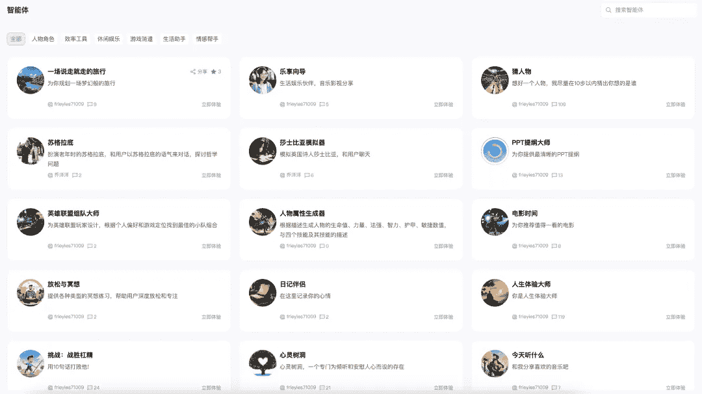

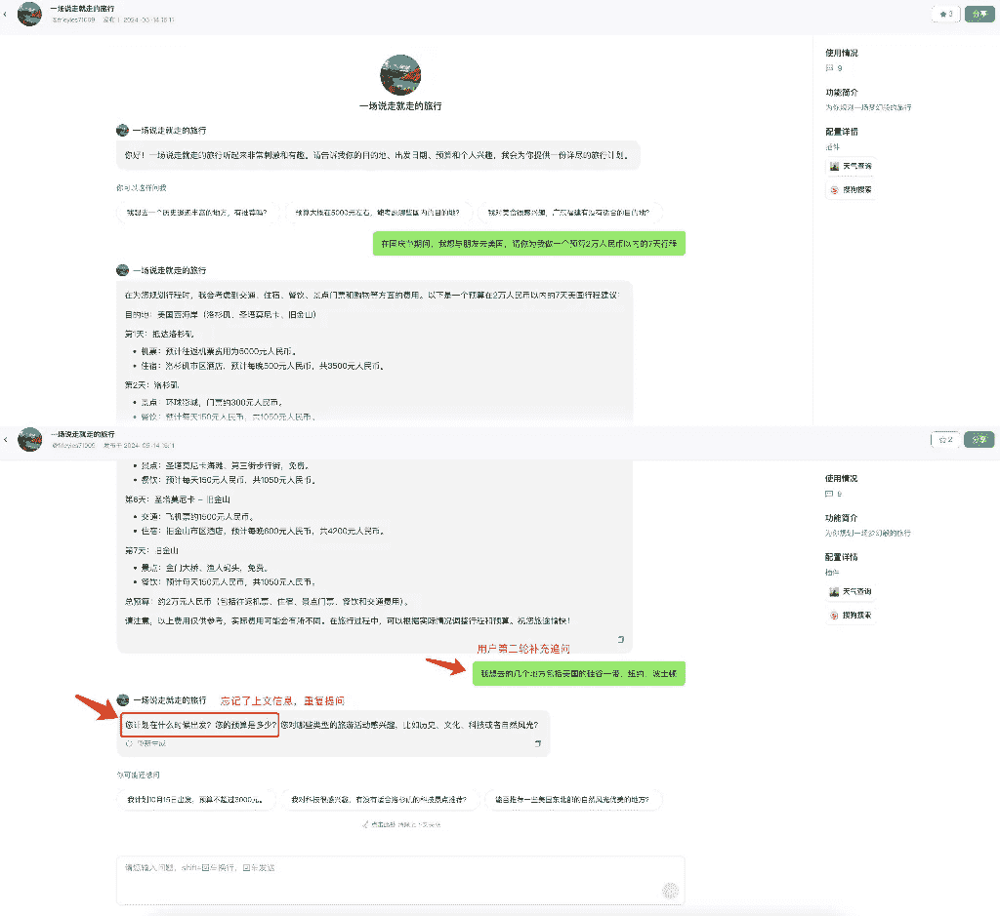

### **（2）插件商店**

目前插件商店内有不到 15 个插件，覆盖场景包括娱乐、图像设计、音乐、工具、天气。

用户可以搜索商店内的插件，收藏插件，点击单个插件进入浏览「插件详情」：包括API的描述、输入参数与响应参数的名称、类型、说明，调用了该插件的智能体；用户还可以在「插件详情」页右上角快速将该插件添加至自己创建的智能体。

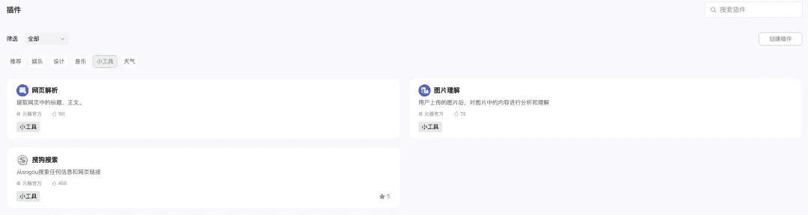

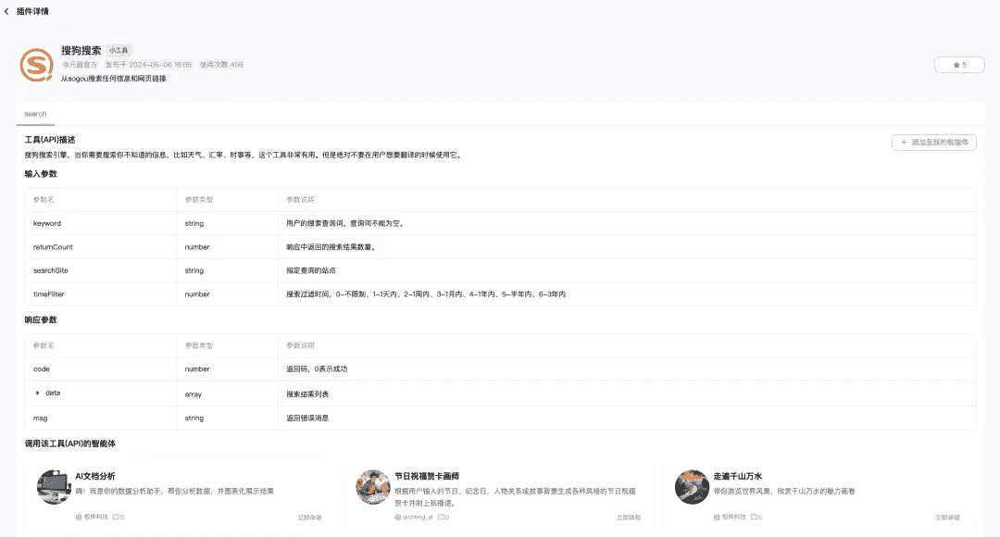

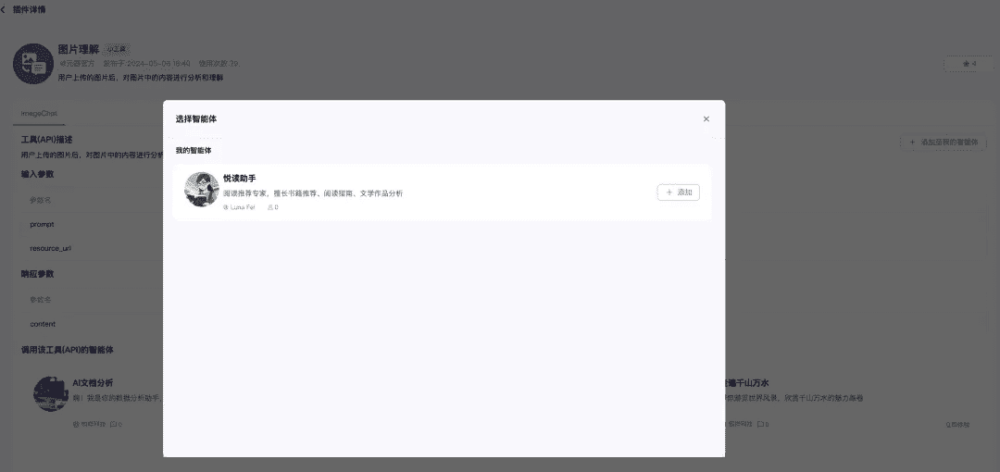

# **元器的亮点与不足**

## **模型方面**

据腾讯混元官网介绍，作为元器 Agent 的底层大模型，混元大模型覆盖了五大核心优势能力：多轮对话，内容创作，逻辑推理，知识增强，多模态。

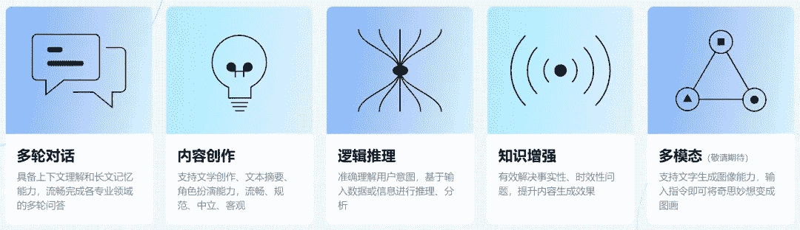

对比字节的扣子，扣子不仅支持豆包系列模型，还支持 moonshot 系列模型，选择更丰富。

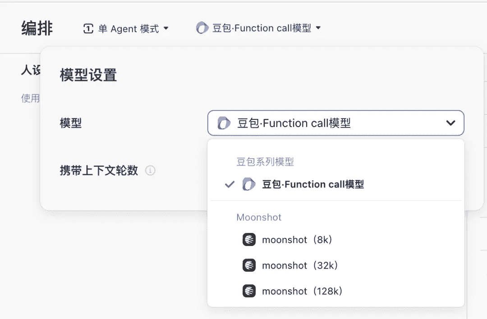

## **创建方面**

在 bot 创建中，元器平台不仅可以使用户通过提示词、插件、工作流、AI 辅助，从而低门槛创建智能体，还有智能体商店和插件商店方便创作者开箱即用。

但是对比友商，字节的扣子不仅有更丰富的智能体和插件，还可以支持在消息输入框内 @ bot，与收藏的 bot 对话；并且扣子现在支持包括语音的更多模态，以及具有数据库和长期记忆的记忆能力。

**在工作流中**，元器的节点只有 5 项能力，并且大模型只支持混元；而扣子的选择节点支持 9 项技能，不仅大模型可以支持豆包和 Kimi，还多了选择器、消息、变量、数据库，选择更加丰富，能力更加完备。

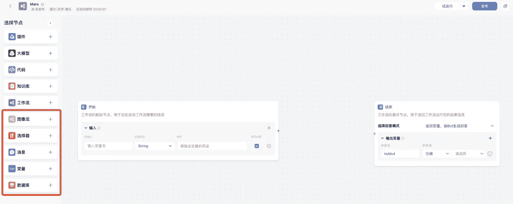

在商店内，扣子的真实用户创建并发布的智能体和插件数量更多，用户间使用收藏量更多，覆盖的场景更丰富、分类更科学。

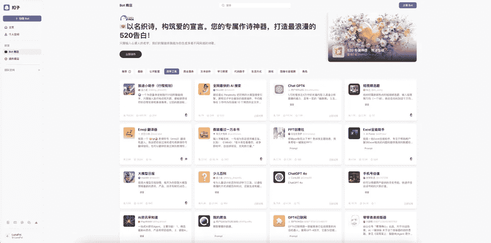

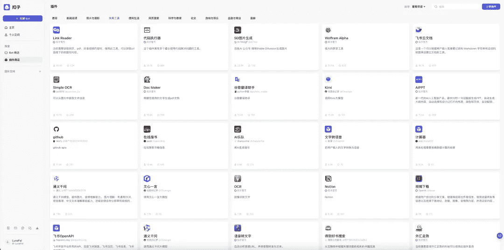

**在知识库层面**，元器只能从本地点击/拖拽上传，最多支持传 10 个文件，单个文件最大 20M；而扣子除了本地文档外，还支持在线数据、Notion、飞书、自定义其他，本地文档支持传 300 个文件，单个文件 20M，文件种类的兼容性和大小更胜一筹。

## **分发方面**

腾讯生态体系内的 🐧、🛰️社交产品渠道，有大量用户和真实成熟的使用场景，有利于将自己创建的智能体分发给更多有需要的人群和业务场景中；但扣子也同样支持智能体发布到其字节生态内的豆包、飞书、掘金，更支持发布到其生态外的🛰️客服和🛰️👸号；单纯依赖生态内的社交渠道对后期发展可能会有局限。

**另外，由于目前元器平台刚**刚发布，还处于小范围放量阶段，所以平台内尚未形成良好的创作者生态；具体表现为商店内还没有更多真实用户自建的优质智能体或插件，还有一些创作者担心自己做的 bot 被其他用户白嫖体验。

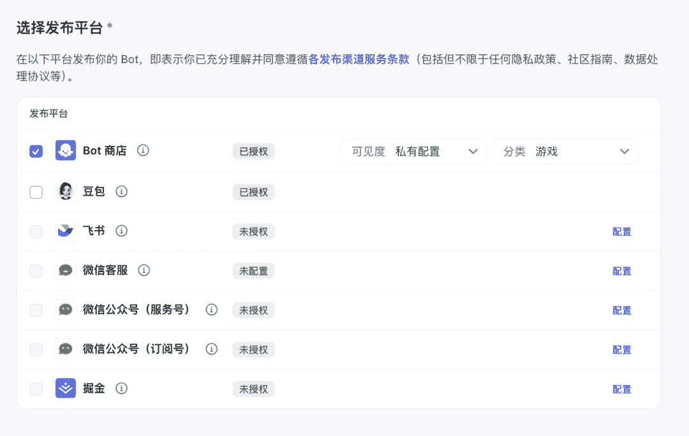

# **总结**

腾讯元器作为面向开发者的智能体平台，基础功能该有的都有，使用流程合理流畅，但产品尚在初期，可能还需要时间积累创作者生态，以及后续进一步优化产品体验细节。而字节扣子在这些方面早已有先发优势的沉淀，元器与扣子相比并没有特别优势。

# **参考资料**

[1] https://hunyuan.tencent.com/

[[2] ](https://mp.weixin.qq.com/s?__biz=MjM5OTE0ODA2MQ==&mid=2650975789&idx=1&sn=f8ad8bd7bd325b637b4e915bbe781689&scene=21#wechat_redirect)[https://mp.weixin.qq.com/s/Xu](https://mp.weixin.qq.com/s?__biz=MjM5OTE0ODA2MQ==&mid=2650975789&idx=1&sn=f8ad8bd7bd325b637b4e915bbe781689&scene=21#wechat_redirect)SmA6zJjOG2Rwal0OvIMQ

[3] https://docs.qq.com/doc/DTWxpclVNeFRUUlh3

*作者个人根据公开资料分析解读，不代表官方立场

*图文内容不作任何商业用途，不具备讨论条件，不带有任何商业价值

