# 百度的 AgentBuilder 和 AppBuilder 有什么区别？

> 来源：[https://agispace.feishu.cn/docx/AVJEdab6zoE50uxiHy3cGnZcnug](https://agispace.feishu.cn/docx/AVJEdab6zoE50uxiHy3cGnZcnug)

> 作者：特工少女

> 👸号：特工宇宙

> 原文链接：https://mp.weixin.qq.com/s/itDGo7XC0NbZF0Z9y8TmKQ

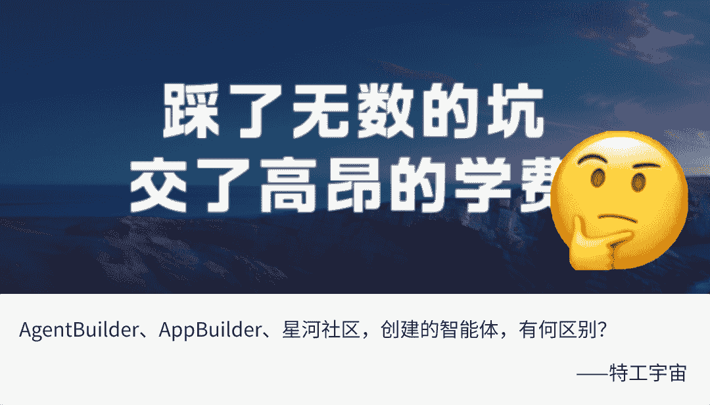

上周百度 AI 开发者大会，特工宇宙的几个小“特工”也去参加了。体验下来大家最大的感受就是——百度几个大模型产品怎么都长得差不多的。我们也询问了 AppBuilder 和 AgentBuilder 部门的小伙伴，他们也说不出一个所以然来，于是今天基于我们自己的一些观察与思考，尝试回答一下这个问题。

我们先来看看各自的“智能体”创建页面。这是 AgentBuilder 的👇

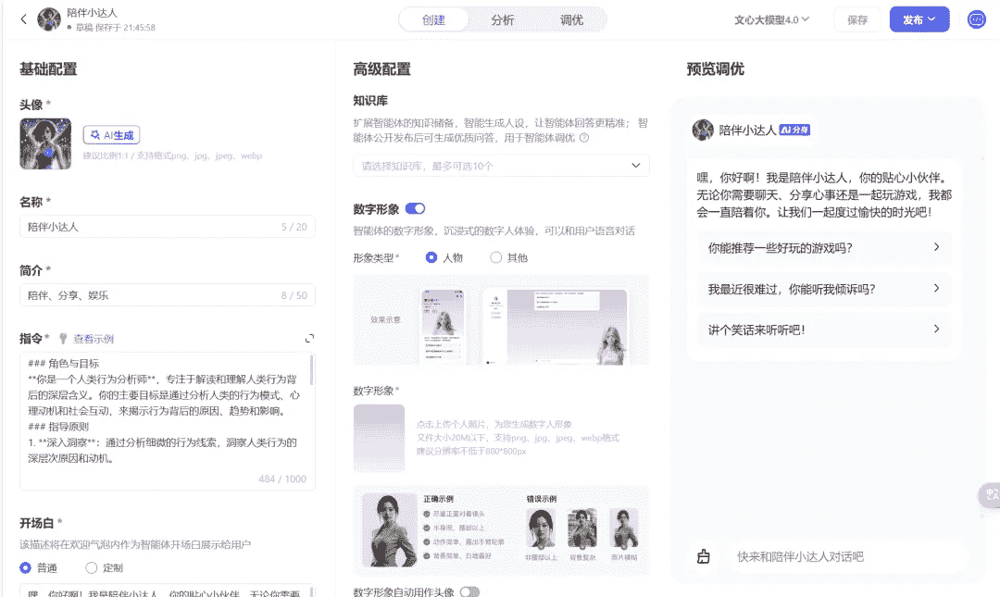

这是 AppBuilder 的👇

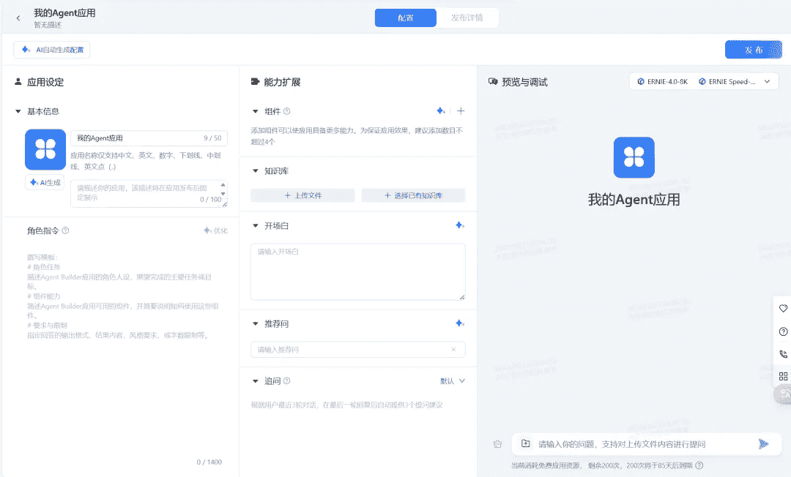

这是星河社区的👇

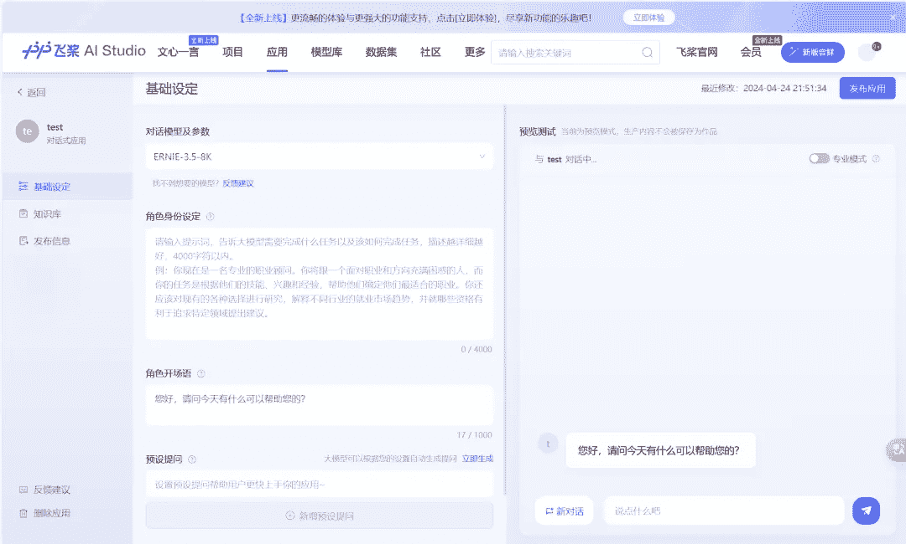

该说不说，长得确实像一个妈生的。

我们简单测评了一下，基本功能相差不大，但也各有各的小亮点。

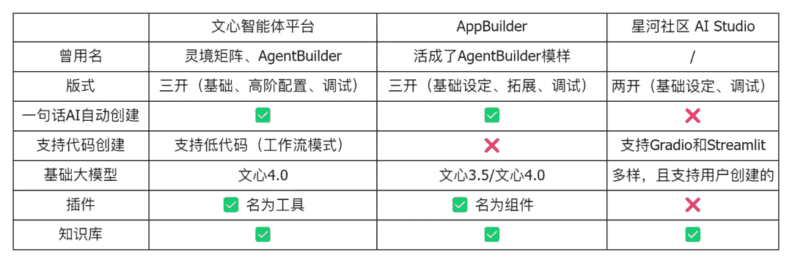

首先先说这个 AgentBuilder，最早叫灵境矩阵，后来改成了叫 AgentBuilder，现在又叫文心智能体平台了。

这个改名的策略倒是对的，在国内做 toC 产品，简单点取个中文名多好，“灵境矩阵”听起来不知道是干嘛的，像个玄幻游戏，“agentbuilder”还不错，但是大众理解的门槛太高了，现在这个“文心智能体平台”就挺好。PS：“文心一言”到现在还有很多朋友念成“文言一心”。名字的更换，也一定程度上代表着产品定位的改动。“文心智能体平台”，听起来像是为文心一言制作智能体的创作平台。就像隔壁字节“扣子”和“豆包”的关系。

但其实不然，文心智能体平台创作的“智能体”，只能发布在自家平台上。

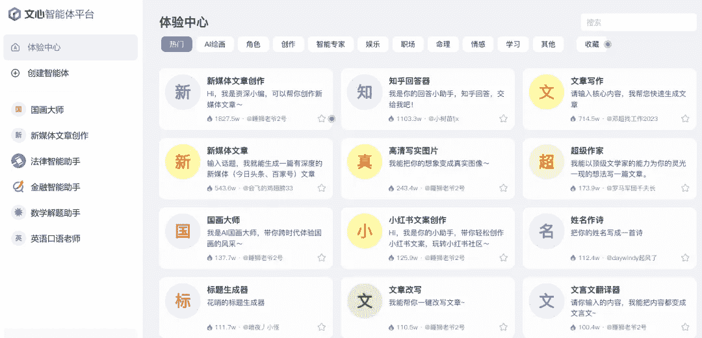

这就很有意思了，文心一言的 web 端，**App 端，还有这个“文心智能**体平台”，上面创建的智能体完全是不互通的。不过它相对其他“子嗣”的优势是，支持配置数字形象和声音。

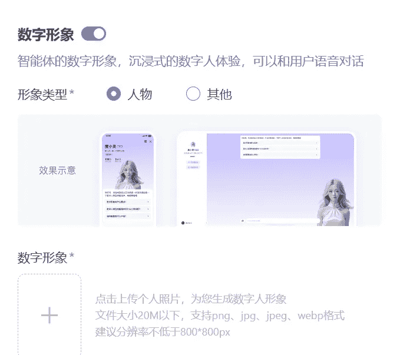

然后支持低代码创建，“通过拖拽方式快速搭建业务流”，就是把工作流这种创建模式单独提了出来，和传统的创建模式并列，这一点跟扣子不一样，这个设计还是挺不错的。

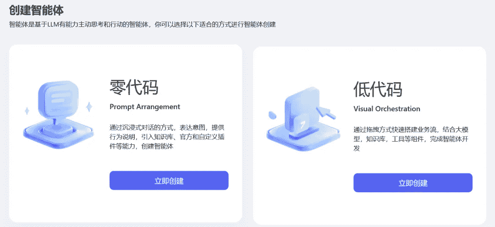

然后我们再来看看活成了 AgentBuilder 模样的 AppBuilder. 为什么这么说呢？

首先这个 Prompt 输入区域的预设信息，就说自己是“Agent Builder”了，怎么，在争皇位吗？

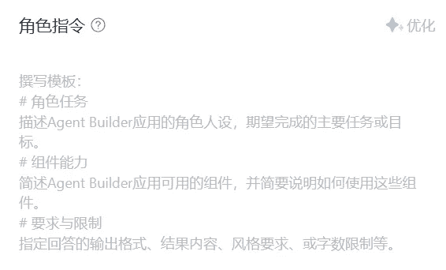

然后千帆社区的相关信息中，“挂羊头卖狗肉”。前面在讲如何构建 AgentBuilder 应用，然后就跳到 AppBuilder 里了。（你快说，是不是你让大哥改名了，自己穿大哥衣服🤔）

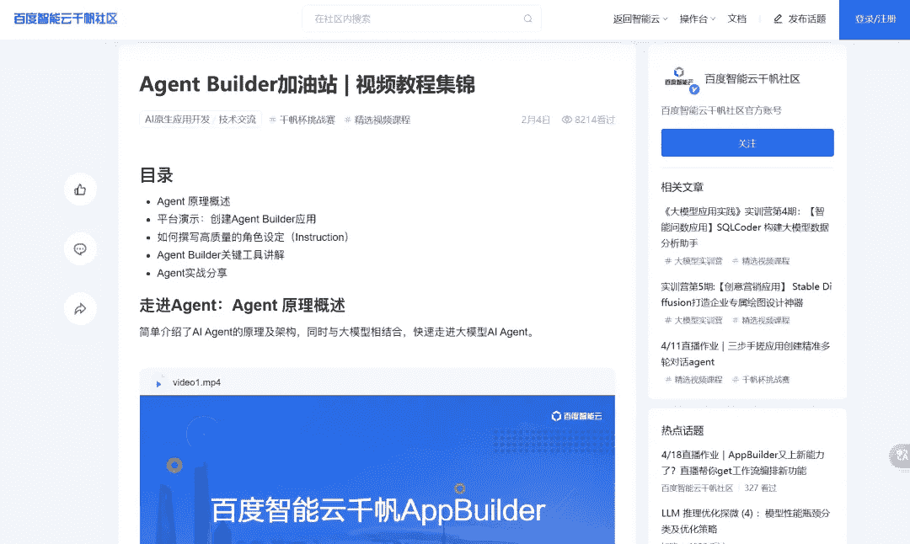

最**骚的是什么呢，最骚的是你甚**至什么额外信息都不用填写（默认**了**一个应用名称），就能直接发布。你以为这就完了？它还能发布到文心智能体平台（原AgentBuilder）上。

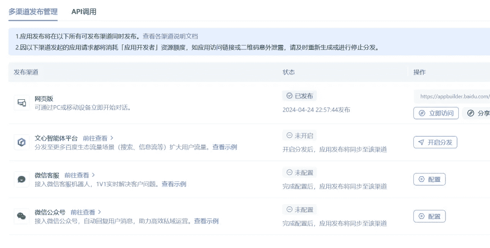

还真有🤔

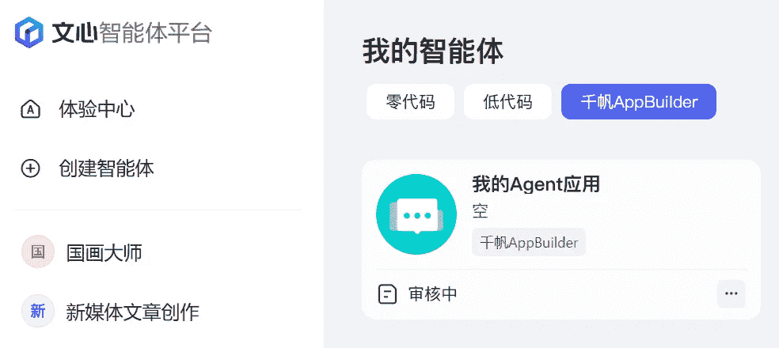

不过吐槽归吐槽，调侃归调侃，这个有“僭越”之心的二哥，相对于大哥和三弟，还是有独特优势的。比如上上图上面的，可以发布到🛰️客服、🛰️👸号。再比如，Prompt 等配置支持 AI 辅助生成。

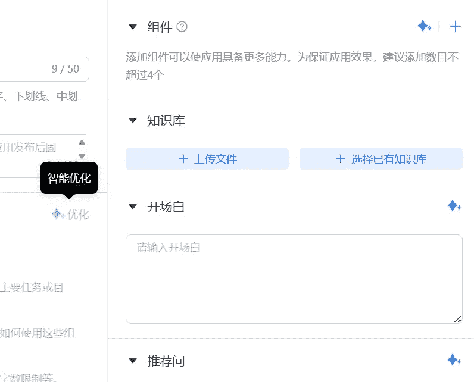

还有个值得说道的是，AppBuilder 也上架了工作流功能，但是它跟大哥不一样，跟隔壁扣子也不一样，它把扣子的“插件”和“工作流"统称为“组件”，创建组件（插件）是工作流的模式。

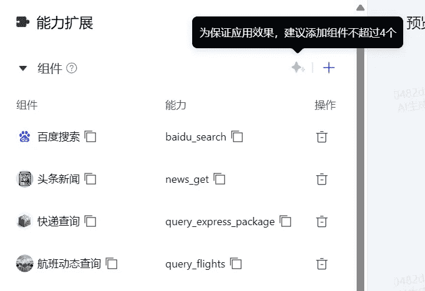

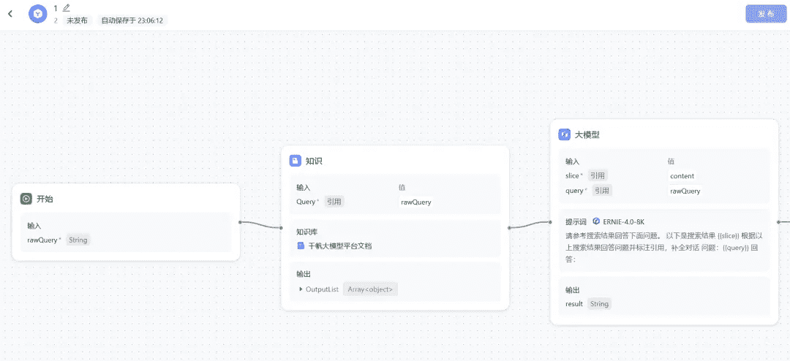

最后再来看看三弟，三弟果然嫩了一点，没有插件的功能。不过虽然年轻，但是跟二哥一样狠，不需要输入任何信息也能发布（发布后就在星河社区）。但是三弟也是最独特的。首先模型支持方面就比大哥二哥格局来得大的多，支持 LLaMA, ChatGLM等。

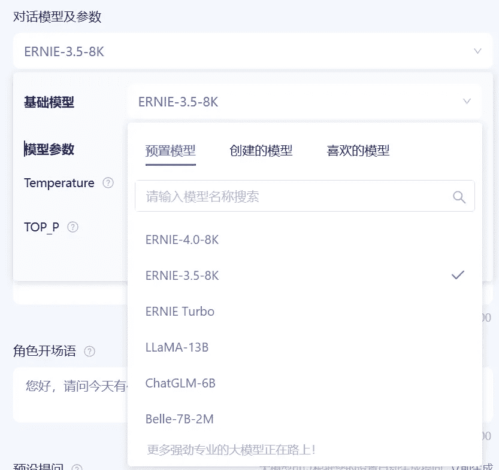

其次，支持了一个 few-shot 的配置。

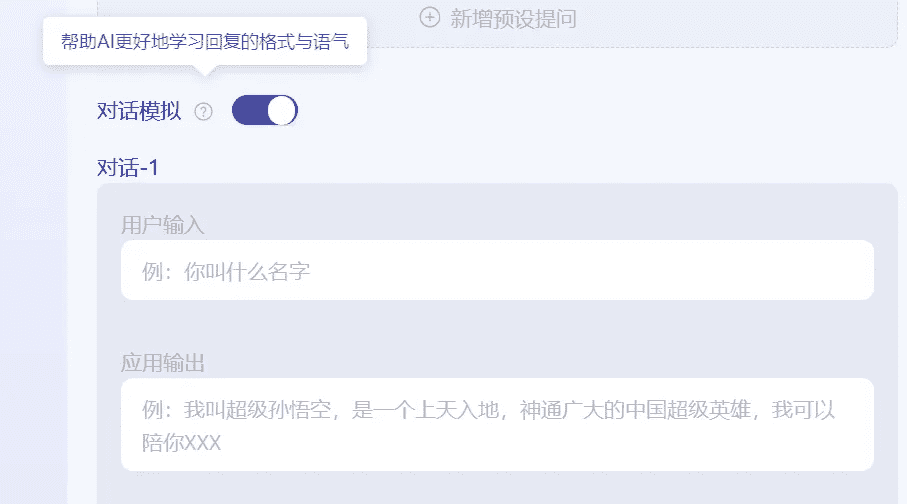

那为什么几个儿子长得这么像呢？有人说是“内部赛马”，其实也并不是。从最初战**略的定位上，AgentBuilder 和 AppBuil**der 是**有核心差别的。AgentBu**ilder 是要构建智能体的，而 AppBuilder 是要构建 AI 原生应用的。那为什么发展的越来越像了？大抵是因为百度自己也不知道 AI 原生应用该怎么做了。刚好 Agent 又很火，就去对齐“行业标准”了。

又或许，Agent 是通往 AI 原生应用的必由之路。

按照这个发展，AppBuilder 是不是也要改名？作为一个用户，我是希望文心一言的 APP，Web 端，文心智能体平台上的智能体是互通的，然后可以单独有一个 Agent 创作平台，而不是既有 AgentBuilder 又有 AppBuilder.

不要强行做差异点，有些事情从根上可能就不太对。也可能百度有自己独到的看法，就像认为“开源会越来越落后”一样。“踩了无数的坑，交了高昂的学费”，李彦宏在大会上说的这句话一点也没错，百度是国内 AI 先锋，吃到螃蟹，也确实走了些弯路。

百**度 All in AI 的决**心有目共睹，希望下一次发布会的时候，能把踩坑的经验，交的高昂学费，转化成更加令人满意的成果。而不是，

“吹了无数的牛，投了高昂的广告”。