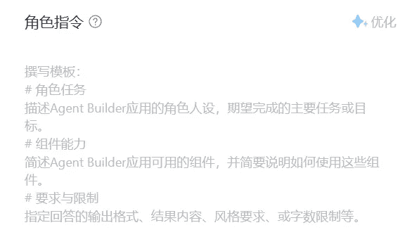
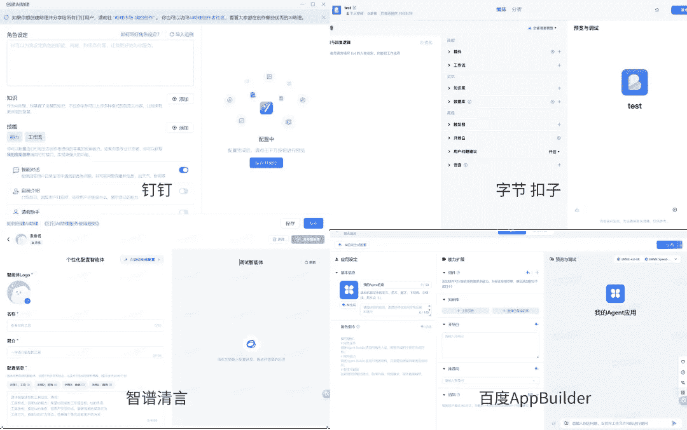
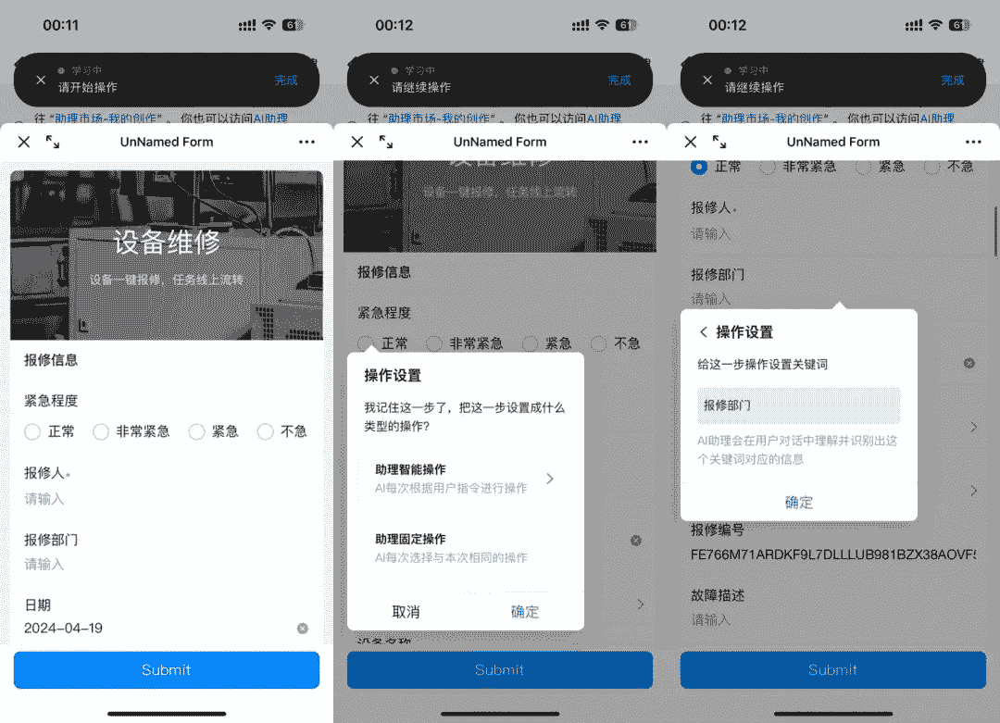
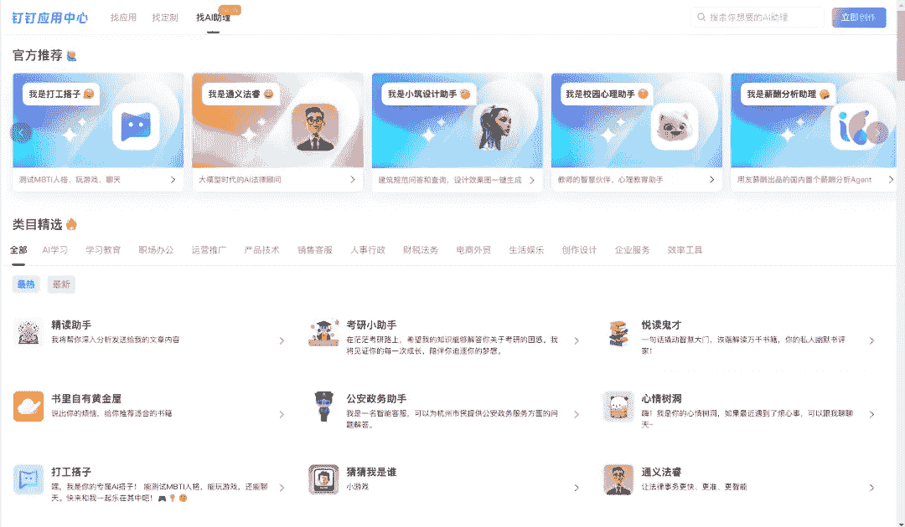

# 浅谈当下国内 AI Agent 现状，钉钉和扣子走在前列

> 来源：[https://agispace.feishu.cn/docx/I3jFdeeg8onCfMxPu0ncDTBGnhh](https://agispace.feishu.cn/docx/I3jFdeeg8onCfMxPu0ncDTBGnhh)

> 作者：特工少女

> 👸号：特工宇宙

> 原文链接：https://mp.weixin.qq.com/s/mc1E8BWpmtjMlDdE38Yfug

两个多月前，我写过一篇文章：字节的Coze、扣子和GPTs，有什么区别？浅谈了我对 Agent 和 GPTs 的一些思考。两个月后的今天，我们可以看到，GPTs 逐渐过气，字节的扣子逐步出圈，而钉钉、百度、Dify 等也都上线了工作流功能。且 Agent 的热度也越来越高，尤其是近段时间吴恩达教授在红杉演讲后。

今天，我把观察到的，以及思考的一些观点，罗列出来，供大家学习交流，欢迎在评论区一起探讨。

1.  国内其实真正做 AI Agent的并不多，很多做 AI 聊天机器人的，都是在蹭“智能体”的概念，反思、规划，环境感知什么的都没有的，顶多算个 ChatBot，Agent 不应该是这样的。

1.  **国内 All i**n AI 最猛的三家是阿里、百度和字节。可能是 FOMO心理作祟，害怕错过 AI 的任何机会。前几天去深圳参加百度的 AI 开发者大会，体验一般，上午光听吹牛了，展厅也不是很大，看似在讲技术讲产品讲发展，其实背后都是百度自己的广告。看了一天下来就一个感触，百度怎么各个产品都长得差不多的？文心一言、AgentBuilder、AppBuilder、星河社区...玩法都几乎一样，最骚的是，AppBuilder 创建过程中，在提示你如何创建 AgentBuilder。这个改天我会着重讲讲（不过调侃归调侃，百度这些年的资源和沉淀还是不容小觑的，总有人觉得自己比百度更懂 AI 哈哈）。

我确信我打开的是 AppBuilder

1.  字节的 AI 产品倒是做的蛮好的，虽然自家的云雀大模型很拉跨。豆包的用户体验很不错，尤其是 TTS 语音这块，据说日活也早就超过了文心一言。字节的扣子/ Coze 也比较惊艳，我们往期文章介绍很多了，这一次就不展开了。

1.  **阿里钉钉的 AI **助理我之前也评测过，它可能是最容易被企业用起来的一个。上周他们又正式发布了自家的 AI Agent 市场，已经上线 200 多位 AI 助理，覆盖办公、生活、娱乐各场景。它的特点是上面有很多专业场景的 Agent，有很多还具备了行动能力，不光只是问答。比如用友薪酬搭建的“薪酬分析助理”，能够查询公司的人力成本、人员流动，提供岗位的市场竞争力判断。

1.  稍微扯远一点，最近很火的 Kimi 没有做 Agent 的迹象，我们在此不讨论。科大讯飞有点高开低走，现在主要搞 AI 鼠标去了？360 还是比较聪明的，老周懂得扬长避短，在自己擅长的浏览器、办公软件、网络安全领域结合 AI，然后做自媒体做公开课，用内容带动口碑，用流量撬动产品增长。

1.  然后腾讯一直没什么动作，也跟在混元的朋友聊过，偶尔会放出来一些 demo，但迟迟没什么大动静。不知道是黔驴技穷了，还是在憋大招。在所有 AI 独角兽公司里面，智谱清言还是比较不错的，但产品功能上没有太大差异点。

几家 Agent 创建页面对比

1.  回束主题，我去年最喜欢的 Agent 产品是 Dify，它是国人做的，是除了 Langchain，在 Agent 领域 stars 数最高的开源项目。Dify 很开放，上面接入了很多家大模型，有时候测试大模型能力也会在 Dify 上白嫖，偶尔也会基于 Dify 做些小玩意，很良心的一个项目，不过后来 Coze 和钉钉 AI 助理上线后我就变心了。

1.  **我当下最看好的两个产品是钉钉 AI 助理和扣子，且对** Dify 等 AI 初创公司是降维打击。主要是其他产品看不到独特的优势，活在钉钉AI助理和扣子的影子里。钉钉近期还上线了一些 AI 助理的进阶能力，比如工作流、拟人操作、高级自定义等，去拓展其 Agent 的行动能力。

1.  工作流算是现在 Agent 的标配了，可以让 AI 处理更复杂任务。各家也都有，扣子一直蛮坚定做 flow 且努力的了，尽管 workflow 测试下来经常有些小问题。钉钉倒也独特，搞个工作流连画布都没有，不过贴心地配置了一些常用工作流模板（这玩意不提供一些模板，小白还真写不来），模板虽然没国外 AgentHub来的多，但是在国内算做的不错的了。

1.  Age**n**t 应该具备感知、规划、记忆和执行等能力，甚至可以模仿人的行为。于是钉钉上新了一个“拟人操作”功能。“拟人操作”是个什么操作？简单说就是让 AI 在背后学习你的一步步操作，拟人化地“看”用户真实操作，一遍就学会。之前 PC 端有类似的产品，也有个 AppAgent 的论文，钉钉的“拟人操作”算是LAM（Large Action Model）+模仿学习（imitation learning）的一个有益尝试，想象力很丰富，可以去测试下。

实测了一下“拟人操作”

1.  **扣子和钉**钉这两个产品，其实不完全在一个生态位上面，扣子的插件是更加开放的，种类更多，和月之暗面的合作就能看出，更多地为开发者服务，提供了一个非常好的工作台。而钉钉的开放更多的是把生态 ISV、低代码应用融合进来。生态可以在上面构建自家的AI助理，低代码应用也可以秒变 AI 助理，以一种离用户更近的产品形态取代原来的。钉钉原有的开放能力已经验证其生态的商业路径的合理性。

1.  为什么我当下也最看好钉钉 AI 助理呢？过去一年，钉钉先是将 20 多条产品线用大模型重塑，再是推出 AI 助理产品，上线 AI 助理市场，它与业务场景、企业真实需求强绑定，发挥自己独特的优势。因为钉钉是思考的比较明白的，且做了很多落地的事情的。最近看报道，已经超过 220w 企业用钉钉 AI 助理了，还是比较夸张的。

1.  前段时间朱啸虎的访谈有提到，AI 的 ToB 已经开始赚钱了，C 端还处在一个迷茫之中。我认为像移动互联网中的🛰️、抖音这样的 Supper App，在 AI 时代相对还比较遥远，短期内 B 端的机会会更大一些，所以某种意义上说，谁拥有更多的 B 端资源，当下生存空间就更大一些。

1.  **目前大厂，尤其是 AI 初**创公司，大部分都是在拿着锤子找钉子，即便是GPTs，也缺乏明确的用户需求，用户有需求时才去找 AI。钉钉不太一样，钉钉拥有天然的应用和场景，基于各种应用和场景再反向接大模型创建 AI 助理解决问题就更加合理（所以飞书又在干嘛）。

1.  为**了更好的将 AI 落地，**各家基本都支持或即将支持导出 API 融入到个人或企业应用系统中，解决开发者最后用一公里的问题。钉钉又不太一样，很多企业就“长”在钉钉上，各种数据也在上面，那就直接跟着钉钉混就好了。钉钉也把生态 ISV、低代码应用融合进来，构建自己的生态壁垒。

1.  此外，**无数打工人（比如我**），上班就是用钉钉的，AI 助理又不收费，肯定是要去试试的，一试就会发现确实还挺好用的，主要是我改个文档，写个方案什么的，不用跳转别的 AI 产品了，直接在钉钉上用 AI 助理一站式解决了。创建的 AI 助理还能分享到团队里，拉入到群聊里，更好地发挥协同作用，这一点还是比较独特的。不是说别家的不能实现，但是要配置又要部署，总归是麻烦的。

1.  **钉钉首批上架的 **AI 助理的个数不多，走的是上架审核逻辑，更考虑实用性原则**。虽然也有聊天、创作类助理**，但相对来说，更多的是提供专业服务类的助理。而其他 ToC 的友商为保证更高的可玩性和用户停留时长，会更追求数量。我们之前也写过一篇文章：实测十余款AI助理，只有这款最合我心意。介绍了在钉钉上创建 AI 助理的流程，感兴趣可以去看一下。

钉钉的 AI 助理市场

1.  总的来说，尽管 Agent 非常火热，但国内还是属于早期探索阶段。期待能迭代出更优秀的 Agent 产品。

