# 基于 Dify + 大模型（LLM）+ 智能体（Agent） 手把手从0-1构建私有化智能助手

> 来源：[https://agispace.feishu.cn/docx/Dda4d3aUSoEhouxU4f7cLHbJnOb](https://agispace.feishu.cn/docx/Dda4d3aUSoEhouxU4f7cLHbJnOb)

> 作者：   译点

> 👸号： 每天译点晓知识

> 原文链接：https://mp.weixin.qq.com/s/nic_x165MpT98cW2OXzcJQ

### **前言**

人工智能技术领域持续火热，智能助手已经成为企业和个人提高效率、获取信息的重要工具。构建一个私有化智能助手，不仅可以满足个性化需求，还可以确保数据安全和隐私保护！

智能助手已经成为我们日常生活和工作中不可或缺的一部分。本文将详细介绍如何基于 Dify、大模型（LLM）和智能体（Agent）从零开始构建一个功能强大、易于扩展、私有化智能助手，帮助读者了解整个构建过程和涉及的关键技术。

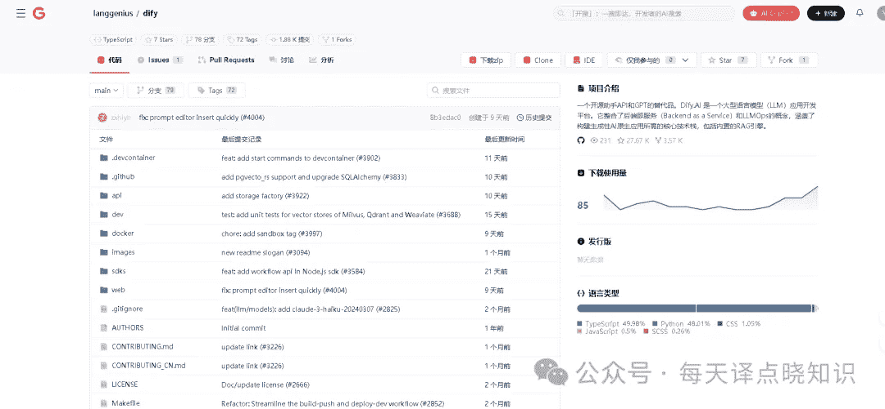

### **安装部署 Dify**

Dify 是一个开源助手 API 和 GPT 的替代品。Dify.AI 是一个大型语言模型（LLM）应用开发平台。它整合了后端即服务（Backend as a Service）和 LLMOps 的概念，涵盖了构建生成性 AI 原生应用所需的核心技术栈，包括内置的 RAG 引擎。这样一个开源的机器学习框架，提供丰富的算法和工具，对开发者进行模型训练和应用开发是极其方便的。

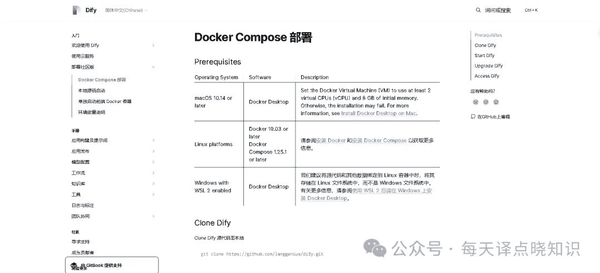

这里，我们在 Windows 操作系统上进行 Docker 虚拟化零代码安装：

+

```
docker compose up -d
```

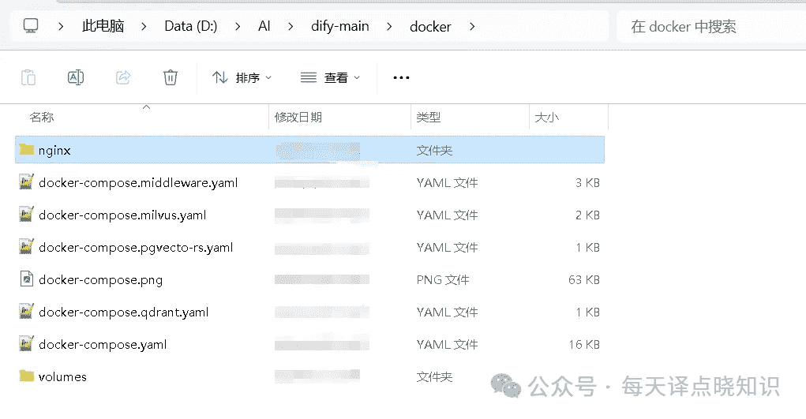

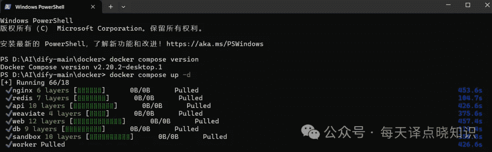

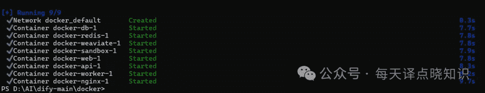

检查，查看各个容器是否都正常运行：

+

```
docker compose ps
```

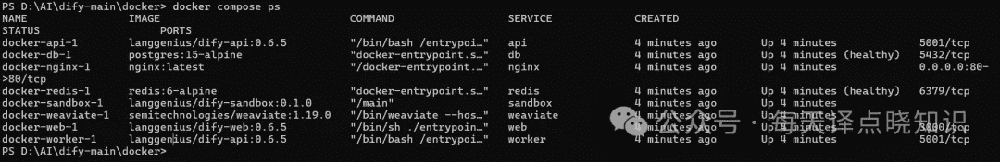

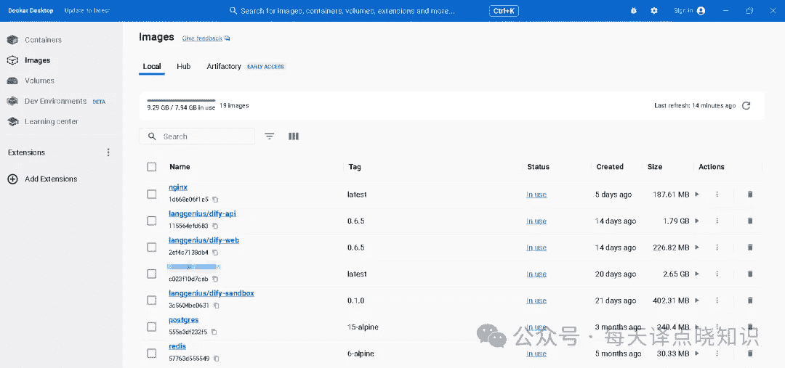

下载&安装 对应版本，根据操作系统任选其一即可。

### **搭建 私有化知识库**

输入本机地址，进入控制台：

+

```
http://localhost
```

首次，第一次初始化，需要设置管理员邮箱账户以及密码：

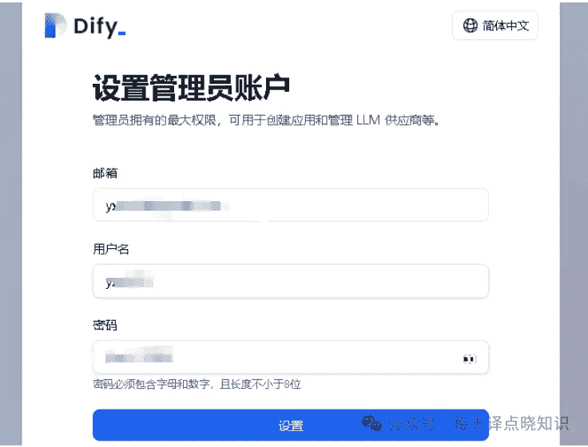

接下来，使用刚才输入的账户+密码，登录系统：

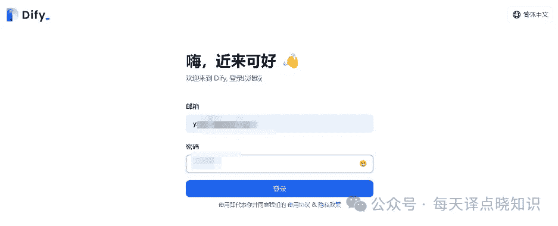

进入之后，我们可以看到菜单栏目：

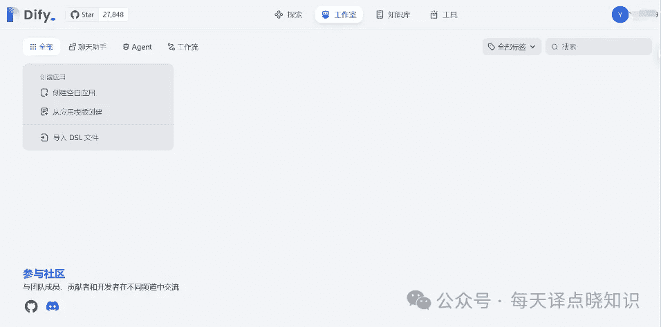


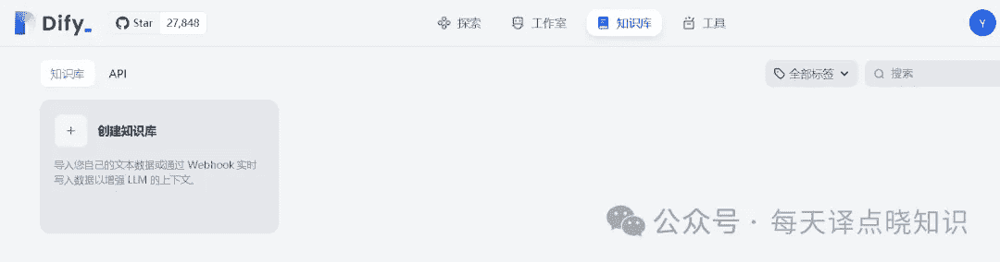

这里我们以译点准备的架构圈手册，为数据源：

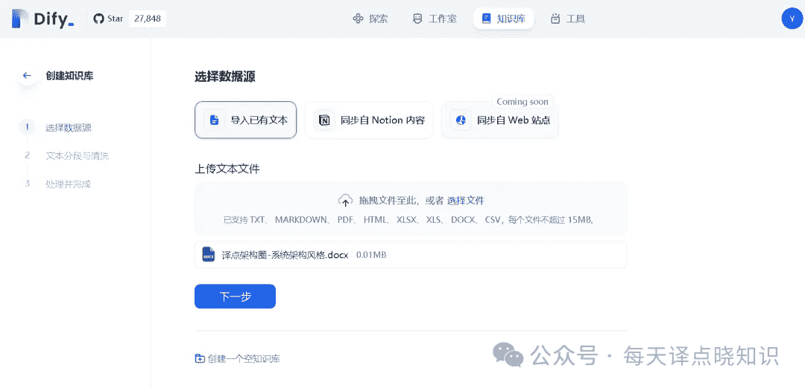

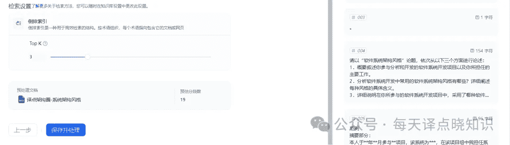

下一步，点击保存并处理，待平台响应 100%：

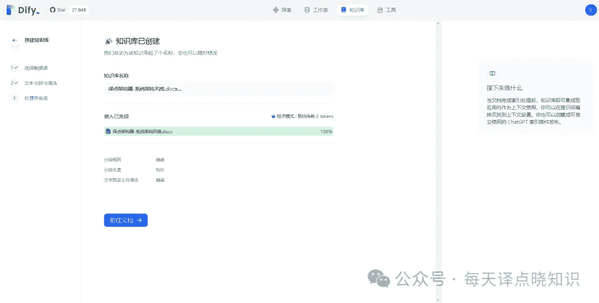

这样我们就能看到，译点架构圈手册已经正常载入。

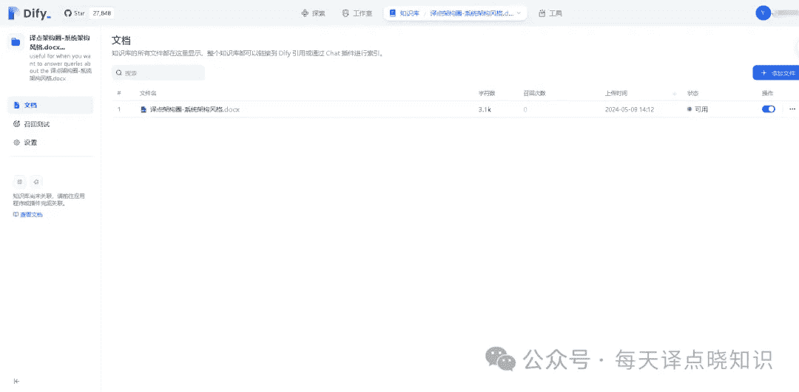

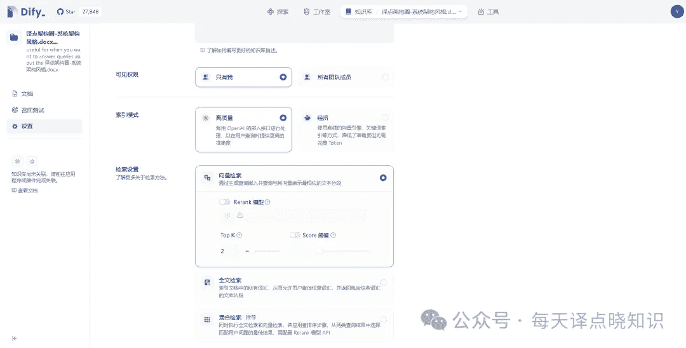

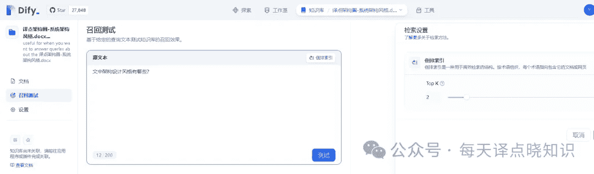

上述，一个简易的个人知识库搭建完成，输入源就是私有化文件或其他知识内容。

其中，大模型（LLM）的选择性也是有很多，不再赘述->参见：

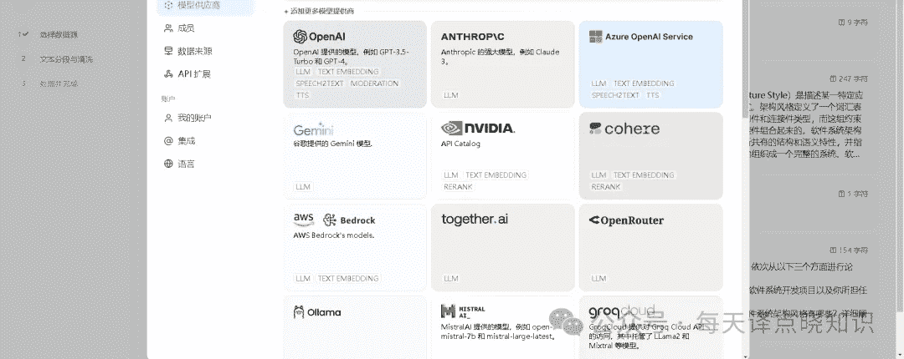

### **构建人工智能体 Agent**

智能体是一种能够自主决策和行动的软件实体，它可以与环境和用户进行交互，实现任务的自动化处理。在本项目中，我们将使用智能体作为智能助手的核心组件，负责处理用户的请求和生成响应。

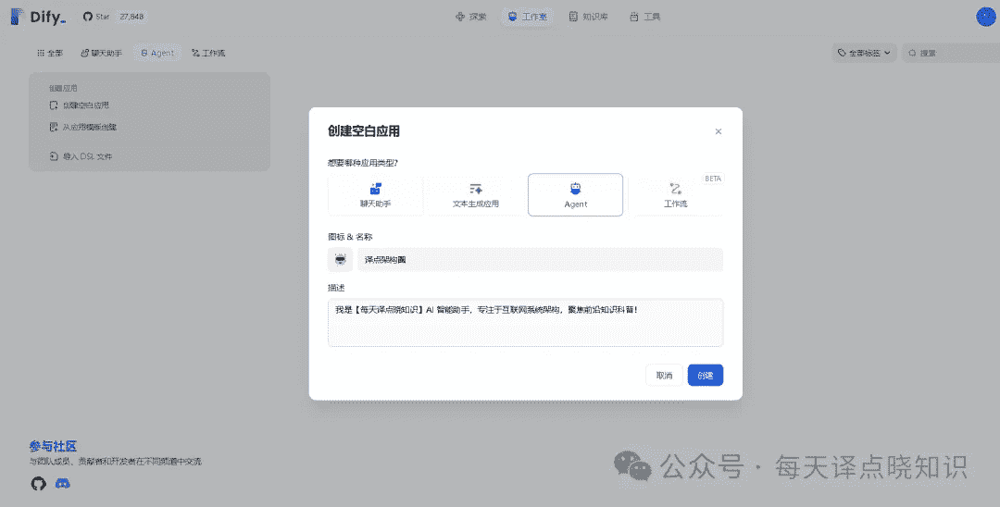

构建智能体，输入名称跟描述内容，设置相应功能：

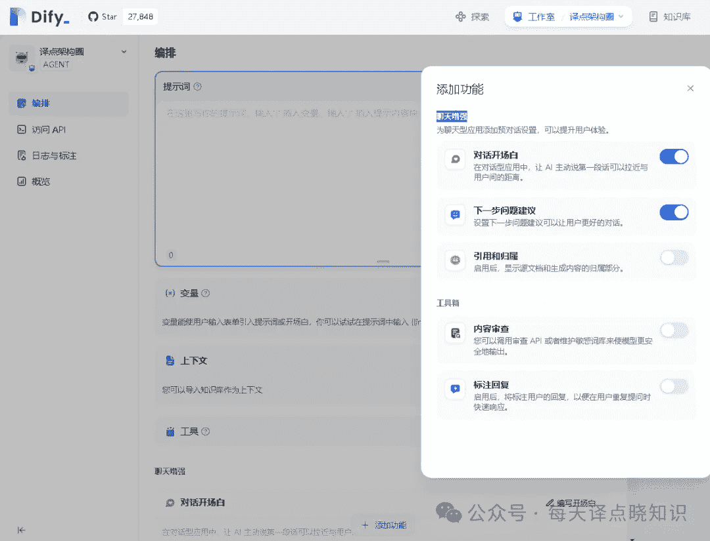

构建智能体有多种方式，直接单独创建 Agent 或 执行工作流：


节点提供了很多内置工具，选择你需要的即可：

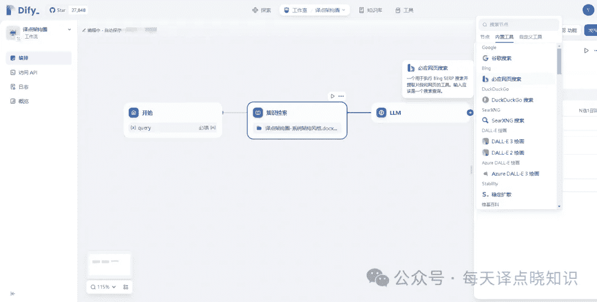

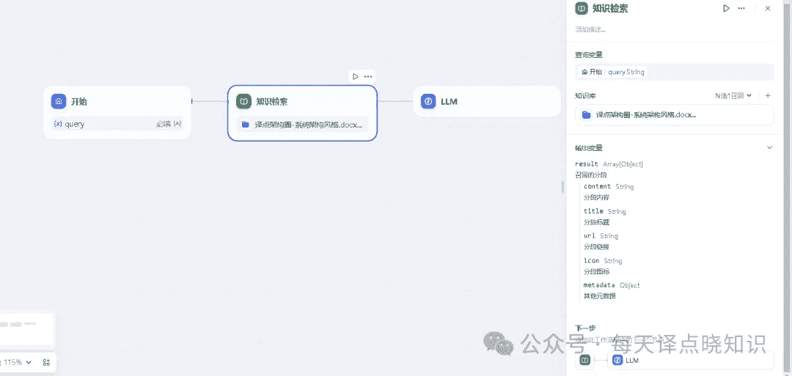

**智能体（A**gent）构建历程数据准备：收集并整理大量**的语料数据，**用**于训练 L**LM 模型和智能体。模型训练：使用 Dif**y 框架对 **LLM 模型进行训练，提高模型在自然语言处理任务上的性能。智能体开发：基于 Dify 和训练好的 LLM 模型，开发智能体的核心功能，包括自然语言理解、对话管理、知识推理等。系统集成：将训练好的 LLM 模型和智能体集成到私有化智能助手中，实现用户与智能助手的交互。测试与优化：对私有化智能助手进行详细的测试，发现并修复潜在的问题。根据测试结果进行优化，提高智能助手的性能和用户体验。

通过上述的介绍，可以了解如何基于 Dify、大模型（LLM）和智能体（Agent）从零开始构建一个私有化智能助手。

人工智能技术持续向前发展，我们可以期待智能助手在未来将拥有更加强大的功能和更加广泛的应用场景。

同时，需要注意到数据安全、隐私保护等问题，确保人工智能技术的发展能够更好地服务于人类社会。