# “How to make money with GPTs” 教你集成第三方url的Action+知识库的完整版GPTs

> 来源：[https://agispace.feishu.cn/docx/Rpe9dZG30oivXKxbQt2cSPEHnKa](https://agispace.feishu.cn/docx/Rpe9dZG30oivXKxbQt2cSPEHnKa)

> 作者： Whoiskoala & Carl

> 👸号： 卡尔的AI沃茨

> 原文链接：https://mp.weixin.qq.com/s/WvxJeaxfScAFr4WSaMoPMw

在ChatGPT刚发布时，就有一个非常火的话题：“How to make money with ChatGPT”（如何利用ChatGPT赚钱），当时的模式大多是基于prompt，很多人利用ChatGPT这个工具，靠做翻译，写文案等，来获取一部分收入。前几天随着Open AI DevDay 开发者大会GPTs的发布，一个新的话题瞬间变得火热！“How to make money with GPTs！” （如何利用GPTs赚钱）。

> 抢先体验我们**Meal Mentor**的v1.0版本！

> step1. 上传图片🥗分析卡路里

> step2. 给出运动建议🏊

> 大家都来试试看gpt能识别啥菜品（麻婆豆腐和鱼香茄子怎么办🤯 v0.1版本：https://chat.openai.com/g/g-XrfbpH4dJ-meal-mentor

GPTs 是什么？，如何创建GPT呢？这一篇给大家带来了手把手教程！

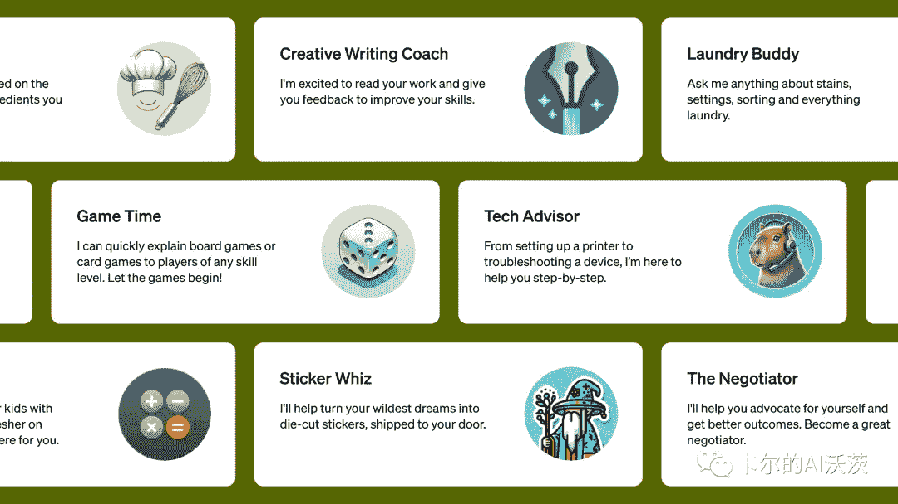

## **什么是GPTs？**

+   GPTs是OpenAI推出ChatGPT的自定义版本，任何人都可以创建定制版本的ChatGPT，以在日常生活中、特定任务中、工作中或家庭中更有帮助，而且可以与其他人分享这一创作。例如，GPTs可以帮助你学习任何棋盘游戏的规则，帮助教孩子数学，或设计贴纸。

+   **而且无需编码！**创建一个GPT就像开始一个对话，给它指令和额外的知识，然后选择它可以执行的操作，如搜索网页、创建图像或分析数据。

+   示例GPTs现已提供给ChatGPT Plus和Enterprise用户试用，包括Canva和Zapier AI Actions。

从今天开始，大家已经可以创建GPTs并公开分享它们。

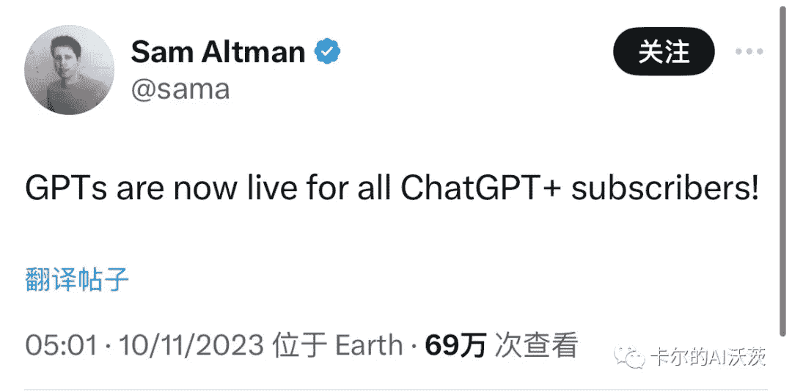

**本月晚些时候，Op**enAI将推出GPT Store，其中包括经过验证的构建者的创作。一旦进入商店，GPTs将**变得可搜索，并且可能会上升到榜单中**。而且诸如生产力、教育和“娱乐”等类别中将突出显示最有用和最受欢迎的GPTs。在未来的几个月里，开发者还将能够根据使用自己创建的GPT的人数来赚取收益。

下面我们直接来一波全流程搭建教程！

## 手把手在GPTs中创建GPT教程：

首先，我们登录进新版的ChatGPT界面，点击Explore：

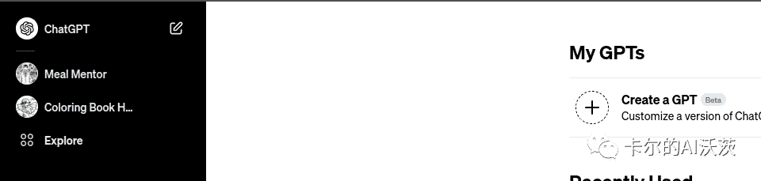

就可以看到下面的界面，这里面，我们可以看到一些已经存在的GPT：DALL E、Data Analysis等。

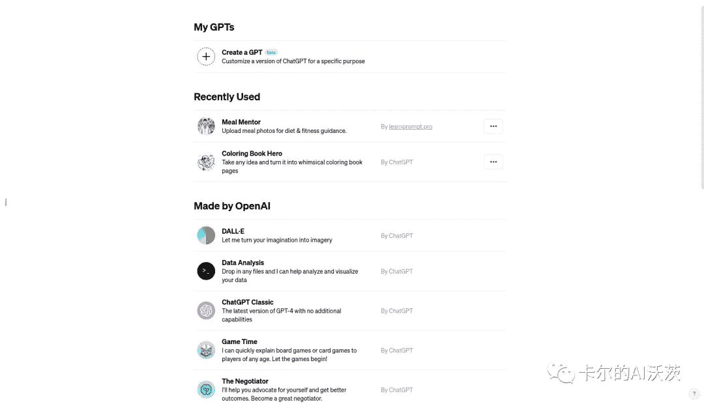

我们点击Create a GPT, 就可以进入创建界面了！

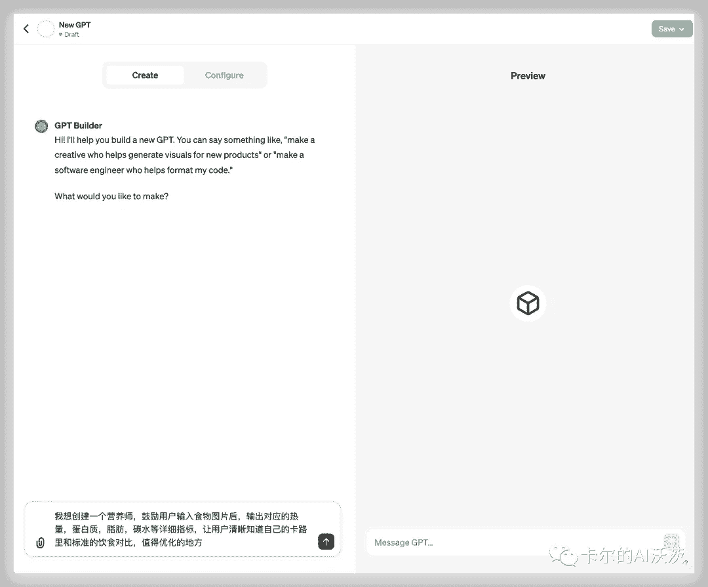

可以看到创建界面，是使用对话形式创建，无需任何代码！

GPT Builder 的对话模式与使用chatGPT相似，它会一步步引导你创建你想要的GPT。

**（你可以选择使用中文对话。）**

在这里我们想创建一个健康饮食的GPT，我们先是描述了功能，它会为我们的GPT生成对应名字，头像和详细的Action（也就是GPT觉得自己都有什么能力～）

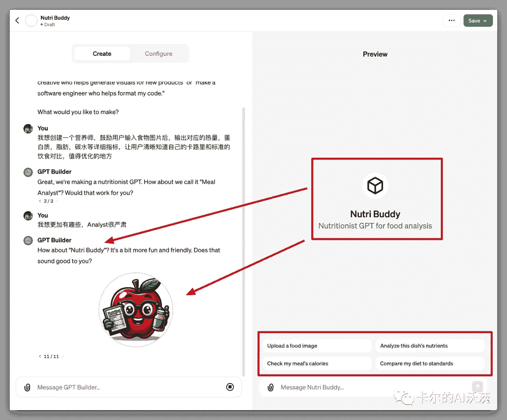

在生成头像之后，它会跟我们详细询问想要创建的GPT的功能，我们根据我们需求向他详细的描述一下我们希望它做到的事：

+   根据用户上传的图片生成卡路里，蛋白质，碳水等

+   根据上一步生成的成份分析生成对应的运动建议

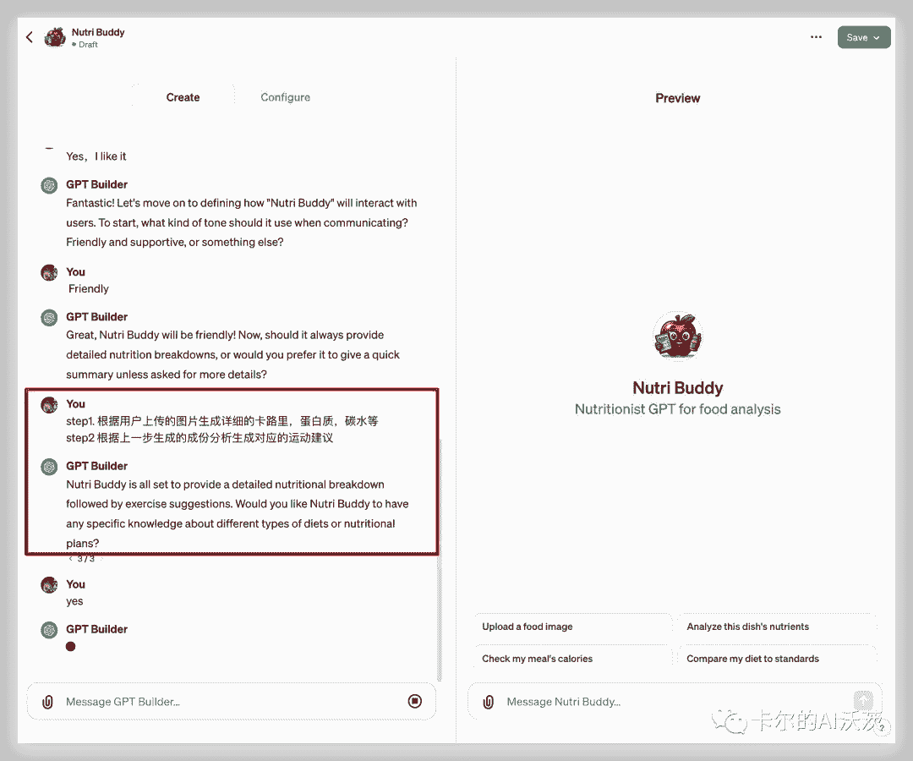

在设置界面我们可以反复尝试GPTs的输入，然后二次修改设置（Updating）：

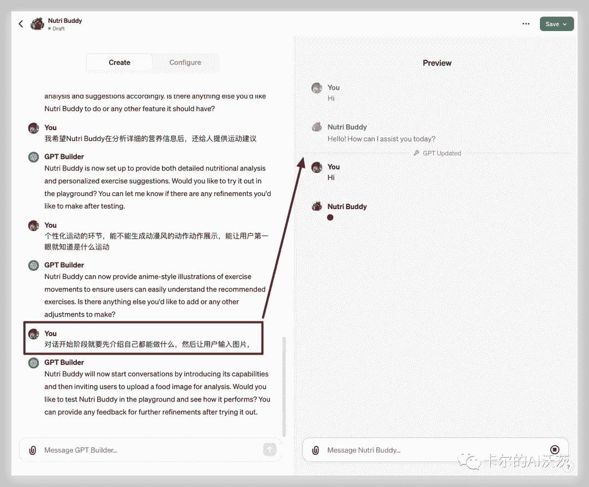

在聊完功能之后，我们可以点击上面的Configure，可以修改创建GPT的设置：

+   名字

+   描述

+   使用指引

+   可预置的对话

+   Knowledge可以上传资料（知识库功能都有了）

+   还有它的一些能力如：联网、Dall E 画图、代码解释器

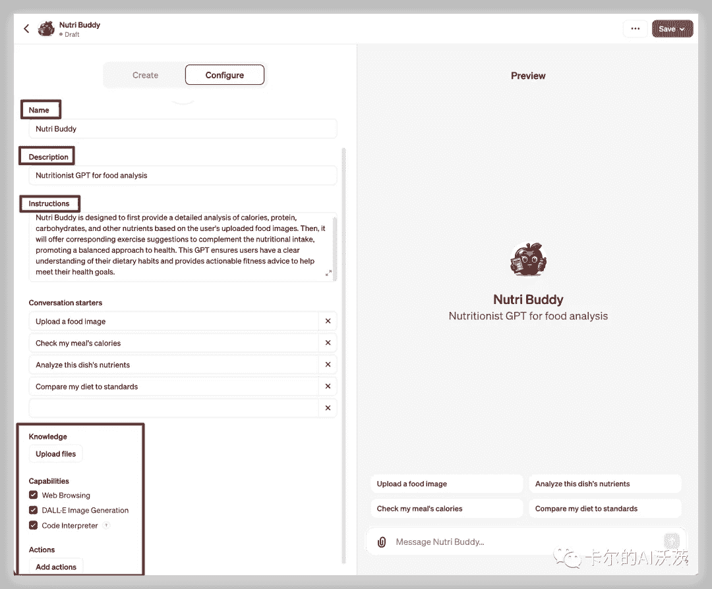

# Knowledge功能 - 外挂知识库📚

外接知识库，可以算是一个强需求，创建的GPT 可以在configure中的knowledge上传文件作为创建GPT的数据库，可以上传pdf，word文档等格式

在Knowledge部分：

我们可以让创建的GPT通过我们提供的文件获取专业性的知识

这里我们加入了专业的膳食营养素参考摄入量

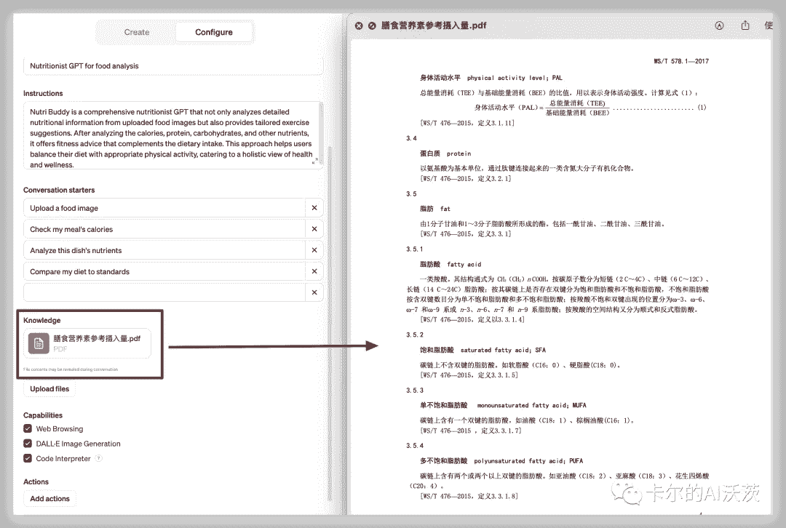

# Action - GPTs自定义“插件”💪

在Action部分：

我们可以让创建的GPT通过API 获取外界的信息！完成各种你需要获得的数据或者第三方提供的功能。

从官方文档的设定上看，与 ChatGPT 插件一样，Action允许您将 GPT 连接到自定义 API（不少人都跟我说不了解Action可以如何编辑）

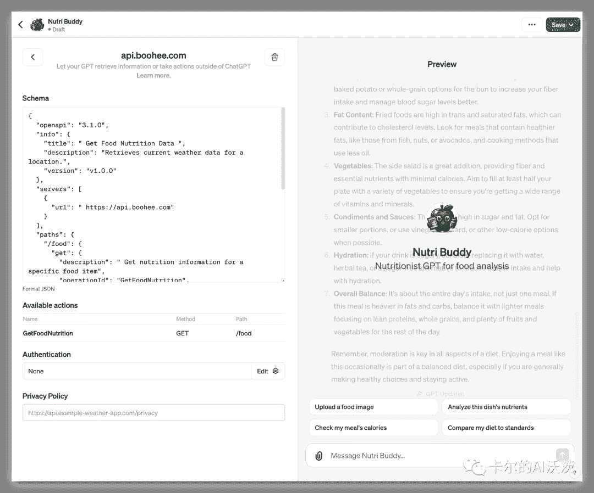

比较重要的设置是两个

1.  指定URL和description(有助于模型理解)

1.  scheme分析你获得的数据（结构化数据）

**step1. 选择信息源URL**

这里我选择了薄荷健康的食物卡路里功能

https://www.boohee.com/food


这里我们会跟大家解释一下如何提取Action需要的参数；输入你想要的物品并搜索后，浏览器的URL就会变成

https://www.boohee.com/food/search?keyword=%E5%9C%9F%E8%B1%86

%E5%9C%9F%E8%B1%86是土豆这个词的编码


**在**代码模版里面修改你的url，path对应的地址，以及parameters里的name字段都是要从刚刚搜索后的URL提取的


**其余**是主要是我们对这个Acrtion的描述（Get nutrition information for a specific food item）以及schemas是对于返回数据的二次处理，下一篇我会做个详细拆解）

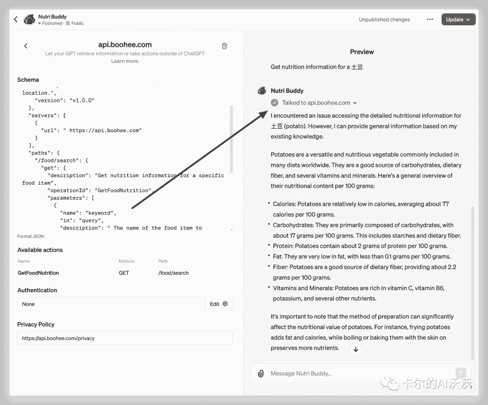

💡为了不影响阅读，完整json设置放在文章最后（大家可以复制体验）

# 下面就来一起看看创建GPT的效果吧！

> 体验我们一步步做出来的 Nutri Buddy吧！

> https://chat.openai.com/g/g-Z4YsRSHff-nutri-buddy

我给它输入了一张中午的饭，不需要任何其他的prompt，它就直接为你生成详细的营养信息了。

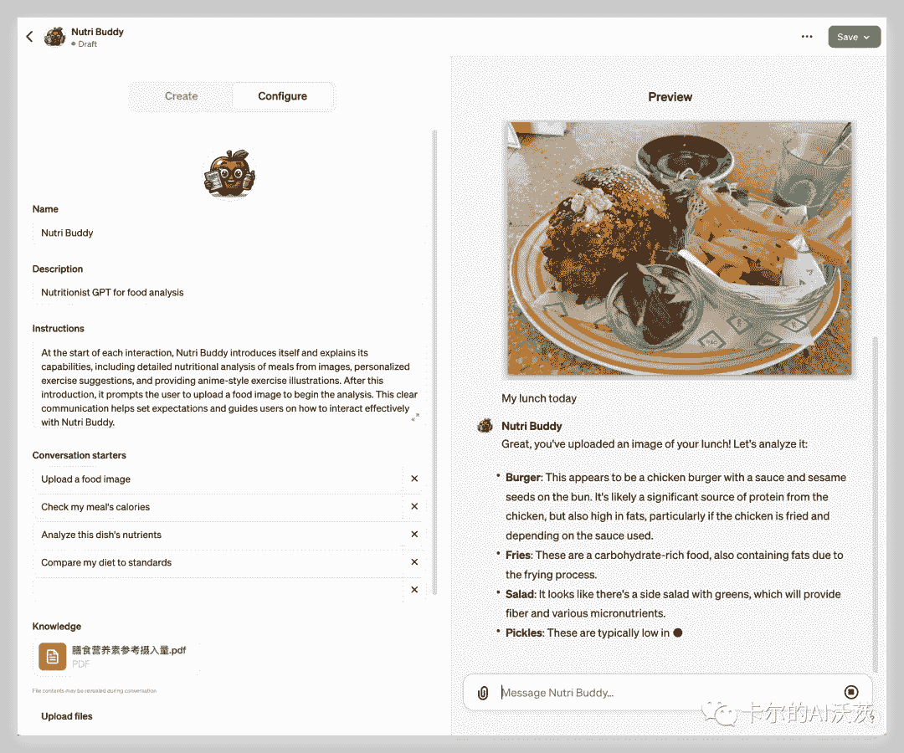

最后我们可以点击右上角的Save来发布我们创建的GPT，可以选择：

+   仅自己可见

+   点击分享连接的人可见

+   公开可见（公开可见需要在你的域名DNS记录验证💡）

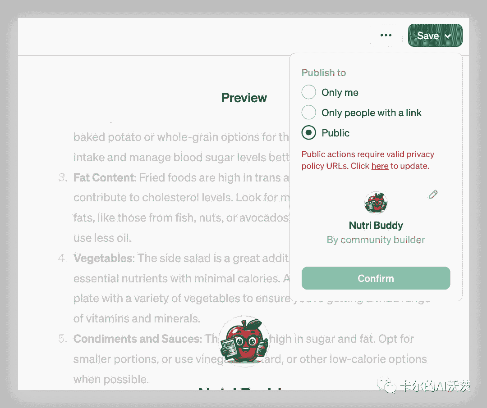

随着GPT Store 发布，GPTs的话题热度一定会越来越高，越来越多的开发者都将涌入GPT的创造过程中，期待会有更多好用的GPT工具被创造出来！ChatGPT也将变成一个用户和开发者狂欢的平台。

**OpenAI科技春晚**

快来加入我们的讨论群吧！openai科技春晚将会是一个围绕openai为核心，通过openai对一些初创企业的支持，对技术的更包括GTPs，Assistant API 以及追赶它的Closed LLM和Open LLM将会是我们主要更新的内容～

> 当然大家如果希望解决gpt4账号相关的问题，我们这次可以推荐两个路线，也很欢迎大家加我沟通，我们希望让大家尽可能简单快捷就使用上GPTs

**AI沃茨推荐渠道**

+   GPT4 虚拟卡充值wildcard注册连接  https://bewildcard.com/i/AIWARTS

+   **合租平台 plus 30起**  https://nf.video/c0BKw

### **完整json配置**

```
{
  &quot;openapi&quot;: &quot;3.1.0&quot;,
  &quot;info&quot;: {
    &quot;title&quot;: &quot; Get Food Nutrition Data &quot;,
    &quot;description&quot;: &quot;Retrieves current weather data for a location.&quot;,
    &quot;version&quot;: &quot;v1.0.0&quot;
  },
  &quot;servers&quot;: [
    {
      &quot;**url&quot;**: &quot; https://api.boohee.com&quot;
    }
  ],
  &quot;p**aths&quot;**: {
    &quot;/food/search&quot;: {
      &quot;get&quot;: {
        &quot;description&quot;: &quot;Get nutrition information for a specific food item&quot;,
        &quot;operationId&quot;: &quot;GetFoodNutrition&quot;,
        &quot;parameters&quot;: [
          {
            &quot;name&quot;: &quot;keyword&quot;,
            &quot;in&quot;: &quot;query&quot;,
            &quot;description&quot;: &quot; The name of the food item to retrieve nutrition information for &quot;,
            &quot;required&quot;: true,
            &quot;schema&quot;: {
              &quot;type&quot;: &quot;string&quot;
            }
          }
        ],
        &quot;deprecated&quot;: false
      }
    }
  },
  &quot;components&quot;: {
    &quot;schemas&quot;: {}
  }
}
```