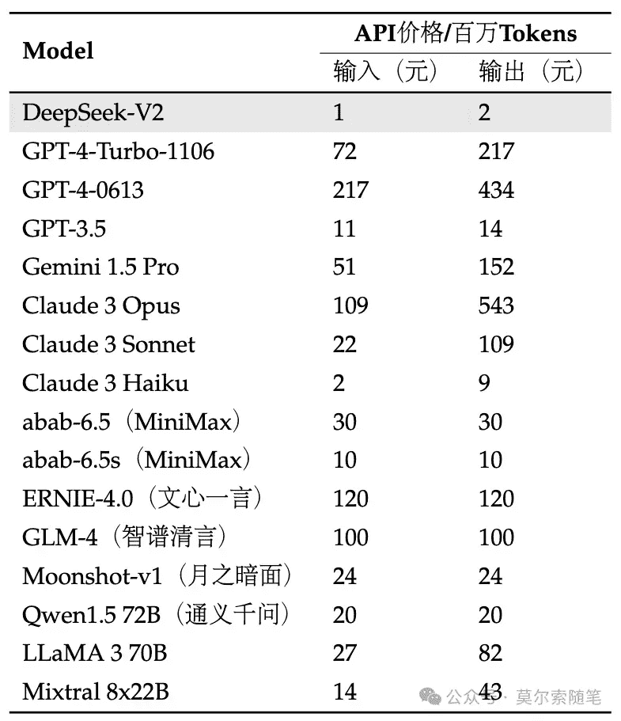
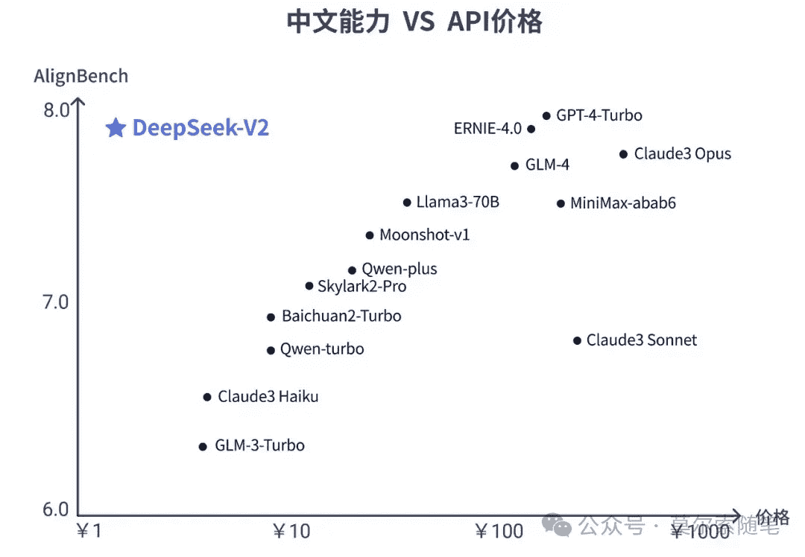
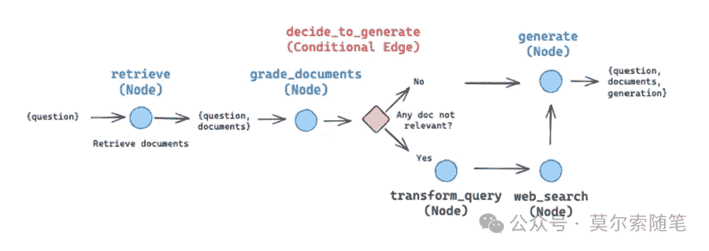

# DeepSeek-V2 到底有多强？写一个 AI 编码 Agent 测测看（附详细代码）

> 来源：[https://agispace.feishu.cn/docx/VwTkdbj1xo0p1AxXaQzcOyUpn5f](https://agispace.feishu.cn/docx/VwTkdbj1xo0p1AxXaQzcOyUpn5f)

> 作者：  是莫尔索

> 公众号： 莫尔索随笔

> 原文链接：https://mp.weixin.qq.com/s/cVbwsPutLjAMj9z7nY0g3A

> 深度求索昨晚宣布开源他们第二代 MoE 模型 DeepSeek-V2，支持 128K 上下文窗口，在主流的大模型能力测试集上都有不俗的表现，特别是知识、数学、推理、编程方面能力处于前列，而且成本直接低出一个数量级，到底表现怎么样，本着务实的态度，这篇文章结合 LangChain 的 LangGraph 组件库，编写一个编码类 AI Agent，来对其能力做下简单验证。

> 在这篇文章中，我会先解释下 DeepSeek-V2 如何做到模型性能强的同时推理成本还低的，然后对 LangGraph 组件进行介绍，最后设计一个能够自动编写生产可用的单元测试代码的编码类 Agent 来验证下 DeepSeek-V2 的实际能力。

我的新书《LangChain 编程从入门到实践》已经开售，推荐准备和正在学习 AI 应用开发的朋友购买阅读！

### **DeepSeek-V2 介绍**

1.  **背景了解**

DeepSeek 背后的公司深度求索是幻方旗下的大模型初创公司（2023 年 7 月成立），幻方是一家很早就开始使用 AI 进行投资的量化基金（做到过千亿规模），2019 年，幻方就成立 AI 公司，其自研的深度学习训练平台「萤火一号」搭载了 1100 块 GPU，2021 年，「萤火二号」搭载了约 1 万张英伟达 A100 显卡，在技术积累和算力储备方面都实力不俗，所以在看到技术报告后，应该可以排除炒作的嫌疑。详细可以看看这篇 👉 疯狂的幻方：一家隐形 AI 巨头的大模型之路([1])

1.  **DeepSeek-V2 有多强**

在目前大模型主流测试集上，DeepSeek-V2 均表现出色：

+   开源模型中中文综合能力（AlignBench）最强，与 GPT-4-Turbo、GLM-4 等闭源模型处于同一梯队

+   英文综合能力（MT-Bench）与最强的开源模型 LLaMA3-70B 同处第一梯队，超过最强 MoE 开源模型 Mixtral 8x22B


各大模型API或Chat版本效果对比

**价**格方面，DeepSeek-V2 API 的价格为 每百万 tokens 输入 1 元、输出 2 元（32K 上下文），价格仅为 GPT-4-Turbo 的近百分之一，LLaMA3-70B 出来时的成本已经震惊我了，DeepSeek-V2 这波属于是杀红眼了 🫠，对应用层是极大的利好。



各大模型API价格对比

DeepSeek-V2 在中文方面是最好用的，价格也是最便宜的（社区里微调 LLaMA3-70B 中文版的朋友估计哭晕在厕所了 😂）



横轴为每百万输入/输出Tokens平均单价

1.  DeepSeek-V2 为什么这么强

对 Transformer 架构中的自注意力机制进行了全方位的创新

+   DeepSeek-V2 没有沿用类 LLaMA 的 Dense 结构和类 Mistral 的 Sparse 结构，而是对模型框架进行了全方位的创新，提出了媲美 MHA（Multi-Head Attention ）的 MLA（Multi-head Latent Attention）架构，大幅减少计算量和推理显存

+   自研 DeepSeekMoE（DeepSeekMoE 主要包括细粒度专家和共享专家这两个特点，**在激活和总专家参数数量**相同的情况下，DeepSeekMoE 可以大幅超越传统的 MoE 架构([2])（Mixture-of-Experts，专家混合） ）进一步将计算量降低到极致，两者结合最终实现模型性能跨级别的提升

+   DeepSeek-V2 包含 236B 参数，每个 Token 激活 2.1B 参数，支持长达 128K 的上下文，大致达到 70B~110B Dense 的模型能力，同时消耗的显存只有同级别 Dense 模型的 1/5~1/100，每 token 成本大幅降低。实际部署在 8 卡 H800 机器上，输入吞吐量超过每秒 10 万 tokens，输出超过每秒 5 万 tokens。

更详细的技术解读请看这篇 👉 幻方发布全球最强 MOE 大模型！DeepSeek-V2

1.  **更多内容**

+   技术报告：https://github.com/deepseek-ai/DeepSeek-V2/blob/main/deepseek-v2-tech-report.pdf

+   代码仓库：https://github.com/deepseek-ai/DeepSeek-V2

+   模型权重：https://huggingface.co/deepseek-ai

+   API Key 申请：https://platform.deepseek.com

#### **总结**

一句话总结：参数更多、能力更强、成本更低！当然能不能干活，我得试了才知道，所以我决定使用 LangChain 的 LangGraph 组件构建一个编码类 Agent 测试下（编码能力、工具调用能力、推理能力），顺便提下，自从上次 LLaMA3-70B 发布，我还在测试其在各类开源 Agent 项目中的实际效果，接下来要替换为 DeepSeek-V2 了。


开源Agent项目

### **LangGraph 介绍**

LangGraph 是一套构建于 LangChain 框架之上的开发组件，可以与 LangChain 现有的链（Chain）、LCEL（LangChain Express Language）等无缝协作，与其生态系统完全兼容。

LangGraph 受到 NetworkX 框架的启发，将应用流程抽象为一个图，其中节点表示一个函数调用或一次大模型调用，而边（则代表了节点的执行顺序（即数据流），并且可以通过设置条件边（conditional edge）来实现流程的分支控制，进而基于此图编译生成相应的应用。在任务执行期间，系统维护一个中央状态对象（state），该对象会随着节点跳转而持续更新，其包含的属性可根据需求自由定义，这种方式使得创建具有状态管理和可控循环的 LLM 应用变得容易，比如多 Agent 应用。LangGraph 的作用包括：

+   分解问题：将复杂问题分解成更小的部分，便于管理和解决。

+   分配任务：将分解后的问题分配给专门的 Agent，每个代理可以专注于解决特定的子问题。

+   协作：允许不同代理之间进行信息交流和协作，以达成共同的目标。

+   状态化：保持对代理间交互和问题解决过程的跟踪，确保协作的连贯性和效率。

下面是官方通过使用 LangGraph 构建 RAG 应用的示意图，晰地阐释了 LangGraph 中的 3 个核心概念：



LangGraph 构建RAG应用

+   StateGraph：状态图。通过提供状态定义来初始化此类，该状态定义代表了一个随时间推移而更新的核心状态对象。

+   Nodes：节点。在创建 StateGraph 后，可通过 graph.add_node(name, value)方法添加节点。

+   Edges：边。添加节点后，需向图中引入边，这些边象征着从一个节点到另一个节点的转移关系。当前支持三种边类型：起始边（Starting Edge）、条件边（Conditional Edge）和普通边（Normal Edge）。

### **代码示例**

下面的代码展示了如何基于 DeepSeek-V2 和 LangGraph 实**现**一个 AI 编码代理，为 Python 代码自动编写单元测试。部分代码参考自 Build an AI Coding Agent with LangGraph by LangChain([3])

#### **配置环境**

首先配置环境，并安装基础依赖。

```
mkdir langgraph_test &amp;&amp; cd langgraph_test
python3 -m venv env
source env/bin/activate
pip install langgraph langchain langchain_openai colorama
```

#### **创建示例文件**

```
**import** os

定义搜索路径，即app目录的绝对路径
search_path = os.path.join(os.getcwd(), &quot;app&quot;)

定义crud.py文件的路径，该文件位于search_path/src目录下
code_file = o**s.**p**ath**.join(search_path, &quot;src/crud.py&quot;)

定义测试文件test_crud.py的路径，该文件位于search_path/test目录下
test_file = os.path.join(search_path, &quot;test/test_crud.py&quot;)

检查search_path路径是否存在，如果不存在则创建
if not os.path.exists(search_path):
    os.mkdir(search_path)  创建search_path目录
    os.mkdir(os.path.join(search_path, &quot;src&quot;))  在search_path下创建src目录
    os.mkdir(os.path.join(search_path, &quot;test&quot;))  在search_path下创建test目录

定义一个包含Item类和CRUDApp类的字符串，这些类将被写入到code_file文件中
code = &quot;&quot;&quot;
class Item:
    def __init__(self, id, name, description=None**):
 **     **  **self.id = id  # 初始化Item对象的id属性
        self.name = name  # 初始化Item对象的name属性
        self.description = description  # 初始化Item对象的description属性，可省略

    def __repr__(self):
        # 定义对象的字符串表示方法，便于打印和调试
        return f&quot;Item(id={self.id}, name={self.name}, description={self.description})&quot;

class CRUDApp:
    def __init__(self):
        self.items = []  # 初始化一个空列表，用于存储Item对象

    def create_item(self, id, name, description=None):
        # 创建一个Item对象，并将其添加到items列表中
        item = Item(id, name, description)
        self.items.append(item)
        return item  # 返回创建的Item对象

    def read_item(self, id):
        # 根据id读取Item对象
        for item in self.items:
            if item.id == id:
                return item  # 如果找到匹配的id，返回Item对象
        return None  # 如果没有找到匹配的id，返回None

    def update_item(self, id, name=None, description=None):
        # 根据id更新Item对象的name和/或description属性
        for item in self.items:
            if item.id == id:
                if name:
                    item.name = name  # 如果提供了name，更新Item对象的name属性
                if description:
                    item.description = description  # 如果提供了description，更新Item对象的description属性
                return item  # 更新完成后返回Item对象
        return None  # 如果没有找到匹配的id，返回None

    def delete_item(self, id):
        # 根据id删除Item对象
        for index, item in enumerate(self.items):
            if item.id == id:
                return self.items.pop(index)  # 如果找到匹配的id，从列表中移除Item对象并返回
        return None  # 如果没有找到匹配的id，返回None

    def list_items(self):
        # 返回所有存储的Item对象的列表
        return self.items
&quot;&quot;&quot;

使用with语句打开code_file文件进行写入
with open(code_file, &#x27;w&#x27;) as f:
    f.write(code)  将code字符串写入到文件中
```

示例文件创建好后，接下来编写 Agent 处理逻辑，即为这段代码（code 字符串内容）自动生成单元测试。

### **编写 Agent 应用**

#### **大模型 API**

开始之前先设置好 DeepSeek-V2 大模型，由于 API 格式与 OpenAI 兼容 ，所以可以直接使用 OpenAI SDK （langchain_openai）来访问 DeepSeek API。

```
llm = ChatOpenAI(base_url=&quot;https://api.deepseek.com/v1&quot;,
    api_key=os.getenv(&quot;DEEPSEEK_KEY&quot;),
    model=&quot;deepseek-chat&quot;)
```

DeepSeek API 手册

1.  **定义 StateGraph**

首先定义一个 AgentState，负责在执行过程中跟踪代理的状态。这主要是一个 TypedDict 类，其中包含 Agent 状态相关属性。

# ** clas**s** AgentStat**e(TypedDict):  定义AgentState类型，用于存储代理的状态     class_source: str     class_methods: List[str]     tests_source: str  创建StateGraph workflow = StateGraph(AgentState)

class_source 存储代码中的 Python 类名称，class_methods 用于存储 Python 类类的方法，tests_source 用于存储生成的单元测试代码。

1.  **定义节点**

**现**在为 AgentState 添加节点，这里需要定义 3 个节点，一个用于查找类方法的节点，一个用于更新单元测试到状态对象的节点，一个用于将生成的单元测试写入测试文件的节点

**代码解析函数**

开始之前先声明一个提取源代码的工具函数，这里假设代码片段在```内

```
**def** extract_code_from_message(message):
    lines = m**ess**age.sp**li**t(&quot;\n&quot;)  按行分割消息**
 **   code** =** &quot;&quot;
    in_code = Fals**e  **标记是否在代码块中
    fo**r li**ne in lines:
        if &quot;```&quot; in** line:**  检查是否是代码块的开始或结束
            in_code = not in_code
        elif in_code:  如果在代码块中，则累加代码
            code += line + &quot;\n&quot;
    return code  返回提取的代码
```

现在开始定义节点

**节点 1 用于查找类方法的节点**

```
系统消息模板
system_message_template =** &quot;&quot;**&quot;你是一个**聪明的开发者**，你将使用pytest编**写高质量**的单元测试**。
**仅用源代码回复测试。不要在你的回复中包含类。我会自己添加导入语句。
如果没有要写的测试，请回复“# 没有要写的测试”且不要包含类。
示例：
def test_**fun**ction(**):**
    ...
请务必遵循指令并编写高质量的测试，不要**写测**试类，只写方法。**
&quot;**&quot;&quot;

import_prompt_template = &quot;&quot;&quot;
这是一条包含代码文件路径的信息：{code_file}。
这是一条包含测试文件路径的信息：{test_file}。
请为文件中的类编写正确的导入语句。
&quot;&quot;&quot;

发现类及其方法
def discover_function(state: AgentState):
    assert os.path.exists(code_file)  确保代码文件存在
    with open(code_file, &quot;r&quot;) as f:  打开代码文件进行读取
        source = f.read()  读取文件内容
**    st**ate[&quot;class_source&quot;] = source  将源代码存储在状态中

    获取方法
    methods = []
    for line in source.split(&quot;\n&quot;):
        if &quot;def &quot; in line:  如果行中包含def，表示这是一个方法定义
            methods.append(line.split(&quot;def &quot;)[1].split(&quot;(&quot;)[0])
    state[&quot;class_methods&quot;] = methods  将方法名存储在状态中

    生成导入语句并启动代码
    import_prompt = import_prompt_template.format(
        code_file=code_file,  格式化导入提示模板
        test_file=test_file
    )
    message = llm.invoke([HumanMessage(content=import_prompt)]).content  调用模型生成消息
    code = extract_code_from_message(message)  提取消息中的代码
    state[&quot;tests_source&quot;] = code + &quot;\n\n&quot;  将测试源代码存储在状态中

    return state  返回更新后的状态

将节点添加到工作流中
workflow.add_node(
    &quot;discover&quot;,  节点名称
    discover_function  节点对应的函数
)
```

上面的代码片段中从 AgentState 的 class_source 元素中提取代码，并将它们传递给 LLM ，然后将 LLM 的响应存储在 AgentState 的 tests_source 元素中。

节点 2 更新单元测试到状态对象的节点

```
编写测试模板
write_test_template = &quot;&quot;&quot;这里是类：**
&#x27;&#x27;**&#x27;
{class_source}
&#x27;&#x27;&#x27;
为方法“{class_method}”实现一个测试。
&quot;&quot;&quot;

def write_tests_function(state: AgentState):

    获取下一个要编写测试的方法
    class_method = state[&quot;class_methods&quot;].pop(0)
    print(f&quot;为{class_method}编写测试。&quot;)

    获取源代码
    class_source = state[&quot;class_source&quot;]

    创建提示
    write_test_prompt = write_test_**templa**te.format(
        class_source=class_source,
        class_method=class_method
    )
    print(colorama.Fore.CYAN + write_test_prompt + colorama.Style.RESET_ALL)  打印提示信息

    获取测试源代码
    system_message = SystemMessage(system_message_template)  创建系统消息
    human_message = HumanMessage(write_test_prompt)  创建人类消息
    test_source = llm.invoke([system_message, human_message]).content  调用模型生成测试代码
    test_source = extract_code_from_message(test_source)  提取消息中的测试代码
    print(colorama.Fore.GREEN + test_source + colorama.Style.RESET_ALL)  打印测试代码
    state[&quot;tests_source&quot;] += test_source + &quot;\n\n&quot;  将测试源代码添加到状态中

    return state  返回更新后的状态

将编写测试节点添加到工作流中
workflow.add_node(
    &quot;write_tests&quot;,
    write_tests_function
)
```

让 LLM 为每个方法编写测试用例，并更新到 AgentState 的 tests_source 元素中。

节点 3 将生成的单元测试写入测试文件

```

编写文**件
d**e**f write_fi**le(s**tate**: Age**nt**State):
    with open(test_file, &quot;w&quot;) as f: ** 打开测试文**件进行写入
        f.write(state[&quot;tests_source&quot;])  写入测试源代码
    return state  返回状态

将写文件节点添加到工作流中
workflow.add_node(
    &quot;write_file&quot;,
    write_file
)
```

1.  **定义边**

现在已经有 3 个节点，接下来定义边用于指定它们之间的执行方向。Agent 工作流从查找类方法的节点开始执行，然后转到编写单元测试的节点。

```
定义入口点，这是流程开始的地方
workflow.set_entry_point(&quot;discover&quot;)

总是从discover跳转到write_tests
workflow.add_edge(&quot;discover&quot;, &quot;write_tests&quot;)
```

add_conditional_edge 函数添加了 write_tests 函数和 should_continue 函数，该函数根据 class_methods 条目决定采取哪一步，

```
判断是否完成**
de**f** should_continu**e(st**at**e: AgentState):
    if len(state[&quot;class_methods&quot;]) == 0:**  如果没有**更多的方法要测试
       ** ret**urn &quot;end&quot;**  结束流程**
    else:
        return &quot;continue&quot;  继续流程

添加条件边
workflow.add_conditional_edges(
    &quot;write_tests&quot;,  条件边的起始节点
    should_continue,  条件函数
    {
        &quot;continue&quot;: &quot;write_tests&quot;,  如果应该继续，则再次执行write_tests节点
        &quot;end&quot;: &quot;write_file&quot;  如果结束，则跳转到write_file节点
    }
)

总是从write_file跳转到END
workflow.add_edge(&quot;write_file&quot;, END)
```

当从 LLM 生成所有方法的单元测试后，测试代码被写入测试文件。

1.  **执行工作流**

最后剩下的就是编译工作流并运行它。

```
app = workflow.compile()  编译工作流
inputs = {}  输入参数
conf**ig **= RunnableConfig(recursion_lim**it=100**)  设置递归限制
try:
    result = app.invoke(inputs, config)  运行应用
    print(result)  打印结果
except GraphRecursionError:  如果达到递归限制
    print(&quot;达到图递归限制。&quot;)  打印错误信息
```

递归限制是给定工作流的 LLM 进行循环推理的次数，当超过限制时，工作流停止。

1.  **生成的单元测试文件**

下面是最终生成的 test_crud.py 文件的内容，大家自行评判。

```
**class** **TestDict**(uni**tte**st.TestCase):
    def test_crudapp_init():
        创建一**个CRUDA**pp实例**
  ** **     app = CRU**DApp()

        验证items列表是**否为空
  **    **  a**ssert app.items == []


    def test_item_repr():
    **    it**em =** It**em(1, &#x27;Test Item&#x27;, &#x27;This is a test item&#x27;)
        expected_repr = &quot;**Item(i**d=1, n**am**e=Test I**tem, d**escription=This is a **test i**tem)&quot;
        assert repr(item) =**= expe****ct**ed_repr


    def test_crudapp_init():
     **   创建一**个CRUDApp实例
   **  **   app =** CRUDA**pp()

  **      **验证items列**表是否为空
****  **      assert app.items == []


  **  def **test**_cr**e**ate_item():
  **      初始化CRUDApp实例
        app = CRUDApp()

        创建一个新项目
        item = app.create_item(1, &#x27;Test Item&#x27;)

 **      ** 断言项目已创建并存在于项目列表中
        assert item in app.list_**items(****)
**        a**sse**rt item.id == 1
        assert item.name == &#x27;Test Item&#x27;
        assert item.description is None

        创建另一个项目，确保ID是唯一**的
    **    another_it**em** **= a**pp.create_ite**m(2, &#x27;**Another **Test I**tem&#x27;)
  **      ****as**sert another_item in app.list_items()
        assert a**nother**_item.id** == 2
**        **assert** another**_item.****na**me == &#x27;Another Test Item&#x27;
        assert another_item.descrip**tion i****s **None

        断言列表中的项目数量正确
        assert len(ap**p.list****_i**t**ems**()) == 2


  **  def **test_rea**d_item**():
    **    初始**化CRUDApp实例
        app = CRUDApp()

        创建一个测试项
        test_item **= app.**create_i**tem(1,** &#x27;Test I**tem&#x27;)
**
       ** 测试读取存**在的项
**   **     read_item = app.read_item(1)
        assert read_item == test_item

        **测试读取不存**在的项
   **  **   non_e**xisten**t_item **= **app.read_item(99)
        assert non_existent_item is None


    **def te**st_updat**e_item**():
   **   ** ** 初**始化CRUDAp**p实例
  **      a**pp** = CRUDApp()

        创建一**个测试用的I****te**m
       ** it**e**m = app.create_**item(1, &#x27;Test Item&#x27;)

        更新Item的名称
        updated_item = app.update_item(1, &#x27;Updated Test Item&#x27;)

        验证更新是否**成功
   **     as**se**rt updated_item is no**t None**
      **  **assert updated_item.id == 1
        asse**rt upd**ated_item.name == &#x27;Updated Test Item&#x27;
        assert updated_item.description is None

        验证列表中的Item是否更新
        listed_items = app.list_items()
        assert len(listed_items) == 1
        assert listed_items[0].id == 1
        assert listed_items[0].name == &#x27;Updated Test Item&#x27;
        assert listed_items[0].description is None

        尝试更新不存在的Item
        non_existent_item = app.update_item(2, &#x27;Non Existent Item&#x27;)
        assert non_existent_item is None

        更新Item的描述
        updated_item_description = app.update_item(1, description=&#x27;Updated Test Description&#x27;)

        验证更新是否成功
        assert updated_item_description is not None
        assert updated_item_description.id == 1
        assert updated_item_description.name == &#x27;Updated Test Item&#x27;
        assert updated_item_description.description == &#x27;Updated Test Description&#x27;

        验证列表中的Item是否更新
        listed_items = app.list_items()
        assert len(listed_items) == 1
        assert listed_items[0].id == 1
        assert listed_items[0].name == &#x27;Updated Test Item&#x27;
        assert listed_items[0].description == &#x27;Updated Test Description&#x27;


    def test_delete_item():
        创建一个CRUDApp实例
        app = CRUDApp()

        创建一些测试用的Item对象
        item1 = app.create_item(1, &#x27;Item 1&#x27;)
        item2 = app.create_item(2, &#x27;Item 2&#x27;)

        验证创建的Item对象是否在列表中
        assert item1 in app.list_items()
        assert item2 in app.list_items()

        删除一个Item对象
        deleted_item = app.delete_item(1)

        验证删除操作是否成功
        assert deleted_item == item1
        assert item1 not in app.list_items()
        assert item2 in app.list_items()

        尝试删除一个不存在的Item对象
        deleted_nonexistent_item = app.delete_item(3)

        验证删除不存在的Item对象时返回None
        assert deleted_nonexistent_item is None


    def test_list_items():
        创建一个CRUDApp实例
        app = CRUDApp()

        创建一些测试用的Item实例
        item1 = app.create_item(1, &#x27;Item 1&#x27;)
        item2 = app.create_item(2, &#x27;Item 2&#x27;, &#x27;This is item 2&#x27;)

        调用list_items方法并检查返回的列表是否包含我们创建的Item实例
        listed_items = app.list_items()
        assert item1 in listed_items
        assert item2 in listed_items

        检查列表的长度是否正确
        assert len(listed_items) == 2
```

### **结论**

生成的单元测试，属于是一种基本可用的状态，多次（10 次）执行输出的结果也较为稳定，通过和 GPT-4-Turbo、GLM-4 生成的进行比较，DeepSeek-V2 在一些 Agent 应用场景确实可以做到平替，毕竟百分之一的成本，性价比在这里摆着，还要啥自行车，等我后续在其他更复杂的 Agent 项目进行进一步验证。

莫尔索随笔

跟踪LLM(大语言模型)最新动态，分享第一手LLM 实践经验，致力于打造个人LLM 应用开发全栈指南！

62篇原创内容

公众号

后台回复 **DeepSeek**，获取文章中的完整代码，点击**阅读原文**，获取更好阅读体验。

我的新书《LangChain 编程从入门到实践》已经开售，推荐准备和正在学习 AI 应用开发的朋友购买阅读！

不可错过 👉：我创建了【A**I 开发】** 交流群，用于 AI 产品构建和分享交流，如果你负责的工作和这**个领**域强相关并且感兴趣，欢迎**后台点击【交流】 ，如果觉**得内容不错，欢迎点个关注，分享和在看～

### **参考资料**

[1]

疯狂的幻方：一家隐形 AI 巨头的大模型之路: https://36kr.com/p/2272896094586500

[2]

MoE 架构: https://baoyu.io/translations/llm/what-is-mixture-of-experts

[3]

Build an AI Coding Agent with LangGraph by LangChain: https://www.analyticsvidhya.com/blog/2024/03/build-an-ai-coding-agent-with-langgraph-by-langchain/