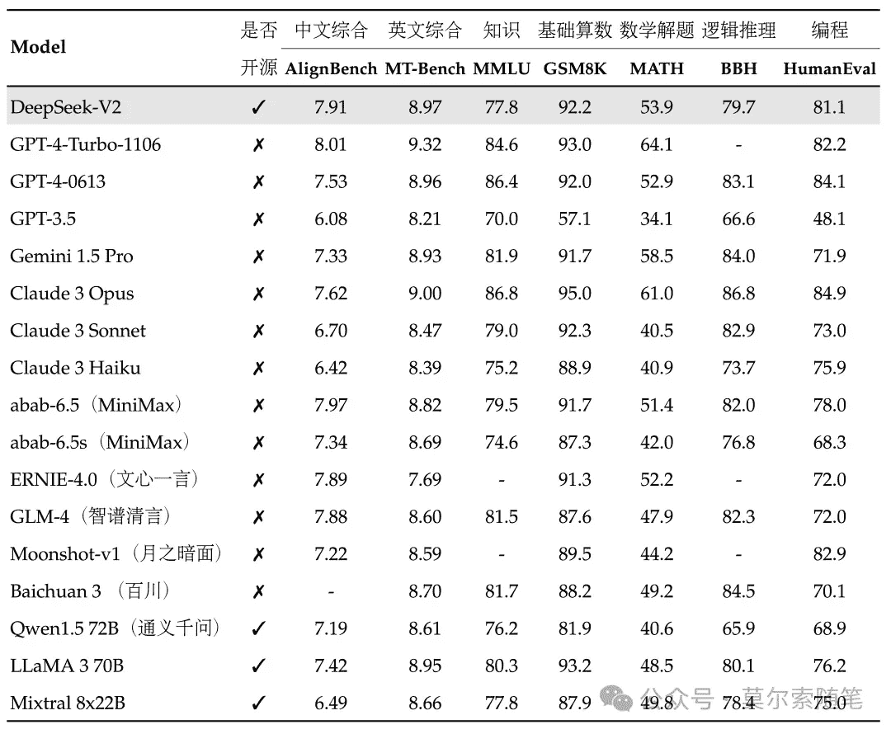
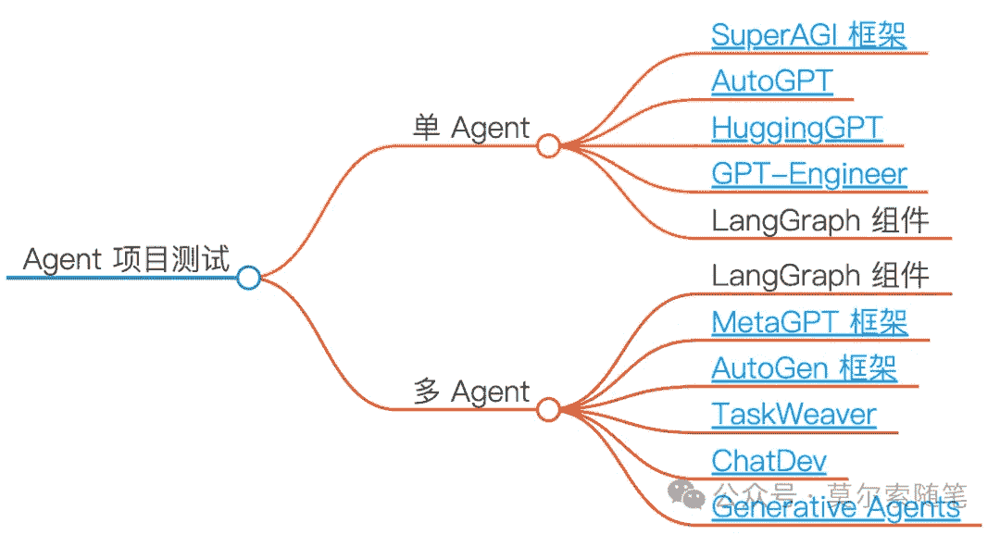

# DeepSeek-V2 到底有多强？写一个 AI 编码 Agent 测测看（附详细代码）

> 来源：[https://agispace.feishu.cn/docx/VwTkdbj1xo0p1AxXaQzcOyUpn5f](https://agispace.feishu.cn/docx/VwTkdbj1xo0p1AxXaQzcOyUpn5f)

> 作者： 是莫尔索

> 👸号： 莫尔索随笔

> 原文链接：https://mp.weixin.qq.com/s/cVbwsPutLjAMj9z7nY0g3A

> 深度求索昨晚宣布开源他们第二代 MoE 模型 DeepSeek-V2，支持 128K 上下文窗口，在主流的大模型能力测试集上都有不俗的表现，特别是知识、数学、推理、编程方面能力处于前列，而且成本直接低出一个数量级，到底表现怎么样，本着务实的态度，这篇文章结合 LangChain 的 LangGraph 组件库，编写一个编码类 AI Agent，来对其能力做下简单验证。

> 在这篇文章中，我会先解释下 DeepSeek-V2 如何做到模型性能强的同时推理成本还低的，然后对 LangGraph 组件进行介绍，最后设计一个能够自动编写生产可用的单元测试代码的编码类 Agent 来验证下 DeepSeek-V2 的实际能力。

我的新书《LangChain 编程从入门到实践》已经开售，推荐准备和正在学习 AI 应用开发的朋友购买阅读！

## DeepSeek-V2 介绍

### 背景了解

DeepSeek 背后的公司深度求索是幻方旗下的大模型初创公司（2023 年 7 月成立），幻方是一家很早就开始使用 AI 进行投资的量化基金（做到过千亿规模），2019 年，幻方就成立 AI 公司，其自研的深度学习训练平台「萤火一号」搭载了 1100 块 GPU，2021 年，「萤火二号」搭载了约 1 万张英伟达 A100 显卡，在技术积累和算力储备方面都实力不俗，所以在看到技术报告后，应该可以排除炒作的嫌疑。详细可以看看这篇 👉 疯狂的幻方：一家隐形 AI 巨头的大模型之路([1])

### DeepSeek-V2 有多强

在目前大模型主流测试集上，DeepSeek-V2 均表现出色：

+ 开源模型中中文综合能力（AlignBench）最强，与 GPT-4-Turbo、GLM-4 等闭源模型处于同一梯队

+ 英文综合能力（MT-Bench）与最强的开源模型 LLaMA3-70B 同处第一梯队，超过最强 MoE 开源模型 Mixtral 8x22B



各大模型API或Chat版本效果对比

价格方面，DeepSeek-V2 API 的价格为 每百万 tokens 输入 1 元、输出 2 元（32K 上下文），价格仅为 GPT-4-Turbo 的近百分之一，LLaMA3-70B 出来时的成本已经震惊我了，DeepSeek-V2 这波属于是杀红眼了 🫠，对应用层是极大的利好。


各大模型API价格对比

DeepSeek-V2 在中文方面是最好用的，价格也是最便宜的（社区里微调 LLaMA3-70B 中文版的朋友估计哭晕在厕所了 😂）


横轴为每百万输入/输出Tokens平均单价

### DeepSeek-V2 为什么这么强

对 Transformer 架构中的自注意力机制进行了全方位的创新

+ DeepSeek-V2 没有沿用类 LLaMA 的 Dense 结构和类 Mistral 的 Sparse 结构，而是对模型框架进行了全方位的创新，提出了媲美 MHA（Multi-Head Attention ）的 MLA（Multi-head Latent Attention）架构，大幅减少计算量和推理显存

+ 自研 DeepSeekMoE（DeepSeekMoE 主要包括细粒度专家和共享专家这两个特点，在激活和总专家参数数量相同的情况下，DeepSeekMoE 可以大幅超越传统的 MoE 架构([2])（Mixture-of-Experts，专家混合） ）进一步将计算量降低到极致，两者结合最终实现模型性能跨级别的提升

+ DeepSeek-V2 包含 236B 参数，每个 Token 激活 2.1B 参数，支持长达 128K 的上下文，大致达到 70B~110B Dense 的模型能力，同时消耗的显存只有同级别 Dense 模型的 1/5~1/100，每 token 成本大幅降低。实际部署在 8 卡 H800 机器上，输入吞吐量超过每秒 10 万 tokens，输出超过每秒 5 万 tokens。

更详细的技术解读请看这篇 👉 幻方发布全球最强 MOE 大模型！DeepSeek-V2

### 更多内容

+ 技术报告：https://github.com/deepseek-ai/DeepSeek-V2/blob/main/deepseek-v2-tech-report.pdf

+ 代码仓库：https://github.com/deepseek-ai/DeepSeek-V2

+ 模型权重：https://huggingface.co/deepseek-ai

+ API Key 申请：https://platform.deepseek.com

## 总结

一句话总结：参数更多、能力更强、成本更低！当然能不能干活，我得试了才知道，所以我决定使用 LangChain 的 LangGraph 组件构建一个编码类 Agent 测试下（编码能力、工具调用能力、推理能力），顺便提下，自从上次 LLaMA3-70B 发布，我还在测试其在各类开源 Agent 项目中的实际效果，接下来要替换为 DeepSeek-V2 了。



开源Agent项目

## LangGraph 介绍

LangGraph 是一套构建于 LangChain 框架之上的开发组件，可以与 LangChain 现有的链（Chain）、LCEL（LangChain Express Language）等无缝协作，与其生态系统完全兼容。

LangGraph 受到 NetworkX 框架的启发，将应用流程抽象为一个图，其中节点表示一个函数调用或一次大模型调用，而边（则代表了节点的执行顺序（即数据流），并且可以通过设置条件边（conditional edge）来实现流程的分支控制，进而基于此图编译生成相应的应用。在任务执行期间，系统维护一个中央状态对象（state），该对象会随着节点跳转而持续更新，其包含的属性可根据需求自由定义，这种方式使得创建具有状态管理和可控循环的 LLM 应用变得容易，比如多 Agent 应用。LangGraph 的作用包括：

+ 分解问题：将复杂问题分解成更小的部分，便于管理和解决。

+ 分配任务：将分解后的问题分配给专门的 Agent，每个代理可以专注于解决特定的子问题。

+ 协作：允许不同代理之间进行信息交流和协作，以达成共同的目标。

+ 状态化：保持对代理间交互和问题解决过程的跟踪，确保协作的连贯性和效率。

下面是官方通过使用 LangGraph 构建 RAG 应用的示意图，晰地阐释了 LangGraph 中的 3 个核心概念：


LangGraph 构建RAG应用

+ StateGraph：状态图。通过提供状态定义来初始化此类，该状态定义代表了一个随时间推移而更新的核心状态对象。

+ Nodes：节点。在创建 StateGraph 后，可通过 `graph.add_node(name, value)` 方法添加节点。

+ Edges：边。添加节点后，需向图中引入边，这些边象征着从一个节点到另一个节点的转移关系。当前支持三种边类型：起始边（Starting Edge）、条件边（Conditional Edge）和普通边（Normal Edge）。

## 代码示例

下面的代码展示了如何基于 DeepSeek-V2 和 LangGraph 实现一个 AI 编码代理，为 Python 代码自动编写单元测试。部分代码参考自 Build an AI Coding Agent with LangGraph by LangChain([3])

### 配置环境

首先配置环境，并安装基础依赖。

```
mkdir langgraph_test && cd langgraph_test
python3 -m venv env
source env/bin/activate
pip install langgraph langchain langchain_openai colorama
```

### 创建示例文件

```
import os

# 定义搜索路径，即app目录的绝对路径
search_path = os.path.join(os.getcwd(), "app")

# 定义crud.py文件的路径，该文件位于search_path/src目录下
code_file = os.path.join(search_path, "src/crud.py")

# 定义测试文件test_crud.py的路径，该文件位于search_path/test目录下
test_file = os.path.join(search_path, "test/test_crud.py")

# 检查search_path路径是否存在，如果不存在则创建
if not os.path.exists(search_path):
    os.mkdir(search_path)  # 创建search_path目录
    os.mkdir(os.path.join(search_path, "src"))  # 在search_path下创建src目录
    os.mkdir(os.path.join(search_path, "test"))  # 在search_path下创建test目录

# 定义一个包含Item类和CRUDApp类的字符串，这些类将被写入到code_file文件中
code = """
class Item:
    def __init__(self, id, name, description=None):
        self.id = id  # 初始化Item对象的id属性
        self.name = name  # 初始化Item对象的name属性
        self.description = description  # 初始化Item对象的description属性，可省略

    def __repr__(self):
        # 定义对象的字符串表示方法，便于打印和调试
        return f"Item(id={self.id}, name={self.name}, description={self.description})"

class CRUDApp:
    def __init__(self):
        self.items = []  # 初始化一个空列表，用于存储Item对象

    def create_item(self, id, name, description=None):
        # 创建一个Item对象，并将其添加到items列表中
        item = Item(id, name, description)
        self.items.append(item)
        return item  # 返回创建的Item对象

    def read_item(self, id):
        # 根据id读取Item对象
        for item in self.items:
            if item.id == id:
                return item  # 如果找到匹配的id，返回Item对象
        return None  # 如果没有找到匹配的id，返回None

    def update_item(self, id, name=None, description=None):
        # 根据id更新Item对象的name和/或description属性
        for item in self.items:
            if item.id == id:
                if name:
                    item.name = name  # 如果提供了name，更新Item对象的name属性
                if description:
                    item.description = description  # 如果提供了description，更新Item对象的description属性
                return item  # 更新完成后返回Item对象
        return None  # 如果没有找到匹配的id，返回None

    def delete_item(self, id):
        # 根据id删除Item对象
        for index, item in enumerate(self.items):
            if item.id == id:
                return self.items.pop(index)  # 如果找到匹配的id，从列表中移除Item对象并返回
        return None  # 如果没有找到匹配的id，返回None

    def list_items(self):
        # 返回所有存储的Item对象的列表
        return self.items
"""

# 使用with语句打开code_file文件进行写入
with open(code_file, 'w') as f:
    f.write(code)  # 将code字符串写入到文件中
```

示例文件创建好后，接下来编写 Agent 处理逻辑，即为这段代码（`code` 字符串内容）自动生成单元测试。

## 编写 Agent 应用

### 大模型 API

开始之前先设置好 DeepSeek-V2 大模型，由于 API 格式与 OpenAI 兼容 ，所以可以直接使用 OpenAI SDK （`langchain_openai`）来访问 DeepSeek API。

```
llm = ChatOpenAI(base_url="https://api.deepseek.com/v1",
    api_key=os.getenv("DEEPSEEK_KEY"),
    model="deepseek-chat")
```

DeepSeek API 手册

### 定义 StateGraph

首先定义一个 `AgentState`，负责在执行过程中跟踪代理的状态。这主要是一个 `TypedDict` 类，其中包含 Agent 状态相关属性。

`class AgentState(TypedDict):` 定义 `AgentState` 类型，用于存储代理的状态，包含 `class_source: str`、`class_methods: List[str]`、`tests_source: str`；创建 `StateGraph` 工作流：`workflow = StateGraph(AgentState)`

`class_source` 存储代码中的 Python 类名称，`class_methods` 用于存储 Python 类类的方法，`tests_source` 用于存储生成的单元测试代码。

### 定义节点

现在为 `AgentState` 添加节点，这里需要定义 3 个节点，一个用于查找类方法的节点，一个用于更新单元测试到状态对象的节点，一个用于将生成的单元测试写入测试文件的节点

#### 代码解析函数

开始之前先声明一个提取源代码的工具函数，这里假设代码片段在```内

```
def extract_code_from_message(message):

    lines = message.split("\n")  # 按行分割消息

    code = ""

    in_code = False  # 标记是否在代码块中

    for line in lines:

        if "```" in line:  # 检查是否是代码块的开始或结束
            in_code = not in_code
        elif in_code:  # 如果在代码块中，则累加代码
            code += line + "\n"
    return code  # 返回提取的代码
```

节点 1 用于查找类方法的节点


# 系统消息模板

```python
system_message_template = """
你是一个聪明的开发者，你将使用pytest编写高质量的单元测试。
仅用源代码回复测试。不要在你的回复中包含类。我会自己添加导入语句。
如果没有要写的测试，请回复“# 没有要写的测试”且不要包含类。
示例：
def test_function():
    ...
请务必遵循指令并编写高质量的测试，不要写测试类，只写方法。
"""
```

# 导入提示模板

```python
import_prompt_template = """
这是一条包含代码文件路径的信息：{code_file}。
这是一条包含测试文件路径的信息：{test_file}。
请为文件中的类编写正确的导入语句。
"""
```

## 发现类及其方法

```python
def discover_function(state: AgentState):
    assert os.path.exists(code_file)  确保代码文件存在
    with open(code_file, "r") as f:  打开代码文件进行读取
        source = f.read()  读取文件内容
    state["class_source"] = source  将源代码存储在状态中

    获取方法
    methods = []
    for line in source.split("\n"):
        if "def " in line:  如果行中包含def，表示这是一个方法定义
            methods.append(line.split("def ")[1].split("(")[0])
    state["class_methods"] = methods  将方法名存储在状态中

    生成导入语句并启动代码
    import_prompt = import_prompt_template.format(
        code_file=code_file,  格式化导入提示模板
        test_file=test_file
    )
    message = llm.invoke([HumanMessage(content=import_prompt)]).content  调用模型生成消息
    code = extract_code_from_message(message)  提取消息中的代码
    state["tests_source"] = code + "\n\n"  将测试源代码存储在状态中

    return state  返回更新后的状态
```

## 将节点添加到工作流中

```python
workflow.add_node(
    "discover",  节点名称
    discover_function  节点对应的函数
)
```

上面的代码片段中从 `AgentState` 的 `class_source` 元素中提取代码，并将它们传递给 `LLM`，然后将 `LLM` 的响应存储在 `AgentState` 的 `tests_source` 元素中。

# 节点 2 更新单元测试到状态对象的节点

## 编写测试模板

```python
write_test_template = """这里是类：
{class_source}
为方法“{class_method}”实现一个测试。
"""
```

## write_tests_function

```python
def write_tests_function(state: AgentState):

    获取下一个要编写测试的方法
    class_method = state["class_methods"].pop(0)
    print(f"为{class_method}编写测试。")

    获取源代码
    class_source = state["class_source"]

    创建提示
    write_test_prompt = write_test_template.format(
        class_source=class_source,
        class_method=class_method
    )
    print(colorama.Fore.CYAN + write_test_prompt + colorama.Style.RESET_ALL)  打印提示信息

    获取测试源代码
    system_message = SystemMessage(system_message_template)  创建系统消息
    human_message = HumanMessage(write_test_prompt)  创建人类消息
    test_source = llm.invoke([system_message, human_message]).content  调用模型生成测试代码
    test_source = extract_code_from_message(test_source)  提取消息中的测试代码
    print(colorama.Fore.GREEN + test_source + colorama.Style.RESET_ALL)  打印测试代码
    state["tests_source"] += test_source + "\n\n"  将测试源代码添加到状态中

    return state  返回更新后的状态
```

## 将编写测试节点添加到工作流中

```python
workflow.add_node(
    "write_tests",
    write_tests_function
)
```

让 `LLM` 为每个方法编写测试用例，并更新到 `AgentState` 的 `tests_source` 元素中。

# 节点 3 将生成的单元测试写入测试文件

## write_file

```python
def write_file(state: AgentState):
    with open(test_file, "w") as f:  打开测试文件进行写入
        f.write(state["tests_source"])  写入测试源代码
    return state  返回状态
```

## 将写文件节点添加到工作流中

```python
workflow.add_node(
    "write_file",
    write_file
)
```

# 1. 定义边

现在已经有 3 个节点，接下来定义边用于指定它们之间的执行方向。Agent 工作流从查找类方法的节点开始执行，然后转到编写单元测试的节点。

## 定义入口点和跳转

```python
# 定义入口点，这是流程开始的地方
workflow.set_entry_point("discover")

# 总是从discover跳转到write_tests
workflow.add_edge("discover", "write_tests")
```

`add_conditional_edge` 函数添加了 `write_tests` 函数和 `should_continue` 函数，该函数根据 `class_methods` 条目决定采取哪一步，

## 添加条件边

```python
# 判断是否完成
def should_continue(state: AgentState):
    if len(state["class_methods"]) == 0:  如果没有更多的方法要测试
        return "end"  结束流程
    else:
        return "continue"  继续流程
```

```python
workflow.add_conditional_edges(
    "write_tests",  条件边的起始节点
    should_continue,  条件函数
    {
        "continue": "write_tests",  如果应该继续，则再次执行write_tests节点
        "end": "write_file"  如果结束，则跳转到write_file节点
    }
)
```

总是从 `write_file` 跳转到 `END`

```python
workflow.add_edge("write_file", END)
```

当从 `LLM` 生成所有方法的单元测试后，测试代码被写入测试文件。

# 1. 执行工作流

最后剩下的就是编译工作流并运行它。

```python
app = workflow.compile()  编译工作流
inputs = {}  输入参数
config = RunnableConfig(recursion_limit=100)  设置递归限制
try:
    result = app.invoke(inputs, config)  运行应用
    print(result)  打印结果
except GraphRecursionError:  如果达到递归限制
    print("达到图递归限制。")  打印错误信息
```

递归限制是给定工作流的 `LLM` 进行循环推理的次数，当超过限制时，工作流停止。

# 1. 生成的单元测试文件

下面是最终生成的 `test_crud.py` 文件的内容，大家自行评判。


```python
class TestDict(unittest.TestCase):
    def test_crudapp_init():
        # 创建一个CRUDApp实例
        app = CRUDApp()

        # 验证items列表是否为空
        assert app.items == []

    def test_item_repr():
        item = Item(1, 'Test Item', 'This is a test item')
        expected_repr = "Item(id=1, name=Test Item, description=This is a test item)"
        assert repr(item) == expected_repr

    def test_crudapp_init():
        # 创建一个CRUDApp实例
        app = CRUDApp()

        # 验证items列表是否为空
        assert app.items == []

    def test_create_item():
        # 初始化CRUDApp实例
        app = CRUDApp()

        # 创建一个新项目
        item = app.create_item(1, 'Test Item')

        # 断言项目已创建并存在于项目列表中
        assert item in app.list_items()
        assert item.id == 1
        assert item.name == 'Test Item'
        assert item.description is None

        # 创建另一个项目，确保ID是唯一的
        another_item = app.create_item(2, 'Another Test Item')
        assert another_item in app.list_items()
        assert another_item.id == 2
        assert another_item.name == 'Another Test Item'
        assert another_item.description is None

        # 断言列表中的项目数量正确
        assert len(app.list_items()) == 2

    def test_read_item():
        # 初始化CRUDApp实例
        app = CRUDApp()

        # 创建一个测试项
        test_item = app.create_item(1, 'Test Item')

        # 测试读取存在的项
        read_item = app.read_item(1)
        assert read_item == test_item

        # 测试读取不存在的项
        non_existent_item = app.read_item(99)
        assert non_existent_item is None

    def test_update_item():
        # 初始化CRUDApp实例
        app = CRUDApp()

        # 创建一个测试用的Item
        item = app.create_item(1, 'Test Item')

        # 更新Item的名称
        updated_item = app.update_item(1, 'Updated Test Item')

        # 验证更新是否成功
        assert updated_item is not None
        assert updated_item.id == 1
        assert updated_item.name == 'Updated Test Item'
        assert updated_item.description is None

        # 验证列表中的Item是否更新
        listed_items = app.list_items()
        assert len(listed_items) == 1
        assert listed_items[0].id == 1
        assert listed_items[0].name == 'Updated Test Item'
        assert listed_items[0].description is None

        # 尝试更新不存在的Item
        non_existent_item = app.update_item(2, 'Non Existent Item')
        assert non_existent_item is None

        # 更新Item的描述
        updated_item_description = app.update_item(1, description='Updated Test Description')

        # 验证更新是否成功
        assert updated_item_description is not None
        assert updated_item_description.id == 1
        assert updated_item_description.name == 'Updated Test Item'
        assert updated_item_description.description == 'Updated Test Description'

        # 验证列表中的Item是否更新
        listed_items = app.list_items()
        assert len(listed_items) == 1
        assert listed_items[0].id == 1
        assert listed_items[0].name == 'Updated Test Item'
        assert listed_items[0].description == 'Updated Test Description'

    def test_delete_item():
        # 创建一个CRUDApp实例
        app = CRUDApp()

        # 创建一些测试用的Item对象
        item1 = app.create_item(1, 'Item 1')
        item2 = app.create_item(2, 'Item 2')

        # 验证创建的Item对象是否在列表中
        assert item1 in app.list_items()
        assert item2 in app.list_items()

        # 删除一个Item对象
        deleted_item = app.delete_item(1)

        # 验证删除操作是否成功
        assert deleted_item == item1
        assert item1 not in app.list_items()
        assert item2 in app.list_items()

        # 尝试删除一个不存在的Item对象
        deleted_nonexistent_item = app.delete_item(3)

        # 验证删除不存在的Item对象时返回None
        assert deleted_nonexistent_item is None

    def test_list_items():
        # 创建一个CRUDApp实例
        app = CRUDApp()

        # 创建一些测试用的Item实例
        item1 = app.create_item(1, 'Item 1')
        item2 = app.create_item(2, 'Item 2', 'This is item 2')

        # 调用list_items方法并检查返回的列表是否包含我们创建的Item实例
        listed_items = app.list_items()
        assert item1 in listed_items
        assert item2 in listed_items

        # 检查列表的长度是否正确
        assert len(listed_items) == 2
```

## 结论

生成的单元测试，属于是一种基本可用的状态，多次（10 次）执行输出的结果也较为稳定，通过和 GPT-4-Turbo、GLM-4 生成的进行比较，DeepSeek-V2 在一些 Agent 应用场景确实可以做到平替，毕竟百分之一的成本，性价比在这里摆着，还要啥自行车，等我后续在其他更复杂的 Agent 项目进行进一步验证。

### 莫尔索随笔

跟踪LLM(大语言模型)最新动态，分享第一手LLM 实践经验，致力于打造个人LLM 应用开发全栈指南！

62篇原创内容

👸号

后台回复 DeepSeek，获取文章中的完整代码，点击阅读原文，获取更好阅读体验。

我的新书《LangChain 编程从入门到实践》已经开售，推荐准备和正在学习 AI 应用开发的朋友购买阅读！

不可错过 👉：我创建了【AI 开发】交流群，用于 AI 产品构建和分享交流，如果你负责的工作和这个领域强相关并且感兴趣，欢迎后台点击【交流】，如果觉得内容不错，欢迎点个关注，分享和在看～

## 参考资料

[1] 疯狂的幻方：一家隐形 AI 巨头的大模型之路: `https://36kr.com/p/2272896094586500`

[2] MoE 架构: `https://baoyu.io/translations/llm/what-is-mixture-of-experts`

[3] Build an AI Coding Agent with LangGraph by LangChain: `https://www.analyticsvidhya.com/blog/2024/03/build-an-ai-coding-agent-with-langgraph-by-langchain/`
