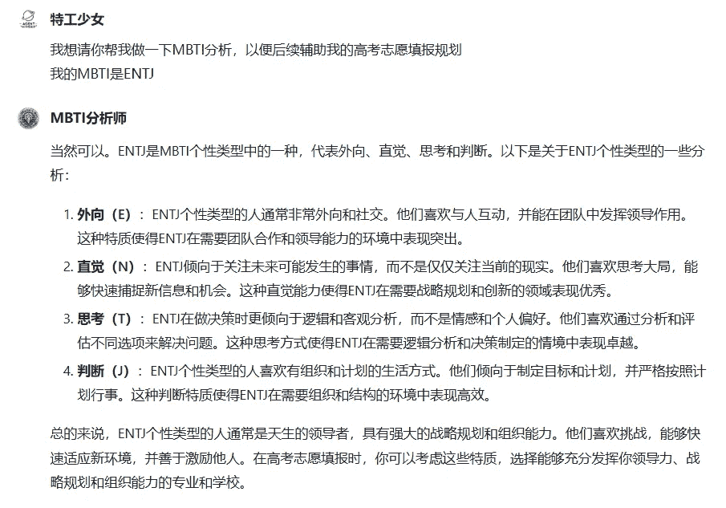
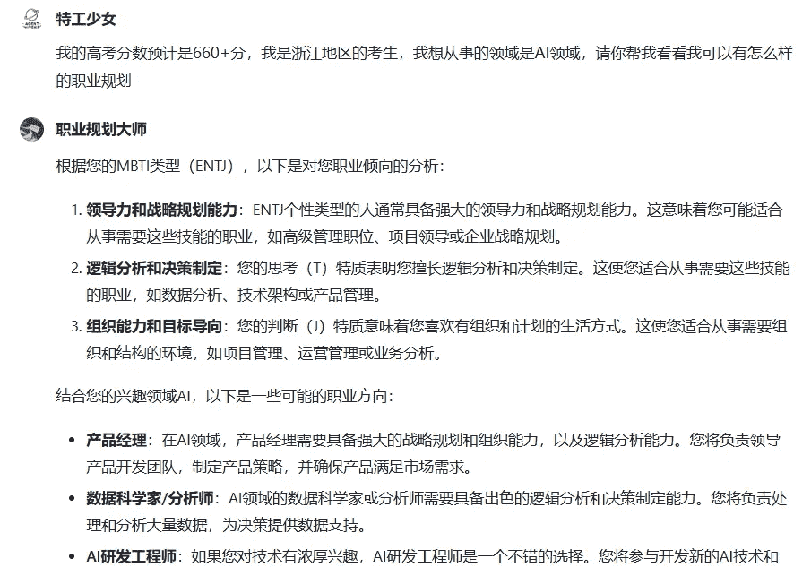
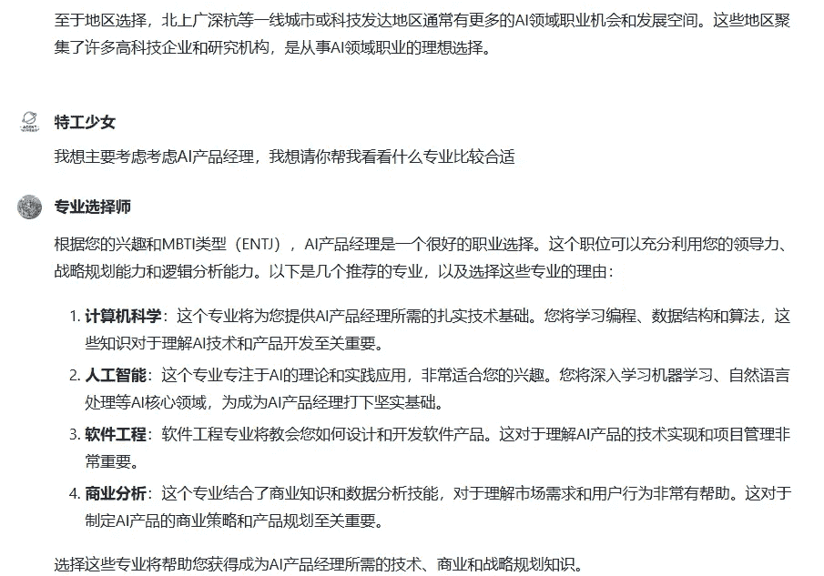
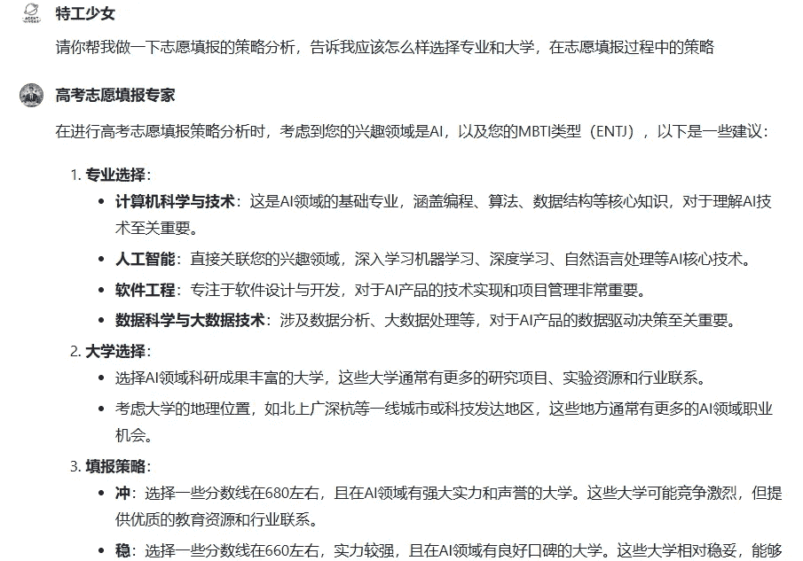
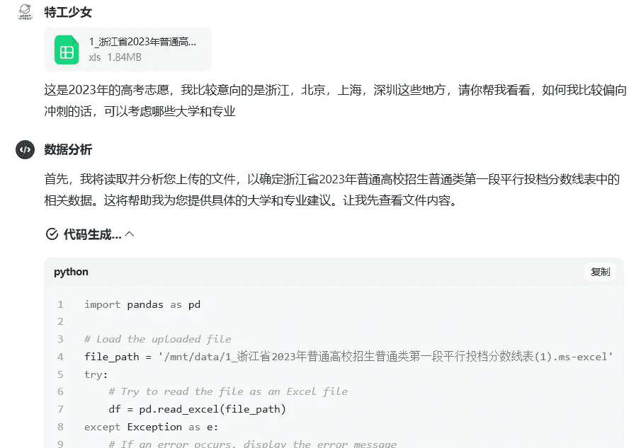
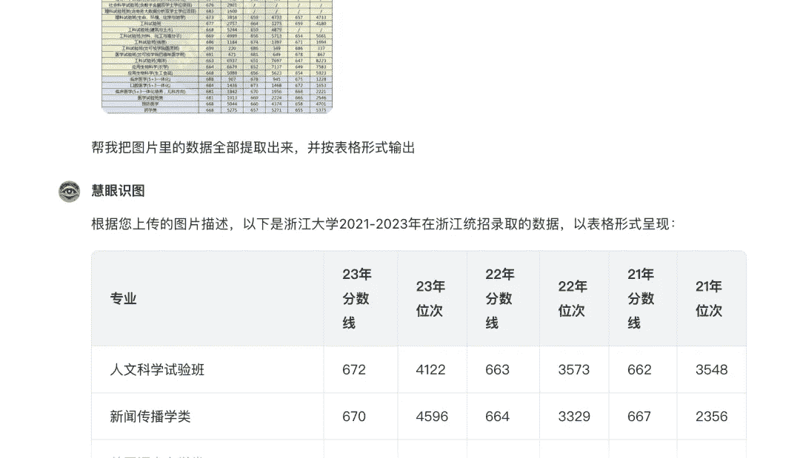
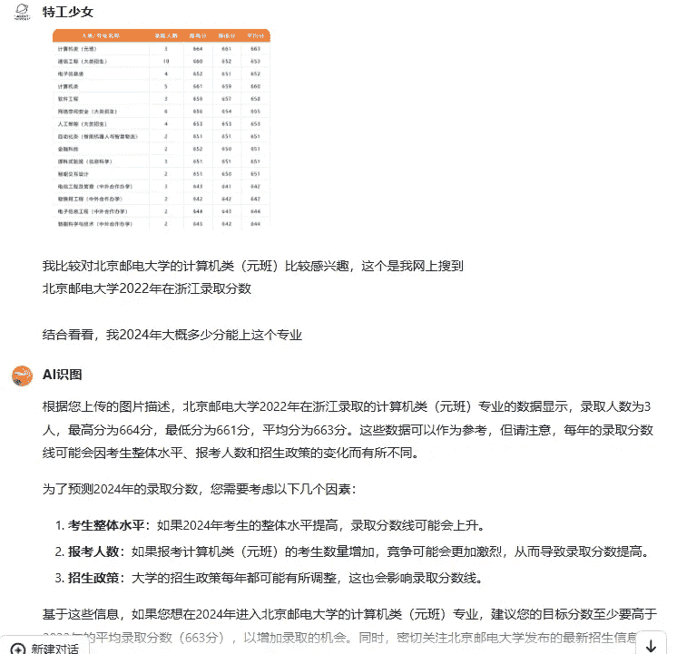
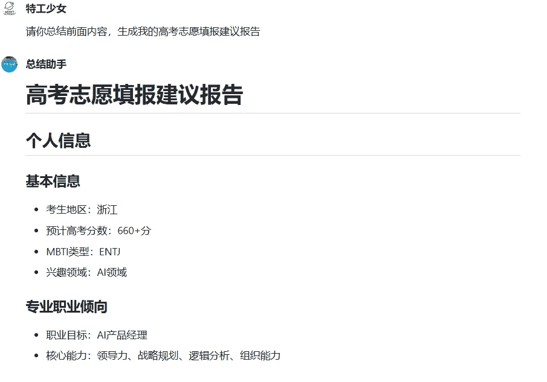
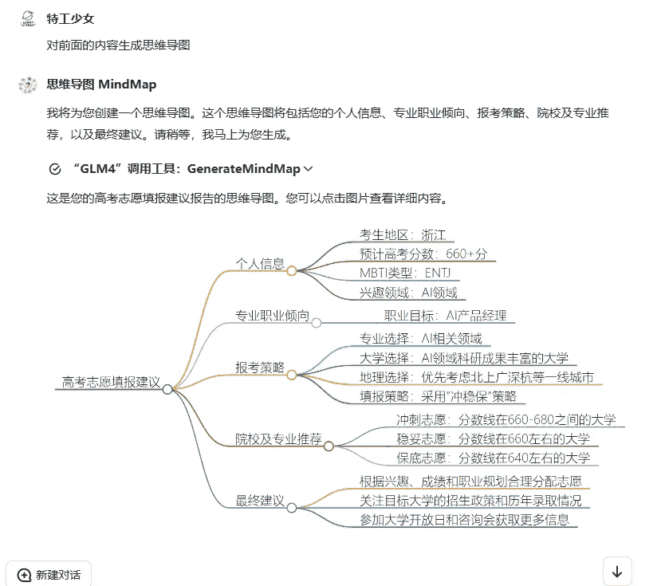

# 用清流 flow 的多智能体，让多位“ AI 专家”助你志愿填报！

> 来源：[https://agispace.feishu.cn/docx/LK5qdRIEIo1sunxkVktcVPnXnkc](https://agispace.feishu.cn/docx/LK5qdRIEIo1sunxkVktcVPnXnkc)

> 作者：特工少女

> 公众号：特工宇宙

> 原文链接：https://mp.weixin.qq.com/s/niTyD1GCdCqVFRsWSWcPQQ

高考在即，不少志愿填报服务成了热门生意。部分学生们可能不以为意，但家长们却都焦虑起来了。这不，张雪峰老师公司近 2 万元的志愿填报服务，都被抢光了。

我寻思🤔，现在 AI 这么强大，有没有可能做个志愿填报的 AI 智囊团，辅助家长孩子做一些信息查询整理、院校专业推荐？‍‍‍‍‍‍‍‍‍‍‍‍‍咱们也靠 AI，把这个价格打下来！本来以为有很大的开发量...但当我发现“它”更新之后，无需任何编程基础，也能拥有这样一个专家顾问团！‍‍‍‍‍‍‍‍‍‍‍

比如可以玄学一手，@一个 MBTI 分析师，给咱们孩子做一个简单分析。

然后我们@职业规划助手，提出一些简单的需求，让其帮忙分析可能适合的职业。可以看到，即使是我们换了一个“专家”，也是记得上下文的。

再基于相关职业，@专业选择师，给予一些推荐专业。

然后@高考志愿填报专家，给咱一些冲稳保的填报策略～

清言的这个数据分析处理能力还是挺不错的，比如说有这么一个高考分数线的表，我们上传后@数据分**析助手，提出一些需求，也能**准确给到回复。很多家长学生这个 Excel 也用不熟，现在自然语言对话就方便多了。

很多时候我们会看到各种小表格，里面信息挺重要，但是都是水印，也不方便复制编辑，这时候你就@一个 AI 识图相关的智能体，比如这样子。

再比如直接让他基于表格数据进行分析。

最后，可以基于以上所有内容，@总结助手，输出一份高考志愿填报报告。可以看到格式和内容都还是非常不错的。

最后还可以再@一下思维导图专家，基于上述报告生成一个更简约美观的思维导图。

而这样可以召唤多智能体，发挥不同“专家”强大**能力的操作，就**来自于智谱清言的新功能——清流 flow.

现在在智谱清言首页，只需要一个@，就能唤起成百上千个能力不同的智能体。

对于任何工作流程，只需要用自然语言，就可以尝试让多智能体来协同完成工作。

“不只是超级助手，更是助理天团”，今早智谱开放日活动上也如是说到。

清流相当于串联了各种智能体的能力，自由组合，构建个性化工作流来解决实际问题。

哎我寻思这不跟咱们特工宇宙理念一致嘛🤔，智能体 = Agent = 特工，在咱们宇宙里，有非常多的特工/智能体/ Agent，一起协同配合完成任务。

不过，AI 专家们的建议，靠谱吗？

内容是仅供参考的，不过这些智能体已经基于了海量的互联网数据做出的一些判断，肯定是比去某度上随便搜搜，这边看看那边看看，要来的靠谱的多。

**那么为啥不直接用统一的一个 ChatBot 而要@这**么多智能体呢？‍‍‍‍‍‍‍‍‍‍‍‍‍因为每个智能体都被赋予了特定的 Prompt 人设，加之了特定的知识库、插件、API 等能力，每一个智能体都成为了能力倾向不同的特工。专业的问题还得交给专业的 Agent 来干！‍‍‍‍‍‍‍‍‍‍‍‍‍‍‍‍‍‍‍‍‍‍‍‍个人测试下来体验唯一有点不好的是，一些 UGC 的智能体能力有点良莠不齐，可以多@几个测试一下，选出适合自己的。如果下次你有复杂的任务无法通过一般的 ChatBot 解决，那么不妨来尝试下清言 flow～‍‍‍‍‍‍‍‍‍

